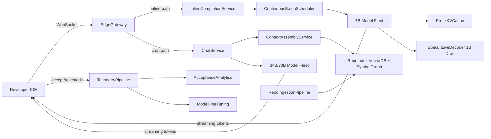

# Chapter 8: Design an AI Coding Assistant

## Context

> [!info] Quick Reference
> - **Pattern:** Dual-path coding assistant (autocomplete + chat)
> - **Scale:** 200M completions/day, 20M chat turns/day
> - **Key Techniques:** FIM prompting, speculative decoding (1B draft model), prefix KV caching, token budget assembly
> - **Primary Concerns:** < 300ms TTFT for autocomplete, acceptance rate telemetry, context window management
> - **Cross-references:** Chapter 4 (serving optimization), Chapter 9 (agentic path for complex edits)

**Problem statement:** Design an IDE-integrated coding assistant (GitHub Copilot-class) that delivers sub-300ms inline completions, multi-turn chat, and repo-aware suggestions—while managing extreme sensitivity to latency, context assembly correctness, and suggestion acceptance rate.

### Real-World Examples

- GitHub Copilot serves 2M+ developers with Fill-In-The-Middle (FIM) completions at <300ms TTFT; a 50ms TTFT regression drops acceptance rate by ~8%, directly impacting retention.
- An enterprise coding assistant indexes a 500K-file monorepo but hits 4s TTFT on completions because the context assembler packs 12K tokens of irrelevant imports; switching to symbol-graph-based context selection cuts prompt size to 2K tokens and restores 280ms TTFT.

---

## Step 1: Understand the Problem and Establish Design Scope

### Functional Requirements

- **Inline autocomplete:** Fill-In-The-Middle completions triggered on keystroke with streaming token delivery.
- **Chat/explain:** Multi-turn conversation grounded in open files, selected code, and repo context.
- **Context assembly:** Automatically select relevant code context (open files, imports, symbols, recent edits) within token budget.
- **Multi-language support:** Syntax-aware completions for top 20 languages without per-language model.
- **Telemetry:** Track acceptance/rejection/edit-after-accept per suggestion for model and ranking improvement.

### Non-Functional Requirements

- **Latency:** Inline TTFT p95 < 300ms. Chat TTFT p95 < 1,000ms.
- **Throughput:** Sustain 200M completions/day (peak 5x → ~11,500 completion QPS).
- **Availability:** 99.9% for inline path; graceful degradation (no completions) preferred over errors.
- **Cost:** < $0.001 per inline completion at scale; < $0.02 per chat turn.
- **Safety:** Never suggest secrets, license-violating code, or code that fails static analysis.

### Back-of-the-Envelope Estimation

#### Traffic Profile

- DAU: 2M developers
- Peak QPS (5x): `~11,575`
- Average output tokens/completion: 50 tokens
- Average chat output tokens: 300 tokens
- Total output tokens/day: ~16B tokens

#### Latency Budget — Inline Autocomplete (300ms total)

| Stage | Budget | Notes |
|---|---|---|
| IDE extension → gateway | 20ms | WebSocket/gRPC persistent connection |
| Debounce + cancellation | 50ms | Wait for typing pause; cancel in-flight on new keystroke |
| Context assembly | 30ms | Local in IDE plugin; symbol lookup + FIM formatting |
| Network to inference | 20ms | Edge PoP or regional inference cluster |
| Queue + scheduling | 10ms | Priority queue, continuous batching |
| Prefill (prompt processing) | 80ms | ~2K input tokens on optimized 7B model |
| Decode (50 tokens) | 70ms | ~1.4ms/token with speculative decoding |
| Network return + render | 20ms | First token streams immediately |

#### Latency Budget — Chat (1,000ms total)

| Stage | Budget | Notes |
|---|---|---|
| Gateway + auth | 30ms | |
| Context assembly (server-side) | 100ms | RAG over repo index + open file context |
| Queue + scheduling | 50ms | Lower priority than inline |
| Prefill (~4K tokens) | 300ms | Larger context, 34B model |
| TTFT delivery | 480ms | First token visible to user |
| Decode streaming | Ongoing | TPOT < 40ms/token |

#### GPU Fleet Sizing (Inline Path)

- Model: 7B quantized (INT4), ~18GB VRAM, ~200 tok/sec/GPU with speculative decoding
- Chat path (34B, lower QPS): ~200 GPUs
- Total fleet: ~600-800 GPUs (steady-state ~250 with autoscaling)

#### Cost Per Completion

- Self-hosted 7B: ~$2/1M output tokens (amortized)

---

## Step 2: Propose High-Level Design and Get Buy-In

### Core Architecture Components

- **IDE Extension (Client):** Implements the debounce timer (50ms default), assembles the FIM prompt locally using the editor's in-memory AST, manages a single persistent WebSocket connection per user, sends explicit cancellation signals when a new keystroke arrives mid-flight, and fires telemetry events (shown/accepted/rejected) without blocking the UI thread.
- **Edge Gateway:** Terminates TLS and multiplexes persistent WebSocket connections from millions of IDE clients, performs token-based authentication and per-user rate limiting (to prevent runaway completion storms from auto-save triggers), and routes requests to the correct backend path—inline completions get the low-latency 7B cluster; chat turns route to the 34B fleet.
- **Inline Completion Service:** The hot path for sub-300ms delivery; it owns a dedicated fleet of quantized 7B models, a continuous batch scheduler that coalesces concurrent requests to maximize GPU utilization, a prefix KV Cache|KV cache layer that eliminates redundant prefill for shared system tokens, and a speculative decoding engine using a 1B draft model for faster token generation.
- **Chat Service:** Orchestrates multi-turn conversations by maintaining session state (conversation history, referenced files, applied suggestions), calling the Context Assembly Service to gather repo-level grounding, and streaming responses from the 34B/70B model fleet—routing to the larger 70B model only when the query is classified as architectural or cross-file in nature.
- **Context Assembly Service:** Runs server-side for the chat path (where 100ms budget allows it); executes embedding-based retrieval over the per-repo vector index, traverses the symbol dependency graph to surface transitive definitions, deduplicates overlapping chunks, and assembles the final 4context window in priority order.
- **Repo Index Pipeline:** Continuously processes repository events (file saves, git pushes, branch switches) by parsing ASTs, building symbol graphs for all supported languages, chunking code at function/class boundaries, embedding each chunk with a code-specialized embedding model, and storing results in a per-repo HNSW index with version tags for stale-entry detection.
- **Telemetry Pipeline:** Collects every acceptance/rejection/edit event from IDE clients, buffers them in 30-second client-side batches to reduce network overhead, ingests them into a Kafka cluster partitioned by user ID, fans out to both real-time Flink dashboards (seconds lag for SLO alerting) and batch Spark jobs (daily model training and cohort analysis).
- **Model Serving Runtime:** A vLLM or TensorRT-LLM instance configured with continuous batching (to eliminate head-of-line blocking across requests), paged KV attention (to pack more requests per GPU), prefix KV caching (to reuse shared prompt states), Flash Attention|Flash Attention 2 kernels (for faster prefill), and tensor parallelism across 2 GPUs for the larger models where single-GPU VRAM is insufficient.

### Pipeline A: Repo Indexing Pipeline

1. On repo connect: clone/pull latest, parse AST for all supported languages. A 500K-file monorepo takes 8-15 minutes for a cold full parse; parallelized across 32 workers with language-specific parsers (tree-sitter for most languages), prioritizing files in the currently active branch and directories with recent git activity.
2. Build symbol graph (definitions, references, imports, exports) per file. Each node is a symbol (function, class, variable), and directed edges represent "defined in", "calls", "imports from" relationships. The graph enables bidirectional traversal: from a use-site back to the definition, and from a definition forward to all callers—critical for cross-file completion context.
3. Chunk files at function/class boundaries; generate embeddings (code-specialized model, e.g., CodeSage). Chunking at semantic boundaries (rather than fixed token windows) preserves function signatures and docstrings together, which are the highest-signal units for embedding similarity. Each chunk is 128-512 tokens.
4. Store in per-repo vector index (HNSW, M=32, ef_construction=200) + symbol graph database (Neo4j or a lightweight in-memory graph for smaller repos). The HNSW index supports approximate nearest-neighbor search in <5ms for 10M chunks with 96%+ recall@10.
5. Incremental update on file save/commit (diff-based re-index, not full rebuild). Only changed functions are re-chunked and re-embedded; unchanged neighbors in the symbol graph retain their edges. This reduces incremental update latency to <200ms for a single file change.
6. Version-tag index; invalidate stale entries on branch switch. A branch switch can change thousands of files simultaneously; rather than waiting for full re-index, the system serves the stale index with a staleness warning until incremental updates catch up (typically <30 seconds for small branches, <5 minutes for large feature branches).

> **Why HNSW over flat search or IVF-PQ:** HNSW provides O(log n) query time with tunable recall, making it viable for per-repo indexes ranging from 10K to 50M vectors.

### Pipeline B: Inline Completion Pipeline

1. Developer types → IDE extension debounces (50ms pause). The debounce timer resets on every keystroke; it fires only when the developer pauses, which in practice correlates with the moment they want a suggestion rather than mid-word. Users with fast typing speeds (>120 WPM) may get a longer debounce (75ms) based on their historical typing profile, because their requests otherwise arrive too early—before the cursor is in a semantically stable position.
2. Extension assembles FIM prompt locally: `<|fim_prefix|>code before cursor<|fim_suffix|>code after cursor<|fim_middle|>` with surrounding file context, open tabs ranked by BM25 relevance, and import statements. This assembly happens entirely in the IDE process (not a server call) and must complete in <30ms to stay within the latency budget. The extension caches the AST of the current file in memory and updates it incrementally on each edit.
3. Request sent via WebSocket to edge gateway; any in-flight request for the same user is cancelled before the new one is dispatched. The IDE holds at most one pending completion at a time; sending a cancel message costs ~1ms and prevents GPU resources from being wasted on a stale context.
4. Gateway routes to the inline completion service; the request enters a priority queue sorted by arrival time with a 150ms TTL—requests older than 150ms are dropped silently because even if served, they will arrive too late to be useful.
5. Continuous batch scheduler admits the request; checks the prefix KV cache for the system prompt and FIM special tokens (~200 tokens that are identical across all requests). A cache hit skips ~15ms of prefill computation. The scheduler coalesces this request with up to 15 concurrent requests into a single batched forward pass.
6. The 7B quantized model generates up to 50 tokens with speculative decoding: the 1B draft model proposes 4 tokens per step, the 7B target model verifies all 4 in one forward pass, and accepted tokens are committed while the first rejected token triggers a restart from the 7B's corrected output. Net speedup: 2.5x, bringing decode from ~175ms to ~70ms.
7. Tokens stream back immediately as each is generated (not buffered); the IDE renders ghost text character-by-character, giving the developer a sense of real-time generation and allowing them to hit Tab early if they recognize the pattern.
8. On accept (Tab) / reject (Esc or typing past the ghost text) / edit-after-accept (modifying the accepted text within 30 seconds): a telemetry event is emitted asynchronously, batched locally for 30 seconds before flushing to the ingestion endpoint to avoid adding network overhead to the hot path.

### Pipeline C: Chat Pipeline

1. Developer opens chat panel, types a question with optional code selection (highlighted text from the editor). The IDE extension attaches the selected code as a structured block in the request payload, along with the file path, language, and surrounding 50 lines for context—this avoids the developer having to manually copy-paste code into the chat box.
2. Chat service retrieves repo-level context via embedding search (top-20 chunks retrieved, then reranked to top-5 using a cross-encoder model) plus symbol graph traversal (for each retrieved chunk, follow one hop in the import graph to include referenced definitions). The entire retrieval step has a 100ms budget enforced by a deadline timer; partial results are used if the deadline is hit.
3. Assembles the final prompt in priority order: system instructions (pinned, prefix-cached) + retrieved repo context + open file state + conversation history (truncated from oldest end if budget exceeded) + current user query. Total context is capped at 4K tokens for standard queries and up to 16K tokens for the "deep analysis" tier.
4. Routes to the 34B model for most requests (default); queries classified as architectural (spanning >5 files, involving design patterns, or exceeding 300 input tokens of user text) are routed to the 70B model. Classification is a lightweight logistic regression on query embeddings, adding <5ms overhead.
5. Streams the response with structured formatting: code blocks are syntax-highlighted, file references are rendered as clickable links that open the file in the editor, and inline citations link to the specific chunk that grounded each claim. The first token is delivered within 480ms TTFT for 34B; ongoing decode runs at <40ms/token.
6. Tracks thumbs-up/down, copy-code actions, apply-to-file actions, and follow-up question rate as quality signals. An applied suggestion that immediately triggers a follow-up clarification question is logged as a low-quality response for training purposes.

> **Why separate the inline and chat paths into different model fleets:** The two paths have fundamentally incompatible optimization surfaces.

### Mermaid Architecture Diagram



---

## Step 3: Design Deep Dive

Focus areas:

1. **Context Assembly and Fill-In-The-Middle (FIM)**
2. **Latency Engineering for Autocomplete**
3. **Telemetry and Acceptance Tracking**

### 1) Context Assembly and Fill-In-The-Middle (FIM)

The quality of code completions is dominated by context selection, not model size. A 7B model with perfect context outperforms a 70B model with irrelevant context.

**FIM prompt structure:**

```text
<|fim_prefix|>{code before cursor}<|fim_suffix|>{code after cursor}<|fim_middle|>
```

The model generates tokens to fill the gap between prefix and suffix. This is fundamentally different from left-to-right completion—it allows the model to respect constraints imposed by code *after* the cursor (e.g., closing brackets, type annotations, function signatures).

**Context budget allocation (2,048 token budget for inline):**

| Slot | Token Budget | Source | Priority |
|---|---|---|---|
| FIM prefix (current file, before cursor) | 600 | Truncated upward from cursor | Highest |
| FIM suffix (current file, after cursor) | 400 | Truncated downward from cursor | Highest |
| Active file imports/type defs | 300 | AST-extracted | High |
| Recently edited lines (last 30s) | 200 | Edit buffer diff | High |
| Open tab snippets (ranked) | 300 | BM25 over open files using cursor-local tokens as query | Medium |
| Repository symbols (definitions used in scope) | 248 | Symbol graph traversal from cursor scope | Medium |

**Context ranking signals:**

- **Recency:** Files edited in the last 60 seconds rank highest, because a developer working across two files simultaneously expects the other file's current state to inform completions—not its state from yesterday's commit. Recency decay is exponential: a file touched 30 seconds ago scores 1.0; the same file touched 10 minutes ago scores 0.3.
- **Locality:** Same directory ranks above same package, which ranks above same repo. This heuristic works well for greenfield projects but breaks down in monorepos where the calling code and the called library live in different subtrees. The symbol graph provides a corrective signal in those cases by surfacing imported definitions regardless of directory distance.
- **Symbol relevance:** Definitions and types referenced in the current function's scope rank above files that happen to live nearby. The IDE extension performs a lightweight scope analysis (without full type inference) to identify identifiers in the current function that lack local definitions—these become high-priority slots in the context budget.
- **Edit correlation:** Files that are frequently co-edited in the git history of the current author rank higher than files that are only edited by others. This is computed from a rolling 90-day co-edit matrix stored per user: if the developer always touches `auth.py` after touching `user.py`, the system preemptively includes `auth.py` context when the cursor is in `user.py`.
- **Language-specific:** For TypeScript, `.d.ts` type declaration files contain the interface contracts that the model needs to generate type-safe completions—they rank as high as the prefix file itself despite containing no runtime logic. For Python, `__init__.py` exports define the public API of the package and are always included when the cursor is inside the package. For Go, `interface` definitions in the same module are elevated.

**Repo-level context retrieval (for chat, not inline):**

The chat path can afford 100ms for server-side retrieval:
1. Embed the user query + selected code with a code embedding model.
2. Retrieve top-K chunks from per-repo HNSW index (K=20, then rerank to top-5).
3. Traverse symbol graph: if retrieved chunk references an imported function, include that function's definition.
4. Deduplicate and assemble within 4K token budget.

#### Context Assembly Trade-off Table

| Strategy | Quality | Latency | Complexity | Best For |
|---|---|---|---|---|
| Current file only (no FIM suffix) | Low — the model cannot see closing braces, type annotations, or the function signature that follows the cursor; acceptance rate typically 12-18% in real evaluations | <5ms assembly; no network calls | Trivial to implement; no dependencies beyond the editor buffer | Prototype or latency-critical fallback when all other options fail |
| FIM with current file | Good for single-file edits where the function being completed is self-contained; acceptance rate improves to 22-28% vs. prefix-only because the suffix prevents over-generation past closing brackets | <10ms; AST parse of current file only | Low — requires FIM-capable model and token template, but no external data source | Single-file scripts, Jupyter notebooks, or early-stage projects where cross-file imports haven't proliferated |
| FIM + open tabs (BM25-ranked) | Strong for the active working set; an engineer context-switching between three files benefits significantly, lifting acceptance rate to 28-34% because the model sees the interfaces it needs to implement | 20-30ms; BM25 scoring over in-memory open-file buffer | Medium — requires maintaining an in-memory BM25 index over open files, updated on every save | Production default for most IDEs; covers >80% of developer workflows without requiring server-side indexing |
| FIM + open tabs + symbol graph | Best for cross-file completions and refactoring tasks; acceptance rate reaches 32-38% for monorepo workloads because the model receives the definition of every identifier in scope, not just what happens to be open | 30-50ms; requires pre-computed symbol graph with O(1) lookup by identifier name | High — requires per-language AST parsing, graph maintenance on file saves, and a symbol resolution API in the IDE plugin | Enterprise monorepos and large codebases where callers and callees live in different directory subtrees |
| FIM + full repo RAG | Acceptable quality for chat-style queries but overkill for inline completions where the developer already has the relevant files open; no acceptance rate advantage over symbol graph, but adds 70-150ms of unrecoverable latency | 100-200ms; requires embedding model inference + HNSW search + reranking | Very high — full vector index pipeline, embedding model serving, retrieval orchestration | Chat path only; never use for inline completions where 300ms total budget makes 150ms retrieval untenable |

### 2) Latency Engineering for Autocomplete

Every millisecond matters. A completion arriving 100ms late is a completion the developer has already typed past. The system must treat latency as a correctness constraint, not a performance metric.

**Debounce and cancellation protocol:**

1. IDE extension waits 50ms after last keystroke before sending request (debounce).
2. If developer types during in-flight request, the extension sends a cancel signal and dispatches a new request.
3. Server-side: cancelled requests are immediately evicted from batch scheduler, freeing KV cache slots.
4. Cancellation rate at scale: ~40-60% of requests are cancelled before completion—this is expected and healthy.

**Speculative decoding for inline path:**

- Draft model: 1B parameter model (same tokenizer and vocabulary as 7B target), sharing the target's embedding table to avoid vocabulary mismatch errors.
- Draft model proposes K=4 tokens per step in a single cheap forward pass (~0.5ms); the draft model's entire forward pass costs less than verifying one token with the 7B target.
- Target 7B model verifies all K draft tokens simultaneously in a single forward pass with a modified attention mask—if all 4 are accepted, 4 tokens are committed in the time it would normally take to generate 1.
- Acceptance rate for code is ~75-85% (substantially higher than prose at 55-65%) because code follows deterministic syntactic rules—variable names, keywords, and punctuation are highly predictable given context, meaning the draft model is often right.
- Effective speedup: 2.5-3x decode speed → 50 tokens in ~70ms instead of ~175ms, which is the single largest contributor to staying under the 300ms TTFT budget.
- VRAM overhead: ~2GB for the 1B draft model (trivial relative to the 7B target's 18GB), making co-location on the same GPU practical.

> **Why speculative decoding instead of simply using the 1B model directly:** The 1B model alone has ~22-26% acceptance rate (too low for a production assistant), but when constrained by 7B verification it achieves 75-85% acceptance at...

**Prefix KV cache:**

- System prompt + FIM special tokens are identical across all requests—every completion request begins with the same ~200-token preamble (system instructions, FIM template markers, language hinting tokens).
- Cache the KV states (keys and values from the attention layers) for this prefix so that subsequent requests skip its recomputation entirely. At 200 tokens on a 7B model with 32 layers and 128-dim heads, the cached KV tensor is ~800MB per GPU but shared across all co-located requests.
- Saves ~15ms of prefill per request; at 11,500 QPS peak, this eliminates roughly 172 GPU-seconds of compute per second—equivalent to removing ~0.9 GPUs of steady-state load from the fleet.
- Invalidation: only on model version change (deployment event) or system prompt update (rare). Per-request content (file-specific prefixes) is not cached because uniqueness makes cache hit probability near zero.

> **Why KV-state caching rather than output caching:** Output (completion text) caching would require identical prompts to produce cache hits, which almost never happens in code completion—every developer's curso...

**Model optimization stack:**

| Technique | TTFT Impact | TPOT Impact | Quality Impact | Deployment Complexity |
|---|---|---|---|---|
| INT4 quantization (AWQ) | Reduces prefill time by ~10% because smaller weight matrices fit more efficiently in L2/HBM bandwidth; prefill is memory-bandwidth-bound, so weight size directly limits throughput | Negligible at batch size 1; at batch size 8+ the memory bandwidth savings become more significant, delivering ~8-12% TPOT improvement | <0.3% drop on pass@1 (HumanEval) for AWQ vs BF16 baseline; imperceptible to users but meaningful to track during rollout | Low — requires running AWQ calibration on a representative code dataset (1-2 hours compute); resulting weights are a drop-in replacement in vLLM |
| Speculative decoding | No direct TTFT improvement (prefill is unchanged); reduces perceived TTFT by delivering the first tokens faster only if draft and target happen to agree on token 1 | 2.5-3x speedup on decode: 50 tokens in ~70ms instead of ~175ms, which is the single largest decode-side optimization available | Zero quality degradation — speculative decoding is mathematically equivalent to sampling from the target distribution, not an approximation | Medium — requires maintaining a separate 1B draft model co-located with the 7B target, synchronizing vocabularies, and implementing the rejection sampling loop in the serving runtime |
| Prefix KV caching | Saves ~15ms per request (skips recomputing 200-token shared prefix); at p95 this moves the TTFT distribution left by 15ms, a meaningful portion of the 300ms budget | None — only affects prefill, not decode | None — deterministic reuse of precomputed states | Low — supported natively in vLLM via `--enable-prefix-caching` flag; only requires system prompt to be identical across requests |
| Continuous batching | Eliminates queuing delay that would otherwise occur when requests arrive during an ongoing generation: a new request can be inserted mid-generation into the batch without waiting for all in-flight requests to finish | Slight TPOT increase at batch size >8 because larger batches have more memory pressure and reduced per-request memory bandwidth; acceptable at batch size 4-8 | None | Medium — vLLM default but requires careful batch size tuning; too large a batch increases TPOT beyond the 40ms/token SLO |
| Flash Attention 2 | Reduces prefill time by ~20% through memory-efficient attention computation that avoids materializing the full N×N attention matrix; particularly impactful for the 2K-token inline context | Reduces TPOT by ~10% for the same reason; incremental gains compound with longer sequences | None — numerically equivalent to standard attention within floating-point precision | Low — a kernel-level drop-in; vLLM and TensorRT-LLM include it by default for Ampere/Hopper GPUs |
| Tensor parallelism (2 GPU) | Reduces prefill time by ~40% by splitting weight matrices across 2 GPUs (each GPU processes half the attention heads), effectively doubling available memory bandwidth for matrix multiplications | Reduces TPOT by ~30% for the same reason; the 2-GPU sweet spot avoids the communication overhead that dominates at 4+ GPU tensor parallelism for 7B models | None | Medium — requires NVLink or high-bandwidth PCIe between paired GPUs; introduces ~2ms inter-GPU synchronization overhead per layer that limits the speedup floor |

**Edge deployment strategy:**

- Deploy inference clusters in 8-12 edge regions matched to IDE telemetry hotspots: US-West (California/Oregon), US-East (Virginia), EU-West (Ireland), EU-Central (Frankfurt), UK (London), India (Mumbai), Japan (Tokyo), Singapore, Brazil (São Paulo), Australia (Sydney). Region selection is driven by P95 developer density from IDE activation telemetry, not generic CDN geography—developers in India experience dramatically different latency profiles than consumers accessing static content.
- Edge placement reduces network RTT from ~80ms (centralized US-East for a developer in India) to ~20ms (Mumbai edge cluster), recovering 60ms from the 300ms budget—the equivalent of eliminating an entire prefill stage. This is not a nice-to-have; for developers in Southeast Asia or South America, centralized inference would push TTFT past 300ms even with a perfect inference stack.
- Each edge cluster runs 30-80 GPUs for the inline path (scaled to regional DAU), 10-20 GPUs for chat. Cluster size is determined by peak QPS × GPU throughput with a 20% headroom buffer; autoscaling handles intra-day variation (typically 3x trough-to-peak within a region following business hours).
- Model weights are stored in a central model registry (S3-compatible object store) and pushed to edge clusters during deployment windows using a BitTorrent-style peer-assisted distribution to avoid saturating the registry's egress bandwidth. Canary deployments roll out to one edge region first, monitored for 2 hours of production traffic before proceeding to remaining regions.

> **Why edge over a single centralized cluster with more GPUs:** Network RTT is not reducible by adding GPU capacity—a 10,000-GPU centralized cluster still incurs 80ms RTT for a developer in India.

**Graceful degradation under load:**

1. If queue depth > 2x batch capacity: return an empty completion immediately (no ghost text shown). This is silent degradation—the developer sees no error, no spinner, no timeout message. The absence of a suggestion is the correct UX behavior here because any suggestion arriving after the queue clears would be stale anyway. Error messages or "loading" indicators would interrupt the developer's flow and signal a service failure, damaging trust even though the system is functioning correctly under its own load-shedding policy.
2. If TTFT p95 exceeds 400ms (detected via rolling 60-second window): reduce the max output token limit from 50 to 25. Shorter completions reduce decode time by ~35ms, which may be enough to bring p95 back under 300ms. Quality degrades modestly because the model can no longer complete multi-line suggestions, but this is preferable to systematically late completions that arrive after the developer has moved on.
3. If GPU utilization > 90% for more than 30 seconds: activate load shedding by prioritizing users with historical acceptance rate > 20% and deferring requests from users who have accepted fewer than 5 completions in the past hour (likely idle or new users). This is ethically defensible because low-acceptance users are less impacted by missing completions, and it preserves capacity for the core productive user segment.
4. Never show stale or semantically-cached completions regardless of load. Code context changes character-by-character; a completion cached from 200ms ago references the state before the developer's most recent edit. Unlike web search where query-level caching is effective, the unique combination of cursor position + surrounding code makes cache hit probability effectively zero except for degenerate cases (same developer, same position, same code—which never recurs in practice).

> **Why silent degradation over error messages:** Inline code completion is an enhancement layer, not a critical function.

### 3) Telemetry and Acceptance Tracking

Telemetry is the feedback loop that makes the system improve. Without it, you're flying blind on the metric that matters most: **acceptance rate**.

**Event taxonomy:**

| Event | Trigger | Key Payload | Latency Sensitivity |
|---|---|---|---|
| `completion_requested` | Debounce fires | cursor_position, file_lang, context_hash, timestamp | None (async) |
| `completion_shown` | Ghost text rendered | request_id, TTFT, tokens_generated, model_version | None |
| `completion_accepted` | Tab key pressed | request_id, accepted_text, time_to_accept | None |
| `completion_rejected` | Esc or type-past | request_id, rejection_type, chars_typed_past | None |
| `completion_edited` | Edit within 30s of accept | request_id, edit_diff, time_to_edit | None |
| `completion_cancelled` | New keystroke during in-flight | request_id, cancel_latency | None |

**Acceptance rate computation:**

- **Raw acceptance rate:** `accepted / shown` — typically 25-35% for mature systems.
- **Persistence rate:** `(accepted - edited_within_30s) / accepted` — measures whether accepted code survives.
- **Character-level acceptance:** `accepted_chars / total_chars_written` — captures partial value even when full suggestion is modified.
- **Weighted acceptance rate:** weight by suggestion length (accepting a 50-token suggestion is more valuable than a 5-token one).

**Telemetry-driven improvements:**

1. **Ranking model training:** Accepted suggestions become positive examples; rejected or immediately-edited suggestions become negative. A lightweight ranker (logistic regression or gradient-boosted trees on features: suggestion length, model log-probability, language, time-of-day, file type, cursor semantic context, user historical acceptance rate) is trained daily on the previous day's 200M completion events. The ranker runs in <1ms on the serving path and reranks up to 3 candidate completions before displaying the top-ranked one—a system that generates 3 candidates and reranks outperforms a system that generates 1 candidate even with a 3B model vs 7B model comparison.
2. **Context ablation:** A/B test individual context slots by randomly withholding them from a 5% slice of traffic and measuring acceptance rate delta. If removing "open-tab context" from 5% of users produces no statistically significant acceptance rate change (p > 0.05 after 48 hours of traffic), that slot's token budget is reallocated to higher-signal sources. This is how production systems discover that some initially-intuitive context sources (e.g., recently closed tabs, clipboard history) don't actually improve acceptance rate and are pure latency cost.
3. **Model selection:** Route requests to model variant A vs B in a multi-armed bandit fashion, tracking acceptance rate per token-cost for each variant. A new model that produces 2% higher acceptance rate but 15% higher token cost may not be worth deploying if the marginal value per additional accepted completion doesn't cover the cost delta. This routing framework allows continuous model evaluation without requiring a fixed A/B split.
4. **Trigger tuning:** Adjust debounce timing based on per-user typing speed profiles derived from the cadence of `completion_requested` events. A developer who types at 150 WPM benefits from a 75ms debounce (their 50ms debounce fires too often mid-word), while a developer who types at 40 WPM can use a 30ms debounce (their 50ms debounce makes suggestions feel slow). Per-user debounce tuning is estimated to improve acceptance rate by 2-4% on the high-typing-speed cohort.

**Privacy and compliance:**

- Telemetry must never include raw code from private repos (enterprise tier).
- Use content hashes instead of raw text for acceptance tracking in enterprise mode.
- Provide opt-out for all telemetry collection.
- Code snippets used for model training require explicit opt-in (separate from telemetry).

#### Telemetry Pipeline Architecture

| Component | Technology | Throughput | Notes |
|---|---|---|---|
| Client-side buffering | IDE extension local buffer | Batch every 30s | Deduplicate cancel + show events |
| Ingestion | Kafka (partitioned by user_id) | 500K events/sec | 7-day retention |
| Real-time dashboard | Flink → Druid | Seconds lag | Acceptance rate, TTFT, error rate |
| Batch analytics | Spark on S3/Parquet | Daily | Cohort analysis, model comparison |
| Training data pipeline | Spark → feature store | Daily | Positive/negative examples for ranker |

### Production Bottlenecks and Mitigations

- **Context assembly timeout on large files**
  - Symptom: >100ms context assembly when cursor is in a 10K-line file.
  - Mitigation: Pre-compute AST and symbol index on file open; incremental update on edit. Hard cap context assembly at 30ms; truncate aggressively.

- **Cancellation storm under rapid typing**
  - Symptom: 60%+ cancellation rate wastes GPU prefill compute.
  - Mitigation: Increase debounce to 75ms for fast typists (detect via typing speed histogram). Server-side: preempt cancelled requests before prefill completes.

- **KV cache thrashing on inline path**
  - Symptom: Prefix cache hit rate drops below 50% when model fleet is at capacity.
  - Mitigation: Partition prefix cache by popularity (system prompt prefix is pinned; per-file prefixes use LRU eviction).

- **Acceptance rate collapse after model update**
  - Symptom: Canary deployment of new model shows 5% acceptance drop.
  - Mitigation: Shadow-mode deployment first (generate but don't show); compare acceptance rate on matched traffic before promoting.

- **Monorepo index staleness**
  - Symptom: Chat path retrieves deleted functions or outdated APIs.
  - Mitigation: Incremental index update on every file save (IDE extension pushes diff events). Full re-index nightly with consistency check.

---

