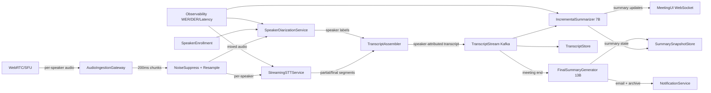

# Chapter 14: Design a Real-Time Meeting Summarizer

## Context

> [!info] Quick Reference
> - **Pattern:** Real-time streaming transcription + summarization
> - **Scale:** 100K concurrent meetings, 600K concurrent audio streams
> - **Key Techniques:** Streaming STT (RNN-T), speaker diarization (enrollment + online clustering), hierarchical incremental summarization, Silero VAD
> - **Primary Concerns:** < 2s utterance-to-text latency, speaker accuracy > 90%, summary drift prevention, action item extraction
> - **Cross-references:** Chapter 4 (serving), Chapter 18 (voice agent), Chapter 15 (multimodal)

**Problem statement:** Design a system that ingests live audio from concurrent meetings, performs real-time speech-to-text with speaker diarization, and produces streaming incremental summaries with action item extraction—all within seconds of utterance.

### Real-World Examples

- A videoconferencing platform (Zoom AI Companion-class) serves 100K concurrent meetings. A 3-second STT lag causes the incremental summary to drift out of sync with the conversation, and participants lose trust. Switching from batch Whisper transcription to a streaming Conformer model with 200ms chunk processing restores real-time parity.
- An enterprise meeting assistant attributes action items to the wrong speaker because diarization fails when two participants have similar vocal profiles over a VoIP codec. embedding-based speaker enrollment at meeting start (3-second voice sample per participant) raises attribution accuracy from 78% to 94%.

---

## Step 1: Understand the Problem and Establish Design Scope

### Functional Requirements

- Real-time streaming transcription with < 2s utterance-to-text latency. Participants lose trust in the system when the transcript visibly lags behind speech; a 2-second cap is the threshold below which humans perceive the system as "live."
- Speaker diarization with identity labels (speaker enrollment optional, fallback to Speaker A/B/C). Without speaker labels, action items cannot be attributed, making the summary nearly useless for accountability.
- Incremental rolling summary updated every 30 seconds during the meeting. Users want to catch up mid-meeting after joining late; a stale summary defeats that use case entirely.
- Action item and decision extraction with speaker attribution. Unattributed action items are rarely acted on; the attribution is what creates personal accountability.
- Final polished summary generated within 10 seconds of meeting end. Participants check their email or the meeting UI immediately after hanging up; a 10-minute delay means they have already moved on.
- Searchable transcript archive with speaker-labeled segments. Organizations need post-meeting audit trails for compliance and dispute resolution; raw unsegmented audio is insufficient.

> **Why the functional requirements are framed around latency and speaker attribution:** All six requirements are latency- or attribution-driven because the entire value proposition of a meeting summarizer collapses if output arrives too late or ...

### Non-Functional Requirements

- **Latency:** STT utterance-to-text < 2s. Summary update cycle ≤ 30s. Final summary < 10s after meeting end. These three budgets are independent: STT latency is dominated by model inference time and chunk size, while summary update Latency (TTFT, TPOT, latency is dominated by throughput and prompt length.
- **Scale:** 100K concurrent meetings, average 6 participants per meeting → 600K concurrent audio streams. This scale means even a 0.1% infrastructure failure affects 600 streams simultaneously, making fault isolation per-meeting critical.
- **Accuracy:** WER < 12%, DER < 10%, action item precision > 85%. These targets are tightly coupled: a WER spike to 20% on a single speaker's utterance will produce garbled input to the diarization service, degrading DER for that segment and potentially corrupting the extracted action items downstream.
- **Availability:** 99.95% uptime for STT path; summarization can degrade gracefully. At 99.95%, planned downtime allowance is ~26 minutes per month—enough for rolling GPU driver upgrades but not full cluster restarts.
- **Cost:** < $0.02 per meeting-minute at scale (inclusive of STT + diarization + LLM summarization). This is a hard commercial constraint: at $0.02/min on 48M meeting-minutes/day, the daily cost ceiling is $960K, which must cover GPU amortization, networking, and storage.

> **Why explicitly allocate the latency budget across pipeline components:** These NFRs exist in tension with each other.

### Back-of-the-Envelope Estimation

#### Traffic Profile

- Concurrent meetings at peak: 100K
- Average participants/meeting: 6
- Average meeting duration: 45 min

#### Audio Ingestion

- Audio format: Opus codec, 16kHz mono per speaker, ~32kbps per stream
- Chunk size for streaming STT: 200ms audio chunks (3,200 samples at 16kHz)

#### STT Compute

- Streaming Conformer model: processes 200ms chunk in ~50ms on GPU (real-time factor 0.25x)
- Concurrent STT inferences: 600K streams, each needing 5 inferences/sec = 3M inferences/sec
- Per-GPU throughput (batched, A100): ~200 concurrent streams per GPU (batch of 200, 50ms/batch)
- With mixed-precision and optimized kernels: ~2,000-2,500 A100 GPUs for STT

#### Diarization Compute

- Speaker embedding extraction: run every 1.5s per meeting (not per stream—done on mixed audio)
- Speaker embedding model (ECAPA-TDNN): ~5ms per inference on GPU, batch of 256

#### Summarization Compute

- Input: rolling transcript window ~2K tokens, output: ~200 tokens per update
- 7quantized model: ~120 tok/sec/GPU, batch of 8 → ~960 tok/sec effective

#### Final Summary Burst

- Meetings ending per minute: ~2,222
- Final summary: ~4K input tokens (full transcript summary), ~500 output tokens

#### Cost Estimation

- Total GPU fleet: ~3,000-4,000 GPUs (STT dominant)
- A100 hourly cost (cloud): ~$2.50/hr

---

## Step 2: Propose High-Level Design and Get Buy-In

### Core Architecture Components

The system is organized into eight loosely coupled services, each with a distinct latency budget and failure mode. Loose coupling is deliberate: a summarization outage must not interrupt transcript delivery, and a diarization degradation must not halt the STT pipeline.

- **Audio Ingestion Gateway:** Receives per-participant audio streams via WebRTC/SFU, demuxes into per-speaker mono channels, and buffers 200ms chunks into Kafka partitions keyed by `meeting_id:speaker_id`. The gateway is the single point of ingestion for all audio and must sustain 19.2 Gbps aggregate throughput at peak load.
- **Streaming STT Service:** Conformer-based streaming ASR with endpointer. Emits partial hypotheses every 200ms as audio arrives, then emits a finalized segment when the endpointer detects end-of-utterance. Partial hypotheses allow the UI to display words as they are spoken; final segments are the canonical record written to storage.
- **Speaker Diarization Service:** Extracts 192-dim ECAPA-TDNN speaker embeddings from 1.5s windows of mixed audio, then either matches against enrolled voiceprints via cosine similarity or clusters the embeddings online via agglomerative clustering. Speaker labels are emitted as `(meeting_id, speaker_id, start_time, end_time)` tuples that the Transcript Assembler joins against STT output.
- **Transcript Assembler:** Merges STT partial/final segments with diarization speaker labels using timestamp overlap logic. Resolves conflicts where a word's timing falls in an overlap region between two speakers by assigning it to the speaker with dominant energy. Writes the merged, speaker-attributed transcript to the per-meeting Kafka topic.
- **Incremental Summarizer:** Subscribes to the per-meeting transcript stream. Every 30 seconds, it snapshots the last 5 minutes of transcript (~1,500 tokens) plus the previous summary state (~300 tokens), submits to a 7B quantized LLM, and emits the updated summary and new action items over WebSocket to the meeting UI.
- **Final Summary Generator:** Triggered by the meeting-end event. Consumes the full condensed transcript (all section summaries concatenated, ~3K-4K tokens) and sends to a 13B model to produce a structured final output with sections: executive summary, key decisions, action items, next steps. Must complete within 10 seconds of meeting end.
- **Storage Layer:** Three separate stores with different characteristics—a time-series transcript store (Apache Cassandra, partitioned by `meeting_id`, ordered by `timestamp`) for fast segment reads; a document store (Elasticsearch) for full-text transcript search; and an in-memory enrollment cache (Redis) for session-scoped speaker voiceprints.
- **Observability:** Real-time dashboards track WER (sampled against human-labeled reference utterances, 0.1% sampling rate), DER (computed offline against post-meeting diarization ground truth), P99 STT latency per region, and GPU utilization per service fleet. Alerts fire when WER exceeds 15% (2× the steady-state budget) or P99 STT latency exceeds 1.8s (90% of the 2s SLA).

> **Why decompose into independently deployable and scalable services:** Each component is independently deployable and scalable because the system's three subsystems—STT, diarization, and summarization—have vastly different resou...

### Pipeline A: Audio Ingestion and Transcription Pipeline

The transcription pipeline is the system's critical path: every millisecond of added latency here directly erodes the 2-second utterance-to-text budget. The design makes three deliberate choices—streaming over batch inference, stateful over stateless workers, and per-speaker over mixed-audio STT—each of which is explained below.

1. **SFU extraction:** The Selective Forwarding Unit (SFU, e.g., mediasoup or Janus) extracts per-participant audio tracks from the WebRTC session as separate RTP streams. This is preferred over receiving the mixed audio from the conferencing platform because per-speaker streams allow the STT model to process each speaker independently, avoiding cross-talk confusion and enabling speaker-attributed partial hypotheses before diarization runs.
2. **Audio preprocessing:** Each audio stream is resampled from its native format (commonly Opus at 48kHz) to 16kHz mono PCM, which is the sample rate all downstream models expect. RNNoise suppresses background noise (keyboard clicks, HVAC, echo) in ~0.5ms per frame—before the signal reaches the STT model, which significantly reduces WER on noisy streams by 3-6 percentage points.
3. **Chunk routing via consistent hashing:** 200ms audio chunks are routed by `hash(meeting_id:speaker_id) % N` to a specific STT worker. Consistent hashing ensures that all chunks for a given speaker stream reach the same GPU worker, which holds the RNN-T recurrent state in GPU VRAM. Rerouting a stream to a different worker would require serializing and deserializing this state (~10MB per stream), adding 50-200ms of latency per handoff.
4. **Incremental Conformer inference:** The STT worker runs a Conformer-Transducer model in streaming mode, consuming each 200ms chunk and maintaining hidden state across chunks. Partial hypotheses are emitted after every chunk (word-by-word), allowing the UI to show text in real time. Final segment hypotheses are emitted when the endpointer detects ≥600ms of silence, triggering the rescoring pass that improves WER by 1-2% over the partial hypothesis.
5. **Parallel diarization path:** Mixed audio (sum of all per-speaker streams) is sent to the diarization service as a separate parallel stream every 1.5 seconds. This runs concurrently with STT inference—diarization does not block transcript generation. Speaker labels for a time window are typically available within 1s of the window's end.
6. **Speaker label join:** The Transcript Assembler receives `(segment, speaker_label)` pairs and joins them on timestamp overlap. If diarization labels arrive before the STT segment is finalized, they are cached; if they arrive after (the common case), they are retroactively applied and the corrected segment replaces the preliminary one in the stream.
7. **Transcript stream write:** The speaker-attributed transcript is written to a Kafka topic partitioned by `meeting_id`. Kafka provides the buffering layer that decouples the real-time STT pipeline from the downstream consumers (incremental summarizer, storage writer), each of which reads at its own pace.

> **Why streaming over batch for STT:** A batch model like Whisper requires the complete utterance to produce an accurate hypothesis (its encoder attends over the full input).

### Pipeline B: Summarization Pipeline

The summarization pipeline operates on a completely different time scale than the transcription pipeline—updates are emitted every 30 seconds rather than every 200ms. This difference allows the use of much larger models (7B for incremental, 13B for final) without violating real-time constraints. The pipeline's design challenge is maintaining coherent context across 45 minutes of conversation while keeping each individual inference under 5 seconds.

1. **Stream subscription:** Each summarization worker subscribes to the Kafka transcript topic for its assigned meetings. Worker assignment uses consistent hashing on `meeting_id` so that a single worker maintains the full summary state for a given meeting across its lifetime, avoiding the need to load summary state from external storage on every update cycle.
2. **Transcript window snapshot:** Every 30 seconds, the worker snapshots the current transcript buffer. The snapshot includes the last 5 minutes of raw transcript (~1,500 tokens at ~300 words per minute) plus the compressed prior summary (~300 tokens). The 5-minute window is chosen to include enough recent context for the model to detect topic transitions without exceeding the effective context length of the 7B model at acceptable inference speed.
3. **Prompt construction:** The prompt is constructed deterministically: system instruction (~200 tokens) + `<previous_summary>` block (~300 tokens) + `<new_transcript>` block (~1,500 tokens) = ~2,000 tokens total. Keeping total input under 2,048 tokens ensures the 7B model operates in its efficient inference range—exceeding this threshold on some architectures triggers a quadratic attention overhead that doubles inference time.
4. **7B model inference with streaming output:** The 7B model is quantized to INT8 (GPTQ or AWQ) and runs on A10G GPUs in a shared batch of 8. Streaming output (token-by-token) is forwarded to the client WebSocket as soon as the first token is generated, reducing perceived latency from ~2s (time-to-first-token on 200-token output) to ~200ms for the client.
5. **Summary diff and action item deduplication:** The new summary is diffed against the previous snapshot. Only changed sections are transmitted to the client to minimize WebSocket payload. New action items are extracted via regex against the `[ACTION] Speaker: Task` format and compared against the existing action item set using embedding-based deduplication (cosine distance < 0.15 → duplicate, skip).
6. **Real-time client push:** The updated summary delta and any new action items are pushed over the persistent WebSocket connection to the meeting UI. The UI renders the diff incrementally, highlighting newly added content in the summary panel for 3 seconds before normalizing it to the standard appearance.
7. **Final summary job:** When the meeting-end event arrives from the SFU (participant count drops to zero or explicit end signal), a final summary job is queued in a priority queue. The job concatenates all section summaries accumulated during the meeting (~3K tokens) plus the raw final 15 minutes of transcript (~2K tokens), submitting ~5K tokens to a 13B model with a structured output instruction specifying sections: executive summary, key decisions, action items, next steps.
8. **Storage and notification:** The final summary is written to the document store (Elasticsearch) and associated with the meeting record. It is emailed to all participants via the notification service, and the full speaker-attributed transcript is indexed for full-text search. Both the summary and transcript are encrypted at rest and tagged with the participant consent record for compliance audit.

> **Why 30-second update cycles rather than continuous summarization:** Continuous summarization (after every utterance) would require 100K LLM inferences per second—roughly 70,000 GPUs at 7B scale, which is economically infeasible.

### Mermaid Architecture Diagram



---

## Step 3: Design Deep Dive

Focus areas:

1. **Real-Time Audio Pipeline (STT, VAD, Diarization, Streaming Transcript)**
2. **Incremental Summarization (Rolling Context, Section Detection, Action Item Extraction)**
3. **Speaker Attribution and Correction**

### 1) Real-Time Audio Pipeline

The audio pipeline must convert raw audio to speaker-attributed text with < 2s end-to-end latency. This is the hardest latency constraint in the system.

**Streaming STT architecture:**

The STT model processes audio incrementally, maintaining hidden state across chunks. Unlike offline models (Whisper) that require the full utterance, streaming models emit partial hypotheses that are refined as more audio arrives.

- **Model:** Streaming Conformer-Transducer (RNN-T) or Conformer-CTC with attention rescoring. The Conformer architecture combines convolution (captures local phonetic patterns) with self-attention (captures long-range dependencies like negation or sentence structure), outperforming pure-attention transformers by 5-10% relative WER on conversational speech.
- **Chunk size:** 200ms (balance between latency and acoustic context). Smaller chunks (e.g., 80ms) increase inference scheduling overhead and reduce acoustic context per chunk, raising WER by ~1-2%; larger chunks (e.g., 500ms) add perceptible display delay that breaks the illusion of real-time transcription.
- **Lookahead:** 200ms future context (total algorithmic latency = 400ms). The lookahead window allows the model to resolve ambiguous phonemes using the next 200ms of audio—for example, distinguishing "two" from "too" by hearing the surrounding words—reducing deletion errors by ~15% at the cost of a fixed additional delay.
- **Endpointer (VAD):** Energy-based VAD with neural confirmation. Detects end-of-utterance to emit finalized segments. Threshold tuned to avoid cutting off mid-sentence; a premature endpointer signal causes the STT model to emit a final hypothesis before the speaker has finished, which is displayed to the user and then awkwardly replaced.

> **Why Conformer-Transducer over Conformer-CTC:** RNN-T uses a recurrent prediction network that conditions output on previously emitted tokens, producing more grammatically coherent partial hypotheses than ...

**Stateful vs stateless STT workers:**

| Aspect | Stateful Worker | Stateless Worker |
|---|---|---|
| Architecture | Sticky session per stream via consistent hashing; RNN-T decoder hidden state (typically ~50MB per active stream) held in GPU VRAM across chunk boundaries; no serialization between chunks | Each chunk processed independently; the caller serializes the RNN-T state (50MB) into the request or into a Redis sidecar, and the worker deserializes it before inference—any worker in the pool can serve any chunk |
| Latency | Lower by 20-50ms per chunk because no state deserialization overhead; at 5 chunks per second per stream, this saves 100-250ms cumulative latency per second of audio, which is significant against a 2-second utterance SLA | Higher by 20-50ms per chunk (state reload from Redis at ~5ms round-trip + deserialization time of ~15-30ms for 50MB state); under high Redis load, P99 can spike to 100ms, consuming 5% of the entire utterance latency budget |
| Fault tolerance | Stream is interrupted on worker failure; gap of 5-10 seconds while the stream is reassigned and state is restored from last checkpoint; requires Redis state checkpointing every 5 seconds (adds ~2ms overhead per checkpoint write) | Naturally fault-tolerant because any worker can serve any chunk; on worker failure, the load balancer reroutes the next chunk to a healthy worker within one round-trip (~50ms), with no perceptible gap in transcript output |
| Scaling | Harder to scale horizontally; adding capacity requires redistributing consistent hash buckets, which migrates streams mid-meeting and triggers state transfer; best handled by adding workers to new hash range without reshuffling existing assignments | Trivial horizontal scaling; new workers register with the load balancer and immediately serve traffic; no state migration required; autoscaling responds to GPU utilization within 30 seconds |
| GPU memory | Higher per-worker; each worker holds state for all its assigned streams (e.g., 200 streams × 50MB = 10GB VRAM per worker for state alone, plus model weights ~8GB); requires careful GPU memory management to avoid OOM | Lower per-worker; state is external (Redis); GPU memory used only for model weights (~8GB) and the current batch's activation tensors; enables fitting more workers per GPU host |
| **Recommended** | **Production default for < 2s latency**; the 20-50ms latency advantage is decisive given the tight utterance SLA; state checkpointing every 5s bounds the fault-recovery gap to 5-10s of transcript loss | Fallback for overflow and fault recovery; new streams during traffic spikes or streams being recovered after a stateful worker failure are temporarily routed through the stateless path until a stateful worker slot becomes available |

**Voice Activity Detection (VAD) pipeline:**

1. **Frame-level energy detection (< 1ms, CPU):** A simple power threshold filter flags each 20ms frame as silence or candidate-speech. This coarse filter eliminates obvious silence (empty rooms, muted participants) before any neural processing, reducing the load on the neural VAD by ~60%. Energy threshold is set at -40 dBFS; frames below this threshold are definitively silence.
2. **Neural VAD (Silero VAD, ~2ms per 200ms chunk on CPU):** A lightweight 1.8M-parameter LSTM model classifies speech vs. non-speech per frame with 96%+ accuracy. Silero VAD is chosen over WebRTC VAD (energy-only) because it maintains accuracy under music, keyboard noise, and HVAC interference that energy thresholds misclassify as speech.
3. **Speech segment routing:** Confirmed speech segments are forwarded to the STT fleet; silence segments are dropped. Since meetings are approximately 60% speech (participants pause, listen, read documents), VAD gating reduces STT GPU load by ~40%, saving roughly 1,000 GPUs at full scale.
4. **Endpointer:** A 600ms sustained silence trigger after a speech segment causes the STT worker to finalize the current hypothesis and emit it as a completed transcript segment. The 600ms threshold is tuned to avoid premature finalization (typical between-word pauses are 100-200ms) while not introducing unacceptable delay at natural sentence boundaries.

> **Why Silero VAD over simpler alternatives:** WebRTC VAD (the WebRTC standard library) uses energy and spectral features only and misclassifies ~8% of frames in noisy conference room conditions.

#### STT Provider Trade-off Table

| Provider/Model | WER (English) | Streaming Support | Latency (chunk) | Cost/hr Audio | Self-Hosted | Best For |
|---|---|---|---|---|---|---|
| Streaming Conformer-RNN-T (self-hosted) | 8-12% across accents; improves to 6-9% with domain fine-tuning | Native streaming; emits partial hypotheses every 200ms chunk with no API round-trip | ~50ms per 200ms chunk on A100 (real-time factor 0.25x); well within 2s latency budget | $0.10-0.20/hr audio (GPU amortized at 200 streams/GPU); lowest unit cost at scale | Yes; full model control, no data egress | Production default at 10K+ concurrent meetings where unit economics and data residency matter |
| Whisper Large V3 (offline) | 5-8%; best-in-class accuracy across accents and domains | No streaming; requires the complete utterance, adding 30s-180s of delay for typical speech segments | 2-5s per utterance (batch processing); unusable for real-time display | ~$0.15/hr GPU amortized; similar cost to Conformer but at lower throughput | Yes; open-weight model under MIT license | Post-meeting re-transcription to produce a higher-accuracy archive transcript; not viable on the live path |
| Google Cloud STT Chirp | 6-10%; strong on non-native English and noisy environments due to large-scale training data | Yes, streaming API with partial results; ~200ms round-trip adds latency beyond model inference time | ~200ms end-to-end including network; adequate for 2s budget but leaves less headroom than self-hosted | $0.024/min (~$1.44/hr); 7-14x more expensive than self-hosted at scale | No; data sent to Google infrastructure | Low-scale deployments (<1K concurrent meetings) or cold-start phase before on-premise infra is provisioned |
| AWS Transcribe Streaming | 10-14%; weaker on strong accents; custom vocabulary helps for domain terms | Yes, streaming via WebSocket; higher WER partially attributable to smaller training dataset vs. Chirp | ~300ms P50; P99 spikes to 600ms under load in shared SaaS model | $0.024/min (~$1.44/hr); identical pricing to Google but lower accuracy | No; integrated into AWS ecosystem via IAM | AWS-native stacks where Transcribe is already approved and switching cost outweighs WER delta |
| Deepgram Nova-2 | 8-11%; competitive with Conformer on clean audio; degrades more on noisy or accented speech | Yes, streaming; fastest time-to-first-word among SaaS options at ~150ms typical | ~150-200ms; lowest latency SaaS option due to optimized inference infrastructure | $0.015/min (~$0.90/hr); cheapest managed option; ~40% cheaper than Google/AWS | No; Deepgram cloud or on-premise enterprise license | Cost-optimized SaaS path for <5K concurrent meetings; on-premise license viable for mid-scale deployments |
| Azure Speech (custom) | 7-11% base; custom model fine-tuning can reach 5-8% for specific domains | Yes, streaming with partial results; SDK-first integration via ONNX runtime | ~250ms typical; custom endpoint deployment can reduce to ~180ms | $0.017/min (~$1.02/hr) base; custom model training adds one-time cost of $1-5K | No (SaaS), Yes (ONNX export for custom models) | Enterprise Azure stacks with compliance requirements; custom model option worthwhile for specialized vocabulary (medical, legal) |

**Recommendation:** Self-hosted streaming Conformer for the core path (cost and latency optimal at 100K concurrent meetings; ~$0.15/hr vs. $0.90-1.44/hr for managed APIs). Managed API (Deepgram or Google Chirp) as overflow during traffic spikes when provisioning new self-hosted capacity would take longer than the spike duration.

### 2) Incremental Summarization

Summarizing a 45-minute meeting is not a single inference at meeting end—it is a continuous process that must produce useful output at any point during the meeting.

**Three summarization strategies:**

| Strategy | How It Works | Latency | Quality | Compute Cost | Best For |
|---|---|---|---|---|---|
| Post-hoc | Full transcript → single LLM call at meeting end | 10-30s at end | Highest (full context) | Low (one call) | Short meetings (<15 min), async use |
| Incremental (rolling) | Every 30s: [prev summary + new transcript] → updated summary | 2-5s per update | Good (may lose early detail) | High (many calls) | Real-time display during meeting |
| Hybrid | Incremental during meeting + post-hoc final polish | 2-5s updates + 10s final | Best of both | Medium-high | **Production default** |

**Incremental summarization protocol (hybrid approach):**

1. **Sliding window:** Maintain a rolling window of transcript: last 5 minutes (T<sub>recent</sub>) + condensed summary of all prior content (S<sub>prev</sub>).
2. **Update cycle (every 30s):**
   - Input: `S_prev` (~300 tokens) + `T_recent` (~1,500 tokens) + system prompt (~200 tokens) = ~2,000 tokens.
   - Output: updated summary (~200 tokens) + new action items (~50 tokens).
   - Model: 7B quantized, ~120 tok/sec → inference time ~2s per update.
3. **Section detection:** The model is prompted to identify topic transitions. When a new topic is detected, the current section summary is finalized and a new section begins. This prevents "summary drift" where early topics are gradually overwritten.
4. **Action item extraction:** Structured output parsing. The prompt enforces `[ACTION] {assignee}: {task} [by {deadline}]` format. Regex post-processing extracts and deduplicates action items.
5. **Final polish (meeting end):** Concatenate all section summaries + action items → feed to 13B model with instruction to produce a structured final summary (executive summary, key decisions, action items, next steps). Budget: 4K input tokens → 500 output tokens, ~5-8s.

**Context window management:**

| Approach | Context Used | Risk | Mitigation |
|---|---|---|---|
| Full transcript in context | All tokens from meeting start (45 min ≈ 15K-25K tokens at 300 WPM); requires a 32K+ context window model | Context window overflow on meetings longer than 25-30 minutes; inference time grows quadratically with attention, doubling cost every 10 minutes of additional transcript | Not viable for real-time updates; only practical as a post-hoc approach on meetings under 15 minutes using a 32K-window model |
| Fixed sliding window (last N min) | Last 5 minutes of raw transcript (~1,500 tokens); simple ring-buffer implementation with O(1) eviction | Loses all information discussed before the 5-minute horizon; an action item assigned at minute 3 of a 45-minute meeting disappears from the model's context by minute 8 | Combine with a running compressed summary of prior content so that older decisions remain accessible as condensed text rather than raw transcript |
| Hierarchical: summary + window | Compressed prior summary (~300 tokens of all decisions and action items) plus last 5 minutes of raw transcript (~1,500 tokens); total ~2,000 tokens per update | Summary compression inevitably loses nuance and verbatim quotes; models may hallucinate details not present in the compressed representation | Section-based summarization preserves thematic structure by finalizing and locking each agenda section as the meeting transitions, preventing overwriting of earlier section content |
| **Map-reduce** | Transcript chunked into 10-minute segments (~3K tokens each); each chunk summarized independently (~200 tokens), then merged in a final reduce pass | Loses cross-chunk references and conversational continuity ("as Alice mentioned at the start" has no referent in an isolated chunk summary); merge pass may produce incoherent output when decisions span multiple chunks | Include a 200-token "prior context" prefix in each chunk's summarization prompt to anchor it to the preceding section; use map-reduce only for final summary of meetings longer than 90 minutes where hierarchical approach accumulates too many sections |

**Recommended:** Hierarchical (summary + window) for real-time updates; map-reduce for final summary of very long meetings (>90 min).

**Prompt template for incremental update:**

```text
<system>You are a meeting summarizer. Update the running summary with new transcript content. Preserve all prior decisions and action items. Identify topic transitions. Extract new action items in format: [ACTION] Speaker: Task.</system>

<previous_summary>{S_prev}</previous_summary>

<new_transcript>{T_recent}</new_transcript>

<instructions>Output an updated summary. If the topic has changed, start a new section. List any new action items.</instructions>
```

### 3) Speaker Attribution and Correction

Diarization answers "who spoke when." Errors here propagate to action item attribution—assigning "John will send the report" to the wrong speaker undermines the entire system's value.

**Diarization approaches:**

| Approach | How It Works | DER | Latency | Enrollment Required | Best For |
|---|---|---|---|---|---|
| Online clustering (spectral) | Extract 192-dim ECAPA-TDNN embeddings from 1.5s windows of mixed audio every 250ms; cluster in real-time using agglomerative clustering with a distance threshold of 0.45; speaker labels updated as new clusters form or merge | 12-18% DER on conversational speech with overlapping speakers; degrades to 20%+ when two speakers share similar vocal characteristics (same gender, similar pitch, shared dialect) | 1-2s; cluster convergence requires several segments before labels stabilize, causing the first 5-10s of each speaker's first utterance to be potentially mis-labeled | No; labels speakers as anonymous integers (Speaker 0, 1, 2...) | Best for consumer products with unknown participant identities, or as the fallback path when enrollment is declined |
| Enrollment-based matching | At session start, collect a 3-second voice sample from each participant; extract reference embedding; during meeting, compare each segment embedding to all reference embeddings via cosine similarity; assign the highest-scoring identity if similarity exceeds 0.65 | 5-8% DER when all participants are enrolled and audio quality is adequate; threshold of 0.65 tuned to reject same-gender imposters while accepting the same speaker under light voice variability (cold, slight echo) | 500ms including embedding extraction (~5ms on GPU) and similarity lookup (~1ms for ≤20 enrolled speakers via brute-force cosine); scales to 100+ enrolled speakers via approximate nearest neighbor (FAISS) | Yes; requires 3-second clear voice sample per participant at meeting start; low UX friction but non-zero dropout rate (~15% of participants skip enrollment | Best for enterprise deployments where participant identities are known from calendar invites and accurate attribution is critical for compliance or billing |
| Hybrid (enroll + cluster) | Enrolled speakers are matched via cosine similarity first; segments that fall below the enrollment threshold (similarity < 0.65) are routed to the online clustering component, which may discover new speaker clusters corresponding to unenrolled participants (guests, last-minute additions) | 6-10% DER; benefits from enrollment accuracy for known speakers while tolerating unknown guests without failing | ~1s; slightly more complex routing logic but no additional model inference—both enrollment matching and clustering use the same pre-computed embedding | Optional; system degrades gracefully from enrollment-based (5-8% DER) to clustering-only (12-18% DER) for unenrolled participants | **Production default**; handles the real-world case where some participants are enrolled from prior meetings and others are new guests |
| End-to-end neural (EEND) | A single transformer model takes raw audio spectrograms as input and jointly performs segmentation and speaker labeling in one pass, without separate embedding extraction or clustering steps; speaker labels are output as frame-level probability distributions | 8-12% DER on standard benchmarks (CALLHOME, AMI corpus); handles overlapping speech better than pipeline approaches because the model learns to jointly assign multiple speakers to a frame | 2-3s; EEND requires a large temporal context window to perform well (the model benefits from seeing several minutes of audio before labels stabilize), making it fundamentally unsuitable for the streaming scenario where low latency is required | No | Research and offline re-diarization scenarios; offline post-meeting re-processing with pyannote.audio (which uses EEND internally) to produce a higher-accuracy archive transcript |

**Speaker embedding pipeline:**

1. **Feature extraction:** 80-dim log-mel filterbank features from 1.5s audio segments.
2. **Embedding model:** ECAPA-TDNN (192-dim speaker embedding). Inference: ~5ms per segment on GPU.
3. **Enrollment matching:** Cosine similarity between segment embedding and enrolled speaker embeddings. Threshold: 0.65 (tuned per deployment). Above threshold → assign identity. Below → route to clustering.
4. **Online clustering:** Agglomerative clustering with a distance threshold. New clusters created when no existing cluster centroid is within threshold.
5. **Label smoothing:** Prevent rapid speaker label oscillation by enforcing a minimum segment duration of 500ms. If a speaker label change lasts < 500ms, merge with the surrounding dominant speaker.

**Correction mechanisms:**

- **Overlap handling:** When two speakers talk simultaneously (cross-talk), diarization degrades. Strategy: detect overlap via energy-based analysis; label the segment as "multiple speakers" and attribute transcript to the dominant speaker (higher energy). Flag for human review if action items are detected in overlap regions.
- **Retroactive correction:** When a new segment provides disambiguating evidence, retroactively relabel prior segments within a 30s window. Propagate corrections to the summary (invalidate and regenerate affected action items).
- **Human-in-the-loop:** Expose a "correct speaker" button in the meeting UI. Corrections are fed back as additional enrollment data for the session, improving diarization for the remainder of the meeting.
- **Post-meeting re-diarization:** After meeting end, run offline diarization (pyannote.audio pipeline with full meeting audio) to produce a higher-accuracy transcript. Replace the streaming transcript in the archive.

**Speaker embedding enrollment flow:**

1. At meeting join, prompt participant: "Say your name to enable speaker identification" (3-second sample).
2. Extract ECAPA-TDNN embedding from sample. Store in session-scoped enrollment cache.
3. If participant has prior enrollment (from previous meetings), merge embeddings with exponential moving average (α=0.3) for drift adaptation.
4. Enrollment is optional—system degrades to anonymous clustering labels (Speaker 1, Speaker 2, etc.) without it.

### Production Bottlenecks and Mitigations

- **STT worker failure mid-meeting**
  - Symptom: transcript gap of 5-10 seconds while stream is reassigned.
  - Mitigation: state checkpointing every 5s to Redis. On failure, new worker resumes from checkpoint. Gap filled by re-processing buffered audio chunks (held in Kafka for 60s).

- **Diarization label flip-flopping**
  - Symptom: speaker labels oscillate rapidly between two speakers during quiet transitions.
  - Mitigation: minimum segment duration enforcement (500ms). Hysteresis on cosine similarity threshold (require 3 consecutive frames above threshold before switching label).

- **Summary hallucination under sparse transcript**
  - Symptom: when participants are silent for extended periods, the summarizer fills in with fabricated content.
  - Mitigation: detect silence gaps > 60s in transcript; inject `[No discussion for N minutes]` marker. Instruct model to skip summarization for gaps.

- **Action item duplication across summary updates**
  - Symptom: same action item re-extracted in consecutive update cycles.
  - Mitigation: maintain a deduplication set of action items keyed by (speaker, task_hash). Only surface new items. Hash uses semantic similarity (embedding distance < 0.15 → duplicate).

- **Cross-talk regions corrupting attribution**
  - Symptom: action items attributed to wrong speaker during simultaneous speech.
  - Mitigation: flag cross-talk regions in transcript. Attach `[attribution uncertain]` tag. In final summary, present uncertain attributions with both candidate speakers.

- **Audio codec degradation on poor networks**
  - Symptom: WER spikes to 25%+ when participants are on low-bandwidth connections (Opus at 8kbps).
  - Mitigation: detect low-bitrate streams via codec metadata. Route to STT model fine-tuned on degraded audio. Flag transcript segments as low-confidence.

---

