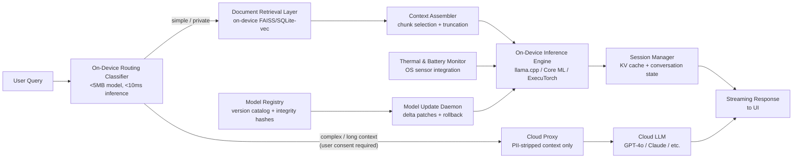

# Chapter 31: Edge and On-Device LLM Deployment

## Context

> [!info] Quick Reference
> - **Pattern:** Quantized model running on local hardware with a hybrid edge-cloud routing layer, on-device update delivery, and thermal-aware inference scheduling
> - **Scale:** Applies to any LLM feature where privacy, latency, or offline operation matter; architecture complexity scales with device heterogeneity and fleet size
> - **Key Techniques:** INT4/INT8 quantization (GGUF, GPTQ, AWQ), inference runtime selection (llama.cpp, MLC-LLM, Core ML, ExecuTorch), hybrid edge-cloud confidence routing, delta model update delivery, KV cache sizing for constrained RAM, battery and thermal throttle management
> - **Primary Concerns:** RAM budget per device class, quantization perplexity loss vs compression ratio, runtime portability vs performance, model update bandwidth, thermal and battery impact of continuous inference
> - **Cross-references:** Chapter 2 (LLM stack patterns), Chapter 5 (guardrails), Chapter 21 (inference optimization), Chapter 22 (agentic systems), Chapter 25 (prompt engineering)

**Problem statement:** Design an end-to-end system that deploys a large language model directly on user devices — mobile phones, laptops, and embedded hardware — while satisfying hard RAM, battery, and thermal constraints, preserving user privacy by keeping data on-device, and gracefully routing to the cloud when the query complexity exceeds local capability.

### Real-World Examples

- A healthcare app wants to run a medical summarization assistant on a physician's iPhone. Patient notes must not leave the device for HIPAA compliance. A full Llama-3-8B at FP16 requires 16GB of VRAM — far beyond mobile RAM. quantization (GGUF Q4_K_M), a Phi-3-mini-3.8B model fits in 2.4GB, runs at 12 tokens/second on the Apple A17 Neural Engine via Core ML, and never transmits any patient data.
- A code autocomplete tool inside an IDE (similar to GitHub Copilot's offline mode) requires sub-100ms first-token Latency (TTFT, TPOT, latency to feel responsive. A cloud-based model adds 150-300ms network round-trip. Running a quantized Gemma-2B locally via llama.cpp with Metal acceleration on an M-series MacBook delivers first tokens in 40-60ms with zero network dependency, enabling offline operation on flights and in restricted-network enterprise environments.

---

## Step 1: Understand the Problem and Establish Design Scope

### Functional Requirements

- Run a quantized LLM locally on supported devices (iPhone 14+, Android flagship, Windows laptop) with no network requirement for simple queries.
- Answer questions about on-device documents (notes, PDFs, emails) without transmitting user content to any external server.
- Route complex queries (multi-document reasoning, queries requiring >4K context, low-confidence edge cases) to a cloud LLM endpoint, with user consent.
- First-token latency <= 500ms for on-device inference on target devices; <= 200ms for short queries.
- Offline operation for simple queries when no network is available; graceful degradation for complex queries.
- Monthly model updates delivered as delta patches, not full weight downloads.
- Inference runs only in foreground; thermal throttling prevents sustained inference above device temperature thresholds.

### Non-Functional Requirements

- **RAM:** on-device model + KV Cache|KV cache + runtime overhead must stay within 60% of available device RAM (leaving headroom for the OS and other apps). Target: <= 3GB total for a 6GB device, <= 5GB for an 8GB device.
- **Battery:** on-device inference must not exceed 10% battery drain per 30-minute active session under normal use.
- **Thermal:** inference must throttle or stop if device temperature exceeds thermal threshold (typically 40°C skin temperature on mobile).
- **Latency:** first token <= 500ms; throughput >= 8 tokens/second on target devices.
- **Update bandwidth:** monthly model delta <= 200MB; full model download <= 800MB (on first install, Wi-Fi recommended).
- **Privacy:** zero user content transmitted to cloud unless user explicitly approves routing to cloud for a specific query.
- **Availability:** on-device inference must be available regardless of network connectivity for queries within the model's capability envelope.

### Back-of-the-Envelope Estimation

#### RAM Constraint Math

A model's memory footprint depends on parameter count and quantization precision:

```text
memory_bytes = num_parameters * bytes_per_parameter
```

For a 7B parameter model:

| Precision | Bytes/param | Model size | Fits in 6GB phone? |
|---|---|---|---|
| FP32 | 4 | 28 GB | No |
| FP16 / BF16 | 2 | 14 GB | No |
| INT8 | 1 | 7 GB | No (exceeds 6GB) |
| INT4 (Q4_K_M) | 0.5 | 3.5 GB | Yes, with ~2.5GB remaining |
| INT4 + KV cache | 0.5 model + 0.6GB KV | ~4.1 GB | Yes (6GB device: 1.9GB remaining) |

For a 3B parameter model (Phi-3-mini, Gemma-2B range):

| Precision | Model size | KV cache (2K ctx) | Total | Fits in 4GB phone? |
|---|---|---|---|---|
| FP16 | 6 GB | 0.3 GB | 6.3 GB | No |
| INT8 | 3 GB | 0.3 GB | 3.3 GB | Marginal |
| INT4 (Q4_K_M) | 1.7 GB | 0.3 GB | 2.0 GB | Yes (headroom: 2GB) |

**KV cache sizing for 2K context window:**

```text
kv_cache_bytes = 2 * num_layers * num_kv_heads * head_dim * context_length * bytes_per_element
```

For Phi-3-mini (32 layers, 32 KV heads, 96 head_dim, 2048 context, INT8):

```text
kv = 2 * 32 * 32 * 96 * 2048 * 1 byte = 2 * 32 * 32 * 96 * 2048
   = 402,653,184 bytes ≈ 384 MB
```

For longer 4K context at INT8: doubles to ~768MB — significant on mobile. Quantizing the KV cache to INT8 (from FP16) halves this, a common optimization in llama.cpp and MLC-LLM.

#### Throughput Budget

User perceives >= 8 tokens/second as "smooth" streaming. At 8 tok/s:

- Simple query, 200-token response: 200 / 8 = 25 seconds total generation. With streaming (tokens appear as generated), this is acceptable for document Q&A.
- Short factual answer, 50 tokens: 50 / 8 = 6.25 seconds — acceptable.
- Long summarization, 500 tokens: 500 / 8 = 62.5 seconds — borderline; surface a progress indicator.

llama.cpp on Apple M2 (CPU only) achieves ~25-40 tok/s for Phi-3-mini INT4. On iPhone A17 via Metal: ~15-20 tok/s. Android Snapdragon 8 Gen 3 with ARM NEON: ~10-15 tok/s.

#### Update Bandwidth Budget

Delta update strategy: monthly, update only changed weight tensors (fine-tune deltas or LoRA adapters):

- Full Phi-3-mini Q4_K_M: ~2.3 GB (first install, Wi-Fi)
- Monthly LoRA adapter update: 50-150 MB (adapter rank 64, delta weights only)
- Monthly full quantized weight refresh: ~500-800 MB (if architecture changes require full re-quantization)

---

## Step 2: Propose High-Level Design and Get Buy-In

### Core Architecture Components

- **On-Device Inference Engine:** the quantized model weights loaded into device RAM plus a hardware-specific runtime (llama.cpp with Metal on iOS/macOS, Core ML for ANE access, ExecuTorch for Llama-family models on Android). The engine manages the KV cache lifecycle — allocating cache at session start, growing it incrementally with each turn, and evicting oldest tokens via a sliding window when the context budget is exhausted. It also acts as the primary consumer of thermal throttle signals from the Thermal Monitor, adjusting its inter-token delay and max token count in real time.
- **On-Device Routing Classifier:** a lightweight binary classifier (<5MB, <10ms inference) that operates on every incoming query before the LLM is invoked. It computes structural features — token count, detected PII patterns, estimated context size after document retrieval — combined with a learned complexity score from a TF-IDF + logistic regression model. The output is one of three routing decisions: `LOCAL` (run on device), `CLOUD_WITH_CONSENT` (prompt the user, then route to the cloud proxy), or `LOCAL_DEGRADED` (offline and complex — run locally with a quality warning).
- **Document Retrieval Layer:** an on-device vector search system combining a small embedding model (all-MiniLM-L6-v2 at 23MB, or a distilled 6-layer variant at 14MB) with a persistent FAISS flat index or SQLite-vec for storage. At query time, the user's query is embedded, the top-K most relevant document chunks are retrieved by cosine similarity, and those chunks are ranked and truncated to fit within the device's context budget before being passed to the inference engine. The index is built incrementally as new documents are added to the app, with background re-indexing on Wi-Fi.
- **Cloud Proxy (Optional, Consent-Gated):** a thin middleware service (not the LLM itself) that sits between the on-device app and the cloud LLM provider. When the user approves cloud routing for a query, the on-device app sends only the specific retrieved document chunks (not raw originals) plus the user query to the proxy; the proxy runs a named-entity PII masking pass, forwards the sanitized payload to the cloud LLM (e.g., GPT-4o or Claude), and streams the response back. Raw documents and conversation history that was not explicitly retrieved never leave the device.
- **Model Update Daemon:** a background service responsible for detecting, downloading, verifying, and applying model weight updates without interrupting foreground inference. On iOS it runs as a background `URLSession` transfer (not a persistent process, which iOS would kill); on Android it uses `WorkManager` with a Wi-Fi connectivity constraint. The daemon downloads delta patches incrementally with resume support, verifies the SHA-256 hash against the Model Registry manifest before applying, and performs an atomic rename swap — never touching the active model path until the new model is fully verified.
- **Thermal and Battery Monitor:** a platform-specific sensor integration layer that polls `ProcessInfo.thermalState` (iOS) or `PowerManager.getThermalHeadroom()` (Android) on a 2-second interval during active inference. It publishes throttle events on an internal bus; the Inference Engine subscribes and applies the appropriate generation config (reduced `max_tokens`, inter-token delays, or full stop) without requiring any coordination with the UI layer. Battery state is monitored via `UIDevice.batteryLevel` (iOS) / `BatteryManager` (Android), triggering additional constraints below 20% and 10% charge thresholds.
- **Session Manager:** maintains the active conversation's turn history, accumulated KV cache state, and document context across multiple user queries within a single session. When the running token count (query + history + retrieved chunks) approaches the device's `MAX_DEVICE_CONTEXT_TOKENS` limit, the Session Manager applies a sliding-window truncation strategy: it drops the oldest complete conversation turns (never partial turns, which would corrupt the chat format) until the context fits, then logs a `history_truncated` metric event. It also handles session serialization to disk so that long conversations can be resumed across app restarts without re-building the KV cache from scratch.

### Mermaid Architecture Diagram



> **Why a separate on-device routing classifier instead of always using the edge model to decide:** The edge model itself cannot cheaply introspect whether a query exceeds its own capability — asking it to do so requires a full inference pass.

> **Why PII stripping in the cloud proxy, not document redaction in the retrieval layer:** Documents are retrieved and chunked before routing is decided.

> **Why a dedicated Model Update Daemon separate from the main app process:** On iOS and Android, background processes have strict CPU, memory, and network quotas.

---

## Step 3: Design Deep Dive

### 1) Quantization for Edge

The fundamental tension in edge quantization is compression ratio vs quality retention. Every bit reduction cuts model size but degrades perplexity. Quantization maps the continuous distribution of FP16 weight values (each representable to one part in 65,536) onto a much coarser discrete grid — at INT4, only 16 distinct values are available per weight. The reconstruction error from this mapping accumulates across layers: each layer's output is slightly wrong, and that error is the input to the next layer. Quantization-aware training (QAT) bakes this error into the forward pass during training so the model learns to compensate, but QAT requires retraining from scratch. Post-training quantization (PTQ) methods like GPTQ and AWQ minimize reconstruction error layer-by-layer using a small calibration dataset — achieving near-QAT quality without retraining, which is the only practical option for large pre-trained models. The key practical insight is that quantization sensitivity is non-uniform across a model's layers: aggressive quantization of the right 70% of layers can achieve the same perplexity delta as uniform quantization of 40% of layers, meaning careful layer selection is worth engineering effort.

#### Quantization Format Comparison: GGUF Q4_K_M vs Q8_0

GGUF is llama.cpp's native weight format. It stores quantized weights with per-block scaling factors and supports mixed-precision quantization (different layers quantized to different bit widths).

| Format | Bits/weight | Phi-3-mini size | Llama-3.2-3B size | Perplexity delta vs FP16 | Recommended for |
|---|---|---|---|---|---|
| FP16 | 16 | 7.6 GB | 6.0 GB | 0 (baseline) | Server / high-VRAM GPU |
| Q8_0 | 8 | 4.1 GB | 3.2 GB | +0.02 (negligible) | Laptop, 8GB+ devices |
| Q6_K | 6 | 3.1 GB | 2.4 GB | +0.08 | Laptop, 8GB devices |
| Q5_K_M | 5 | 2.6 GB | 2.0 GB | +0.15 | 6GB devices, quality-sensitive |
| Q4_K_M | 4 | 2.2 GB | 1.7 GB | +0.25-0.40 | Mobile, default choice |
| Q3_K_M | 3 | 1.7 GB | 1.3 GB | +0.70-1.20 | Embedded, <3GB RAM only |
| Q2_K | 2 | 1.1 GB | 0.9 GB | +2.0-4.0 | Avoid unless extremely RAM-constrained |

"K" variants use k-means clustering for quantization codebooks ("importance-aware"). Q4_K_M uses 4-bit for most weights and 6-bit for attention and feedforward "important" layers, achieving better quality than naive 4-bit at the same average bit-width.

> **Why INT4 quantization for 7B on mobile:** A 7B model at FP16 = 14GB — exceeds any phone.

#### GPTQ vs AWQ: Post-Training Quantization Methods

Both GPTQ and AWQ are weight-only post-training quantization methods that produce INT4 weights without retraining.

| Method | Core Idea | Quality at INT4 | Quantization Speed | Runtime Support | Best For |
|---|---|---|---|---|---|
| GPTQ | Second-order weight updates (Hessian-based) minimize per-layer reconstruction error | Good — PPL delta ~0.3-0.5 | Slow (hours for 7B) | ONNX Runtime, vLLM, AutoGPTQ | GPU server, offline quantization |
| AWQ (Activation-aware Weight Quantization) | Identifies "salient" weights via activation magnitudes; protects them with higher precision | Better — PPL delta ~0.2-0.3 | Faster than GPTQ | llama.cpp (via export), MLC-LLM | Mobile, quality-critical |
| GGUF Q4_K_M | k-means codebook per weight block, importance-weighted layer selection | Good — PPL delta ~0.25-0.40 | Fast (minutes) | llama.cpp natively | Mobile, easiest deployment |
| BitsAndBytes NF4 | NormalFloat4 distribution-aware quantization | Good for fine-tuning | N/A (training-time) | HuggingFace Transformers | Fine-tuning on GPU, not mobile |

> **Why AWQ over GPTQ for mobile deployment:** AWQ identifies the small fraction of weights (~1%) that have outsized impact on activations and preserves them at higher precision.

#### Importance-Weighted Quantization: Which Layers Stay at Higher Precision

Not all layers are equally sensitive to quantization. Empirically across transformer architectures:

- **Embedding layer:** highly sensitive to quantization because each row of the embedding matrix is accessed for exactly one token per forward pass — there is no averaging effect from batch processing. Quantizing embeddings from FP16 to INT4 introduces per-token reconstruction error that propagates through every subsequent layer, noticeably degrading coherence and vocabulary precision. Keep at FP16 or INT8; the embedding layer is typically only 1-3% of total parameter count, so the RAM cost of keeping it at higher precision is small.
- **First and last transformer layers:** the first layers transform raw token embeddings into contextual representations, and the last layers decode those representations back to logit space — both transitions are highly sensitive to numerical precision loss. Empirically, perplexity increases 2-3× faster when quantizing these boundary layers compared to middle layers at the same bit-width. Q4_K_M's "K" variants automatically apply 6-bit quantization to the first two and last two transformer layers while using 4-bit for the interior.
- **Attention QKV projections:** moderately sensitive because the query-key dot product is a scaled inner product — even small weight errors compound when summed across the full `head_dim` (typically 64-128 values). Keeping QKV projections at 5-bit or 6-bit rather than 4-bit reduces attention pattern errors noticeably on reasoning tasks, at the cost of ~10-15% additional RAM for those layers specifically. For RAM-constrained deployments, 4-bit QKV is acceptable if the overall perplexity budget allows a delta of ≤ 0.5.
- **FFN layers (middle transformer blocks):** the feedforward sublayers in the middle blocks of a deep transformer are the least quantization-sensitive components because their activations are distributed across many neurons — the law of large numbers smooths out individual weight quantization errors before the output is residually added. Safely quantize these to 4-bit across all middle layers; they typically constitute 60-70% of total parameters, making this the primary source of the compression benefit.
- **LM head (output projection):** must be kept at FP16. The LM head is a single linear projection from hidden dimension to vocabulary size (often 32K-128K tokens); each of the 32K+ output logits depends directly on the precision of the corresponding row in this matrix. INT4 quantization of the LM head introduces systematic bias toward high-frequency tokens, measurably raising top-1 accuracy on common tokens while causing rare-token generation to collapse — a perceptible quality drop on any vocabulary-diverse output.

---

### 2) Inference Runtime Selection

The runtime determines which hardware backends are used, which quantization formats are supported, and what portability trade-offs apply. Choosing the wrong runtime can leave 2-4x throughput on the table: a Phi-3-mini INT4 model running on llama.cpp with CPU-only kernels on an iPhone achieves ~10 tok/s, while the same model compiled for Core ML and routed to the Apple Neural Engine reaches 30+ tok/s. The runtime choice is also a build-system and deployment commitment — switching from llama.cpp to Core ML requires a new model conversion pipeline, new integration code, and iOS-only binary artifacts, which has significant implications for Android parity and CI/CD complexity. Most production deployments use a runtime adapter layer that exposes a common inference API while swapping the backend per platform: llama.cpp for Android and cross-platform CI, Core ML for iOS production builds, ONNX Runtime for Windows laptop targets.

#### Trade-off Table: Inference Runtimes for Edge

| Runtime | Primary Targets | Quantization Support | Hardware Backends | Portability | Throughput on Mobile ARM | Best For |
|---|---|---|---|---|---|---|
| llama.cpp | CPU (all), Metal (macOS/iOS), CUDA, Vulkan | GGUF (Q2-Q8, K-variants) | ARM NEON, AVX-512, Apple Metal, CUDA | High (C++, no framework deps) | 10-20 tok/s (3B INT4) | Most mobile/laptop deployments |
| MLC-LLM | iOS, Android, WebGPU, CUDA | INT4 (AWQ, TVM-compiled) | Apple Metal, Vulkan, WebGPU | Medium (TVM compilation per device) | 15-25 tok/s (3B INT4) | Best mobile GPU throughput |
| ONNX Runtime | Windows, Linux, Android | INT8, INT4 (limited) | AVX-512, ARM NEON, CUDA, DirectML | Very High (any ONNX model) | 6-12 tok/s (3B INT4) | Windows laptops, enterprise |
| Core ML | iOS, macOS only | INT4, INT8, FP16 | Apple Neural Engine (ANE), GPU, CPU | Low (Apple ecosystem only) | 20-35 tok/s via ANE | iPhone/Mac, best ANE utilization |
| ExecuTorch | iOS, Android (Meta's mobile PyTorch) | INT4, INT8, FP16 | XNNPACK, Metal, Vulkan | Medium (PyTorch ecosystem) | 12-18 tok/s (3B INT4) | Meta's LLMs on mobile (Llama) |

> **Why llama.cpp over ONNX Runtime for mobile CPU inference:** ONNX Runtime is optimized for AVX-512 server CPUs and achieves excellent throughput on Intel/AMD server hardware.

> **Why Core ML for iOS when performance is the priority:** Core ML routes computation to Apple's Neural Engine (ANE), a dedicated ML accelerator present in A15+ chips.

> **Why ExecuTorch for Llama-family models on mobile:** Meta designed ExecuTorch specifically as the mobile deployment path for the Llama model family.

#### Runtime Selection Decision Tree

```text
Is the target device Apple (iPhone/Mac)?
  → Yes + ANE performance is priority → Core ML
  → Yes + cross-platform code sharing needed → llama.cpp with Metal backend
  → No
Is the target Android with GPU?
  → Yes + best GPU throughput needed → MLC-LLM (Vulkan)
  → Yes + lowest integration effort → llama.cpp with Vulkan backend
Is the model a Llama-family model?
  → Yes + mobile-first → ExecuTorch
Is the target Windows laptop / Linux server?
  → ONNX Runtime (DirectML for Windows GPU) or llama.cpp (CUDA/CPU)
```

---

### 3) Hybrid Edge-Cloud Architecture and Routing

Pure on-device deployment fails when queries require reasoning beyond the local model's capability. Pure cloud deployment leaks user data and has 200-800ms network round-trips. Hybrid routing balances both.

#### Routing Classifier Design

The routing classifier must be:
- **On-device:** cannot make a network call to decide whether to make a network call.
- **Fast:** < 10ms inference. Adding 10ms to every query is acceptable; 100ms is not.
- **Lightweight:** < 5MB model size. Cannot allocate 500MB for the router when the LLM itself is already at the RAM limit.

Classifier features (computed locally, no LLM needed):

| Feature | Computation | Signal |
|---|---|---|
| Query token count | Tokenizer (shared with LLM) | Proxy for context length requirement |
| Query complexity score | TF-IDF similarity to complexity template set | Distinguishes "what is X?" from "compare and contrast X, Y, Z across..." |
| Number of document references | Regex count of "document," "file," "in the email," etc. | Multi-document queries need more context |
| Estimated context length | Query tokens + retrieved chunk tokens | Direct test: will it fit in the device's max context? |
| Privacy flag | Named entity detection on query | "my social security number," "patient ID" → force local |
| User's explicit preference | App setting (always local / always cloud / auto) | Override all other signals |

Routing decision logic (pseudocode):

```text
function route_query(query, user_preference):
    if user_preference == ALWAYS_LOCAL:
        return LOCAL

    if user_preference == ALWAYS_CLOUD:
        return CLOUD if network_available() else LOCAL

    # Auto mode: run classifier
    features = extract_features(query)

    # Hard constraints → force local
    if features.privacy_flag == HIGH:
        return LOCAL

    # Capability constraints → force cloud
    estimated_context = features.query_tokens + features.retrieved_chunk_tokens
    if estimated_context > MAX_DEVICE_CONTEXT:
        return CLOUD_WITH_CONSENT if network_available() else LOCAL_DEGRADED

    # Complexity threshold → confidence-based routing
    complexity_score = classifier.predict(features)  # 0.0-1.0
    if complexity_score > COMPLEXITY_THRESHOLD:      # e.g., 0.75
        return CLOUD_WITH_CONSENT if network_available() else LOCAL_DEGRADED

    return LOCAL
```

> **Why hybrid edge-cloud with confidence routing:** Pure edge fails on queries requiring >4K context or multi-step reasoning where small models hallucinate.

#### Routing Accuracy vs. Latency Trade-off Table

| Classifier Type | Size | Inference Time | Routing Accuracy | Notes |
|---|---|---|---|---|
| Rule-based (token count + regex) | 0 MB | <1 ms | 70-80% | No ML, deterministic |
| TF-IDF + logistic regression | <1 MB | 1-3 ms | 80-87% | sklearn, good baseline |
| DistilBERT-tiny fine-tuned | 14 MB | 5-15 ms | 90-93% | Best quality, larger RAM |
| MobileNet-text (custom) | 3 MB | 3-8 ms | 87-91% | Good size/quality balance |

Recommendation: TF-IDF + logistic regression for v1 (fast to build, adequate accuracy); DistilBERT-tiny for v2 if routing errors are causing user-visible quality issues.

#### Consent Model for Cloud Routing

When the classifier routes to cloud, the app must:
1. Surface a consent prompt: "This question is complex. Send to cloud AI for a better answer? Your document content will not be shared — only your question and relevant excerpts."
2. Allow the user to proceed or cancel (falls back to local inference with a quality caveat).
3. Store per-session consent so users are not re-prompted on every query within a session.
4. Log consent events for compliance auditing.

---

### 4) Model Update Delivery, Battery, and Thermal Management

#### Model Update Delivery

Shipping a 2.3GB full model update monthly violates the bandwidth budget. Delta updates deliver only changed weights.

**Delta update strategies:**

| Strategy | Update Size | Complexity | Rollback Support | Best For |
|---|---|---|---|---|
| Full model re-download | 100% (2-5 GB) | Low: a single CDN fetch replaces the model directory atomically; no diff computation needed | Yes — retain the previous model directory for 7 days; rollback is a directory rename | Major architecture changes that alter layer count or weight shapes, making partial patches invalid |
| LoRA adapter delta | 50-200 MB | Medium: the base model weights stay frozen on disk; only the adapter tensors (rank 64 ≈ 2% of total weights) are downloaded and hot-swapped | Yes — swapping to the old adapter is instantaneous since the base model never changes; corrupted adapter just falls back to base | Behavioral fine-tune updates (tone, safety, domain adaptation) where the base model architecture is unchanged across versions |
| Weight tensor diff (bsdiff) | 100-500 MB | Medium: bsdiff generates a binary patch between old and new GGUF files; applying it requires writing a temporary output file, consuming 2× the model's disk space during patching | Yes — the old GGUF file is retained until the new file's SHA-256 is verified; apply is atomic via rename | Incremental weight updates where quantization format is unchanged; most efficient when <30% of tensors change between versions |
| Quantization re-packing | Varies (10-100% of model size) | High: requantizing to a new GGUF variant requires downloading calibration data or the new quantized tensors, then validating perplexity before activating | Yes — old quantized file kept until new file passes perplexity regression gate | Switching quantization strategy (e.g., Q4_K_M → Q5_K_M after a device RAM increase) without changing the underlying model weights |

**Update delivery pipeline:**

1. Model Registry publishes a version manifest: `{model_id, version, base_hash, delta_url, delta_hash, min_app_version}`.
2. Update Daemon checks the manifest on Wi-Fi, once daily.
3. Downloads the delta file incrementally (resumable, background URLSession on iOS).
4. Verifies SHA-256 hash of downloaded delta against the manifest.
5. Applies delta to the current model weights in a staging directory.
6. Verifies the resulting model hash against the manifest's `expected_model_hash`.
7. Atomically swaps the staging model into the active model directory (rename, not copy).
8. Retains the previous model version for 7 days for rollback.

> **Why atomic rename for model swapping instead of in-place overwrite:** Model weight files are memory-mapped during inference.

#### A/B Testing On-Device

On-device A/B testing presents a unique challenge compared to server-side A/B testing: the treatment (the model weights) is baked into the device at update time, not selected per request at a central server. This means the experiment assignment must happen before the model is downloaded, and the device must download only the variant it is assigned to — it cannot lazy-load the alternative. Assignment is deterministic so that a device always sees the same variant for the same experiment, preventing the experience from changing under the user mid-experiment:

```python
variant = hash(device_id + experiment_id) % 100
if variant < rollout_percentage:
    active_model = "model_v2"
else:
    active_model = "model_v1"
```

The device_id must be stable across app reinstalls for the experiment to be valid — use the platform's persistent identifier (iOS `UIDevice.identifierForVendor` persists within an app install, Android `Settings.Secure.ANDROID_ID` persists across reinstalls). Experiment assignments are fetched from the Model Registry manifest at update check time, not at query time, so the routing decision adds zero latency to inference.

Quality signals (user feedback, task completion, session length) are logged locally in a privacy-preserving event store and uploaded (anonymized and aggregated — never at the individual user level) on Wi-Fi for analysis. The upload must be differential-privacy-protected if the app's privacy policy prohibits individual-level behavioral telemetry, which is typical for healthcare and legal enterprise apps. Minimum detectable effect for a model quality improvement is typically 2-3% on task completion rate, requiring ~5,000 device-sessions per variant for 80% statistical power.

> **Why deterministic hash assignment instead of a server-side cohort API:** A server-side cohort assignment (device calls an API to get its variant) requires a network round-trip and introduces a dependency on network availability fo...

#### Battery and Thermal Management

**Thermal state machine:**

| Thermal State | Device Temp | Inference Action |
|---|---|---|
| Normal (<35°C) | No throttle applied — device thermal sensors report nominal heat dissipation | Run at full batch size with the highest token generation rate the hardware supports; KV cache and context window operate at their configured maximums |
| Warm (35-38°C) | Mild throttle — sustained inference is heating the SoC faster than passive cooling dissipates | Reduce batch size to 1 (already minimum for autoregressive decoding) and insert a 20ms inter-token sleep to introduce CPU idle time between decode steps, allowing the SoC to partially cool between computations |
| Hot (38-40°C) | Hard throttle — skin temperature approaching regulatory thermal limits; iOS `.serious` / Android `THERMAL_STATUS_SEVERE` | Cap max_tokens per response to 200 (preventing long sustained computation bursts), insert 50ms inter-token delay, and surface a subtle "Running slower to protect your device" UI indicator so users understand the degradation |
| Critical (>40°C) | Stop inference immediately — skin temp at or above Apple/Google OEM safety thresholds; continued inference risks thermal shutdown | Halt generation mid-token, return the partial response to the UI with a `truncated=True` flag, display a "Device needs to cool down" toast, and poll `thermalState` every 5 seconds — resuming only when state drops to Warm or below |

**iOS implementation** uses `ProcessInfo.thermalState` (`.nominal`, `.fair`, `.serious`, `.critical`). **Android** uses the `PowerManager` thermal headroom API (available API 30+).

**Battery state integration:**

- If battery < 20% and not charging: reduce max_tokens from 512 to 256, disable streaming (batch the full response) to reduce CPU wake-ups.
- If battery < 10% and not charging: surface a toast "AI responses paused to save battery" and route all queries to cloud (with consent) or return cached responses.

> **Why batch size 1 for thermal throttling:** On mobile, the primary thermal driver during LLM inference is the memory bandwidth required to load weight matrices from DRAM.

**Background vs foreground scheduling:**

- iOS: inference is suspended when the app enters background (`applicationDidEnterBackground`). No background inference allowed — Apple's CPU time limits would kill the process in ~30 seconds.
- Android: inference is bound to a foreground service. When the user navigates away, the foreground service can continue briefly (30-60 seconds) but should checkpoint and pause.
- Laptop: no foreground restriction. Implement a user-visible "running locally" indicator in the system tray; pause inference if the user locks the screen (lid-close event).

---

