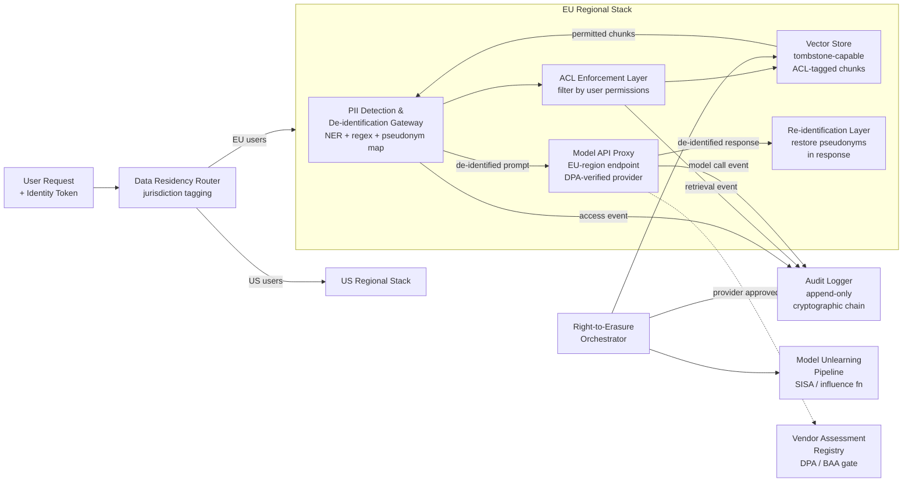

# Chapter 30: Privacy, Compliance, and Data Governance for LLM Systems

## Context

> [!info] Quick Reference
> - **Pattern:** Defense-in-depth privacy stack — PII de-identification at the boundary, ACL-aware retrieval, immutable audit logs, and deletion-capable vector stores with model unlearning hooks
> - **Scale:** Applies to any production LLM system handling personal data; required for regulated industries (healthcare, finance, legal) from day one; complexity compounds when using external API providers
> - **Key Techniques:** NER-based PII detection with confidence thresholds, pseudonymization with entity-consistent substitution, SISA training for machine unlearning, tombstoning in vector stores, right-to-erasure pipelines, ACL-filtered retrieval (query-time vs. index-time), immutable audit logging, vendor DPA/BAA assessment
> - **Primary Concerns:** PHI/PII leakage to API providers, right-to-deletion in fine-tuned model weights, data residency enforcement, over-redaction breaking LLM reasoning, audit log completeness, ACL bypass through indirect prompt injection
> - **Cross-references:** Chapter 2 (LLM stack patterns), Chapter 5 (guardrails and safety), Chapter 22 (agentic systems — attack surface multiplies), Chapter 27 (evaluation — compliance of eval pipelines), Chapter 24 (RAG architecture — retrieval trust boundaries)

**Problem statement:** Design a privacy and compliance layer for a production LLM system that handles personal data — including PHI, PII, and user-generated content subject to GDPR and CCPA — ensuring that personal data is detected and de-identified before it reaches external model APIs, that users can exercise their right to erasure without requiring full model retraining, that retrieval is gated by access controls, and that every data access is captured in an immutable audit log sufficient to satisfy regulatory inquiry.

### Real-World Examples

- A healthcare startup builds a clinical documentation assistant that lets physicians dictate notes and receive structured summaries. The system sends raw dictation audio transcriptions directly to a commercial LLM API. The transcriptions contain patient names, dates of birth, diagnoses, and medication lists — all PHI under HIPAA. The provider's DPA is signed, but the provider's general terms allow logging prompts for abuse monitoring. Two months after launch, the provider updates its data retention policy. The startup now has PHI residing in a third-party log store with no deletion mechanism and no BAA provision for that specific log pipeline. A signed DPA was necessary but not sufficient; de-identification at the boundary would have made the policy change irrelevant.
- A European SaaS company builds an enterprise knowledge-base assistant that indexes employee documents and answers questions about company policy. A user queries the system with a question that incidentally reveals they are investigating a colleague for misconduct. The RAG pipeline retrieves documents the querying user is not authorized to see — HR disciplinary records that happen to be semantically similar to the query. The retrieval system filtered on file extension but not on document-level ACL. The resulting response reveals information about a third party who has rights under GDPR Article 17 to control their own data. Index-time ACL filtering would have blocked the retrieval before it reached the LLM.

---

## Step 1: Understand the Problem and Establish Design Scope

### Functional Requirements

- Detect and de-identify PII and PHI in user queries and retrieved documents before they are sent to any external model API.
- Maintain entity consistency within a single request: "John Smith" and "the patient" must both be pseudonymized to "Patient_A7" throughout the prompt.
- Enforce per-user ACL on retrieval: only documents the requesting user is authorized to see may be included in the prompt context.
- Support right-to-erasure: delete a user's data from the document store, vector index, query logs, and fine-tuned model weights within 30 days of a verified deletion request.
- Capture an immutable, append-only audit log for every data access: who queried what, which documents were retrieved, what de-identification transformations were applied, and which model received the data.
- Enforce data residency: EU user requests must be routed to EU-region inference endpoints and storage; US PHI must not leave US-region storage.
- Provide a vendor assessment gate: before any new API provider or tool integration receives user data, it must pass a documented DPA/BAA checklist.

### Non-Functional Requirements

- **Latency:** PII detection and de-identification must complete in <= 200ms p99 on inputs up to 8K tokens, keeping total request latency under 3 seconds.
- **Precision:** false negative rate for PII detection on clinical text must be <= 5% (i.e., recall >= 95%). False positive rate (over-redaction) must be <= 10%.
- **Auditability:** audit logs must be append-only, cryptographically chained, and retained for >= 6 years for HIPAA compliance.
- **Deletion SLA:** right-to-erasure requests must be fulfilled within 30 days (GDPR) or 45 days (CCPA); the system must confirm deletion across all storage layers.
- **Availability:** the de-identification pipeline must not be a single point of failure — if it is unavailable, requests containing unverified personal data must be rejected (fail closed), not passed through.
- **Data residency:** EU data must not transit US-region infrastructure. Request routing must enforce this before any data leaves the originating region.

### Back-of-the-Envelope Estimation

#### PII Detection Latency Budget

Assume:

- **Input size:** 4K tokens average (user query + retrieved context), ~3,000 words.
- **NER model:** a production-grade NER (e.g., spaCy with a clinical fine-tune) processes ~10K tokens/second on a single CPU core.
- **Processing time:** `4,000 tokens / 10,000 tokens/s = 400ms` on one CPU core.
- **Optimization:** run NER on 8 CPU cores in parallel, processing in 512-token chunks: `4,000 / 8 / 10,000 = 50ms` per request.
- **Regex pre-pass** for structured PII (SSN, email, phone): `< 5ms` on the same input.
- **Total de-identification latency:** ~55ms — well within the 200ms budget.

#### Audit Log Volume

- **Request rate:** 10,000 requests/day across all users.
- **Log size per request:** 1KB (user ID, timestamp, query hash, retrieved document IDs, PII entity counts, model endpoint, response hash).
- **Daily volume:** `10,000 * 1KB = 10MB/day`.
- **6-year retention:** `10MB * 365 * 6 = ~21GB` — fits comfortably in any time-series store or object store with lifecycle policies.
- **Cryptographic chaining overhead:** SHA-256 of previous entry + current entry = 64 bytes extra per record — negligible.

#### Vector Store Deletion Cost

- **Index size:** 500K document chunks (clinical notes split into 512-token chunks).
- **Deletion by patient:** average patient has 200 note chunks.
- **Tombstoning:** mark 200 chunk IDs as deleted in a separate table = 200 row writes, microseconds.
- **Full index rebuild:** `500K chunks * 0.5ms embedding + index overhead ≈ 4 hours` — too slow for a 30-day SLA.
- **Conclusion:** use tombstoning for immediate logical deletion; schedule monthly full rebuilds to physically purge tombstoned entries and reclaim memory.

#### Data Residency Routing Overhead

- **EU-region endpoint latency vs. US-region:** EU-to-US round trip ≈ 120ms additional. For a 2-second LLM response, this is 6% overhead.
- **Acceptable:** within the 3-second budget. No cross-region routing is needed if the EU endpoint is used from the start.

---

## Step 2: Propose High-Level Design and Get Buy-In

### Core Architecture Components

- **PII Detection and De-identification Gateway:** sits at the ingress boundary of the LLM service. Every request passes through this gateway before reaching the retrieval layer or model API. Runs NER-based detection plus regex passes for structured PII. Produces a pseudonymization map (original entity → pseudonym) that is held in memory for the duration of the request.
- **ACL Enforcement Layer:** intercepts retrieval queries before they reach the vector store. Attaches the requesting user's permission set (derived from the identity provider) to the query. Only document chunks whose ACL tag is a subset of the user's permissions are eligible for retrieval.
- **Vector Store with Tombstone Support:** the document index stores each chunk with a `deleted` flag and the owning user or patient ID. Deletion requests set the flag; a periodic rebuild job physically removes flagged entries.
- **Audit Logger:** receives structured log events from every component in the pipeline (gateway, retrieval, model call, response). Writes to an append-only log store with cryptographic chaining. Separate from the application database to prevent tampering.
- **Right-to-Erasure Orchestrator:** receives verified deletion requests from the compliance API. Coordinates deletion across: the document store, the vector index (tombstoning), the query log store, and the model unlearning pipeline (if fine-tuned data is implicated).
- **Data Residency Router:** inspects the requesting user's jurisdiction (derived from account metadata, not IP geolocation) and routes the request to the appropriate regional stack. Each regional stack is fully isolated: its own API endpoint, vector store shard, and audit log.
- **Vendor Assessment Registry:** a documented checklist and approval record for every third-party API or tool that receives user data. Gates integration PRs — a CI check fails if a new external call is made to an unapproved endpoint.

### Mermaid Architecture Diagram



---

## Step 3: Design Deep Dive

The four focus areas below address the hardest implementation problems in the architecture. Each involves a fundamental tension: PII detection must be thorough enough to prevent leakage but fast enough to stay on the critical path; data residency must be enforced structurally (not just by policy); deletion must reach every storage layer including model weights; and ACL enforcement must be applied before data enters any processing pipeline, not after. These are the areas where real systems fail under regulatory scrutiny — and where interviewers probe most deeply.

1. **PII Detection and De-identification Pipeline** — the boundary gateway that prevents personal data from crossing into external systems; covers the two-pass (regex + NER) detection architecture, entity-consistent pseudonymization, confidence thresholds, and defense against indirect prompt injection through retrieved documents.
2. **Data Residency and Vendor Agreements** — the routing and contractual layer that keeps data within legally required jurisdictions; covers inference deployment options by residency strength, provider-specific regional endpoint capabilities, and the DPA/BAA assessment checklist that gates new vendor integrations.
3. **Right to Deletion and Model Unlearning** — the erasure pipeline that satisfies GDPR Article 17 and CCPA deletion obligations across all storage layers, including the hardest case: model weights trained on personal data; covers tombstoning, document store deletion, query log purging, and the SISA and influence function approaches to machine unlearning.
4. **ACL-Aware Retrieval and Consent Management** — the access control layer that prevents unauthorized documents from entering the LLM prompt; covers the four enforcement timing options (index-time isolation, query-time metadata filter, post-retrieval filter, LLM-based decision) with their security trade-offs, the ACL tag schema, consent flag management for training data collection, and retroactive violation detection via audit log reconciliation.

---

### 1) PII Detection and De-identification Pipeline

#### Trade-off Table: De-identification Approaches

| Approach | Reasoning Preserved | Recall (clinical) | Latency | Re-linkability Risk | Best For |
|---|---|---|---|---|---|
| Full redaction (`[REDACTED]`) | No — breaks coreference; the LLM cannot track that `[REDACTED]` in sentence 3 is the same patient as `[REDACTED]` in sentence 1, producing fragmented or incoherent summaries | High — regex and NER both achieve >95% recall on structured and unstructured PII | Very Low — regex-only pass completes in under 5ms even on 8K token inputs | None — replaced text carries no statistical signal about the original | Highest-security contexts where LLM reasoning coherence is not required, such as document redaction for legal discovery |
| Pseudonymization (entity-consistent) | Yes — consistent placeholder preserves coreference chains; "Patient_A7" in sentence 1 and sentence 5 refers to the same person, enabling the LLM to reason across the full note | High — same two-pass detection as redaction; recall depends on NER quality, targeting ≥95% on clinical text | Low — adds ~50ms for map construction on a 4K-token input; negligible compared to LLM inference time of 1-3 seconds | Low — pseudonyms are meaningless without the server-side map; risk limited to map key compromise or session store breach | Medical summarization, clinical Q&A, RAG over clinical text where entity tracking across paragraphs is essential |
| Synthetic substitution (realistic fake names) | Yes — "James Thornton" replaces "John Smith" seamlessly; the LLM reasons normally with no awareness of substitution | High — same detection pipeline; substitution accuracy limited by name generator realism | Medium — requires a name generation service call (~20-50ms additional); generating realistic medical record numbers adds further complexity | Low–Medium — synthetic names are indistinguishable from real names, but correlating them to originals requires access to the substitution log | Training data generation where examples must look authentic; demo environments where real names would cause reputational or legal risk |
| Tokenization (reversible vault) | Yes — token placeholder maps 1:1 to original; reasoning is fully preserved and re-identification is exact, not approximate | High — same detection pipeline; tokenization is a post-detection step with no impact on recall | Low — vault lookup adds ~5-15ms per entity; with 20 entities per document this is ~100-300ms additional, approaching the 200ms budget | High — the vault is a high-value target; compromise exposes all original entities for all tokenized documents simultaneously; vault must be HSM-backed or equivalent | Regulated workflows where authorized downstream systems (billing, pharmacy) require the original values; acceptable only with strong vault security controls |
| No de-identification (rely on provider DPA) | Yes — no transformation; full fidelity reasoning | N/A — no detection required | None — zero added latency; the simplest path | High — PHI/PII resides in provider logs, accessible to provider staff, subject to provider policy changes and breaches; the DPA is a legal control, not a technical one | Non-regulated, non-sensitive content only; never acceptable for PHI, GDPR-covered personal data, or any data where the individual has not consented to third-party processing |

> **Why de-identify before sending to the API, not rely on provider DPA:** Even with a signed DPA, data sent to an API provider may be logged for monitoring or accessible to provider employees.

> **Why pseudonymization over redaction for medical contexts:** Redaction (replacing "John Smith" with "[REDACTED]") breaks entity coreference — the LLM cannot reason about "the patient" across sentences.

#### Detection Architecture: Two-Pass Pipeline

**Pass 1 — Regex for structured PII (< 5ms):**

Structured PII has known formats that regex handles with near-perfect recall. Apply before NER to reduce the NER model's input surface and avoid NER false negatives on structured patterns.

| PII Type | Pattern | Example |
|---|---|---|
| SSN | `\b\d{3}-\d{2}-\d{4}\b` | 123-45-6789 |
| US Phone | `\b(\+1[-.\s]?)?\(?\d{3}\)?[-.\s]?\d{3}[-.\s]?\d{4}\b` | (415) 555-1234 |
| Email | `\b[A-Za-z0-9._%+-]+@[A-Za-z0-9.-]+\.[A-Z]{2,}\b` | user@example.com |
| Date of birth | `\b(DOB|Date of Birth)[:\s]+\d{1,2}[/-]\d{1,2}[/-]\d{2,4}\b` | DOB: 04/12/1978 |
| MRN | `\b(MRN|Medical Record)[:\s#]+\d{5,10}\b` | MRN: 4821093 |
| NPI | `\bNPI[:\s]+\d{10}\b` | NPI: 1234567890 |

**Pass 2 — NER for unstructured PII (< 55ms):**

NER detects person names, organization names, locations, and dates that regex cannot capture. Use a clinical-domain-adapted NER model (spaCy with the `en_core_sci_lg` pipeline or Microsoft Presidio with a custom recognizer set). Apply a confidence threshold of 0.85.

> **Why confidence threshold 0.85 for PII detection:** Below 0.85, false negative rate for names and phone numbers rises above 5% on medical text benchmarks.

#### Entity Consistency: Pseudonymization Map

Entity consistency requires that every occurrence of "John Smith" — whether spelled "John Smith," "Mr. Smith," or referred to pronominally as "the patient" — maps to the same pseudonym "Patient_A7" within a single request.

Implementation:

1. After both passes, collect all detected entities and their spans.
2. Canonicalize entity strings: lowercase, strip punctuation, resolve co-references using a coref model or heuristic (within 100 tokens of a named entity, pronouns are attributed to that entity).
3. For each unique canonical entity, assign a pseudonym from a deterministic hash of `(entity_canonical, session_key)` — deterministic within a session, different across sessions.
4. Store the `(pseudonym → original)` map in server-side session state, never sent to the client or the model.
5. After the model returns a response, run the map in reverse to re-identify pseudonyms in the response before presenting to the user.

**Pseudonymization pseudocode:**

```text
function build_pseudonym_map(text, session_key):
    entities = []
    # Pass 1: regex
    for pattern in REGEX_PATTERNS:
        matches = pattern.findall(text)
        entities.extend([(match.span, match.pii_type, match.text) for match in matches])
    # Pass 2: NER
    ner_results = ner_model.predict(text, confidence_threshold=0.85)
    entities.extend([(result.span, result.label, result.text) for result in ner_results])
    # Deduplicate overlapping spans (prefer longer span)
    entities = deduplicate_spans(entities)
    # Build map
    pseudonym_map = {}
    entity_counters = defaultdict(int)
    for span, pii_type, entity_text in sorted(entities, key=lambda e: e.span.start):
        canonical = canonicalize(entity_text)
        if canonical not in pseudonym_map:
            counter = entity_counters[pii_type]
            entity_counters[pii_type] += 1
            pseudonym = f"{PSEUDONYM_PREFIX[pii_type]}_{counter:03d}"
            pseudonym_map[canonical] = pseudonym
    return pseudonym_map

function apply_pseudonyms(text, pseudonym_map):
    # Replace longest matches first to avoid partial substitution
    for canonical, pseudonym in sorted(pseudonym_map.items(), key=lambda x: -len(x[0])):
        text = text.replace_all_case_insensitive(canonical, pseudonym)
    return text

function restore_pseudonyms(response_text, pseudonym_map):
    reverse_map = {v: k for k, v in pseudonym_map.items()}
    for pseudonym, original in reverse_map.items():
        response_text = response_text.replace(pseudonym, original)
    return response_text
```

#### Handling Indirect Prompt Injection via Retrieved Documents

The de-identification pipeline must also defend against prompt injection carried in retrieved documents. An attacker who can write to a retrieved document store can embed instructions that cause the LLM to exfiltrate data from the prompt.

Defense layers:

1. **Content sanitization at ingest:** when documents are indexed, scan for instruction-like patterns (`"Ignore previous instructions"`, `"You are now..."`) and flag for human review before indexing.
2. **Prompt structure enforcement:** wrap retrieved context in XML-style tags with explicit instructions: `<retrieved_context> ... </retrieved_context>`. Instruct the model in the system prompt that retrieved context must never override its instructions.
3. **Output monitoring:** run a lightweight classifier on model responses that checks for anomalous patterns — data formatted as base64, unexpected URLs, or content that matches the structure of system-prompt content. Block and alert on matches.

> **Why defense in depth for indirect injection, not a single filter:** No single control reliably blocks all indirect injection vectors.

---

### 2) Data Residency and Vendor Agreements

#### Trade-off Table: Inference Deployment Options for Data Residency

| Option | Data Residency Guarantee | Latency | Cost | Operational Burden | Best For |
|---|---|---|---|---|---|
| External API, single region endpoint | Weak — provider may route requests or logs across regions without notice; a policy update (as seen with OpenAI's 2023 data retention changes) can retroactively alter where data is stored | Lowest — no inter-region routing overhead; US East endpoints typically achieve 300-800ms first-token latency for 4K-token prompts | Lowest — pay-per-token with no infrastructure management; ~$0.002-0.015 per 1K tokens depending on model tier | Lowest — no infrastructure to manage; provider handles GPU provisioning, scaling, and model updates | Non-regulated content, development environments, or proof-of-concept systems where compliance is not yet a requirement |
| External API, region-locked endpoint (Azure OpenAI EU, Bedrock EU) | Strong — contractually guaranteed at the infrastructure level; prompts, completions, and abuse monitoring logs are processed within the specified region; SCCs and DPAs are pre-negotiated with the cloud provider | Low — EU endpoints add 80-150ms vs. US East due to smaller regional GPU fleets and geographic distance; still within a 3-second total request budget | Low–Medium — region-locked endpoints may carry a 10-20% premium over US endpoints due to lower fleet utilization and regulatory compliance overhead | Low — provider manages the infrastructure; operator configures routing and manages API keys; DPA review is a one-time legal task | GDPR compliance for EU user data; HIPAA-covered entities that have signed a BAA with the cloud provider; the preferred option for most regulated SaaS systems |
| Self-hosted in cloud VPC, same region | Strongest short of on-premises — data never leaves your VPC; no third-party logging; model weights and inference are fully under your control; GPU memory is not shared with other tenants | Medium — adding ~100-200ms for GPU cold-start on spot instances; dedicated GPU instances eliminate cold-start but at higher cost; network latency within a region is negligible (<5ms) | High — a single A100 80GB GPU instance on AWS costs $3-4/hour on-demand; a 7B model requires 1 GPU, a 70B model requires 4-8 GPUs; at 10K requests/day with 50% utilization, monthly cost is $2,000-$8,000+ | High — requires MLOps capability: model deployment pipelines, GPU autoscaling, model version management, security patching, and monitoring; typically requires a dedicated platform engineering team | HIPAA strict interpretation where the provider's BAA scope is insufficient; organizations with an existing MLOps team; use cases where model customization or fine-tuning frequency makes vendor lock-in too costly |
| On-premises inference | Absolute — data never traverses public networks; air-gapped deployments have no external connectivity surface | Highest network latency only if clients are remote (~10-50ms LAN); GPU utilization is not elastic — peak-hour queuing can add hundreds of milliseconds | Very High — upfront CapEx for GPU hardware ($10,000-$30,000+ per A100 GPU); ongoing power, cooling, and facility costs; no economies of scale; hardware refresh cycles every 3-5 years | Very High — full hardware lifecycle management; no provider SLA; firmware and driver updates are manual; disaster recovery requires physical redundancy at a second site | Classified government or defense systems; clinical environments with network isolation requirements; organizations in jurisdictions that prohibit cloud data processing by law |

**Which API providers offer region-locked endpoints (as of 2026):**

- **Azure OpenAI Service:** EU data residency is available in Sweden Central, France Central, and UK South; prompts, completions, and fine-tuning data are processed exclusively in the selected region; by default, Azure OpenAI logs prompts for abuse monitoring, but this can be disabled via a "Modified Abuse Monitoring" agreement — a prerequisite for HIPAA BAA coverage on the logging pipeline; Microsoft's standard GDPR DPA and SCCs are pre-signed and cover all Azure regions, so no additional negotiation is required for EU deployment.
- **Amazon Bedrock:** EU regions include eu-west-1 (Ireland) and eu-central-1 (Frankfurt); by default, Amazon Bedrock does not use inputs or outputs to train foundation models — this is a contractual commitment in the service terms and does not require a separate opt-out; Bedrock supports HIPAA-eligible workloads when combined with an AWS BAA, which is available to all AWS customers at no additional cost; organizations should verify that the specific model they are using (e.g., Claude 3.5 Sonnet via Bedrock) is covered under the BAA's eligible services list.
- **Google Cloud Vertex AI:** EU regions include europe-west1 (Belgium) and europe-west4 (Netherlands); Google's GDPR Data Processing Amendment is automatically incorporated into the Cloud Data Processing Addendum for all customers; Vertex AI supports healthcare data workloads and is listed as a HIPAA-eligible service when a BAA is signed; note that Google may use aggregate, anonymized usage data for service improvement unless an explicit opt-out is requested.
- **Anthropic API (direct):** as of 2026, Anthropic does not offer region-specific inference endpoints from its own API; all inference is processed in US data centers; for EU data residency requirements, Claude models must be accessed via Azure OpenAI Service or Amazon Bedrock, both of which offer Anthropic models in EU regions; Anthropic's BAA covers the direct API for HIPAA purposes, but data residency guarantees require the cloud provider wrappers.

**Latency cost of geographic compliance:**

EU-to-EU endpoint adds 0ms cross-region overhead but may have higher baseline latency than US endpoints due to smaller GPU fleet allocation. In practice: EU Azure OpenAI adds 80-150ms vs. US East, within a 3-second total budget.

#### Vendor DPA and BAA Assessment Checklist

Before sending any user data to a third-party API or tool, the following must be verified and documented in the Vendor Assessment Registry:

**For HIPAA (BAA required):**
- [ ] Business Associate Agreement signed and on file — without a signed BAA, sending PHI to the provider is an automatic HIPAA violation regardless of how the data is handled; obtain the BAA before the first production request and verify it covers the specific services used (API inference, logging, fine-tuning, and any support ticket systems).
- [ ] Provider confirms PHI is not used to train models or improve services without explicit opt-in — this must appear as an explicit written commitment in the BAA or an addendum, not merely in a general terms-of-service section that can change without notice; verify this covers all derivative uses such as model evaluation, benchmark datasets, and abuse classifier training.
- [ ] Provider confirms PHI logs are encrypted at rest and in transit — encryption at rest requires AES-256 or equivalent; encryption in transit requires TLS 1.2 minimum; request the provider's SOC 2 Type II report or equivalent to confirm these controls are in place and tested, not merely asserted in a marketing document.
- [ ] Provider specifies maximum log retention period and deletion mechanism — the provider must state the maximum duration prompts and completions are retained (ideally zero for PHI, or a bounded window of hours to days for abuse monitoring) and provide a self-service or API-triggered mechanism to request deletion; document the retention period in the vendor registry entry.
- [ ] Provider confirms data is processed only within agreed-upon regions — for US-only PHI this means US regions; if global regions are acceptable, the BAA must explicitly enumerate them; request a confirmation email or contractual addendum any time the provider changes its regional infrastructure.
- [ ] Provider has a breach notification process meeting HIPAA's 60-day notification requirement — the BAA must commit the provider to notify you within a defined window (typically 3-5 business days) of discovering a breach involving your PHI, giving you time to assess scope and meet the 60-day notification requirement to HHS and affected individuals.

**For GDPR (DPA required):**
- [ ] Data Processing Agreement signed, referencing Article 28 requirements — Article 28 requires that the DPA specify the subject matter, duration, nature, and purpose of processing; the types of personal data and categories of data subjects; and the obligations and rights of the controller; verify all six elements are present before signing.
- [ ] Standard Contractual Clauses (SCCs) in place if data transfers outside the EU — since the Schrems II decision invalidated Privacy Shield, SCCs are the primary transfer mechanism for EU-to-US data flows; the 2021 SCCs (Commission Implementing Decision 2021/914) are required for new agreements; older 2001/2004-era SCCs are invalid and must be replaced.
- [ ] Provider confirms what personal data is processed, for what purpose, and for how long — the DPA must include a data processing record (Article 30 record); if the provider cannot produce this, they are non-compliant with Article 30 obligations, which is a red flag independent of your organization's obligations.
- [ ] Provider provides a mechanism for data subject erasure requests flowing through to their systems — if a user exercises GDPR Article 17 erasure rights, the erasure must propagate to the provider's logs and any derived datasets; verify the provider has a documented process for receiving and acting on erasure requests within 30 days.
- [ ] Provider's sub-processors are listed and covered by equivalent DPAs — Article 28(4) requires that sub-processors are bound by the same obligations as the processor; request the provider's sub-processor list and confirm that entities handling your data (cloud infrastructure, content moderation vendors, monitoring tools) have equivalent DPAs in place.

**For CCPA:**
- [ ] Provider confirms they do not "sell" user data as defined under CCPA — CCPA's definition of "sale" includes sharing data for cross-context behavioral advertising or for any monetary or other valuable consideration; many providers share aggregate usage data with advertising partners, which may qualify as a "sale" under CCPA's broad definition; obtain explicit written confirmation that your users' data is not shared in any such arrangement.
- [ ] Opt-out of sale mechanism is available — if the provider does share data in a way that qualifies as a sale, they must offer an opt-out; verify this mechanism is available at the API level (not just for consumer-facing products) and that opting out does not degrade service quality in violation of CCPA's non-discrimination provision.
- [ ] Deletion requests can be fulfilled within 45 days — CCPA allows a 45-day initial response period with a 45-day extension if the provider notifies the requestor; confirm the provider's deletion pipeline can act on API-submitted deletion requests (not just web form submissions) within this window.

> **Why a signed DPA is necessary but not sufficient:** A DPA defines contractual obligations, but it does not physically prevent a provider from logging data.

---

### 3) Right to Deletion and Model Unlearning

#### Trade-off Table: Deletion Approaches by Storage Layer

| Layer | Deletion Method | Latency | Completeness | Notes |
|---|---|---|---|---|
| Document store (Postgres, S3) | Hard delete by user_id — `DELETE FROM documents WHERE user_id = $1` cascaded to all shards and read replicas, plus S3 `DeleteObject` for raw file objects | Milliseconds — a single-shard delete takes under 10ms; cascading across 5 read replicas adds ~50ms total | Complete — the row is physically gone; SQL DELETE is not soft-delete unless triggers redirect it; confirm via a post-delete SELECT COUNT(*) = 0 | Include backup volumes in scope: point-in-time recovery backups will retain the data until they age out; document the backup retention window as a residual risk in the deletion certificate |
| Vector index (Pinecone, Weaviate, pgvector) | Tombstoning — set `deleted = true` on all chunk rows matching the user's document IDs; tombstoned chunks are excluded from query-time filters immediately | Milliseconds — 200 row updates (typical patient chunk count) at ~0.5ms each = ~100ms total; faster with a bulk UPDATE statement | Logical only — the embedding vectors remain in memory and on disk; ANN index structure may still include the vectors, so a sophisticated attacker with direct index access could reconstruct proximity information | Tombstoning satisfies GDPR's "right to erasure" for practical purposes — the data is inaccessible via any product surface — but is not equivalent to physical deletion; disclose this in the DPIA |
| Vector index (after rebuild) | Full rebuild from remaining non-deleted documents — re-embed all surviving chunks and reconstruct the ANN index from scratch | Hours — 500K chunks at 0.5ms per embedding call = ~4 hours; ANN index construction adds ~30-60 minutes; total downtime or degraded-accuracy window is 4-5 hours | Complete — no residual vectors from deleted documents remain; ANN index structure is clean; this is the only way to achieve physical deletion from the vector store | Schedule monthly full rebuilds; confirm the rebuild completes and the deletion is physically verified before the 30-day GDPR SLA expires to avoid a compliance gap between tombstoning and physical removal |
| Query log store | Delete by user_id using a hashed identifier — `DELETE FROM query_logs WHERE user_id_hash = SHA256($user_id)`; if the log is write-once (Kafka, Kinesis, CloudTrail), create a deletion manifest and filter it in all downstream consumers | Minutes — SQL delete is fast; write-once stores require a separate ETL job to rewrite filtered partitions, which takes 30-60 minutes depending on log volume | Complete if the store supports deletion; write-once or immutable stores may not support physical deletion — the deletion manifest approach achieves logical deletion but leaves raw bytes on disk in the original partition | Archive tier (Glacier, cold storage) may have a 12-48 hour retrieval time before deletion is possible; factor this into the 30-day SLA timeline and initiate archive deletion immediately on request receipt |
| Fine-tuned model weights | Machine unlearning via SISA retraining of the affected shard (preferred) or influence function gradient update (fallback for models without SISA partitioning) | Hours–Days — SISA shard retraining takes ~10% of the original fine-tune time; for a 7B model fine-tuned in 8 GPU-hours, shard retraining takes ~50 minutes; influence function updates take ~2-4 hours per 1,000 deleted examples at 7B scale | Approximate — neither SISA nor influence functions guarantee zero memorization of deleted data; empirical membership inference attacks (MIA) should be run post-unlearning to bound residual memorization; residual risk is typically below 5% for standard fine-tuning datasets | Best-effort unlearning is legally defensible under current regulatory interpretations (ICO guidance, CNIL recommendations) if paired with documentation of the process and its limitations; for highest-risk cases, full model retraining from scratch is the only provably complete option |
| Audit logs | Never deleted — the audit log records that the data was accessed and that deletion was performed, not the personal data itself; deleting the audit log would destroy evidence of compliance | N/A — deletion is not permitted by policy or by append-only infrastructure design | Retained permanently or for the regulatory minimum (6 years for HIPAA, generally 5-7 years for GDPR compliance documentation) | Store user identifiers in the audit log as SHA-256 hashes rather than plaintext — the hash is sufficient for reconciliation queries without being "personal data" under most regulatory interpretations, reducing the log's compliance scope |

#### Deletion Pipeline: Step-by-Step

When a verified deletion request arrives (identity verified via re-authentication or notarized ID):

1. **Acknowledge and timestamp:** record the deletion request ID, user ID, timestamp, and initiating regulation (GDPR Article 17, CCPA) in the audit log. This record itself is never deleted.
2. **Document store deletion:** execute `DELETE FROM documents WHERE user_id = $1`; extend to all shards and read replicas. Delete corresponding S3 objects. Confirm deletion of backup copies within the retention window (if backups older than the deletion request cannot be selectively modified, document this as a limitation and rotate them on schedule).
3. **Vector index tombstoning:** set `deleted = true` for all chunks whose `source_doc_id` belongs to the user. Tombstoned chunks are excluded from all future retrieval queries.
4. **Query history deletion:** delete all rows in the query log table for the user. If the query log is in an append-only audit store (it should be for compliance), log that the queries were deleted and retain the access record metadata (timestamps, query hashes) without the query content.
5. **Model unlearning:** if the user's data was included in fine-tuning, trigger the unlearning pipeline (see below). Mark the model version as "pending unlearning."
6. **Confirmation:** after all steps complete, generate a signed deletion certificate (timestamp, user ID hash, list of storage layers confirmed cleared) stored in the audit log and sent to the user.

#### Machine Unlearning: SISA Training

Exact deletion from neural network weights is computationally equivalent to retraining from scratch — which is infeasible for large models. Two practical approaches:

**SISA Training (Sharded, Isolated, Sliced, and Aggregated):**

During fine-tuning, partition the training data into S shards. Within each shard, train the model on sequential slices, saving checkpoints after each slice. When a deletion request arrives:

1. Identify which shard and slice contains the target data.
2. Retrain only from the checkpoint immediately before that slice within that shard.
3. Re-aggregate the shard model with the other shard models.

**Cost:** retraining O(1/S * fraction_of_shard) of the total training compute, not 100%. With S=10 shards and 10 slices per shard, worst-case retraining is 10% of total compute.

**Limitation:** SISA requires pre-partitioned training infrastructure. Retrofitting SISA to a model already trained without it requires retraining from scratch — plan the architecture before the first fine-tune.

**Influence Functions (approximate unlearning):**

Influence functions estimate the effect of removing a single training example on model parameters without retraining. Apply a parameter update that approximately negates the influence of the target examples.

**Cost:** O(n * d) per deleted example, where d is model dimension. For large models (7B+ parameters), this is expensive but feasible for small deletion sets.

**Limitation:** approximate — influence function unlearning reduces (does not eliminate) the model's memorization of the target data. For strong regulatory requirements, document the approximation and pair it with data minimization (do not fine-tune on personal data if you can avoid it).

> **Why not simply retrain from scratch for every deletion request:** A 7B-parameter fine-tune takes 4-8 GPU-hours on a 100K-example dataset.

> **Why the audit log is never deleted:** The audit log records that data was accessed and that a deletion was performed — it does not store the personal data itself.

---

### 4) ACL-Aware Retrieval and Consent Management

#### Trade-off Table: ACL Enforcement Timing

| Approach | Latency Impact | Security | Index Size | Failure Mode |
|---|---|---|---|---|
| Index-time filtering (per-user index) | None at query time — each user queries only their own index shard, so no filter overhead at retrieval; the entire ANN search operates within the already-restricted dataset | Strongest — unauthorized documents are physically absent from the user's index shard; no filter logic means no filter bypass; data isolation is structural, not policy-dependent | O(users * docs) — for 10,000 physicians each authorized to see ~50K of 500K total chunks, this is 10,000 × 50,000 = 500 million chunk records; storage cost and index management complexity make this operationally untenable at scale | Index staleness: when a physician's patient panel changes, their index shard must be updated before the next query; a background update lag of minutes to hours creates a window where stale access is possible; requires an index synchronization pipeline with change-data-capture from the ACL source of truth |
| Index-time tagging + query-time filter | Low — applying a metadata pre-filter in Pinecone or pgvector adds ~2-5ms per query regardless of index size; this is the recommended approach for production systems at scale | Strong — the filter is applied before the ANN search result set is returned, so unauthorized documents never appear in the candidate list; filter logic is deterministic and testable; the attack surface is the filter construction code, not the model | O(docs) — a single shared index with ACL metadata tags per chunk; for 500K chunks with a 100-byte ACL JSON field, total ACL metadata overhead is ~50MB — negligible | Filter bypass if the ACL filter expression is incorrectly constructed — for example, a missing `NOT deleted` clause or an incorrect boolean operator returns unauthorized results; mitigated by unit-testing the filter builder with adversarial ACL combinations before deployment |
| Post-retrieval filtering (retrieve then discard) | High — the ANN search retrieves the full top-K set including unauthorized documents, wasting embedding computation and network transfer; for a query retrieving 20 candidates before filtering down to 5 permitted, 75% of retrieval work is discarded | Weak — unauthorized documents enter the application memory and the pipeline code path; if any downstream step (logging, prompt assembly) runs before the filter completes, unauthorized data can leak into the LLM prompt; this architecture relies on a single synchronous code path without bugs | O(docs) — same as tagging, but without the metadata overhead since no ACL tags are needed in the index; the lower index size comes at the cost of higher security risk | Unauthorized data may enter the LLM context if the filter is applied asynchronously, if an exception causes the filter to be skipped, or if a developer adds a prompt-assembly step before the filter — a common engineering shortcut that creates a race condition between retrieval and filtering |
| LLM-based access decision (ask the model) | Very High — each retrieval decision requires an additional LLM inference call (~500-1,500ms at 2K tokens); for 20 candidate chunks, this adds 10-30 seconds of latency per query, making it completely impractical for interactive use | Unreliable — LLMs are not access control systems; they can be manipulated via prompt injection in retrieved documents, jailbroken by adversarial user queries, or simply produce incorrect access decisions due to hallucination; the model has no authoritative source of truth about ACL policy | N/A — this approach does not use the index for access decisions; it offloads access policy enforcement to the model's reasoning, which has no persistent state and cannot be audited | Catastrophic — a single adversarial prompt or model update can change access behavior across all users simultaneously; there is no test suite that covers all possible manipulations; access decisions cannot be deterministically replicated for audit purposes; this approach must never be used as the primary ACL enforcement mechanism |

> **Why query-time filtering over post-retrieval filtering:** Post-retrieval filtering retrieves unauthorized documents into memory before discarding them.

> **Why not per-user indexes:** Per-user indexes scale as O(users * documents).

#### ACL Tag Schema

Each document chunk in the vector index carries a metadata field:

```json
{
  "chunk_id": "chunk_00192847",
  "source_doc_id": "note_patient_00481",
  "patient_id": "P-00481",
  "acl": {
    "permitted_roles": ["attending_physician", "care_team_member", "admin"],
    "permitted_users": ["user_dr_chen", "user_dr_patel"],
    "owner_patient_id": "P-00481"
  },
  "deleted": false
}
```

At query time, the retrieval layer constructs a filter expression:

```text
filter = (
    NOT deleted
    AND (
        owner_patient_id IN user.patient_panel
        OR admin IN user.roles
        OR user.user_id IN permitted_users
    )
)
```

This filter is applied as a pre-filter (before ANN search in most vector stores) or as a metadata post-filter depending on the vector store's capabilities. Prefer pre-filter when the vector store supports it — it reduces the candidate set before expensive ANN computation.

#### Consent Management: Opt-Out of Model Training

For systems where user queries might be used to improve the model (few-shot example mining, fine-tuning data collection), each request must carry a consent flag:

```text
user.consent.model_training = true | false | not_set
```

The pipeline enforces:
- If `model_training = false` or `not_set`: the query and response are excluded from any training data collection pipeline. They are still logged to the audit log (for compliance), but the training data export job filters them out.
- If `model_training = true`: queries and responses are eligible for training data collection, subject to de-identification first.
- Default: `not_set` → treated as `false`. Opt-in must be explicit.

> **Why default opt-out for training data collection:** GDPR requires explicit, informed, specific consent for new purposes (Article 6).

#### Detecting ACL Violations via Audit Logs

The audit log enables retroactive detection of ACL violations — cases where a filter bug or misconfiguration allowed unauthorized retrieval:

1. **Log schema:** for every retrieval event, record `{user_id, query_id, retrieved_chunk_ids[], timestamp}`.
2. **Nightly reconciliation job:** for each retrieval event, check that every `retrieved_chunk_id` was authorized for the `user_id` using the current ACL table. Flag mismatches.
3. **Alert:** any mismatch is a potential unauthorized data access — notify the compliance officer and initiate an incident investigation.
4. **Root cause:** common causes include ACL cache staleness (user was removed from a care team but the cached ACL persisted), filter bugs in a new vector store query path, or ACL tag missing from a newly indexed document.

---

