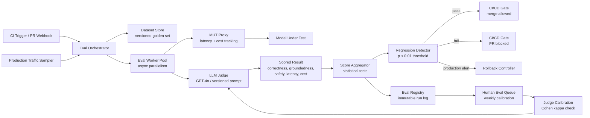

# Chapter 27: Evaluation at Scale

## Context

> [!info] Quick Reference
> - **Pattern:** Automated eval pipeline with eval pyramid, LLM-as-judge scoring, regression tracking, and CI/CD integration
> - **Scale:** Applies to any production LLM system; complexity compounds at >= 10K evals/day or >= 5 model dimensions tracked
> - **Key Techniques:** Eval pyramid (unit → integration → human), LLM-as-judge with calibration, benchmark selection, dataset curation with decontamination, regression golden sets, A/B testing with statistical power, continuous eval in CI/CD, multi-dimensional weighted scoring
> - **Primary Concerns:** Judge quality, dataset contamination, false regression alerts, eval latency/cost, metric coverage vs observability overhead
> - **Cross-references:** Chapter 2 (LLM stack patterns), Chapter 5 (guardrails), Chapter 25 (prompt engineering), Chapter 22 (agentic systems — eval surfaces multiply)

**Problem statement:** Design an automated evaluation pipeline for a production LLM system that continuously measures output quality, safety, and reliability across model updates — at a cost and latency that makes running evals on every code change feasible, with alerting thresholds calibrated to minimize false positives while catching genuine regressions before they reach users.

### Real-World Examples

- A team ships a new system prompt to reduce verbosity in a customer support bot. The model's BLEU score against golden responses improves by 8%, so the change ships. Two days later, user satisfaction drops 12 points because the model started truncating multi-step instructions. BLEU measured surface-level brevity, not completeness. An LLM-as-judge scoring correctness and completeness separately would have caught the regression.
- A code generation model is upgraded from version 3 to version 4. The engineering team runs HumanEval and finds a 3% improvement. In production, latency p99 increases 40% and cost per request increases 25%. The eval pipeline did not track latency or cost as first-class metrics. Shipping the upgrade doubled the infrastructure bill before anyone noticed.

---

## Step 1: Understand the Problem and Establish Design Scope

### Functional Requirements

- Run automated evals on every pull request and every production model deployment.
- Support multiple eval types: unit evals (single-turn, deterministic), integration evals (multi-turn, tool-use), and human evals (async, sampled).
- Score responses on multiple dimensions: correctness, groundedness, safety, latency, and cost per request.
- LLM-as-judge for open-ended quality scoring, calibrated against human labels.
- Maintain a versioned golden dataset for regression testing, with coverage across task types and difficulty levels.
- Detect regressions with statistical rigor — alert only when the drop is statistically significant at p < 0.01.
- Support A/B testing between model versions with minimum detectable effect (MDE) guarantees.
- Integrate with CI/CD: block PRs that fail eval gates; trigger rollback on production regression.
- Log every eval run with model version, dataset version, judge prompt version, and per-dimension scores.

### Non-Functional Requirements

- **Latency:** CI eval pipeline completes in <= 30 minutes for a standard run of <= 500 evals.
- **Cost:** eval pipeline cost <= $50 per full CI run at 500 evals; <= $500 per production regression run at 5,000 evals.
- **Reliability:** eval pipeline itself achieves >= 99.5% success rate; flaky infra must not cause false regression alerts.
- **Auditability:** every eval result is immutably logged with version IDs for compliance.
- **Scalability:** pipeline must scale from 500 to 100,000 evals without architectural changes — only parallelism tuning.
- **Coverage:** golden dataset covers >= 95% of task-type distribution by frequency; >= 20% of tail-distribution edge cases.

### Back-of-the-Envelope Estimation

#### Cost Model

Assume:

- **Judge model:** GPT-4o at $2.50/1M input tokens, $10.00/1M output tokens.
- **Eval prompt to judge:** 800 tokens input (system prompt + question + model response + rubric), 100 tokens output (score + rationale).
- **Cost per eval:** `(800 / 1M * $2.50) + (100 / 1M * $10.00) = $0.002 + $0.001 = $0.003`
- **CI run (500 evals):** `500 * $0.003 = $1.50` — well within the $50 budget.
- **Production run (5,000 evals):** `5,000 * $0.003 = $15.00` — well within the $500 budget.
- **Daily cost at 50 CI runs:** `50 * $1.50 = $75.00/day`

#### Latency Model

- Evals run in parallel: 50 concurrent judge calls.
- Judge latency: 2-4 seconds per call.
- **Parallelism needed for 500 evals in 30 minutes:** `500 / (30 * 60 / 3) = 500 / 600 = < 1 concurrent call.` Even 10 concurrent calls finishes in < 2 minutes.
- **Bottleneck at 100K evals:** `100,000 / 50 concurrent * 3s = 6,000s = 100 minutes`. Need 200+ concurrent for 30-minute budget. Use async batch API or increase parallelism with rate-limit negotiation.

#### Dataset Storage

- Golden dataset: 10,000 examples per task type, 8 task types = 80,000 examples.

#### Statistical Power Budget

For A/B testing between model versions:

- Baseline metric: 82% correctness score.
- MDE (minimum detectable effect): 2 percentage points.
- Alpha: 0.01 (1% false positive rate per test).
- Power: 0.90.
- Required sample size per variant: ~3,200 examples.
- At 5,000 evals per production run: sufficient for 1 primary metric A/B test.

---

## Step 2: Propose High-Level Design and Get Buy-In

### Core Architecture Components

- **Eval Orchestrator:** accepts an eval job (model ID, dataset ID, judge config), fans out individual eval tasks to workers, collects results, computes aggregate scores and regression signals. It is the single point of coordination: every eval run is addressable by a stable run ID, enabling the CI/CD gate to poll for completion and the registry to log the full result atomically.
- **Eval Worker Pool:** stateless workers that take a single (prompt, model_response, rubric) triple, call the judge, and return a scored result. Statelessness is essential for horizontal scaling — any worker can handle any task without shared in-memory state, so provisioning 200 workers to hit the 30-minute latency budget requires no application-level changes.
- **Model Under Test (MUT) Proxy:** wraps the model being evaluated; handles retry, timeout enforcement, and records per-request latency and token counts for every call. Centralizing latency and cost measurement in the proxy ensures these non-quality metrics are captured consistently regardless of which worker is executing, and allows the eval pipeline to track cost-per-request as a first-class regression dimension.
- **LLM Judge:** a separate model (GPT-4o or equivalent) that scores the MUT response given the rubric. The judge prompt is versioned independently of the eval dataset so that rubric improvements can be tracked and calibrated without invalidating historical score comparisons — a judge prompt change is treated as a breaking change requiring a recalibration run.
- **Dataset Store:** versioned, immutable golden dataset with per-example task type, difficulty tier, and expected-output metadata. Immutability is critical for reproducibility — a regression comparison is only valid if both the baseline run and the current run used the same dataset version, so the store enforces append-only versioning rather than in-place edits.
- **Score Aggregator:** computes per-dimension statistics (mean, p10, p90, pass rate) and runs statistical tests (Welch's t-test, Mann-Whitney U) against the baseline snapshot. Computing p10 alongside mean catches tail regressions that the mean hides — a model that improves median correctness while degrading the worst 10% of responses appears healthy in aggregate but is failing specific user segments.
- **Regression Detector:** compares current run scores against baseline; fires alerts if any dimension drops beyond the configured threshold at p < 0.01. It applies both a statistical significance check and a minimum effect-size check before triggering, preventing the false alert cascade that occurs when large-n runs make every small fluctuation statistically significant.
- **Eval Registry:** stores every eval run result with full metadata — model version, dataset version, judge prompt version, per-dimension scores, statistical test results, alert status. The registry is the compliance backbone: in regulated industries, auditors require proof that every model version was evaluated before deployment, and the registry provides this lineage in a queryable, immutable log.
- **CI/CD Gate:** integrates with GitHub Actions / GitLab CI; polls the Eval Orchestrator until run completes; fails the pipeline if regression is detected or blocks PR from merging. By failing the pipeline rather than posting an advisory comment, the gate enforces a hard quality contract — engineers cannot accidentally merge a regressing change because they missed the warning.
- **Rollback Controller:** subscribes to regression alerts in production; triggers blue-green or canary rollback via the deployment system. Automating rollback rather than paging on-call first reduces mean time to recovery (MTTR) from the typical 20-40 minutes for a human to respond, investigate, and act, to under 5 minutes for a fully automated reversal.
- **Human Eval Queue:** routes sampled responses to human annotators (via Labelbox, Scale AI, or internal tools) for periodic calibration of the LLM judge. Human annotation is not on the critical path of CI — it runs weekly in async batches — but it is the only ground-truth signal that prevents the judge from drifting silently over time as the model's output distribution changes.

### Pipeline A: CI Pre-Merge Eval

1. PR opened; CI triggers eval job via webhook. The webhook payload carries the branch's model artifact ID, allowing the orchestrator to spin up the correct MUT version without manual configuration.
2. Eval Orchestrator selects CI eval dataset (500-sample stratified subset of golden set). The subset is drawn with stratified sampling to mirror the full golden set's task-type distribution — not a random 10% — so that rare but important task types remain represented even at reduced scale.
3. Workers call MUT (the branch's model version) and the baseline model in parallel. Running both versions simultaneously against the same dataset controls for any time-of-day variation in judge response quality or API latency that would otherwise introduce noise into the delta computation.
4. Each response scored by LLM judge on correctness, groundedness, safety. Scores are returned as structured JSON with per-example rationale stored for later audit; the rationale is the primary artifact for debugging regression root causes.
5. Score Aggregator computes delta vs baseline, including per-task-type breakdowns so the CI report shows not only overall correctness but whether any specific task category drove the change.
6. Regression Detector checks statistical significance with Bonferroni-corrected alpha (0.01 / n_dimensions) to control family-wise error rate across all dimensions tested simultaneously.
7. CI Gate posts result to PR: pass/fail with per-dimension breakdown. A failing gate posts an actionable comment citing the regressing dimension, the delta magnitude, the p-value, and a link to the eval registry run for deeper inspection.

### Pipeline B: Production Continuous Eval

1. Production model serves live traffic; 5% of requests sampled (no PII). The 5% rate is chosen to accumulate ~3,200 samples per 24 hours at typical enterprise traffic volumes — enough for statistically powered regression detection — while keeping sampling overhead below 0.1ms per request via reservoir sampling at the load balancer tier.
2. Sampled responses queued for judge scoring (async, not on the hot path). Decoupling scoring from the live request path is critical: judge latency of 2-4 seconds per call must never add to user-perceived latency, so responses go to a Kafka topic and workers consume asynchronously with at-least-once delivery semantics.
3. Score Aggregator updates rolling 1-hour and 24-hour windows. The 1-hour window enables rapid detection of acute regressions (e.g., a bad config push); the 24-hour window filters out transient fluctuations caused by time-of-day query distribution shifts without requiring enough data to be statistically stable.
4. Regression Detector checks every 15 minutes against the pre-deployment baseline. The 15-minute cadence is chosen to balance detection latency against the minimum sample size needed per check: at 5% sampling, 15 minutes yields ~30-50 samples depending on traffic volume, which is sufficient for detecting large regressions (>5pp) but not subtle ones (<2pp) — the daily window handles the latter.
5. On regression: Rollback Controller notifies on-call and triggers canary rollback. Rollback is staged — canary traffic (5%) is reverted first, giving the on-call engineer a 10-minute window to confirm the signal before full rollback completes, preventing overcorrection from a transient false alert.

### Pipeline C: Human Calibration Loop

1. Weekly: 200 responses sampled from production traffic, stratified by task type. Stratification is essential because the judge may be well-calibrated on common task types (factual QA) but systematically off on rare ones (multi-step math) — a flat random sample would under-represent the failure modes the calibration is most needed to catch.
2. Sent to human annotators with the same rubric used by the LLM judge. Annotators use a structured annotation tool that presents the rubric inline and prevents seeing the judge's score until after they have submitted their own — preventing anchoring bias that would inflate apparent kappa.
3. Cohen's kappa computed between human labels and judge labels. Ordinal-weighted kappa is used rather than simple kappa because a disagreement of 1 point on a 5-point scale is less serious than a disagreement of 4 points — the ordinal weighting penalizes large disagreements proportionally.
4. If kappa < 0.70: judge prompt flagged for revision; team reviews disagreements. The review focuses on the specific examples where human and judge disagree by 2+ points — these are the examples where the rubric anchor is ambiguous or the judge has a systematic blind spot, and they drive the revision.
5. Revised judge prompt goes through its own eval gate before deployment. The revised prompt is evaluated on the same 200-example calibration set before it can be promoted to production, ensuring that prompt changes improve kappa rather than introducing new disagreement patterns.

### Mermaid Architecture Diagram



---

## Step 3: Design Deep Dive

Focus areas for this chapter:

1. **LLM-as-Judge Design and Calibration**
2. **Dataset Curation and Regression Golden Sets**
3. **Statistical Rigor: Regression Detection and A/B Testing**
4. **Latency and Cost Budgeting for Eval Pipelines**

---

### 1) LLM-as-Judge Design and Calibration

#### Trade-off Table: Scoring Approaches

| Approach | Agreement with Humans | Cost/eval | Scalability | Best For |
|---|---|---|---|---|
| Human labelers | Ground truth — defines the agreement baseline all other methods are measured against | $0.15-$0.50 per label; at 100K evals/day this is $15K-$50K/day, making human-only pipelines economically impossible at production scale | Low: annotation turnaround is 24-72 hours per batch, incompatible with CI latency budgets | Calibration sets (200-500 examples/month) and high-stakes audits where legal or compliance liability requires a human decision |
| LLM-as-judge (calibrated) | 85-92% kappa agreement when the judge prompt is calibrated monthly against human labels and rubric anchors are explicit | $0.001-$0.005 per eval at GPT-4o rates; at 100K evals/day cost is $100-$500/day — 100x cheaper than human labeling | High: completes 500 evals in under 5 minutes with 50 concurrent workers; scales linearly with parallelism up to API rate limits | Production CI regression tracking, A/B testing, and any quality dimension that requires understanding semantics rather than surface patterns |
| LLM-as-judge (uncalibrated) | 65-80% — the judge introduces systematic biases (verbosity preference, positional bias) that inflate scores for longer or first-listed responses | $0.001-$0.005 per eval; same cost as calibrated, but the signal quality does not justify the cost for production decisions | High: same throughput as calibrated judge | Prototyping and coarse directional signal during early development before a calibration set exists |
| Rule-based / BLEU / ROUGE | 40-70% on open-ended tasks; BLEU rewards n-gram overlap and penalizes paraphrases even when semantically equivalent — a correct answer using synonyms scores near zero | Less than $0.0001 per eval; purely computational, no API cost | Very High: millions of evals per second on a single CPU, no rate limits | Exact-match tasks with a small canonical output space (e.g., structured data extraction, translation into a fixed target dialect) where lexical overlap correlates with semantic equivalence |
| Embedding cosine similarity | 70-80% agreement on semantic similarity tasks; cannot detect factual errors when two semantically similar sentences have opposite truth values | ~$0.0001 per eval using a local sentence encoder; $0.00002 per eval using OpenAI text-embedding-3-small | High: embedding inference is fast (5-20ms per pair) and can run on local GPU without external API calls | Detecting semantic drift in model outputs, near-duplicate detection in golden set decontamination, and retrieval quality in RAG systems — not for factuality or safety scoring |

> **Why LLM-as-judge over human labelers at scale:** Human labelers cost ~$0.15-0.50 per eval; at 100K evals/day, that is $15K-50K/day.

> **Why not BLEU/ROUGE for open-ended generation:** BLEU/ROUGE measure n-gram overlap — a response can be semantically identical to the reference but score near 0 if it uses different synonyms.

#### Judge Prompt Construction

The judge prompt has four mandatory sections:

1. **Role and capability declaration:** "You are an expert evaluator for LLM-generated responses. Your task is to score the following response objectively using the provided rubric."
2. **Rubric with explicit anchors:** define each score point (1-5) with a concrete example or behavioral description. Vague rubrics produce high variance.
3. **Structured output schema:** require the judge to output JSON with `score` (int 1-5) and `rationale` (string, <= 100 words). No markdown wrapping.
4. **Constraint against positional and verbosity bias:** explicitly instruct the judge not to prefer longer responses or the first option presented.

```text
[JUDGE SYSTEM PROMPT]
You are an expert LLM response evaluator. Score the response below on CORRECTNESS only.
Do not reward longer responses. Do not penalize brevity. Judge only factual accuracy.

RUBRIC:
5 - Fully correct. All factual claims verified against the provided context. No hallucinations.
4 - Mostly correct. One minor inaccuracy that does not affect the main answer.
3 - Partially correct. Correct direction but missing key facts or one material error.
2 - Mostly incorrect. Correct framing but wrong key facts.
1 - Incorrect or hallucinated. Response contradicts the context or fabricates information.

OUTPUT FORMAT (JSON only, no markdown):
{"score": <int 1-5>, "rationale": "<string, max 100 words>"}

Most important: base your score only on the provided context. Do not use external knowledge.
```

> **Why explicit rubric anchors reduce variance:** A rubric that says "score 1-5 for correctness" produces high inter-rater variance — the judge must infer the boundaries.

#### Bias Mitigation

Three systematic biases degrade judge quality:

**Positional bias:** when comparing two responses (A/B format), the judge prefers the first option at rates of 60-70% regardless of quality. Mitigation: always run comparison evals with both orderings (A-then-B and B-then-A) and average the scores. Flag cases where the orderings disagree as "uncertain."

**Verbosity bias:** the judge scores longer responses higher even when length adds no quality. Mitigation: explicit instruction in the judge system prompt ("do not reward length; judge correctness only"); separate rubrics for completeness vs conciseness.

**Self-preference bias:** a Claude judge prefers Claude-generated responses; a GPT-4o judge prefers GPT-4o responses. Mitigation: use a judge from a different provider family than the MUT whenever possible. Alternatively, use an ensemble of two judges from different families and require agreement.

> **Why averaging over both orderings for pairwise evals:** Positional bias is deterministic — the model applies it consistently to every comparison.

#### Calibration Against Human Labels

Calibration procedure:

1. Sample 500 responses from production, stratified by task type.
2. Human annotators score each response with the same rubric (5-point scale).
3. Judge scores the same 500 responses independently.
4. Compute Cohen's kappa (ordinal weights) between human and judge scores.
5. **Target: kappa >= 0.70** (substantial agreement). Below 0.70: revise the judge prompt or rubric.
6. Run calibration monthly, or after any judge prompt change.

If the judge systematically under-scores (human average 3.8, judge average 3.1): add score-anchoring examples in the few-shot block showing what a "4" looks like. If the judge over-scores: add hard negative examples of responses that look good but are factually wrong.

> **Why Cohen's kappa over Pearson correlation for calibration:** Pearson measures linear correlation but ignores systematic bias.

---

### 2) Dataset Curation and Regression Golden Sets

#### Trade-off Table: Dataset Curation Strategies

| Strategy | Coverage Quality | Maintenance Cost | Contamination Risk | Best For |
|---|---|---|---|---|
| Manual curation only | High: expert curators write examples targeting known failure modes and edge cases, producing the highest signal-to-noise ratio per example | Very High: requires dedicated annotation staff; at $0.20-0.50/example and 10,000 examples per task type, a full golden set costs $2K-$5K to build and $500-$1K/month to maintain | Low: internal examples derived from proprietary sources are unlikely to appear in any pretraining corpus | Small, high-stakes datasets of 500-2,000 examples where each example is carefully reviewed by a domain expert (legal, medical, financial domains) |
| Production traffic sampling | High: real queries from real users represent the true distribution of what the model encounters; coverage naturally tracks distribution shifts as user behavior evolves | Medium: requires an anonymization pipeline to strip PII before storage, and a human review step to label sampled responses — typically 2-4 hours/week of annotator time | Medium: queries derived from user traffic may overlap with public data sources that were in the model's pretraining corpus, requiring decontamination checks | Regression testing and distribution tracking where the goal is detecting quality shifts on the actual user query distribution |
| Benchmark adoption (MMLU, HumanEval) | Variable: strong for capability measurement (MMLU covers 57 subjects; HumanEval covers Python coding) but weak for application-specific regression because benchmark tasks rarely match a specific product's query distribution | Low: no curation effort; benchmarks are downloaded and versioned once; updates require tracking upstream benchmark changes | High: models trained after 2022 may have seen benchmark examples verbatim during pretraining, inflating scores by 5-15% on contaminated subsets | Capability spot-checks after major base model upgrades, not primary regression signals for fine-tuned application models |
| Synthetic generation | Controllable: an LLM generator can be prompted to fill specific coverage gaps (rare languages, edge-case query structures) that are underrepresented in production traffic | Low: generation cost is $0.001-$0.01/example at GPT-4o rates; refreshing 1,000 synthetic examples costs $1-$10 and takes minutes | Unknown: synthetic examples generated by an LLM may inadvertently mirror patterns from the generator's training data; decontamination against known sources is required | Filling coverage gaps in the golden set where production traffic is sparse (tail languages, rare task types) and for augmenting difficulty by generating adversarial examples |
| Hybrid: curated + sampled + synthetic | Best overall: manual curation provides high-quality anchors for difficulty calibration; production sampling tracks real distribution; synthetic generation fills tail coverage gaps | High: orchestrating three curation pipelines with different refresh cadences requires dedicated tooling and ownership; budget 4-8 hours/week of engineering time for maintenance | Low with decontamination: the decontamination pipeline checks all three source types before adding examples to the golden set | Production-grade golden sets at scale where regression detection must be both statistically powered and representatively distributed across real user query types |

#### Benchmark Selection

**MMLU (Massive Multitask Language Understanding):** 57 subjects, 14K questions. Use for: measuring knowledge breadth on a new base model, particularly when evaluating whether a base model upgrade has degraded general knowledge retention. Do not use for: regression testing your fine-tuned application model — MMLU measures general knowledge from the pretraining distribution, not the task-specific behaviors your fine-tune is optimizing, and a correct fine-tune may slightly reduce MMLU while improving task performance.

**HumanEval:** 164 Python coding problems with unit test validation, making correctness objectively binary — the generated code either passes the tests or it does not. Use for: code generation capability evals where you want a ground-truth signal without a judge model. Do not use for: measuring code style, documentation quality, code generation in non-Python languages, or tasks requiring context beyond the function signature — HumanEval problems are self-contained and do not capture the complexity of production code generation tasks.

**HellaSwag:** 70K commonsense NLI sentence-completion tasks where the model must select the most plausible continuation from four candidates. Use for: measuring base model reasoning on commonsense inference, especially for comparing pretrained models before any fine-tuning. Do not use for: application-specific regression testing — the commonsense completion format does not represent any real product use case and does not predict regression in instruction-following, factual QA, or code generation.

**MT-Bench:** 80 multi-turn questions across 8 categories (writing, roleplay, reasoning, math, coding, extraction, STEM, humanities), scored by GPT-4 as judge on a 1-10 scale. Use for: instruction-following and multi-turn quality measurement, particularly for comparing general-purpose chat model versions against each other. Best fit for evaluating whether a model update has degraded conversational coherence or instruction adherence in multi-turn contexts that single-turn benchmarks cannot capture.

> **Why no single benchmark covers production regression needs:** Each benchmark measures one narrow capability slice on a distribution that differs from most production applications.

> **Why not use MMLU as a regression signal for fine-tuned models:** MMLU measures general knowledge from the base model's training distribution.

#### Difficulty Stratification

A flat golden set biases regression detection toward average-difficulty examples. A stratified set ensures regressions on edge cases are visible:

- **Easy (40%):** examples the baseline model gets right 95%+ of the time. These detect catastrophic regressions — if a model update causes failure on easy examples (simple factual questions, basic format compliance), that is an immediate signal of a serious breakage such as a system prompt corruption or wrong model version being served. Easy examples should never regress; when they do, the regression magnitude is large enough to detect quickly even at small sample sizes.
- **Medium (40%):** examples the baseline model gets right 60-80% of the time. These are the primary regression signal for normal model updates — the quality improvement or degradation from a prompt change or fine-tuning step is most visible in this difficulty band, where the model is operating near the edge of its capability and small changes in the distribution shift pass/fail outcomes.
- **Hard (20%):** examples the baseline model gets right 20-40% of the time. These detect improvements and subtle regressions on edge cases — multi-step reasoning problems, adversarial prompts, or rare domain-specific queries. Hard examples are included primarily to make improvements visible (otherwise a model could improve on hard examples while looking flat on easy/medium) and to catch the class of regression where capability on complex tasks degrades while simple tasks remain stable.

> **Why weight hard examples at only 20%:** Hard examples have high variance — small prompt or sampling changes cause large score swings that are not meaningful regressions.

#### Decontamination

Training data contamination occurs when eval examples appear verbatim (or near-verbatim) in the model's training corpus. A contaminated eval overestimates the model's true capability and under-reports regressions on genuinely held-out tasks.

Decontamination procedure:

1. Embed all golden set examples with a sentence encoder.
2. Embed all available training data (if accessible) or the model's known pretraining data sources.
3. Flag any golden set example with cosine similarity >= 0.95 to a training example (near-duplicate).
4. Remove flagged examples; replace with freshly curated ones.
5. For public benchmarks (MMLU, HumanEval): assume contamination exists. Use only for capability spot-checks, not as primary regression signal for models trained after benchmark publication.

> **Why 0.95 cosine similarity as the decontamination threshold:** Below 0.95, two sentences may share topic and vocabulary but differ in meaning — they are not duplicates.

#### Golden Set Maintenance

- **Refresh cycle:** monthly, add 200 new examples from production traffic (anonymized, human-reviewed). Retire examples that the model gets right 99%+ of the time for three consecutive months (they no longer discriminate).
- **Coverage audit:** quarterly, compute the semantic coverage of the golden set against the current production query distribution using embedding clustering. Identify clusters with < 2% golden set representation; add targeted examples.
- **Version control:** golden set is versioned in a catalog (dataset_id, version, size, coverage_stats, created_at). Every eval run records the dataset version for reproducibility.

---

### 3) Statistical Rigor: Regression Detection and A/B Testing

#### Trade-off Table: Statistical Test Choices

| Test | Assumption | Use When | Weaknesses |
|---|---|---|---|
| Welch's t-test | Approximate normality, which holds for n > 30 by the Central Limit Theorem even when individual scores are not normally distributed; does not assume equal variances between baseline and current | Continuous scores (1-5 correctness scale aggregated to means) where the primary regression signal is a shift in the mean; at n=500 evals per run, provides sufficient power to detect a 0.1-point shift at alpha=0.01 | Sensitive to outliers: a small number of catastrophically wrong responses (score=1 on a mostly 4-5 distribution) inflates variance and can both mask a real regression and reduce power, making a parallel p10 check advisable |
| Mann-Whitney U | Non-parametric: makes no distributional assumption; works on ordinal data where the distance between scale points is not well-defined | Pass/fail rates and ordinal scores where the underlying distribution is clearly non-normal; also preferred when the MUT produces a bimodal score distribution (either fully correct or completely wrong) | Less statistical power than Welch's t-test at the same sample size — approximately 15-20% more samples are needed to achieve the same alpha/power combination, which matters when CI eval budgets limit run size |
| Bootstrap confidence interval | None: the only assumption is that the observed sample is representative of the population; resamples the data with replacement to estimate the sampling distribution empirically | Small samples (n < 30) where asymptotic tests are unreliable, and for any metric where the exact test statistic distribution is unknown (e.g., geometric mean of latency ratios) | Computationally expensive: 10,000 bootstrap iterations on 500 scores takes ~2-5 seconds in Python; parallelizable but adds pipeline latency; not suitable as the primary test for large-n runs where Welch's test is both faster and more powerful |
| Proportion z-test | Binomial: each example is an independent Bernoulli trial (pass or fail) and the two proportions being compared come from independent samples | Binary pass/fail metrics such as safety pass rate (did the model produce any unsafe content?), format compliance (is the output valid JSON?), or exact-match correctness on classification tasks | Not appropriate for continuous scores on a 1-5 rubric, where treating the score as a proportion (e.g., "fraction of examples scoring >= 3") discards magnitude information and reduces statistical power |

#### Regression Detection Algorithm

For each metric dimension d in {correctness, groundedness, safety, latency_p95, cost_per_request}:

1. Compute `score_baseline[d]` from the most recent production run (the "golden snapshot").
2. Compute `score_current[d]` from the current eval run.
3. Run Welch's t-test (or Mann-Whitney U for pass/fail metrics): compute p-value.
4. Compute effect size (Cohen's d or percentage delta).
5. **Alert condition:** `p < 0.01 AND delta < -threshold[d]`. Threshold per dimension:
   - Correctness: -2 percentage points.
   - Groundedness: -2 percentage points.
   - Safety: -0.5 percentage points (lower tolerance; safety regressions are critical).
   - Latency p95: +15% (increase = regression).
   - Cost per request: +20% (increase = regression).

> **Why p-value < 0.01 for regression alerts:** p < 0.05 gives a 5% false positive rate per test; with 20 metrics monitored, that is ~1 false alert per eval run.

> **Why require both p < 0.01 AND delta > threshold:** Statistical significance alone is not enough — at large n (10,000 evals), a 0.1 percentage point drop is statistically significant but practically irrelevant.

#### Multiple Testing Correction

When testing 20 dimensions simultaneously, the family-wise error rate (FWER) without correction is `1 - (1 - 0.01)^20 = 18%` — nearly 1 in 5 runs produces at least one false alert. Apply Bonferroni correction: use alpha = 0.01 / 20 = 0.0005 per test. At n = 5,000 evals per run, this requires a larger effect size to achieve significance, which is appropriate — we want to be conservative.

For correlated dimensions (correctness and groundedness often move together), use Holm-Bonferroni correction instead of standard Bonferroni — it is less conservative while still controlling FWER.

#### A/B Testing LLM Updates

When comparing two model versions in production:

1. **Traffic split:** hash(request_id) % 100 < split_percentage → new model; else → baseline model. Deterministic hash-based splitting ensures the same request always goes to the same variant — preventing a user from receiving different model versions across retry attempts, which would contaminate the user experience and make the eval signal unreliable. User-level splitting (hash(user_id)) is preferable when the task involves multi-turn sessions, to prevent a user from experiencing both model versions within a single conversation.
2. **Minimum detectable effect:** define MDE before running. For correctness at 82% baseline, a 2pp MDE at alpha=0.01 and power=0.90 requires ~3,200 samples per variant. Defining the MDE before running prevents the team from extending the test until a favorable result appears (optional stopping), which inflates the false positive rate. The MDE should reflect the business threshold below which a quality difference is not actionable — if the team would not ship a model with a 0.5pp improvement, setting MDE to 0.5pp wastes statistical power on an unactionable signal.
3. **Run duration:** collect traffic for >= 48 hours to capture weekday/weekend and time-of-day variation. Stopping early when you see a positive result inflates false positive rate. The 48-hour minimum is a practical approximation of one full traffic cycle; teams with strong weekly patterns (e.g., enterprise products with no weekend traffic) should run for 7 days to capture a full Monday-Friday cycle.
4. **Guardrail metrics:** always include safety and error rate as guardrail conditions. If the treatment wins on correctness but loses on safety, the test fails regardless of the correctness improvement magnitude. Guardrail metrics are checked against a one-tailed threshold (any degradation is a failure) rather than the two-tailed test used for primary metrics — safety regressions have no acceptable minimum effect size.
5. **Sequential testing option:** for long-running A/B tests, use O'Brien-Fleming group sequential boundaries rather than fixed-horizon tests. This allows intermediate analysis at pre-specified interim looks (e.g., at 25%, 50%, 75%, and 100% of target sample size) without inflating the family-wise false positive rate — the O'Brien-Fleming boundaries require a larger effect size for significance at early looks and relax the requirement as the sample approaches the pre-specified target, which is the statistically correct behavior for early stopping.

> **Why 48-hour minimum run duration:** LLM traffic has strong diurnal and weekly patterns — weekday morning enterprise users ask different questions than weekend evening consumer users.

---

### 4) Latency and Cost Budgeting for Eval Pipelines

#### Eval Pyramid Cost Profile

The eval pyramid allocates budget by layer:

| Layer | Frequency | Sample Size | Cost/Run | Primary Signal |
|---|---|---|---|---|
| Unit evals | Every commit | 100-500 | $0.30-$1.50 | Correctness, format, safety |
| Integration evals | Every PR | 500-2,000 | $1.50-$6.00 | Multi-turn quality, tool use |
| Full regression | Every deployment | 5,000-20,000 | $15-$60 | Regression vs. baseline |
| Human evals | Weekly | 200-500 | $30-$250 | Judge calibration, catch blind spots |

> **Why the pyramid shape:** Unit evals are fast and cheap — they run on every commit and catch obvious regressions early.

#### Parallelism and Rate Limit Management

Running 5,000 judge calls synchronously takes `5,000 * 3s = 4.2 hours`. With 100 concurrent workers: `5,000 / 100 * 3s = 150s = 2.5 minutes`. Parallelism is the primary lever.

Rate limit arithmetic (OpenAI GPT-4o Tier 3: 10,000 RPM):

- 5,000 evals in 30 minutes = 5,000 / 30 = 167 RPM → well within limits.
- 100,000 evals in 30 minutes = 100,000 / 30 = 3,333 RPM → within limits but approaching; use the Batch API at 50% cost reduction for async runs.

> **Why use the Batch API for production regression runs:** The OpenAI Batch API accepts up to 50,000 requests and returns results within 24 hours at 50% cost reduction.

#### Cost Gating: Adaptive Eval Depth

Running full 5,000-eval regression on every PR is wasteful when the change is a documentation fix. Implement adaptive eval depth:

1. Classify the PR into one of four tiers based on file path patterns in the diff: docs-only (changes only to `*.md`, `*.rst`, `docs/`), config-only (changes only to non-model configuration such as environment variables, infrastructure YAML), prompt change (any change to system prompts, few-shot examples, or retrieval templates), model code change (changes to model loading, inference code, or fine-tuning scripts), model version upgrade (a bump to the model artifact ID or API model name). The classification uses path-based rules first (deterministic and auditable) with an optional diff classifier for ambiguous cases.
2. Map PR class to eval tier: docs-only → skip eval entirely (zero cost); config-only → 100 unit evals ($0.30, completes in < 30 seconds); prompt change → 500 integration evals ($1.50, completes in under 5 minutes); model code change → 2,000-example regression ($6.00, completes in under 20 minutes); model version upgrade → full 5,000-example regression ($15.00, completes in under 30 minutes). The tier ladder ensures that the eval cost is proportional to the risk surface of the change.
3. PR classification uses a simple rule-based system (file path matching via glob patterns) as the default because it is deterministic, auditable, and requires no model inference. An optional lightweight diff classifier (fine-tuned BERT, ~50ms, runs locally) handles edge cases such as a PR that modifies both documentation and a prompt file — the classifier can identify whether the prompt change is substantive or cosmetic based on the actual content of the diff, and can be overridden by a PR label for cases the classifier gets wrong.

> **Why adaptive eval depth over always running the full regression:** At 50 PRs/day, running 5,000-eval regression on every PR costs `50 * $15 = $750/day`.

---

