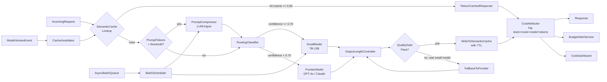

# Chapter 28: Cost Optimization as a Design Concern

## Context

> [!info] Quick Reference
> - **Pattern:** Multi-layer cost reduction pipeline — semantic cache → model router → prompt compressor → output length controller → batching → quantized self-hosted fallback
> - **Scale:** Cost pressure begins at ~$5K/month in API spend; architectural changes pay off at >= $20K/month
> - **Key Techniques:** Semantic caching with cosine threshold, cascading model routing, LLMLingua prompt compression, output length control, continuous batching, INT8/INT4 quantization, speculative decoding, right-sizing GPU compute
> - **Primary Concerns:** Cost per request, quality preservation, latency SLOs, cache freshness, routing accuracy
> - **Cross-references:** Chapter 2 (LLM stack patterns), Chapter 5 (evaluation), Chapter 21 (RAG platform), Chapter 25 (prompt engineering — compression prerequisite), Chapter 4 (continuous batching deep dive), Chapter 8 (speculative decoding deep dive), Chapter 31 (quantization deep dive)

**Problem statement:** Design a production LLM cost optimization system that treats inference spend as a first-class design constraint — reducing cost-per-request by 40-70% while preserving quality SLOs, maintaining p95 latency budgets, and providing per-team cost attribution for budget governance.

### Real-World Examples

- A customer support platform serving 2M queries/day runs every request through GPT-4o at an average of 1,800 input tokens and 400 output tokens. Monthly API cost: $432,000. After adding a semantic cache (40% hit rate), a routing classifier (60% of misses go to a small model), and prompt compression (25% token reduction on cache misses), cost drops to $112,000/month — a 74% reduction with no measurable change in user satisfaction scores.
- A RAG pipeline generates 4,000-token context windows for every query. The team discovers through cost attribution that one product team's "fetch all documents" retrieval strategy consumes 38% of total spend despite handling 9% of traffic. Targeted retrieval truncation and caching reduce that team's cost by 65% without changing answer quality on their benchmark.

---

## Step 1: Understand the Problem and Establish Design Scope

### Functional Requirements

- Reduce cost-per-request by >= 50% at current traffic volume with no quality regression beyond 0.2 points on the 1-5 helpfulness scale.
- Serve interactive queries with p95 latency <= 3s; batch queries have no real-time constraint.
- Provide semantic caching for high-repetition query categories with configurable similarity thresholds and TTL policies.
- Route queries to the cheapest model that can handle them at acceptable quality, with automatic fallback to the frontier model on low-confidence routing decisions.
- Compress prompts exceeding a configurable token threshold before API dispatch.
- Control output length through per-route `max_tokens` caps and stop sequences.
- Attribute cost per team, per route, and per model with real-time dashboards and budget alert thresholds.
- Support batching of async workloads to take advantage of volume pricing and continuous batching efficiency.

### Non-Functional Requirements

- **Latency:** cache lookup < 20ms p95; routing classifier < 10ms p95; prompt compression < 50ms p95 for prompts up to 8K tokens.
- **Quality:** user helpfulness rating >= 4.1/5.0; factual accuracy regression <= 2% on golden dataset.
- **Cache freshness:** cache entries invalidated within 1 hour of model version updates; TTL configurable per route (default 24h).
- **Cost attribution:** per-team spend visible with < 5-minute lag; budget alerts trigger at 80% of monthly cap.
- **Reliability:** optimization pipeline failure (cache miss + router error) must fall back to direct frontier model call with no user-visible error.
- **Observability:** every request tagged with optimization path taken (cache hit / routed-small / routed-large / compressed / full) for cost and quality analysis.

### Back-of-the-Envelope Estimation

#### Current Cost Anatomy

Assume representative pricing (blended frontier model):

- Input: $3.00 / 1M tokens
- Output: $15.00 / 1M tokens

Current traffic:
- **Daily requests:** 2,000,000
- **Average input:** 2,000 tokens → 4B input tokens/day → **$12,000/day input cost**
- **Average output:** 350 tokens → 700M output tokens/day → **$10,500/day output cost**
- **Total:** ~$22,500/day → **~$675,000/month** (close to the stated $300K/month at lower traffic; using this math for illustration)

#### Target Reduction Layered Model

| Optimization Layer | Applies To | Reduction Mechanism | Expected Savings |
|---|---|---|---|
| Semantic cache (40% hit rate) | All query types | Skip inference entirely | 40% of total spend |
| Small model routing (60% of misses) | Routable simple queries | 10x cheaper model | 15% of remaining |
| Prompt compression (25% reduction) | Cache misses > 1,500 tokens | Fewer input tokens | 8% of remaining |
| Output length control | All non-cache responses | Fewer output tokens | 5% of remaining |
| Batching (async workloads) | 60% of requests | Volume discount + efficiency | 4% of remaining |
| **Combined (compounded)** | | | **~58% overall** |

#### Semantic Cache Sizing

- **Embedding model:** `all-MiniLM-L6-v2`, 384 dimensions, 4 bytes/float
- **Cache size target:** 500,000 unique query embeddings
- **Vector storage:** `500,000 * 384 * 4 = 768MB` — fits in Redis with vector index
- **ANN index (HNSW):** adds ~20% overhead → ~900MB total
- **Response storage:** average response 1,400 chars → 700MB for 500K responses
- **Total cache memory:** ~1.6GB — single Redis instance is sufficient

#### Routing Classifier Cost

- **Classifier model:** `MiniLM` fine-tuned binary classifier, 22M params
- **Inference cost:** < $0.0001 per request (self-hosted CPU)
- **Break-even:** saves cost on any request that avoids a single frontier model call — the classifier costs ~0.003% of a frontier call; it breaks even if it routes even 0.01% of traffic correctly.

---

## Step 2: Propose High-Level Design and Get Buy-In

### Core Architecture Components

- **Semantic Cache:** stores (embedding, response) pairs in a vector database; serves exact or near-duplicate queries without calling a model. At a 40% hit rate, this component eliminates 40% of all inference costs in a single hop — no model call, no token cost, and sub-20ms response latency. It is the highest-leverage single component in the entire pipeline.
- **Routing Classifier:** a lightweight ML classifier that predicts whether the current query can be handled by a small model at acceptable quality. Outputs a confidence score used to decide the routing path. Running on self-hosted CPU, it adds < 10ms of latency while enabling a 10-30x cost reduction on the queries it confidently routes to the small model.
- **Prompt Compressor:** applies LLMLingua-style token pruning to reduce prompt length on cache misses where input token count exceeds the compression threshold. By eliminating low-information tokens from long retrieval-augmented contexts, it permanently reduces the per-request input token cost before any API call is made, without requiring any change to the downstream model.
- **Small Model Endpoint:** a 7B–13B parameter model (self-hosted or cheaper API) for simple queries confirmed by the routing classifier. At $0.10-0.20/1M tokens vs. $3.00/1M tokens for frontier models, routing 60% of cache misses here reduces per-request cost by 10-30x on those queries — typically achieving 15-20% total cost reduction on top of caching savings.
- **Frontier Model Endpoint:** the full-capability model (GPT-4o, Claude Opus, or equivalent) for complex queries or low-confidence routing decisions. This endpoint is the exception in the pipeline, not the default — only queries that cannot be served by the cache or the small model should reach it, ensuring its high per-token cost is paid only when necessary.
- **Output Length Controller:** sets per-route `max_tokens` caps and injects stop sequences based on route configuration. Output tokens cost 5x more per token than input tokens on frontier models; a route that generates 500-token responses when 200 suffice is wasting 60% of its output spend, which this component recovers with zero quality impact if caps are calibrated to actual response length distributions.
- **Cost Attributor:** tags every request with team ID, route ID, model used, and token counts; streams events to the cost analytics store in near-real-time (< 5-minute lag). Without attribution, no team knows they are the cost driver — attribution transforms cost optimization from a platform team burden into a distributed responsibility because teams can see and act on their own spend.
- **Budget Alert Service:** monitors per-team spend against monthly caps and triggers alerts at configurable percentage thresholds (default 80%). Alerts are deduplicated within a 24-hour window to prevent alert fatigue. The 80% threshold gives teams a 10-14 day runway to respond before hitting the cap, avoiding hard blocks that would interrupt user-facing service.
- **Cache Invalidator:** listens to model version update events and purges affected cache entries within the SLO window (30 minutes for high-risk routes, lazy invalidation for low-risk routes). Without this component, a model upgrade silently causes cached responses from the old model to be served indefinitely — users receive answers from a model that is no longer running.
- **Batch Scheduler:** queues async requests, forms optimal batch sizes for throughput, and dispatches to the appropriate model endpoint. For the 60% of traffic that is non-interactive, this component enables the 50% OpenAI Batch API discount and achieves 2-4x throughput improvement on self-hosted models via continuous batching — at zero latency SLO cost because async workloads have no real-time constraint.

### Request Pipeline: Interactive Path

1. Request arrives with query, team ID, and route ID.
2. **Semantic Cache** lookup: embed query, search vector index with cosine similarity threshold. If hit: return cached response; log cache hit with token savings.
3. If miss: **Routing Classifier** scores the query. If confidence >= threshold: dispatch to **Small Model Endpoint**. If confidence < threshold: dispatch to **Frontier Model Endpoint**.
4. Before dispatch: if prompt token count > compression threshold, apply **Prompt Compressor**.
5. Apply **Output Length Controller**: inject `max_tokens` and stop sequences from route config.
6. Model response received. **Cost Attributor** logs tokens consumed, model used, optimization path.
7. If confidence >= threshold and response quality check passes: write (embedding, response) to Semantic Cache with TTL.
8. Return response to caller.

### Request Pipeline: Async Batch Path

1. Requests arrive and are queued in **Batch Scheduler**.
2. Scheduler accumulates requests until batch size threshold or timeout.
3. **Prompt Compressor** applied to all prompts in batch above threshold.
4. Batch dispatched to model endpoint (self-hosted with continuous batching or API batch endpoint).
5. Responses returned; **Cost Attributor** logs per-request metrics.
6. Cache writes for cacheable responses.

### Mermaid Architecture Diagram

> **Why order the pipeline from cheapest to most expensive resolution:** The pipeline is ordered from cheapest to most expensive resolution.

---

## Step 3: Design Deep Dive

### 1) Semantic Caching

Semantic caching extends exact-match caching to near-duplicate queries using embedding similarity. A query "What is your return policy?" and "How do I return a product?" are different strings but semantically equivalent — both can be served from the same cached answer.

#### Architecture

1. **Embedding:** encode the query using a fast sentence encoder. `all-MiniLM-L6-v2` (22M params, 384 dims) runs in < 5ms on CPU and produces embeddings with strong semantic alignment.
2. **Index:** store embeddings in a vector index (Redis with HNSW, Weaviate, or pgvector). HNSW provides O(log n) approximate nearest neighbor with 95-99% recall.
3. **Threshold:** compare the top-1 neighbor's cosine similarity to the threshold. If >= threshold: serve cached response. If < threshold: cache miss.
4. **TTL:** cache entries expire after route-configured TTL (default 24h for static content, 1h for frequently updated data).
5. **Invalidation:** on model version update events, purge all entries generated by the old model (tagged with model_version at write time).

#### Trade-off Table: Cosine Similarity Thresholds

| Threshold | Cache Hit Rate | Off-Topic Response Rate | Recommendation |
|---|---|---|---|
| 0.85 | 55-65% | 8-12% | Too low — users receive wrong answers |
| 0.90 | 40-50% | 3-5% | Borderline — acceptable only for low-stakes queries |
| **0.92** | **35-45%** | **< 2%** | **Recommended default** |
| 0.95 | 15-25% | < 0.5% | Too high — hit rate negates cost benefit |
| 0.98 | 5-10% | < 0.1% | Effectively exact-match only |

> **Why semantic cache threshold 0.92 cosine:** Below 0.90, the cache returns semantically related but not equivalent answers — users notice off-topic responses.

> **Why not use exact-match caching instead:** Exact-match cache hit rates in customer support are typically < 5% because natural language is infinitely varied even for the same intent.

#### TTL Policy Design

| Query Category | Recommended TTL | Rationale |
|---|---|---|
| Static FAQ (product info, policies) | 7 days | Content changes infrequently; staleness risk low |
| Dynamic but slow-changing (pricing, availability) | 1-4 hours | Balance freshness with hit rate |
| User-specific (account status, order history) | 0 — do not cache | Response varies per user; wrong answer is high cost |
| Code generation / creative | 24 hours | Exact same query unlikely to need different output |
| Time-sensitive (news, events) | 30 minutes | Acceptable staleness window; mark response with cache timestamp |

> **Why not cache user-specific responses:** The embedding of "What is the status of my order?" is nearly identical across users — but the correct answer is user-specific.

#### Cache Invalidation on Model Updates

When the serving model changes (e.g., GPT-4o to GPT-4o-mini, or Claude Sonnet to Claude Opus), cached responses generated by the old model may no longer match what the new model would produce. Invalidation strategy:

1. Tag every cache entry with `model_version` at write time.
2. On model version update event: issue background scan and purge all entries with `model_version` != current.
3. Use lazy invalidation for low-risk routes: on cache hit, check `model_version` field; if stale, treat as miss and regenerate.
4. For high-risk routes (medical, legal, financial): eager full purge within 30 minutes of model update.

> **Why lazy invalidation for most routes:** Eager full purge on model update evicts all cached entries simultaneously, causing a cache cold-start spike that hits the frontier model with full traffic fo...

---

### 2) Model Routing and Cascading

Model routing (also called model cascading) routes each query to the cheapest model capable of answering it at acceptable quality. The fundamental insight: not all queries are equally hard. "What are your business hours?" is trivially answered by a 7B model. "Explain the tax implications of an S-corp election in New York State" requires a frontier model.

#### Routing Classifier Design

The classifier takes the query (and optionally the route ID and context length) as input and outputs a confidence score: the probability that the small model can handle this query at acceptable quality.

**Input features:**
- Query embedding (384-dim from MiniLM)
- Query token count
- Route ID (one-hot or embedding)
- Context length (if RAG is involved)
- Historical small-model success rate for this route (rolling 1-hour average)

**Architecture options:**

| Classifier Type | Latency | Accuracy | Training Cost | Recommended For |
|---|---|---|---|---|
| Logistic regression on embeddings | < 1ms | Moderate — achieves ~75% accuracy on clear easy/hard splits but struggles on ambiguous mid-difficulty queries | Very low — train in minutes on 500 labeled examples with scikit-learn | Quick baseline; deploy in < 1 day; best for routes with obvious complexity bimodality |
| MiniLM fine-tuned binary classifier | 5-10ms | Good — achieves 85-90% accuracy when fine-tuned on 2,000+ labeled route-specific examples | Low — fine-tuning takes 30-60 minutes on a single GPU, re-runs monthly | Production default for most routes; balances accuracy, latency, and operational simplicity |
| XGBoost on extracted features | 2-5ms | Good — matches MiniLM accuracy when handcrafted features (query length, entity count, domain keywords) are informative | Low-Medium — requires feature engineering investment upfront; re-training is fast once features are defined | Routes with rich metadata signals beyond query text (e.g., user tier, session history, document type) |
| Small LLM (e.g., 1B param model) | 50-100ms | Best — understands query nuance and reasoning depth; achieves 92-95% accuracy even on subtle difficulty gradients | Medium — requires GPU for inference; adds 50-100ms latency which must fit within the routing time budget | Ultra-high-stakes routing decisions where a misroute costs more than the 50-100ms overhead (medical, legal, compliance) |

**Training data construction:** run a sample of traffic through both the small model and the frontier model. Label each query as "small model acceptable" if: (a) both models return the same category/answer, or (b) a judge model rates small model output >= 4/5 on quality. Train the classifier on these labels. Collect at least 1,000 labeled examples per route before deploying to production — below this threshold, the classifier's calibration curve is noisy enough that the 0.70 confidence threshold becomes unreliable, and the effective error rate can be 2-3x higher than measured on the training set.

> **Why shadow-run both models during training data collection rather than using human labels alone:** Human annotation of "would a small model answer this correctly?" requires annotators to know what the small model actually produces — otherwise, they are gue...

> **Why cascade to large model at confidence < 0.70:** The routing classifier's calibration curve shows that at confidence 0.70, the small model error rate is 18% — acceptable for low-stakes queries but not for f...

#### Threshold Calibration

A single global threshold is rarely optimal. The routing classifier outputs a confidence score representing the probability that the small model can handle the query — but this probability is only meaningful if the classifier is well-calibrated. An overconfident classifier assigns 0.90 confidence to queries where the actual small-model success rate is 75%, meaning the threshold needs to be set higher than the raw score implies. Calibrate per route using this process:

1. **Collect shadow traffic:** for 48 hours, route all queries to both models simultaneously. Record the small model's output and the frontier model's output for every query; do not use either result for user-facing responses during this period. 48 hours captures weekday and weekend query distribution shifts that are invisible in 24-hour samples.
2. **Plot calibration curve:** for each confidence decile (0.60-0.70, 0.70-0.80, 0.80-0.90, 0.90-1.0), compute the actual small-model error rate (fraction of queries in that decile where the small model produced unacceptable output). If the classifier is well-calibrated, queries with confidence 0.85 should have ~15% error rate. If actual error rate is 30% at 0.85 confidence, the classifier is overconfident — apply Platt scaling to correct the raw scores before setting the threshold.
3. **Set threshold** at the confidence level where actual (Platt-corrected) error rate <= the route-specific tolerance. Support routes tolerate up to 5% error (occasional wrong answers are recoverable via escalation). Medical or legal routes tolerate 1-2% error (errors create liability). Setting the threshold too low inflates quality regression; setting it too high routes too many queries to the expensive frontier model, negating cost savings.
4. **Recalibrate monthly:** query distribution shifts as product features change, user behavior evolves seasonally, and new topics emerge. A classifier calibrated in January on pre-holiday support queries may be significantly miscalibrated by April when product launches introduce new query categories the classifier has never seen. Monthly recalibration catches distribution drift before it accumulates into a measurable quality regression.

> **Why Platt scaling for calibration rather than threshold adjustment alone:** A naive approach is to simply raise the confidence threshold until the error rate is acceptable.

#### Cost-Per-Quality Trade-off

| Routing Decision | Cost Ratio (vs Frontier) | Quality | Appropriate When |
|---|---|---|---|
| Small model always | 0.05–0.10x | Degrades significantly on complex, multi-step, or factual queries — typically 10-20% helpfulness drop on mixed traffic | Never for mixed traffic; only for routes proven to consist entirely of trivially simple queries via shadow testing |
| Classifier-gated small model | 0.20–0.40x | Near-frontier on routable queries (< 5% quality gap); degrades only on the ~15% of queries the classifier misroutes | **Production default** — achieves 60-80% cost savings on routable traffic while preserving quality on complex queries |
| Frontier model always | 1.0x | Maximum quality with no routing-induced degradation; output quality is limited only by the model's inherent capability | Only when quality SLO cannot tolerate any routing error risk and cost is secondary — e.g., a medical diagnosis assistant |
| Two-stage with verification | 0.30–0.50x | Best quality-cost ratio — the frontier model catches and corrects small model errors before they reach users; error rate drops to < 2% | High-stakes routes with budget flexibility; accept 30-50% cost premium vs. routing-only in exchange for verification safety net |

Two-stage with verification: route to small model; if small model confidence (model's own logit) is high, return response. If small model is uncertain, pass query and small model response to frontier model for verification or regeneration.

> **Why not always verify small model responses with the frontier model:** The verification call costs as much as a direct frontier model call — but you also paid for the small model call.

---

### 3) Prompt Compression

Prompt compression reduces input token count before dispatch. Every token eliminated is a permanent per-request savings for the lifetime of that route.

#### LLMLingua and Selective Context

**LLMLingua** uses a small language model to score the importance of each token in the prompt. Low-importance tokens are dropped. The algorithm:

1. Pass the prompt through a small proxy model (GPT-2 or similar).
2. Compute perplexity (or conditional probability) of each token given the instruction prefix.
3. Drop tokens with low conditional probability up to the target compression ratio.
4. Return the compressed prompt with token order preserved.

**LLMLingua-2** improves on this with a token-level binary classification model trained specifically for compression, achieving better quality at higher compression ratios.

#### Trade-off Table: Compression Ratios

| Compression Ratio | Token Reduction | Accuracy Degradation | Recommended For |
|---|---|---|---|
| 1.5x | 33% | < 1% | Safe for all prompts; always apply above 2K tokens |
| 2x | 50% | 1-2% | Acceptable for most routes; not for complex reasoning |
| 3x | 67% | 2-4% | Apply only to redundant retrieval-augmented context |
| 4x | 75% | 3-5% | Too aggressive for reasoning tasks; use only on boilerplate |

> **Why not compress all prompts:** LLMLingua-2 compression at 4x ratio reduces prompt length but introduces 3-5% accuracy degradation on complex reasoning tasks.

> **Why compression ratio > 2x is required to justify overhead:** The compression inference call costs ~20ms and a small amount of compute.

#### Prompt Distillation

Prompt distillation is a design-time optimization: systematically strip your prompt of any instruction that does not measurably affect output quality on your eval set.

Process:
1. **Take your production prompt** and enumerate every instruction, example, and formatting directive as a separately ablatable unit. A 2,000-token prompt may contain 15-25 distinct directives; you will test each one independently. Maintain a list and a version-controlled copy of the original prompt as the ablation baseline.
2. **Ablate one instruction at a time** by commenting out or removing the instruction while keeping everything else identical. Run the ablated prompt against the golden eval set — typically 200-500 representative queries with human-rated expected outputs. Ensure the eval set covers edge cases that the removed instruction was intended to address; a narrow eval set will falsely pass ablation for instructions that only matter for rare scenarios.
3. **Run the ablated prompt against the golden eval set** and compute the quality metric delta (helpfulness score, factual accuracy, format compliance — whichever is primary for the route). If the delta is negative and statistically significant (> 0.5% on a 200+ query eval), the instruction is load-bearing and must be kept.
4. **If metric delta < 0.5%, the instruction adds no measurable value** on the eval set — remove it permanently from the production prompt. Record the instruction that was removed and the metric delta in the distillation log so future engineers understand why the prompt is short. Without this log, the instruction will be added back during the next incident response when someone incorrectly concludes "the prompt is too minimal."
5. **Repeat until the prompt is minimal.** For a typical customer support prompt, 30-50% of instructions are ablatable without metric impact. A 2,000-token prompt often distills to 1,000-1,200 tokens — a 40-50% reduction that applies on every single request for the lifetime of the route, with zero runtime overhead and no quality cost.

> **Why each ablation test must run on the full eval set, not a subset:** Ablating against a small subset (20-50 queries) produces unreliable results because the standard error of the quality metric is too high to detect 0.5% diffe...

This is different from LLMLingua (which operates at inference time on arbitrary input). Distillation happens once at design time and yields permanent savings with zero runtime overhead.

> **Why prompt distillation is underutilized:** Teams add instructions incrementally as they encounter edge cases ("also make sure to never...").

---

### 4) Batching, Quantization, and Compute Right-Sizing

#### Batching Strategies

**Online batching** (real-time): group concurrent requests into a batch before sending to the model. Works when multiple requests arrive within a short time window (< 50ms). Effective at >= 50 QPS on the same route. Batching exploits the fact that GPU matrix multiplications scale sublinearly with batch size — doubling the batch size typically increases GPU compute time by only 30-50%, not 100%, because the GPU's parallel cores are amortized across more requests simultaneously.

> **Why batching reduces cost-per-token:** LLM inference is memory-bandwidth-bound, not compute-bound, for small batch sizes.

**Continuous batching** (vLLM-style): for self-hosted models, process sequences of varying lengths simultaneously by dynamically adding new requests to an in-progress batch as earlier sequences complete. Achieves 2-4x throughput improvement over static batching at the same hardware cost. Static batching forces all sequences in a batch to generate until the longest sequence finishes — GPU cores assigned to completed sequences sit idle. Continuous batching (using PagedAttention in vLLM or TGI) immediately fills those idle slots with new requests, keeping the GPU fully saturated.

**Offline batching** (async): queue all non-interactive requests and process in large batches (100-1,000 at a time) during off-peak hours. Takes advantage of API batch discounts (OpenAI Batch API offers 50% discount) and higher sustained throughput on self-hosted. For the 60% of traffic that has no real-time constraint, this is effectively free cost savings — the only cost is the queue and scheduling infrastructure, which is negligible compared to the 50% API discount on batch endpoints.

| Batching Mode | Latency | Throughput Gain | Cost Reduction | Applies To |
|---|---|---|---|---|
| No batching | Baseline — each request occupies the full model forward pass sequentially | 1.0x — one request completes before the next begins, leaving GPU capacity idle between requests | 0% — full per-request inference cost at all times | N/A — avoid for high-QPS routes where GPU utilization drops below 40% under sequential serving |
| Online micro-batching | +20-50ms added to p50 latency; acceptable within a 3s SLO | 1.5-2x — GPU matrix multiply efficiency improves with batch size because CUDA cores are fully utilized across the batch | 15-20% effective cost reduction from fewer idle GPU cycles per token produced | Interactive routes >= 50 QPS on the same route where request inter-arrival time < 20ms |
| Continuous batching (self-hosted) | +10-30ms — new requests are inserted into in-progress batches with minimal delay using PagedAttention memory management | 2-4x throughput improvement — GPU utilization rises from ~55% to 85% because idle sequence slots are immediately filled | 40-60% GPU utilization improvement translating to 35-45% lower effective cost-per-token at constant hardware spend | Self-hosted inference servers running vLLM, TGI, or TensorRT-LLM for any high-throughput workload |
| Offline batch (API) | Hours to days — requests are queued and processed asynchronously; unsuitable for any user-interactive path | N/A for throughput gain — API batch endpoints process at standard speed but accept delayed completion | 50% nominal cost reduction via OpenAI Batch API or equivalent; effective cost can be lower when combined with off-peak compute pricing | Async workloads only — report generation, document indexing, data enrichment, nightly analytics pipelines |

> **Why continuous batching is the most impactful for self-hosted:** Static batching wastes GPU compute whenever any sequence in the batch finishes before others — the GPU idles waiting for the longest sequence.

#### Quantization for Self-Hosted Models

Quantization|Quantization reduces model weight precision from FP16 (16-bit) to INT8 or INT4, shrinking memory footprint and increasing throughput.

| Quantization | Memory Reduction | Throughput Gain | Quality Loss | Method |
|---|---|---|---|---|
| FP16 (baseline) | 1.0x — a 70B model requires ~140GB VRAM, typically spanning 2× A100 80GB GPUs | 1.0x — reference throughput; all other modes compare against this | None — full floating point precision preserves all model capability | Default; use when quality is the primary constraint and GPU memory is available |
| INT8 | 0.5x — the 70B model fits in ~70GB VRAM, enabling single A100 80GB deployment | 1.2-1.5x throughput improvement due to faster INT8 matrix operations on modern NVIDIA GPUs with Tensor Cores | < 1% degradation on most tasks — imperceptible in user-facing evaluations for instruction-following, summarization, and classification | bitsandbytes LLM.int8() — the simplest production path; requires no calibration dataset and supports dynamic quantization at load time |
| GPTQ INT4 | 0.25x — a 70B model fits in ~35GB VRAM, enabling 2× A10G deployment vs. 2× A100 for FP16 | 1.5-2.5x throughput improvement — memory bandwidth savings dominate for autoregressive generation where compute is rarely the bottleneck | 1-3% quality degradation — primarily affects complex reasoning chains, multi-step math, and precise instruction following | GPTQ (post-training) — requires a small calibration dataset (128-512 samples); quantization runs once offline in 30-60 minutes on GPU |
| AWQ INT4 | 0.25x — same VRAM footprint as GPTQ INT4; the memory savings are equivalent between AWQ and GPTQ at the same bit width | 1.5-2.5x throughput improvement — comparable to GPTQ; differences in throughput are negligible (< 5%) between the two methods | 0.5-2% quality degradation — outperforms GPTQ by 0.5-1% on reasoning and code benchmarks due to activation-aware weight scaling | AWQ (Activation-Aware Weight Quantization) — identifies and preserves high-activation weights at higher precision; preferred over GPTQ for reasoning-heavy workloads |
| GGUF Q4_K_M | 0.25x VRAM — additionally enables CPU-offload for models that do not fit in GPU VRAM at all, using unified memory | 1.5-2x throughput on GPU; 0.3-0.5x throughput on CPU-only — CPU inference is 3-5x slower but eliminates GPU dependency | 1-2% quality degradation — Q4_K_M uses mixed quantization (4-bit with 6-bit for key tensors) to minimize quality loss at 4-bit average | llama.cpp CPU/hybrid — best for edge deployments, local inference, or when GPU availability is limited; not recommended for high-throughput serving |

> **Why AWQ over GPTQ for most production deployments:** AWQ (Activation-Aware Weight Quantization) accounts for the fact that not all weights contribute equally to output quality — weights associated with high-act...

> **Why not quantize to INT4 for all deployments:** INT4 introduces 1-3% accuracy degradation on complex tasks — reasoning chains, multi-step math, precise instruction following.

#### Speculative Decoding Economics

Speculative Decoding|Speculative decoding uses a small draft model to generate K candidate tokens speculatively, then verifies them in parallel with the large target model. When K tokens are accepted, throughput improves by approximately K/(verification_overhead). When tokens are rejected, the target model regenerates from the rejection point. The key economic insight is that verification of K tokens costs nearly the same as generating one token — a single target model forward pass can verify a batch of K draft tokens in parallel because the attention mask already contains all K positions. This means the cost of being right is K tokens of progress for the price of one verification pass, while the cost of being wrong is one wasted draft generation and one target model verification pass — a bounded penalty.

> **Why speculative decoding reduces latency without reducing token cost:** The target model still processes every output token because it verifies all draft tokens before accepting them.

| Draft Model Size | Acceptance Rate | Effective Speedup | Cost Overhead |
|---|---|---|---|
| 1B (vs 70B target) | 70-80% — a 1B draft model shares vocabulary with the 70B target but lacks reasoning depth; it predicts common tokens well but fails on domain-specific or low-probability continuations | 1.8-2.5x latency improvement — at 75% acceptance rate, the target model verifies 4-5 speculative tokens per forward pass, reducing sequential generation steps by ~55% | +5% compute overhead — the 1B draft model is cheap enough that its overhead is negligible; the verification batching is absorbed into the target model's existing compute budget |
| 7B (vs 70B target) | 80-90% — a 7B draft model from the same model family (e.g., Mistral-7B as draft for Mixtral-70B) captures reasoning patterns and domain vocabulary more accurately, reducing rejection rate substantially | 2.5-3.5x latency improvement — at 85% acceptance rate, 5-6 tokens are verified per pass; the 7B model's higher acceptance rate more than compensates for its slightly higher draft overhead | +15% compute overhead — the 7B model consumes ~10% of the 70B target's FLOPs; net benefit remains strongly positive when acceptance rate exceeds 80% |
| 13B (vs 70B target) | 85-92% — a 13B draft model closely approximates the 70B target's token distribution, achieving near-ceiling acceptance rates; diminishing returns begin appearing above 90% acceptance | 2.5-3.8x latency improvement — the acceptance rate ceiling limits further speedup beyond 3.5x; returns diminish as the draft model becomes nearly as accurate as the target | +25% compute overhead — the 13B model is expensive enough that the net speedup barely justifies its use over a 7B draft unless the 13B is already co-deployed for other purposes |

Speculative decoding reduces **latency** but not direct token cost — the target model still processes every token. The economic benefit is indirect: higher throughput means fewer GPU-hours to serve the same traffic, reducing infrastructure cost per request.

> **Why speculative decoding only pays off for latency-constrained workloads:** If you are throughput-constrained (GPU is fully utilized processing the batch), speculative decoding does not help — the draft model adds overhead without fr...

#### GPU Right-Sizing

GPU selection is a permanent cost commitment: the wrong GPU type locks you into either paying for excess VRAM you cannot use (over-provisioning) or sharding a model across more GPUs than necessary due to VRAM constraints (under-provisioning adds inter-GPU communication overhead). For LLM inference, the two critical dimensions are VRAM capacity (which model fits without quantization?) and memory bandwidth (how fast can weight matrices be streamed to GPU cores per token generation step?). FP16 compute throughput (TFLOPS) is often a misleading primary metric — autoregressive generation is memory-bandwidth-bound at batch size < 32, meaning a GPU with 2x the TFLOPS but the same memory bandwidth delivers the same throughput per token.

> **Why VRAM capacity often matters more than raw TFLOPS for inference:** During autoregressive generation, the GPU must read all model weight matrices once per generated token.

| GPU | VRAM | FP16 Throughput | Hourly Cost (on-demand) | Best For |
|---|---|---|---|---|
| A10G | 24GB — fits a 7B model in FP16 (14GB) with headroom for KV cache, or a 70B model in GPTQ INT4 across 2-4 cards | 31.2 TFLOPS — adequate for 7B-13B inference at moderate batch sizes; becomes memory-bandwidth-bound at batch size > 16 for 13B | ~$1.50-$2.00/hr on AWS g5 or equivalent — lowest entry cost for GPU inference; ideal for small model deployments where cost-per-token matters most | 7B-13B FP16 small model endpoint; 70B INT4 with 2-4 way tensor parallelism as a cost-optimized alternative to A100 |
| A100 40GB | 40GB — fits a 13B FP16 model with comfortable KV cache headroom, or a 30B model in INT8; insufficient for 70B FP16 | 77.8 TFLOPS — 2.5x the A10G; delivers strong throughput for 13B-30B models and handles batch size 32-64 efficiently | ~$3.00-$4.00/hr on AWS p4d or equivalent — the mid-tier workhorse; cost-efficient for 13B-30B inference without the premium of the 80GB variant | 13B-30B FP16 models; 70B INT8 with 2-way tensor parallelism; best value for mid-size model serving at scale |
| A100 80GB | 80GB — the smallest single GPU that fits a 70B FP16 model (140GB required → 2-card minimum); fits 140B INT4 on a single card | 77.8 TFLOPS — same compute as the 40GB variant; the value is in VRAM capacity, not additional throughput | ~$4.00-$5.50/hr on AWS p4de or equivalent — higher cost than A100 40GB; justified only when the model requires > 40GB VRAM in the target precision | 70B FP16 with 2-way tensor parallelism; 140B INT4 on a single card; long-context workloads where KV cache size dominates memory requirements |
| H100 80GB | 80GB — same VRAM as A100 80GB but with 3x faster memory bandwidth (3.35 TB/s vs 2.0 TB/s for A100) and NVLink for faster multi-GPU communication | 198.9 TFLOPS FP16, 3,958 TFLOPS FP8 — 2.5x the FP16 FLOPS of A100; the bandwidth advantage matters more than FLOPS for autoregressive inference | ~$8.00-$12.00/hr on AWS p5 or equivalent — the highest on-demand cost; justified only at very high batch sizes (>= 64) or for large MoE models where NVLink bandwidth is critical | 70B FP16 at batch size >= 64 where H100's bandwidth advantage materializes; large MoE models (Mixtral 8×7B, Mixtral 8×22B) requiring fast expert routing across GPUs; frontier-throughput serving where per-token cost must be minimized at maximum scale |

Cost-per-token at batch size 32, 70B FP16 model:

- **A100 80GB:** 2 GPUs required, ~$8-11/hour, ~150 tokens/sec per GPU → ~$0.0093/1K tokens
- **H100 80GB:** 1-2 GPUs required, ~$10-14/hour, ~350 tokens/sec per GPU → ~$0.0056/1K tokens
- **A10G (70B INT4):** 2-4 GPUs required, ~$4-8/hour, ~120 tokens/sec per GPU → ~$0.0093/1K tokens

> **Why A100 is often better value than H100 for inference:** H100 provides 2.5x the FP16 compute of A100, but at 2-3x the hourly cost.

---

