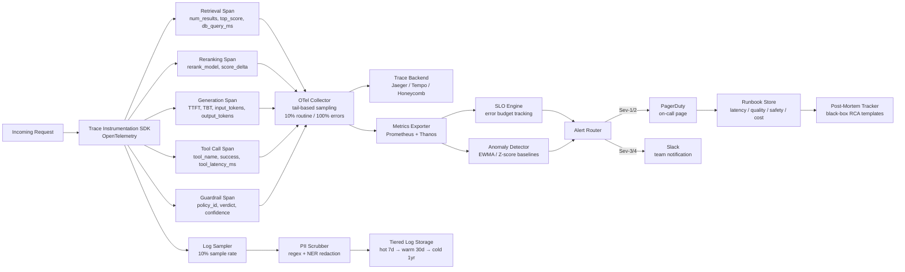

# Chapter 29: Observability and Incident Response for LLM Systems

## Context

> [!info] Quick Reference
> - **Pattern:** End-to-end observability stack for LLM systems covering distributed tracing, metrics, prompt/response logging, anomaly detection, and structured incident runbooks
> - **Scale:** Applies at >= 100 QPS where manual inspection breaks down; essential at >= 1K QPS where cost and quality drift become invisible without instrumentation
> - **Key Techniques:** Span decomposition (retrieval, reranking, generation, tool call), SLO burn rate alerting, sampled prompt logging with PII scrubbing, retention tiering, anomaly detection on LLM-specific signals, post-mortem frameworks for black-box models
> - **Primary Concerns:** Non-determinism makes baseline drift ambiguous; token billing ties observability cost to request volume; quality is a metric with no ground truth at runtime; black-box model internals make root cause identification probabilistic not deterministic
> - **Cross-references:** Chapter 2 (LLM stack patterns), Chapter 5 (guardrails), Chapter 22 (agentic systems — trace depth multiplies), Chapter 27 (evaluation at scale — offline quality signal complements online observability)

**Problem statement:** Design a complete observability and incident response system for a production LLM platform serving 5,000 QPS across multiple product surfaces — covering distributed tracing, metrics collection, prompt/response logging, anomaly detection, alerting, and structured incident runbooks — such that any latency regression, quality regression, safety incident, or cost spike is detected within 5 minutes and root cause is isolatable to a specific pipeline component within 15 minutes.

### Real-World Examples

- A RAG-based customer support system shows a 40% increase in p95 latency. Without span-level tracing, the on-call engineer spends 45 minutes bisecting before discovering that the vector database query time tripled due to a missing index on a new embedding dimension. A retrieval span with a `db_query_ms` attribute would have surfaced this in the first dashboard view.
- A code generation assistant starts producing responses with a 3x higher refusal rate after a silent model provider update. Because the system logs only final outputs (not intermediate reasoning), there is no signal to distinguish between: (a) user query distribution shifting toward policy-violating requests, (b) provider-side model update increasing refusal sensitivity, or (c) a system prompt injection in a recent deploy. Without per-component metrics, all three hypotheses take the same investigation path.

---

## Step 1: Understand the Problem and Establish Design Scope

### Functional Requirements

- **Distributed tracing across all pipeline stages** — retrieval, reranking, generation, tool call, and guardrail evaluation must each produce a distinct span with stage-specific attributes (e.g., `retrieval.top_score`, `gen.ttft_ms`, `guardrail.verdict`), enabling per-component latency isolation during incident triage without code bisection.
- **Real-time metrics for latency, throughput, token economy, and quality proxies** — specifically: TTFT (time to first token), TBT (time between tokens), e2e latency, request throughput, input/output token counts, KV cache hit rate, refusal rate, truncation rate, and retrieval similarity score distributions; these signals must be queryable at 1-minute granularity with labels for `product_line`, `model_version`, and `region`.
- **Sampled prompt/response logging with PII scrubbing before storage** — sampling rate is configurable per product line (default 10%), with forced 100% inclusion of all error requests and guardrail-blocked requests; PII scrubbing using regex + NER redaction occurs synchronously before the first log write so that no unscrubed content reaches any storage system.
- **Anomaly detection on LLM-specific signals** — automated baseline tracking and alerting for KV cache hit rate drops (> 20 percentage point decline), latency distribution shifts (p95 increases > 50% from EWMA baseline), sudden refusal rate changes (> 2x baseline for 5+ minutes), and token throughput degradation (> 30% decline from rolling average).
- **SLO burn rate alerting integrated with PagerDuty** — four severity levels (Sev-1 through Sev-4) with defined detection windows (1h, 6h, 24h, 72h), burn rate thresholds aligned with the Google SRE Workbook standard, and each alert linked to a specific runbook with a named escalation contact.
- **Structured incident runbooks for four incident classes** — latency regression, quality regression, safety incident, and cost spike; each runbook must be executable by an on-call engineer without domain-specific context, with exact dashboard URLs, metric thresholds, and per-diagnosis mitigation steps rather than general guidance.
- **Post-mortem process adapted for LLM black-box root cause analysis** — post-mortems must enumerate hypotheses with supporting or refuting evidence, identify the proximate observable cause (not a model-internal assertion), and explicitly document when root cause is unattributable due to provider-side black-box behavior.

### Non-Functional Requirements

- **Detection time:** any SLO breach detectable within 5 minutes of onset.
- **Root cause isolation:** on-call engineer can isolate the failing pipeline component within 15 minutes using trace and metric data.
- **Storage cost:** observability storage budget <= $10K/month at 5K QPS.
- **Logging overhead:** tracing and logging add <= 5ms to request p50 latency.
- **PII compliance:** no raw PII stored in observability systems; scrubbing occurs before any log write.
- **Alert noise:** false positive page rate <= 1 per on-call shift; alert fatigue is treated as a first-class metric.
- **Retention:** traces hot 7 days, warm 30 days, cold 1 year; aggregated metrics retained indefinitely at 1-minute granularity.

### Back-of-the-Envelope Estimation

#### Tracing Volume

Assume:

- **Request rate:** 5,000 QPS.
- **Spans per request:** 6 (root, retrieval, reranking, generation, guardrail, response write).
- **Bytes per span:** 500 bytes (attributes + timestamps + trace metadata).
- **Trace write rate:** `5,000 * 6 * 500 bytes = 15 MB/s = 54 GB/hour = ~1.3 TB/day`.
- **With 10% trace sampling (tail-based, keeping errors + slow requests):** `~130 GB/day` — manageable in a time-series store.

#### Log Storage Cost

Assume full prompt/response logging at 5K QPS:

- **Average exchange size:** 2K tokens = ~1.5 KB text.
- **Log write rate (unsampled):** `5,000 * 1.5 KB = 7.5 MB/s = 648 GB/day`.
- **At $0.023/GB/month (S3):** `648 GB/day * 30 days * $0.023 = $447/month` for storage alone.
- **At 10% sampling:** `$45/month` for storage — a 10x reduction.
- **Processing cost** (ingestion, scrubbing pipeline): add ~3x → total ~$135/month at 10% sampling.
- **Full logging at 2K tokens/exchange at 5K QPS = 2M tokens/min = ~$0.04/min = $57K/month** for token-equivalent processing cost if piped through an LLM scrubber. This is why statistical sampling, not full logging, is the correct approach.

#### Metric Cardinality

- **Dimensions:** product_line (8), model_version (5), region (3), request_type (4) = 480 unique label combinations.
- **Metrics per combination:** ~20 (latency percentiles, token counts, error rates, etc.).
- **At 1-minute granularity, 30 days:** `480 * 20 * 43,200 = 414M data points/month`.
- **In Prometheus/Thanos at ~2 bytes/sample:** `~800 MB/month` — trivial.

---

## Step 2: Propose High-Level Design and Get Buy-In

### Core Architecture Components

- **Trace Instrumentation SDK:** thin wrapper around OpenTelemetry that emits spans for each pipeline stage. Language-native (Python/Go), < 1ms overhead per span. Propagates trace context across async boundaries via baggage headers.
- **Trace Collector:** OpenTelemetry Collector sidecar that receives spans, applies tail-based sampling (100% for errors and requests > 2x p95 latency; 10% otherwise), and forwards to the trace backend.
- **Trace Backend:** distributed trace storage (Jaeger, Tempo, or Honeycomb). Indexed on trace_id, span_kind, model_version, product_line, error status. Query interface for waterfall views and span-level attribute search.
- **Metrics Pipeline:** Prometheus scraping per-service metric endpoints; Thanos for long-term storage and cross-cluster aggregation. Custom LLM metrics exposed via a `/metrics` endpoint on each service.
- **Log Ingestion Pipeline:** sampled prompt/response logs flow through a PII scrubbing service before reaching any storage system. Scrubber uses regex + NER-based PII detection and redaction. Logs written to tiered object storage (S3/GCS) with lifecycle policies.
- **Anomaly Detector:** streaming anomaly detection over the metrics pipeline using Z-score or EWMA-based baselines. Detects sudden shifts in refusal rate, latency distribution, token throughput, and KV cache hit rate.

> **Why EWMA-based baselines over fixed thresholds for anomaly detection:** LLM workloads have strong diurnal patterns — traffic peaks at business hours and troughs overnight, which means a fixed threshold like "alert if refusal rate...
- **SLO Engine:** computes real-time error budget consumption from SLO definitions (e.g., p95 latency < 3s, error rate < 0.1%). Fires burn rate alerts when budget is consumed faster than sustainable.
- **Alert Router:** receives alerts from the SLO Engine and Anomaly Detector; maps alert type to runbook; pages on-call via PagerDuty for Sev-1/2; posts to Slack for Sev-3/4.
- **Runbook Store:** versioned Markdown runbooks for each incident class. Linked from alert pages automatically. Each runbook has a step-by-step diagnosis tree and escalation contacts.
- **Post-Mortem Tracker:** structured post-mortem database linked to incident records. Templates adapted for LLM black-box incidents where root cause may be probabilistic.

> **Why tail-based sampling over head-based sampling:** Head-based sampling (sample at request ingress with probability p) cannot know whether a request will be slow or error-prone until it completes.

> **Why a dedicated PII scrubbing service before any log write:** Once PII enters a log system, it is nearly impossible to fully purge — replicas, backups, and exported datasets propagate it.

> **Why separate span kinds for retrieval, reranking, generation, and tool calls:** When a RAG pipeline degrades, root cause is either retrieval (wrong chunks returned) or generation (correct chunks, bad synthesis).

### Mermaid Architecture Diagram



---

## Step 3: Design Deep Dive

### 1) Distributed Tracing for LLM Pipelines

#### Span Design

Each LLM pipeline request produces a trace with six canonical span kinds. Span attributes are the primary observability surface — they carry the data that makes traces actionable.

**Root span (`llm.request`):**

| Attribute | Type | Description |
|---|---|---|
| `request.id` | string | UUID for the end-to-end request |
| `product_line` | string | which product surface initiated the request |
| `model.id` | string | model version identifier |
| `model.provider` | string | openai, anthropic, etc. |
| `request.type` | enum | chat, rag, agent, tool_call |
| `latency.e2e_ms` | float | end-to-end latency in milliseconds |
| `error` | bool | whether the request resulted in an error |
| `error.type` | string | timeout, model_error, guardrail_block, etc. |

**Retrieval span (`llm.retrieval`):**

| Attribute | Type | Description |
|---|---|---|
| `retrieval.query_embedding_ms` | float | time to embed the query |
| `retrieval.db_query_ms` | float | time for the vector DB query |
| `retrieval.num_results` | int | number of chunks returned |
| `retrieval.top_score` | float | similarity score of the top chunk |
| `retrieval.min_score` | float | similarity score of the lowest-ranked chunk returned |
| `retrieval.index_version` | string | which index version was queried |

**Reranking span (`llm.reranking`):**

| Attribute | Type | Description |
|---|---|---|
| `reranking.model_id` | string | reranker model identifier |
| `reranking.input_count` | int | number of chunks fed to reranker |
| `reranking.output_count` | int | number of chunks after reranking |
| `reranking.latency_ms` | float | reranker inference latency |
| `reranking.top_score_delta` | float | score change of top chunk after reranking |

**Generation span (`llm.generation`):**

| Attribute | Type | Description |
|---|---|---|
| `gen.ttft_ms` | float | time to first token in milliseconds |
| `gen.tbt_mean_ms` | float | mean time between tokens |
| `gen.tbt_p95_ms` | float | p95 time between tokens |
| `gen.input_tokens` | int | prompt token count |
| `gen.output_tokens` | int | completion token count |
| `gen.finish_reason` | enum | stop, length, content_filter, tool_calls |
| `gen.cache_hit` | bool | KV cache hit for this request |
| `gen.cost_usd` | float | estimated cost for this generation |

**Tool call span (`llm.tool_call`):**

| Attribute | Type | Description |
|---|---|---|
| `tool.name` | string | name of the tool invoked |
| `tool.call_count` | int | number of times this tool was called in the request |
| `tool.latency_ms` | float | total tool execution latency |
| `tool.success` | bool | whether the tool call returned without error |
| `tool.error_type` | string | if failed: timeout, auth_error, schema_error |

**Guardrail span (`llm.guardrail`):**

| Attribute | Type | Description |
|---|---|---|
| `guardrail.policy_id` | string | which policy was evaluated |
| `guardrail.verdict` | enum | allow, block, flag |
| `guardrail.confidence` | float | classifier confidence score |
| `guardrail.latency_ms` | float | guardrail evaluation latency |

> **Why separate retrieval spans from generation spans:** When a RAG pipeline degrades, root cause is either retrieval (wrong chunks returned) or generation (correct chunks, bad synthesis).

#### Trace Propagation Across Async Boundaries

LLM pipelines are rarely fully synchronous. A tool call may spawn a background job; a streaming response may outlive the HTTP connection; a retrieval service may be called over an internal RPC boundary with its own threading model. Trace context must propagate across all of these boundaries, or the trace waterfall fragments into disconnected spans that cannot be assembled into a coherent request timeline.

The core problem is that OpenTelemetry's in-process context propagation (using Python's `contextvars` or Go's `context.Context`) is automatically thread-local and does not survive crossing process or queue boundaries. When a span is started in Process A and a child span is started in Process B (the retrieval service), Process B has no way to know it is a child of Process A's span unless the trace context is explicitly serialized and transmitted. The W3C Trace Context standard defines a wire format for this serialization (`traceparent` header), and OpenTelemetry implements it as a built-in propagator. Correctly instrumenting async boundaries is the single most common failure mode in distributed tracing rollouts — a system that looks well-instrumented locally but has broken propagation across service boundaries produces orphaned spans that are invisible in waterfall views.

> **Why W3C `traceparent` header over proprietary formats:** The W3C Trace Context specification (RFC) is supported by every major tracing library, APM vendor, and service mesh.

**Pattern: W3C `traceparent` header propagation**

For synchronous HTTP sub-calls (retrieval service, reranking service): inject the W3C `traceparent` header in the outbound request. The receiving service extracts the header and creates a child span under the same trace.

**Pattern: Baggage for cross-process metadata**

For metadata that must be accessible in every downstream span without explicit passing (e.g., `product_line`, `request.type`): use OpenTelemetry Baggage. Set baggage at the root span; each downstream service reads it to populate its own span attributes.

**Pattern: async queue propagation**

For tasks queued via Celery, SQS, or Kafka: serialize the `traceparent` into the message envelope. The consumer deserializes and creates a linked span (use `LINK` relationship, not `CHILD_OF`, since the consumer may process the message seconds or minutes later).

> **Why `LINK` instead of `CHILD_OF` for async queue spans:** The `CHILD_OF` relationship implies that the child span's start time is within the parent span's active duration — this is true for synchronous sub-calls (a ...

#### Trade-off Table: Tracing Backend Options

| Backend | Setup Complexity | Query Capability | Cost at 130 GB/day | Best For |
|---|---|---|---|---|
| Jaeger (self-hosted) | Medium — requires deploying and operating Cassandra or Elasticsearch as the backing store, plus the Jaeger collector and query services; expect 2–4 engineer-days to stand up with proper HA. | Good — the Jaeger UI renders span waterfalls and supports JSON-based attribute filtering, but free-text search across span attributes requires an Elasticsearch backend and becomes slow beyond 10M spans/day. | ~$100/month storage — only storage costs apply since compute runs on your own infrastructure; factor in ~$200/month for the backing store cluster at this data volume. | Cost-sensitive teams with existing Kubernetes infrastructure who want zero vendor dependency and are willing to own operational burden. |
| Tempo + Grafana | Low — deploys as a single Kubernetes StatefulSet backed by object storage (S3/GCS); integrates natively with Grafana dashboards already used for Prometheus metrics, reducing the dashboard sprawl problem. | Excellent — TraceQL enables structured queries like `{ span.retrieval.top_score < 0.5 && duration > 2s }`, making it possible to find degraded retrieval spans directly without manual trace browsing. | ~$80/month storage — Tempo writes traces directly to S3-compatible object storage at standard rates; no proprietary storage format means data is portable and cheap. | Teams already operating Grafana + Prometheus who want traces, metrics, and logs in a unified UI without a second vendor contract. |
| Honeycomb | Very Low — SDK instrumentation via one environment variable (`HONEYCOMB_API_KEY`); no collector infrastructure to manage; data flows directly from the application to Honeycomb's SaaS ingest. | Excellent — BubbleUp statistical analysis automatically surfaces which span attributes differ between slow and fast traces, reducing incident triage from minutes of manual dashboard reading to a single click. | ~$2,000–$5,000/month — priced per event (span); at 130 GB/day (~260M events/day at ~500 bytes/event) and typical per-event pricing around $0.01–$0.02 per 1K events, costs reach this range before any volume discounts. | Teams that prioritize MTTR reduction and can absorb higher cost in exchange for eliminating the need to write custom analysis queries during incidents. |
| Datadog APM | Low — agent-based collection; Datadog's auto-instrumentation patches popular frameworks automatically; integrates with Datadog Logs and Metrics in a single pane, eliminating cross-tool navigation during incidents. | Good — Datadog's trace UI supports service maps, error tracking, and latency distributions per endpoint, but high-cardinality attribute search (e.g., filtering by a custom `retrieval.index_version` field) requires the APM Indexed Spans feature at additional cost. | ~$3,000–$8,000/month — Datadog charges per host for APM plus per-GB for indexed spans; at 130 GB/day the indexed span cost dominates; aggressively tuning which span attributes are indexed can halve this figure. | Teams already paying for Datadog Logs and Infrastructure monitoring where the all-in-one platform value outweighs the higher per-unit cost vs. self-hosted alternatives. |
| AWS X-Ray | Low (on AWS) — automatic integration with AWS Lambda, API Gateway, and ECS via X-Ray daemon sidecars; no additional infrastructure to provision for AWS-native deployments. | Limited — X-Ray's console supports service maps and trace filtering on HTTP status codes and response times, but does not support custom attribute search (e.g., querying by `retrieval.top_score`), making LLM-specific incident investigation difficult; investigators must export traces to S3 and query via Athena for custom attributes. | ~$50/month — priced at $5 per 1M traces recorded and $0.50 per 1M traces retrieved; at 5K QPS with 10% sampling that is 43M traces/day × $5/M = $215K/month, so X-Ray is only affordable at aggressive head-based sampling (< 0.1%), which eliminates the tail-latency capture needed for LLM incident triage. | Simple AWS-native stacks with low QPS (< 100 QPS) where cost is negligible and the team has no existing tracing infrastructure to migrate from. |

---

### 2) Metrics and Alerting Design

#### Key LLM-Specific Metrics

Beyond standard web service metrics (request rate, error rate, p50/p95/p99 latency), LLM systems require a distinct set of metrics that classical APM tools do not track by default.

**Latency decomposition:**

- `llm_ttft_seconds` — time to first token. The primary user-perceived latency signal for streaming responses. SLO: p95 < 1.0s.
- `llm_tbt_seconds` — time between tokens (per-token inter-arrival time). High TBT creates a stutter effect even when TTFT is low. Alert threshold: p95 > 150ms for 3 consecutive minutes.
- `llm_e2e_latency_seconds` — full request latency including retrieval, reranking, generation, and guardrail. SLO: p95 < 3.0s.

**Token economy:**

- `llm_input_tokens_total` — counter of input tokens, labeled by `model_id` and `product_line`. Drives cost attribution.
- `llm_output_tokens_total` — counter of output tokens. Combined with input tokens to compute per-request cost.
- `llm_token_throughput_tps` — tokens per second (output). A drop in throughput signals model-side compute saturation or rate limiting.
- `llm_kv_cache_hit_rate` — fraction of requests served (at least partially) from the KV cache. A drop in cache hit rate causes TTFT to increase and cost to rise simultaneously.

> **Why `llm_kv_cache_hit_rate` is a first-class operational metric:** The KV cache stores the attention key-value tensors for the prompt prefix, allowing the model to skip recomputing those tensors on repeated or similar prefixes.

**Quality proxies (measurable at runtime without ground truth):**

- `llm_refusal_rate` — fraction of requests where `finish_reason == content_filter` or response contains a refusal pattern. A spike indicates either user behavior change or model policy change.
- `llm_truncation_rate` — fraction of responses where `finish_reason == length` (output hit max_tokens). High truncation rate indicates the context window budget is misconfigured.
- `llm_retrieval_top_score` (histogram) — distribution of similarity scores for the top retrieved chunk. A downward shift indicates query distribution drift or index quality degradation.
- `llm_empty_response_rate` — fraction of responses with zero output tokens. Should be near zero; any spike is an error signal.

**Cost and efficiency:**

- `llm_cost_per_request_usd` (histogram) — cost per request computed from token counts and model pricing. Alert on p99 > budget threshold.
- `llm_context_window_utilization` — fraction of max context window used. Approaching 1.0 causes truncation and increases cost.

#### SLO Burn Rate Alerting

Define SLOs in terms of an error budget over a rolling window. Example SLO: "p95 latency < 3 seconds for 99.5% of requests over a 30-day window."

**Error budget:** 0.5% of requests may exceed 3s p95 latency. At 5,000 QPS over 30 days: `5,000 * 86,400 * 30 * 0.005 = 64.8M` bad request seconds of budget.

**Burn rate alerts fire when the budget is consumed faster than sustainable:**

| Alert Name | Burn Rate | Detection Window | Severity | Action |
|---|---|---|---|---|
| Critical latency burn | 14x | 1 hour | Sev-1 | Page on-call immediately |
| High latency burn | 6x | 6 hours | Sev-2 | Page on-call within 15 min |
| Elevated latency burn | 3x | 24 hours | Sev-3 | Slack notification, no page |
| Low latency burn | 1.5x | 72 hours | Sev-4 | Weekly review ticket |

A "14x burn rate" means the system is consuming 14% of its 30-day error budget per hour — exhausting the entire budget in ~50 hours if uncorrected.

> **Why SLO burn rate alerts over static thresholds:** A static p95 > 500ms alert fires during any traffic spike even if the SLO is not at risk.

#### Alert Fatigue Mitigation

Alert fatigue is treated as a first-class operational metric: track `pages_per_on_call_shift` and `false_positive_page_rate` in the post-mortem tracker. Targets: <= 5 pages per shift, <= 20% false positive rate.

Alert fatigue is not merely uncomfortable — it is operationally dangerous. When engineers receive more than 5–8 pages per on-call shift, their response to each subsequent page degrades: they acknowledge alerts faster without fully investigating, apply mitigations speculatively without confirming root cause, and develop habituation to alarms that desensitizes them to genuine Sev-1 pages. Research from Google's SRE practice documents that on-call engineers who receive > 10 pages per shift have a statistically significant higher rate of missed incidents and post-incident review quality degradation. For LLM systems specifically, alert fatigue is exacerbated by the non-determinism of quality signals — a refusal rate that fluctuates naturally by ±0.5% around a baseline creates a fertile source of noise alerts if threshold-based alerting is applied naively. The goal is not to reduce alerting coverage but to ensure every page is actionable, every alert has a corresponding runbook, and every false positive is treated as a defect in the alerting system that must be corrected.

> **Why tracking false positive page rate as a metric rather than relying on subjective feedback:** Engineers habituate to noise and stop reporting false positives explicitly — the signal disappears from retrospectives even as the underlying problem persists.

Mitigation strategies:

1. **Multi-window burn rate:** require the burn rate threshold to be exceeded in both a short window (1h) and a long window (6h) before paging — this eliminates transient spikes that self-resolve within the hour without consuming significant error budget. A spike that lasts 15 minutes and clears will not fire the 6-hour window check, preventing the 3 AM page for an incident that resolved before the engineer was awake.
2. **Alert grouping:** group correlated alerts (e.g., retrieval latency spike + e2e latency spike) into a single incident using the alert router's dependency metadata, so that a retrieval outage that simultaneously triggers four downstream alerts generates one page, not four. The router suppresses child alerts when a parent alert is already open and routes them as additional context to the same incident ticket.
3. **Runbook-driven alert definitions:** every alert must have a linked runbook that describes a concrete diagnostic action — if a runbook cannot be written for an alert because there is no actionable response, the alert should not exist. The discipline of writing the runbook before enabling the alert is a forcing function that eliminates vanity metrics (alerts that notify but do not guide action).
4. **Monthly alert review:** metrics on alert volume, true/false positive rates, and mean time to resolve (MTTR) per alert type are reviewed monthly in a dedicated 30-minute meeting — alerts with a false positive rate > 30% over the prior month are revised or removed before the next on-call rotation, creating a continuous improvement loop rather than a set-and-forget alerting regime.

---

### 3) Prompt/Response Logging with Sampling and PII Scrubbing

#### Sampling Strategy

Prompt/response log sampling is the mechanism by which a statistically representative subset of exchanges is written to storage while the remainder is discarded. Unlike trace sampling — where every request generates at least a root span and span-level attributes — prompt/response logs contain the full text of user inputs and model outputs, which are both privacy-sensitive and storage-intensive. The goal of sampling is to collect enough content for quality analysis, incident replay, and model evaluation without incurring the storage, processing, and compliance costs of full logging.

Sampling rate selection involves a three-way tension: statistical validity (enough samples to detect quality regressions with low false-negative rate), storage cost (every 10x increase in sampling rate multiplies storage costs proportionally), and compliance exposure (every logged exchange containing PII that survives the scrubber is a potential data subject access request or erasure obligation). The 10% default resolves this tension for most production workloads above 100 QPS: at 500 QPS sampled (10% of 5K QPS), you collect 43.2M exchanges per day, which is orders of magnitude more than needed for statistically valid quality analysis (where 100K–1M samples per month is typically sufficient for detecting regressions at the 1% level with 95% confidence). Higher sampling rates provide diminishing returns for quality analysis while linearly increasing cost and compliance surface area.

**10% sampling** is the recommended default for production prompt/response logging at >= 100 QPS.

Sampling implementation:

```text
sample_decision = hash(request_id) % 100 < sample_rate_pct
```

- Deterministic: the same request always makes the same sampling decision. This is important for deduplication and replay.
- Stratified override: regardless of the global sample rate, always log: (a) all requests where `error == true`; (b) all requests where `guardrail.verdict == block`; (c) all requests flagged by the anomaly detector.
- Per-product-line configurability: safety-sensitive products may log at 50%; high-volume, low-stakes products may log at 1%.

> **Why sample 10% of prompts/responses for logging:** Full logging at 1,000 QPS with 2K tokens/exchange = 2M tokens/min = ~$0.04/min = $57K/month just for storage processing costs.

#### PII Scrubbing Pipeline

The scrubbing pipeline must run before any log is written to storage. Scrubbing is irreversible — once written, scrubbed logs cannot be un-scrubbed.

**Two-layer scrubbing:**

Layer 1 — Rule-based (fast, < 1ms):
- Email addresses: `\b[A-Za-z0-9._%+-]+@[A-Za-z0-9.-]+\.[a-z]{2,}\b` → `[EMAIL]`
- US phone numbers: multiple patterns → `[PHONE]`
- SSN: `\b\d{3}-\d{2}-\d{4}\b` → `[SSN]`
- Credit card numbers (Luhn-valid patterns): → `[CC_NUMBER]`
- IP addresses: → `[IP_ADDRESS]`
- Dates of birth (contextual): → `[DOB]`

Layer 2 — NER-based (slower, 5-15ms, applied after layer 1):
- Named entity recognition model identifies PERSON, ORG, GPE entities.
- Entities in context that match PII patterns (e.g., "My name is John Smith") are replaced with `[PERSON]`.
- False positive rate of NER is acceptable — over-redaction is preferable to under-redaction for compliance.

**Scrubbing placement:** the scrubbing service is a synchronous pass-through in the logging pipeline, not an async enrichment step. The log is held in memory until scrubbing completes; the scrubbed version is then written. No intermediate write of unscrubed content occurs.

#### Retention Tiers

| Tier | Age Range | Storage Class | Query Latency | Cost/TB/month | Use Case |
|---|---|---|---|---|---|
| Hot | 0–7 days | SSD-backed object store (e.g., S3 Intelligent-Tiering with Expedited retrieval, or a self-managed MinIO cluster on NVMe) | < 100ms — fast enough for interactive trace browsing during an active incident; engineers can paginate through thousands of log entries without waiting | ~$230 | Active incident investigation where the on-call engineer needs sub-second query response to move quickly through the diagnosis tree |
| Warm | 7–30 days | Standard object store (S3 Standard or GCS Standard) — data is compressed with Zstandard at ~3:1 ratio before write to reduce storage costs by two-thirds at the expense of ~10ms decompression overhead per query | < 5s — acceptable for post-mortem work where the engineer is reading sequentially rather than interactively browsing; most post-mortem log retrieval is a batch fetch of 50–200 records, not a real-time stream | ~$23 | Post-mortem replay where specific request IDs from an incident trace are retrieved for manual review, and scheduled quality analysis jobs that run overnight and tolerate latency |
| Cold | 30 days–1 year | S3 Glacier Instant Retrieval or GCS Archive — first-byte latency is 1–3 minutes; data is stored in compressed columnar format (Parquet) to minimize egress costs for analytical queries | Minutes — suitable only for compliance audits (e.g., GDPR data subject access requests) and rare deep forensic investigations where the engineer knows the exact request IDs in advance and can tolerate a retrieval wait | ~$4 | Regulatory compliance (retain proof of PII scrubbing for 1 year), rare forensic investigations, and capacity planning analysis that joins historical token counts with infrastructure cost data |
| Delete | > 1 year | Automated lifecycle policy deletes objects; deletion is verified by a daily audit job that checks for objects with `creation_date > 365 days` and alerts if any are found, since failure to delete can be a GDPR violation | — | $0 | GDPR right-to-erasure compliance: the 1-year limit is the maximum retention period for personal data in many GDPR interpretations; automatic deletion ensures no manual process failure creates a compliance gap |

> **Why tiered retention instead of a single storage class:** Storing all 30 days of logs in hot SSD-backed storage would cost ~$230/TB/month × 1.5 TB (51.8 GB/day × 30 days) = ~$345/month just for the warm-tier volume.

**Storage cost math at 10% sampling, 5K QPS:**

- Sampled rate: 500 exchanges/second.
- Per-exchange size after scrubbing: ~1.2 KB.
- Daily write: `500 * 86,400 * 1.2 KB = 51.8 GB/day`.
- Hot tier (7 days): `51.8 * 7 = 363 GB at $230/TB = $84/month`.
- Warm tier (23 additional days): `51.8 * 23 = 1,191 GB at $23/TB = $27/month`.
- Cold tier (11 months): `51.8 * 335 = 17,353 GB at $4/TB = $69/month`.
- **Total: ~$180/month** — well within the $10K/month observability budget.

#### Trade-off Table: LLM Observability Platform Options

| Platform | Tracing | Metrics | Prompt Logging | LLM-Specific Features | Cost |
|---|---|---|---|---|---|
| LangFuse (self-hosted) | Basic — supports parent-child span hierarchy for LLM calls and tool invocations, but lacks distributed tracing across independent microservices; adequate for monolithic pipelines, insufficient for multi-service architectures. | Basic — provides aggregate cost and latency dashboards but does not expose a Prometheus-compatible metrics endpoint, requiring a separate metrics pipeline for SLO alerting. | Yes (built-in) — stores prompts and responses natively in its PostgreSQL backend; must configure retention policies manually to comply with GDPR right-to-erasure requirements. | Trace hierarchy for session-level analysis, evaluation score integration (human and automated), and per-trace cost attribution that rolls up to daily spend dashboards. | Free (infra only) — self-hosting requires a PostgreSQL instance and a web server; at 5K QPS expect ~500 GB/month database growth without aggressive sampling, translating to ~$50–$150/month infra cost. |
| LangFuse (cloud) | Good — cloud offering adds multi-tenant trace isolation, automatic retention management, and UI improvements; still does not bridge to infrastructure-level tracing (e.g., vector DB span timing). | Good — cloud dashboards include cost-per-product-line breakdowns and latency trend charts; missing: configurable alerting on metric thresholds, which requires exporting data to an external alerting tool. | Yes — SaaS-managed with configurable data residency (EU region available for GDPR); PII scrubbing must be implemented in the application layer before data leaves your environment. | Session tracking for multi-turn conversations, automated cost tracking per model version, and native integration with offline evaluation pipelines for closing the feedback loop between production traces and eval datasets. | $100–$2,000/month — tiered by monthly trace volume; at 5K QPS with 10% sampling (~43M traces/month) the cost lands in the $500–$1,500 range; enterprise contracts include SLA guarantees and SSO. |
| LangSmith | Good — LangChain-native instrumentation reduces integration effort for LangChain-based pipelines to near zero; non-LangChain pipelines require the LangSmith REST API, adding ~50–100 lines of custom instrumentation code. | Good — provides latency and error rate dashboards per chain and per LLM call, with comparison views across dataset runs; lacks Prometheus integration, requiring a separate metrics pipeline for burn rate alerting. | Yes — prompt and response logging is the core product feature; supports annotation workflows where human reviewers can label sampled logs directly in the UI, creating training data from production traces. | Dataset curation from production traces (one-click to add a trace to an evaluation dataset), automated evaluation against golden sets, and regression testing on prompt versions — the strongest eval-feedback loop of any listed platform. | $0.50–$2.00/1K traces — at 5K QPS with 10% sampling that is 43.2M traces/month, placing cost at $21K–$86K/month at list price; volume discounts and enterprise agreements typically reduce this by 50–70% at this scale. |
| OpenTelemetry DIY | Excellent — full OpenTelemetry SDK gives complete control over span schema, sampling, and backend routing; supports any combination of Jaeger, Tempo, Honeycomb, or Datadog as the backend without SDK changes. | Excellent — Prometheus native metrics with full label cardinality control; integrates directly with Thanos for long-term retention and cross-cluster federation; no constraints imposed by a vendor's data model. | Custom — requires building a log sampling and storage pipeline from scratch; the flip side is full control over PII scrubbing implementation, retention tiers, and storage backends without any vendor data-sharing concerns. | None built in — every LLM-specific signal (refusal rate, retrieval quality proxy, KV cache hit rate) must be implemented as custom metrics and custom span attributes; this is a build-vs-buy decision that pays off at teams with > 3 platform engineers. | Infra only ($500–$5K/month) — cost scales with backend choice; Tempo + Grafana + Prometheus on Kubernetes lands around $500–$1,000/month at this scale; adding Thanos for long-term retention adds ~$200/month in S3 costs. |
| Datadog LLM Observability | Excellent — end-to-end tracing from HTTP gateway through retrieval, generation, and tool calls with automatic correlation to Datadog Logs and Metrics; the single-pane view eliminates cross-tool navigation during incidents. | Excellent — 400+ built-in LLM metrics including TTFT, token throughput, and cost; configurable SLO monitoring with burn rate alerting natively in the Datadog SLO widget without external tooling. | Yes — LLM Observability product stores prompts and responses with configurable sampling; includes built-in sensitive data scanning (regex + ML) that can substitute for a custom PII scrubbing pipeline. | Built-in LLM dashboards with model comparison views, automatic anomaly detection on token and latency signals using Datadog's Watchdog ML engine, and one-click drill-down from a cost spike alert to the specific model and product line driving it. | $3K–$15K/month — pricing is a function of hosts, indexed logs, and APM spans; LLM Observability adds a per-event charge on top; at 5K QPS the combined cost frequently exceeds $10K/month, making it viable primarily for organizations already standardized on Datadog where incremental cost is acceptable. |
| Arize AI | Good — Arize provides tracing for LLM pipelines with native support for embedding-space visualization; trace depth for complex agentic systems (> 5 tool calls per request) may reach rendering limits in the UI. | Good — includes embedding drift metrics, input distribution shift detection, and output quality proxies that go beyond what standard APM tools track; integrates with Prometheus via export for use in existing alerting pipelines. | Yes — prompt and response logging with built-in embedding storage for similarity search across historical requests; this enables retrieval of the most similar past requests to a current incident prompt, which is uniquely useful for quality regression debugging. | Hallucination detection via LLM-as-judge scoring on sampled responses, embedding drift monitoring to detect query distribution shift before it affects quality metrics, and cohort analysis to compare quality across user segments or model versions. | $1K–$10K/month — tiered by monthly prediction volume and feature set; hallucination detection and embedding drift monitoring are add-on modules at additional cost; suitable for teams where quality monitoring is the primary observability gap and latency/cost monitoring is already covered elsewhere. |

> **Why OpenTelemetry as the instrumentation foundation regardless of backend:** OpenTelemetry is vendor-neutral.

---

### 4) Incident Runbooks and Post-Mortems

#### Runbook: Latency Regression

**Trigger:** SLO burn rate alert — p95 e2e latency consuming error budget at > 6x rate.

**Step 1 — Localize the degraded span (target: 5 minutes):**
1. Open the trace backend. Filter: `latency.e2e_ms > 3000` and `time_range: last_15m`.
2. Compare the waterfall breakdown across slow traces. Is the latency concentrated in `llm.retrieval`, `llm.generation`, or `llm.tool_call`?
3. Check span-level metrics: `llm_retrieval_db_query_ms p95` and `llm_ttft_seconds p95`. One will be elevated.

**Step 2 — Retrieval latency elevated:**
1. Check `retrieval.index_version` on the slow spans — did an index version change recently?
2. Check vector DB dashboards for query latency and index memory pressure.
3. Check `retrieval.num_results` — a sudden increase in results returned increases reranking latency.
4. **Mitigation:** roll back the index version, reduce `num_results` cap, or increase vector DB replica count.

**Step 3 — Generation latency elevated (TTFT spike):**
1. Check `llm_kv_cache_hit_rate` — a drop in cache hit rate is the most common cause of TTFT spikes.
2. Check `llm_token_throughput_tps` — a drop in throughput indicates model-side compute pressure or rate limiting.
3. Check model provider status page — provider incidents cause generation latency spikes that are outside your control.
4. **Mitigation:** check KV cache configuration (context length changes evict cache), enable prompt prefix caching if not already on, or failover to a secondary provider.

**Escalation:** if root cause is not isolated within 15 minutes, escalate to the model infrastructure team lead.

#### Runbook: Quality Regression

**Trigger:** anomaly detection alert on `llm_refusal_rate` (>2x baseline for 5 minutes) or `llm_empty_response_rate` (>0.5% for 3 minutes). Also triggered by user-facing CSAT alert or manual report.

**Step 1 — Distinguish model-side vs. input-side (target: 5 minutes):**
1. Open sampled logs (hot tier). Filter: requests from the last 30 minutes where `guardrail.verdict == block` or response contains a refusal pattern.
2. Are the queries themselves policy-violating (adversarial user behavior shift)? Or are benign queries being refused (model sensitivity shift)?
3. Check whether a model version or system prompt changed in the last 2 hours (deployment log).

**Step 2 — Model version change as root cause:**
1. Compare `llm_refusal_rate` time series against deployment timestamps.
2. If the spike aligns with a deployment: roll back the model version or system prompt.
3. If the model version is unchanged: check provider-side model update notices (some providers update models silently).

**Step 3 — System prompt change as root cause:**
1. Retrieve the system prompt version from the deployment log for the time of regression onset.
2. Compare against the previous system prompt — did a change introduce language that increases refusal sensitivity?
3. **Mitigation:** revert system prompt; run eval pipeline against the previous version to confirm recovery.

**Step 4 — Retrieval quality regression:**
1. Check `llm_retrieval_top_score` histogram — a left shift (lower scores) indicates the wrong chunks are being retrieved.
2. Check whether the embedding model or index was updated.
3. **Mitigation:** roll back embedding model version; re-index if index corruption is suspected.

#### Runbook: Safety Incident

**Trigger:** `guardrail.verdict == block` rate drops unexpectedly (guardrail may be broken), or a safety violation is reported by a user or internal monitor.

**Step 1 — Confirm guardrail is functioning (target: 3 minutes):**
1. Run the guardrail canary: a set of known-policy-violating prompts that should always be blocked. These run every 5 minutes.
2. If canary prompts are not being blocked: the guardrail service is degraded. Page the safety engineering team immediately (Sev-1).
3. If canary prompts are blocked: the guardrail is functioning; the incident is a guardrail miss on a novel attack pattern.

**Step 2 — Scope the incident:**
1. Retrieve sampled logs for requests in the incident window. How many requests reached the same attack pattern?
2. Identify the pattern: jailbreak, prompt injection, data extraction attempt, or other.
3. Assess downstream impact: did any violating content reach users? Is there evidence of data exfiltration?

**Step 3 — Containment:**
1. Add a temporary blocklist rule for the identified attack pattern in the guardrail service.
2. If the attack surface is broad (many variations), enable a stricter safety mode on the model (lower temperature, more restrictive system prompt) as a temporary measure.
3. Notify the legal and trust-and-safety teams within 30 minutes of scope assessment.

**Step 4 — Post-incident:**
1. The attack pattern is added to the guardrail test suite.
2. The safety eval golden set is updated to cover the pattern.
3. A post-mortem is filed within 48 hours.

#### Runbook: Cost Spike

**Trigger:** `llm_cost_per_request_usd p99 > 2x` baseline for 10 consecutive minutes, or daily cost forecast exceeds budget by > 20%.

**Step 1 — Identify the cost driver (target: 5 minutes):**
1. Check `llm_input_tokens_total` and `llm_output_tokens_total` by product_line and model_id. Which combination is elevated?
2. Check `llm_context_window_utilization` — approaching 1.0 indicates context is bloated (retrieved chunks too long, conversation history not truncated).
3. Check `llm_kv_cache_hit_rate` — a drop increases per-token cost because cached tokens are billed at a discount.

**Step 2 — Token count spike:**
1. Retrieve sampled logs for the most expensive requests (sort by `gen.cost_usd` descending).
2. Are input prompts unusually long? Is the retrieval pipeline injecting too many chunks?
3. **Mitigation:** cap `num_results` for retrieval; truncate conversation history beyond N turns; reduce max_tokens for output.

**Step 3 — Model version change as cost driver:**
1. Check whether a model upgrade was deployed recently. Higher-capability models (e.g., Opus vs. Sonnet) may have been accidentally applied to high-volume product lines.
2. **Mitigation:** revert to the cost-appropriate model for the affected product line.

#### Post-Mortems for LLM Incidents

LLM incidents have a structural challenge: the model is a black box. "The model started generating worse responses" is not a falsifiable root cause. The post-mortem framework must be adapted.

**Adapted post-mortem structure:**

1. **Incident timeline:** timestamps of onset, detection, mitigation, resolution. Detection gap is a key metric.
2. **Observable symptoms:** what metrics and traces showed the incident. Not what we believe caused it.
3. **Hypotheses tested:** enumerate each root cause hypothesis considered during investigation. For each: what evidence was gathered, what was found, how the hypothesis was confirmed or eliminated.
4. **Proximate cause:** the most specific observable change correlated with the incident onset (e.g., "KV cache hit rate dropped from 72% to 18% at 14:23 UTC, coinciding with a context length increase from 4K to 8K tokens").
5. **Contributing factors:** conditions that made the incident worse or harder to detect (e.g., "we had no TTFT SLO — only e2e latency, which masked the TTFT spike for 12 minutes").
6. **Counterfactual root cause (black-box models):** when the proximate cause is a provider-side model update or unexplained model behavior change, state this explicitly: "The model's output distribution shifted in a way that is not attributable to any configuration change on our side. We cannot determine the model-internal root cause." This is a valid finding; the follow-up actions are: improve detection (observability), improve resilience (fallback models), and file a report with the provider.
7. **Action items:** specific, owner-assigned, deadline-bounded changes to the system.

> **Why enumerate hypotheses rather than assert root cause in LLM post-mortems:** In classical systems, root cause is usually deterministic — a specific code path, configuration value, or hardware failure.

---

