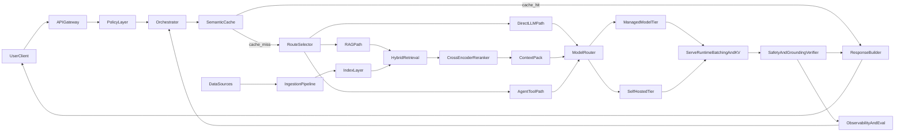

# Chapter 1: A Framework for LLM System Design Interviews

## Context

> [!info] Quick Reference
> - **Pattern:** Interview Framework
> - **Scale:** 1.5M DAU, 18M requests/day
> - **Key Techniques:** 5-step framework, back-of-envelope estimation, trade-off tables
> - **Primary Concerns:** Scope discipline, cost-latency-safety balance, rollback design
> - **Cross-references:** [[chapter-02|Chapter 2]] (pattern selection), [[chapter-03|Chapter 3]] (retrieval), [[chapter-05|Chapter 5]] (safety)

**Problem statement:** Build a repeatable framework for answering any LLM system design interview question with production-grade technical depth in 40-45 minutes.

### Real-World Examples

- A fintech team designs an internal LLM assistant and must justify why RAG is safer than fine-tuning for policy updates every week. Because compliance policies change frequently, fine-tuning would require a new training run and deployment cycle for every update — a process taking days to weeks. RAG allows new policy documents to be indexed in minutes and immediately reflected in answers, with a clear audit trail of which document version grounded each response.
- A healthcare startup interview asks for a triage bot design where abstention and escalation logic matter more than fluent prose. In clinical settings, a confident but wrong answer is far more dangerous than a clearly-stated "I don't know." The design must include calibrated confidence thresholds, explicit escalation paths to human reviewers, and audit logs sufficient to satisfy HIPAA and clinical liability requirements — none of which are addressed by optimizing generation quality alone.

---

## Step 1: Understand the Problem and Establish Design Scope

### Simulated Dialogue

**Interviewer:** Design a framework for LLM system design interviews.  
**Candidate:** I will scope product goals, risk profile, and numeric constraints first, then map them to architecture and trade-offs.

**Candidate:** Should this framework optimize for startup speed, enterprise reliability, or both?  
**Interviewer:** Both. It must work for MVP and regulated enterprise contexts.

**Candidate:** What constraints must always be quantified?  
**Interviewer:** Latency, token cost, scale, safety, and rollback strategy.

### Functional Requirements

- Provide a reusable **5-step response structure** for any LLM system design prompt. Without a repeatable skeleton, interview answers tend to drift into feature lists rather than defensible architecture; the 5-step structure forces scoping before architecture, estimation before component selection, and trade-off justification before deep dives.
- Force explicit design choices for **retrieval**, **model routing**, and **safety controls**. These three areas are where LLM system design diverges most sharply from classical distributed-systems design; leaving them implicit signals that the candidate has not operated such systems in production.
- Include concrete fallback paths for low-confidence, high-risk, and degraded-runtime states. Production LLM systems fail partially — a retrieval tier may degrade while the model tier stays healthy; safety controls must account for all partial-failure combinations, not just the happy path.
- Produce outputs that are implementable and measurable, not conceptual only. An answer that says "add caching" without specifying cache key strategy, TTL policy, invalidation trigger, and hit-rate target is not actionable; every design choice must be tied to a metric that signals whether it is working.

### Non-Functional Requirements

- **Interview execution:** reach credible high-level design in <= 10 minutes. This forces prioritization: spend the first 5 minutes on scoping and estimation, then use the next 5 to sketch the end-to-end pipeline with named components. If you spend more than 10 minutes before getting explicit buy-in from the interviewer, you risk spending the bulk of your time on the wrong sub-problem.
- **Latency discipline:** include **TTFT** and **TPOT** budgets, not just total latency. Time-to-first-token governs perceived responsiveness in streaming interfaces, while tokens-per-output-token governs reading throughput for long responses; optimizing only total latency can mask a terrible user experience where the first character arrives after 3 seconds even though the full response completes at 5 seconds.
- **Cost visibility:** show token economics and serving cost envelope. Token pricing differs 5–10x between input and output for most managed models, and between model tiers; failing to separate these and project daily cost at realistic traffic means the design cannot be evaluated for economic viability.
- **Scalability:** demonstrate burst handling and bottleneck containment. LLM workloads have sharp daily and event-driven traffic peaks — a 12x peak multiplier is common in consumer products — and the system must identify which component saturates first (GPU queue, retrieval IOPS, connection pool) and show how it is isolated from cascading failure.
- **Safety and compliance:** include guardrails, auditability, and deterministic escalation. Guardrails alone are insufficient without an audit-complete trace of inputs, retrieved context, model outputs, and policy decisions; regulators and incident responders need a full causal chain, and the escalation path must be deterministic rather than model-generated to avoid loops.

### Back-of-the-Envelope Estimation

Assume a representative production assistant:

- **DAU:** 1.5M
- **Requests/day:** 18M
- **Average input tokens:** 1,600
- **Average output tokens:** 280
- **RAG usage:** 65%
- **Peak multiplier:** 12x avg traffic

#### Throughput

- Average QPS: `18,000,000 / 86,400 ~= 208`
- Peak QPS: `~2,500`
- Target capacity planning: `3,000-3,500 QPS` (peak + failover margin)

#### Token Volume and API Cost

- Input tokens/day: `18M * 1,600 = 28.8B`
- Output tokens/day: `18M * 280 = 5.04B`
- Cost/day formula:
  - `daily_cost = (28,800 * input_price_per_1M) + (5,040 * output_price_per_1M)`

#### Latency Budget (Interactive Path)

- Gateway + auth: 80ms
- Retrieval + rerank: 250ms
- Scheduler/queue: 150ms
- **TTFT:** 900ms
- Decode (TPOT ~28 ms/token for first 120 tokens streamed): ~3.4s full body
- Post-check + formatting: 220ms
- **p95 end-to-end:** ~5.0s

> **Why 900ms TTFT:** This is the upper bound before users perceive a noticeable pause in conversational interfaces; research on interactive systems places the "feels instant" threshold around 100ms and the "noticeable delay" threshold around 1s, making 900ms the practical ceiling for acceptable interactive response. Budgeting below this allows for queue jitter and retrieval variance without SLO breach.

#### Context and Vector Storage Sizing

- Corpus chunks: 300M
- Embedding dim: 1536, float32 (`~6KB/vector`)

> **Why 1536-dim:** OpenAI's `text-embedding-3-small` and similar production embedding models use 1536 dimensions, balancing semantic richness against the memory footprint of large-scale ANN indexes; higher dimensions (3072) improve recall marginally but roughly double VRAM requirements per shard.

- Raw vector footprint: `~1.8TB`
- + metadata/index overhead/replicas (x2.2 to x3): **4.0-5.5TB**

#### Self-hosted VRAM Planning (Order-of-Magnitude)

- Small inference tier (7B class, [[glossary#Quantization|quantized]]): ~16-24GB VRAM/GPU
- Mid tier (13B-34B quantized/mixed): ~40-80GB VRAM/GPU
- Large tier (70B class): multi-GPU (>=160GB aggregate VRAM) with tensor parallelism

---

## Step 2: Propose High-Level Design and Get Buy-In

### Core Architecture Components

- **Client + Gateway:** auth, rate limits, tenant isolation, trace IDs. The gateway is the only component that sees 100% of traffic; it is the right place to enforce per-tenant quota, inject correlation IDs for distributed tracing, and shed load via token-bucket rate limiting before expensive downstream components are hit. Placing rate limiting deeper in the stack (e.g., at the model router) means already-paid retrieval and embedding costs are wasted on requests that will ultimately be rejected.
- **Policy Layer:** prompt policy, data policy, risk class, output schema constraints. The policy layer translates business rules into machine-enforceable constraints: which data sources a tenant may access, which model capabilities are permitted (e.g., code execution disabled for certain risk classes), and what output schema the response must conform to. Centralizing this logic prevents individual route authors from implementing inconsistent or incomplete policy checks in application code.
- **Orchestrator:** route selection (`direct`, `RAG`, `tool`, `agentic`). The orchestrator is the control-flow brain of the system; it classifies each request's complexity and intent, then dispatches to the cheapest execution mode that satisfies the SLO. A simple factual query routed to a direct LLM path costs ~10x less than the same query routed through RAG, so even a 60%-accurate complexity classifier meaningfully reduces token spend at scale.
- **Retrieval Stack:** query rewrite, hybrid search, **[[glossary#Cross-Encoder Reranking|cross-encoder reranking]]**.

> **Why cross-encoder reranking:** Bi-encoder (embedding) retrieval scores queries and documents independently, so the scores are not calibrated to the specific query-document pair. A cross-encoder takes the full `(query, document)` pair as input and produces a directly comparable relevance score, lifting Recall@5 by 5–12% over fusion-only approaches at the cost of ~60ms additional GPU latency.

- **Model Router:** selects provider/model tier by complexity, SLO, and cost budget. A well-designed router applies a scoring function across candidate models that weights latency headroom, token cost, and task-match quality; for most production workloads, routing 70–80% of traffic to a small or mid-tier model and reserving the large tier for complex queries reduces serving cost by 50–70% with minimal quality regression on simple intents.
- **Serving Runtime:** **[[glossary#Continuous Batching|continuous batching]]**, prefix/[[glossary#KV Cache|KV cache]], streaming transport. The serving runtime is where raw model capacity is translated into actual throughput; continuous batching and KV caching are not optional performance tweaks but baseline requirements for economically viable self-hosted serving — without them, GPU utilization on real traffic patterns typically falls below 40%.

> **Why continuous batching:** Static batching holds a batch open until all sequences finish, which means short completions wait idle for the longest sequence in the batch. Continuous batching admits new requests at every decode step, raising GPU utilization from ~30–50% to 60–80% without adding hardware.

- **Cache Hierarchy:** retrieval cache, **semantic cache**, response cache.

> **Why semantic cache:** An exact-match response cache misses paraphrased but semantically identical queries. A semantic cache embeds the incoming query and checks cosine similarity against cached query embeddings, returning a cached answer when similarity exceeds a threshold; for FAQ-like workloads this can reduce model calls by 20–40%, cutting both latency and cost.
- **Safety Stack:** input filter, runtime policy checks, output verifier. The safety stack must operate at three distinct points — on the raw user input (to block jailbreak and injection attempts before any compute is spent), at runtime during tool and retrieval steps (to prevent mid-execution policy violations), and on the final output (to catch hallucinations, PII leakage, and policy-violating content before delivery). A single output-only filter is insufficient because it cannot prevent wasted compute or detect retrieval-layer data leakage.
- **Observability/Eval:** latency histograms (TTFT/TPOT), cost/query, quality and safety metrics. Observability in LLM systems must cover both infrastructure dimensions (P50/P95/P99 TTFT, TPOT, queue depth, GPU utilization) and semantic dimensions (retrieval Recall@K, citation precision, safety policy violation rate, user-reported thumbs-down rate); infrastructure metrics alone cannot detect a silent quality regression where the system is fast and cheap but increasingly wrong.

### Pipeline A: Data Ingestion / Indexing Pipeline

1. Ingest source documents/events and normalize to canonical schema.
2. Parse layout-aware text (headers, tables, code blocks, entities).
3. Chunk using policy (fixed, semantic, or **parent-child chunking**).

> **Why parent-child chunking:** Fixed-size chunks retrieve precise text but lose surrounding context; returning a 512-token child chunk often truncates the evidence needed for a complete answer. Parent-child chunking stores small child chunks for high-precision retrieval and links each child to a larger parent chunk that supplies full context, improving both citation accuracy and answer completeness for long documents.
4. Generate embeddings and index vectors + lexical terms + ACL metadata.
5. Run index QA (coverage, parser failure rate, duplicate chunks).
6. Promote index version via alias swap; keep rollback alias hot.

### Pipeline B: Inference / Query Pipeline

1. Receive request; apply auth, quota, and policy checks.
2. Classify intent/complexity and choose execution mode.
3. Retrieve/rerank context (if needed) with token budget packing.
4. Route to model tier and execute with streaming output.
5. Apply output guardrails and grounding verification.
6. Return response + citations + trace; emit telemetry to eval loop.

### Mermaid Architecture Diagram



---

## Step 3: Design Deep Dive

Focus areas for this chapter:

1. **Interview Scoping for LLM Systems**
2. **Cost-Latency-Quality-Safety Trade-off Engine**
3. **Production Failure Modes and Mitigations**

### 1) Interview Scoping for LLM Systems

A high-signal interview answer starts with 6 non-negotiable clarifications:

- **Risk class:** low-risk assistant vs regulated domain. This single answer determines whether you need deterministic safety classifiers, human-in-the-loop checkpoints, full audit logging, and regulatory compliance layers (HIPAA, SOC 2, EU AI Act). A general productivity assistant can afford probabilistic guardrails; a medical or financial tool cannot.
- **Grounding contract:** citation required, optional, or prohibited. If citations are required, every answer must be traceable to a specific retrieved chunk and document version — this changes the retrieval pipeline, the response format, and the evaluation metrics. If citations are prohibited (e.g., creative or conversational contexts), adding RAG infrastructure is overhead that should not be defaulted into the design.
- **Freshness SLA:** static corpus, hourly, near-real-time. A static corpus can be embedded once and indexed offline with no update infrastructure. Hourly freshness requires an incremental ingestion pipeline, index versioning, and alias-swap promotion. Near-real-time freshness requires streaming ingestion, write-ahead log tailing, and substantially more complex rollback logic — each tier roughly doubles infrastructure complexity.
- **Latency SLO:** TTFT and p95 completion targets. Most conversational products target TTFT under 1 second and p95 completion under 5 seconds; exceeding these drives measurable drop-off in session completion rates. Getting the explicit SLO from the interviewer lets you immediately rule out model sizes and architectures that cannot fit within the budget.
- **Cost envelope:** max cost/query and monthly ceiling. At scale, a 1-cent-per-query difference accumulates to hundreds of thousands of dollars monthly; knowing the ceiling determines whether managed APIs are viable at all, whether a cheaper routing tier is needed for low-complexity queries, and whether caching targets are economically justified.
- **Fallback contract:** abstain, escalate, or degrade mode. The fallback contract must be agreed explicitly because it affects every layer: a system that must always return an answer (degrade mode) needs cached summaries and truncation policies, while a system that must abstain for low-confidence inputs needs calibrated uncertainty scores and a user-visible "I cannot answer this" path with minimal latency.

### 2) Cost-Latency-Quality-Safety Trade-off Engine

#### Retrieval Strategy

| Approach | Strengths | Weaknesses | Use When |
|---|---|---|---|
| Keyword (BM25) | Very fast (sub-10ms at 300M doc scale), no embedding cost, exact token match for IDs and code symbols, zero GPU dependency | Completely misses semantic paraphrases — "cardiac arrest" and "heart attack" return disjoint result sets; Recall@10 typically 0.55–0.65 on natural-language queries | Lookup-heavy workloads where exact terminology is stable: legal citations, SKU/ID lookups, code symbol search, structured log queries |
| Dense Vector | High semantic recall (Recall@10 typically 0.70–0.80), handles synonym and paraphrase variation naturally, language-agnostic when using multilingual embedding models | ANN index adds 50–150ms query latency; re-embedding the full corpus when model changes costs thousands of GPU-hours; misses exact rare tokens like serial numbers or version strings | Natural-language question answering, cross-lingual retrieval, or any domain where user phrasing varies significantly from document terminology |
| Hybrid + Rerank | Fusion of BM25 and dense retrieval lifts Recall@10 to 0.80–0.88; adding a cross-encoder reranker further lifts to 0.85–0.92; best of both exact-match and semantic coverage | Requires running two retrieval paths plus a reranking inference pass (~60ms GPU); more index infrastructure to operate and tune; alpha fusion weight must be calibrated per domain | Default choice for enterprise production systems where missed evidence has downstream accuracy or compliance consequences — the precision/recall gain almost always justifies the infrastructure cost |

> **Why Hybrid + Rerank as the default enterprise baseline:** BM25 alone achieves Recall@10 of 0.55–0.65; dense-only reaches 0.70–0.80; hybrid fusion lifts this to 0.80–0.88; adding a cross-encoder reranker further lifts to 0.85–0.92. The marginal gain from hybrid over any single approach is consistently large enough to justify the extra infrastructure for enterprise use cases where missed evidence has downstream consequences.

#### Chunking Strategy

| Approach | Strengths | Weaknesses | Use When |
|---|---|---|---|
| Fixed-size chunking | Simple to implement, fully predictable chunk count and embedding cost, easy to tune chunk size and overlap parameters in one place | Hard cuts at byte boundaries frequently split sentences and paragraphs mid-thought, degrading both embedding quality and citation coherence; overlap adds redundant storage (typically 10–20% overhead) without solving the boundary problem | Appropriate for MVP and prototyping phases, or for highly homogeneous corpora (e.g., structured product descriptions, database records) where semantic boundary loss is minimal |
| Semantic chunking | Groups text into semantically coherent units using sentence boundary detection and embedding similarity, improving both retrieval relevance and answer coherence | Produces variable chunk sizes and counts, making storage and cost prediction harder; the boundary-detection model adds pipeline latency (~20–50ms per document) and an additional dependency to maintain | Well-suited for narrative documents, policy and compliance text, knowledge-base articles, and any content where paragraph-level meaning units are naturally variable in length |
| Parent-child chunking | Small child chunks (128–256 tokens) enable high-precision retrieval without drowning the context window in irrelevant text; each child links back to a larger parent chunk (512–1024 tokens) that provides full evidential context, improving both answer completeness and citation accuracy | Requires storing and indexing two granularity levels per document, doubling index footprint; the metadata linking children to parents and tracking version consistency adds pipeline and ops complexity | Optimal for large documents (technical manuals, legal contracts, research papers) and long-context QA tasks where both retrieval precision and sufficient surrounding context are required simultaneously |

#### Model Hosting Strategy

| Approach | Strengths | Weaknesses | Use When |
|---|---|---|---|
| Managed APIs | Zero infrastructure bootstrapping, available in days, handles capacity scaling automatically, and includes managed safety filters from the provider; ideal for unpredictable or bursty traffic where provisioning GPUs ahead of demand is impractical | Provider-imposed rate limits (e.g., 10K–60K RPM tiers) create hard throughput ceilings; variable latency during peak provider load; recurring token cost becomes the dominant cost driver at scale (often $0.01–$0.15/1K tokens for frontier models) and cannot be amortized | Best for early-stage products, low-volume enterprise pilots, or routes with highly variable traffic that does not justify committed GPU capacity; also valuable as a burst/failover path in hybrid architectures |
| Self-hosted | Token cost converts to fixed GPU infrastructure cost, which breaks even vs managed APIs at roughly 2–5M tokens/day for mid-tier models; full control over model version, quantization, batching policy, and data residency; no external rate limits | Requires GPU ops expertise to manage VRAM budgets, driver updates, OOM failures, and multi-GPU tensor parallelism; adds on-call burden; cold-start time for spinning up new replicas is minutes, not seconds; upgrades require re-validation of safety and quality metrics | Appropriate for high-volume, stable-traffic routes where the daily token volume is high enough to amortize GPU hardware costs and the team has mature ML infrastructure operations capability |
| Hybrid (managed + self-hosted) | Self-hosted handles predictable base load at low unit cost; managed APIs absorb burst traffic above the self-hosted capacity ceiling; provides geographic failover if one provider or data center has an outage | Requires a model router that understands the capacity state of both tiers and can make real-time dispatch decisions; must maintain feature and quality parity between the two serving paths; adds complexity to policy enforcement and audit logging that must span both environments | The default architecture for mature production systems at significant scale — the economics and resilience benefits almost always outweigh the routing complexity once daily traffic exceeds ~1M tokens |

#### Caching Strategy

| Approach | Strengths | Weaknesses | Use When |
|---|---|---|---|
| No cache | Eliminates all cache-related bugs (staleness, invalidation races, threshold mis-tuning); every request sees the freshest model response; simplest system to reason about and debug | Every request pays full token and compute cost; at 18M requests/day even a 20% cache hit rate saves millions of tokens daily; lack of caching is the single largest low-effort cost optimization left on the table in most production systems | Appropriate only during early prototyping and for workloads with near-zero query repetition (e.g., unique per-user generative content); not acceptable in any cost-sensitive production deployment |
| Semantic cache | Embeds incoming queries and matches against a cached query embedding store using cosine similarity; for FAQ-like workloads with moderate intent repetition, achieves 20–40% cache hit rates, proportionally reducing model calls, TTFT, and token cost | Similarity threshold requires careful calibration: too tight misses paraphrases and provides low hit rates; too loose returns stale or semantically adjacent-but-wrong answers, degrading quality; stale entries must be invalidated when underlying documents change, adding coupling between the retrieval and cache layers | Highly effective for enterprise assistants, internal helpdesks, and product FAQs where a relatively small set of intents accounts for a large share of queries; less effective for open-ended generative tasks |
| KV/prefix cache | Reuses attention key-value tensors for repeated prompt prefixes (system prompts, few-shot examples, shared context preambles) at the serving runtime layer; eliminates the prefill computation for the shared prefix, reducing TTFT by 30–60% for long-template workloads without any application-layer changes | Consumes VRAM proportional to the number of distinct cached prefixes and their lengths — at scale, aggressive prefix caching can crowd out VRAM needed for active inference batches; eviction policy tuning requires careful profiling of prefix reuse patterns per deployment | Essential for workloads with long shared system prompts (e.g., 2K–8K token instruction templates), multi-turn sessions with long conversation histories, or any deployment where the same prompt prefix appears across many requests |

### 3) Production Bottlenecks and Mitigations

- **Provider rate limiting**
  - Symptom: burst traffic returns 429/5xx errors; naively implemented retries with fixed backoff cause retry storms that amplify load on both the provider and internal queues, turning a transient rate limit into a sustained outage window.
  - Mitigation: implement token-bucket rate limiting at the API gateway before requests reach the provider, so quota is enforced client-side; use exponential backoff with full jitter on retries to spread retry load over time; configure a secondary provider as a failover route so that when the primary hits its rate ceiling, traffic is automatically shifted rather than queued indefinitely.

- **GPU OOM during long prompts**
  - Symptom: inference worker crashes or returns 500 errors specifically on requests with long input contexts or when batch sizes grow during traffic spikes; the failure is non-deterministic and hard to reproduce in load testing at average traffic volumes.
  - Mitigation: enforce hard maximum input token limits per route at the gateway before any GPU compute is scheduled; implement dynamic batch sizing in the serving runtime that reduces batch size as context length grows (since KV cache memory scales with sequence length); define a prompt truncation policy that prioritizes the system prompt and most recent retrieved chunks, silently dropping the lowest-relevance chunks when the token budget is exceeded.

- **Queue saturation / head-of-line blocking**
  - Symptom: TTFT p95 spikes to 3–5x the baseline value despite high GPU utilization; the GPU is working hard but requests wait a long time before their first token because a few long-running requests occupy all batch slots and block shorter, simpler requests behind them.
  - Mitigation: implement priority lanes that separate requests by complexity class (e.g., simple direct completions vs multi-step RAG vs agentic tasks) so that fast-path requests are never blocked behind long-running ones; enforce bounded queue depths with explicit shed policies that return 503 with retry-after headers rather than allowing unbounded queueing that drives TTFT to minutes.

- **Stale embeddings / index drift**
  - Symptom: retrieval Recall@K and citation precision metrics degrade gradually over weeks without any infrastructure change; source documents have been updated but the embedding index reflects the old versions, causing the model to cite outdated or contradicted information.
  - Mitigation: tag each vector in the index with the embedding model version and document content hash; detect stale vectors by comparing document content hashes at query time or via background audit jobs; maintain a shadow index for incremental re-embedding of changed documents and promote it via alias swap so that the transition is instantaneous and the old index remains available for rollback.

- **DB/metadata connection exhaustion**
  - Symptom: ACL checks and metadata lookups (document ownership, tenant permissions, citation metadata) become the p95 bottleneck rather than the model or retrieval tier; database connection pool queues grow under load and metadata lookup latency exceeds the retrieval latency budget.
  - Mitigation: deploy read replicas for metadata and ACL stores to distribute read load; configure connection pool limits explicitly and monitor pool wait time as a first-class SLO metric; cache frequently-accessed metadata (tenant permissions, document ACLs) with short TTLs (30–300 seconds) using an in-process or Redis cache to eliminate round-trips for hot keys.

- **Agentic hallucination loops**
  - Symptom: an agent issues repeated tool calls with slightly mutated inputs, accumulating tool results without making progress toward a final answer; in production this manifests as requests that consume 10–50x the expected token budget and eventually time out, without ever returning a useful response.
  - Mitigation: enforce strict per-task step budgets (e.g., 6–10 tool invocations maximum, calibrated by task class) in the orchestrator, not in the model prompt; implement loop detection by hashing each tool call's (tool_name, key_arguments) tuple and flagging duplicates within a session; on budget exhaustion or loop detection, trigger a deterministic terminal action (abstain with explanation, or escalate to human review) rather than allowing the model to continue.

### Advanced Techniques to Explicitly Mention in Interviews

- **Continuous batching** for GPU throughput stability. Unlike static batching — which holds a batch open until every sequence finishes and wastes GPU cycles waiting for long outputs — continuous batching admits new requests into the batch at every decode step. This raises effective GPU utilization from 30–50% under realistic traffic patterns to 60–80%, directly reducing the GPU count (and cost) required to serve a given RPS target.
- **KV caching** for repeated prefixes/system prompts. The key-value attention tensors for a repeated prefix (system prompt, few-shot examples, or shared preamble) can be computed once and stored in VRAM, eliminating the prefill step for subsequent requests that share that prefix. For workloads with 2K–8K token system prompts, this reduces TTFT by 30–60% with no change to the application layer.
- **Semantic caching** with freshness-aware invalidation. A semantic cache stores query embeddings alongside cached responses and serves a cached answer when a new query's embedding exceeds a cosine similarity threshold; freshness-aware invalidation links each cache entry to the document versions it was grounded on, so that when source documents are updated, the corresponding cache entries are invalidated proactively rather than serving stale answers until TTL expiry.
- **Cross-encoder reranking** for high-precision context selection. After bi-encoder retrieval produces a candidate set of 20–50 chunks, the cross-encoder scores each `(query, chunk)` pair jointly, producing a calibrated relevance score that the bi-encoder's independent embeddings cannot provide; this lifts Recall@5 by 5–12 percentage points, meaning the top chunks passed to the model contain the correct evidence more reliably, directly improving answer accuracy.
- **Parent-child chunking** for large documents. Fine-grained child chunks (128–256 tokens) enable high-precision retrieval by keeping each indexed unit semantically tight, while the parent chunk (512–1024 tokens) provides the surrounding context needed for a complete answer; serving the parent to the model while indexing the child is the key insight that resolves the classic precision-vs-context tension in RAG systems.
- **[[glossary#LoRA (Low-Rank Adaptation)|LoRA adapters]]** for domain specialization without full model [[glossary#Fine-tuning|fine-tuning]]. LoRA inserts small trainable rank-decomposition matrices into the attention layers of a frozen base model, updating only 0.1–1% of total parameters; this reduces training compute by 10–100x compared to full fine-tuning and allows multiple domain adapters to share a single base model checkpoint at serving time, making it economical to maintain separate adapters for finance, legal, and medical domains without multiplying GPU serving costs.

> **Why LoRA over full fine-tuning:** Full fine-tuning updates all model weights, requiring weeks of GPU time and GBs of storage per domain variant. LoRA inserts low-rank weight matrices into attention layers, training only those small matrices (typically 0.1–1% of total parameters); this cuts training compute by 10–100x and lets multiple adapters share a single base model in serving, reducing VRAM cost.

### Applied Framework Insights

- Treat system design answers as **budget allocation** problems (token, latency, risk, cost). Every architectural decision consumes some portion of a finite budget: adding a cross-encoder reranker costs ~60ms of the latency budget and some GPU capacity, but returns precision gains that may reduce downstream model output length, recovering some token budget. Framing choices this way forces explicit trade-off reasoning rather than additive "and we also add..." answers that ignore resource constraints.
- Every component must justify itself with a measurable metric. A component that cannot be evaluated — because its success or failure has no observable signal — is a component that will silently degrade without detection. The justification discipline also helps during interviews: if you cannot name the metric a component improves, you probably should not include it in the design, because it signals you have not thought through whether the component is actually necessary.
- Always include rollback and degrade modes; production systems fail in partial ways, not binary ways. A retrieval tier may become unavailable while the model tier remains healthy; the correct response is not a full outage but a degrade to direct-LLM mode with a user-visible disclaimer that citations are unavailable. Similarly, if a new index version has a higher parser failure rate, the rollback path (alias repoint to the prior index version) must be tested and documented before the promotion, not designed after the incident.

---

## Practical Implementation

```python
# Back-of-envelope estimation calculator for LLM systems
def estimate_llm_system(
    rps: float,
    avg_input_tokens: int,
    avg_output_tokens: int,
    model_size_b: float,       # billions of parameters
    gpu_throughput_tok_per_sec: float = 120,
    slo_p99_ms: int = 2000,
):
    total_tokens_per_req = avg_input_tokens + avg_output_tokens
    tokens_per_sec = rps * total_tokens_per_req
    # continuous batching: effective throughput ≈ 6x single-request throughput
    effective_throughput_per_gpu = gpu_throughput_tok_per_sec * 6
    gpus_needed = tokens_per_sec / effective_throughput_per_gpu
    # rough cost: ~$2/hr per A100; model shards across ceil(model_size_b / 40) GPUs
    shards_per_replica = max(1, int(model_size_b / 40))
    replicas = max(1, int(gpus_needed / shards_per_replica) + 1)
    cost_per_hour = replicas * shards_per_replica * 2.0
    return {
        "rps": rps,
        "tokens_per_sec": tokens_per_sec,
        "gpus_needed": round(gpus_needed, 1),
        "replicas": replicas,
        "shards_per_replica": shards_per_replica,
        "est_cost_per_hour_usd": round(cost_per_hour, 2),
        "p99_feasible": (avg_output_tokens / gpu_throughput_tok_per_sec * 1000) < slo_p99_ms,
    }

# Example: 70B model serving 50 RPS with 500-token average output
result = estimate_llm_system(
    rps=50, avg_input_tokens=800, avg_output_tokens=500,
    model_size_b=70, gpu_throughput_tok_per_sec=80,
)
# => {'rps': 50, 'tokens_per_sec': 65000, 'gpus_needed': 135.4, 'replicas': 7,
#     'shards_per_replica': 2, 'est_cost_per_hour_usd': 28.0, 'p99_feasible': True}
```

```text
# Pseudocode: 5-step interview framework as a decision tree
# Demonstrates: how to sequence scoping, architecture, and trade-offs under time pressure

function run_interview_framework(problem_statement):
    # Step 1: Scope (5 min)
    requirements = clarify(problem_statement)
    nfr = extract_nonfunctional(requirements)   # latency, throughput, accuracy
    boe = back_of_envelope(nfr)                 # tokens/sec, GPU count, storage

    # Step 2: High-level design (10 min)
    components = select_components(requirements)
    pipeline = connect(components)              # ingestion → processing → serving
    buy_in = present_and_confirm(pipeline)      # pause; get interviewer feedback

    # Step 3: Deep dive (15 min) — pick 2-3 hardest sub-problems
    for problem in top_k(hardest_subproblems(pipeline), k=3):
        options = enumerate_options(problem)
        winner = score(options, criteria=[latency, cost, complexity, operability])
        apply(winner, pipeline)
        present_tradeoff_table(options, winner)

    # Step 4: Wrap up (5 min)
    summarize(pipeline)
    flag_risks_and_mitigations(pipeline)
    state_open_questions()

    # Step 5: Curveballs
    for question in interviewer_followups():
        answer_with_tradeoff(question)
```

---

## Step 4: Wrap Up

### Final Design Summary

A strong LLM interview design framework is a **deterministic decision graph**:

- quantify first,
- route by complexity/risk,
- optimize with caching/batching/reranking,
- and enforce safety + rollback as first-class design constraints.

### Wrap-Around Concerns

- **Release engineering:** canary + shadow traffic + rollback trigger. A new model version or index update should first receive a small fraction of live traffic (e.g., 1–5%) with automated monitoring that compares quality and safety metrics against the baseline; shadow traffic runs the new path in parallel without serving results, allowing latency and error-rate comparison with zero user risk. The rollback trigger must be a specific, pre-agreed metric threshold (e.g., "if p95 TTFT exceeds 1.5x baseline or citation precision drops more than 5 percentage points, revert automatically") rather than a manual decision made under incident stress.
- **Governance:** policy versioning and audit-complete traces. Every policy decision — which documents a tenant may access, which model capabilities are permitted, which safety rules are applied — must be stored as versioned configuration, not hardcoded logic, so that policy changes have a clear approval history and can be audited. Audit-complete traces must capture the full causal chain: raw user input, retrieved document versions and their content hashes, model inputs, model outputs, post-processing steps, and final delivered response — all linked by a correlation ID that survives across service boundaries.
- **Cost controls:** route-level token caps, cache hit-rate targets, and monthly budget alarms. Token caps per route prevent a single prompt design or user behavior from consuming disproportionate budget; a 4K input cap on a route that averages 800 tokens still allows 5x headroom while preventing runaway costs. Cache hit-rate targets (e.g., "semantic cache must maintain >25% hit rate; if it drops below 15%, page the on-call engineer") ensure that caching infrastructure is delivering its expected economic benefit rather than silently degrading. Monthly budget alarms with at 50%, 80%, and 95% thresholds give teams time to react before bills exceed budget.
- **Drift controls:** retrieval quality and safety metrics tracked by model/index version. Retrieval Recall@K and citation precision must be measured and stored per index version and per embedding model version, so that regressions can be attributed to specific changes rather than discovered as unexplained degradation weeks later. Safety policy violation rates must similarly be tracked per model version, since a new model release may handle edge cases differently and re-introduce categories of policy violations that the prior version had suppressed.

---

## Step 5: Interviewer Curveballs

### Interviewer Follow-ups & Frequently Asked Questions (FAQ)

Q: Your p95 TTFT jumped from 900ms to 2.4s overnight; where do you look first?

**The Ideal Answer:** I check queue wait time and semantic cache hit-rate regressions first, because these two metrics together explain the majority of sudden TTFT spikes without requiring model-level changes. A queue wait increase signals that GPU capacity is saturated relative to incoming load; a cache hit-rate drop means more requests are reaching the model cold, amplifying queue pressure. Only after ruling these out do I check provider throttling, serving runtime changes, or traffic distribution shifts.

**Deep Dive & Trade-offs:**
- Inspect queue depth histograms and batch size distributions for the affected time window; compare against the 7-day baseline to distinguish a demand increase from a capacity decrease.
- If semantic cache hit-rate fell from 30% to 5%, that alone converts 25% of previously-cached requests into cold model calls, explaining the TTFT spike without any underlying infrastructure failure.
- Check route distribution for shifts: if a new feature release drove more complex intents to the agentic path, those longer-running requests occupy batch slots longer and create head-of-line blocking for simpler requests.
- Apply temporary mitigation within minutes: stricter token caps per route reduce per-request GPU time; routing easy intents (single-turn, short context) to a faster model tier (e.g., a 7B quantized model) frees capacity for complex requests on the primary tier.

**The Interviewer's Rubric:** A strong answer demonstrates structured incident triage that starts with the highest-leverage, fastest-to-check signals (queue and cache metrics, readable from a dashboard in under a minute) before escalating to provider logs or infrastructure forensics. The rubric penalizes answers that immediately blame the model provider without checking client-side signals first, or that cannot distinguish between a demand spike and a capacity regression.

Q: How do you decide between managed and self-hosted serving for one route?

**The Ideal Answer:** I run a break-even analysis comparing the all-in unit cost of managed API tokens at projected steady-state volume against the annualized cost of GPU infrastructure (hardware or cloud GPU rental, plus ops labor). For most mid-tier models (13B–34B parameters), the break-even point is approximately 2–5M tokens per day on a single route; below that threshold, managed wins on economics; above it, self-hosted wins if the team has the operational maturity to manage the GPU fleet.

**Deep Dive & Trade-offs:**
- Managed wins for launch speed (available in days, no GPU provisioning lead time), low ops overhead (no on-call burden for GPU failures or OOM crashes), and flexibility for bursty or unpredictable traffic that cannot be provisioned ahead of demand.
- Self-hosted wins when throughput is predictable and consistently high enough to amortize GPU hardware over a 1–3 year horizon; also wins when data residency requirements, regulatory constraints, or latency SLOs that managed providers cannot guarantee make the external API non-viable.
- The hybrid design — self-hosted handling the predictable base load, managed API as burst and geographic failover — is the economically optimal architecture for most mature systems, provided the routing layer can make dispatch decisions in under 5ms and the two paths maintain consistent feature and safety parity.

**The Interviewer's Rubric:** A strong answer provides a concrete economic framework (break-even analysis with approximate numbers) rather than abstract "it depends" reasoning. The rubric rewards candidates who articulate the exact conditions that would flip the decision — daily token volume, team ops maturity, data residency constraints — and who proactively propose the hybrid architecture as the long-term steady state rather than treating the decision as binary.

Q: What token budget policy would you enforce by default?

**The Ideal Answer:** A hard maximum total token budget per route, with the budget subdivided into per-section quotas: a fixed allocation for the system prompt and instructions, a configurable allocation for retrieved context, and a cap on the output length; all enforced at the gateway before GPU compute is scheduled, not as a soft suggestion in the prompt text.

**Deep Dive & Trade-offs:**
- A concrete example for an enterprise Q&A route with an 8K context model: 2K for system prompt and instructions (fixed), 4K for retrieved context chunks (top chunks by reranker score up to the budget), and 2K for the response cap. This distributes the context window in proportion to the value each section provides while leaving headroom to avoid edge-case OOM failures.
- Hard budget enforcement prevents three failure modes: GPU OOM when users craft adversarially long inputs, tail-latency blowups where long-context decodes hold batch slots for seconds longer than the p50 request, and cost spikes where a single session consumes thousands of tokens of output by exploiting a missing output cap.
- Pairing budget enforcement with cross-encoder reranking ensures that when retrieval context is truncated to fit the budget, the highest-relevance chunks are retained rather than truncating arbitrarily by insertion order; without reranking, budget truncation systematically discards the most relevant evidence if it happened to rank lower in retrieval.

**The Interviewer's Rubric:** A strong answer specifies the budget at the level of concrete section allocations with example numbers, rather than stating generically that "you should limit tokens." The rubric rewards candidates who identify all three failure modes prevented by the policy (OOM, tail latency, cost spikes) and who understand that the truncation strategy matters as much as the budget itself — a budget without a principled truncation policy still produces quality regressions.

Q: How do you prevent stale vector index quality without constant full re-embedding?

**The Ideal Answer:** Use incremental re-embedding triggered by document content changes — detected via content hash comparison in the ingestion pipeline — so that only changed documents are re-embedded rather than the full corpus. Combine this with periodic sampled quality audits (testing a random 0.5–1% of the corpus against a held-out query set) to detect embedding model drift that affects documents not flagged as changed.

**Deep Dive & Trade-offs:**
- Full re-embedding a 300M-chunk corpus at 1536 dimensions costs thousands of GPU-hours and disrupts the index; incremental re-embedding triggered by document change events keeps freshness affordable by processing only the delta — typically 0.1–5% of the corpus per day in a dynamic knowledge base.
- Shadow index promotion via alias swap is the production-safe migration pattern: build the new index version in parallel while the current alias serves live traffic, run automated quality validation (Recall@K, citation precision, parser failure rate) against the shadow index before promotion, and maintain a hot rollback alias pointing to the previous version so that a single alias repoint reverts the migration within seconds if a regression is detected.
- Track Recall@K and citation precision as time series metrics per index version and per embedding model version; a gradual decline in these metrics without a document change event signals embedding model staleness — the embedding model's representation of the query distribution has drifted relative to the indexed document representations — which requires a targeted re-embedding rather than an incremental update.

**The Interviewer's Rubric:** A strong answer distinguishes between two distinct staleness causes — document content changes (addressed by incremental re-embedding) and embedding model drift (addressed by version tracking and periodic quality audits) — and provides the alias-swap rollback pattern as the production-safe promotion mechanism. The rubric penalizes answers that treat re-embedding purely as a data engineering problem without addressing the quality validation and rollback safety requirements.

Q: What breaks first at 10x traffic spikes?

**The Ideal Answer:** Request queues and upstream provider rate limits break first — within seconds of the spike — because neither has elastic capacity. Once queues saturate, cache miss rate rises as cached requests are shed or delayed, amplifying the raw model load and creating a cascade where more requests hit the model cold at exactly the moment GPU capacity is most constrained.

**Deep Dive & Trade-offs:**
- At 10x normal load, the request queue fills in seconds if not actively shed; head-of-line blocking then causes TTFT for all requests (including simple ones that would complete in 200ms) to grow to the queue drain time, potentially minutes. The first architectural protection is a bounded queue with an explicit shed policy — return 503 with a retry-after header rather than queuing indefinitely, which converts a total-latency meltdown into a graceful partial outage.
- Protect critical routes (e.g., authenticated enterprise users, safety-critical flows) with reserved capacity pools that are not subject to the general queue; this ensures that even during a spike, the highest-priority requests are served within SLO while lower-priority traffic is shed.
- Introduce deterministic degrade modes that activate automatically when load exceeds a configurable threshold: route to cached summaries if the retrieval tier is saturated, truncate output length caps to reduce per-request GPU time, or route to a faster/smaller model tier temporarily; these degrade modes must be pre-built and tested before the spike, not improvised during the incident.
- Never allow unbounded retries: a retry storm from 1M clients each retrying 3 times at a 10x traffic event produces 30x load, converting a survivable spike into a prolonged outage. Enforce max retry counts (e.g., 2 retries maximum) with full jitter backoff at the gateway.

**The Interviewer's Rubric:** A strong answer traces the failure cascade in order (queue saturation → cache miss amplification → model overload → retry storm) rather than jumping to solutions, demonstrating understanding of how LLM system failures are self-reinforcing. The rubric rewards candidates who proactively specify the shed policy, reserved capacity design, and degrade-mode inventory as pre-built safeguards, and who explicitly prohibit unbounded retries as a system invariant.

Q: How do you stop agent tool loops in production?

**The Ideal Answer:** Enforce max-step budgets in the orchestrator as a hard ceiling that the model cannot override, implement loop-signature detection by hashing each tool call's identifying parameters to detect repeated invocations within a session, and define a forced terminal action (abstain with explanation, or escalate to human review) that fires deterministically when either limit is reached — all implemented in orchestration code, not in the model's system prompt.

**Deep Dive & Trade-offs:**
- Track repeated tool calls by hashing a tuple of (tool_name, canonicalized_key_arguments) for each invocation within a session; if the same hash appears more than N times (e.g., N=2 for write tools, N=3 for read tools), flag the session as looping and halt immediately. This catches the most common loop pattern — the model repeatedly invoking a tool with minor input variations hoping for a different result — without requiring semantic analysis of the tool's output.
- Enforce a strict step ceiling (e.g., 6–10 total tool invocations for information-retrieval tasks, 3–5 for write-side tasks) calibrated per task class, not a single global limit; the ceiling should be set at roughly 2–3x the 95th-percentile step count for successful completions of that task class, so that normal variation is accommodated while runaway loops are caught early.
- The forced terminal action must be deterministic — hardcoded in the orchestrator, not generated by the model — because a looping model that is asked to terminate often generates another tool call instead of a terminal response. The terminal action should include a human-readable explanation of why the task was halted and, for enterprise workflows, automatically create a human-review ticket with the full session trace.

**The Interviewer's Rubric:** A strong answer emphasizes that loop controls must be enforced in orchestration code rather than model prompts, because prompting a looping model to stop is unreliable. The rubric rewards candidates who distinguish between step-count budgets (prevent runaway execution) and signature-based loop detection (catch cycles that stay within step budget), and who specify that the terminal action must be deterministic rather than model-generated.

Q: What minimum metric pack proves architecture health weekly?

**The Ideal Answer:** TTFT p95, TPOT p95, cost/query, retrieval Recall@K, citation precision, and policy violation rate — measured together as a weekly health dashboard, not individually as siloed metrics, because a regression in any one dimension while the others hold steady tells a different story than a correlated regression across multiple dimensions.

**Deep Dive & Trade-offs:**
- Latency without quality is misleading: a system can achieve fast TTFT by routing more traffic to a smaller, faster model that produces lower-quality answers; the TTFT metric alone would show improvement while user satisfaction degrades. TTFT p95 and TPOT p95 should always be presented alongside Recall@K and citation precision so that latency gains can be attributed to genuine efficiency improvements rather than quality trade-downs.
- Quality without cost is unsustainable: citation precision and Recall@K can be improved by routing all traffic to the largest, most expensive model, but the resulting cost/query increase may exceed the monthly budget within weeks. Cost/query must be a first-class weekly metric — not just a monthly billing check — because cost regressions that are caught weekly can be traced to specific changes, whereas monthly billing surprises require forensic analysis.
- Safety without acceptance can over-block users: a policy violation rate metric that only measures block events may look healthy while the safety system's false positive rate — blocking legitimate queries — is creating user frustration and churn. The minimum metric pack should include both the policy violation detection rate and the user-reported "incorrectly blocked" rate (via thumbs-down feedback tagged to safety-blocked responses) to monitor the safety-acceptance trade-off.

**The Interviewer's Rubric:** A strong answer treats these six metrics as a coupled system where each metric has at least one other metric that can be gamed by optimizing the first in isolation; the rubric rewards candidates who articulate these coupling relationships explicitly rather than listing the metrics as independent targets. Candidates who add a seventh metric (e.g., user thumbs-down rate, session completion rate) and explain why it fills a gap in the core six score additional points.

Q: Why include LoRA adapters in a system design interview at all?

**The Ideal Answer:** LoRA adapters are the practical middle ground between prompt engineering (zero training cost, limited adaptation capability) and full fine-tuning (high training cost, high storage cost, long iteration cycle); in production system design, they enable domain-specific specialization at a cost and iteration speed that is actually feasible for most teams, making them worth explicitly naming as an architectural option when the problem involves domain adaptation.

**Deep Dive & Trade-offs:**
- Adapter routing introduces lifecycle and compatibility complexity that must be designed for: each adapter is tied to a specific base model version, so a base model upgrade requires re-training or re-validating all adapters; the serving layer must route each request to the correct adapter, which requires storing adapter-to-route mappings as versioned configuration and testing each adapter independently before promotion.
- LoRA adapters are particularly effective for domain-specific output format and style control — enforcing structured JSON output schemas, domain terminology conventions, or citation formatting requirements — where prompt-only approaches require long and brittle few-shot examples that consume valuable context window budget on every request.
- Always design a rollback path to the base model (no adapter) as a safety escape hatch; if an adapter produces unexpected outputs for a new class of inputs encountered in production, the rollback to base model can be triggered at the router level without any redeployment, providing a fast mitigation path while the adapter is debugged and re-trained.

**The Interviewer's Rubric:** A strong answer explains the three-way trade-off between prompting, LoRA, and full fine-tuning (not just contrasting LoRA with full fine-tuning) and identifies a concrete use case where LoRA provides value that prompting cannot achieve. The rubric rewards candidates who address the lifecycle complexity — adapter versioning, base model upgrade compatibility, per-adapter rollback — rather than treating LoRA as a drop-in solution without operational overhead.

## Exercises

**[Design] Exercise 1: Apply the 5-Step Framework to a Cold Brief**
You are handed a single-line interview prompt: "Design an internal engineering assistant that answers questions over a 12M-document codebase and design wiki for 8,000 engineers." Walk the full 5-step framework end to end as you would in a 45-minute interview, allocating roughly 5 minutes to scoping, 8 to high-level design, 20 to deep dive, and the remainder to wrap-up and curveballs. Key considerations: which clarifying questions in Step 1 most change the architecture (read-only vs. write-capable, freshness SLA, on-prem vs. cloud), and how do you justify cutting scope explicitly rather than designing for everything? Where in the deep dive do you spend your limited time, and what do you deliberately defer? How do you signal seniority by naming the metric each component improves rather than listing components additively?

**[Design] Exercise 2: Defend a Default and a Fallback for Every Sub-Problem**
For a production assistant sized at 18M requests/day with 65% RAG usage, produce a one-default-plus-one-fallback design for each of four sub-problems: retrieval strategy, model hosting, caching strategy, and safety controls. For each, state the single condition that would cause you to switch from the default to the fallback. Key considerations: for model hosting, at what daily token volume does self-hosting break even against managed APIs, and what operational maturity must the team have before that switch is defensible? For caching, what hit-rate assumption justifies a semantic cache and what concrete quality risk does a too-loose similarity threshold introduce? How do you express each switch condition as a measurable trigger an on-call engineer could evaluate, not a subjective judgment?

**[Implementation] Exercise 3: Build the Back-of-the-Envelope Estimation Calculator**
Implement an estimation function that takes RPS, average input/output tokens, model size in billions of parameters, GPU single-request throughput, and a p99 latency SLO, and returns GPUs needed (accounting for continuous batching uplift and tensor-parallel shards per replica), daily token volume, and an order-of-magnitude monthly cost. Cover these edge cases: a model too large to fit a single GPU (must shard and the GPU count must round up per replica), a fractional-GPU result that must be ceilinged to whole replicas, zero or negative inputs that should raise rather than silently return garbage, and a throughput target that cannot be met within the latency SLO at any economical GPU count (the function should flag this rather than emit an absurd number).

**[Implementation] Exercise 4: KV-Cache Memory Budget Estimator**
Implement a function that estimates KV-cache VRAM consumption for a serving deployment, given hidden dimension, number of layers, number of concurrent sequences, average sequence length, and dtype (fp16 vs. int8), then reports how much VRAM remains for active inference batches after a fixed model-weight footprint is reserved. Edge cases to cover: sequences whose combined KV-cache footprint exceeds available VRAM (the function must report the maximum concurrent sequences that fit rather than overcommit), the effect of prefix caching when a shared system prompt of N tokens is reused across all sequences (counted once, not per sequence), and a configuration where prefix caching is so aggressive it leaves insufficient VRAM for any active batch (which the function should detect and warn about).

**[Debug] Exercise 5: Diagnosing a Gradual TTFT p95 Regression**
Over three weeks, TTFT p95 has climbed from 900ms to 3.2s while average GPU utilization remains high and no deployment is recorded in the change log. Average-case load tests pass cleanly and cannot reproduce the regression. Formulate a systematic root-cause plan covering at least five distinct causes, ranked by likelihood and checking cost. Key considerations: your plan must distinguish queue saturation and head-of-line blocking (a few long requests occupying all batch slots) from genuine capacity shortfall, and must include checks for prefix-cache VRAM crowding out active batches, a creeping increase in average input-context length from retrieval, provider rate-limit throttling on a managed burst path, and metadata/ACL connection-pool wait time leaking into the pre-inference budget. For the two most likely causes, articulate how each would manifest differently across TTFT, TPOT, GPU-utilization, and queue-depth metrics, and what the remediation would be.

---

## End of Chapter

- **Key takeaway:** The strongest interview answers tie every architecture choice to a measurable SLO, cost budget, or safety outcome — not as an afterthought but as the primary justification. An answer that says "we add a cross-encoder reranker" is weaker than "we add a cross-encoder reranker because our Recall@5 target is 88% and hybrid retrieval alone only achieves 82%; the reranker closes that gap at the cost of 60ms, which fits within our 250ms retrieval budget." The difference between a senior and a principal-level interview answer is consistently this level of quantified specificity.
- **What to practice:** Be able to defend one default design and one explicit fallback design for each major sub-problem (retrieval strategy, model hosting, caching strategy, safety controls), with a specific condition that would cause you to switch from the default to the fallback. Practicing the "when would you NOT use this approach?" question for each design choice builds the trade-off reasoning that distinguishes production experience from theoretical knowledge.
- **Interview drill:** For any system you design, walk through three scenarios: (1) how you would detect a silent quality regression that is not reflected in latency or error-rate metrics; (2) how you would roll back a bad index or model deployment in under 5 minutes without downtime; and (3) how you would communicate the risk and resolution timeline to a non-technical stakeholder. All three require different skills — metric design, operational procedure, and communication — and strong candidates prepare explicitly for all three rather than focusing only on the architecture diagram.

---

<!-- nav-footer -->
← Start | [[README|Contents]] | [[chapter-02|Chapter 2 →]]
