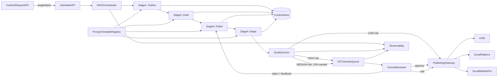

# Chapter 10: Design an Automated Content Generation Pipeline

## Context

> [!info] Quick Reference
> - **Pattern:** Multi-stage async content generation pipeline
> - **Scale:** High-volume content operations with HITL review
> - **Key Techniques:** Outline→draft→polish→format DAG (Temporal.io), quality scoring, 15% HITL routing, prompt A/B testing
> - **Primary Concerns:** Brand voice consistency, quality gate thresholds, pipeline observability, HITL latency
> - **Cross-references:** [[chapter-02|Chapter 2]] (prompt chaining), [[chapter-05|Chapter 5]] (output evaluation)

**Problem statement:** Design a high-throughput asynchronous content generation pipeline that processes 200K+ pieces per day through multi-stage prompt chains, automated quality scoring, and human-in-the-loop (HITL) review—optimizing for throughput and consistency over latency.

### Real-World Examples

- A marketing platform migrates from synchronous LLM calls (8 req/sec ceiling) to an async DAG-based pipeline, reaching 200K articles/day with 3-stage generation (outline → draft → polish) while reducing per-article cost from $0.15 to $0.06 through batch processing and prompt caching.
- A news wire deploys automated quality scoring on 100% of generated articles but routes only 15% (flagged as high-risk: legal, medical, financial topics) through human review. This cuts review backlog by 85% while maintaining a 99.7% compliance rate.

---

## Step 1: Understand the Problem and Establish Design Scope

### Simulated Dialogue

**Interviewer:** Design an automated content generation pipeline for production scale.  
**Candidate:** Content generation is fundamentally different from real-time inference—throughput and quality consistency matter more than latency. I need to understand the content types, quality bar, review requirements, and publishing SLAs.

**Candidate:** What content types and volumes?  
**Interviewer:** Marketing articles, product descriptions, email campaigns, social media posts. 200K pieces per day across all types. Each goes through multiple generation stages.

**Candidate:** What quality requirements exist?  
**Interviewer:** Automated quality scoring on all outputs. Human review on 15% of content (high-risk categories: financial claims, health advice, legal statements, brand-sensitive topics). Published content must meet brand style, factual accuracy, and compliance standards.

**Candidate:** What are the SLAs?  
**Interviewer:** Standard content: complete within 2 hours of submission. Urgent content (breaking campaigns): complete within 15 minutes. HITL review SLA: 30-minute turnaround from queue entry.

**Candidate:** What is the cost budget?  
**Interviewer:** Target $0.08 per content piece average, including LLM inference, quality scoring, and HITL labor.

### Functional Requirements

- **Multi-stage generation:** Each content piece passes through 2-4 generation stages (e.g., outline → draft → style polish → format adaptation).
- **Prompt template management:** Versioned prompt templates per content type and stage. A/B testing of prompt variants.
- **Quality scoring:** Automated scoring on every output (relevance, fluency, brand voice, factual grounding, compliance).
- **HITL review:** Route flagged content to human reviewers with structured feedback that flows back into the pipeline.
- **Batch processing:** Support bulk submission of 10K+ content requests with aggregate progress tracking.
- **Multi-format output:** Same content adapted for different channels (blog, email, social, ad copy) in a single pipeline run.

### Non-Functional Requirements

- **Throughput:** Sustain 200K content pieces/day. Peak: 3x (campaign launches).
- **Latency:** Standard p95 < 2 hours. Urgent p95 < 15 minutes.
- **Cost:** Average $0.08/piece (total, including HITL labor allocation).
- **Quality:** > 95% of published content passes human quality audit (sampled monthly).
- **Reliability:** No lost work—every stage result persisted before next stage begins. Retry on failure without re-running completed stages.
- **Observability:** Per-stage latency, quality score distribution, HITL queue depth, prompt version performance.

### Back-of-the-Envelope Estimation

#### Traffic Profile

- Content pieces/day: 200K
- Average stages per piece: 3
- Total LLM calls/day: `200K * 3 = 600K`
- Average QPS: `600K / 86,400 ≈ 7 calls/sec`
- Peak QPS (3x campaigns): ~21 calls/sec
- Average output tokens/stage: 700 tokens (outline: 300, draft: 1,200, polish: 600 → weighted avg)
- Total output tokens/day: `600K * 700 = 420M tokens`
- Average input tokens/stage: 1,300 tokens (prompt template + context + previous stage output)
- Total input tokens/day: `600K * 1,300 = 780M tokens`

#### Cost Breakdown ($0.08/piece target)

| Component | Per-Piece Cost | Calculation |
|---|---|---|
| LLM inference (3 stages) | $0.045 | 3.9K input + 2.1K output tokens @ blended $3/$15 per 1M |
| Quality scoring (1 LLM call) | $0.008 | ~800 input + 200 output tokens, cheaper model |
| HITL review (15% of pieces) | $0.021 | 15% * $0.14/review (human reviewer at $50/hr, 6 min avg) |
| Infrastructure (queues, storage, DAG engine) | $0.006 | Amortized compute + storage |
| **Total** | **$0.080** | |

#### Daily Aggregate

- LLM cost: `200K * $0.045 = $9,000/day`
- Quality scoring: `200K * $0.008 = $1,600/day`
- HITL labor: `200K * 0.15 * $0.14 = $4,200/day`
- Infrastructure: `200K * $0.006 = $1,200/day`
- **Total: ~$16,000/day → $480K/month**

#### HITL Queue Sizing

- Pieces requiring review: `200K * 15% = 30K/day`
- Reviews/hour needed: `30K / 24 = 1,250/hour` (assuming 24h coverage)
- At 6 min/review: `1,250 / 10 reviews/hr/person = 125 concurrent reviewers`
- Peak (3x): 375 reviewers → requires flexible workforce or longer SLA during peaks

#### Infrastructure Sizing

- LLM inference: 7-21 QPS is modest. A single 34B model instance handles this. Total fleet: 4-8 GPUs (or managed API).
- DAG engine: 200K DAG executions/day, 3-4 nodes per DAG → ~700K node executions/day → Airflow/Temporal handles easily.
- State store: 200K * ~15KB per piece (all stage outputs) = 3GB/day → 90GB/month (trivial).
- Queue: Kafka or SQS. 200K messages/day per topic, 5 topics → 1M messages/day (trivial throughput).

> **Why a durable queue rather than direct async calls:** Each stage executor must be able to crash, restart, or scale out without losing the in-flight task. Persisting tasks to a queue before calling the LLM means the message is acknowledged only after the stage result is written to the content store—so no work can vanish in a crash window. Kafka is preferred over SQS at scale because it supports consumer groups with independent offsets per stage pool (Stage 2 workers can replay from offset 0 without affecting Stage 3 consumers), enables exactly-once semantics via transactions, and retains the full message log for debugging. SQS is simpler to operate and sufficient if the DAG orchestrator (Temporal) already handles replay; the queue then only needs at-least-once delivery.

---

## Step 2: Propose High-Level Design and Get Buy-In

### Core Architecture Components

Nine components work together to move a content brief from request to published article without losing any intermediate work or blocking on a single stage's failure.

- **Job Intake API:** Accepts content requests (single or batch), validates that the brief contains the minimum required fields (topic, content type, target channels, priority), deduplicates against recent submissions via [[glossary#Embedding|embedding]] similarity, and creates a DAG instance in the orchestrator. Batch submissions of 10K+ briefs are streamed into the queue rather than accepted all at once, preventing intake from becoming a write bottleneck.
- **DAG Orchestrator:** Manages the multi-stage execution graph per content piece, ensuring each stage waits on its upstream dependency before starting and that every stage result is durably persisted before the next stage is triggered. It handles configurable retry policies per failure type, priority preemption for urgent content, and fan-out coordination when a single piece must produce multiple channel variants in parallel.
- **Prompt Template Registry:** Stores versioned prompt templates keyed by content type and stage, with metadata for model selection, [[glossary#Temperature|temperature]], max tokens, and A/B test traffic-split configuration. Serving the correct template version at the moment a stage executor pulls a task is critical—stale template reads can cause an A/B test to mix variants and corrupt the experiment.
- **Stage Executors:** Horizontally scalable worker pools, one pool per stage type (outline, draft, polish, format adaptation), that pull tasks from their respective queues, fetch the active prompt template, inject previous stage output and request metadata, and call the LLM. Workers are stateless so any node can handle any queued task, enabling straightforward autoscaling during campaign peaks.
- **Quality Scorer:** Runs a multi-dimensional automated evaluation on every stage's final output using a combination of [[glossary#Fine-tuning|fine-tuned]] 7B judge models and rule-based checks. It produces a composite 0–1 score, a per-dimension breakdown, and a risk classification (LOW/MEDIUM/HIGH) that determines the publishing path. Keeping the scorer separate from the generation workers allows it to be retrained independently without touching the generation pipeline.
- **HITL Review Queue:** A priority queue that presents flagged content to human reviewers with the original brief, all quality score breakdowns, and highlighted passages that triggered the flag. It enforces the 30-minute SLA by surfacing time-remaining countdown to reviewers and auto-escalating items approaching the SLA limit.
- **Content Store:** Append-only persistent storage for every stage output, quality score record, reviewer action, and final published artifact. Using an append-only model means no stage result is ever overwritten—if a re-run produces a different output, both versions are stored and the active pointer is updated, enabling full audit trails and rollback.
- **Publishing Gateway:** Delivers approved content to downstream channel APIs (CMS, email platform, social media) through per-channel queues with independent retry logic and dead-letter handling. A channel API outage never blocks generation or review—content accumulates in the per-channel queue and drains automatically on recovery.
- **Observability:** Emits per-stage latency histograms, quality score distributions per content type and prompt version, HITL queue depth and reviewer throughput, prompt A/B test metrics, and per-piece cost attribution. Without this layer, regressions in quality or throughput are invisible until downstream stakeholders complain.

### Pipeline A: Content Generation DAG

1. Content request arrives at intake API with: content type, topic/brief, target channels, priority, metadata.
2. DAG orchestrator creates execution graph based on content type template:
   - Stage 1 (Outline): Generate structured outline from brief.
   - Stage 2 (Draft): Expand outline into full draft using content type prompt.
   - Stage 3 (Polish): Style, tone, and grammar refinement.
   - Stage 4 (Adapt): Format for target channels (blog version, email version, social snippet).
3. Each stage executor pulls from its queue, retrieves prompt template from registry, injects previous stage output + metadata.
4. LLM generates output; result persisted to content store before next stage begins.
5. After final generation stage: quality scorer evaluates the output.
6. Quality scorer assigns risk level: LOW (auto-publish), MEDIUM (spot-check pool), HIGH (mandatory HITL review).
7. LOW → publishing gateway. MEDIUM → 10% sampled for HITL. HIGH → HITL review queue.

### Pipeline B: HITL Review Pipeline

1. Content enters HITL queue with priority (urgent content jumps queue).
2. Review dashboard presents: generated content, source brief, quality scores, flagged issues.
3. Reviewer actions: APPROVE (publish), REJECT (back to generation with feedback), EDIT (inline corrections → publish).
4. On REJECT: feedback injected into Stage 3 (Polish) prompt as "Reviewer feedback: {feedback}"; re-run Stage 3 + quality scoring.
5. Reviewer feedback logged for: (a) prompt template improvement, (b) quality scorer calibration, (c) model fine-tuning data.
6. SLA tracker monitors queue depth and turnaround; alerts if 30-min SLA is at risk.

### Pipeline C: Prompt Template Lifecycle

1. Prompt engineers author new template version in template registry.
2. Template deployed to shadow lane (5% of traffic, results scored but not published).
3. Compare quality scores, HITL rejection rates, and downstream engagement metrics against baseline version.
4. If shadow metrics pass threshold: gradual rollout (5% → 25% → 50% → 100%).
5. If regression detected: automatic rollback to previous version.
6. All template versions retained with full audit trail.

### Mermaid Architecture Diagram



---

## Step 3: Design Deep Dive

Focus areas:

1. **DAG-Based Pipeline Orchestration**
2. **Quality Scoring and HITL Integration**
3. **Prompt Chain Design**

### 1) DAG-Based Pipeline Orchestration

The pipeline is not a simple linear chain—content types have different stage graphs, stages can fan out (multi-channel adaptation), and failures must not lose completed work.

**DAG structure per content type:**

| Content Type | Stages | Fan-Out | Typical Duration |
|---|---|---|---|
| Blog article | Outline → Draft → Polish → SEO optimize | None | 4-8 min |
| Product description | Extract features → Write copy → Adapt (3 channels) | 1→3 at Adapt | 2-4 min |
| Email campaign | Subject line (3 variants) → Body → CTA polish | 3→1→1 | 3-5 min |
| Social media pack | Core message → Adapt (Twitter, LinkedIn, Instagram, Facebook) | 1→4 | 2-3 min |
| News summary | Source ingest → Summarize → Fact-check → Polish | None (serial) | 3-6 min |

**Orchestration engine selection:**

| Engine | Throughput | Retry/Recovery | Visibility | Operational Cost | Best For |
|---|---|---|---|---|---|
| Temporal.io | Very high (100K+ workflows/sec) | Built-in durable execution; automatic retry with backoff | Excellent (web UI, history replay) | Medium (managed service or self-hosted) | Production default |
| Apache Airflow | Moderate (DAG scheduling overhead) | DAG-level retry; manual intervention for stuck tasks | Good (web UI) | Low (mature, well-understood) | Batch-heavy, scheduled pipelines |
| AWS Step Functions | High (serverless) | Built-in retry, catch, timeout | Good (console) | Low ops, higher per-execution cost at scale | AWS-native shops, low ops overhead |
| Custom queue-based (Kafka + workers) | Highest (no orchestration overhead) | Manual retry logic; higher engineering cost | Must build | Lowest per-unit at scale | Very high throughput, simple DAGs |

**Recommended: Temporal.io** for durability guarantees. Each content piece is a Temporal workflow; each stage is an activity with configurable retry policy.

> **Why Temporal.io over simpler queues:** Content generation workflows have three properties that make raw queue-based orchestration painful: long duration (up to 2 hours), fan-out parallelism (multi-channel adaptation), and mandatory state persistence between stages. Temporal's durable execution model persists the full workflow event history to a database, so a worker crash mid-stage resumes from the last persisted checkpoint rather than re-running from scratch. For a 200K piece/day pipeline this matters concretely—a 10-minute worker outage without durable execution would drop ~1,400 in-flight workflows and require manual re-queuing. With Temporal, those workflows resume automatically. The trade-off is operational complexity (running a Temporal cluster or paying for the managed service) and slightly higher per-workflow overhead (~5ms) versus raw Kafka consumers, which is negligible at the 7 QPS average load here.

**Stage execution model:**

```text
ContentWorkflow(request):
  outline = execute_stage("outline", request.brief, request.content_type)
  draft = execute_stage("draft", outline, request.content_type)
  polished = execute_stage("polish", draft, request.content_type)

  if request.channels.length > 1:
    adaptations = parallel_for(request.channels, ch ->
      execute_stage("adapt", polished, ch))
  else:
    adaptations = [polished]

  for content in adaptations:
    score = quality_score(content)
    if score.risk == HIGH or (score.risk == MEDIUM and random() < 0.10):
      reviewed = submit_for_hitl_review(content, score)
      if reviewed.action == REJECT:
        polished = execute_stage("polish", draft, request.content_type,
                                  feedback=reviewed.feedback)
        content = execute_stage("adapt", polished, request.channels[0])
        score = quality_score(content)
    publish(content, request.channel)
```

**Failure handling:**

| Failure Type | Detection | Recovery | Max Retries |
|---|---|---|---|
| LLM API timeout | 60s timeout per call | Retry with exponential backoff (2s, 4s, 8s) | 3 |
| LLM API rate limit (429) | HTTP status code | Back off per retry-after header; route to secondary provider | 5 |
| Quality score below threshold | Score < 0.4 (hard fail) | Re-run stage with temperature 0.3 (more deterministic) | 2 |
| Stage output validation failure | Schema check on output (missing required fields) | Re-run with stricter format instructions in prompt | 2 |
| Workflow timeout | Wall-clock > 2h (standard) / 15min (urgent) | Escalate to ops; partial results saved | 0 (alert only) |
| Content store write failure | Write timeout or error | Retry write; on persistent failure, pause workflow | 5 |

**Priority scheduling:**

- Urgent content gets dedicated worker pool (20% of capacity reserved).
- Standard content uses remaining 80%.
- During campaigns (3x load): autoscale standard pool; urgent pool is elastic up to 50% of total.
- Starvation prevention: standard content waiting > 1 hour gets priority boost.

### 2) Quality Scoring and HITL Integration

Quality scoring replaces manual review for 85% of content. The scorer must be fast, [[glossary#Calibration|calibrated]], and transparent.

**Quality scoring dimensions:**

| Dimension | Weight | Measurement | Threshold (pass) |
|---|---|---|---|
| Relevance to brief | 0.25 | LLM judge: does the content address the brief's requirements? | ≥ 0.7 |
| Fluency and grammar | 0.15 | LLM judge + rule-based checks (LanguageTool) | ≥ 0.8 |
| Brand voice consistency | 0.20 | LLM judge against brand style guide reference | ≥ 0.6 |
| Factual grounding | 0.20 | Citation check: claims supported by provided sources? | ≥ 0.7 |
| Compliance (legal/regulatory) | 0.20 | Rule-based keyword scan + LLM judge for claims about health/finance/legal | ≥ 0.9 |

**Composite score:** Weighted sum. Pass threshold: 0.70. Risk classification:
- Score ≥ 0.85 AND no compliance flag → LOW risk (auto-publish)
- Score ≥ 0.70 AND compliance flag → HIGH risk (mandatory HITL)
- Score ≥ 0.70 AND no compliance flag → MEDIUM risk (10% sampled for HITL)
- Score < 0.70 → FAIL (re-generate)

**Quality scorer architecture:**

| Component | Model | Latency | Cost/Evaluation |
|---|---|---|---|
| Relevance judge | 7B fine-tuned on brief→content pairs | 200ms | $0.002 |
| Fluency checker | Rule-based (LanguageTool) + 7B backup | 100ms | $0.001 |
| Brand voice scorer | 7B fine-tuned on brand-labeled examples | 200ms | $0.002 |
| Factual grounding | Citation extraction + URL/source verification | 500ms | $0.002 |
| Compliance scanner | Keyword regex + 7B judge on flagged passages | 300ms | $0.001 |
| **Total** | | **~800ms** | **$0.008** |

> **Why LanguageTool as the primary fluency checker rather than always using an LLM:** LanguageTool is a deterministic, sub-10ms rule-based grammar checker that catches 90%+ of fluency issues (subject-verb disagreement, incorrect articles, run-on sentences) at zero marginal LLM cost. An LLM judge is only invoked when LanguageTool flags a passage or when the overall fluency score from LanguageTool falls below 0.85, which occurs in roughly 15% of outputs. This hybrid approach cuts fluency checking cost from $0.002/piece (LLM-only) to $0.001/piece while maintaining equivalent detection rates on structured grammatical errors. Purely LLM-based fluency checking also adds 200ms of latency per evaluation call; the rule-based path adds under 10ms.

**Scorer calibration loop:**

1. Monthly: sample 500 scored pieces across the score distribution.
2. Human evaluators rate the same dimensions independently.
3. Compute scorer-human correlation per dimension. Target: Kendall's τ > 0.7.
4. If correlation drops below 0.6 on any dimension: retrain that dimension's judge model on the new human labels.
5. Track score distribution drift over time—if mean score creeps up without quality improvement, the scorer is inflating.

**HITL review interface design:**

The review UI must minimize reviewer cognitive load to hit the 6-minute average review time:

| UI Element | Purpose | Design |
|---|---|---|
| Side-by-side view | Brief on left, generated content on right | Highlighted sections matching brief requirements |
| Quality score breakdown | Show per-dimension scores | Color-coded (green/yellow/red) with expandable rationale |
| Flagged passages | Compliance or grounding issues | Inline highlights with suggested fixes |
| Action buttons | Approve / Edit / Reject | One-click approve; inline edit mode; reject with structured feedback form |
| Feedback taxonomy | Structured reject reasons | Dropdown: factual error, tone mismatch, incomplete, compliance violation, other |
| Time tracker | SLA monitoring | Visible countdown; items turning red at 80% of SLA |

**Feedback loop from HITL to pipeline:**

| Feedback Signal | Consumer | Action |
|---|---|---|
| Rejection reason: "tone mismatch" | Prompt template team | Adjust brand voice instructions in polish stage prompt |
| Rejection reason: "factual error" | Quality scorer | Add failing case to grounding judge training set |
| Reviewer edits (diff) | Model fine-tuning | Editor preference pairs for RLHF/DPO training |
| Approval rate by prompt version | A/B test engine | Promote high-approval prompt versions |
| Average review time by content type | Ops | Adjust HITL staffing allocation |

### 3) Prompt Chain Design

Each stage in the pipeline uses a carefully designed prompt that takes the previous stage's output as input. The chain must maintain coherence, prevent error amplification, and allow independent stage optimization.

**Prompt chain architecture principles:**

1. **Explicit contracts between stages:** Each stage outputs a structured format that the next stage expects. No ambiguity.
2. **Context compression:** Don't pass the full output of all previous stages. Summarize or extract the relevant portions.
3. **Independent optimization:** Each stage's prompt can be A/B tested independently because the inter-stage format is fixed.
4. **Error isolation:** A bad outline produces a bad draft. Add validation gates between stages to catch errors early.

> **Why decompose into multiple stages rather than writing one large prompt that generates the final article directly:** A single-prompt approach forces the LLM to simultaneously plan structure, write prose, enforce brand voice, and satisfy SEO constraints—competing objectives that cause the model to make trade-offs implicitly and inconsistently. Separate stages make each objective explicit and individually measurable: Stage 1 is graded on outline completeness, Stage 2 on draft coverage, Stage 3 on brand voice alignment. This also means errors are isolated—a flawed outline caught at the Stage 1 validation gate costs one cheap outline call ($0.002) to fix, while a flawed outline that propagates to a 1,200-token draft costs $0.02 to fix at Stage 2 and $0.045 to fix at Stage 3. At 200K pieces/day, catching errors one stage earlier rather than later saves thousands of dollars daily. The downside is that multi-stage chains amplify latency (3-4x) and introduce inter-stage coupling that must be managed through explicit format contracts.

**Example prompt chain for blog article:**

| Stage | Input | Output Format | Prompt Key Instructions |
|---|---|---|---|
| 1: Outline | Brief (topic, keywords, audience, length target) | JSON: `{title, sections: [{heading, bullet_points, target_word_count}]}` | "Create a structured outline. Each section must have 3-5 bullet points. Total target: {word_count} words." |
| 2: Draft | Outline JSON + brief | Markdown article with section headers | "Expand each section from the outline. Maintain the heading structure. Target {word_count} words total." |
| 3: Polish | Draft markdown + brand style guide excerpt | Markdown article (same structure, refined prose) | "Refine for {brand_voice}. Fix grammar. Ensure claims are supported. Do not change the structure or add new sections." |
| 4: SEO | Polished markdown + target keywords | Final markdown + meta description + alt texts | "Naturally integrate keywords: {keywords}. Add meta description (155 chars). Do not keyword-stuff." |

**Inter-stage validation gates:**

| Gate | Between Stages | Check | Failure Action |
|---|---|---|---|
| Outline completeness | 1 → 2 | All required sections present? Word count targets sum to ±20% of total target? | Re-run Stage 1 with stricter constraints |
| Draft length | 2 → 3 | Output within ±30% of target word count? | Re-run Stage 2 with explicit "you wrote X words, target is Y" |
| Structure preservation | 3 → 4 | Section headings match between draft and polished version? | Re-run Stage 3 with "do not modify headings" reinforced |
| Keyword integration | 4 → publish | All target keywords present at least once? | Re-run Stage 4 with missing keyword list |

**Prompt template versioning and A/B testing:**

```json
{
  "template_id": "blog_draft_v3",
  "content_type": "blog_article",
  "stage": "draft",
  "version": 3,
  "status": "canary",
  "traffic_split": 0.10,
  "baseline_version": 2,
  "prompt_text": "You are a content writer for {brand}. Expand this outline into a well-structured blog article...",
  "model": "gpt-4o-mini",
  "temperature": 0.7,
  "max_tokens": 2000,
  "evaluation_metrics": ["quality_score", "hitl_approval_rate", "avg_review_time"],
  "promotion_criteria": {
    "quality_score_delta": ">= -0.02",
    "hitl_approval_rate_delta": ">= 0",
    "min_sample_size": 500
  }
}
```

**A/B test lifecycle:**
1. New template version created → deployed at 10% traffic.
2. After 500 pieces through new version: compare metrics against baseline.
3. If promotion criteria met: escalate to 50%, then 100%.
4. If any metric regresses beyond threshold: auto-rollback to baseline.
5. Typical A/B test duration: 2-5 days at 200K pieces/day.

#### Prompt Chain Trade-off Table

| Decision | Option A: Single-Stage Generation | Option B: 2-Stage (Draft + Polish) | Option C: 3-4 Stage Chain | Recommended |
|---|---|---|---|---|
| Quality | Acceptable for short content | Good—polish fixes draft issues | Best—each stage specializes | 3-stage for articles; 2-stage for short content |
| Cost | Lowest (1 LLM call) | 2x cost | 3-4x cost | 3-stage; cost is marginal vs HITL savings |
| Latency | Fastest | 2x | 3-4x | Acceptable for async pipeline |
| Error amplification risk | None (single pass) | Low | Medium—bad outline propagates | Mitigated by inter-stage validation gates |
| Optimization granularity | Coarse (one prompt to tune) | Medium | High—tune each stage independently | 3-stage for mature pipelines |
| Consistency across pieces | Low (high variance per run) | Medium | High (structured output reduces variance) | 3-stage for brand consistency |

**Deduplication and semantic caching:**

- Before running a new content piece: embed the brief and check against recent pieces (last 30 days).
- Cosine similarity > 0.92 → flag as potential duplicate. Serve cached result or merge briefs.
- Saves ~8-12% of pipeline cost from accidental re-submissions and similar briefs from different teams.
- Cache key: content_type + brief_embedding + target_channels. TTL: 30 days.

> **Why 0.92 as the cosine similarity threshold rather than a stricter 0.98 or a looser 0.85:** At 0.98 the deduplication only catches verbatim-equivalent briefs (copy-paste re-submissions), missing the large class of "same campaign, slightly reworded brief" duplicates that represent the majority of wasted generation. At 0.85 the system begins flagging genuinely distinct briefs as duplicates (e.g., two different product descriptions that both open with "The X is a high-performance tool..."), causing false positives that frustrate submitters. Empirically, 0.92 on sentence-transformer embeddings (e.g., `all-mpnet-base-v2`) aligns with human judgment of "these briefs are effectively asking for the same content" at roughly 90% precision and 85% recall, delivering the 8-12% cost savings without material false-positive rate. The threshold should be tuned per content type: short social media briefs need a higher threshold (0.95) because short text embeddings cluster more tightly by default.

### Production Bottlenecks and Mitigations

- **HITL queue backlog during campaign launches**
  - Symptom: Queue depth exceeds 3,000; 30-min SLA breached for 20% of items.
  - Mitigation: (1) Temporarily raise auto-publish threshold (score ≥ 0.80 → LOW risk instead of 0.85). (2) Activate surge reviewer pool. (3) For urgent content: bypass HITL for MEDIUM risk, rely on post-publish audit.

- **Prompt version regression goes undetected**
  - Symptom: New prompt template version slowly degrades quality, but quality scorer doesn't catch it because the scorer was calibrated on the old prompt's output distribution.
  - Mitigation: A/B test every template version with mandatory hold-out. Track HITL rejection rate per prompt version (leading indicator before scorer drift).

- **Stage output format drift**
  - Symptom: Stage 2 occasionally outputs HTML instead of markdown, breaking Stage 3's parser.
  - Mitigation: Strict output validation between stages. If format check fails, retry with "Output MUST be in markdown format. No HTML tags." appended to prompt. After 2 retries, flag for manual review.

- **Cost spikes from retry amplification**
  - Symptom: A temporarily degraded LLM API causes 60% of Stage 2 calls to fail quality gate, triggering 2 retries each. Cost doubles.
  - Mitigation: Circuit breaker on per-stage retry rate. If retry rate > 30% for a stage over 10 minutes, pause that stage and alert. Resume after API health check passes.

- **Content store write contention during batch submissions**
  - Symptom: 10K-piece batch submission causes write throughput bottleneck; DAGs stall waiting for persistence.
  - Mitigation: Content store uses write-ahead log with async replication. Stage can proceed once WAL write confirms. Background replication to durable store.

> **Why a write-ahead log (WAL) rather than waiting for full synchronous replication before proceeding:** A synchronous multi-AZ replication write adds 5–15ms per stage; across 600K stage writes per day this accumulates to hours of added latency in aggregate. The WAL pattern commits to a local fast log (sub-millisecond) and the workflow proceeds immediately; a background process then replicates to the primary durable store. If the worker crashes between WAL write and replication, the orchestrator's durable execution history (Temporal) replays the stage and re-issues the write—idempotent via the stage's unique execution ID. This reduces per-stage handoff latency by 10–15ms, compounding to a 30–45ms reduction across a 3-stage chain and preventing write throughput from becoming the pipeline's bottleneck during 10K-piece batch bursts.

- **Reviewer fatigue degradation**
  - Symptom: Reviewer approval rate increases over a shift (rubber-stamping). Quality of reviews degrades in hours 6-8.
  - Mitigation: Inject known-bad content as calibration items (5% of queue). Flag reviewers whose calibration accuracy drops below 80%. Mandatory breaks every 2 hours.

---

## Practical Implementation

### Pseudocode: Temporal.io Content Workflow

The following pseudocode shows the durable workflow structure for a single content piece, including fan-out for multi-channel adaptation and the HITL integration loop.

```text
# Pseudocode: Content Generation Workflow (Temporal.io activity model)

WORKFLOW ContentGenerationWorkflow(request: ContentRequest):
    # Stage 1: Outline
    outline_result = ACTIVITY execute_stage(
        stage="outline",
        input=request.brief,
        content_type=request.content_type,
        retry_policy=RetryPolicy(max_attempts=3, backoff=ExponentialBackoff(base=2s))
    )
    VALIDATE outline_result AGAINST OutlineSchema OR RETRY_STAGE(1)

    # Stage 2: Draft
    draft_result = ACTIVITY execute_stage(
        stage="draft",
        input=outline_result,
        content_type=request.content_type
    )
    VALIDATE draft_result.word_count WITHIN ±30% OF request.target_words OR RETRY_STAGE(2)

    # Stage 3: Polish
    polish_result = ACTIVITY execute_stage(
        stage="polish",
        input=draft_result,
        content_type=request.content_type,
        brand_style_guide=load_brand_guide(request.brand_id)
    )
    VALIDATE section_headings(polish_result) == section_headings(draft_result) OR RETRY_STAGE(3)

    # Fan-out: adapt per channel in parallel
    adaptations = PARALLEL_FOR channel IN request.channels:
        ACTIVITY execute_stage(
            stage="adapt",
            input=polish_result,
            channel=channel
        )

    # Quality scoring and HITL routing per adaptation
    FOR (adaptation, channel) IN zip(adaptations, request.channels):
        score = ACTIVITY quality_score(adaptation)
        PERSIST score TO content_store(request.piece_id, channel)

        IF score.risk == HIGH OR (score.risk == MEDIUM AND random() < 0.10):
            review_result = ACTIVITY submit_hitl_review(
                content=adaptation,
                score=score,
                sla_minutes=30
            )
            IF review_result.action == REJECT:
                polish_result = ACTIVITY execute_stage(
                    stage="polish",
                    input=draft_result,
                    feedback=review_result.feedback
                )
                adaptation = ACTIVITY execute_stage(stage="adapt", input=polish_result, channel=channel)
                score = ACTIVITY quality_score(adaptation)

        ACTIVITY publish(adaptation, channel, prompt_version=get_active_template_version())
```

### Runnable Python: Inter-Stage Validation Gate

```python
import json
from dataclasses import dataclass
from typing import Optional

@dataclass
class OutlineSection:
    heading: str
    bullet_points: list[str]
    target_word_count: int

@dataclass
class Outline:
    title: str
    sections: list[OutlineSection]

@dataclass
class ValidationResult:
    passed: bool
    error_message: Optional[str] = None
    retry_prompt_suffix: Optional[str] = None

def validate_outline(raw_json: str, brief_word_count: int) -> ValidationResult:
    """
    Validate Stage 1 (Outline) output before passing to Stage 2 (Draft).
    Returns a ValidationResult with a retry_prompt_suffix on failure.
    """
    # Check valid JSON
    try:
        data = json.loads(raw_json)
    except json.JSONDecodeError as e:
        return ValidationResult(
            passed=False,
            error_message=f"Invalid JSON: {e}",
            retry_prompt_suffix=(
                "Your previous output was not valid JSON. "
                "Output ONLY a JSON object matching this schema: "
                "{\"title\": str, \"sections\": [{\"heading\": str, "
                "\"bullet_points\": [str, ...], \"target_word_count\": int}]}"
            )
        )

    # Check required top-level fields
    if "title" not in data or "sections" not in data:
        return ValidationResult(
            passed=False,
            error_message="Missing required fields: 'title' or 'sections'",
            retry_prompt_suffix="Your outline must include 'title' and 'sections' keys at the top level."
        )

    sections = data["sections"]
    errors = []

    # Check each section has at least 3 bullet points
    for sec in sections:
        heading = sec.get("heading", "<unnamed>")
        bullets = sec.get("bullet_points", [])
        if len(bullets) < 3:
            errors.append(
                f"Section '{heading}' has {len(bullets)} bullet point(s); provide at least 3."
            )

    # Check total target_word_count within ±20% of brief target
    total_wc = sum(sec.get("target_word_count", 0) for sec in sections)
    lower = brief_word_count * 0.80
    upper = brief_word_count * 1.20
    if not (lower <= total_wc <= upper):
        errors.append(
            f"Total target_word_count across sections is {total_wc}; "
            f"it must be between {int(lower)} and {int(upper)} "
            f"(±20% of brief target {brief_word_count})."
        )

    if errors:
        suffix = "Fix the following issues in your outline:\n" + "\n".join(f"- {e}" for e in errors)
        return ValidationResult(
            passed=False,
            error_message="; ".join(errors),
            retry_prompt_suffix=suffix
        )

    return ValidationResult(passed=True)


def execute_stage_with_validation(llm_call, prompt: str, brief_word_count: int, max_retries: int = 2) -> str:
    """
    Run Stage 1 with validation gate. On failure, append error context and retry.
    Raises RuntimeError if all retries are exhausted.
    """
    current_prompt = prompt
    for attempt in range(max_retries + 1):
        raw_output = llm_call(current_prompt)
        result = validate_outline(raw_output, brief_word_count)
        if result.passed:
            return raw_output
        if attempt < max_retries:
            current_prompt = prompt + f"\n\n[Attempt {attempt + 1} failed] {result.retry_prompt_suffix}"
        else:
            raise RuntimeError(
                f"Stage 1 (Outline) failed validation after {max_retries + 1} attempts. "
                f"Last error: {result.error_message}"
            )
```

### Runnable Python: Quality Score Composite Calculation with Risk Classification

```python
from dataclasses import dataclass
from enum import Enum
import random

class RiskLevel(Enum):
    LOW = "LOW"
    MEDIUM = "MEDIUM"
    HIGH = "HIGH"
    FAIL = "FAIL"

@dataclass
class DimensionScore:
    relevance: float       # 0.0 – 1.0
    fluency: float         # 0.0 – 1.0
    brand_voice: float     # 0.0 – 1.0
    factual: float         # 0.0 – 1.0
    compliance: float      # 0.0 – 1.0
    compliance_flagged: bool = False  # True if a compliance keyword was detected

WEIGHTS = {
    "relevance": 0.25,
    "fluency": 0.15,
    "brand_voice": 0.20,
    "factual": 0.20,
    "compliance": 0.20,
}

PASS_THRESHOLDS = {
    "relevance": 0.70,
    "fluency": 0.80,
    "brand_voice": 0.60,
    "factual": 0.70,
    "compliance": 0.90,
}

@dataclass
class QualityScoreResult:
    composite: float
    risk: RiskLevel
    dimension_scores: DimensionScore
    failed_dimensions: list[str]
    route_to_hitl: bool

def compute_quality_score(scores: DimensionScore) -> QualityScoreResult:
    """
    Compute composite quality score and determine routing decision.
    """
    raw = {
        "relevance": scores.relevance,
        "fluency": scores.fluency,
        "brand_voice": scores.brand_voice,
        "factual": scores.factual,
        "compliance": scores.compliance,
    }

    composite = sum(WEIGHTS[dim] * raw[dim] for dim in WEIGHTS)

    failed_dimensions = [
        dim for dim, score in raw.items()
        if score < PASS_THRESHOLDS[dim]
    ]

    # Risk classification logic
    if composite < 0.70 or failed_dimensions:
        risk = RiskLevel.FAIL
        route_to_hitl = False  # Re-generate, not review
    elif scores.compliance_flagged:
        # Any compliance flag forces HIGH regardless of composite score
        risk = RiskLevel.HIGH
        route_to_hitl = True
    elif composite >= 0.85:
        risk = RiskLevel.LOW
        route_to_hitl = False  # Auto-publish
    else:
        # 0.70 <= composite < 0.85, no compliance flag
        risk = RiskLevel.MEDIUM
        route_to_hitl = random.random() < 0.10  # 10% sample to HITL

    return QualityScoreResult(
        composite=round(composite, 4),
        risk=risk,
        dimension_scores=scores,
        failed_dimensions=failed_dimensions,
        route_to_hitl=route_to_hitl,
    )


# Example usage
if __name__ == "__main__":
    sample_scores = DimensionScore(
        relevance=0.82,
        fluency=0.91,
        brand_voice=0.65,
        factual=0.78,
        compliance=0.95,
        compliance_flagged=False,
    )
    result = compute_quality_score(sample_scores)
    print(f"Composite: {result.composite}")
    print(f"Risk: {result.risk.value}")
    print(f"Route to HITL: {result.route_to_hitl}")
    print(f"Failed dimensions: {result.failed_dimensions}")
    # Expected: composite ≈ 0.8135, risk=MEDIUM, route_to_hitl=False (90% probability)
```

---


---

## Step 4: Wrap Up

### Final Design Summary

The design is a throughput-first async pipeline built on DAG orchestration (Temporal.io), with multi-stage prompt chains that decompose generation into specialized steps with validation gates between them. Quality scoring on 100% of outputs routes only 15% to human review, while prompt template A/B testing and HITL feedback loops drive continuous improvement. The system is designed to process 200K content pieces/day at $0.08/piece with a standard p95 turnaround under 2 hours.

Three architectural decisions define this system's character. First, the choice of an async DAG over synchronous calls is what makes 200K pieces/day achievable—synchronous pipelines hit a ceiling around 8 req/sec due to LLM latency stacking, while the async DAG decouples submission throughput from generation throughput and lets the worker pools absorb burst load. Second, the 85/15 split between auto-publish and HITL review is not a fixed ratio but an outcome of the quality scorer's calibration: as the scorer improves over time (driven by HITL feedback), the HITL rate naturally decreases, lowering the $4,200/day labor cost without explicit policy changes. Third, the prompt chain's inter-stage validation gates prevent error amplification—a bad outline caught at the 1→2 gate is fixed before it contaminates the draft and polish stages, so the effective retry cost is one cheap outline call rather than an expensive full-chain re-run.

The system's weakest point is the quality scorer itself: all routing decisions depend on it, and a miscalibrated scorer either overloads the HITL queue (if too strict) or lets low-quality content auto-publish (if too lenient). The monthly calibration loop with Kendall's τ tracking is the most important operational process in the entire pipeline.

### Wrap-Around Concerns

- **Risk: Quality scorer grade inflation.** Scorer quality scores drift upward over time without real quality improvement, letting more low-quality content auto-publish as the system matures and the score distribution shifts. This happens because the scorer's training data skews toward the kinds of content that humans approved historically, so it becomes systematically optimistic about similar-looking content. Mitigation: monthly human calibration audit on 500 stratified samples; track the rolling 30-day mean score and alert if it rises more than 5 percentage points without a corresponding rise in downstream engagement metrics.

- **Risk: Cross-stage semantic inconsistency.** The prompt chain produces internally inconsistent content where Stage 3 (Polish) silently contradicts factual claims made in Stage 2 (Draft)—for example, rewriting "the product launches in Q3" to "the product launches in Q4" to improve sentence flow. This is the most subtle failure mode because each stage output looks individually plausible. Mitigation: add a consistency check in the quality scorer that extracts named entities and claims from both the draft and polished outputs and flags contradictions using an LLM judge; route contradicting pairs directly to HIGH risk regardless of other scores.

- **Risk: Cross-team near-duplicate submissions.** Multiple content teams independently submit similar briefs on the same topic (e.g., three teams submit "summer sale email for product X" within a 24-hour window), causing the brand's channels to receive nearly-identical content that looks like a copy-paste error to recipients. Each team's submission passes quality scoring independently because the scorer evaluates quality, not uniqueness. Mitigation: cross-batch deduplication at intake using cosine similarity > 0.88 on brief embeddings; semantic similarity check against published content from the last 30 days before any pipeline execution begins.

- **Risk: HITL reviewer coverage gaps.** Human reviewers are a single point of failure for urgent content during off-hours (e.g., a 2 AM campaign launch in a single-timezone team), where a queue depth spike has no reviewers to drain it. The HITL SLA breach then delays time-sensitive content. Mitigation: follow-the-sun coverage across 3 time zones with minimum 2 active reviewers per zone at all times; auto-escalation to an on-call reviewer pool if queue depth exceeds 200 items with no active reviewer sessions; for urgent content during confirmed off-hours, allow a one-time SLA extension with requester notification.

- **Risk: Downstream channel API fragility.** CMS, email platform, and social media APIs each have rate limits and unplanned outages; when a channel goes down, generated and approved content accumulates in the publishing queue, and time-sensitive pieces (flash sales, event announcements) can become stale before delivery. Mitigation: publishing gateway uses per-channel queues with exponential backoff retry and dead-letter handling; content is marked "published" only after the channel confirms receipt; pieces carry a TTL metadata field and are auto-cancelled with requester notification if the TTL expires while the piece is still in the publishing queue.

---

## Step 5: Interviewer Curveballs

### Interviewer Follow-ups & Frequently Asked Questions (FAQ)

Q: The HITL review queue is growing at 500 items/hour and reviewers can only process 400/hour. What do you do right now?

**The Ideal Answer:** Immediate triage: (1) Raise the auto-publish quality threshold from 0.85 to 0.80—this routes ~30% of currently-queued MEDIUM risk content to auto-publish, instantly draining part of the queue. (2) Activate surge reviewers (on-call pool). (3) For non-urgent content, extend the SLA to 2 hours temporarily. (4) Longer term: retrain the quality scorer to be more discriminating (reduce the MEDIUM band), reducing HITL volume permanently.

**Deep Dive & Trade-offs:**
- Raising auto-publish threshold increases risk: ~2% of auto-published content may have issues caught in post-publish audit.
- Surge reviewers are expensive and may have lower quality (less familiarity with brand voice).
- The real fix is improving the quality scorer to reduce the gray zone (MEDIUM risk band).

**The Interviewer's Rubric:** Checking operational triage under pressure with quantitative reasoning. The interviewer wants to see a candidate who immediately reaches for the threshold lever as a fast, quantified fix (not just "add more reviewers"), understands the quality risk that comes with raising the threshold, and proposes the durable fix (improve the scorer's discriminating power) rather than just staffing up indefinitely. A strong answer gives a concrete number for how much queue drain the threshold change buys (roughly 30% in this case) before discussing surge staffing. A weak answer describes the problem and stops at "escalate to ops."

---

Q: How do you A/B test a prompt template change when the quality scorer might itself be biased toward the old template's output style?

**The Ideal Answer:** Use a metric that is independent of the quality scorer: HITL approval rate. Route A/B traffic through HITL review at 100% (temporarily) and compare human approval rates. If the new template's HITL approval rate is equal or better, the scorer's bias doesn't matter. After confirming, recalibrate the scorer on the new template's output distribution.

**Deep Dive & Trade-offs:**
- 100% HITL review during A/B test is expensive. Limit test to 500 pieces.
- Alternative: use a held-out human evaluation panel (cheaper than HITL but slower).
- Scorer recalibration after template change is mandatory—skip it and the scorer will slowly drift.

**The Interviewer's Rubric:** Checking awareness of evaluation circularity in ML systems, which is a pervasive trap in automated pipelines. The interviewer is testing whether the candidate recognizes that a quality scorer trained on one distribution cannot be the ground truth for evaluating a different distribution—using it as both judge and jury invalidates the A/B test. A strong answer names the independent ground truth (HITL approval rate or a held-out human panel), quantifies the cost (500 pieces through 100% HITL), and commits to rescoring after the fact. A weak answer treats the existing scorer as authoritative and misses the circularity entirely.

---

Q: A brand manager says the pipeline's output "doesn't sound like us" even though quality scores are high. What's wrong?

**The Ideal Answer:** The quality scorer's "brand voice" dimension is miscalibrated. It was likely trained on a small set of examples and doesn't capture the brand's evolving voice. Fix: (1) Collect 50+ examples of content the brand manager rates as "on-voice" and "off-voice." (2) Fine-tune the brand voice scorer on this data. (3) Inject the brand's actual style guide (with examples) into the polish stage prompt, not just a description. (4) Add a brand-manager review lane for 1 week to calibrate the pipeline, then reduce to spot-checks.

**Deep Dive & Trade-offs:**
- Brand voice is subjective and hard to specify in a prompt. Few-shot examples are more effective than descriptive instructions.
- Fine-tuning a scorer on 50 examples risks overfitting. Use cross-validation and track generalization.
- Ongoing: add monthly brand voice calibration sessions where brand stakeholders rate 20 random pieces.

**The Interviewer's Rubric:** Checking ability to debug subjective quality issues in an automated pipeline where the metric says "pass" but the human expert says "fail." The interviewer wants to see the candidate resist the impulse to tune numbers in a scoring formula and instead go to the data: collect labeled examples from the person closest to the ground truth (the brand manager), then retrain. A strong answer also acknowledges that descriptive prompt instructions for brand voice are weak compared to in-prompt few-shot examples, and proposes the calibration lane as a bridge while the scorer catches up. A weak answer suggests only tweaking the brand voice dimension weight without re-examining what the scorer was trained on.

---

Q: How do you handle a content type that has never been generated before (e.g., the company launches a podcast script format)?

**The Ideal Answer:** Cold-start protocol: (1) Define the stage DAG for podcast scripts (e.g., Outline → Script Draft → Audio Direction Notes). (2) Author initial prompt templates based on 5-10 manually written podcast scripts as exemplars. (3) Route 100% of new content type through HITL review for the first 2 weeks. (4) Use HITL feedback to iterate on prompts daily. (5) Once HITL approval rate exceeds 85%: deploy quality scorer trained on the 2 weeks of human-labeled data. (6) Gradually reduce HITL rate to the standard 15%.

**Deep Dive & Trade-offs:**
- Forcing 100% HITL on new content types is expensive but prevents publishing low-quality content for a new format.
- 2-week ramp-up is aggressive. Complex formats (whitepapers, technical documentation) may need 4-6 weeks.
- The quality scorer for a new content type starts poorly. Don't trust it until it has 500+ human-labeled examples.

**The Interviewer's Rubric:** Checking cold-start reasoning for production ML pipelines, where the absence of a trained scorer means the human-in-the-loop must serve as both quality gate and training data generator. The interviewer is looking for a structured ramp-up plan with explicit phase transitions (100% HITL → scorer training → gradual HITL reduction) and honest acknowledgment that the initial scorer will be poor. A strong answer quantifies the cold-start cost (2 weeks × 30K reviews/day for a new content type at 15% HITL rate means ~4,200 extra reviews, or ~$588/day in HITL labor before automation kicks in) and names the signal that triggers the transition to reduced HITL (approval rate exceeding 85%). A weak answer says "train a model" without addressing who provides the training labels or how the transition is managed.

---

Q: The pipeline processes 200K pieces/day but only 60% are ultimately published. Where is the waste?

**The Ideal Answer:** Diagnose the 40% drop-off at each stage: (1) How many fail inter-stage validation and are retried? (2) How many fail quality scoring and are re-generated? (3) How many are rejected by HITL? (4) How many are abandoned by the requester before completion? Likely culprits: (a) Poor briefs leading to irrelevant outlines (fix: brief validation at intake), (b) Requesters submitting speculative briefs they don't intend to publish (fix: approval workflow before pipeline entry), (c) Duplicate submissions from multiple teams (fix: deduplication at intake).

**Deep Dive & Trade-offs:**
- Publishing 60% of generated content means 40% of LLM cost ($3,600/day) is waste.
- Brief validation at intake (LLM check: "Is this brief specific enough to generate quality content?") costs $0.002/brief but could save $1,500/day in wasted generation.
- Deduplication saves $1,000-2,000/day depending on duplicate rate.

**The Interviewer's Rubric:** Checking system-level efficiency thinking beyond the generation pipeline itself and the ability to decompose a high-level "40% waste" number into attributable causes. The interviewer is looking for a candidate who drills into each drop-off stage methodically (intake → inter-stage gates → quality scoring → HITL rejection → requester abandonment), quantifies the waste cost per cause, and prioritizes interventions by ROI. A strong answer identifies brief quality at intake as the highest-leverage fix—a $0.002/brief LLM check that saves $0.045/piece in wasted generation is a 22x return—and backs this with the math. A weak answer lists possible causes without prioritizing or quantifying them.

---

Q: A critical downstream channel (email platform API) is down. You have 5,000 email campaigns generated and approved in the last 2 hours. What happens?

**The Ideal Answer:** The publishing gateway's email queue absorbs the backlog (dead-letter queue for failed publishes, retry with exponential backoff). Content is already generated and approved—no re-work needed. Monitor queue depth. When the email platform recovers, the queue drains automatically. If the outage exceeds 4 hours: (1) Alert requesters that delivery is delayed, (2) Review queue for time-sensitive campaigns that are now stale (flash sales, event announcements), (3) Allow requesters to cancel stale items. The pipeline itself continues generating and approving new content regardless of channel status.

**Deep Dive & Trade-offs:**
- Decoupling generation from publishing is critical. A channel outage must never block the pipeline.
- Dead-letter queue prevents message loss but needs monitoring (unbounded queue growth = cost).
- Time-sensitive content staling is the real risk. Add TTL metadata to content pieces: auto-cancel if not published within TTL.

**The Interviewer's Rubric:** Checking fault isolation and async architecture thinking—specifically whether the candidate has designed publishing as a decoupled concern rather than a synchronous step at the end of the pipeline. The interviewer wants to hear "the pipeline keeps running" as the first sentence, not "we pause generation." A strong answer also identifies the secondary risk (time-sensitive content staling in the queue) and proposes TTL metadata as the mechanism for handling it gracefully. A weak answer focuses on retrying the API call and misses that 5,000 already-approved pieces are sitting safely in a queue and require no re-work when the channel recovers.

---

Q: How would you add personalization—generating slightly different versions of the same content for different audience segments?

**The Ideal Answer:** Add a fan-out step after Stage 3 (Polish): for each audience segment, run a "Personalize" stage that adapts tone, examples, and CTAs to the segment profile. This turns a 1:1 pipeline into 1:N. Key changes: (1) Segment profiles stored in metadata (e.g., "enterprise decision-maker" vs "individual developer"). (2) Personalize stage prompt: "Adapt this content for {segment}: {segment_description}. Emphasize {segment_pain_points}." (3) Quality scoring runs independently per variant. (4) Cost scales linearly with segments: 5 segments = 5x the adapt + scoring cost.

**Deep Dive & Trade-offs:**
- Linear cost scaling makes this expensive at high segment counts. Mitigate: only personalize for segments with > 10K recipients.
- Alternative: single generic version + personalized subject line/CTA only (cheaper, captures 80% of the lift).
- Personalization increases HITL load proportionally. May need to auto-publish personalization variants if base content was already human-approved.

**The Interviewer's Rubric:** Checking ability to extend the pipeline architecture for new requirements without redesigning from scratch—the mark of a candidate who thinks in composable primitives. The interviewer wants to see the fan-out pattern identified immediately (a new stage type, not a new pipeline), followed by honest acknowledgment of the cost and HITL implications of linear segment scaling. A strong answer also proposes the partial personalization optimization (personalize only subject line and CTA, not the full body) as a pragmatic alternative that captures most of the engagement lift at 10–20% of the cost. A weak answer says "add a loop for each segment" without addressing cost scaling or HITL load impact.

---

Q: The marketing team wants real-time A/B testing of published content (measuring click-through rates). How does this feed back into the pipeline?

**The Ideal Answer:** Close the loop: (1) Publishing gateway tags each published piece with its prompt template version and content variant ID. (2) Downstream analytics (click-through, engagement, conversion) are attributed back to these tags. (3) A daily batch job compares engagement metrics across prompt versions and content variants. (4) Winning prompt versions are auto-promoted; losing versions are auto-deprecated. (5) This creates a flywheel: prompt template A/B testing optimizes for automated quality scores (fast feedback), and downstream engagement metrics validate that quality scores correlate with real business outcomes.

**Deep Dive & Trade-offs:**
- Engagement feedback is delayed (hours to days), unlike quality scoring (seconds). The pipeline must optimize for both fast (quality score) and slow (engagement) signals.
- Attribution is noisy: engagement depends on distribution timing, audience, and channel—not just content quality.
- Minimum sample size for engagement A/B tests: ~5,000 impressions per variant. At 200K pieces/day, achievable within 1-2 days for high-traffic content types.

**The Interviewer's Rubric:** Checking end-to-end feedback loop thinking that connects the generation pipeline's automated quality signals to real business outcomes, and awareness that fast (quality score) and slow (engagement) signals must both be incorporated. The interviewer is testing whether the candidate understands that optimizing only for quality score can lead to content that scores well internally but underperforms in the market—a local optimum. A strong answer describes the attribution tagging mechanism concretely (prompt version ID embedded in the published piece's metadata), quantifies the minimum sample size needed for statistical significance (~5,000 impressions), and names the flywheel effect: engagement data validates the quality scorer's correlation with real outcomes, which tells engineers whether to trust the scorer as a proxy. A weak answer describes "collecting analytics and feeding them back" without addressing the multi-day delay, the attribution noise, or how the two feedback loops (fast and slow) interact.

---

## Exercises

### Design Exercises

**1. Multi-Tenant Content Pipeline (Design)**
A single-tenant content generation pipeline must be extended to serve five independent client brands, each with a distinct brand voice, separate quality scorer models, and isolated HITL reviewer pools. Design the multi-tenancy architecture: how do you isolate prompt template registries, quality scorer weights, content stores, and HITL queues per tenant without running five entirely separate stacks? Address how shared DAG orchestration infrastructure is partitioned, how cross-tenant cost attribution works, and what the blast radius is if one tenant's quality scorer retraining goes wrong. Consider the trade-offs between resource sharing (cheaper) and strict isolation (safer) at each layer of the stack.

**2. Adaptive Quality Routing (Design)**
The fixed HITL routing threshold (score ≥ 0.85 = LOW, 0.70–0.85 = MEDIUM, < 0.70 = FAIL) works at steady state but is too rigid for campaign launches where HITL capacity is the bottleneck. Design an adaptive quality routing system that dynamically adjusts routing thresholds based on real-time HITL queue depth, time of day, and content urgency. Define the feedback control loop: what signal triggers a threshold change, by how much does the threshold shift, and how do you prevent runaway threshold relaxation that lets low-quality content auto-publish? Quantify the quality risk introduced by each 0.05-point threshold relaxation using the cost breakdown model from the chapter.

### Implementation Exercises

**3. Inter-Stage Validation Gate (Implementation)**
Implement the validation gate between Stage 1 (Outline) and Stage 2 (Draft) for a blog article pipeline. The gate must check: (a) the outline is valid JSON matching the expected schema, (b) all required sections are present and have at least 3 bullet points each, (c) the sum of per-section `target_word_count` values falls within ±20% of the overall brief word count target. On failure, the gate must enrich the retry prompt with a specific error message (e.g., "Section 'Introduction' has only 1 bullet point; provide at least 3") and re-trigger Stage 1 with a retry count that resets to 0 after a successful pass. Implement in Python with unit tests covering all three failure modes and the success path, and track retry counts and failure reasons in the content store record.

**4. Quality Scorer Calibration Reporter (Implementation)**
Implement a calibration report generator that takes a CSV of 500 human-rated content pieces (columns: `piece_id`, `human_relevance`, `human_fluency`, `human_brand_voice`, `human_factual`, `human_compliance`) and a corresponding CSV of automated scorer outputs, then computes Kendall's τ per dimension, flags any dimension below the 0.6 alert threshold, plots the score distribution comparison (automated vs. human) as a histogram per dimension, and outputs a markdown summary table. The implementation must handle ties in the rank correlation correctly and include a confidence interval for τ using bootstrap resampling with 1,000 iterations. The report should also compute score inflation rate (mean automated score minus mean human score per dimension) and flag dimensions where inflation exceeds 0.05.

### Debug Exercise

**5. Silent Prompt Template Regression (Debug)**
A new blog draft prompt template (v4) was deployed at 10% traffic three days ago. Quality scores for v4 content average 0.81, which is slightly above the v3 baseline of 0.79, so the A/B test engine is preparing to promote v4 to 50% traffic. However, a content editor notices that v4 articles consistently end mid-sentence in the final paragraph. The quality scorer gives these truncated articles a fluency score of 0.82 (above threshold) because the truncation occurs after 90% of the content is written and the scorer evaluates the full piece holistically. Diagnose why the scorer misses the truncation, identify the minimum change to the scoring pipeline that would catch this failure mode reliably, and explain why the A/B test metrics (quality score delta ≥ -0.02, HITL approval rate delta ≥ 0) did not surface the regression. Propose both an immediate mitigation to halt the v4 promotion and a structural fix to prevent similar silent regressions from any future prompt version.

---

## End of Chapter

- **Key takeaway:** Content generation pipelines are throughput-optimized async systems where the quality scoring layer and HITL integration determine production viability. Multi-stage prompt chains decompose a hard problem (generate great content) into a sequence of easier, individually optimizable problems (generate an outline, expand it, polish it). The DAG orchestrator, not the LLM, is the backbone.
- **What to practice:** Design a 3-stage prompt chain for a specific content type. Define the inter-stage contract (input/output format), write the validation gate between stages, and calculate the cost per piece including retries.
- **Interview drill:** The HITL queue is at 2x capacity and growing. Walk through immediate triage (threshold adjustment, surge staffing), medium-term fixes (scorer recalibration), and long-term strategy (reduce HITL rate by improving automated scoring).

---

<!-- nav-footer -->
[[chapter-09|← Chapter 9]] | [[README|Contents]] | [[chapter-11|Chapter 11 →]]
