# Chapter 17: Design a Legal Contract Review System

## Context

> [!info] Quick Reference
> - **Pattern:** Long-context legal document review with citation grounding
> - **Scale:** 10K contracts/day, avg 80 pages (~120K tokens)
> - **Key Techniques:** Hierarchical chunking (coarse + fine extraction), 5-layer citation verification, clause alignment algorithm, temperature=0 for reproducibility
> - **Primary Concerns:** Citation fabrication, digit transposition, OCR error propagation, 7-year audit trail (WORM)
> - **Cross-references:** [[chapter-03|Chapter 3]] (chunking), [[chapter-11|Chapter 11]] (document extraction), [[chapter-05|Chapter 5]] (hallucination prevention)

**Problem statement:** Design a system that reviews legal contracts at scale—extracting clauses, grounding every finding to exact source text, comparing against master templates, and producing structured risk assessments—while handling documents that routinely exceed 100K tokens and tolerating zero [[glossary#Hallucination (LLM)|hallucinated]] legal language.

### Real-World Examples

- A corporate legal team reviews 500 vendor contracts/month against a Master Service Agreement (MSA). Each contract averages 80 pages. A junior associate spends ~4 hours per contract identifying deviations. Deploying an LLM-based review system with clause-level grounding reduces review time to 20 minutes per contract, but a hallucinated indemnification clause in the first week (the model fabricated language that wasn't in the contract) nearly causes a $2M liability. Adding character-level citation verification eliminates hallucinated clauses entirely at the cost of 15% more processing time.
- An insurance company processes 10K policy documents/day during renewal season. Each policy must be compared against the current template to flag clause changes. Manual comparison misses 8% of material deviations. An LLM-based diff pipeline with structured clause alignment catches 99.2% of deviations, but the long-context processing pipeline must handle policies with 200+ page appendices that exceed single-model context windows.

---

## Step 1: Understand the Problem and Establish Design Scope

### Simulated Dialogue

**Interviewer:** Design a legal contract review system powered by LLMs.  
**Candidate:** Legal review has a unique constraint hierarchy: correctness > completeness > speed. A hallucinated clause that doesn't exist in the contract is worse than missing a real clause. I need to understand document characteristics, clause taxonomy, and the acceptable error budget for different clause risk tiers.

**Candidate:** What are the document characteristics?  
**Interviewer:** 10K contracts/day. Average 80 pages, ~120K tokens. Some contracts have 200+ page appendices pushing to 300K tokens. Formats: PDF (80%), DOCX (15%), scanned images (5%).

**Candidate:** What is the review task?  
**Interviewer:** Extract 50+ clause types (indemnification, limitation of liability, termination, IP assignment, confidentiality, governing law, etc.). Compare each extracted clause against a master template. Flag deviations with risk scores. Every finding must cite exact text from the source document.

**Candidate:** What accuracy is required?  
**Interviewer:** For critical clauses (indemnification, liability caps, termination): 99%+ extraction accuracy, zero tolerance for hallucinated text. For standard clauses (notice periods, assignment rights): 95%+ accuracy. False positives (flagging a deviation that isn't one) are acceptable at 5%; false negatives (missing a real deviation) must be <1% for critical clauses.

**Candidate:** Latency requirements?  
**Interviewer:** This is a batch workflow, not interactive. Acceptable processing time: <5 minutes per contract for standard (80 pages), <15 minutes for complex (200+ pages). Results delivered to a review queue for attorney sign-off.

### Functional Requirements

- Extract 50+ predefined clause types from contracts with exact text spans (start/end character offsets).
- Compare extracted clauses against master templates to identify deviations, additions, and omissions.
- Produce structured risk assessments: per-clause risk score (critical/high/medium/low), deviation summary, recommended action.
- Support multi-document comparison: compare two contracts against each other (e.g., proposed vs. executed version).
- Handle documents exceeding 200K tokens through chunked or hierarchical processing.
- Every extracted clause and finding must include exact source citation (page, paragraph, character span).
- Support PDF, DOCX, and scanned document ingestion with OCR.

### Non-Functional Requirements

- **Accuracy:** 99%+ extraction for critical clauses, 95%+ for standard clauses. Zero hallucinated text in citations.
- **Throughput:** 10K contracts/day = ~7 contracts/minute sustained.
- **Latency:** <5 min per standard contract (80 pages), <15 min per complex contract (200+ pages).
- **Cost:** <$2 per contract (LLM + compute).
- **Auditability:** full trace from finding to source text; reproducible results for legal discovery.
- **Security:** contracts contain sensitive business terms; data must not leave tenant boundary. On-prem or private cloud deployment required for many customers.

### Back-of-the-Envelope Estimation

#### Document Processing

- Contracts/day: 10K
- Average pages: 80
- Average tokens: 120K
- Total tokens/day (input): `10K * 120K = 1.2B tokens`
- With clause extraction (50 clauses × ~200 output tokens each): `10K * 50 * 200 = 100M output tokens/day`
- Comparison output (deviations): ~500 output tokens/contract → `10K * 500 = 5M output tokens/day`
- Total output tokens/day: ~105M

#### LLM Cost

- Using GPT-4-class model (128K context): ~$0.01/1K input, $0.03/1K output
- Input cost/day: `1.2B / 1K * $0.01 = $12,000`
- Output cost/day: `105M / 1K * $0.03 = $3,150`
- Total/day: ~$15,150
- Per contract: `$15,150 / 10K = $1.52` ← under $2 budget
- With chunked processing overhead (20% token increase for overlapping chunks): `$1.52 * 1.2 = $1.82`

#### Alternative: Long-Context Model (1M+ tokens)

- Claude/Gemini with 1M context: ~$0.003/1K input, $0.015/1K output (cheaper per token but uses full context)
- Per contract (120K input): `120 * $0.003 + 10 * $0.015 = $0.36 + $0.15 = $0.51`
- 60% cheaper per contract but requires the model to attend over 120K tokens accurately

#### Processing Budget per Contract (80 pages, <5 min)

| Stage | Budget | Notes |
|---|---|---|
| Document ingestion (PDF parse + OCR if needed) | 30s | PDF → text with layout preservation |
| Document chunking + indexing | 10s | Overlapping chunks, section detection |
| Clause extraction (LLM, multiple chunks) | 150s | 5-8 LLM calls for chunked processing, or 1 call for long-context |
| Citation verification | 30s | Verify each extracted clause exists verbatim in source |
| Template comparison | 30s | Clause alignment + deviation detection |
| Risk scoring + report generation | 30s | Structured output assembly |
| **Total** | **280s (~4.7 min)** | Within 5-min budget |

#### Infrastructure

- Throughput: 7 contracts/min → 7 concurrent processing pipelines
- GPU (if self-hosted): 7 pipelines × 1 GPU each (for 70B model) = 7 GPUs sustained
- With API-based: 7 concurrent API calls with rate limit headroom
- OCR processing (5% scanned): 500 contracts/day × 80 pages × 200ms/page = ~2.2 GPU-hours for OCR

---

## Step 2: Propose High-Level Design and Get Buy-In

### Core Architecture Components

- **Document Ingestion Service:** Converts PDF, DOCX, and scanned image inputs into structured text with character-level position metadata preserved. It handles OCR via Tesseract or PaddleOCR for scanned content, applies text normalization (Unicode canonicalization, whitespace collapse), and performs section boundary detection so that downstream components know where article and clause divisions fall. Without accurate ingestion, all subsequent character offset tracking becomes unreliable.
- **Document Chunker:** Splits long documents into overlapping sliding-window chunks (~8K tokens each, 500-token overlap) aligned to detected section boundaries rather than arbitrary token counts. Paragraph integrity is preserved — a chunk never begins mid-sentence — and each chunk carries its global character offset range so that clause offsets reported by the LLM can be translated back to document-absolute positions used by the review UI.
- **Clause Extractor (LLM):** Issues a structured prompt to an LLM for each chunk, requesting verbatim extraction of the 50+ target clause types with start and end character offsets and a per-clause confidence score. Operates independently per chunk and feeds results to the cross-chunk deduplication step, which merges extractions that overlap by more than 50% of their character spans into a single canonical extraction with the higher confidence score retained.
- **Citation Verifier:** The system's primary hallucination firewall. It takes each extracted clause's (text, start_offset, end_offset) triple and validates it against the source document through a five-stage cascade: exact match, Unicode-normalized match, fuzzy window search within ±500 characters, full-document text search, and final rejection. Any extraction not confirmed by at least one of these stages is flagged as hallucinated and routed to a recovery re-prompt before it can reach the attorney queue.
- **Template Registry:** A versioned store of master contract templates, each pre-processed into per-clause records containing: canonical text, acceptable-variation rules (e.g., liability cap must fall between $1M and $10M), structured parameter schemas (amounts, durations, jurisdictions), and a severity classification (critical/high/medium/low) that drives risk scoring downstream. Multiple template versions coexist so that comparisons are always bound to a specific, auditable template version rather than whatever is currently "latest."
- **Clause Comparator:** Receives the verified extraction list and the template clause set, then performs three complementary checks for each matched clause type: a token-level diff to surface exact insertions and deletions, cosine-similarity scoring against sentence [[glossary#Embedding|embeddings]] (thresholds: >0.95 = substantially similar, 0.80–0.95 = modified, <0.80 = significantly different), and rule-based parameter comparison for structured fields (e.g., comparing extracted dollar amounts against the template's acceptable range). Missing clause types in the contract and added clause types absent from the template are reported separately.
- **Risk Scorer:** Combines three inputs — clause severity (from the template definition), deviation magnitude (from the comparator's similarity score and parameter delta), and extraction confidence penalty (if extraction confidence < 0.8, the risk is multiplied by 1.5 to force human review) — into a per-clause risk score. The contract-level traffic-light summary (red/yellow/green) is driven by the maximum per-clause score, ensuring no single critical-severity deviation can be buried in an average.
- **Review Queue:** An attorney-facing interface that presents each contract with inline text highlights mapped via the verified character offsets, per-clause deviation summaries with risk scores, the corresponding template clause for side-by-side comparison, and three actions (approve, reject, escalate). Every attorney action is logged with a timestamp and user ID to satisfy the 7-year audit trail requirement.
- **Observability:** Tracks four primary metrics continuously: extraction accuracy sampled against attorney override decisions (weekly sampling of 2% of contracts), hallucination rate before and after citation verification, per-stage processing latency (targeting <150s for clause extraction, <30s for verification), and cost per contract with model/chunk-count breakdown. Dashboards alert on-call engineers when hallucination rate exceeds 10% or per-contract cost exceeds $1.90 (10% below the $2 budget ceiling).

### Pipeline A: Template Ingestion Pipeline

1. Legal team uploads a master contract template (the "gold standard" document).
2. **Document Ingestion** parses the template with full layout preservation.
3. **Clause Extractor** runs with a specialized prompt: "Extract every clause in this template. For each: clause type, exact text, section number, page number."
4. Attorney reviews and corrects the extracted template clauses (human-in-the-loop calibration).
5. Approved template clauses stored in **Template Registry** with: clause_type, canonical_text, acceptable_variation_rules (e.g., "liability cap must be between $1M and $10M"), severity_if_missing (critical/high/medium/low).
6. Template versioned. Multiple templates can coexist (e.g., vendor MSA template v3.2, NDA template v1.1).

### Pipeline B: Contract Review Pipeline

1. Contract submitted for review (PDF/DOCX upload via API or batch).
2. **Document Ingestion:** parse PDF with `pdfplumber` (for native PDF) or `Tesseract` (for scanned). Preserve page numbers, paragraph boundaries, and character offsets. Output: structured text with character-level position mapping.

> **Why pdfplumber:** pdfplumber preserves character-level bounding boxes and page coordinates from native PDFs, which feeds directly into the character offset tracking system. Alternatives like PyMuPDF are faster but less reliable for complex multi-column layouts found in legal contracts; pdfminer is the underlying engine and pdfplumber provides a higher-level API that reduces offset mapping bugs.
> **Why Tesseract:** Tesseract is the production-grade open-source OCR engine with the broadest language model support (100+ languages) and a well-documented confidence API. PaddleOCR offers better accuracy on CJK scripts and degraded documents but adds a heavier dependency; Tesseract is the lower-risk default with PaddleOCR as the multilingual/degraded fallback.
3. **Section Detection:** identify document structure—section headers, numbered clauses, appendices, exhibits, signature blocks. Use a combination of regex patterns (numbered sections like "3.1", "ARTICLE IV") and an LLM classifier for ambiguous boundaries.
4. **Document Chunking:** split into overlapping chunks of ~8K tokens with 500-token overlap. Align chunk boundaries to section breaks when possible. Each chunk carries its character offset range in the original document.
5. **Clause Extraction:** for each chunk, call the LLM with the prompt:
   - System: "You are a legal contract reviewer. Extract all clauses matching the following types: [list of 50+ clause types]. For each clause found, return: clause_type, exact_verbatim_text (copy character-for-character from the document), start_char_offset, end_char_offset, confidence_score."
   - Emphasis in prompt: "Do NOT paraphrase or summarize. Return the EXACT text as it appears in the document."
6. **Cross-chunk deduplication:** clauses spanning chunk boundaries appear in both chunks. Deduplicate by character offset overlap (>50% overlap → merge, keep the extraction with higher confidence).
7. **Citation Verification:** for every extracted clause, verify: `document_text[start_offset:end_offset] == extracted_text`. If mismatch: fuzzy-match within a ±200 character window. If still no match: reject the extraction (hallucination detected).
8. **Template Comparison:** for each extracted clause, find the matching clause in the template. Compute:
   - Token-level diff (insertion/deletion/modification).
   - Semantic similarity (sentence embedding cosine similarity).
   - Clause-specific deviation rules (e.g., "liability cap changed from $5M to $2M" → critical deviation).
9. **Missing clause detection:** for each template clause not found in the contract, flag as "clause omitted" with severity from template definition.
10. **Risk Scoring:** aggregate per-clause scores into a contract-level risk report. Structure: critical (must fix), high (should fix), medium (review), low (informational).
11. Results pushed to **Review Queue** for attorney sign-off.

### Mermaid Architecture Diagram

```mermaid
flowchart LR
  contract[ContractUpload PDF/DOCX] --> ingestion[DocumentIngestion]
  ingestion --> ocr{Scanned?}
  ocr -->|yes| ocrEngine[OCR Tesseract/PaddleOCR]
  ocr -->|no| parser[PDFParser pdfplumber]
  ocrEngine --> structuredText[StructuredText + CharOffsets]
  parser --> structuredText

  structuredText --> sectionDetect[SectionDetector]
  sectionDetect --> chunker[DocumentChunker 8K overlap]

  chunker --> clauseExtract[ClauseExtractor LLM]
  clauseExtract --> dedup[CrossChunkDedup]
  dedup --> citVerify[CitationVerifier]

  citVerify -->|verified| comparator[ClauseComparator]
  citVerify -->|hallucination| reject[RejectedExtraction]

  templateUpload[TemplateUpload] --> templateIngest[TemplateIngestion]
  templateIngest --> templateRegistry[TemplateRegistry]

  templateRegistry --> comparator
  comparator --> riskScorer[RiskScorer]
  riskScorer --> reviewQueue[AttorneyReviewQueue]

  reviewQueue --> attorney[Attorney Approve/Reject/Escalate]

  observability[Observability Accuracy Hallucination Latency] --> clauseExtract
  observability --> citVerify
  observability --> comparator
```



---

## Step 3: Design Deep Dive

Focus areas:

1. **Long-Context Processing Strategies**
2. **Exact Grounding and Citation Verification**
3. **Multi-Document Comparison Pipeline**

### 1) Long-Context Processing Strategies

An 80-page contract at ~120K tokens exceeds the effective context window of most models. Even models with 128K or 1M token context windows degrade in accuracy on tasks requiring attention to specific passages deep in the context (the "lost in the middle" problem). Three architectural approaches:

**Approach A: Chunked Processing with Cross-Chunk Reconciliation**

Split the document into overlapping chunks, process each independently, reconcile results.

- Chunk size: 8K tokens (fits comfortably in any model's context with room for the system prompt + clause definitions).

> **Why 8K:** 8K sits well below the 128K context limit, leaving headroom for the 5K system prompt and clause definitions while still capturing most individual clauses in a single chunk. Smaller chunks (4K) would fragment multi-paragraph clauses; larger chunks (16K) increase per-call cost without proportionally improving recall.

- Overlap: 500 tokens (ensures clauses spanning chunk boundaries are captured in at least one chunk).

> **Why 500 tokens:** 500 tokens (~375 words) covers the longest typical clause preamble, ensuring a clause starting near the end of one chunk is fully present in the next. Shorter overlaps (100 tokens) miss split clauses; longer overlaps (1K+) inflate total token count by 12%+ without meaningful recall gain.
- Processing: each chunk gets an independent LLM call for clause extraction.
- Reconciliation: deduplicate by character offset, merge split clauses, resolve conflicts (same text classified as different clause types in different chunks → use the classification with higher confidence).
- Chunks per 120K-token contract: `120K / (8K - 0.5K) = 16 chunks`
- LLM calls: 16 per contract for extraction + 1 for final reconciliation = 17 calls.

**Approach B: Long-Context Model (Single Pass)**

Use a model with 128K+ context window (Claude 3.5, Gemini 1.5 Pro, GPT-4-turbo 128K) to process the entire document in one call.

- Entire 120K-token document + system prompt + clause definitions (~5K tokens) = 125K tokens.
- Single LLM call. No chunking, no reconciliation.
- Risk: "lost in the middle" effect—clauses in the middle third of the document have lower extraction recall (~15% lower) than clauses near the beginning or end.
- Mitigation: use two passes with different document orderings (original order, then reversed order), merge results.

**Approach C: Hierarchical Processing**

Two-stage pipeline: coarse pass identifies clause locations, fine pass extracts and analyzes each.

1. **Stage 1 (coarse):** Use a fast model (or even regex + NLP) to identify candidate clause locations—section headers matching clause type patterns ("Indemnification", "Limitation of Liability", "Term and Termination"). Output: (section_header, page, char_offset) tuples.
2. **Stage 2 (fine):** For each candidate location, extract a ~4K token window around it. Run the LLM on this focused context with the specific clause type prompt. Higher accuracy because the model attends to a small, relevant window.
3. **Stage 3 (gap check):** Run a sweep to find clauses in unexpected locations (e.g., an indemnification clause buried in an appendix). Use embedding search: embed each paragraph, search for paragraphs similar to template clause embeddings.

#### Long-Context Strategy Trade-off Table

| Strategy | Extraction Recall | Precision (no hallucination) | LLM Calls (80-page contract) | Cost | Latency | Best For |
|---|---|---|---|---|---|---|
| Chunked (8K chunks, overlap) | 92% | 96% (some cross-chunk errors) | 17 | $1.80 | 150s (parallel) or 300s (serial) | Works with any model regardless of context window size; safest choice when model capabilities are uncertain or varied across deployments. |
| Long-context single pass | 85% (lost-in-middle) | 97% | 1 | $0.51 | 60s | Optimal for short contracts under 60 pages where the lost-in-middle effect is limited to a narrow center band that rarely contains unique critical clauses. |
| Long-context dual pass (fwd + reverse) | 93% | 97% | 2 | $1.02 | 120s | Good balance for 60–120 page contracts using a strong long-context model; doubles cost vs. single pass but recovers ~8 percentage points of missed-middle recall. |
| Hierarchical (coarse + fine + gap) | 96% | 98% | 10-15 (focused) | $1.20 | 180s | **Production default for critical clauses** — coarse header scan narrows each LLM call to a ~4K focused window, eliminating lost-in-middle degradation for the 15 highest-stakes clause types. |
| Hybrid: hierarchical for critical, chunked for standard | 96% critical, 92% standard | 98% critical, 96% standard | 12-18 | $1.50 | 200s | **Production default overall** — allocates expensive hierarchical processing to the 15 critical clause types and cost-effective chunked processing to the remaining 35+ standard types, keeping the per-contract cost at $1.50, safely inside the $2 budget ceiling. |

**Recommended:** Hybrid approach. Use hierarchical processing for the 15 critical clause types (indemnification, liability, termination, IP, confidentiality, etc.) and chunked processing for the remaining 35+ standard clause types. This allocates compute budget where accuracy matters most.

> **Why hierarchical as production default for critical clauses:** Hierarchical processing achieves 96% extraction recall vs. 85% for single-pass long-context, because each focused 4K-token window avoids the lost-in-middle attention degradation. The compute cost ($1.20) stays below the $2 budget while matching the accuracy of full chunked processing ($1.80) for the clauses that matter most.
> **Why hybrid over full hierarchical for all clauses:** Running hierarchical processing across all 50+ clause types would require 150+ targeted LLM calls per contract, pushing latency above the 5-minute budget. Chunked processing handles the remaining 35 standard clauses in 16 parallel calls with acceptable 92% recall — the risk-cost trade-off is favorable since standard clauses have lower remediation stakes.

### 2) Exact Grounding and Citation Verification

In legal review, a hallucinated clause—text the model generates that doesn't exist in the contract—can cause material harm. The citation verification layer is the system's most critical safety component.

**The hallucination problem in legal text:**

LLMs hallucinate legal text in predictable ways:
- **Paraphrasing:** the model rephrases a clause in its own words instead of quoting verbatim. "Company shall indemnify" becomes "The company agrees to provide indemnification."
- **Interpolation:** the model combines language from two different clauses into one quote.
- **Confabulation:** the model generates legally plausible language that doesn't appear anywhere in the document.
- **Offset drift:** the model returns the correct text but with wrong character offsets (pointing to a different part of the document).

**Citation verification pipeline:**

1. **Exact match check:** `document_text[start:end] == extracted_text`. If match → verified. (~70% of extractions pass this check immediately.)
2. **Normalized match:** strip whitespace variations, normalize Unicode, collapse multiple spaces. Re-check. (Catches ~10% more.)
3. **Fuzzy window search:** if no exact match at the claimed offset, search within ±500 characters using Levenshtein distance. Accept if edit distance < 3% of text length. (Catches offset drift, ~8% more.)

> **Why ±500 characters:** ±500 characters covers the maximum observed offset drift from PDF layout reflows and multi-column text re-ordering during ingestion. A tighter window (±200) misses drift caused by footnote injections; a wider window (±1000) risks accepting a match from a semantically different clause of similar length.
4. **Full document search:** if still no match, search the entire document for the extracted text. If found elsewhere → correct the offset, flag as "offset corrected." (~5% more.)
5. **Rejection:** if no match found anywhere → reject as hallucination. Log for analysis. (~7% of initial extractions rejected.)

> **Why ~7% rejection rate is acceptable:** With verbatim instruction prompts, the ~7% pre-verification hallucination rate falls to <1% after recovery, meeting the zero-unverified-text-in-output requirement. The 7% figure is a measurement from GPT-4-class models with strong grounding instructions; without those instructions the rate reaches 12%, doubling recovery work. The rejection pipeline exists precisely because this residual rate cannot be driven to zero through prompting alone.

**Post-rejection recovery:**

For rejected extractions, attempt recovery:
- Re-prompt the LLM with explicit grounding instructions: "The following text was not found in the document. Please re-read section [N] and extract the [clause_type] clause using ONLY text from the document."
- Include the actual document text for the relevant section in the re-prompt.
- Recovery success rate: ~60% (the model self-corrects when confronted with the actual text).

> **Why ~60% recovery:** When the rejected extraction is caused by paraphrasing or interpolation (the majority of cases), re-prompting with the actual section text causes the model to copy correctly. The remaining 40% failure cases are confabulations where the model generates legally plausible but absent language regardless of the provided section text — these are logged as unrecoverable and reach the attorney queue with an explicit "unverified extraction" flag rather than being silently dropped.

**Hallucination rate by model and strategy:**

| Model/Strategy | Hallucination Rate (before verification) | After Verification (rejected) | Latency Overhead |
|---|---|---|---|
| GPT-4-class, no grounding instructions | 12% | 0% (all caught) | +30s/contract |
| GPT-4-class, with "quote verbatim" instruction | 7% | 0% | +30s/contract |
| GPT-4-class, with verbatim instruction + few-shot grounding examples | 3% | 0% | +30s/contract |
| Claude 3.5 (strong instruction following) | 4% | 0% | +30s/contract |
| Any model + citation verification + recovery | <1% effective (after recovery) | 0% | +45s/contract |

**Character offset tracking through the pipeline:**

The entire system maintains a character-level coordinate system:
- Document ingestion outputs text with character offsets per page, paragraph, and line.
- Chunks carry their offset ranges.
- LLM extractions include offsets relative to the chunk, which are translated to document-global offsets.
- All downstream processing (comparison, risk scoring) references document-global offsets.
- The review UI uses these offsets to highlight exact text spans in the rendered PDF.

#### Grounding Strategy Trade-off Table

| Strategy | Hallucination Rate | Recall Impact | Implementation Complexity | Notes |
|---|---|---|---|---|
| Prompt instruction only ("quote verbatim") | 7% — the model follows the instruction most of the time but silently paraphrases or interpolates in the remaining 7% of cases, with no mechanism to detect it | None — the model extracts all clauses it identifies, so recall is unaffected even if the output text is fabricated | Trivial — a single sentence added to the system prompt | Insufficient for any legal use case where the extracted text will be shown to an attorney as authoritative; the 7% rate means roughly 3–4 hallucinated clauses per average 50-clause contract. |
| Instruction + few-shot grounding examples | 3% — few-shot examples demonstrating verbatim copying teach the model the expected behavior pattern more concretely than instructions alone, cutting the hallucination rate roughly in half | None | Low — requires curating 5–10 high-quality exemplar (document_section, correct_extraction) pairs; these can be sourced from attorney-corrected extractions during the first weeks of deployment | Good baseline that reduces attorney correction workload; not sufficient alone for zero-tolerance critical clauses. |
| Post-extraction exact match verification | 0% hallucinations reach output (all caught), but 7% of extractions are rejected entirely | -7% recall — rejected extractions are dropped unless a recovery step follows; for a 50-clause contract this means ~3–4 clause extractions lost | Medium — requires maintaining character offset tracking through the entire pipeline and implementing the five-stage verification cascade | The rejection is necessary but creates a gap; must be paired with recovery re-prompting to avoid systematically missing clauses that the model consistently paraphrases. |
| Verification + fuzzy match + recovery | 0% hallucinations in final output; <1% final effective miss rate after the re-prompt recovery step succeeds on ~60% of initially-rejected extractions | -1% recall — only the unrecoverable confabulations (where the model generates absent language even when shown the actual section text) are permanently lost | High — requires the full five-layer verification pipeline, the fuzzy-match engine, offset correction logic, and a recovery re-prompt loop with retry limits | **Production default** — the 15% latency overhead (+45s per contract) is the acceptable cost of guaranteeing that every clause text reaching the attorney review queue exists verbatim in the source document. |
| Constrained decoding (force output from source tokens) | 0% by construction — the generation vocabulary is restricted to token spans from the source document, making hallucination mathematically impossible | -5% recall — reformatted text (e.g., OCR-normalized characters, line-break-collapsed paragraphs) may not exactly match source tokens, causing valid clauses to be unreachable by the constrained decoder | Very high — requires custom inference infrastructure (typically a modified vLLM or TGI server) and source-token indexing per document; incompatible with hosted API services | Currently research-stage; viable for self-hosted deployments where the OCR pipeline is lossless and character-perfect source text is guaranteed. |

### 3) Multi-Document Comparison Pipeline

Contract review often requires comparing a submitted contract against a master template, or comparing two versions of the same contract (redline diff). This is fundamentally a structured alignment problem.

**Clause alignment algorithm:**

1. **Extract clauses from both documents** using the extraction pipeline described above. Output: two lists of (clause_type, text, offset) tuples.
2. **Match by clause type:** for each clause type present in the template, find the corresponding clause in the submitted contract. Three outcomes:
   - **Matched:** same clause type found in both. Proceed to diff analysis.
   - **Missing:** clause type in template but not in contract. Flag severity from template rules.
   - **Added:** clause type in contract but not in template. Flag for review (may be innocuous or adversarial).
3. **Semantic similarity scoring:** for matched clauses, compute sentence-embedding cosine similarity between template clause and contract clause. Threshold: >0.95 = "substantially similar," 0.80-0.95 = "modified," <0.80 = "significantly different."

> **Why 0.95 and 0.80:** Legal language is highly formulaic, so 0.95 cosine similarity reliably identifies paraphrases of the same legal intent while excluding clauses with meaningfully changed obligations. 0.80 is calibrated against attorney-labeled pairs: clauses rated "significantly different" by attorneys cluster below 0.80 in embedding space, while "modified but acceptable" clauses cluster in the 0.80-0.95 band. Thresholds below these values increase false positives (attorney review fatigue); above them, critical deviations are misclassified as similar.
4. **Token-level diff:** for modified/different clauses, compute a word-level diff (similar to `git diff` but on legal text). Highlight insertions, deletions, and substitutions.
5. **Clause-specific rule evaluation:** some clauses have structured deviation rules:
   - Liability cap: extract the dollar amount, compare against template range ($1M-$10M). Flag if outside range.
   - Termination notice period: extract the number of days, compare against template (30 days). Flag if shorter.
   - Governing law: extract jurisdiction, compare against template (State of Delaware). Flag if different.
   - These rules are codified in the Template Registry as structured extraction + comparison functions.

**Structured extraction for parameterized clauses:**

For clauses with extractable parameters (amounts, dates, durations, jurisdictions), use [[glossary#Structured Output / Constrained Decoding|structured output]]:

```json
{
  "clause_type": "limitation_of_liability",
  "full_text": "In no event shall either party's aggregate liability exceed $5,000,000...",
  "parameters": {
    "cap_amount": 5000000,
    "cap_currency": "USD",
    "cap_type": "aggregate",
    "applies_to": "both_parties",
    "exclusions": ["willful misconduct", "indemnification obligations"]
  },
  "source_offset": {"start": 45230, "end": 45487},
  "page": 23
}
```

The comparator then operates on structured parameters, not just text similarity.

**Multi-document comparison at scale:**

When comparing N contracts against a template (e.g., reviewing 100 vendor contracts against the same MSA):

1. Extract template clauses once (cached).
2. Process all N contracts through the extraction pipeline (parallelizable).
3. For each contract, compare against the cached template.
4. Aggregate deviations across all N contracts into a heat map: which clause types are most frequently deviated? Which vendors have the most critical deviations?

**Risk scoring model:**

Each deviation receives a risk score:

```text
risk_score = clause_severity × deviation_magnitude × confidence_penalty
```

- `clause_severity`: from template (critical=1.0, high=0.7, medium=0.4, low=0.1)
- `deviation_magnitude`: from semantic similarity (1 - cosine_similarity) for text changes; rule-based for parameter changes (e.g., liability cap below template minimum = 1.0)
- `confidence_penalty`: from extraction confidence (if extraction confidence < 0.8, multiply risk by 1.5 to ensure human review)

Contract-level risk = max(clause_risks) for the traffic-light summary (red/yellow/green).

#### Multi-Document Comparison Trade-off Table

| Strategy | Precision (correct deviations) | Recall (missed deviations) | Latency per Comparison | Best For |
|---|---|---|---|---|
| Full-text diff (no clause extraction) | Low (75%) — formatting changes (page breaks, header reformatting, exhibit reordering) pollute the diff with hundreds of false-positive line changes that obscure real legal deviations | High (98%) | 5s | Useful as a cheap first-pass triage to decide whether a contract is worth full extraction; not a substitute for clause-level analysis. |
| Clause-level extraction + type matching | High (93%) — accurate for clauses in expected locations, but misses same-type clauses when a counterparty places them under non-standard section titles such as "Hold Harmless" instead of "Indemnification" | Medium (90%) — roughly 10% of critical clauses that appear in unexpected sections or appendices are not matched against the template | 30s | Appropriate for standard commercial contracts with consistent structure, such as NDAs and short vendor agreements under 30 pages. |
| Clause extraction + semantic similarity + rule-based | Very high (97%) — combining semantic thresholds with hard parameter rules (dollar amounts, day counts, jurisdiction names) catches deviations that text similarity alone would score as "acceptable" because the surrounding boilerplate is unchanged | High (96%) | 45s | **Production default** — this combination catches the most common deviation categories with latency well inside the 5-minute budget. |
| Clause extraction + LLM-based deviation analysis | Highest (99%) — an LLM judges each matched clause pair in full context, catching subtle meaning changes (e.g., "may" replaced by "shall") that text diff and embedding similarity both underestimate | Highest (98%) | 120s — each matched clause pair requires an additional LLM call adding ~3s × 50 clause types = 150s overhead on top of extraction | Reserved for high-value contracts (M&A agreements, large vendor deals exceeding $10M) where the 2% precision gain justifies the 3× latency and ~$0.30 additional LLM cost per contract. |

### Production Bottlenecks and Mitigations

- **OCR quality on scanned documents**
  - Symptom: clause extraction accuracy drops to 70% on scanned PDFs with poor scan quality.
  - Mitigation: OCR confidence scoring per page. If average confidence < 85%, flag the document for manual re-scan or apply image enhancement (deskew, contrast normalization) before re-OCR. Use a multimodal model (GPT-4V) as fallback for low-confidence pages.

- **Clause spanning page breaks with different formatting**
  - Symptom: a single clause split across pages is extracted as two separate clauses, or the second half is missed.
  - Mitigation: section-aware chunking that groups content by section headers, not page boundaries. The overlap in chunk boundaries ensures split clauses are captured. Post-extraction merge: if two extracted clauses of the same type have adjacent offsets, merge them.

- **Template drift (template updated but not re-ingested)**
  - Symptom: the system flags deviations that were intentionally changed in the latest template version.
  - Mitigation: template versioning with mandatory re-ingestion on update. Comparison always uses the template version specified by the legal team. Alerts when a template hasn't been re-validated in 90 days.

- **Adversarial clause insertion**
  - Symptom: a counterparty inserts a clause in an unexpected location (e.g., a limitation of liability buried in the definitions section) to evade detection.
  - Mitigation: the hierarchical pipeline's gap-check stage (Stage 3) uses embedding search across the entire document to find clause-like text in unexpected locations. This catches ~85% of adversarial placements.

- **Cost explosion on 200+ page documents**
  - Symptom: a 300-page contract generates 40 chunks, resulting in 40+ LLM calls and $4+ per contract.
  - Mitigation: hierarchical processing with aggressive section filtering. If the table of contents is extractable, skip sections known to be boilerplate (e.g., "Exhibit A: List of Subprocessors"). Process only sections likely to contain the 50 target clause types.

### Advanced Techniques

- **Clause-level [[glossary#Fine-tuning|fine-tuning]]:** Fine-tune a smaller open-source model (8B–13B parameters, such as Llama-3-8B or Mistral-7B) specifically on legal clause extraction using a supervised dataset of 10K+ (contract_section, extracted_clause_json) pairs sourced from attorney-corrected review outputs. The fine-tuned model reaches 95%+ accuracy on the 35 standard clause types at approximately 1/10th the per-token cost of GPT-4-class APIs, enabling a two-tier architecture: fine-tuned model for standard clauses, GPT-4-class for the 15 critical clauses where the accuracy gap matters. At 10K contracts/day, this tier split saves roughly $8,000/day compared to using GPT-4-class for everything.
- **Cross-reference resolution:** Legal contracts routinely defer clause definitions across sections ("as defined in Section 3.2(a)", "subject to the limitations in Exhibit B"). Without resolving these references, clause extraction sees incomplete text — an indemnification clause that says "shall indemnify for the Losses (as defined in Section 1.1)" is extracted without the loss definition, making parameter comparison impossible. Build a cross-reference graph during section detection: parse every reference pattern, resolve the target section, and inject the referenced text inline into the clause text before the LLM sees it. This requires a depth-limited resolver (max 3 hops) to avoid circular reference loops.
- **Precedent-based risk scoring:** Train a gradient-boosted classifier on historical attorney decisions — approved, negotiated, escalated, rejected — for each (clause_type, deviation_type) combination. The classifier learns empirical risk weights: "governing law changed from Delaware to California" is approved 95% of the time (low effective risk), while "mutual indemnification replaced by unilateral" is escalated 100% of the time (critical risk regardless of the template's static severity rating). After accumulating 2K+ annotated decisions, the precedent model outperforms the static rule-based scorer by ~12 percentage points in predicting which deviations will require escalation, reducing unnecessary critical-flag interruptions for attorneys by ~30%.

---

## Practical Implementation

### Citation Verification — 5-Layer Check (Python)

```python
# Validates that a legal citation actually supports the claim made in the generated text
# Layers: existence -> retrieval -> semantic alignment -> quote accuracy -> precedential scope
import re
import anthropic
from sentence_transformers import SentenceTransformer, util

client  = anthropic.Anthropic()
encoder = SentenceTransformer("all-MiniLM-L6-v2")

def verify_citation(claim: str, citation_ref: str, corpus_retriever) -> dict:
    result = {"citation": citation_ref, "claim": claim, "layers": {}}

    # Layer 1: existence -- does the citation exist in our corpus?
    source_doc = corpus_retriever.get(citation_ref)
    result["layers"]["exists"] = source_doc is not None
    if not source_doc:
        return result | {"verdict": "FAIL", "reason": "citation not found"}

    # Layer 2: retrieval -- does the section marker appear in the source?
    section_match = re.search(r"§\s*[\d\.]+", citation_ref)
    result["layers"]["section_found"] = bool(section_match and section_match.group() in source_doc)

    # Layer 3: semantic alignment -- is the cited text topically related to the claim?
    claim_emb = encoder.encode(claim)
    doc_emb   = encoder.encode(source_doc[:2000])
    similarity = float(util.cos_sim(claim_emb, doc_emb))
    result["layers"]["semantic_score"] = round(similarity, 3)
    if similarity < 0.45:
        return result | {"verdict": "FAIL", "reason": "citation semantically unrelated to claim"}

    # Layer 4: quote accuracy -- if claim contains a quoted string, verify it appears verbatim
    quoted = re.findall(r'"([^"]{10,})"', claim)
    for q in quoted:
        if q not in source_doc:
            return result | {"verdict": "FAIL", "reason": f"quoted text not found verbatim: {q!r}"}
    result["layers"]["quotes_verified"] = True

    # Layer 5: precedential scope -- LLM judges whether source actually supports the claim
    scope_prompt = f"""Does the following source text support the legal claim?
Claim: {claim}
Source excerpt: {source_doc[:1000]}
Answer YES or NO and one sentence reason."""

    resp = client.messages.create(
        model="claude-sonnet-4-5", max_tokens=128,
        messages=[{"role": "user", "content": scope_prompt}]
    )
    answer = resp.content[0].text.strip()
    result["layers"]["precedential_support"] = answer
    verdict = "PASS" if answer.upper().startswith("YES") else "FAIL"
    return result | {"verdict": verdict}
```

### Hierarchical Long-Document Chunking vs. Single Long-Context Decision (Pseudocode)

```text
# Decides whether to use hierarchical chunking+RAG or a single long-context call
# based on document length, query type, and cost budget

function route_document_processing(document, query, budget_usd) -> strategy:
    token_count = count_tokens(document)
    query_type  = classify_query(query)
    # query_type in: {SPECIFIC_CLAUSE, CROSS_SECTION_REASONING, FULL_SUMMARY}

    if token_count <= 32_000:
        return SINGLE_LONG_CONTEXT       # fits in window -- always use long-context

    if query_type == SPECIFIC_CLAUSE:
        return HIERARCHICAL_RAG          # chunk -> embed -> retrieve top-3 -> generate

    if query_type == CROSS_SECTION_REASONING:
        estimated_cost = long_context_cost(token_count)
        if estimated_cost <= budget_usd:
            return SINGLE_LONG_CONTEXT   # accuracy > cost concern
        else:
            return MAP_REDUCE_SUMMARIZE  # section summaries -> retrieve -> synthesize

    if query_type == FULL_SUMMARY:
        return MAP_REDUCE_SUMMARIZE      # chunk -> summarize each -> combine

function hierarchical_chunk(document) -> chunks:
    # Level 1: split on section headers (##, Article, Section N)
    sections = split_by_headers(document)
    chunks = []
    for section in sections:
        if token_count(section) <= 512:
            chunks.append(section)
        else:
            # Level 2: split oversized sections by paragraph with overlap
            paragraphs = split_by_paragraph(section)
            chunks.extend(sliding_window(paragraphs, size=512, overlap=64))
    return chunks
```

### Clause Extraction with Structured Output and Offset Tracking (Python)

```python
# Extracts named clause types from a document chunk using structured JSON output.
# Returns verified extractions with document-global character offsets.
import json
import anthropic

client = anthropic.Anthropic()

CLAUSE_TYPES = [
    "indemnification", "limitation_of_liability", "termination",
    "ip_assignment", "confidentiality", "governing_law",
    "notice_period", "assignment_rights", "force_majeure",
]

EXTRACTION_SCHEMA = {
    "type": "object",
    "properties": {
        "extractions": {
            "type": "array",
            "items": {
                "type": "object",
                "properties": {
                    "clause_type":       {"type": "string", "enum": CLAUSE_TYPES},
                    "verbatim_text":     {"type": "string"},
                    "start_char_offset": {"type": "integer"},
                    "end_char_offset":   {"type": "integer"},
                    "confidence":        {"type": "number", "minimum": 0, "maximum": 1},
                },
                "required": ["clause_type", "verbatim_text", "start_char_offset",
                             "end_char_offset", "confidence"],
            }
        }
    },
    "required": ["extractions"],
}

def extract_clauses_from_chunk(
    chunk_text: str,
    chunk_global_start: int,
) -> list[dict]:
    """
    Extract clauses from a single document chunk.
    chunk_global_start: character offset of this chunk's first character in the full document.
    Returns list of clause dicts with document-global offsets.
    """
    system_prompt = (
        "You are a legal contract reviewer. "
        "Extract every clause matching the specified types. "
        "CRITICAL: verbatim_text must be copied CHARACTER-FOR-CHARACTER from the document. "
        "Do NOT paraphrase, summarize, or rephrase. "
        "start_char_offset and end_char_offset are positions within the provided chunk text."
    )

    user_prompt = (
        f"Document chunk:\n\n{chunk_text}\n\n"
        f"Extract all clauses of these types: {', '.join(CLAUSE_TYPES)}. "
        f"Return a JSON object matching the required schema."
    )

    resp = client.messages.create(
        model="claude-sonnet-4-6",
        max_tokens=4096,
        temperature=0,           # deterministic for audit trail
        system=system_prompt,
        messages=[{"role": "user", "content": user_prompt}],
        tools=[{
            "name": "record_extractions",
            "description": "Record the clause extractions from this chunk",
            "input_schema": EXTRACTION_SCHEMA,
        }],
        tool_choice={"type": "tool", "name": "record_extractions"},
    )

    tool_block = next(b for b in resp.content if b.type == "tool_use")
    extractions = tool_block.input["extractions"]

    # Translate chunk-local offsets to document-global offsets
    for ext in extractions:
        ext["doc_start"] = chunk_global_start + ext["start_char_offset"]
        ext["doc_end"]   = chunk_global_start + ext["end_char_offset"]

    return extractions


def verify_and_filter(
    extractions: list[dict],
    full_document: str,
) -> tuple[list[dict], list[dict]]:
    """
    Run exact-match citation verification.
    Returns (verified, rejected) lists.
    """
    verified, rejected = [], []
    for ext in extractions:
        s, e = ext["doc_start"], ext["doc_end"]
        if full_document[s:e] == ext["verbatim_text"]:
            ext["verification"] = "exact_match"
            verified.append(ext)
        else:
            # Attempt fuzzy window search within ±500 chars
            window_start = max(0, s - 500)
            window_end   = min(len(full_document), e + 500)
            window       = full_document[window_start:window_end]
            idx = window.find(ext["verbatim_text"])
            if idx != -1:
                ext["doc_start"]     = window_start + idx
                ext["doc_end"]       = window_start + idx + len(ext["verbatim_text"])
                ext["verification"]  = "fuzzy_offset_corrected"
                verified.append(ext)
            else:
                ext["verification"] = "hallucination_rejected"
                rejected.append(ext)
    return verified, rejected
```

---

## Step 4: Wrap Up

### Final Design Summary

The system processes legal contracts through a five-stage pipeline: document ingestion with OCR and layout preservation; hierarchical clause extraction that focuses LLM compute on critical clause types while using chunked processing for standard clauses; character-level citation verification that catches and recovers from hallucinated text; structured clause comparison against versioned master templates with both semantic similarity and rule-based parameter checks; and risk scoring that combines clause severity, deviation magnitude, and extraction confidence into actionable attorney review queues. The architecture handles 120K-token documents within the 5-minute processing budget at <$2/contract.

### Wrap-Around Concerns

- **Risk:** Hallucinated legal text that passes through to an attorney who trusts it. Mitigation: citation verification with exact match + fuzzy match + full-document search. The reject-and-recover pipeline ensures zero unverified text reaches the review queue. But verification adds 15% to processing time.
- **Risk:** "Lost in the middle" for long documents causes critical clauses in the middle pages to be missed. Mitigation: hierarchical processing with embedding-based gap search. Dual-pass (forward + reverse) for long-context models.

> **Why 15% lower extraction recall in the middle:** Transformer attention scores decay for tokens distant from both ends of the sequence in extended contexts. Benchmarks across 128K-token GPT-4-class models show approximately 15% gap between recall at document edges vs. the center third — this is the specific degradation that motivates the hierarchical approach for critical clauses rather than relying on long-context single-pass processing.
- **Risk:** Scanned PDFs with poor quality produce garbled OCR, causing extraction failures. Mitigation: OCR confidence scoring with fallback to multimodal models (GPT-4V reads the page image directly). Adds $0.01/page for vision model calls.
- **Risk:** Template version mismatch causes false deviation flags, eroding attorney trust. Mitigation: strict template versioning with review date tracking. Comparison always binds to a specific template version.
- **Risk:** Adversarial clause placement in unexpected document sections. Mitigation: embedding-based full-document sweep catches clauses outside expected sections. Not foolproof against highly obfuscated language—this is the argument for attorney-in-the-loop, not full automation.

---

## Step 5: Interviewer Curveballs

### Interviewer Follow-ups & Frequently Asked Questions (FAQ)

Q: A contract has an indemnification clause that spans two pages with a table of exceptions in between. Your chunked approach splits this into two chunks and extracts it as two separate clauses. How do you fix this?

**The Ideal Answer:** This is the cross-boundary clause problem. Three fixes layered: (1) **Section-aware chunking:** detect that both parts belong to the same numbered section (e.g., "Section 8.1 Indemnification") and keep the entire section in one chunk, even if it exceeds the 8K target (allow up to 12K for section integrity). (2) **Overlap window:** the 500-token overlap ensures the start of the second part appears in the first chunk and vice versa. During deduplication, if two extractions of the same clause type have overlapping character offsets, merge them. (3) **Cross-chunk reference resolution:** if the first chunk ends with "...subject to the exceptions in Table 8.1" and the second chunk starts with that table, the hierarchical pipeline's fine-grained extraction stage pulls both the clause text and the table into a single extraction window.

**Deep Dive & Trade-offs:**
- Section-aware chunking requires robust section detection, which fails on poorly formatted documents (~10% of PDFs).
- Larger chunks (12K) increase per-call cost and may reduce accuracy for the non-target content in the chunk.
- The merge algorithm must handle partial overlaps carefully—naive deduplication might drop the table of exceptions if it's classified as a different clause type.

**The Interviewer's Rubric:** Checking understanding of the interaction between document structure and chunking boundaries. Strong answers recognize that the problem has three nested sub-problems: detection (knowing a clause spans a boundary), capture (ensuring both halves appear in at least one chunk), and reconstruction (correctly merging two partial extractions without dropping the embedded table). Weak answers propose simply increasing chunk size to 20K tokens, which raises per-call cost by 2.5× and degrades extraction accuracy for unrelated clauses that now appear in the same inflated context window. The best answers also flag that section-aware chunking requires robust section detection, which fails for ~10% of poorly formatted PDFs, and propose a graceful fallback (overlap-only chunking with explicit merge logic) for those cases.

---

Q: The model extracts a clause and cites it verbatim, but the clause is from a DIFFERENT contract the model saw in its training data, not the one being reviewed. Your citation verifier passes because the text coincidentally also appears in the current document. How do you handle this?

**The Ideal Answer:** This is an extremely subtle failure mode—the model hallucinates familiar boilerplate that happens to exist in the current document. The citation verifier correctly validates the text exists at the claimed location, so no alarm fires. Detection requires a second layer: **contextual coherence checking**. The extracted clause must be coherent with its surrounding context. If the extracted "indemnification clause" is located in the definitions section, that's suspicious. Cross-check: (1) the clause type must appear in a section that semantically matches (indemnification clauses belong in indemnification or liability sections). (2) The extracted text's section header must be consistent with the clause type. (3) For parameterized clauses, verify that the extracted parameters (party names, amounts) match the contract's parties, not some other entity.

**Deep Dive & Trade-offs:**
- This failure mode is rare (<0.5% of extractions) but high-impact for critical clauses.
- Section-type validation requires a mapping of clause types to expected section types—manual curation, not hard to build.
- Party name verification requires entity extraction (NER) from the contract header.
- Defense in depth: even with these checks, the attorney review step is the ultimate safeguard. The system should never be positioned as replacing attorney judgment, only accelerating it.

**The Interviewer's Rubric:** Checking depth of adversarial thinking about grounding verification edge cases. Strong candidates recognize that this failure mode — where the hallucination is coincidentally correct — cannot be caught by the citation verifier alone, and immediately pivot to the orthogonal signal of structural coherence (does the extracted clause appear in a section consistent with its type?). Weak candidates stop at "the citation verifier would catch it" without recognizing that the verifier confirms text existence, not semantic fit. The best answers also quantify the risk: at <0.5% incidence across 10K contracts/day, this affects ~50 contracts/day, which in a high-stakes legal portfolio (where each contract may involve millions of dollars) makes even a 0.5% rate operationally unacceptable for critical clauses.

---

Q: Your system uses a 128K context model and processes the entire contract in one pass. Extraction accuracy for clauses on pages 30-50 (middle of document) is 15% lower than pages 1-10 or 70-80. How do you fix this without switching to chunked processing?

**The Ideal Answer:** The "lost in the middle" problem is well-documented for long-context transformers. Fixes within the single-pass paradigm: (1) **Document reordering:** process the contract twice—once in original order, once with sections shuffled (or reversed). Merge the two extraction results, keeping the higher-confidence extraction for each clause. This ensures every section appears "near the edges" in at least one pass. (2) **Attention anchoring:** insert marker tokens at key section boundaries: `[SECTION: Indemnification starts here]`. These markers help the model allocate attention to specific regions. (3) **Structured prompting:** instead of asking "extract all clauses" in one shot, ask clause-type-by-clause-type: "Find the indemnification clause," then "Find the liability limitation clause." Each focused query forces the model to attend to the relevant section. This turns 1 call into 50 calls but each is highly focused.

**Deep Dive & Trade-offs:**
- Dual-pass doubles cost ($1.02 vs $0.51). Justified for critical clauses; overkill for standard.
- Clause-by-clause prompting (50 calls) is accurate but slow (~50 × 10s = 500s) and expensive (50 × $0.51 = $25.50/contract). Only viable for the 5-10 most critical clause types.
- In practice: hybrid approach. Single pass for standard clauses, clause-by-clause for critical clauses, dual pass as a completeness check.

**The Interviewer's Rubric:** Checking knowledge of transformer attention limitations and practical workarounds. Strong candidates can cite the empirical ~15% recall gap and explain the positional attention decay mechanism without prompting. They propose at least two distinct in-paradigm fixes (not chunking) and reason through the cost trade-offs: dual-pass is affordable at $1.02/contract, but clause-by-clause prompting at $25.50/contract is only viable for the 5–10 most critical clause types on the highest-value contracts. Weak answers jump to "just use chunking" without engaging with the constraint of staying within the single-pass paradigm, which is what the question is specifically testing.

---

Q: A customer wants to compare 100 vendor contracts against the same MSA template. How do you scale this and what aggregate insights can you provide?

**The Ideal Answer:** Architecture for batch comparison: (1) Extract template clauses once, cache. (2) Process 100 contracts in parallel (7 concurrent workers = ~15 minutes total, not 500 minutes serial). (3) For each contract, store structured deviations in a database: (contract_id, clause_type, deviation_type, severity, extracted_text, template_text). (4) **Aggregate analytics:** query the deviations database to produce: a heatmap of most-deviated clause types across vendors; a ranked list of highest-risk vendors; common deviation patterns (e.g., "35 out of 100 vendors reduced the liability cap below $5M"); clause-specific trend analysis ("notice period deviations increased 20% vs. last quarter"). (5) **Standardization recommendations:** based on the aggregate data, suggest template modifications. If 80% of vendors reject a specific clause, the template may be unreasonable—flag for legal team review.

**Deep Dive & Trade-offs:**
- Parallel processing requires sufficient LLM API rate limits or self-hosted GPU fleet. At 7 QPS, 100 contracts complete in ~15 minutes.
- Aggregate analytics requires structured extraction (not just text diffs). The structured output format with parsed parameters is essential.
- Privacy: different vendors' contract details must not leak across tenant boundaries in the aggregate view. Ensure aggregation only shows statistics, not raw clause text from other vendors.

**The Interviewer's Rubric:** Checking ability to think beyond single-document processing to portfolio-level legal analytics. Strong answers move naturally from the technical scaling question (parallel workers, rate limits) to the business-value question (what does the aggregate deviation data tell the legal team that individual reviews cannot?), and they address the privacy constraint unprompted — recognizing that showing Vendor A's clause text to a user reviewing Vendor B is a confidentiality breach. Weak answers describe the parallelism correctly but stop at "process 100 contracts in parallel" without engaging with the aggregate insight layer, which is where the portfolio-level value lies.

---

Q: How do you handle contracts in languages other than English?

**The Ideal Answer:** Multilingual support requires changes at multiple layers: (1) **OCR:** use a multilingual OCR engine (PaddleOCR supports 80+ languages). (2) **Section detection:** language-specific section header patterns (e.g., "Artikel" in German, "Article" in French, "條" in Chinese). Maintain per-language regex libraries. (3) **Clause extraction:** modern LLMs (GPT-4, Claude) handle major languages well. The clause type taxonomy is language-independent but the extraction prompt must include language-specific instructions and few-shot examples in the target language. (4) **Citation verification:** exact-match verification works identically regardless of language (it's character comparison). Fuzzy matching must handle language-specific normalization (e.g., CJK character width normalization). (5) **Template comparison:** cross-language comparison (e.g., English template vs. French contract) requires clause-level translation before comparison. Use the LLM to translate the extracted clause, then compare against the English template. Flag that the comparison was cross-lingual.

**Deep Dive & Trade-offs:**
- LLM accuracy for legal text extraction degrades for lower-resource languages. German/French: ~90% of English accuracy. Japanese/Korean: ~80%. Less common languages: may require fine-tuning.
- Cross-language comparison introduces translation errors as a noise source. Consider requiring all comparisons to be intra-language (translate the template, not the contract).
- The structured output format (JSON with parameters) is language-independent, which helps downstream processing.

**The Interviewer's Rubric:** Checking internationalization thinking for legal tech systems. Strong answers systematically walk the pipeline from OCR through extraction through comparison and flag the specific adaptation required at each stage — they don't just say "use a multilingual model." They also address the cross-language comparison scenario (English template vs. French contract) and reason through whether to translate the template or the contract, landing on translating the contract's extracted clauses rather than the template to avoid introducing translation variance into the canonical reference. Weak answers say "GPT-4 supports multiple languages" and stop there, missing the OCR, section-detection, fuzzy-matching normalization, and accuracy degradation dimensions entirely.

---

Q: An attorney reports that the system flagged a clause as "missing" when it actually exists under a different section title. How do you debug and fix this?

**The Ideal Answer:** Root cause analysis: (1) Check the clause extraction output—was the clause extracted at all? If yes, was it classified as the wrong clause type? If no, the extraction missed it. (2) **If misclassified:** the clause type taxonomy may be too rigid. "Indemnity" might be titled "Hold Harmless" in some contracts. Fix: expand the clause type definitions with aliases and synonyms. In the template registry, "indemnification" maps to: ["indemnification", "indemnity", "hold harmless", "defence and indemnity"]. (3) **If not extracted at all:** check which chunk contained the clause. If the clause was at a chunk boundary, it may have been split. Check the hierarchical pipeline's gap search—did the embedding search flag this section? If not, the clause's language may be unusual enough that its embedding doesn't match the template clause embedding. Fix: add this contract's phrasing as an additional example in the few-shot pool. (4) **Systematic fix:** track all "attorney overrides" (attorney marks a clause as present after the system said missing). Use these overrides as training signal to expand clause type definitions and improve extraction prompts.

**Deep Dive & Trade-offs:**
- Every attorney correction is a training signal. Build a feedback pipeline: override → add to eval set → retune prompts/thresholds monthly.
- Expanding clause aliases too aggressively causes false positives (extracting text that isn't actually that clause type).
- The alias list should be curated by attorneys, not auto-generated, to maintain legal precision.

**The Interviewer's Rubric:** Checking closed-loop improvement thinking and humility about system limitations. Strong answers treat attorney override events as structured training signals and describe a concrete feedback loop: override logged → added to evaluation set → prompt or threshold adjusted in weekly retune cycle → accuracy metric re-evaluated. They also flag the alias-expansion risk (adding "hold harmless" as an alias for "indemnification" may cause the system to extract unrelated protective language as indemnification clauses) and propose attorney curation of the alias list rather than automated expansion. Weak answers diagnose the specific incident correctly but propose a one-time fix ("just add 'hold harmless' to the list") without a systematic process for capturing and incorporating future corrections.

---

Q: How do you ensure reproducibility? If the same contract is processed twice, it must produce identical results.

**The Ideal Answer:** LLMs are non-deterministic by default ([[glossary#Temperature|temperature]] > 0, sampling). For legal review, reproducibility is a compliance requirement. Enforcement: (1) **Temperature 0:** all LLM calls use temperature=0 and top_p=1.0 (greedy decoding). This is necessary but not sufficient—some APIs still show minor variation.

> **Why temperature=0:** Legal review is a retrieval and classification task, not a creative one. Higher temperatures introduce stochastic variation that means two identical contracts processed on different days produce different extraction outputs — a compliance violation. Temperature=0 enables the caching layer to function correctly: the cache key is (document_hash + template_version + model_version + prompt_version), and only deterministic outputs make this scheme valid. (2) **Deterministic seed:** if the API supports a seed parameter, set it to a deterministic hash of (document_id + template_version). (3) **Result caching:** after processing, store the full extraction result keyed by (document_hash + template_version + model_version + prompt_version). Subsequent requests for the same document return the cached result, not a new processing run. (4) **Version pinning:** pin model version, prompt version, and template version. Any change to these triggers a new processing run with a new version tag, not an in-place update. (5) **Audit trail:** every extraction includes a provenance record: model_id, prompt_hash, document_hash, timestamp, full extraction output.

**Deep Dive & Trade-offs:**
- Temperature 0 slightly reduces extraction recall (~1-2%) because the model can't explore alternative interpretations. Acceptable trade-off for reproducibility.
- Caching means reprocessing requires explicit invalidation. If the model improves, old results persist until the cache is cleared.
- Version pinning adds operational complexity (must maintain old model versions alongside new ones during transition periods).

**The Interviewer's Rubric:** Checking compliance and auditability thinking for regulated industries. Strong answers go beyond "temperature=0" to address the full reproducibility stack: API seed parameters, result caching with compound cache keys, model and prompt version pinning, and explicit provenance records in every extraction output. They also reason about the operational tension: strict version pinning prevents newer, more accurate models from improving historical results, so the system needs a clear protocol for when a cache is invalidated and re-processing is triggered. Weak answers cite temperature=0 as sufficient and do not recognize that API providers do not guarantee deterministic outputs even at temperature=0, making result caching the actual enforcement mechanism for legal-grade reproducibility.

---

Q: What's your strategy for handling contracts where the PDF is a scanned image of a fax of a photocopy—extremely degraded quality?

**The Ideal Answer:** Degraded document pipeline: (1) **Image preprocessing:** deskew, binarization (Otsu's method), contrast enhancement, noise removal (median filter). These are deterministic CV operations, <100ms per page. (2) **Multi-engine OCR:** run both Tesseract and PaddleOCR; merge results using confidence-weighted voting per word. (3) **OCR confidence filtering:** if average word confidence < 70% for a page after preprocessing, escalate to a multimodal model (GPT-4V/Claude with vision). The vision model reads the page image directly, bypassing OCR entirely. Cost: ~$0.01/page for vision. (4) **Confidence-gated extraction:** if overall document OCR confidence is below a threshold, flag the entire document for manual review instead of producing low-confidence extractions. A wrong extraction on a degraded document is worse than no extraction. (5) **Quality reporting:** include an "OCR quality score" in the output so attorneys know which pages may have transcription errors.

**Deep Dive & Trade-offs:**
- Multimodal models are excellent at reading degraded text but expensive at scale ($0.01/page × 80 pages = $0.80 per contract, a significant uplift).
- Use vision models only for pages below the confidence threshold, not the entire document.
- Some documents are simply unreadable by any automated system. The system must know when to say "I can't process this" rather than produce garbage.
- Pre-processing improves OCR accuracy by 10-15% on degraded documents. Always apply before OCR.

**The Interviewer's Rubric:** Checking robustness thinking for real-world document quality issues. Strong answers apply image preprocessing before OCR (not as an afterthought), use confidence-weighted multi-engine voting rather than picking a single OCR engine, and know when to escalate to vision models vs. when to reject the document entirely. Critically, they recognize that producing a low-confidence extraction on a degraded document is worse than producing no extraction — an attorney who trusts a garbled clause text will make a worse decision than one who knows the document couldn't be read. The best answers also address the cost trade-off quantitatively: at $0.01/page × 80 pages = $0.80 per contract for vision model fallback, this is only applied selectively to pages below the confidence threshold, not the entire document.

## Exercises

### Design Exercises

**Exercise 1 — Multi-Tenant Template Isolation**

A SaaS legal review platform serves 50 enterprise customers, each with their own proprietary contract templates stored in the shared Template Registry. Design the data isolation and access-control architecture to ensure that a query from Tenant A cannot retrieve, compare against, or surface in aggregate analytics any template or extraction belonging to Tenant B. Your design must also handle the case where two tenants independently upload the same public-domain template (e.g., a GDPR data processing addendum) — how do you avoid redundant storage and processing while maintaining tenant isolation? Address: (a) the database schema with tenant partitioning keys, (b) the API authentication flow that binds each request to a tenant scope, (c) how aggregate analytics (deviation heatmaps across a tenant's own 100 contracts) are computed without joining across tenant boundaries, and (d) the audit log structure needed to prove to each tenant that their data was never accessed by another tenant.

**Exercise 2 — Real-Time Redline Review for Contract Negotiation**

The current system is designed for batch processing with a <5 minute SLA. A new customer requirement is real-time redline review: an attorney is in an active negotiation session and wants deviation analysis within 15 seconds of pasting a counterparty's edited clause into the UI. Design a two-tier latency architecture that serves both the batch (10K contracts/day) and real-time (15-second SLA) workloads from the same underlying infrastructure. Address: (a) how the real-time path differs architecturally from the batch path (hint: the real-time path receives a single edited clause, not a full contract), (b) what pre-computation can be done at template-ingestion time to make real-time comparison sub-second, (c) how you handle the citation verification step in 15 seconds when the source document may be 120K tokens, and (d) the resource isolation strategy that prevents real-time requests from being queued behind batch jobs during peak processing hours.

### Implementation Exercises

**Exercise 3 — Cross-Chunk Deduplication with Confidence-Weighted Merging**

Implement a function `deduplicate_extractions(extractions: list[dict], overlap_threshold: float = 0.5) -> list[dict]` that takes a list of clause extractions across all chunks (each with `doc_start`, `doc_end`, `clause_type`, `verbatim_text`, `confidence`) and returns a deduplicated list. Two extractions are duplicates if they have the same `clause_type` and their character spans overlap by more than `overlap_threshold` of the shorter span's length. When merging duplicates, keep the extraction with the higher `confidence` score. If the two extractions have different `verbatim_text` for the same span (the model extracted different subsets of the clause in different chunks), merge them by taking the extraction whose span is wider (it captured more of the clause), but flag the merged result with `"merge_conflict": true` for downstream review. Include test cases for: (a) two identical extractions from overlapping chunks, (b) two partial extractions of a cross-boundary clause, (c) two extractions of the same clause type that are in genuinely different locations (should not be merged).

**Exercise 4 — Precedent-Based Risk Scorer**

Using the attorney decision dataset schema `{contract_id, clause_type, deviation_type, attorney_action: "approved"|"negotiated"|"escalated"|"rejected", deviation_magnitude: float, clause_severity: "critical"|"high"|"medium"|"low"}`, implement a risk scorer that: (a) trains a gradient-boosted classifier (using scikit-learn's `GradientBoostingClassifier`) on historical decisions, treating the attorney action as the label (mapped to a severity score: approved=0, negotiated=1, escalated=2, rejected=3), (b) exposes a `score_deviation(clause_type, deviation_type, deviation_magnitude, clause_severity) -> float` function that returns a 0–1 risk score, and (c) falls back to the static formula `clause_severity × deviation_magnitude × confidence_penalty` when fewer than 50 historical examples exist for the given (clause_type, deviation_type) combination. Evaluate the classifier against a held-out test set and report precision/recall for the "escalated" and "rejected" classes, which represent the high-stakes prediction targets.

### Debug Exercise

**Exercise 5 — Diagnosing Silent Extraction Gaps**

You are on-call and receive an alert: extraction accuracy for the `termination` clause type has dropped from 96% to 81% over the past 48 hours, as measured by attorney override rate. The system processed 2,000 contracts during this period. No code deployments occurred. The citation verifier's rejection rate stayed flat at 7%. Describe your step-by-step debugging process. You must answer: (a) What data do you pull first, and what specific query or dashboard view do you use? (b) The degradation is limited to `termination` clauses — what hypotheses does this scope suggest about the root cause, and how do you rank them by likelihood? (c) You discover that 70% of the affected contracts come from a single customer who started submitting contracts from a new law firm that uses "Early Termination" and "Mutual Termination" as section headers instead of "Termination and Expiration." How does this explain the drop, and what is the minimal fix? (d) How do you prevent this failure mode from recurring for other clause types when new customers with non-standard document formatting onboard?

---

## End of Chapter

- **Key takeaway:** Legal contract review is a precision-critical system where hallucinated text can cause direct financial harm — a fabricated indemnification clause can create $2M+ liability exposure before any attorney catches it. Citation verification with character-level grounding is therefore the single most important safety mechanism in the architecture, not an optimization. Long-context processing requires a hybrid strategy — hierarchical for the 15 critical clause types, chunked for the remaining 35+ standard types — because no single approach achieves 99%+ extraction recall across an entire 120K-token document; single-pass models degrade 15% in the middle third, and full chunked processing over-allocates compute to low-stakes clauses. Multi-document comparison transforms from a naive text-diff problem into a structured alignment problem only when clause-level extraction produces parameterized JSON outputs (amounts, durations, jurisdictions) that can be compared with rule-based logic rather than relying solely on embedding similarity, which cannot distinguish a $1M liability cap from a $10M one.
- **What to practice:** Trace a single clause — an indemnification clause in section 8.1 spanning 600 words — through every stage of the pipeline: (1) document ingestion and character offset assignment, (2) section-aware chunking and which chunks capture it, (3) LLM clause extraction with verbatim instruction, (4) each of the five citation verification layers and what triggers a rejection, (5) template comparison computing both token diff and semantic similarity, (6) risk score calculation using the formula `clause_severity × deviation_magnitude × confidence_penalty`. At each stage, identify the specific failure mode that would cause the clause to be silently dropped or hallucinated.
- **Interview drill:** Given a 200-page contract with an indemnification clause split across pages 45–46, with a table of exceptions embedded between the two paragraphs, walk through how the system detects, extracts, verifies, and compares this clause end-to-end. Specifically: which chunk boundaries does it straddle? How does the deduplication merge the two partial extractions? What happens when the citation verifier's exact-match check fails on the merged clause because the chunk overlap introduced a whitespace artifact? What does the recovery re-prompt contain and what is the expected success rate?

---

<!-- nav-footer -->
[[chapter-16|← Chapter 16]] | [[README|Contents]] | [[chapter-18|Chapter 18 →]]
