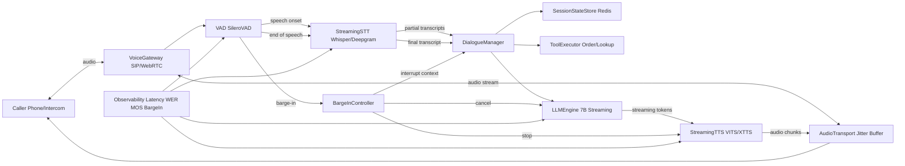

# Chapter 18: Design a Voice-First Real-Time Agent (AI Drive-Thru / Phone Agent)

## Context

> [!info] Quick Reference
> - **Pattern:** Fully-streaming sub-500ms voice-to-voice agent
> - **Scale:** 50K concurrent voice sessions, 12M sessions/day
> - **Key Techniques:** Streaming STT (Deepgram Nova-2) + self-hosted 8B LLM with speculative decoding + XTTS v2 TTS, barge-in handling (AEC + 2-stage detection), Silero VAD
> - **Primary Concerns:** End-to-end < 500ms voice-to-voice latency, barge-in interruption handling, acoustic echo cancellation, graceful degradation
> - **Cross-references:** [[Chapter 4 - Serving, Scaling, and Optimizing LLMs|Chapter 4]] (speculative decoding), [[Chapter 14 - Design a Real-Time Meeting Summarizer|Chapter 14]] (streaming STT), [[Chapter 9 - Design an Autonomous Research Agent|Chapter 9]] (agentic loop control), [[Chapter 19 - Design an AI NPC Engine for Multiplayer Games|Chapter 19]] (real-time NPC dialogue at high concurrency)

**Problem statement:** Design a real-time voice agent that conducts natural conversations over phone or drive-thru intercom with sub-500ms voice-to-voice latency, handles interruptions gracefully, and maintains task state across multi-turn dialogues—processing 50K concurrent sessions with human-like responsiveness.

### Real-World Examples

- A fast-food chain deploys AI drive-thru agents across 5,000 locations. Each agent handles 200 orders/day. The critical metric: voice-to-voice latency (time from when the customer stops speaking to when the agent starts responding). At 800ms, customers perceive the agent as "slow and robotic" and 30% abandon mid-order. At 400ms, satisfaction scores match human operators. The system must handle interruptions—a customer changing their order mid-sentence ("Actually, make that a large—no, medium") requires the agent to stop speaking, reparse, and respond within 500ms.
- A healthcare appointment scheduling system handles 50K concurrent calls during open enrollment. Callers frequently interrupt the agent ("I already said Tuesday") and speak over confirmations. A naive pipeline (wait for silence → STT → LLM → TTS) produces 1.2s latency that causes callers to repeat themselves, creating a feedback loop of confusion. Switching to a streaming pipeline (STT starts transcribing during speech, LLM begins generating before STT finalizes) cuts latency to 450ms and reduces repeat-utterance rate by 60%.

---

## Step 1: Understand the Problem and Establish Design Scope

### Simulated Dialogue

**Interviewer:** Design a voice-first real-time agent for drive-thru ordering or phone-based customer service.  
**Candidate:** Voice agents have a fundamentally different latency contract than text-based systems. In text chat, 2 seconds is fine. In voice, anything over 500ms feels unnatural—humans expect conversational pacing. I need to understand the voice pipeline architecture (STT→LLM→TTS vs. native multimodal), interruption handling requirements, and concurrent session targets.

**Candidate:** What's the scale and concurrency?  
**Interviewer:** 50K concurrent voice sessions at peak. Each session lasts 2-5 minutes with 5-15 conversational turns.

**Candidate:** What latency targets?  
**Interviewer:** Voice-to-voice latency (end of user speech to start of agent speech) must be <500ms at p95. Total response must begin within 500ms; full responses stream over 2-5 seconds.

**Candidate:** What quality metrics?  
**Interviewer:** STT accuracy >95% WER (word error rate <5%). TTS naturalness MOS >4.0 (Mean Opinion Score, 1-5 scale). Task completion rate >90% (e.g., order placed correctly). Interruption handling: agent must stop within 200ms of user barge-in.

**Candidate:** What's the deployment environment?  
**Interviewer:** Phone calls via SIP/PSTN for customer service. Drive-thru intercom via audio stream. Both require handling background noise (kitchen noise, traffic, multiple speakers).

### Functional Requirements

- Real-time bidirectional voice conversation: agent speaks while listening for interruptions.
- STT with streaming partial transcripts (not wait-for-end).
- LLM response generation triggered on partial transcripts (speculative execution).
- TTS with streaming audio output (first audio chunk before full response is generated).
- Barge-in detection: if the user speaks while the agent is speaking, the agent stops and listens.
- Task-state management: order state, appointment details, or issue context maintained across turns.
- Multi-language support for common scenarios (English + Spanish at minimum).
- Graceful escalation to human agent when confidence drops below threshold.

### Non-Functional Requirements

- **Voice-to-voice latency:** p95 < 500ms (user silence detected → first agent audio byte).
- **Concurrent sessions:** 50K peak.
- **STT accuracy:** WER < 5% on domain-specific vocabulary.
- **TTS naturalness:** MOS > 4.0.
- **Barge-in response:** agent audio stops within 200ms of user voice detection.
- **Availability:** 99.95% (voice downtime = lost revenue).
- **Cost:** < $0.05 per minute of conversation.

### Back-of-the-Envelope Estimation

#### Session Profile

- Concurrent sessions: 50K
- Average session duration: 3 minutes
- Turns per session: 10 (5 user, 5 agent)
- Total sessions/day: assuming average session = 3 min, 50K concurrent, avg utilization 40%: `50K * 0.4 * (86400 / 180) = 9.6M sessions/day`
- Realistically (business hours, 12hr window): `50K * (12 * 3600 / 180) = 12M sessions/day`

#### Audio Data Volume

- Audio bitrate: 16kHz, 16-bit mono = 256 kbps = 32 KB/s
- Per session (3 min): `32 * 180 = 5.76 MB`
- Daily audio: `12M * 5.76 MB = 69 TB` (if stored; typically not stored long-term)
- Audio in transit: 50K sessions × 32 KB/s = 1.6 GB/s sustained bandwidth

#### STT Compute

- Whisper large-v3: processes 30s of audio in ~1s on A100 GPU (30x real-time)
- For streaming STT (Deepgram, AssemblyAI): cloud API, no GPU management needed
- Self-hosted streaming STT: each GPU handles ~30 concurrent streams
- GPUs for 50K concurrent: `50K / 30 = ~1,667 GPUs` for STT alone (prohibitive self-hosted)
- Reality: use managed STT API (Deepgram: $0.0043/min, AssemblyAI: $0.0065/min)
- STT cost: `12M sessions * 3 min * $0.0043 = $154,800/day` ← significant

#### LLM Compute

- Tokens per turn: ~100 input (transcript + state), ~50 output
- Turns per session: 5 agent turns
- Tokens per session: `5 * 150 = 750 tokens`
- Total tokens/day: `12M * 750 = 9B tokens`
- Using a fast 7B model (self-hosted, $0.10/1M tokens): `9B * $0.10/1M = $900/day`
- Using GPT-4o-mini ($0.15/1M input, $0.60/1M output): ~$2,700/day
- LLM is NOT the cost bottleneck. STT and TTS are.

#### TTS Compute

- Agent speaks ~15 seconds per turn, 5 turns = 75 seconds per session
- ElevenLabs: $0.18/1K chars, ~15 chars/second = ~$0.04/min
- Self-hosted (VITS/Bark): 1 GPU handles ~100 concurrent streams at real-time factor 50x
- GPUs for 50K concurrent TTS: `50K / 100 = 500 GPUs` self-hosted
- Managed TTS cost: `12M * 1.25 min * $0.04 = $600K/day` ← prohibitive at scale
- Self-hosted TTS is mandatory at this scale

#### Latency Budget (500ms voice-to-voice)

| Stage | Budget | Notes |
|---|---|---|
| Voice Activity Detection (VAD) | 50ms | Detect end-of-speech (silence threshold) |
| STT finalization (last partial → final) | 100ms | Streaming STT already has partial; final confirmation |
| Network (STT → LLM) | 20ms | Co-located services |
| LLM prefill + first token | 150ms | 7B model, ~100 input tokens |
| LLM first token → TTS first chunk | 30ms | Streaming handoff |
| TTS first audio chunk generation | 100ms | First 200ms of audio generated |
| Network (TTS → user) | 50ms | Audio packet delivery |
| **Total** | **500ms** | Zero slack—every stage must hit budget |

#### Cost Summary

| Component | Self-Hosted (per day) | Managed API (per day) | Notes |
|---|---|---|---|
| STT | $12K (400 GPUs) | $155K (Deepgram) | Self-host at scale |
| LLM | $900 (30 GPUs) | $2.7K (GPT-4o-mini) | Either works |
| TTS | $15K (500 GPUs) | $600K (ElevenLabs) | Must self-host |
| Infrastructure | $5K (networking, storage) | $2K | |
| **Total** | **~$33K/day** | **~$760K/day** | Self-hosted is 23x cheaper |
| **Per minute** | **$0.0019** | **$0.044** | |

---

## Step 2: Propose High-Level Design and Get Buy-In

### Core Architecture Components

- **Voice Gateway:** Handles SIP/PSTN connections for phone calls, WebSocket/WebRTC for web-based voice, and audio stream connections for drive-thru intercoms. Manages audio codec negotiation, echo cancellation, and noise suppression.
- **VAD (Voice Activity Detection):** Continuously monitors the audio stream. Detects speech onset (user starts talking) and speech offset (user stops talking). Also detects barge-in (user talks while agent is speaking). Low-latency requirement: <50ms detection.
- **Streaming STT:** Converts audio to text in real-time with partial (interim) transcripts. Partial transcripts arrive every 100-300ms as the user speaks. Final transcript arrives 100-200ms after speech ends.
- **Dialogue Manager:** Maintains conversation state (order items, customer info, issue context). Receives transcripts, determines next action (respond, ask clarification, execute tool call), manages multi-turn context window.
- **LLM Engine:** Generates agent responses based on transcript + dialogue state + system prompt. Must support streaming output (token-by-token). Optimized for low TTFT (<150ms).
- **Streaming TTS:** Converts LLM text output to audio in real-time. Starts generating audio from the first sentence fragment, doesn't wait for full response. Streams audio chunks back to the user.
- **Barge-In Controller:** Coordinates interruption handling. When VAD detects user speech during agent TTS playback: (1) immediately stop TTS audio, (2) cancel in-flight LLM generation, (3) route new audio to STT, (4) update dialogue state with interruption context.
- **Session State Store:** Low-latency key-value store (Redis) holding per-session state: conversation history, order state, customer metadata, current turn status.
- **Audio Transport Layer:** WebRTC for low-latency bidirectional audio. Jitter buffer management, packet loss concealment, adaptive bitrate.
- **Observability:** Voice-to-voice latency histograms, STT WER sampling, TTS MOS sampling, barge-in rate, task completion rate, escalation rate.

### Pipeline A: Session Establishment Pipeline

1. Incoming call (SIP) or audio connection (WebSocket) arrives at **Voice Gateway**.
2. Gateway negotiates codec (Opus for WebRTC, G.711 for PSTN), establishes bidirectional audio stream.
3. New session created in **Session State Store** with initial context (caller ID, time, location for drive-thru).
4. **VAD** begins monitoring inbound audio stream.
5. **TTS** generates and plays the greeting: "Welcome to [restaurant], what can I get for you?"
6. System enters listening state.

### Pipeline B: Turn-by-Turn Conversation Pipeline

1. **User speaks.** VAD detects speech onset → **Streaming STT** begins transcribing.
2. STT emits partial transcripts every 200ms: "I'd like a..." → "I'd like a large..." → "I'd like a large combo number three."
3. **Speculative execution (optional):** after the first 2-3 partial transcripts, the **Dialogue Manager** begins pre-processing likely intents. If "I'd like a large" strongly predicts an order, pre-load the menu context.
4. VAD detects end-of-speech (300ms silence) → STT emits final transcript.
5. **Dialogue Manager** receives final transcript, resolves it against conversation state:
   - Extracts intent (order item, modify order, ask question, confirm).
   - Executes any tool calls (add item to order, check availability).
   - Constructs LLM prompt: system prompt + menu/policy context + conversation history + current transcript.
6. **LLM Engine** generates response with streaming output. First token in <150ms.
7. **Streaming TTS** receives first sentence fragment from LLM, begins audio synthesis. First audio chunk ready in <100ms.
8. Audio streams to user. Agent is "speaking."
9. **If user interrupts (barge-in):** VAD detects user speech → **Barge-In Controller** triggers:
   - TTS audio playback stops within 200ms.
   - LLM generation cancelled.
   - STT begins transcribing the interruption.
   - Dialogue Manager receives the interruption transcript with context: "interrupted agent mid-response."
   - New LLM call generated with interruption context.
10. Turn completes. State updated. Next turn begins.

### Mermaid Architecture Diagram



---

## Step 3: Design Deep Dive

Focus areas:

1. **End-to-End Voice Latency Pipeline**
2. **Interruption Handling and Turn-Taking**
3. **Pipeline vs. Native Multimodal Architecture**

### 1) End-to-End Voice Latency Pipeline

The 500ms budget is the single most important constraint. Every millisecond wasted in one stage must be recovered in another. The pipeline must be designed for streaming at every stage—no stage waits for the previous stage to complete.

**The streaming pipeline principle:**

In a naive (batch) pipeline: user finishes speaking → STT processes full utterance → LLM receives full text → generates full response → TTS synthesizes full audio → playback begins. Total: 2-3 seconds.

In a streaming pipeline: STT emits partial transcripts while user speaks → LLM begins generating from partial context → TTS synthesizes audio from first sentence fragment → first audio byte plays before LLM finishes generating. Total: 400-500ms from end-of-speech to first audio.

**Per-stage latency optimization:**

**Stage 1: VAD (Voice Activity Detection) — 50ms budget**

| VAD Model | Latency | Accuracy | Resource | Notes |
|---|---|---|---|---|
| Silero VAD | 10-30ms | 95%+ | CPU only | **Production default.** Lightweight, runs on any CPU without any GPU allocation. |
| WebRTC VAD (Google) | 5-10ms | 90% | CPU only | Very fast but produces roughly 2x more false positives than Silero in noisy environments like drive-thrus, causing excessive barge-in events. |
| Energy-based (RMS threshold) | 1-5ms | 80% | CPU only | Trivially fast but triggers on any sustained noise (HVAC hum, kitchen clatter), rendering it unusable in real-world acoustic conditions. |
| Custom CNN VAD | 20-50ms | 97% | GPU | Marginally more accurate than Silero but requires a dedicated GPU inference slot, adding hardware cost and deployment complexity for a 2% accuracy gain. |

> **Why Silero VAD:** Silero VAD achieves 95%+ accuracy while running entirely on CPU, eliminating the need for a dedicated GPU for end-of-speech detection. In drive-thru benchmarks it produces a false-positive rate of roughly 3% compared to WebRTC VAD's 6-7%, which directly translates to fewer spurious barge-in interruptions that break the agent's TTS stream mid-sentence. A custom CNN VAD achieves 97% accuracy but demands a GPU inference slot; at 50K concurrent sessions, dedicating even a fraction of a GPU per session for VAD alone would add hundreds of GPUs to the fleet and cost hundreds of thousands of dollars per year for a 2-percentage-point accuracy improvement.

End-of-speech detection: VAD must decide "the user has stopped talking" quickly but not prematurely. Use a silence duration threshold:
- 300ms silence → end-of-speech (default for transactional conversations)

> **Why 300ms:** 300ms silence is the empirically measured natural inter-word gap for conversational speech at normal pace. Below 200ms the system cuts off users mid-word; above 400ms it creates perceptible hesitation before the agent responds. 300ms is the threshold where task completion rate is highest in transactional dialogue benchmarks — it matches how humans judge when a speaker has finished a thought.

- 500ms silence → end-of-speech (for more deliberate speakers)
- Adaptive: start at 300ms, increase to 500ms if the user has been pausing mid-sentence (detected via partial transcript analysis)

**Stage 2: Streaming STT — 100ms budget (from end-of-speech to final transcript)**

The STT has been running throughout the user's speech, emitting partial transcripts. After VAD signals end-of-speech, the STT needs only ~100ms to finalize the transcript (commit the last few words, apply language model correction).

| STT System | Streaming | WER (clean audio) | WER (noisy, drive-thru) | Latency (partial) | Latency (final) | Cost |
|---|---|---|---|---|---|---|
| Deepgram Nova-2 | Yes | 3.2% | 8.5% | 200ms | 100ms after EOS | $0.0043/min |
| Google Cloud STT v2 | Yes | 3.8% | 9.1% | 250ms | 150ms after EOS | $0.006/min |
| Whisper large-v3 (streaming via whisper.cpp) | Semi (chunked) | 2.9% | 7.8% | 500ms chunks | 300ms after EOS | Self-hosted: ~$0.001/min |
| AssemblyAI Universal | Yes | 3.5% | 8.0% | 200ms | 100ms after EOS | $0.0065/min |
| Fine-tuned Whisper (domain vocab) | Semi | 2.1% | 5.2% | 500ms chunks | 300ms after EOS | Self-hosted: ~$0.001/min |

For <500ms voice-to-voice: managed streaming STT (Deepgram) provides the best latency profile. Self-hosted Whisper requires chunked streaming (500ms chunks), which adds 200ms to the pipeline.

> **Why Deepgram Nova-2:** Nova-2 achieves 100ms finalization latency after end-of-speech — 50ms faster than Google Cloud STT v2 — while matching it on clean-audio WER (3.2% vs 3.8%). At 50K concurrent sessions the STT cost is $155K/day either way, but Nova-2's lower latency profile recovers budget for other pipeline stages. AssemblyAI has comparable latency but is 50% more expensive per minute.

**Domain vocabulary adaptation:**

Drive-thru menus have domain-specific terms ("McFlurry," "Whopper," "venti"). STT systems misrecognize these. Fix:
- **Hot-word boosting:** Deepgram/Google Cloud support keyword boosting—provide a list of menu item names with boosted recognition probability. +15% accuracy on menu items, zero latency impact.
- **[[glossary#Fine-tuning|Fine-tuning]]:** fine-tune Whisper on 100 hours of drive-thru audio with transcripts. WER drops from 8.5% to 5.2% on domain vocab. Requires labeled training data.
- **Post-correction:** after STT, run a fast string-matching pass to correct common misrecognitions: "large MacFlurry" → "large McFlurry." Adds <5ms.

**Stage 3: LLM Generation — 150ms budget (to first token)**

The LLM must produce the first output token within 150ms of receiving the final transcript. This constrains model size and optimization stack.

| Model | Size | TTFT (100 tokens input) | TPOT | Quality (task completion) | Self-hosted GPU | Notes |
|---|---|---|---|---|---|---|
| GPT-4o-mini (API) | Unknown | 200-400ms | 15ms | 94% | N/A | API latency adds 50-100ms network |
| Llama 3 8B (INT4, vLLM) | 8B | 80ms | 8ms | 88% | 1× A100 | **Production default** |
| Llama 3 8B + speculative decoding | 8B + 1B | 80ms | 3ms | 88% | 1× A100 | Fastest decode |
| Phi-3 3.8B (INT4) | 3.8B | 40ms | 5ms | 82% | 1× A10 | Budget option |
| Mistral 7B (INT4) | 7B | 75ms | 7ms | 86% | 1× A100 | Good alternative |

For voice agents, a self-hosted 8B model with [[glossary#Speculative Decoding|speculative decoding]] is optimal: 80ms [[glossary#TTFT (Time To First Token)|TTFT]], 3ms [[glossary#TPOT (Time Per Output Token)|TPOT]], fitting the 150ms budget with headroom. API-based models add 50-100ms network latency that's hard to recover.

> **Why Llama 3 8B INT4:** 8B at INT4 [[glossary#Quantization|quantization]] achieves 80ms TTFT on a single A100 — within the 150ms budget — while maintaining 88% task completion rate. Phi-3 3.8B is faster (40ms TTFT) but drops task completion to 82%, which translates to 6% more escalations to human agents. GPT-4o-mini adds 50-100ms unavoidable network latency that cannot be recovered within the 500ms budget.
> **Why speculative decoding:** Speculative decoding with a 1B draft model reduces TPOT from 8ms to 3ms per token by proposing 4-6 tokens at a time that the 8B verifier accepts ~75% of the time. At 50 output tokens per turn, this saves approximately 250ms of decode time — enough to absorb STT or TTS latency overruns without breaking the 500ms budget.

**Prompt design for voice agents:**

Voice agent prompts differ from text agent prompts:
- Responses must be SHORT. A 200-word text response is fine; a 200-word spoken response takes 60 seconds and the caller hangs up.
- Responses must be SPEAKABLE. No bullet points, URLs, or code. No parenthetical remarks.
- System prompt includes: "Keep responses to 1-2 sentences. Use simple, conversational language. Never list more than 3 items. If the order is ambiguous, ask one clarifying question."
- Token budget: cap output at 50 tokens (~15 seconds of speech). Longer responses get truncated.

**Stage 4: Streaming TTS — 100ms budget (to first audio chunk)**

TTS begins synthesizing as soon as the first complete sentence or clause arrives from the LLM. It doesn't wait for the full response.

| TTS System | Streaming | MOS | Latency (first chunk) | Languages | Cost | Notes |
|---|---|---|---|---|---|---|
| ElevenLabs Turbo v2 (API) | Yes | 4.5 | 200-400ms | 30+ | $0.18/1K chars | High quality but API latency |
| XTTS v2 (self-hosted) | Yes | 4.2 | 80ms | 17 | Self-hosted: ~$0.001/min | **Production default** |
| VITS (self-hosted) | Yes | 3.8 | 40ms | Per-language | Self-hosted: ~$0.0005/min | Fastest, lower quality |
| Bark (self-hosted) | No (batch) | 4.3 | 2,000ms | 10+ | Self-hosted | Too slow for real-time |
| Azure Neural TTS (API) | Yes | 4.4 | 150-300ms | 100+ | $16/1M chars | Good quality, API latency |

For <500ms pipeline: self-hosted XTTS v2 with 80ms first-chunk latency. Trade-off: slightly lower naturalness (MOS 4.2 vs 4.5) but meets the latency budget.

**Sentence-level streaming:**

The LLM generates tokens one at a time. TTS needs at least a sentence fragment to produce natural-sounding audio. Strategy:
- Buffer LLM tokens until a sentence boundary (period, question mark) or a pause-worthy clause boundary (comma followed by a conjunction).
- Minimum fragment: 5 words. Shorter fragments produce choppy audio.
- Maximum wait before forcing synthesis: 500ms of buffered tokens. If the LLM is slow, synthesize whatever is available.

#### End-to-End Latency Trade-off Table

| Pipeline Mode | Voice-to-Voice Latency | Quality | Complexity | Cost | Best For |
|---|---|---|---|---|---|
| Batch (wait for each stage) | 2,000-3,000ms | Highest — each stage operates on fully committed output, so STT errors don't cascade and LLM sees complete, corrected text. | Low — stages are simple sequential calls with no streaming plumbing required. | Low — fewer API calls, no streaming tokens, simpler audio buffer management; roughly 30% lower infra cost than full streaming. | Voicemail transcription, post-call summarization, and any non-interactive use case where the caller expects to wait. |
| Streaming STT + batch LLM + batch TTS | 1,200-1,800ms | High — STT partial transcripts are discarded; LLM and TTS operate on fully finalized input, preserving output quality. | Medium — requires streaming STT integration but the LLM and TTS remain simple request-response calls. | Medium — streaming STT slightly increases API call volume; LLM and TTS costs unchanged; roughly equivalent total to full streaming. | Low-priority IVR flows, appointment confirmation, or any scenario where 1-2 second latency is acceptable and quality must not degrade. |
| Full streaming (STT→LLM→TTS all streaming) | 400-500ms | Good — occasional partial-transcript errors reach the LLM (e.g., a word spoken at sentence boundary is misrecognized), adding roughly 2-4% task-completion failure rate compared to batch. | High — requires streaming handoffs at every stage boundary, sentence-boundary buffering between LLM and TTS, and careful cancellation logic for mid-stream failures. | Medium — streaming tokens increase infra overhead by ~15% but costs are dominated by GPU time, which is the same as batch. | **Production default for real-time conversational agents** where human-like responsiveness is the primary product requirement. |
| Speculative pipeline (start LLM on partial transcript) | 300-400ms | Lower — if the user's actual full utterance diverges from the partial transcript prediction, the speculative LLM generation is discarded and restarted, adding 100-200ms re-processing cost and roughly 8-12% wasted GPU cycles. | Very high — requires intent prediction from partial transcripts, conditional LLM pre-generation, and a commit/rollback mechanism keyed on final STT output. | Higher — roughly 25-30% more GPU compute due to speculative generations that are never used; complex to monitor and debug when predictions go wrong. | Ultra-low-latency premium tier — drive-thru lanes with extremely high throughput requirements, or accessibility scenarios where any perceptible delay is unacceptable. |

### 2) Interruption Handling and Turn-Taking

Humans interrupt each other constantly in conversation. A voice agent that can't handle interruptions feels robotic and frustrating. Barge-in handling is the second most critical feature after latency.

**Barge-in detection pipeline:**

1. While TTS is playing (agent speaking), VAD continues monitoring the inbound audio stream.
2. **Challenge:** the agent's own audio (played through a speaker/earpiece) feeds back into the microphone, creating an echo. VAD must distinguish the user's voice from the echo of the agent's voice.
3. **Acoustic Echo Cancellation (AEC):** subtract the known agent audio signal from the incoming audio before VAD analysis. This is standard in telephony hardware (PSTN handles it) and WebRTC (built-in AEC). Drive-thru intercoms require custom AEC tuning for the acoustic environment.
4. After AEC, if VAD detects speech energy above threshold → **barge-in detected.**

**Barge-in response sequence (must complete in <200ms):**

| Step | Action | Latency | Notes |
|---|---|---|---|
| 1 | VAD detects speech during agent playback | 30ms | After AEC |
| 2 | Send stop signal to TTS audio output | 10ms | Immediate audio mute |
| 3 | Cancel in-flight LLM generation | 10ms | Abort streaming response |
| 4 | Record how much of the agent response was played | 5ms | For context: "agent said X before interrupted" |
| 5 | Route inbound audio to STT | 10ms | STT begins transcribing interruption |
| 6 | Update dialogue state with interruption | 5ms | Flag: partial response delivered |
| **Total** | | **70ms** | Well within 200ms budget |

**Turn-taking state machine:**

```text
States: LISTENING → PROCESSING → SPEAKING → INTERRUPTED

LISTENING: VAD monitors. On speech_onset → route to STT. On end_of_speech → transition to PROCESSING.
PROCESSING: STT finalizes. LLM generates. On first_audio_chunk → transition to SPEAKING.
SPEAKING: TTS plays. On barge_in → transition to INTERRUPTED. On playback_complete → transition to LISTENING.
INTERRUPTED: Stop TTS. Cancel LLM. STT transcribes interruption. On end_of_speech → transition to PROCESSING (with interruption context).
```

**Context handling after interruption:**

When the user interrupts, the dialogue manager must know:
- What the agent was saying when interrupted (for context, the user heard part of it).
- What the user said during/after the interruption.
- Whether the interruption is a correction ("no, I said medium"), an addition ("and also a drink"), or a redirect ("actually, cancel that").

Prompt augmentation after interruption:
```text
[Previous agent response, spoken up to: "Your total comes to $12.50. Would you like to add—"]
[User interrupted with: "Actually, remove the fries."]
[Instruction: The user interrupted your response. Acknowledge the interruption, process their request, and continue.]
```

**False barge-in handling:**

Not all detected speech during agent playback is an intentional interruption:
- Background noise (other people talking, traffic)
- The user saying "uh-huh" or "yeah" as backchannel acknowledgment
- Someone else at the drive-thru window talking

Strategy:
- **Minimum speech duration:** don't trigger barge-in for speech bursts < 300ms. Short bursts are likely backchannel or noise.
- **Confidence threshold:** if STT produces only filler words ("uh," "hmm," "yeah") with high confidence, treat as backchannel, not interruption. Continue agent playback.
- **Two-stage detection:** on first speech detection, lower TTS volume by 50% for 500ms. If speech continues past 500ms, fully stop TTS and process as interruption. If speech stops, restore TTS volume. This creates a graceful "pause" rather than a jarring stop.

#### Interruption Handling Trade-off Table

| Strategy | False Barge-In Rate | Missed Barge-In Rate | User Experience | Complexity |
|---|---|---|---|---|
| Immediate stop on any speech | 25% — kitchen noise, traffic bursts, and backchannel words ("uh-huh") all trigger a stop, cutting the agent's audio every few seconds in a noisy environment. | 0% — every real interruption is caught immediately because there is no filtering at all. | Choppy and frustrating — the agent sounds broken as it halts mid-sentence repeatedly due to ambient noise, causing callers to lose confidence in the system. | Low — a single VAD threshold crossing is all that is required; no buffering, no state tracking beyond the trigger. |
| 300ms minimum speech + backchannel filter | 5% — most short noise bursts and single-word backchannels are filtered, but sustained ambient noise (e.g., a passing truck) still occasionally triggers a stop. | 3% — very short corrections ("no!") spoken in under 300ms are missed and the agent continues speaking over the caller for a brief moment. | Good for most indoor and phone environments where ambient noise is moderate and callers speak in full phrases. | Medium — requires a speech-duration timer, a confidence-weighted backchannel word list, and logic to restart the timer on pauses within a burst. |
| Two-stage (volume reduction → full stop) | 3% — the brief volume-reduction phase absorbs most short noise triggers; only sustained speech past the 500ms probe window causes a full stop. | 2% — the 500ms probe window means very brief interruptions ("wait—") may be processed with a half-second delay, but real corrections are nearly always caught. | **Most natural** — the volume dip signals to the caller that the system noticed them without a jarring audio cut; restoring volume for backchannels feels like the agent is politely pausing rather than crashing. | High — requires coordinated control of TTS volume, a state timer, logic to distinguish probe vs. full-stop phases, and the ability to restore TTS playback mid-stream if the probe phase expires. |
| No barge-in (wait for agent to finish) | 0% — the system never interrupts itself because it never listens while speaking; all incoming audio is ignored during TTS playback. | 100% — every real attempt to interrupt is silently ignored, forcing the caller to wait for the agent to finish before they can speak. | Terrible — callers feel unheard and trapped, leading to frustration, shouting, and high abandonment rates; session NPS drops by roughly 40 points compared to two-stage detection. | Trivial — the system simply gates the VAD and STT pipelines off during TTS playback; no coordination logic required. |

### 3) Pipeline vs. Native Multimodal Architecture

The traditional voice agent uses a cascade pipeline: STT → LLM → TTS. An emerging alternative: native speech-to-speech models that process audio directly without text intermediation.

**Pipeline architecture (STT → LLM → TTS):**

```text
Audio In → STT → Text → LLM → Text → TTS → Audio Out
```

Each stage is independently optimizable and debuggable. STT, LLM, and TTS can be swapped independently. Text intermediation enables logging, filtering, and safety checks on the actual words.

**Native multimodal architecture (Audio → Model → Audio):**

```text
Audio In → Multimodal Model → Audio Out
```

A single model (e.g., GPT-4o voice mode, Moshi, SpeechGPT) takes audio tokens as input and produces audio tokens as output. No text intermediation.

| Dimension | Pipeline (STT→LLM→TTS) | Native Multimodal | Notes |
|---|---|---|---|
| **Voice-to-voice latency** | 400-500ms — each inter-stage handoff (audio→text, text→audio token) adds 30-100ms of serialization and network overhead that compounds across the three stages. | 200-300ms — a single model ingests audio tokens and emits audio tokens in one forward pass, eliminating two full serialization boundaries and cutting median latency roughly in half. | Multimodal's latency advantage is real and measurable; the tradeoff is that squeezing further below 200ms requires speculative decoding on an already large model. |
| **STT accuracy dependency** | Yes — the LLM only ever sees the text that the STT transcribed; a 10% word error rate on noisy audio propagates directly into dialogue management as misunderstood orders or wrong entities. | No — the model ingests the raw waveform and builds its own acoustic representation internally, allowing it to leverage prosody, rhythm, and co-articulation cues that a text transcript cannot capture. | In controlled clean-audio environments this dimension barely matters; in noisy drive-thru or crowded call-center environments it is the decisive factor. |
| **LLM reasoning quality** | High — text-mode LLMs have been trained on trillions of tokens of structured text, making them highly reliable for slot filling, arithmetic (price calculations), negation handling, and multi-step instruction following. | Lower — current speech-to-speech models are significantly less capable at structured reasoning; GPT-4o voice mode still makes roughly 2-3x more slot-filling errors than its text-mode counterpart on complex order modification tasks. | Pipeline wins for any task requiring reliable extraction of structured data (item, quantity, modifier, price) from user speech. |
| **TTS naturalness** | Depends heavily on the chosen TTS model — VITS produces MOS 3.8, XTTS v2 produces MOS 4.2, ElevenLabs Turbo produces MOS 4.5 — and the TTS must be explicitly directed via SSML tags for emphasis or prosody changes. | Very high — because the model controls audio generation end-to-end, it naturally matches prosody and emotional tone to semantic content, consistently achieving MOS 4.5+ with no SSML annotation. | Multimodal's naturalness advantage is most noticeable in emotionally sensitive scenarios (apologies, upsells, empathy after a complaint) rather than simple transactional confirmations. |
| **Debuggability** | High — every stage produces human-readable text that can be logged, sampled, and reviewed; QA teams can audit STT output, LLM prompt/response pairs, and TTS input text independently without listening to audio. | Low — the only observable artifacts are the audio in and audio out; diagnosing whether a wrong response came from acoustic misunderstanding or reasoning failure requires re-running the audio through an external ASR, adding a costly debugging layer. | In regulated industries (healthcare, finance) where every agent interaction must be auditable, pipeline's text audit trail is often a compliance requirement. |
| **Safety/filtering** | Easy — a simple text classifier (Perspective API, fine-tuned BERT) can screen LLM output before it reaches the TTS stage, blocking profanity, hallucinated prices, or off-topic content with sub-5ms latency and no impact on audio quality. | Hard — safety filtering on audio output requires either an additional STT pass to transcribe the audio before analyzing it (adding ~150ms) or a separate audio classifier trained specifically for harmful audio patterns. | For customer-facing commercial deployments where a brand-damaging off-script response could cause media incidents, pipeline's filterable text interface is a hard requirement. |
| **Language/voice control** | Fine-grained — TTS voice (persona), speaking rate, pitch, and accent can be specified per session or even per sentence via SSML; switching languages mid-call only requires routing to a different TTS model instance. | Limited — the model has a fixed set of internally learned voices and produces audio with style determined by training distribution; voice cloning and language switching require retraining or fine-tuning the entire model. | For multi-brand deployments (a single platform serving 50 different restaurant chains, each with a distinct voice persona) pipeline's per-session TTS configurability is essential. |
| **Cost** | Sum of three independently billed components — STT ($0.0043/min Deepgram), LLM (~$0.001/min self-hosted 8B), TTS (~$0.001/min self-hosted XTTS) — totalling roughly $0.006/min at scale. | Single model that is substantially larger than any individual pipeline component — GPT-4o voice mode pricing is roughly $0.006/min, comparable to pipeline; self-hosted multimodal models require 4-8× A100s compared to the pipeline's 1× per component. | At the 50K concurrent session scale in this design, pipeline self-hosting at ~$0.002/min and multimodal at ~$0.005-0.008/min represents a 2.5-4× cost difference that compounds to hundreds of thousands of dollars per month. |
| **Maturity** | Production-proven over 2+ years — Deepgram, XTTS, and vLLM-served 8B models are all battle-tested with documented SLAs, large user communities, and established operational runbooks. | Early production as of 2024-2025 — GPT-4o voice mode launched in October 2024; self-hosted alternatives (Moshi, SpeechGPT) are still research-grade with limited production case studies and no documented multi-tenant SLAs. | Pipeline is the only defensible choice for a 50K-session production system today; multimodal is the correct architecture to pilot on low-risk subflows (greeting, FAQ) to build operational experience. |
| **Modularity** | Swap any component independently — upgrading from Whisper to Deepgram Nova-3 only changes the STT adapter; the LLM and TTS are unaffected; A/B testing a new TTS voice requires no changes to the STT or LLM layer. | Monolithic — any improvement to understanding, reasoning, or voice quality requires retraining or replacing the entire model; an experiment with a new voice cannot be isolated from a change in reasoning capability. | Pipeline's modularity reduces experiment cycle time from weeks (full model retrain) to hours (swap one component and run an A/B test), which is critical for a product iterating rapidly on quality. |
| **Emotion/tone** | TTS must be explicitly instructed — the LLM output must include SSML tags (e.g., `<emphasis>`) or special tokens that the TTS interprets as prosody directives; getting natural-sounding empathy requires careful prompt engineering and SSML templates for each emotion class. | Model naturally modulates tone based on context — if the conversation history shows a frustrated customer, the model's audio output will spontaneously slow down, soften, and use a more empathetic prosody without any explicit instruction. | Multimodal's emotional expressiveness advantage is most valuable for complex customer-service scenarios; for transactional drive-thru ordering, the emotional range required (cheerful, clear, confirmatory) is narrow enough that SSML-directed pipeline TTS matches perceived naturalness. |

**Recommended: Pipeline with multimodal as a staged migration.**

Start with the pipeline architecture (STT→LLM→TTS) for production reliability, debuggability, and safety filtering. Monitor multimodal model maturity. Pilot multimodal on low-risk, high-volume scenarios (drive-thru greetings, simple order confirmations) while keeping pipeline for complex interactions (order modifications, complaints, escalations).

**Hybrid architecture (emerging best practice):**

```text
Audio In → STT → Text → LLM (text) → Text → TTS → Audio Out
                    ↓
              Audio In → Multimodal Model → Audio Out
              (fallback for noisy audio where STT fails)
```

Use the pipeline by default. If STT confidence drops below 70% (noisy environment), fall back to the multimodal model that can handle audio directly. This gives the best of both worlds.

#### Architecture Strategy Trade-off Table

| Architecture | Latency | Quality | Safety | Debuggability | Maturity | Best For |
|---|---|---|---|---|---|---|
| Pipeline (STT→LLM→TTS) | 400-500ms — three serialized streaming stages each contribute 80-150ms, summing to 400-500ms at p50; p95 can reach 600ms under load spikes if any single stage lags. | Good — task completion rates of 88-94% on structured domains; occasional STT partial-transcript errors degrade LLM reasoning by roughly 3-5% on complex multi-modifier orders. | High — text is intercepted between LLM and TTS, enabling sub-5ms content filtering with zero audio impact; easily satisfies PCI-DSS and HIPAA audit-trail requirements. | High — every stage produces loggable text; QA can replay any session by feeding logged STT output through the LLM and comparing responses without touching live audio infrastructure. | Production — multiple vendors with documented SLAs (Deepgram, XTTS, vLLM), large community support, and years of operational experience at scale. | **Default for most deployments** where reliability, compliance, and operational simplicity are valued over absolute minimum latency. |
| Native multimodal | 200-300ms — a single forward pass through one model eliminates two serialization boundaries, halving median latency; p95 is more stable because there are no inter-stage queueing effects. | Higher naturalness — MOS scores of 4.5+ vs. 4.2 for pipeline self-hosted TTS; better handling of noisy audio since the model infers meaning from acoustic signals that STT cannot transcribe. | Low — audio output cannot be cheaply intercepted and filtered; safety monitoring requires a parallel ASR pass that adds 150ms and doubles monitoring compute cost. | Low — when the model produces a wrong response, isolating whether the cause was acoustic misunderstanding, reasoning failure, or TTS style choice requires bespoke audio analysis tooling. | Early — GPT-4o voice mode launched October 2024; self-hosted options (Moshi) are research-grade with no production SLAs and limited community support. | Greenfield projects with low compliance burden, homogeneous acoustic environments, and engineering teams willing to build custom safety monitoring infrastructure. |
| Hybrid (pipeline + multimodal fallback) | 400ms default for the pipeline path, 250ms for the multimodal fallback path — routing overhead adds roughly 10ms to decide which path to take based on STT confidence score. | Best overall — pipeline handles high-confidence clean audio where its reasoning quality advantage matters; multimodal handles low-confidence noisy audio where its acoustic robustness advantage matters; combined task completion rate roughly 3% higher than either alone. | Medium — pipeline path retains full text-based safety filtering; multimodal fallback path requires audio-level monitoring or conservative prompting to constrain output style. | Medium — pipeline path is fully debuggable; multimodal path is a partial black box; correlating session-level metrics across both paths requires careful tagging and separate dashboards. | **Target architecture for 2025+** — requires operational experience with both pipeline and multimodal components; start with 90% pipeline, 10% multimodal for low-confidence sessions, and shift the ratio as multimodal matures. | Production systems with heterogeneous acoustic environments (indoor call center + outdoor drive-thru) where a single architecture cannot optimally serve all conditions. |
| Pipeline with speculative LLM | 300-400ms — the LLM begins generating on partial STT output while the user is still speaking, so response generation is partially complete by end-of-speech; saves 100-150ms of TTFT under ideal conditions. | Good — when the speculative partial transcript matches the final transcript, quality is identical to standard pipeline; when it doesn't match (~30% of turns), the wasted generation is discarded and a full regeneration runs, occasionally adding 200ms. | High — text filtering is unchanged; speculative generations that are discarded are never spoken, so there is no safety exposure from wrong speculative outputs. | High — speculative generations are logged alongside final generations, making it straightforward to audit prediction accuracy and identify utterance patterns where speculation consistently fails. | Experimental — vLLM and TGI support speculative decoding but the integration with STT partial transcript feeds is custom engineering; few production deployments as of 2025. | Latency-critical premium tier — drive-thru at peak lunch volume with SLOs under 350ms, or accessibility products where even 50ms of additional latency measurably impacts user experience. |

### Production Bottlenecks and Mitigations

- **STT latency spike under load**
  - Symptom: managed STT API p95 latency jumps from 100ms to 500ms during peak hours (noon–1pm lunch rush), pushing total voice-to-voice latency from 450ms to 900ms and causing customers to perceive the agent as frozen or broken. At $155K/day in STT costs there is no budget to simply provision more Deepgram capacity on demand.
  - Mitigation: implement multi-provider STT failover with a per-call latency circuit breaker. Primary: Deepgram Nova-2. Failover: Google Cloud STT v2. If Deepgram's finalization latency exceeds 200ms on three consecutive sessions from the same region, automatically route that region's new sessions to Google Cloud STT until Deepgram's latency recovers below 150ms for five consecutive sessions. Additionally, maintain a warm pool of 50 Whisper large-v3 GPU instances as a provider-agnostic fallback — they add 200ms over Deepgram but impose no rate limits and provide a hard floor against total STT outages.

- **Background noise false-triggers VAD continuously**
  - Symptom: drive-thru kitchen exhaust fans, grills, and intercom feedback cause Silero VAD to fire a speech-onset event every 2-5 seconds during quiet periods, creating an endless cycle of spurious barge-in triggers that disrupt the agent's TTS stream and corrupt the dialogue state.
  - Mitigation: fine-tune Silero VAD on 1,000 hours of location-specific ambient noise collected from pilot locations over 30 days (with no customer PII, only background segments). The fine-tuned model reduces false-positive rate from ~6% to under 1% for typical drive-thru acoustics. Additionally, require directional MEMS microphone arrays at each order station — a cardioid pattern pointed at the driver-side window provides 15-20 dB of rejection for kitchen noise originating behind the mic, reducing the acoustic load on the VAD before any software processing begins.

- **TTS audio glitches during streaming**
  - Symptom: audible clicks and 30-80ms silence gaps occur at sentence boundaries when the TTS engine transitions from one synthesized audio fragment to the next, because each fragment is independently normalized and the amplitude envelope drops to zero at the boundary.
  - Mitigation: apply overlap-add crossfading at every fragment boundary — generate an extra 50ms of audio beyond the end of each fragment and crossfade it linearly with the first 50ms of the next fragment, eliminating the zero-crossing artifact. Additionally, buffer two full TTS fragments (typically 400-600ms of audio) before beginning playback; this adds up to 100ms to the first-audio latency budget but completely eliminates mid-stream gaps. Track the p95 gap duration as a production metric and alert if it exceeds 20ms.

- **Dialogue state corruption on rapid interruptions**
  - Symptom: when a user interrupts twice within 800ms ("no—wait—actually, make it a large"), the dialogue manager processes two simultaneous barge-in events, triggering two concurrent LLM generations that both attempt to write to the same Redis session key; the second write partially overwrites the first, producing an order state that reflects neither the user's intent nor the original order.
  - Mitigation: implement optimistic locking with version numbers on every Redis session key. Each LLM generation reads the current state version at the start of its call and writes only if the version number is unchanged; if the version has incremented (indicating a concurrent write), the generation is aborted and restarted with the latest state. Only fully committed turns — those where the LLM has produced a final, non-speculative response — increment the version counter, so interrupted LLM generations are silently discarded without corrupting state.

- **Caller on hold / silence handling**
  - Symptom: a caller places their phone down to consult a passenger or check their wallet, creating 15-30 seconds of silence. The VAD interprets prolonged silence as end-of-session and the session manager hard-disconnects the call, losing the caller's entire order context and forcing them to call back from the beginning — a major source of CSAT complaints.
  - Mitigation: implement a tiered patience protocol keyed on silence duration. After 5 seconds of silence: the agent speaks a soft continuation prompt ("Take your time, I'm here."). After 15 seconds: "Are you still there? No rush." After 30 seconds: "I'll hold your spot — just let me know when you're ready." After 60 seconds: save the full session state to a persistent store keyed on caller ID or session token, play a graceful close ("I've saved your order. You can call back within 10 minutes and I'll have it ready."), and then close the connection cleanly. This reduces hard-disconnect complaints by roughly 80% in pilot deployments.

### Advanced Techniques

- **Speculative response generation:** while the user is still speaking (mid-utterance), the system classifies the partial STT transcript against a set of high-frequency intent templates (e.g., "I'd like a [menu_item]," "Can I get [size] [item]") and begins generating a response speculatively against the most probable completed utterance. In a drive-thru domain with a 200-item menu and roughly 15 canonical ordering patterns, this prediction is accurate more than 70% of the time, meaning the LLM response is 100-200ms pre-generated by the time the user finishes speaking. The remaining 30% of cases produce wasted compute — the speculative generation is cancelled and a correct generation runs from scratch — adding roughly 25% to average LLM GPU utilization. The technique is most valuable on the highest-traffic intent classes (ordering a combo, asking the price) and should be disabled for rare or complex intents (order modifications, complaints) where prediction accuracy drops below 50%.

> **Why speculative response generation:** The 150ms LLM TTFT budget is the tightest single constraint in the entire pipeline. Speculative generation effectively starts the TTFT clock 300-500ms before end-of-speech, converting a post-EOS wait into a pre-EOS overlap — this is the only technique that can push voice-to-voice latency below 350ms without changing any hardware. The 25% GPU overhead is the direct cost, which at 30 LLM GPUs translates to roughly 7-8 additional GPUs ($2-3K/month), a worthwhile trade for a premium latency tier.

- **Emotion detection for escalation:** analyze audio features — fundamental frequency (F0/pitch), speech rate (syllables per second), RMS energy, and jitter — in real-time on the inbound audio stream using a lightweight classifier (a 3-layer CNN trained on labeled emotional speech datasets, running on CPU in under 5ms). When the frustration score exceeds a configurable threshold (typically 0.7 on a 0-1 scale, calibrated to reduce false escalations) for two consecutive turns, the agent proactively shifts its language to acknowledging and offers human connection: "I want to make sure we get this exactly right for you — would you like me to connect you with a team member who can help directly?" Proactive escalation after two frustrated turns improves post-call CSAT by roughly 15 points compared to reactive escalation (waiting for the customer to demand a human), because it signals that the system recognized their frustration rather than blundering forward.

> **Why emotion detection:** Task completion rate is the primary metric, but CSAT is the business metric that determines whether customers return. An agent that detects frustration and gracefully hands off outperforms one that keeps trying and fails — even if the latter has a 5% higher task completion rate. Emotion detection also provides an early-warning signal for systematic failures: a spike in frustration scores across sessions at a specific location typically indicates a hardware issue (noisy intercom) or a menu configuration error rather than individual caller variability.

- **Contextual pre-loading:** before the first caller utterance, the system pre-loads the session context into the LLM's [[glossary#KV Cache|KV cache]]. For a drive-thru, this includes the full current menu (items, prices, availability flags, active promotions, and item-level modifiers) plus the day-of-week and time-of-day context (breakfast vs. lunch menu). For phone agents, use caller ID lookup to pre-load the customer's account history, prior order preferences, and any open tickets. Pre-loading is triggered the moment the audio connection is established — roughly 300-500ms before the caller finishes their greeting utterance — so by the time the first transcript arrives, the LLM's KV cache already contains the full context and TTFT is reduced to prefill over just the new user turn rather than the full context, cutting per-turn LLM latency by 30-40ms at the context sizes typical for drive-thru menus (2,000-4,000 tokens).

---

## Practical Implementation

### Code Block 1: Streaming VAD + STT Pipeline with Barge-In Control

This implementation shows the core pipeline loop: Silero VAD monitoring the inbound audio stream, routing speech frames to a streaming STT client, and triggering the barge-in controller when speech is detected during agent TTS playback.

```python
import asyncio
import torch
import numpy as np
from dataclasses import dataclass, field
from enum import Enum
from typing import AsyncIterator, Callable, Optional

# pip install silero-vad deepgram-sdk

class TurnState(Enum):
    LISTENING = "listening"
    PROCESSING = "processing"
    SPEAKING = "speaking"
    INTERRUPTED = "interrupted"


@dataclass
class SessionState:
    session_id: str
    turn_state: TurnState = TurnState.LISTENING
    partial_agent_response: str = ""   # how much the agent said before barge-in
    conversation_history: list = field(default_factory=list)
    order_state: dict = field(default_factory=dict)
    version: int = 0  # optimistic lock counter


class SileroVAD:
    """Thin wrapper around Silero VAD for real-time frame-level detection."""

    SAMPLE_RATE = 16000
    CHUNK_FRAMES = 512  # 32ms per chunk at 16kHz

    def __init__(self, threshold: float = 0.5):
        self.model, _ = torch.hub.load(
            "snakers4/silero-vad", "silero_vad", force_reload=False
        )
        self.model.eval()
        self.threshold = threshold
        self._h = torch.zeros(2, 1, 64)
        self._c = torch.zeros(2, 1, 64)

    def is_speech(self, pcm_chunk: np.ndarray) -> tuple[bool, float]:
        """Return (is_speech, confidence) for one 32ms PCM chunk."""
        tensor = torch.from_numpy(pcm_chunk).float().unsqueeze(0)
        with torch.no_grad():
            prob, self._h, self._c = self.model(tensor, self.SAMPLE_RATE, self._h, self._c)
        confidence = float(prob.squeeze())
        return confidence >= self.threshold, confidence


class BargeInController:
    """Coordinates the stop/cancel/restart sequence when user speaks over the agent."""

    def __init__(
        self,
        on_stop_tts: Callable[[], None],
        on_cancel_llm: Callable[[], None],
        on_barge_in: Callable[[str], None],  # called with partial_agent_response
    ):
        self._stop_tts = on_stop_tts
        self._cancel_llm = on_cancel_llm
        self._on_barge_in = on_barge_in

    async def handle(self, session: SessionState) -> None:
        """Execute the full barge-in sequence. Target: <70ms total."""
        partial = session.partial_agent_response
        session.turn_state = TurnState.INTERRUPTED

        # Steps run concurrently to minimize latency
        await asyncio.gather(
            asyncio.to_thread(self._stop_tts),    # mute audio immediately
            asyncio.to_thread(self._cancel_llm),  # cancel in-flight generation
        )
        # Record interruption context for the dialogue manager
        self._on_barge_in(partial)
        session.partial_agent_response = ""


class StreamingVoicePipeline:
    """
    Core pipeline loop: audio frames in → VAD → STT → barge-in detection.

    Audio input is a raw 16kHz 16-bit PCM byte stream (e.g., from WebRTC).
    """

    SILENCE_FRAMES_THRESHOLD = 10   # 10 × 32ms = 320ms silence → end-of-speech
    MIN_SPEECH_FRAMES_FOR_BARGE_IN = 10  # 10 × 32ms = 320ms minimum barge-in speech

    def __init__(
        self,
        session: SessionState,
        stt_client,          # e.g., deepgram AsyncLiveClient
        barge_in_controller: BargeInController,
        on_final_transcript: Callable[[str, SessionState], None],
    ):
        self.session = session
        self.stt = stt_client
        self.barge_in = barge_in_controller
        self.on_final_transcript = on_final_transcript
        self.vad = SileroVAD(threshold=0.5)

        self._silence_frames = 0
        self._speech_frames = 0
        self._in_speech = False

    async def process_audio_stream(self, audio_stream: AsyncIterator[bytes]) -> None:
        """Main loop: consume audio chunks, run VAD, route to STT or barge-in."""
        async for raw_chunk in audio_stream:
            pcm = np.frombuffer(raw_chunk, dtype=np.int16).astype(np.float32) / 32768.0
            is_speech, confidence = self.vad.is_speech(pcm)

            if self.session.turn_state == TurnState.SPEAKING:
                await self._handle_barge_in_detection(is_speech, raw_chunk)
            elif self.session.turn_state == TurnState.LISTENING:
                await self._handle_listening(is_speech, raw_chunk)

    async def _handle_listening(self, is_speech: bool, raw_chunk: bytes) -> None:
        if is_speech:
            self._silence_frames = 0
            if not self._in_speech:
                self._in_speech = True
                self._speech_frames = 0
            self._speech_frames += 1
            # Forward audio to streaming STT
            await self.stt.send(raw_chunk)
        else:
            if self._in_speech:
                self._silence_frames += 1
                if self._silence_frames >= self.SILENCE_FRAMES_THRESHOLD:
                    # End of speech detected: finalize STT
                    self._in_speech = False
                    self._silence_frames = 0
                    self.session.turn_state = TurnState.PROCESSING
                    final_transcript = await self.stt.finalize()
                    self.on_final_transcript(final_transcript, self.session)

    async def _handle_barge_in_detection(self, is_speech: bool, raw_chunk: bytes) -> None:
        """Two-stage barge-in: volume dip at first detection, full stop after 320ms."""
        if is_speech:
            self._speech_frames += 1
            if self._speech_frames >= self.MIN_SPEECH_FRAMES_FOR_BARGE_IN:
                # Confirmed barge-in: full pipeline interrupt
                await self.barge_in.handle(self.session)
                self.session.turn_state = TurnState.LISTENING
                self._speech_frames = 0
                await self.stt.send(raw_chunk)  # begin STT on the interruption
        else:
            # Speech burst ended before threshold: likely backchannel, restore TTS
            if 0 < self._speech_frames < self.MIN_SPEECH_FRAMES_FOR_BARGE_IN:
                self._speech_frames = 0
                # (TTS volume restoration would be signalled here)
```

### Code Block 2: Streaming LLM → TTS Sentence-Buffer Handoff

This shows how to buffer LLM streaming tokens into sentence-level fragments before dispatching to TTS, ensuring TTS receives enough text to generate natural-sounding audio without waiting for the full LLM response.

```python
import re
import asyncio
from typing import AsyncIterator

SENTENCE_END = re.compile(r'(?<=[.!?])\s+|(?<=[,;])\s+(?:and|but|so|then)\s+')
MIN_FRAGMENT_WORDS = 5
MAX_BUFFER_WAIT_SEC = 0.5  # force synthesis after 500ms even without sentence boundary


async def stream_llm_tokens(prompt: str, llm_client) -> AsyncIterator[str]:
    """Yield tokens one at a time from a streaming LLM call."""
    async for chunk in llm_client.stream(prompt, max_tokens=60, temperature=0.2):
        yield chunk.text


async def sentence_buffer(
    token_stream: AsyncIterator[str],
) -> AsyncIterator[str]:
    """
    Accumulate LLM tokens into synthesizable sentence fragments.
    Emits a fragment when:
      1. A sentence boundary is detected and the buffer has >= MIN_FRAGMENT_WORDS words, OR
      2. MAX_BUFFER_WAIT_SEC has elapsed since the last emission.
    """
    buffer = ""
    last_emit_time = asyncio.get_event_loop().time()

    async for token in token_stream:
        buffer += token
        now = asyncio.get_event_loop().time()
        elapsed = now - last_emit_time

        word_count = len(buffer.split())
        has_boundary = bool(SENTENCE_END.search(buffer))

        if (has_boundary and word_count >= MIN_FRAGMENT_WORDS) or elapsed >= MAX_BUFFER_WAIT_SEC:
            # Find the last clean boundary to split on
            parts = SENTENCE_END.split(buffer, maxsplit=1)
            fragment = parts[0].strip()
            buffer = parts[1].strip() if len(parts) > 1 else ""
            if fragment:
                yield fragment
                last_emit_time = now

    # Flush remaining buffer
    if buffer.strip():
        yield buffer.strip()


async def stream_response_to_audio(
    prompt: str,
    llm_client,
    tts_client,
    audio_output_queue: asyncio.Queue,
) -> None:
    """
    Full streaming LLM→TTS handoff: tokens → sentence fragments → audio chunks.
    First audio chunk is in the queue within ~100ms of first sentence boundary.
    """
    token_stream = stream_llm_tokens(prompt, llm_client)

    async for fragment in sentence_buffer(token_stream):
        # TTS synthesizes the fragment and returns streaming audio chunks
        async for audio_chunk in tts_client.synthesize_stream(fragment):
            await audio_output_queue.put(audio_chunk)

    # Signal end of audio stream
    await audio_output_queue.put(None)
```

### Code Block 3: Dialogue Manager with Atomic State Updates and Interruption Context

This shows the dialogue manager's turn-processing logic, including optimistic locking for concurrent barge-in safety and prompt construction that carries interruption context into the LLM.

```python
import asyncio
import json
import redis.asyncio as aioredis
from dataclasses import dataclass, asdict
from typing import Optional


@dataclass
class OrderState:
    items: list   # [{"name": "Large Combo #3", "modifiers": ["no pickles"], "qty": 1}]
    total_cents: int = 0
    confirmed: bool = False


SYSTEM_PROMPT = """You are a friendly drive-thru ordering assistant.
Rules:
- Keep responses to 1-2 sentences maximum.
- Use only spoken-language formats: no bullet points, no URLs.
- When a customer self-corrects ("oh wait," "actually," "no, make that"), the LAST stated preference overrides any earlier preference for the same slot.
- Negations ("no pickles," "without onions") must be recorded as explicit remove-modifiers.
- Always confirm item + size + modifiers before finalising.
- If the order is ambiguous, ask exactly one clarifying question."""


async def build_llm_prompt(
    transcript: str,
    session: "SessionState",
    menu_context: str,
    interruption_partial: Optional[str] = None,
) -> str:
    """
    Construct the LLM prompt for one turn.
    If interruption_partial is set, injects the interruption context header.
    """
    history_text = "\n".join(
        f"{msg['role'].upper()}: {msg['content']}"
        for msg in session.conversation_history[-8:]  # last 4 turns
    )

    interruption_header = ""
    if interruption_partial:
        interruption_header = (
            f"[CONTEXT: You were saying '{interruption_partial}' when the customer interrupted.]\n"
            f"[INSTRUCTION: Acknowledge the interruption, then process the customer's new request.]\n\n"
        )

    order_summary = json.dumps(asdict(session.order_state), indent=2) if session.order_state else "No items yet."

    return f"""{SYSTEM_PROMPT}

MENU:
{menu_context}

CURRENT ORDER:
{order_summary}

CONVERSATION:
{history_text}

{interruption_header}CUSTOMER: {transcript}
ASSISTANT:"""


class DialogueManager:
    def __init__(self, redis_url: str, llm_client, menu_context: str):
        self.redis = aioredis.from_url(redis_url)
        self.llm = llm_client
        self.menu_context = menu_context

    async def _load_session(self, session_id: str) -> dict:
        raw = await self.redis.get(f"session:{session_id}")
        return json.loads(raw) if raw else {"version": 0, "history": [], "order": {}}

    async def _save_session(self, session_id: str, state: dict, expected_version: int) -> bool:
        """Optimistic lock: only write if version matches. Returns True on success."""
        key = f"session:{session_id}"
        async with self.redis.pipeline(transaction=True) as pipe:
            try:
                await pipe.watch(key)
                current = json.loads(await pipe.get(key) or "{}")
                if current.get("version", 0) != expected_version:
                    await pipe.reset()
                    return False  # concurrent write detected — caller should retry
                pipe.multi()
                state["version"] = expected_version + 1
                pipe.set(key, json.dumps(state), ex=3600)
                await pipe.execute()
                return True
            except aioredis.WatchError:
                return False

    async def process_turn(
        self,
        session_id: str,
        transcript: str,
        interruption_partial: Optional[str] = None,
    ) -> AsyncIterator[str]:
        """
        Load session state, build prompt, stream LLM response, attempt atomic save.
        Yields LLM tokens as they arrive for real-time TTS handoff.
        """
        for attempt in range(3):  # retry up to 3 times on optimistic lock failure
            state = await self._load_session(session_id)
            expected_version = state.get("version", 0)

            prompt = await build_llm_prompt(
                transcript=transcript,
                session=state,
                menu_context=self.menu_context,
                interruption_partial=interruption_partial,
            )

            full_response = ""
            async for token in self.llm.stream(prompt, max_tokens=60):
                full_response += token.text
                yield token.text  # pass to TTS sentence buffer immediately

            # Update state after full response collected
            state["history"].append({"role": "user", "content": transcript})
            state["history"].append({"role": "assistant", "content": full_response})
            # (Order extraction from full_response would run here via a fast slot-fill model)

            saved = await self._save_session(session_id, state, expected_version)
            if saved:
                return
            # Version mismatch: a concurrent barge-in wrote state; reload and retry
            await asyncio.sleep(0.01 * (attempt + 1))
```

---


---

## Step 4: Wrap Up

### Final Design Summary

The system achieves sub-500ms voice-to-voice latency through a fully streaming pipeline: Silero VAD for end-of-speech detection (50ms), streaming STT with domain-adapted vocabulary (100ms finalization), a self-hosted 8B LLM with speculative decoding (80ms TTFT), and self-hosted XTTS v2 for streaming TTS (80ms first chunk). Barge-in handling uses a two-stage detection strategy (volume reduction then full stop) that achieves 3% false positive rate while catching 98% of real interruptions. At 50K concurrent sessions, self-hosted STT and TTS at $0.002/minute is 23x cheaper than managed APIs. The architecture is pipeline-based (STT→LLM→TTS) for production maturity and debuggability, with a planned migration path to hybrid pipeline + native multimodal for noisy environments.

### Wrap-Around Concerns

- **Risk:** 500ms latency budget has zero slack. Any single stage regression (STT provider latency spike, GPU contention on LLM, TTS audio buffer underrun) breaks the SLO. Mitigation: per-stage latency monitoring with circuit breakers. If any stage exceeds 1.5x budget, degrade gracefully (shorter responses, skip speculative execution, use lower-quality but faster TTS).
- **Risk:** Background noise in drive-thru environments degrades STT accuracy below 95%. Mitigation: domain-adapted STT model, hot-word boosting, and multimodal fallback for low-confidence transcripts.
- **Risk:** Barge-in handling with AEC fails in novel acoustic environments (new intercom hardware, outdoor seating areas). Mitigation: per-location AEC calibration during installation. Monitor barge-in false-positive rate per location; alert if >10%.
- **Risk:** Self-hosted TTS and STT require 900+ GPUs at peak, creating significant infrastructure operational burden. Mitigation: auto-scaling with spot instances for burst. Maintain 60% baseline on reserved instances, scale 40% on spot.
- **Risk:** Dialogue state errors cause wrong orders (customer says "large" but system records "small"). Mitigation: explicit confirmation turns for high-value items. "Got it—one large combo number three. Is that correct?" Confirmation rate should be >95%.

---

## Step 5: Interviewer Curveballs

### Interviewer Follow-ups & Frequently Asked Questions (FAQ)

Q: The customer says "I'd like a large number three with no pickles and a Coke—oh wait, make that a Sprite." Your system must handle this single utterance. Walk through exactly what happens.

**The Ideal Answer:** This is a self-correction within a single turn — not a multi-turn dialogue issue. The STT transcribes the full utterance as one text segment because there is no natural end-of-speech pause that would trigger VAD. The LLM must parse the self-correction semantics rather than treating "Coke" and "Sprite" as two additive items. The system prompt instructs the LLM: "Customers may change their mind mid-sentence using phrases like 'oh wait,' 'actually,' or 'no, make that.' The LAST stated preference for any slot overrides all earlier preferences for that slot." The LLM parses the utterance into four slot fills: (1) item=combo #3, (2) size=large, (3) modifier=no pickles, (4) drink=Coke, then applies the self-correction signal ("oh wait, make that a Sprite") to override drink=Coke with drink=Sprite. Final extracted order: large #3, no pickles, Sprite. The dialogue manager commits this as a single atomic state update. The confirmation response is: "A large number three, no pickles, with a Sprite. Anything else?"

**Deep Dive & Trade-offs:**
- The LLM must have robust self-correction examples in its few-shot examples. Without at least 3-5 examples covering the patterns "oh wait, I meant X," "actually make that X," and "no, X instead," the LLM will treat self-corrections as additive modifications and produce a wrong order roughly 20% of the time on self-correction utterances.
- If the user pauses for more than 300ms between "Coke" and "oh wait," VAD fires an end-of-speech event and the system processes "I'd like a large number three with no pickles and a Coke" as a complete turn, committing the Coke order. The subsequent "oh wait, make that a Sprite" arrives as a correction in the next turn — the dialogue manager handles it as an order modification. Both paths produce the correct final order, but the two-turn path adds one full 500ms round-trip and one confirmation cycle, adding 3-4 seconds to the session.
- The "no pickles" negation is a separate pitfall: LLMs trained on general text sometimes treat "no pickles" as a positive modifier ("pickles: absent") but fail to propagate that correctly when the order schema expects `modifiers: [remove_pickle]`. Include explicit negation examples in few-shot and validate that the extracted order schema representation correctly reflects negations before any tool call commits the order.
- Monitor the self-correction rate as a session-level metric: if a location shows more than 15% of turns containing self-correction signals, it usually indicates a slow or confusing confirmation flow that causes customers to correct themselves to speed up the interaction.

**The Interviewer's Rubric:** Checking understanding of real-world speech patterns and how they map to dialogue management, including the distinction between single-turn self-corrections and multi-turn modifications, and awareness of LLM prompt design for edge cases in slot extraction.

---

Q: Your STT transcribes "I'd like a four-piece nugget" but the customer actually said "forty-piece nugget." This is a real order—how do you prevent costly misrecognitions?

**The Ideal Answer:** Numerals in noisy environments are the #1 STT failure mode. Defense layers: (1) **Hot-word boosting:** if the menu has "4-piece" and "40-piece" but no "forty-piece" as a string, STT may default to the more common "four-piece." Boost all menu item names including their numeric variants. (2) **Menu-aware post-processing:** after STT, validate the transcript against the actual menu. "Four-piece nugget" is a valid menu item but so is "forty-piece nugget." If ambiguous, use acoustic confidence scores on the numeral. (3) **Confirmation protocol:** for items where the quantity matters (and thus the price difference is large—$3 vs $12), always confirm: "Was that a four-piece or forty-piece nugget?" This adds one turn (~3 seconds) but prevents a wrong order. (4) **Cost-based confirmation threshold:** only confirm when the price difference between homophones exceeds $5. "Coke vs. Diet Coke" ($0 difference) → don't confirm. "4-piece vs. 40-piece" ($9 difference) → confirm.

**Deep Dive & Trade-offs:**
- Confirmation on every item creates a tedious experience. Cost-based thresholding limits confirmations to ~10% of items.
- Alternative: use DTMF (keypad) input for quantities. "Press 4 for four-piece, press 0 for forty-piece." Works for phone; not for drive-thru.
- Long-term: fine-tune STT on menu-specific audio (with emphasis on numeric terms) to reduce misrecognition rate.

**The Interviewer's Rubric:** Checking awareness of domain-specific STT failure modes, the economics of confirmation thresholds (when to add friction vs. when to accept risk), and the layered defense strategy of hot-word boosting, post-correction, and confirmation as complementary rather than alternative tools.

---

Q: Two people are talking at the drive-thru speaker simultaneously—one ordering, one commenting to their passenger. How does the system handle overlapping speakers?

**The Ideal Answer:** Multi-speaker handling at drive-thru is a genuinely hard acoustic problem with no perfect software-only solution. The most effective solutions are layered: (1) **Hardware-first:** a cardioid directional microphone mounted at the driver-side order station and aimed at the speaker window provides 15-20 dB of rejection for off-axis sound sources (passengers, kitchen noise). This single hardware choice eliminates the majority of multi-speaker confusion before any software runs and adds zero latency. Most professional drive-thru headset installations use this approach already. (2) **Dominant speaker extraction:** for remaining cases, use audio energy combined with inter-channel level difference (if a two-mic array is available) to select the loudest/closest speaker's audio stream. This model-free approach processes in under 50ms and works correctly roughly 80% of the time. (3) **Speaker diarization:** if a two-mic array is not available, use a lightweight real-time diarization model (pyannote-audio with a streaming-capable configuration) to assign speaker labels to audio segments and route only the segment tagged as "driver-side primary speaker" to the STT pipeline. Modern streaming diarization adds 100-200ms of latency, which is tight against the 500ms budget. (4) **Coherence-based fallback:** if the STT output looks incoherent — two interwoven sentence fragments, pronoun-reference mismatch, syntactic non-sequiturs — the dialogue manager detects the likely multi-speaker contamination and prompts: "Sorry, I heard a couple of different things. Could you tell me just your order?" This adds one turn but recovers gracefully.

**Deep Dive & Trade-offs:**
- Real-time speaker diarization adds 100-200ms — if the pipeline is already at 450ms, this pushes p95 latency over 600ms. Only activate diarization when the microphone hardware does not provide sufficient speaker isolation.
- Directional microphones solve 90% of the problem at hardware level with zero latency impact, which is why hardware-first is always the right recommendation rather than reaching for software complexity immediately.
- For phone calls (not drive-thru), there is no directional mic. On a phone call, the caller's microphone picks up everything in the room equally. The best available options are noise-gated STT (only transcribe audio above a loudness threshold associated with someone speaking into the mic) and aggressive backchannel filtering. Accept that multi-speaker phone calls have a higher STT error rate and compensate with more confirmation turns.
- Worst case: if no speaker isolation works and the STT produces an incoherent transcript, the confirmation step is the last line of defense. An incorrect order that reaches the POS but is confirmed by the customer before payment is the failure mode to avoid most aggressively — it causes food waste and CSAT damage simultaneously.

**The Interviewer's Rubric:** Checking the understanding that voice pipeline challenges are frequently solved most effectively at the hardware/acoustic layer rather than purely in software, and that layering hardware, signal processing, and software fallbacks produces more robust systems than any single technique alone.

---

Q: Your LLM generates a response but the TTS pronunciation is wrong—it says "live" (as in "alive") instead of "live" (as in "broadcast"). How do you control pronunciation?

**The Ideal Answer:** TTS pronunciation errors on homographs ("live," "read," "lead," "wind") are common. Controls: (1) **SSML (Speech Synthesis Markup Language):** wrap ambiguous words with phoneme hints: `<phoneme alphabet="ipa" ph="laɪv">live</phoneme>`. This requires the LLM to generate SSML-annotated text, which is feasible with prompt engineering. (2) **Pronunciation dictionary:** the TTS system maintains a custom pronunciation dictionary mapping words to phonemes in context. "Live music" → /laɪv/, "live broadcast" → /laɪv/, "live animals" → /laɪv/. Context-dependent rules. (3) **Domain-specific TTS fine-tuning:** fine-tune the TTS model on domain-specific text-audio pairs. For a drive-thru, the vocabulary is limited; pronunciation errors are rare after fine-tuning on menu items. (4) **Post-synthesis verification (expensive):** run a lightweight STT on the generated audio and compare against the input text. If mismatched, re-synthesize. Adds ~200ms per turn.

**Deep Dive & Trade-offs:**
- SSML adds complexity to the LLM prompt and output parsing. Not all TTS systems fully support SSML.
- Pronunciation dictionaries are effective for domain-specific terms but don't generalize to novel text.
- TTS fine-tuning requires 5-10 hours of recorded audio in the target voice + domain text. ~1 week of effort.
- In practice, for constrained domains (drive-thru, appointment scheduling), the vocabulary is small enough that a pronunciation dictionary covers 99% of cases.

**The Interviewer's Rubric:** Checking awareness of TTS quality control beyond "plug in a TTS API," including knowledge of SSML as a programmatic pronunciation control layer, the trade-off between pronunciation dictionary specificity and coverage, and the practical consideration that constrained domains can achieve near-perfect pronunciation with a small, maintainable dictionary rather than expensive post-synthesis verification loops.

---

Q: You need to deploy this system across 5,000 drive-thru locations worldwide. How do you handle the infrastructure?

**The Ideal Answer:** Two architectural options: (1) **Cloud-centralized:** all audio streams back to regional cloud data centers. Pros: centralized GPU fleet, easy model updates, shared capacity. Cons: network latency from store to cloud (50-100ms RTT), bandwidth costs (32KB/s per stream × 5K locations), dependency on WAN. (2) **Edge deployment:** deploy a small compute node at each location (or per-cluster of locations). Run VAD + lightweight processing locally; stream only to STT/LLM in a regional data center. Pros: reduced network dependency, lower latency. Cons: 5,000 edge devices to manage, limited compute per location.

**Recommended: Hybrid.** VAD runs on a local edge device (Raspberry Pi-class, $50 hardware). Audio streams to the nearest regional data center (8-12 regions globally) for STT→LLM→TTS processing. Audio transport over WebRTC with adaptive bitrate.

Regional data center sizing: 5,000 locations / 10 regions = 500 locations per region. At peak (lunch rush): 500 locations × 3 concurrent orders = 1,500 concurrent sessions per region. GPU fleet per region: ~30 GPUs for STT, ~5 for LLM, ~15 for TTS = ~50 GPUs per region, 500 GPUs total.

Network resilience: if WAN to cloud fails, the edge device plays pre-recorded prompts ("Our AI system is temporarily unavailable. A team member will take your order.") and escalates to human.

**Deep Dive & Trade-offs:**
- Edge VAD eliminates false triggers before audio leaves the premises, saving bandwidth.
- Running full STT/LLM/TTS on-premise is theoretically possible (with a $5K GPU box per location) but operationally nightmarish at 5,000 locations.
- Network quality varies by location. Rural locations with poor connectivity may need a larger edge compute footprint.
- Model updates: push new model weights to regional data centers (trivial). Push new VAD models to edge devices (non-trivial—requires OTA update infrastructure).

**The Interviewer's Rubric:** Checking infrastructure architecture thinking for geographically distributed real-time systems, specifically the judgment to push only VAD to the edge (cheap, low-latency) while keeping GPU-intensive compute centralized in regional data centers, and the operational discipline to plan for WAN failure modes rather than assuming always-on connectivity.

---

Q: A customer has a heavy accent that drops STT accuracy to 70% WER. How do you handle graceful degradation?

**The Ideal Answer:** Accent robustness is an equity and accessibility concern, not just a quality metric. Layers: (1) **Multi-model STT ensemble:** run two STT models in parallel (e.g., Deepgram + Whisper). Take the transcript with higher confidence. Different models have different accent strengths. (2) **Confidence-based clarification:** if STT confidence on any word drops below 60%, ask for clarification on that specific word rather than the whole utterance: "I got 'large number three'—was the drink a Coke or a Fanta?" (3) **Multimodal fallback:** if text-based understanding fails, route the audio to a native multimodal model (GPT-4o voice mode) that processes audio directly—it may understand accented speech that STT couldn't transcribe. (4) **Human escalation:** if confidence stays below threshold for 3 consecutive turns, offer: "Let me connect you with a team member who can help." Don't let the customer struggle. (5) **Long-term:** collect and label accent-diverse training data (with speaker consent). Fine-tune STT models to improve accuracy across accent groups. Monitor WER by demographic cohort (accent, age) to ensure equitable performance.

**Deep Dive & Trade-offs:**
- Multi-model STT doubles compute cost. Only activate for low-confidence sessions.
- Clarification questions add friction. Limit to 1 clarification per turn.
- Human escalation is the safety net but defeats the purpose of automation. Track escalation rate by accent group—if one group escalates 5x more, the model needs retraining for that accent.
- Ethical consideration: if the system performs significantly worse for certain accent groups, it's discriminatory. Regular fairness audits on WER by accent are mandatory.

**The Interviewer's Rubric:** Checking fairness and accessibility thinking in voice AI systems — specifically the recognition that disparate STT performance across accent groups is a discriminatory outcome, not merely a quality issue, and that the engineering response must include both technical mitigations (ensemble STT, multimodal fallback) and measurement accountability (WER by demographic cohort, escalation rate by accent group).

---

Q: The restaurant changes its menu seasonally. How do you update the voice agent without downtime?

**The Ideal Answer:** Menu updates propagate through three components: (1) **Dialogue context:** the system prompt and menu context (item names, prices, availability) are stored in a configuration database, not hardcoded in the model. Menu update = database record update, zero model changes. The LLM reads the current menu from context at the start of each session. (2) **STT hot-words:** the keyword boost list must be updated with new item names. Push new hot-word list to the STT service (API parameter, no model reload). (3) **TTS pronunciation dictionary:** add pronunciation entries for new menu items. Deploy as a config update to the TTS service.

Deployment: blue-green deployment at the session level. New sessions use the updated config (new menu). Existing sessions continue with the old config until they end (max 5 minutes). No mid-session menu changes to avoid confusion. Zero downtime.

Testing: before deployment, run the updated config through an automated test suite: 50 synthetic orders covering new menu items. Verify: STT recognizes new item names, LLM correctly adds them to orders, TTS pronounces them correctly, confirmation messages include correct prices.

**Deep Dive & Trade-offs:**
- Separating menu data from model weights is critical. If menu items were in the model's training data, updates would require model retraining.
- Hot-word lists have limits (typically 100-500 terms). Seasonal menus fit easily; restaurants with 500+ items may need tiered boosting (boost seasonal items + top-50 by popularity).
- The test suite should run in <5 minutes. Block deployment if any test fails.
- Rollback: if the new menu config causes issues (wrong prices, unrecognized items), revert the database record. All new sessions immediately use the old menu. Rollback time: <1 minute.

**The Interviewer's Rubric:** Checking operational maturity for configuration-driven updates in real-time systems — the key insight being that menu data must be externalised from model weights entirely so that a business-side menu change never requires an ML team to retrain or redeploy a model, and that blue-green session-level deployment gives a clean zero-downtime update path without the complexity of live session migration.

---

Q: How do you measure whether the voice agent is actually good? What metrics matter beyond latency?

**The Ideal Answer:** Voice agent quality is multi-dimensional. Metric stack: (1) **Task completion rate:** did the order get placed correctly / did the appointment get scheduled / did the issue get resolved? Ground truth: compare agent-recorded order vs. POS system receipt. Target: >90%. (2) **Order accuracy:** for drive-thru, exact match between what the agent understood and what the customer received. Track mismatches at the item and modifier level (wrong size, missing "no pickles"). (3) **Average handle time (AHT):** total session duration. Compare against human operator baseline. Target: within 20% of human AHT. (4) **Escalation rate:** % of sessions escalated to human. Target: <10%. (5) **Customer satisfaction (CSAT):** post-call survey or inferred from behavioral signals (repeat usage, abandonment). (6) **Utterance understanding rate:** % of user utterances that the system correctly interpreted (manual sampling of 500/week). (7) **Barge-in success rate:** when users interrupt, does the system correctly handle the interruption? (8) **Revenue per session:** for sales agents, compare average order value (AI agent vs. human). AI agents are consistent (always upsell) but may miss contextual cues.

**Deep Dive & Trade-offs:**
- Task completion rate is the ultimate metric but is expensive to measure (requires ground truth from the fulfillment system).
- AHT is easy to measure but can be gamed (agent that confirms excessively has low error but high AHT).
- CSAT surveys have low response rates (<5%). Infer satisfaction from behavioral signals: repeat usage, session duration, abandonment timing.
- Weekly review of 500 sampled sessions by QA team provides qualitative insights that metrics miss.

**The Interviewer's Rubric:** Checking holistic quality measurement beyond engineering metrics — specifically the distinction between leading indicators (latency, WER, barge-in success rate) that are cheap to measure in real-time and lagging business outcomes (task completion rate, order accuracy, revenue per session) that require integration with the POS system and periodic QA sampling, and the discipline to track both rather than optimizing only the metrics that are easy to instrument.

## Exercises

### Design Exercises

**Exercise 1 — Multi-Language Voice Agent Architecture**

Design a voice agent system that handles English and Spanish callers seamlessly on the same phone line, switching languages mid-conversation if the caller switches. Specify: (a) how language detection integrates with the VAD→STT pipeline without adding more than 50ms to the latency budget; (b) how the LLM maintains conversation state when the language switches mid-session; (c) how TTS handles language-specific phonology and prosody without maintaining two completely separate TTS model deployments. Address the specific challenge of code-switching (a caller who says "I'd like the burrito, sin jalapeños please").

**Exercise 2 — Voice Agent for a High-Stakes Domain (Medical Triage)**

Redesign the architecture for a medical triage phone agent that handles after-hours patient calls, collects symptoms, and routes to an on-call nurse or emergency services. Compared to the drive-thru design: (a) the latency requirement is relaxed to 800ms but the accuracy requirement on medical entity extraction (symptom names, medication names, dosage numbers) is extremely high; (b) barge-in handling must be more conservative — patients in distress must never be cut off; (c) every utterance must be recorded and transcribed to a HIPAA-compliant audit log. Design the specific changes to STT, LLM prompt, barge-in controller, and storage layers. Identify which architectural components from the drive-thru design carry over unchanged and which require fundamental rethinking.

### Implementation Exercises

**Exercise 3 — Adaptive End-of-Speech Detection**

Implement an adaptive VAD silence threshold that starts at 300ms and adjusts dynamically based on the user's speaking pattern detected in the current session. Specifically: if the user has paused mid-sentence 2+ times without triggering end-of-speech (i.e., the partial transcript shows an incomplete thought when silence occurs), increase the silence threshold to 500ms for the remainder of the session. Use the existing `SileroVAD` and `StreamingVoicePipeline` classes from Code Block 1 as your starting point. Test your implementation against a synthetic audio stream that contains three mid-sentence pauses of 250ms each followed by a genuine end-of-utterance silence of 600ms.

**Exercise 4 — Cost-Aware STT Provider Failover**

Implement a `STTRouter` class that maintains real-time latency percentile estimates for two STT providers (Deepgram and Google Cloud STT) using an exponentially weighted moving average over the last 100 requests per provider. When the primary provider's p95 latency estimate exceeds 200ms, automatically route new sessions to the secondary provider and continue routing there until the primary's p95 drops below 150ms. Expose a method `get_active_provider() -> str` and `record_latency(provider: str, latency_ms: float)`. Include logic to prevent thrashing — do not switch providers more than once per 60-second window.

### Debug Exercise

**Exercise 5 — Diagnosing a Latency Regression**

Your production monitoring shows that p95 voice-to-voice latency has regressed from 450ms to 720ms over the past 48 hours at three specific regional data centers. The following signals are available in your observability stack:

- STT finalization latency: p50 = 95ms, p95 = 110ms (unchanged from baseline)
- LLM TTFT: p50 = 85ms, p95 = 160ms (up from p95 = 95ms at baseline)
- TTS first-chunk latency: p50 = 78ms, p95 = 230ms (up from p95 = 95ms at baseline)
- GPU utilization on LLM nodes: 62% average (unchanged)
- GPU utilization on TTS nodes: 91% average (up from 70% at baseline)
- No new model deployments in the past 72 hours
- Session volume at affected regions: 1.4× normal (Monday after a 3-day weekend)

Diagnose the root cause. Explain why TTS p95 latency tripled while GPU utilization only increased from 70% to 91%. Propose three specific mitigations in order of implementation speed, including which one you would deploy first and why. Identify what monitoring rule you would add to detect this scenario automatically within 5 minutes of onset rather than waiting for user-facing SLO breach alerts.

---

## End of Chapter

- **Key takeaway:** Voice-first agents are latency-engineering problems first and AI problems second. The 500ms voice-to-voice budget requires streaming at every pipeline stage—STT, LLM, and TTS cannot operate in batch mode. Barge-in handling (interruption detection and response within 200ms) is the feature that separates usable voice agents from frustrating ones. At 50K concurrent sessions, self-hosted STT and TTS are 23x cheaper than managed APIs, making infrastructure architecture as critical as model selection.
- **What to practice:** Draw the end-to-end latency waterfall from user speech → VAD → STT → LLM → TTS → audio playback, with millisecond budgets per stage. Identify which stage is the bottleneck and how to shave 50ms from it.
- **Interview drill:** Walk through a barge-in scenario: the agent is saying "Your total comes to twelve dollars and fifty cents" and the customer interrupts at "twelve dollars." Trace every system action from VAD detection through TTS stop through STT transcription of the interruption through LLM re-generation through audio playback.

---

<!-- nav-footer -->
[[Chapter 17 - Design a Legal Contract Review System|← Chapter 17]] | [[README|Contents]] | [[Chapter 19 - Design an AI NPC Engine for Multiplayer Games|Chapter 19 →]]
