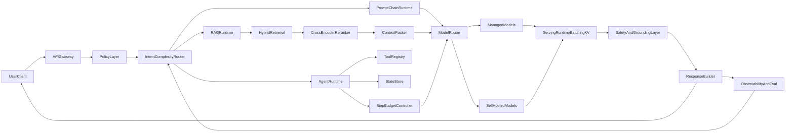

# Chapter 2: The LLM Stack and Core Patterns

## Context

> [!info] Quick Reference
> - **Pattern:** Multi-pattern platform (prompt chain + RAG + agentic)
> - **Scale:** 16M requests/day, pattern split 50/35/15%
> - **Key Techniques:** Intent routing, model tiering, continuous batching, semantic caching
> - **Primary Concerns:** Pattern selection, managed vs self-hosted, router drift
> - **Cross-references:** [[Chapter 1 - A Framework for LLM System Design Interviews|Chapter 1]] (framework), [[Chapter 3 - Data Pipelines and Vector Infrastructure|Chapter 3]] (retrieval), [[Chapter 4 - Serving, Scaling, and Optimizing LLMs|Chapter 4]] (serving)

**Problem statement:** Design a production LLM stack and decision framework for choosing between **prompt chaining**, **RAG**, and **agentic orchestration** under strict latency, cost, and safety constraints.

### Real-World Examples

- A SaaS company routes invoice classification to a small model, customer policy Q&A to RAG, and dispute-resolution workflows to an agentic path.
- An enterprise migration uses managed APIs for launch, then moves stable high-volume routes to self-hosted GPUs for unit-cost reduction.

---

## Step 1: Understand the Problem and Establish Design Scope

### Simulated Dialogue

**Interviewer:** Design the LLM stack for a multi-product AI platform.  
**Candidate:** I will first quantify traffic, latency budgets, and risk classes, then define pattern routing and serving architecture.

**Candidate:** Do all use cases require retrieval and tool use?  
**Interviewer:** No. Some are deterministic form-like tasks; others require fresh enterprise knowledge or multi-step tool workflows.

**Candidate:** Is this managed-API-first or self-hosted-first?  
**Interviewer:** Managed first, but it must support migration to self-hosted tiers when volume grows.

**Candidate:** What hard constraints are non-negotiable?  
**Interviewer:** p95 latency targets, budget controls, policy compliance, and auditable behavior.

### Functional Requirements

- Support three execution patterns in one platform:
  - **Prompt chaining** for deterministic workflows,
  - **RAG** for grounded, citation-backed answers,
  - **Agentic flows** for tool-heavy, multi-step tasks.
- Route requests dynamically across model tiers and providers.
- Enforce policy checks and deterministic fallback behavior.
- Provide traceable outputs with quality and cost telemetry.

### Non-Functional Requirements

- **Latency:** Route-specific TTFT (time to first token), TPOT (time per output token), and end-to-end p95 targets. A single global latency budget is insufficient because prompt-chain routes target sub-2.5s p95 while agentic routes may legitimately require 12s p95—blending these into one metric masks regression in both directions. Latency budgets should be set per route class and enforced by the API gateway as a timeout, not just measured after the fact.
- **Scale:** The system must absorb burst traffic of at least 10x average QPS (185 QPS average → 2,200 QPS burst) without cascading failures. This requires the gateway, router, retrieval service, and model serving layer each to be independently auto-scalable, with no synchronous dependency chain that can bottleneck the entire stack when one component receives burst traffic.
- **Cost:** Per-route token budgets (enforced at the gateway before model calls) and monthly envelope controls (tracked per tenant and per route). Without per-route cost enforcement, a single misconfigured agentic route can exhaust the monthly budget in hours. Monthly envelope controls must trigger graduated responses—alert at 70% consumed, restrict to minimum SLO at 90%, enforce hard stop at 100%.
- **Reliability:** Graceful degradation under provider failures and rate limits, defined as: a provider failure causes automatic routing to the fallback tier within 30 seconds, and a rate-limit event causes request queuing or tier downgrade rather than an error response to the client. Reliability is measured by the percentage of requests that receive any valid response (even degraded quality) rather than an error—target 99.9% valid-response rate including degraded fallbacks.
- **Security/compliance:** Tenant isolation ensures that no tenant's data (prompts, retrieved context, or model outputs) is accessible to another tenant through shared caching, logging, or inference infrastructure. Audit logs capture every request, routing decision, model call, and policy check with a tamper-evident trail. Output policy enforcement must be applied to 100% of responses before delivery, not sampled—safety checks cannot be probabilistic when the failure mode is a policy violation.​

### Back-of-the-Envelope Estimation (Platform Mix)

Assume:

- **Requests/day:** 16M
- Pattern split:
  - Prompt chain: 50%
  - RAG: 35%
  - Agentic: 15%
- Per-request token profile:
  - Prompt chain: 700 input / 140 output
  - RAG: 2,200 input / 280 output
  - Agentic: 4,800 input / 500 output

#### Throughput

- Average QPS: `16,000,000 / 86,400 ~= 185`
- Peak QPS (12x burst): `~2,220`
- Capacity target with failover margin: `~2,800 QPS`

#### Token Volume

- Prompt input: `8M * 700 = 5.6B`
- RAG input: `5.6M * 2200 = 12.32B`
- Agentic input: `2.4M * 4800 = 11.52B`
- **Total input/day:** `~29.44B`

- Prompt output: `8M * 140 = 1.12B`
- RAG output: `5.6M * 280 = 1.568B`
- Agentic output: `2.4M * 500 = 1.2B`
- **Total output/day:** `~3.888B`

#### Latency Envelope by Pattern

- Prompt chain: TTFT 400-800ms, p95 full response 1.5-2.5s
- RAG: TTFT 700-1200ms, p95 full response 3-5s
- Agentic: TTFT 900-1500ms, p95 full response 6-12s (bounded by tool fan-out)

#### Cost Formula

- `daily_cost = (input_tokens/1M * input_price) + (output_tokens/1M * output_price)`
- Key implication: agentic path is lower volume but high cost/query due to multi-step calls and larger outputs.

#### VRAM Planning for Model Tiers (Order-of-Magnitude)

- Fast route tier (7B [[glossary#Quantization|quantized]]): ~16-24GB VRAM
- Balanced route tier (13B-34B): ~40-80GB VRAM
- Complex route tier (70B): >=160GB aggregate VRAM with multi-GPU parallelism

---

## Step 2: Propose High-Level Design and Get Buy-In

### Core Architecture Components

- **API Gateway + Policy Layer:** Handles authentication, per-tenant quota enforcement, and request classification before any model call occurs. Placing policy enforcement here rather than inside model runtimes means that rate-limit decisions, tenant isolation checks, and abuse detection add only 1–5ms of overhead and never require a model invocation—critical when blocking malformed or unauthorized traffic at the edge.
- **Intent and Complexity Router:** Determines which of the three execution paths (prompt chain, RAG, or agentic) will handle the request, and at which model tier. This is the highest-leverage component in the stack—misclassification here cascades into quality failures, cost overruns, and latency violations across every downstream system.
- **Prompt Runtime:** Manages template versioning, schema-constrained output generation (e.g., JSON mode or grammar-constrained decoding), and chain-step execution. Centralizing this in a dedicated runtime rather than ad hoc per-service code enables consistent rollback, A/B testing of prompt versions, and token-budget enforcement across all callers.
- **Retrieval Runtime:** Combines sparse (BM25) and dense (embedding) retrieval, applies **[[glossary#Cross-Encoder Reranking|cross-encoder reranking]]** to re-score the top candidates, and packs the highest-relevance chunks into the context window. Separating retrieval from the model serving layer allows independent scaling—retrieval throughput can scale horizontally on CPU, while model inference stays on GPU.
- **Agent Runtime:** Implements the planner/executor loop, maintains a tool registry with capability manifests, persists intermediate state across steps, and enforces hard step and token budgets. Without explicit step budgets and loop-detection logic, agentic workflows degrade into runaway tool-call chains that exhaust cost limits and never converge.
- **Model Router:** Selects the appropriate provider and model tier for each request using a composite policy over SLO requirements, estimated token cost, provider health signals, and route-level risk class. This layer decouples execution patterns from specific model choices—swapping a model or provider requires only a config change here, not changes in the RAG or agent runtimes.
- **Serving Runtime:** Handles response streaming, **[[glossary#Continuous Batching|continuous batching]]** to maximize GPU utilization, and prefix/[[glossary#KV Cache|KV cache]] management to reduce TTFT for repeated prompt prefixes. This layer translates high-level completion requests into optimized GPU kernel schedules and is where the majority of hardware efficiency is won or lost.
- **Safety Runtime:** Executes input classifiers, runtime content policy checks, and output grounding validators before and after model generation. Running safety checks as a dedicated runtime rather than post-processing inside the serving layer allows independent scaling, independent failure handling, and audit logs decoupled from model outputs.
- **Observability + Eval:** Collects TTFT/TPOT histograms per route, per-query cost breakdowns, quality scores, and safety violation rates. Feeding this telemetry back into the Intent Router (via the observability loop in the diagram) enables automated detection of router drift and route quality regressions without requiring manual log inspection.

### Pipeline A: Stack Preparation / Data and Runtime Setup

1. **Register prompts, schemas, tool contracts, and policy rules.** Every prompt template, output schema, tool manifest, and policy rule is version-controlled and deployed through a registry with immutable identifiers. This ensures that a quality regression can be traced to an exact prompt version and rolled back in under 5 minutes without re-deploying application code.
2. **Build retrieval assets (indexes, embeddings, metadata filters).** Embedding generation, chunking, metadata extraction, and index construction are run as a separate offline pipeline. Keeping this decoupled from the serving path means a new document corpus can be indexed and alias-swapped into production without disrupting live queries.
3. **Configure model catalog by route tier (fast/balanced/complex).** The catalog maps intent classes to candidate models with their VRAM footprints, cost per 1M tokens, and SLO targets. Maintaining this as a central config rather than hard-coded client logic enables circuit-breaker-style downgrades during provider incidents without application changes.
4. **Set route-level token and latency budgets with fallback chains.** Each route defines a primary model choice, a fallback model, a maximum input token count, and a p95 latency target. Fallback chains ensure that a single provider outage degrades to a slower or less capable model rather than returning an error—a critical property when serving external customers.
5. **Publish runtime config via versioned release and rollback handles.** Runtime configuration (budgets, routing rules, model catalog) is published to a distributed config store with a version tag. Any component reading the config can roll back to the previous version within one minute if a canary evaluation detects quality or cost regressions.

### Pipeline B: Runtime Query Execution

1. **Validate request, apply auth and policy constraints.** The gateway verifies the bearer token, checks per-tenant request-per-minute and token-per-day quotas, and runs a lightweight input classifier (typically a fine-tuned BERT-class model under 50ms) that blocks clearly malicious or policy-violating payloads before any routing or retrieval occurs.
2. **Classify intent and complexity score.** The intent router assigns a route class (e.g., structured extraction, knowledge retrieval, or multi-step workflow) and a complexity score based on token count, detected entity types, and presence of tool-requiring phrases. This double-signal classification reduces false-escalation to expensive tiers by roughly 20–30% compared to intent class alone.
3. **Route to prompt-chain, RAG, or agentic execution graph.** The routing decision is logged with the intent class, complexity score, selected tier, and expected cost before execution begins. This pre-execution trace is critical for post-hoc router audits—if a route misfires, the signal that caused the decision is immediately queryable.
4. **Execute with bounded token/time budgets and streaming enabled.** The runtime enforces hard token limits on the input (truncating or rejecting over-length prompts) and on the output (halting generation at the configured max). Streaming is enabled by default so that the API gateway begins forwarding tokens to the client within milliseconds of the first decode step, keeping TTFT within SLO even when full generation takes seconds.
5. **Apply safety and grounding validators.** After generation, output safety classifiers check for policy violations and hallucinated citations. For RAG routes, a grounding check verifies that factual claims in the response are attributable to retrieved chunks. Failing safety checks either truncate the response, append a disclaimer, or trigger a full abstain depending on the route's configured risk policy.
6. **Return response + trace metadata; feed telemetry into evaluation loop.** Each response is returned with a structured trace payload including route taken, model used, token counts, latency breakdown, and safety check outcomes. The evaluation loop aggregates this telemetry to compute per-route quality pass-rates, cost efficiency, and safety violation rates—driving the weekly router recalibration process.

### Mermaid Architecture Diagram



---

## Step 3: Design Deep Dive

Focus areas for this chapter:

1. **Pattern Selection: RAG vs Agent**
2. **Prompt Chaining Design**
3. **Model Routing and Tiering**

### 1) Pattern Selection: Prompt Chaining vs RAG vs Agentic

| Pattern | Strengths | Failure Modes | Best Fit |
|---|---|---|---|
| Prompt Chaining | Lowest latency (p95 under 2.5s) and cost (often 5–10x cheaper than agentic per query), and fully deterministic because each step's inputs and outputs are schema-controlled. | Breaks down when the task requires knowledge that changes faster than prompt release cycles, or when the answer requires reasoning over more information than fits in the context window. | Form extraction, structured transformations, classification pipelines, templated report generation—any workflow where the logic is known at design time and does not require live data lookup. |
| RAG | Grounds responses in a verifiable, up-to-date corpus, reducing hallucination rates by 40–70% versus prompt-only for knowledge-intensive tasks. Enables citations that let users audit model claims. | Retrieval misses (high embedding recall cutoff but low precision) cause confident but wrong answers. Index drift—where the embedding index lags document updates by hours or days—silently degrades answer quality with no visible error. | Enterprise Q&A over policy documents or product catalogs, support copilots needing accurate citations, search assistants where freshness and factual grounding matter more than conversational fluency. |
| Agentic | Handles tasks that genuinely require multi-hop reasoning or real-world side effects—querying APIs, writing files, triggering workflows—where no static prompt chain can be pre-enumerated at design time. | Without explicit step and token budgets, tool-call loops can run indefinitely; a single agent invocation can easily consume 50,000+ tokens and dozens of API round-trips. Tail latency is unbounded without hard timeouts, and debugging failures requires inspecting full multi-step execution traces. | Research agents that must synthesize from heterogeneous live sources, workflow automation that requires conditional branching across external systems, dispute-resolution or triage workflows where decision paths cannot be fully enumerated in advance. |

**Decision Rule:**
- **Start with prompt chaining.** Before considering retrieval or tool use, determine whether the task can be solved with knowledge baked into model weights and a well-engineered prompt. If the answer only changes when a human rewrites the prompt template (i.e., knowledge update frequency is days to weeks), prompt chaining is sufficient and the operational simplicity benefit is significant.
- **Add RAG if external knowledge freshness or citations are required.** The two independent triggers for RAG are: (1) the correct answer changes faster than the prompt can be redeployed (hours to days), or (2) the user or a downstream system needs a verifiable source citation that can be audited. If neither condition holds, RAG adds retrieval latency, index maintenance cost, and new failure modes with no quality benefit.
- **Escalate to agentic only if multi-hop tool orchestration is genuinely unavoidable.** "Unavoidable" means the task requires real-world side effects (writing to external systems) or conditional branching across more than 2–3 decision points that cannot be pre-enumerated in a static chain. If you can enumerate the steps at design time, it is a prompt chain, not an agent. The burden of proof for escalating to agentic should be a documented failure case from prompt chaining or RAG, not an architectural preference.

> **Why this escalation order:** Each step up in pattern adds significant latency, cost, and operational complexity. Agentic paths add 10–30x the per-request cost of prompt chaining due to multi-step model calls and tool round-trips, and introduce loop failure modes that require explicit budgets and detection. The default should always be the simplest pattern that satisfies the quality and freshness requirements.

### 2) Prompt Chaining Design

High-quality chaining requires control-plane rigor:

- **Step-level contracts:** Each step declares its expected input schema (JSON or typed fields) and output schema. If step N's output fails schema validation, the chain fails fast with a structured error rather than propagating malformed data into step N+1, where it would silently corrupt downstream reasoning. Validation should be performed by a cheap deterministic function, not by another model call.
- **Chain-level guards:** The chain enforces a maximum number of steps, a cumulative token budget across all steps, and a wall-clock timeout. These are independent limits because a chain can blow through the token budget in two steps or exhaust the timeout across many short steps. Without both, a single long-running chain can starve other requests sharing the same serving worker pool.
- **Validation hooks:** Between steps, deterministic validators (regex, JSON schema checks, business-rule assertions) catch obviously wrong intermediate outputs before they are passed to the next model call. These hooks add under 1ms each and prevent wasted inference on provably invalid intermediate states.
- **Model specialization:** Route classification, intent detection, and text normalization steps to small, fast models (7B quantized, under 100ms TTFT). Reserve larger models (34B+) exclusively for the synthesis or reasoning step that cannot be simplified. In practice this reduces per-chain cost by 40–60% versus running every step on the largest model.

**Why this matters:** A single monolithic prompt that chains all logic in one call forces the model to hold all intermediate reasoning in the context window simultaneously, inflating token counts and TTFT. A well-structured chain where each step produces a compact schema-validated output can cut total prompt tokens by 30–50%, because intermediate noise is stripped between steps rather than accumulated. Multi-step chains also unlock independent model selection per step, and each step's output becomes a discrete audit point for quality evaluation—something that cannot be done when all reasoning is folded into a single opaque completion.

### 3) Model Routing and Tiering

| Routing Strategy | Strengths | Weaknesses | Use When |
|---|---|---|---|
| Static route map | Simplest possible implementation—a lookup table keyed on route name or regex pattern. Zero runtime overhead, no model calls, fully predictable in load tests. | Cannot adapt when query distributions shift; a product launch that changes query phrasing can misroute 15–30% of traffic overnight without any alert firing. | Suitable only for early MVP with a single known query type or an internal tool where the query distribution is fully controlled and rarely changes. |
| Rule-based dynamic routing | Classification signals (token count, keyword match, intent class score) are human-readable and auditable. When a regression occurs, the rule that fired can be identified and corrected in minutes. Requires no labeled training data to deploy. | Rules require manual maintenance as query distributions evolve. Each new product feature may require new rules, and rule interactions can produce unexpected edge cases that take multiple on-call rotations to surface and fix. | The right default for most production systems. The combination of transparency, debuggability, and low deployment risk outweighs the manual tuning cost for the vast majority of LLM-serving use cases. |
| Learned router model | A small classification model (typically a fine-tuned encoder, 30–100M parameters) trained on labeled examples can learn subtle signals—semantic framing, implicit domain, query structure—that rules cannot express. Achieves 5–15% better routing accuracy than hand-tuned rules on complex multi-intent corpora. | Requires weeks of labeled data from a live system before training is meaningful. When quality regresses, the root cause is opaque without SHAP/attribution tooling. Requires its own eval pipeline, retraining infrastructure, and shadow-mode testing before each update. | Reserved for organizations that already run robust offline eval, have 60+ days of labeled routing data, and have encountered a measurable quality ceiling from rule-based routing that justifies the infrastructure investment. |

> **Why rule-based dynamic routing for most production systems:** A learned router requires labeled training data showing which tier produced acceptable quality per request class—data that takes weeks to accumulate from a live system. Rule-based routing (route by token count, intent class, and provider health) is immediately auditable when quality regressions occur and can be adjusted without model retraining. Reserve learned routing for organizations that already have robust offline eval infrastructure to detect router drift reliably.

Suggested route policy signals:

- **Intent class and complexity score:** The combination of intent class (e.g., structured extraction vs. open-ended Q&A) and complexity score (derived from token count, entity density, and multi-hop keywords) is the primary signal. Using only one of these produces systematic errors—a short but semantically complex query will be under-routed if token count is the sole signal.
- **Required grounding strictness:** Routes serving regulated or safety-critical content should have a flag that forces both retrieval augmentation and grounding validation, regardless of complexity score. This prevents a low-complexity request in a high-risk domain from bypassing the RAG path because its token count looks simple.
- **Current provider health/rate-limit status:** The router queries a provider health sidecar that tracks recent error rates, 429 frequency, and latency percentiles per model. A provider in degraded state should be deprioritized before requests start failing, not after the first 429 wave arrives.
- **Cost budget remaining for route/time window:** Per-route and per-tenant daily cost envelopes should be enforced by the router, not downstream. When a budget threshold is approaching (e.g., 80% consumed), the router can automatically downgrade to a cheaper model tier, preventing cost overruns without requiring an emergency code change.

### 4) Protocol Layer for Tool-Using Systems

Modern agentic systems increasingly need a standard way to discover tools, retrieve contextual resources, and reuse prompt workflows across applications. Without a protocol layer, every product team implements tool invocation differently—inconsistent schemas, no shared permission model, duplicated retry logic, and no unified audit surface. Treat this as a first-class architectural layer between the AI host and external systems, not as ad hoc function-calling code embedded inside each product's inference loop.

The [[glossary#Model Context Protocol (MCP)|Model Context Protocol (MCP)]] is the most important pattern to know here:

- **Host:** The AI application that owns the conversation context, makes all model API calls, and manages the user-facing approval UX for sensitive tool actions. The host is responsible for deciding which tools are offered to the model and enforcing the permission boundaries—the model itself cannot self-authorize access to external systems.
- **Client:** The host-side connection to a single MCP server. A host can maintain multiple clients simultaneously, one per external integration. The client handles transport-level concerns (connection lifecycle, retries, serialization) so the host's reasoning loop stays clean.
- **Server:** A lightweight integration surface that exposes tools, resources, and prompts over a standard protocol. Servers are stateless by design—they expose capabilities but do not persist conversation state. This makes them independently deployable and auditable units.
- **Tools:** Actions the model can request to perform side effects in the world—querying a database, creating a support ticket, sending an email, or calling an external API. Each tool has a typed schema that the model reads to form valid invocations; poorly specified schemas are the leading source of malformed tool calls.
- **Resources:** Contextual data blobs the model can read to enrich its reasoning—files, configuration schemas, live records, or documentation pages. Resources flow into the context window as read-only content; the model cannot modify them directly, which is a critical safety boundary.
- **Prompts:** Reusable parameterized prompt templates or multi-step workflows exposed by a server. These allow organizations to centralize and version approved prompt patterns rather than letting individual engineers write ad hoc system prompts for each integration.

> **Why standardize tools, resources, and prompts behind MCP:** Without a shared protocol like MCP, scaling from 5 tools to 50 tools requires rewriting discovery, invocation, and permission logic in every client. MCP's biggest architectural value is that adding a new integration requires only deploying a new MCP server—the host, router, and permission model remain unchanged.

System design implication: MCP standardizes discovery and invocation, but production still needs a server registry, permission model, approval gates, result sanitization, tool-call audit logs, and defenses against prompt injection through resources or tool descriptions. A malicious or poorly designed MCP server can expose tool descriptions or resource content that manipulates the model's reasoning—treating server output as trusted input is a security antipattern. See [[Chapter 23 - Design an MCP-Based Tool Integration Platform|Chapter 23]] for the full platform design.

### Additional Trade-offs

#### Managed vs Self-hosted Serving

| Approach | Strengths | Weaknesses |
|---|---|---|
| Managed API | Operational simplicity—no GPU infrastructure to provision, patch, or monitor. Teams can reach production in days rather than weeks. Provider handles model updates, hardware failure, and horizontal scaling. Cost is proportional to usage, making it ideal for unpredictable or low-volume early traffic where reserved GPU capacity would sit idle. | Per-token pricing becomes expensive at high volume; at 29B input tokens/day (this chapter's estimate), managed API costs can reach $20,000–$60,000/day depending on model tier and provider. Rate limits are shared across tenants and can trigger unexpectedly during marketing-driven traffic spikes, causing 429 storms that static retry logic cannot absorb. |
| Self-hosted | At sufficient volume (typically 1B+ tokens/day per model), self-hosted GPU clusters reduce per-token costs by 60–80% versus managed APIs. Full control over hardware allocation means no shared rate limits and no exposure to provider pricing changes. Enables custom kernels, quantization profiles, and fine-tuned model weights that managed APIs do not support. | Requires GPU provisioning, CUDA driver management, model weight distribution, inference server operation (vLLM, TGI, or equivalent), and on-call coverage for hardware failures and OOM crashes. GPU OOM events during long-prompt or high-batch periods require automatic batch-size shrinking or request rejection logic that must be built and maintained. Operational burden typically requires 2–4 dedicated ML infrastructure engineers. |
| Hybrid | Combines managed API for burst capacity and low-volume routes with self-hosted for stable, high-volume routes—capturing both cost efficiency and operational resilience. Provider outages fall back to managed, and cost-optimized routes run self-hosted. Achieves 30–50% cost reduction over pure managed while maintaining SLO coverage. | Adds routing-layer complexity: the model router must track provider health across both managed and self-hosted endpoints, enforce failover order, and handle the latency gap between tiers (self-hosted p99 can differ from managed p99 by 200–800ms). Policy compliance must be enforced identically across both paths, which requires synchronized configuration management. |

#### Cache Strategy

| Cache | Strengths | Weaknesses | Use Case |
|---|---|---|---|
| No cache | Eliminates the risk of returning stale or semantically mismatched cached responses. Every request generates a fresh completion, guaranteeing that model outputs reflect the current prompt state. Zero implementation complexity—no cache infrastructure, threshold tuning, or invalidation logic. | Every request pays full prefill cost and TTFT. At 29B input tokens/day, removing caching could add $5,000–$15,000/day in additional API costs and increase average TTFT by 300–600ms on templated routes. Cache-eligible traffic in production is typically 20–40% of volume, so not caching is purely a cost and latency regression for steady-state workloads. | Appropriate only during initial prototyping before query distribution is understood, or for routes with strict correctness requirements and no tolerance for near-match errors (e.g., legal or financial record retrieval). |
| Semantic cache | For support and FAQ workloads, 20–40% of queries are semantic near-duplicates of previously answered questions. A semantic cache with a cosine similarity threshold of 0.92–0.95 can serve these from cache in under 10ms, eliminating the model call entirely and delivering 100x TTFT improvement for hit traffic. Reduces cost proportionally to hit rate. | A threshold set too low (e.g., 0.85) returns stored responses to semantically related but factually distinct queries—a dangerous failure mode in domains where similar phrasing means different things. Cached responses also become stale when underlying knowledge updates (product changes, policy revisions) without automatic invalidation, requiring source-version-aware TTL management. | High-repeat-intent routes: customer support Q&A, product FAQ copilots, HR policy assistants, and any use case where the same question recurs across many users within a short time window. Should not be applied to agentic or multi-turn sessions where context uniqueness is the norm. |
| KV/prefix cache | Eliminates redundant GPU computation for prompt prefixes that are identical across requests—system prompts, instruction headers, and fixed RAG context. On a 70B model with a 2K-token shared prefix, KV caching saves 200–400ms of TTFT per request that hits the cache. Requires no quality trade-off because the attention computation is deterministic for the same prefix. | Consuming VRAM to store KV tensors for cached prefixes competes directly with active batch slots, reducing maximum batch size. A 2K-token prefix KV cache for a 70B fp16 model consumes roughly 200–400MB of VRAM per cached layer, and eviction policies must be tuned carefully or cache thrashing degrades net throughput. | Templated prompts with long system prefixes (>500 tokens), multi-turn conversation sessions where the early context is reused across turns, and RAG routes that include a fixed large instruction block before the retrieved chunks. Most effective when the shared prefix represents >20% of total token count per request. |

> **Why KV/prefix cache for templated prompts:** System prompts and instruction prefixes are processed on every request, consuming prefill time even though their attention states are identical each time. Caching these KV states eliminates 200–400ms of redundant computation for a 2K-token shared prefix on a 70B model, with zero quality impact because the computation is deterministic.

> **Why not semantic cache for high-risk routes:** A semantic cache returns a stored answer when a new query is "close enough" to a cached query. For safety-critical or frequently-updated domains this can surface stale or semantically adjacent but factually wrong responses, requiring careful threshold tuning per intent class and source-version invalidation to be safe.

### Production Bottlenecks and What Breaks First

- **Provider rate limiting:** Managed API providers assign per-tenant rate limits in tokens-per-minute and requests-per-minute. A 12x traffic burst (2,220 QPS against a limit provisioned for 185 QPS) generates a wave of 429 responses that triggers naive retry logic simultaneously across all clients—producing a retry storm that amplifies the original burst load and extends the incident duration from minutes to tens of minutes.
  - Mitigation: Implement token-bucket rate limiting at the gateway before requests reach the provider, so excess requests are queued or shed locally rather than sent to the provider and rejected. Add circuit breakers that open after 5% of requests return 429/5xx within a 30-second window, routing traffic to the fallback provider. Use jittered exponential backoff with a full-jitter strategy (random sleep between 0 and the backoff ceiling) to prevent retry synchronization across clients.

- **Router misclassification drift:** Query distributions shift as product behavior changes and users learn the system. A router calibrated on week-1 traffic can accumulate 15–20% misclassification on week-8 traffic if not recalibrated. Systematic false-downgrade (complex queries routed to cheap tier) is particularly dangerous because it produces confident but incorrect outputs with no error signal—the request completes successfully, so no alert fires.
  - Mitigation: Run a weekly router eval against a held-out labeled set that covers all route classes with at least 100 examples each. Compute a route confusion matrix that shows false-downgrade and false-escalation rates by pair. Maintain a router rollback policy: any config change that increases false-downgrade rate by >3% is automatically reverted within 1 hour of detection.

- **Database/metadata connection exhaustion:** Every request performs synchronous lookups for authentication, ACL checks, and route policy before the model call begins. At 2,800 QPS, even a 5ms average lookup adds 14 seconds of aggregate wait per second of throughput. When the database connection pool fills (typically at 5–15x normal load), requests queue for a connection and p95 TTFT spikes from 50ms to 500–1500ms for the metadata-lookup phase alone.
  - Mitigation: Size connection pools for peak QPS by load testing at 2–3x projected peak before launch. Add read replicas for ACL and policy data (which are read-heavy and write-infrequently). Implement a TTL metadata cache (5–30 second TTL) for policy data that changes less often than per-second—this reduces database read load by 80–95% for static policy configurations.

- **Stale vector embeddings/index skew:** When documents are updated in the source system but the embedding index is not rebuilt, the RAG route continues to retrieve outdated chunks and generate answers grounded in stale facts. This failure is invisible in serving metrics—TTFT, TPOT, and error rates all look healthy—and surfaces only through user reports or citation audits days after the index diverged from the source.
  - Mitigation: Track embedding model version and document hash alongside each vector in the index. Run shadow index tests after every embedding model update by comparing retrieval results between old and new index on a standard query set before alias-swapping. Implement alias-based index rollback: the RAG runtime reads from an alias that points to the active index, so rollback is an alias update (seconds) rather than a full index rebuild (hours).

- **Agentic hallucination loops:** Without explicit convergence detection, an agent can enter a loop where each tool call produces a result that appears to require another tool call, with no terminal condition reached. This pattern is not random—it is typically triggered by tool schemas that return ambiguous responses or by planner prompts that do not distinguish between "evidence found" and "evidence not found" outcomes. A looping agent can exhaust a 100,000-token budget in under 10 minutes of real time.
  - Mitigation: Enforce hard step limits (e.g., max 15 steps per invocation) in the agent runtime, not via prompt instruction. Implement loop signature detection: if the same tool is called with the same arguments (or cosine-similar arguments) within the last 5 steps, treat it as a loop and force a terminal action. Define deterministic exit policies—on budget breach or loop detection, the agent must either abstain (return a structured "could not complete" response) or escalate to a human queue, never retry the same path.

- **GPU OOM in self-hosted tiers:** Long prompt inputs combined with large batch sizes can exhaust GPU VRAM mid-batch, causing the inference worker to crash and drop all in-flight requests. VRAM consumption scales with prompt length times batch size times the model's KV cache size per token, meaning that a normal average prompt length can produce OOM events in the tail if a few long-context requests land in the same batch during peak load.
  - Mitigation: Enforce strict per-request input token caps (e.g., reject requests over 8,192 tokens at the gateway) before they reach the serving worker, preventing the largest inputs from entering the batch. Implement dynamic batch shrinking: if the serving worker detects VRAM pressure above 90%, it reduces active batch size by 25% for the next scheduling interval before OOM occurs. Configure a route downgrade policy: if the self-hosted tier reports sustained VRAM pressure, the model router automatically shifts marginal traffic to the managed API fallback until pressure normalizes.

### Advanced Techniques to Name and Use Correctly

- **Continuous batching** for throughput and queue stability. In continuous batching, the GPU processes a fixed number of token slots per step, and as soon as one sequence completes its generation, a new request takes its slot without waiting for the remaining sequences to finish. This eliminates the GPU idle time inherent in static batching, where all slots stay occupied until the longest sequence completes. At 2,800 QPS with variable-length completions, continuous batching typically raises effective GPU utilization from 30–50% (static) to 60–80%, directly reducing the number of GPU replicas required to serve the load.

> **Why not static batching:** Static batching holds the batch until all requests finish, meaning short completions idle while waiting for the longest sequence. Continuous batching retires completed requests and admits new ones at every decode step, raising GPU utilization from ~30–50% to 60–80% with no hardware additions.

- **KV caching** to reduce TTFT on repeated prefixes. When multiple requests share an identical prompt prefix—a system prompt, a set of instructions, or a fixed RAG preamble—the attention key-value tensors computed during prefill for that prefix are stored in GPU VRAM. Subsequent requests that match the prefix skip its recomputation and begin decoding from the cached state, reducing TTFT by 200–500ms on long prefixes. This technique is most impactful when prompt templates are standardized and the shared prefix exceeds 500 tokens.
- **Semantic caching** with freshness- and policy-aware invalidation. A semantic cache intercepts queries before the LLM call, encodes the query into an embedding, and performs approximate nearest-neighbor search against a cache index. Hits above a similarity threshold (typically 0.92–0.95) return the stored response directly. Invalidation must account for both TTL expiry and source-version changes—when a policy document is updated, all cache entries referencing queries that would have retrieved that document must be invalidated or the cache will serve stale answers.
- **Cross-encoder reranking** for precision in RAG route. Bi-encoder retrieval (dense or sparse) ranks candidates by approximate similarity to the query, which optimizes for recall but not precision—many returned candidates are topically related but do not directly answer the question. A cross-encoder reranker processes each (query, candidate) pair jointly through a full attention pass, producing a precise relevance score that reorders the top-K candidates before context packing. This two-stage approach achieves 10–20% better answer quality (measured by citation precision) than bi-encoder retrieval alone at the cost of 50–150ms additional latency.
- **Parent-child chunking** where large documents need both recall and precise citation. Document chunks are stored at two granularities: large parent chunks (500–2000 tokens) for retrieval recall and small child chunks (50–200 tokens) for precise attribution. Retrieval operates on the child chunks to find specific evidence, but the context window receives the surrounding parent chunk to give the model sufficient context to reason accurately. Without this, either recall suffers (too small chunks miss document-level context) or citations are imprecise (too large chunks make it impossible to attribute specific claims).
- **[[glossary#LoRA (Low-Rank Adaptation)|LoRA adapters]]** for domain adaptation without full fine-tune overhead. Low-Rank Adaptation injects trainable rank-decomposed weight matrices into the attention layers of a frozen base model. A typical LoRA adapter for a 7B model is 10–50MB rather than the 14GB of full model weights, can be trained on 1,000–10,000 domain examples in hours on a single GPU, and can be swapped at serving time by hot-loading the adapter weights on top of the shared base. This enables per-tenant or per-domain specialization without maintaining a separate full model copy for each use case.

### Applied Stack Insights

- **Treat execution patterns as economic and reliability decisions, not just model choices.** The choice between prompt chaining, RAG, and agentic is primarily a decision about cost envelope, failure modes, and operational complexity. A RAG route that costs 3x more per query than a prompt chain is justified only if retrieval-grounded quality is demonstrably required—not because RAG is architecturally "more complete." Optimize for the simplest pattern that passes the quality bar.
- **Route-specific budgets outperform one-size-fits-all architecture.** A single global latency budget (e.g., "all requests must complete in under 5s") will either be too tight for legitimate agentic workflows or too loose to surface TTFT regressions in prompt-chain routes. Per-route budgets with independent alert thresholds allow the team to tighten constraints on fast routes (prompt chain: p95 under 2.5s) without forcing the agentic path into unreachable targets.
- **Every optimization must be measured against quality and safety regressions.** Switching from full-precision to INT4 quantization on a production model may improve throughput by 30% but degrade answer quality on long-context reasoning by 5–10%—a trade-off that only eval data can surface. Every infrastructure optimization (caching, batching, model downgrade, quantization) should be gated on an eval run covering quality, safety, and grounding metrics before rollout.

---

## Practical Implementation

```python
# Intent router with model tiering — routes queries to the cheapest capable model
import anthropic, openai, hashlib, json
from sentence_transformers import SentenceTransformer
import numpy as np

_encoder = SentenceTransformer("all-MiniLM-L6-v2")

TIERS = {
    "simple":  {"model": "gpt-4o-mini",       "max_tokens": 512},
    "complex": {"model": "gpt-4o",             "max_tokens": 2048},
    "coding":  {"model": "claude-opus-4-5",  "max_tokens": 4096},
}

# Cluster centroids (pre-computed from labeled examples)
CENTROIDS = {
    "simple":  np.load("centroids/simple.npy"),
    "complex": np.load("centroids/complex.npy"),
    "coding":  np.load("centroids/coding.npy"),
}

def classify_intent(query: str) -> str:
    vec = _encoder.encode(query)
    scores = {tier: float(np.dot(vec, c) / (np.linalg.norm(vec) * np.linalg.norm(c)))
              for tier, c in CENTROIDS.items()}
    return max(scores, key=scores.get)

def route(query: str, system_prompt: str) -> str:
    tier = classify_intent(query)
    cfg  = TIERS[tier]
    client = openai.OpenAI() if "gpt" in cfg["model"] else anthropic.Anthropic()
    if isinstance(client, openai.OpenAI):
        resp = client.chat.completions.create(
            model=cfg["model"], max_tokens=cfg["max_tokens"],
            messages=[{"role": "system", "content": system_prompt},
                      {"role": "user",   "content": query}],
        )
        return resp.choices[0].message.content
    resp = client.messages.create(
        model=cfg["model"], max_tokens=cfg["max_tokens"],
        system=system_prompt,
        messages=[{"role": "user", "content": query}],
    )
    return resp.content[0].text
```

```text
# Pseudocode: semantic cache lookup and write with TTL
# Demonstrates: how to short-circuit LLM calls for repeated/similar queries

SIMILARITY_THRESHOLD = 0.92
TTL_SECONDS          = 3600   # 1 hour

function semantic_cache_get(query, cache_store, encoder):
    query_vec = encoder.encode(query)
    candidates = cache_store.ann_search(query_vec, top_k=5)
    for entry in candidates:
        if cosine_similarity(query_vec, entry.vec) >= SIMILARITY_THRESHOLD:
            if not is_expired(entry.created_at, TTL_SECONDS):
                cache_store.increment_hit_counter(entry.id)
                return entry.response     # cache hit — skip LLM
    return null                           # cache miss — call LLM

function semantic_cache_write(query, response, cache_store, encoder):
    query_vec = encoder.encode(query)
    cache_store.upsert({
        vec:        query_vec,
        query:      query,
        response:   response,
        created_at: now(),
        ttl:        TTL_SECONDS,
    })

# Usage in serving path:
function handle_query(query):
    cached = semantic_cache_get(query, cache, encoder)
    if cached:
        return cached
    response = call_llm(query)
    semantic_cache_write(query, response, cache, encoder)
    return response
```

---

## Step 4: Wrap Up

### Final Design Summary

The LLM stack should run as a **policy-driven execution platform**:

- classify and route by complexity/risk,
- use the cheapest path that meets quality and safety,
- and maintain strict controls for latency, cost, and fallback behavior.

### Wrap-Around Concerns

- **Routing drift:** Query distributions in production shift continuously as users learn the system's capabilities, products release new features, and seasonal or event-driven traffic patterns emerge. Without periodic router recalibration (weekly eval runs comparing route classifications against oracle labels), a router that was 92% accurate at launch can degrade to 78% accuracy within 60 days. Rollback guardrails—automated reversion to the previous router config if quality pass-rate drops >5% within 24 hours of a config change—are the safety net that makes frequent recalibration safe.
- **Provider concentration risk:** Routing all production traffic to a single managed API provider creates a single point of failure that has caused multi-hour outages at scale. Maintaining warm failover capacity (even at 20–30% of volume) across a secondary provider ensures that a provider incident causes a graceful degradation to a slower or slightly less capable model rather than a complete service outage. Provider diversification also provides negotiating leverage on pricing at contract renewal.
- **Prompt/runtime governance:** Every prompt template, chain definition, tool manifest, and routing rule must be version-controlled with an immutable identifier and deployed through a gated release process. "Gate on eval" means that no config change reaches production without a comparison run against the baseline eval suite, with explicit sign-off on any quality or safety regression introduced by the change. Ungoverned prompt modifications are one of the most common root causes of production quality regressions that take days to diagnose.
- **Operational debt:** Agentic tool registries and prompt chain libraries accumulate stale, undocumented, and overlapping artifacts over time. An unaudited tool registry with 50+ tools increases the probability of tool selection errors and prompt injection surface area proportionally. A quarterly audit that removes unused tools, consolidates overlapping chains, and updates documentation for changed APIs is a maintenance requirement, not optional housekeeping—the failure rate of agentic workflows increases measurably as registry complexity grows without corresponding documentation.

---

## Step 5: Interviewer Curveballs

### Interviewer Follow-ups & Frequently Asked Questions (FAQ)

Q: If you can keep only two patterns in v1, which ones and why?

**The Ideal Answer:** I keep prompt chaining + RAG; they cover deterministic flows and grounded knowledge with lower latency/cost than agentic orchestration. Prompt chaining handles 50–60% of real-world LLM use cases (classification, extraction, formatting, templated generation) without requiring live retrieval. RAG extends coverage to knowledge-intensive tasks where freshness and citation fidelity are required. Together they serve 85%+ of production use cases while keeping v1 infrastructure tractable—no tool registry, no state store, no step budget controller.

**Deep Dive & Trade-offs:**
- Prompt chains give control and predictable cost: each step has a known token budget and schema contract, making cost forecasting straightforward and enabling aggressive caching at the step level.
- RAG handles freshness and citation requirements that static prompts cannot: when the corpus changes daily or the user needs verifiable sourcing, RAG is the only option that doesn't require prompt redeployment for every data update.
- Agentic path is added only after measured failure patterns justify complexity: the right trigger is a documented failure class—tasks that require live tool use or multi-hop decisions that cannot be pre-enumerated—not a desire to build the most complete architecture from day one.

**The Interviewer's Rubric:** The interviewer is checking prioritization and scope discipline. A strong answer names both patterns with concrete reasoning for why each is chosen over alternatives, and explicitly names agentic as the excluded pattern with a cost/complexity justification. Weak answers omit the economic rationale or default to "all three are important."

Q: What hard threshold would trigger moving a route from managed API to self-hosted?

**The Ideal Answer:** When route-level unit economics plus SLO variance consistently beat managed APIs for 4–8 weeks of production traffic and ops readiness exists—meaning the team can demonstrate GPU cluster provisioning, on-call runbooks, and a tested rollback path before the migration begins. The specific financial threshold should be computed as: (self-hosted TCO including GPU reservation, on-call, and infra engineering) divided by (managed API spend for the same token volume). If self-hosted TCO is less than 50–60% of managed API spend at current volume, the migration has a viable payoff horizon of 6–12 months.

**Deep Dive & Trade-offs:**
- Include infra, on-call, and incident costs in TCO: GPU hardware is only one component; fully-loaded self-hosted cost includes CUDA driver patching, model weight distribution, inference server maintenance, GPU OOM incident response, and the opportunity cost of 2–4 infrastructure engineers.
- Keep managed as failover even after migration: traffic should never be 100% self-hosted for a production route because GPU hardware failures and kernel panics cause sudden capacity loss. Maintain 20–30% of capacity on managed API as a warm failover, even if its unit cost is higher.
- Require rollback in < 10 minutes: migration success depends on the ability to shift traffic back to managed in under 10 minutes if a self-hosted regression is detected post-launch. Without a tested rollback path, migration risk is unbounded.

**The Interviewer's Rubric:** The interviewer is checking practical migration judgment. A strong answer provides a concrete financial decision framework (TCO comparison with specific cost components), names the failover requirement as a non-negotiable, and ties the 4–8 week consistency window to avoiding false positives from short-term provider pricing changes. Weak answers say "when it's cheaper" without specifying how to measure "cheaper" in total cost terms.

Q: How do you detect that your router is harming quality?

**The Ideal Answer:** Track route confusion matrix, quality pass-rate by routed tier, and false downgrade/false escalation rates on a weekly cadence. The key signal is a divergence between two metrics: the percentage of requests routed to cheap tiers (router behavior) and the quality pass-rate for those requests (model output quality). When cheap-tier routing increases without a corresponding quality regression, the router is correctly exploiting the capability of smaller models. When cheap-tier routing increases and quality pass-rate drops, the router is under-serving complex queries—the classic false downgrade pattern.

**Deep Dive & Trade-offs:**
- Offline oracle labels + online A/B are both required: offline evaluation on held-out labeled examples detects systematic routing errors; online A/B with forced routing overrides reveals whether quality regressions in production are attributable to router decisions or to model capability gaps.
- Cheap-tier overuse often appears as a rising unsupported-claim rate or user escalation rate: these are indirect quality signals that are measurable without manual labeling at scale. A routing regression that increases unsupported claims by 3% in a safety-critical domain is a serious incident, not a marginal quality issue.
- Route audits should be versioned and reversible: every router config change should be tagged with a version identifier and accompanied by a pre/post quality comparison. If a regression is discovered 5 days later, the team must be able to identify exactly which router version caused it and roll back to the previous version in minutes.

**The Interviewer's Rubric:** The interviewer is checking if router quality is treated as a first-class operational concern equal to serving latency and cost. A strong answer names both offline and online evaluation, gives a concrete example of how router harm manifests in downstream metrics (unsupported claims, user escalations), and describes a versioned audit process. Weak answers treat router quality as a one-time setup concern rather than an ongoing measurement discipline.

Q: What is the most common hidden bottleneck in this stack?

**The Ideal Answer:** Metadata and policy lookups—specifically the database queries that populate ACL checks, tenant quota enforcement, and route policy evaluation. These lookups execute on every request before any model call occurs, so they directly add to TTFT. At 2,800 QPS, a metadata lookup that averages 8ms adds 22+ seconds of cumulative latency per second of throughput. When the database connection pool exhausts (typically at 5–15x normal traffic), p95 metadata latency spikes from 8ms to 800ms+, producing a system-wide TTFT degradation that appears in dashboards as a model serving regression even though the model serving layer is healthy.

**Deep Dive & Trade-offs:**
- Router depends on policy and ACL metadata on every request: unlike the model call, which can be batched and streamed, ACL checks are blocking synchronous lookups that must complete before routing can proceed. Any database slowdown is immediately visible in end-to-end TTFT.
- Connection pool exhaustion spikes TTFT globally: the default connection pool sizes in most ORMs (5–20 connections) are calibrated for OLTP workloads at moderate QPS and will exhaust quickly under LLM gateway traffic. Connection pool sizing must be load-tested at peak QPS before launch, not after the first production incident.
- Add read replicas and short-lived cache with strict invalidation: policy and ACL data changes infrequently (seconds to minutes) but is read thousands of times per second. A TTL cache of 5–30 seconds with version-triggered invalidation reduces database read load by 80–95% without meaningful staleness risk for policy changes.

**The Interviewer's Rubric:** The interviewer is testing system-level bottleneck diagnosis beyond the obvious model serving layer. A strong answer identifies the specific mechanism (connection pool exhaustion from synchronous metadata lookups), quantifies the impact (p95 TTFT spike disproportionate to model serving health), and names the mitigations in order of implementation priority. Weak answers identify "database" generically without explaining why it is a bottleneck specifically in LLM gateway traffic patterns.

Q: How do you keep agentic workflows from becoming unbounded cost sinks?

**The Ideal Answer:** Enforce per-request step budgets (hard max: 10–20 steps depending on task class) and cumulative token budgets (hard max: 50,000–100,000 tokens per invocation), then force a terminal action (abstain with a structured explanation, or escalate to a human queue) when either budget is breached. These limits must be enforced in the agent runtime control plane, not by prompting the model to "stop when you've used 10 steps"—models do not reliably self-enforce tool-call quotas under adversarial or edge-case inputs.

**Deep Dive & Trade-offs:**
- Budget-aware planner reduces runaway loops: a planner that tracks remaining step budget and adjusts its tool-selection strategy accordingly (e.g., preferring bulk tools over sequential single-record lookups as budget depletes) converges more reliably than a stateless planner that ignores budget state until the limit is hit.
- Track cost per successful task, not just per request: an agent that completes tasks in an average of 8 steps but fails 40% of the time has a true cost per successful task 1.7x higher than its per-request cost suggests. Tracking task-success-weighted cost reveals that some "cheap" agentic routes are actually cost-inefficient when completion rate is accounted for.
- Prefer deterministic subroutines for repetitive tool actions: if an agent consistently executes the same sequence of 3 tool calls to perform a subtask (e.g., look up customer ID, fetch account record, check balance), extract that sequence into a deterministic function called as a single tool. This converts 3 LLM-mediated tool calls into 1, reducing token overhead and loop risk for the most common execution paths.

**The Interviewer's Rubric:** The interviewer is checking control-plane cost governance—whether the candidate understands that budget enforcement must be a hard runtime control, not a soft model prompt. A strong answer distinguishes between step budgets and token budgets (both are required), names the terminal action policy on budget breach, and provides at least one technique for reducing per-task cost beyond just limiting steps. Weak answers rely on prompting the model to self-limit without naming runtime enforcement mechanisms.

Q: When does semantic cache become dangerous?

**The Ideal Answer:** Semantic cache becomes dangerous when two failure modes combine: similarity thresholds set too loosely (below 0.90 cosine similarity) and freshness windows too long for the rate of change of the underlying knowledge source. At 0.85 cosine similarity, queries that are topically adjacent but factually distinct—"What is the refund window for standard orders?" versus "What is the refund window for enterprise orders?"—are treated as equivalent and return the wrong cached response. This failure is silent and does not surface any error signal, making it harder to detect than a model hallucination.

**Deep Dive & Trade-offs:**
- Loose matching returns plausible but stale outputs that look authoritative: the response is grammatically correct and topically related, so users and automated quality checks may not flag it. The failure typically surfaces only through user complaints or detailed citation audits days after the bad response was returned.
- Use intent-specific thresholds and source-version invalidation: routes with precise factual requirements (pricing, policy, legal) should use higher thresholds (0.94–0.97) than routes with general informational intent (0.88–0.92). When the source document for a cached entry is updated, all cache entries derived from queries that would have retrieved that document must be invalidated immediately—not after TTL expiry.
- High-risk intents should bypass cache unless strict checks pass: routes classified as regulatory, safety-critical, or financial should run fresh model inference by default. A cache opt-in policy (whitelist eligible route classes) is safer than a cache opt-out policy (blacklist sensitive routes) because new routes default to safe behavior rather than requiring engineers to remember to add an exclusion.

**The Interviewer's Rubric:** The interviewer is checking safe cache policy design—whether the candidate understands that semantic cache failures are silent and confidence-inspiring, which makes them more dangerous than obvious errors. A strong answer names the threshold failure mode with a concrete example of semantically similar but factually distinct queries, describes source-version invalidation as a required mechanism (not just TTL), and articulates an opt-in policy for high-risk routes. Weak answers focus only on staleness without addressing the near-match precision failure mode.

Q: How do you decide reranker depth in RAG path?

**The Ideal Answer:** Reranker candidate depth is a Pareto trade-off between retrieval recall and added TTFT latency. The right number is corpus-dependent but follows a pattern: measure recall@K for the initial bi-encoder retrieval at K=20, 40, 80, and 150; identify the K beyond which incremental recall gain drops below 2%; then set reranker depth at that K. For most enterprise corpora with 100K–10M documents, this sweet spot is 20–50 candidates. For very large or heterogeneous corpora (100M+ documents, multiple domains), depth of 50–80 is more common because the initial retrieval is noisier.

**Deep Dive & Trade-offs:**
- Too few candidates (K < 20) means the reranker optimizes precision over an already-biased pool: if the most relevant document was not retrieved in the top 20 by the bi-encoder, no reranking can recover it. Recall is bounded by the initial retrieval stage, so setting K too low sacrifices answer completeness in exchange for negligible latency savings.
- Too many candidates (K > 100) inflates reranking latency by 50–200ms without proportional recall gain, because the marginal documents at high K are typically low-relevance noise that the reranker correctly down-ranks. The latency cost is real (cross-encoders run O(K) forward passes), while the quality benefit diminishes rapidly above the recall saturation point.
- Tune by query class and monitor citation precision uplift: queries with narrow factual targets (specific dates, numbers, named entities) often need lower K because the relevant evidence is concentrated. Open-ended synthesis queries benefit from higher K because evidence is distributed across multiple documents. Tracking citation precision uplift (reranked vs. non-reranked responses) per query class provides the empirical signal needed to set class-specific depths rather than applying a single global K.

**The Interviewer's Rubric:** The interviewer is checking practical retrieval optimization—whether the candidate can describe a data-driven method for setting reranker depth rather than defaulting to a fixed number. A strong answer names the recall@K measurement methodology, gives a concrete range with corpus-size context, and distinguishes between query classes. Weak answers give a fixed number without explaining how it was derived or what signals would prompt adjustment.

Q: What minimum weekly KPI pack proves this stack is healthy?

**The Ideal Answer:** The minimum weekly KPI pack must span three dimensions—serving performance, economic efficiency, and quality/safety—because degradation in each dimension can exist independently without surfacing in the others. The metrics: TTFT p95 and TPOT p95 (broken down per route, not global averages), cost per query per route, route distribution percentages (to detect drift), retrieval Recall@K and citation precision for RAG routes, quality pass-rate per routed tier, and safety violation rate. Any week-over-week change of >10% in any metric should trigger an investigation.

**Deep Dive & Trade-offs:**
- Latency-only dashboards miss quality drift: a stack can serve every request within SLO while the router is systematically assigning complex queries to cheap tiers that return confidently wrong answers. TTFT and TPOT metrics will look healthy even as citation precision drops from 85% to 60% over three weeks.
- Quality-only dashboards ignore economic instability: a stack with excellent quality metrics can be simultaneously running 40% over monthly cost budget because an agentic route is receiving traffic it was never sized for. Cost-per-query-per-route is the only signal that catches route-level economic regressions before they become month-end billing surprises.
- Route-distribution drift often precedes incident spikes: when the percentage of requests hitting the agentic path increases from 15% to 25% over two weeks without a corresponding product launch, it typically indicates router misclassification or upstream query distribution shift. Catching this drift early (via the weekly route distribution report) allows investigation before it produces visible quality or cost incidents.

**The Interviewer's Rubric:** The interviewer is checking multidimensional operational maturity—whether the candidate understands that LLM stack health cannot be reduced to a single latency or quality metric. A strong answer organizes the KPI pack into the three dimensions (serving, economics, quality/safety), explains why each dimension can degrade independently, and names a concrete change threshold (10% week-over-week) that triggers investigation. Weak answers list metrics without explaining what failure mode each metric detects or how the metrics relate to each other.

## Exercises

**[Design] Exercise 1: Pattern Selection for a Mixed-Intent Support Platform**
You are designing the orchestration layer for a customer-support platform handling 16M requests/day across three intent classes: order-status lookups (knowledge baked into model weights, changes monthly), policy and product questions (corpus updated daily, citations required for compliance), and refund/dispute resolution (requires querying live billing APIs and triggering ticket-creation side effects). Decide which of prompt chaining, RAG, and agentic each intent maps to, and justify each choice against the escalation decision rule. Key considerations: which intent has a documented failure case that justifies escalating to the agentic path, and which would be over-engineered if pushed there? Given the per-pattern token profiles in this chapter, what is the cost ratio between the cheapest and most expensive intent per query, and how does that shape your routing budget guards? What is the failure mode if the router misclassifies a dispute-resolution query as a simple lookup, and vice versa?

**[Design] Exercise 2: Design the Routing and Tiering Policy**
For the same platform, design a model routing and tiering policy spanning a 7B fast tier, a 34B balanced tier, and a 70B complex tier. Choose a routing strategy (static map, rule-based dynamic, or learned router) and defend why the alternatives are worse given that the team has 30 days of production data and no offline eval harness yet. Key considerations: which of the four suggested route-policy signals (intent + complexity score, grounding strictness, provider health, remaining cost budget) is the primary signal, and why does relying on token count alone systematically misroute short-but-complex queries? How does a grounding-strictness flag prevent a low-complexity request in a regulated domain from bypassing the RAG path? When a per-route daily cost envelope hits 80% consumed, what does the router do, and why must this be enforced at the router rather than downstream?

**[Implementation] Exercise 3: Implement a Rule-Based Dynamic Router**
Implement a rule-based router that takes a request (intent class, token count, entity density, grounding-required flag, current per-route cost consumed, and a provider-health signal) and returns a target model tier plus whether to engage the RAG path. The router must combine intent and a derived complexity score rather than using token count alone. Edge cases to cover: a short query with high entity density and multi-hop keywords that must route up despite low token count; a grounding-required request that must force the RAG path regardless of complexity; a provider in degraded health that must be deprioritized before requests start failing; and a route at 80%+ of its cost budget that must automatically downgrade to a cheaper tier. Make every routing decision auditable by returning the specific rule that fired.

**[Implementation] Exercise 4: Build a Prompt Chain with Step Contracts and Chain Guards**
Implement a prompt-chaining executor that runs an ordered list of steps, where each step declares an input schema and an output schema validated by a cheap deterministic function (not a model call). The executor must enforce three independent chain-level guards: a maximum step count, a cumulative token budget across all steps, and a wall-clock timeout. Edge cases to cover: a step whose output fails schema validation must fail the chain fast with a structured error rather than passing malformed data to the next step; the token budget can be exhausted in two large steps or across many small ones (both must trip the guard); the wall-clock timeout must fire even if step and token budgets are unmet; and steps marked as classification/normalization must be routable to a small fast model while the synthesis step uses a larger one.

**[Debug] Exercise 5: Diagnosing Silent Quality Drift Behind Healthy Latency Dashboards**
Your serving dashboards show every request meeting TTFT and TPOT SLOs, yet a weekly audit reports citation precision has fallen from 85% to 60% over three weeks, and the agentic route's share of traffic has crept from 15% to 25% with no corresponding product launch. Formulate a systematic root-cause plan covering at least five distinct causes, ranked by likelihood and checking cost. Key considerations: your plan must separate router-misclassification causes (complex queries assigned to cheap tiers, or simple queries escalated to agentic) from retrieval-layer causes (index drift where the embedding index lags document updates) and from cost-driven causes (a cost-budget guard silently downgrading tiers). It must explain why latency-only dashboards are structurally blind to this class of regression, how cost-per-query-per-route and route-distribution drift each surface a different failure mode, and what the remediation would be for the two most likely causes.

---

## End of Chapter

- **Key takeaway:** Master the four core LLM patterns (direct/prompt-chain, RAG, tool-use, agentic) and know when each is the right default. Pattern selection is not a model capability question—it is an economic and reliability decision. Each step up the pattern hierarchy (prompt chain → RAG → agentic) multiplies per-query cost by 3–10x and introduces qualitatively different failure modes. Getting this decision right before architecture is committed saves months of re-engineering.
- **What to practice:** Given a new product brief, classify it into a pattern within 60 seconds and justify why the alternatives are worse. A good classification exercise names the specific constraint that rules out each alternative—"RAG is unnecessary because the knowledge fits in a static prompt and changes less than once per week" is a stronger answer than "prompt chaining is simpler." Practice this on 10–15 real product descriptions before an interview.
- **Interview drill:** Sketch a hybrid system that uses two patterns (e.g., RAG + agentic) and explain: (1) what signals the router uses to distinguish between the two paths, (2) what the failure mode is if the router misclassifies a query in each direction, (3) what the cost ratio between the two paths is under the traffic split in this chapter's scenario, and (4) how you would detect router quality regression in the first week after launch. A complete answer covers all four points and takes 8–12 minutes to walk through at interview pace.

---

<!-- nav-footer -->
[[Chapter 1 - A Framework for LLM System Design Interviews|← Chapter 1]] | [[README|Contents]] | [[Chapter 3 - Data Pipelines and Vector Infrastructure|Chapter 3 →]]
