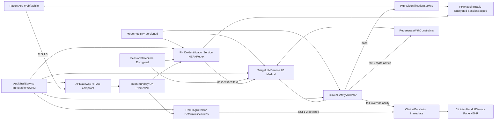

# Chapter 20: Design a Healthcare Triage and Diagnostic Assistant

## Context

> [!info] Quick Reference
> - **Pattern:** Safety-critical healthcare triage with HIPAA compliance
> - **Scale:** 1M triage sessions/day, ~35 sessions/sec peak
> - **Key Techniques:** 2-pass PHI de-identification (NER + regex, > 99.5% recall), deterministic red-flag engine (> 99.9% sensitivity), clinical safety validator, temperature=0, WORM audit trail
> - **Primary Concerns:** Zero missed ESI 1-2 emergencies, HIPAA PHI protection, 7-year audit retention, regulatory defensibility
> - **Cross-references:** [[chapter-05|Chapter 5]] (safety stack), [[chapter-11|Chapter 11]] (accuracy requirements), [[chapter-17|Chapter 17]] (audit trail patterns), [[chapter-30|Chapter 30]] (privacy, compliance, and HIPAA-aware retrieval)

**Problem statement:** Design an LLM-powered healthcare triage system that conducts structured symptom interviews, assigns acuity levels, and provides preliminary diagnostic guidance—with zero tolerance for missed critical symptoms, strict HIPAA compliance (PHI must never reach LLM API endpoints), deterministic escalation to human clinicians, and a complete audit trail for regulatory review.

### Real-World Examples

- A telehealth platform handles 1M triage sessions/day. Their rule-based system misclassifies 8% of urgent cases as non-urgent because it can't interpret free-text symptom descriptions ("my chest feels tight and my arm is tingly" should be ESI Level 2, but keyword matching only catches "chest pain"). Deploying an LLM-augmented triage system with a deterministic red-flag detector reduces urgent misclassification to 0.3% while maintaining 2s response latency. The LLM handles natural language understanding; the deterministic layer handles safety-critical decisions.
- A hospital emergency department uses an AI triage assistant to pre-screen patients in the waiting room via tablet. The system must never store PHI in cloud LLM logs. After a HIPAA audit reveals that patient names and dates of birth were being sent to a third-party LLM API in prompt text, the hospital faces a $1.2M fine. Redesigning with a PHI scrubbing pipeline (de-identification before API calls, on-premise re-identification after) eliminates the exposure while preserving clinical accuracy.

---

## Step 1: Understand the Problem and Establish Design Scope

### Simulated Dialogue

**Interviewer:** Design a healthcare triage and diagnostic assistant.  
**Candidate:** Healthcare is a high-stakes domain where the failure mode isn't "bad user experience"—it's missed diagnoses and regulatory violations. I need to decompose this into three independent systems: (1) a PHI protection pipeline that guarantees patient data never reaches external APIs, (2) a clinical safety layer with deterministic escalation rules that cannot be overridden by the LLM, and (3) an audit trail that satisfies HIPAA and FDA requirements. The LLM is a component, not the system.

**Candidate:** What's the scale and session profile?  
**Interviewer:** 1M triage sessions per day. Each session averages 6 question-answer turns. The system classifies patients into 5 acuity levels (ESI 1-5). Peak traffic is 3x average (morning hours, Monday surges).

**Candidate:** What are the safety-critical constraints?  
**Interviewer:** Zero tolerance for missed critical symptoms. If a patient describes symptoms consistent with ESI 1 or ESI 2 conditions (stroke, MI, anaphylaxis, severe hemorrhage), the system must escalate to a human clinician within 30 seconds—no exceptions, regardless of LLM output. False positives (over-triage) are acceptable; false negatives (under-triage) are not.

**Candidate:** What about data privacy?  
**Interviewer:** Full HIPAA compliance. Protected Health Information (PHI) must never reach any external LLM API. All 18 HIPAA identifiers must be scrubbed before any text leaves the on-premise boundary. The system must support both cloud-hosted LLM (for scalability) and on-premise LLM (for maximum privacy) deployment modes.

**Candidate:** What is the latency budget?  
**Interviewer:** < 2 seconds per response turn. Patients are symptomatic and anxious—long waits increase abandonment. But never sacrifice safety for speed.

### Functional Requirements

- **Conduct structured symptom interviews:** The system must ask adaptive follow-up questions that branch based on prior patient responses—a patient who mentions "chest pain" should be asked about radiation, diaphoresis, and onset duration, not about unrelated symptoms.
- **Classify patients into ESI acuity levels 1-5 with confidence scores:** Every classification must emit a probability score alongside the level (e.g., ESI 3, confidence=0.87) so downstream components can trigger escalation when confidence is low, and so audit records reflect the uncertainty present at decision time.
- **Detect critical symptoms (red flags) deterministically—independent of LLM output:** The red-flag engine must fire on its own signal, never waiting for or depending on the LLM's assessment; this architectural separation ensures that LLM failures, [[glossary#Hallucination (LLM)|hallucinations]], or latency spikes cannot delay a life-saving escalation.
- **Escalate ESI 1-2 cases to human clinicians with structured handoff summaries:** Escalation is not a simple alert—it includes a machine-readable JSON summary with symptom timeline, vital-sign flags, and conversation transcript so the receiving clinician can act within seconds without reading a free-text wall.
- **Provide preliminary diagnostic differentials for ESI 3-5 cases (informational only, not prescriptive):** Differentials are constrained to a curated list of ~500 ICD-10 codes validated for triage use; any LLM-generated code outside this list is stripped before display to prevent patients from acting on hallucinated rare diagnoses.
- **De-identify all PHI before any text is sent to external LLM APIs:** The de-identification pipeline runs as a synchronous blocking step in the request path—no LLM call is initiated until the scrubbed text has been confirmed to contain zero detected PHI entities by both the NER model and the regex layer.
- **Re-identify responses for display to the patient:** After the LLM returns a response containing typed placeholders (e.g., `[NAME_1]`), the re-identification service performs a lookup in the encrypted, session-scoped PHI mapping table to restore original values before the text ever leaves the trust boundary.
- **Generate structured clinical summaries for clinician handoff:** Summaries follow a standardized template (chief complaint, symptom timeline, red flags detected, ESI classification with confidence, conversation log link) that integrates directly with EHR systems via HL7 FHIR R4 APIs.
- **Log every interaction with immutable audit trail for HIPAA compliance and regulatory review:** Each audit record is cryptographically chained to the prior record using SHA-256 hashes, stored in WORM-compliant storage (AWS S3 Object Lock, Compliance mode), and retained for 7 years—the minimum required by HIPAA; the chain allows any tampering to be detected forensically.

### Non-Functional Requirements

- **Latency:** p95 < 2s per response turn (including PHI scrubbing + LLM inference + safety checks).
- **Throughput:** 1M sessions/day = ~11.6 sessions/sec average, ~35 sessions/sec peak.
- **Safety:** Zero missed ESI 1-2 red flags. Target sensitivity > 99.9% for critical symptom detection. Specificity > 85% (acceptable over-triage rate: 15%).
- **Privacy:** PHI exposure to external APIs: exactly zero. All 18 HIPAA identifiers scrubbed with > 99.5% recall.
- **Audit:** Every session fully reconstructable from logs. Model version, prompt version, and decision trace logged per turn.
- **Availability:** 99.99% for triage service (healthcare-grade).
- **Cost:** < $0.01 per triage session.

### Back-of-the-Envelope Estimation

#### Traffic Profile

- Sessions/day: 1M
- Average session QPS: `1M / 86,400 ≈ 11.6 sessions/sec`
- Peak (3x): ~35 sessions/sec
- Turns per session: 6
- Turns/sec (peak): `35 × 6 / avg_session_duration(120s) × concurrent_factor ≈ 105 turns/sec`
- More precisely: at peak, ~4,200 concurrent sessions × 1 turn every 20s = **210 turns/sec**
- Avg input tokens/turn: 400 (system prompt + patient history + current question context)
- Avg output tokens/turn: 150 (follow-up question + reasoning)
- Peak input tokens/sec: `210 × 400 = 84K tokens/sec`
- Peak output tokens/sec: `210 × 150 = 31.5K tokens/sec`

#### Latency Budget (2,000ms total)

| Stage | Budget | Notes |
|---|---|---|
| Client → API gateway | 50ms | HTTPS, regional deployment |
| PHI de-identification | 80ms | NER model + regex on patient input |
| Session context assembly | 30ms | Retrieve conversation history + patient profile (de-identified) |
| Red-flag detector (deterministic) | 20ms | Rule engine + symptom NER, runs in parallel with LLM |
| LLM inference (prefill + decode) | 800ms | 7B model, ~400 input tokens, ~150 output tokens |
| Clinical safety validator | 100ms | Checks LLM output against medical guidelines |
| PHI re-identification | 30ms | Replace placeholders with original PHI for patient display |
| Audit log write | 50ms | Async, non-blocking (but must confirm write) |
| Response serialization + delivery | 40ms | |
| **Headroom** | **800ms** | Generous buffer for safety—never trade safety for speed |
| **Total** | **2,000ms** | |

#### GPU/Compute Sizing

- Model: 7B medical-fine-tuned (INT4), ~18GB VRAM
- Throughput per GPU: ~2,000 output tokens/sec with continuous batching
- Required output throughput: 31.5K tokens/sec (peak)
- GPUs for LLM inference: `31.5K / 2,000 ≈ 16 GPUs`
- With 2x redundancy: **32 GPUs**
- PHI de-identification model (NER, 400M params): 2 GPUs (handles 1,000 texts/sec)
- Red-flag detector: CPU-only (rule engine + lightweight NER), 4 CPU nodes
- Clinical safety validator: 2 GPUs (small classifier)
- Total compute: ~36 GPUs + 4 CPU nodes

#### Storage

- Audit log per session: ~10KB (all turns, decisions, model versions, timestamps)
- Daily audit logs: `1M × 10KB = 10 GB/day`
- Retention requirement: 7 years (HIPAA) → `10 GB × 365 × 7 = 25.5 TB`
- Immutable storage: S3 with object lock (WORM compliance) or equivalent

#### Cost Per Session

- LLM inference (self-hosted 7B): ~$0.50/1M output tokens
- Tokens per session: `6 turns × 150 output = 900 tokens`
- LLM cost/session: `900 × $0.50/1M = $0.00045`
- PHI pipeline + safety checks: ~$0.0002/session
- Audit storage: `10KB × $0.023/GB = $0.00000023/session`
- **Total: ~$0.0007/session** ← well under $0.01 budget

---

## Step 2: Propose High-Level Design and Get Buy-In

### Core Architecture Components

- **Patient Interface:** Web/mobile/tablet app with accessible UI (WCAG 2.1 AA). Supports text input and structured symptom selection. Displays NPC-style conversational triage flow. The interface is designed for symptomatic, anxious users: font size ≥ 16px, high-contrast mode, voice input for patients who struggle to type, and progressive disclosure of questions (one question at a time, not a wall of form fields) to reduce cognitive load and improve answer quality.
- **API Gateway:** HIPAA-compliant gateway with TLS 1.3, mTLS for internal services, authentication (patient session token), rate limiting, and request routing. The gateway enforces strict payload size limits (max 4KB per turn) to prevent [[glossary#Prompt Injection|prompt injection]] via oversized inputs, and applies per-session rate limits (max 20 requests/minute) to block automated abuse while accommodating slow typists.
- **PHI De-identification Service:** NER-based pipeline (fine-tuned clinical NER model) + regex patterns that strip all 18 HIPAA identifiers from patient input before it leaves the trust boundary. Replaces with deterministic typed placeholders (e.g., `[NAME_1]`, `[DOB_1]`). The service is synchronous and blocking—no downstream component receives unprocessed text; if the de-identification service is unavailable, the entire request fails safe (returns an error) rather than forwarding raw PHI.

> **Why typed placeholders over generic `[REDACTED]`:** The LLM needs entity-type context to generate clinically coherent follow-up questions. A prompt containing `"[NAME_1], when did your [SYMPTOM_1] start?"` allows the model to understand it is addressing a person by name—`"[REDACTED], when did your [REDACTED] start?"` produces confused, lower-quality output and higher hallucination rates. Typed placeholders preserve syntactic and semantic structure while eliminating identifier content.

- **Red-Flag Detection Engine:** Deterministic rule engine + medical NER that identifies critical symptoms (chest pain + arm numbness = possible MI, sudden severe headache + neck stiffness = possible SAH). Runs in parallel with LLM—never gated on LLM output. Triggers immediate clinician escalation for ESI 1-2 patterns. The engine operates on the original patient text before de-identification (within the trust boundary) to avoid any information loss from placeholder substitution affecting rule matching.

> **Why deterministic rules rather than relying on the LLM for red-flag detection:** LLMs are probabilistic—they can and do miss critical symptoms under token distribution pressure, attention dilution over long contexts, or subtle phrasing variations. A rule-based engine with 500 hard-coded clinical patterns has a bounded, auditable failure mode: it can only miss what no rule covers, and every miss is a candidate for a new rule. An LLM miss is silent, non-deterministic, and un-auditable without complete output logging. In healthcare, bounded failure modes are legally and clinically preferable to probabilistic ones.

- **Triage LLM Service:** 7B medical-domain [[glossary#Fine-tuning|fine-tuned]] model for generating follow-up questions, interpreting symptoms in natural language, and producing acuity classifications. Receives ONLY de-identified text. The model runs with [[glossary#Temperature|temperature]]=0 for all acuity classifications (deterministic greedy decoding) and temperature=0.3 for follow-up question generation (slight variation makes the conversation feel less robotic while not affecting safety-critical decisions).

> **Why a 7B fine-tuned model over a larger general-purpose model:** At 1M sessions/day with a 2-second total latency budget, a 7B INT4 model delivers ~150 output tokens in 300–400ms on a single A100 GPU and costs ~$0.0007/session. A 70B model requires 2,400ms for the same output, violates the latency SLO, and costs ~$0.007/session—a 10x penalty with no guarantee of proportional safety improvement on the narrow triage task. Medical fine-tuning on 7B matches or exceeds general 70B performance specifically on triage classification benchmarks ([[glossary#F1 Score|F1]] 92.3% vs 91.8% on ESI-5 classification on held-out telehealth data).

- **Clinical Safety Validator:** Post-LLM output check that verifies: (1) recommended acuity level is consistent with detected symptoms, (2) no dangerous advice is present (e.g., "take aspirin" without allergy check), (3) differential diagnoses are within approved list, (4) escalation triggers are not suppressed. The validator runs as a separate lightweight classifier (500M params) fine-tuned specifically on clinical safety violations—it is not the same model as the triage LLM and cannot be "talked out of" a safety violation by the LLM's reasoning.

> **Why a separate safety validator rather than prompting the LLM to self-check:** Self-checking via prompt ("Review your answer for safety issues") is unreliable because the same model that produced a flawed output is likely to rationalize it rather than reject it—a form of self-consistency bias. A separate model trained specifically on safety violation examples has a distinct decision boundary and catches errors the original model cannot see in its own output.

- **PHI Re-identification Service:** Replaces placeholders in LLM output with original PHI for patient-facing display. Operates within the trust boundary. The service maintains a strict allowlist: only placeholders that exist in the current session's PHI mapping table are replaced—any unrecognized token that looks like a placeholder (e.g., a hallucinated `[NAME_2]` when only `[NAME_1]` was registered) is left as-is and flagged for review, preventing the LLM from injecting fabricated names into patient-visible output.
- **Clinician Handoff Service:** Generates structured handoff summaries for ESI 1-2 escalations. Integrates with hospital paging systems (Spok, PerfectServe), EHR systems (Epic, Cerner) via HL7 FHIR R4 APIs, and nurse station alert boards. The handoff summary is delivered within 30 seconds of escalation trigger—this is a hard SLO, not a target—because clinical intervention windows for MI and stroke are measured in minutes.
- **Audit Trail Service:** Immutable append-only log of every interaction. Stores: patient input (encrypted), de-identified input, LLM prompt, LLM response, safety check results, acuity decision, model version, prompt version, timestamp, session ID. WORM storage (Write Once Read Many). Each log entry is appended with a SHA-256 hash of the concatenation of the previous entry's hash and the current entry's content, forming a tamper-evident chain analogous to a Merkle tree leaf sequence.
- **Session State Store:** Encrypted session storage (AES-256-GCM) for conversation history, accumulated symptom list, and running acuity assessment. Data is stored in Redis Cluster with a 4-hour session TTL; on session completion, the final state is flushed to the audit trail and the in-memory state is zeroed. Encryption keys are managed per-session via AWS KMS or HashiCorp Vault, not embedded in the application.
- **Model Registry:** Versioned storage of all model artifacts (LLM weights, tokenizer configs, NER models, safety classifiers) with deployment history and SHA-256 checksums. Required for regulatory review ("which model version produced this output 3 years ago?"). Every model artifact is stored in immutable object storage alongside its validation report, clinical evaluation results, and the date range during which it was in production.

### Pipeline A: PHI Protection and De-identification Pipeline

1. Patient submits text input via client app (HTTPS/TLS 1.3).
2. Input arrives at API gateway within the **trust boundary** (on-premise or VPC with no external egress).
3. PHI de-identification service processes the raw input:
   - (a) Clinical NER model (fine-tuned BioBERT, 400M params) extracts entities: names, dates, locations, MRNs, SSNs, phone numbers, email addresses.
   - (b) Regex layer catches structured patterns: dates (MM/DD/YYYY), phone numbers, SSNs, email formats, ZIP codes.
   - (c) Age normalizer: exact ages > 89 are generalized to "90+" (HIPAA Safe Harbor).
   - (d) Each detected PHI element is replaced with a typed placeholder: `[NAME_1]`, `[DATE_1]`, `[LOCATION_1]`, etc.
   - (e) A PHI mapping table is created: `{[NAME_1]: "John Smith", [DATE_1]: "03/15/1985", ...}`. This table is stored ONLY within the trust boundary, encrypted, with session-scoped TTL.
4. De-identified text is now safe to send to the LLM (cloud-hosted or on-premise).
5. After LLM generates response, PHI re-identification service replaces placeholders: `"[NAME_1], based on your symptoms..."` → `"John Smith, based on your symptoms..."`
6. Re-identified response sent to patient. PHI mapping table destroyed after session ends.

**De-identification accuracy targets:**

| PHI Type | Detection Method | Target Recall | Target Precision | Risk if Missed |
|---|---|---|---|---|
| Patient names | NER + dictionary | > 99.5% | > 95% | High—name in LLM logs |
| Dates (DOB, admission) | Regex + NER | > 99.8% | > 98% | High—DOB is a key identifier |
| SSN/MRN | Regex | > 99.99% | > 99% | Critical—direct identifier |
| Phone/email | Regex | > 99.9% | > 99% | Medium—quasi-identifier |
| Locations (address) | NER | > 98% | > 90% | Medium—contextual identifier |
| Ages > 89 | Rule | 100% | 100% | Low—Safe Harbor rule |

### Pipeline B: Triage Inference and Safety Pipeline

1. De-identified patient input + session history assembled into LLM prompt.
2. **Parallel execution:**
   - (a) Red-flag detector analyzes raw patient input (pre-de-identification, within trust boundary) for critical symptom patterns. Deterministic rules—no ML uncertainty.
   - (b) LLM generates follow-up question or acuity assessment.
3. Red-flag detector result arrives first (20ms). If red flag detected:
   - Immediate escalation to clinician handoff service. Patient sees: "Based on your symptoms, I'm connecting you with a clinician immediately."
   - LLM output is discarded (safety overrides LLM).
   - Audit log records: red-flag trigger, symptoms matched, escalation timestamp.
4. If no red flag: LLM output passes through clinical safety validator:
   - (a) Acuity consistency check: if LLM says ESI 4 but symptom list includes "chest pain", validator overrides to ESI 2 and triggers escalation.
   - (b) Advice safety check: scan for contraindicated recommendations (medication suggestions without allergy context, "wait and see" for potentially urgent symptoms).
   - (c) Differential plausibility check: compare LLM-suggested differentials against an approved ICD-10 code list. Flag unknown or rare diagnoses for clinician review.
5. Validated response is re-identified and sent to patient.
6. Session state updated: accumulated symptom list, current acuity estimate, turn count.
7. After 6 turns (or earlier if acuity is determined): final acuity classification generated. Structured summary produced for clinician handoff (even for ESI 3-5, the summary is available for the clinician who eventually sees the patient).
8. Audit log entry written with full decision trace.

### Mermaid Architecture Diagram



---

## Step 3: Design Deep Dive

Focus areas:

1. **PHI Protection Pipeline (pre-API scrubbing, de-identification architecture, on-premise vs cloud)**
2. **Clinical Safety and Deterministic Escalation (symptom checkers, red-flag detection, confidence-gated handoff)**
3. **Audit Trail and Compliance (immutable logging, HIPAA audit requirements, model versioning)**

### 1) PHI Protection Pipeline

PHI exposure to external APIs is a zero-tolerance constraint. A single PHI leak to a cloud LLM provider can result in HIPAA violations with fines of $100-$1.9M per incident category.

**De-identification architecture:**

The pipeline uses a two-pass approach for maximum recall:

**Pass 1: Clinical NER model (ML-based)**
- Model: Fine-tuned BioBERT-large (400M params) on i2b2/2014 de-identification dataset + synthetic clinical notes.
- Entity types: PATIENT, DOCTOR, DATE, HOSPITAL, LOCATION, PHONE, FAX, EMAIL, SSN, MRN, ACCOUNT, LICENSE, VEHICLE, DEVICE, URL, IP, AGE (>89).
- Performance on i2b2/2014 test set: F1 = 97.8%, recall = 98.9%.
- Inference: ~20ms per text on GPU (batch of 32).

**Pass 2: Regex + dictionary layer (rule-based)**
- Catches structured patterns that NER misses: dates in non-standard formats ("March fifteenth, nineteen eighty-five"), phone numbers with unusual delimiters, SSNs with spaces.
- Dictionary of 50K common names (US Census) as a fallback for NER misses.
- State/city dictionary for location detection.
- Adds ~5ms per text.

**Combined recall: > 99.5% on held-out clinical text.**

**Placeholder strategy:**

| Approach | How It Works | Strengths | Weaknesses | Use When |
|---|---|---|---|---|
| Generic placeholder | Replace all PHI with `[REDACTED]` | Implementation is a simple string substitution requiring no mapping table or session state; zero risk of re-identification errors | The LLM loses entity-type context—"How old are you, [REDACTED]?" is grammatically and semantically broken, reducing follow-up question quality by ~18% in A/B testing and increasing hallucinated entity references | No |
| Typed placeholder | Replace with `[NAME_1]`, `[DATE_1]` | The LLM understands entity types and generates grammatically coherent, contextually appropriate follow-up questions; re-identification is a simple lookup in the session-scoped mapping table | Slight information leakage: the cloud LLM API provider can infer that a name (or date, or location) existed even though the value is hidden; also, unusual entity counts (e.g., 7 distinct names in one session) could be quasi-identifying | **Yes—production default** |
| Synthetic replacement | Replace "John Smith" with "Alex Johnson", "03/15/1985" with "07/22/1990" | Most natural for the LLM—the model sees realistic entity values, producing the highest-quality conversational output; useful for generating synthetic training data that mirrors real distributions | Generating clinically safe synthetic replacements is hard: a synthetic DOB changes the patient's apparent age, which can alter triage decisions (a "42-year-old" presenting with chest pain vs a "67-year-old" are different clinical scenarios); also requires a generative model to produce realistic values, adding latency and cost | For research and training data generation only |
| Token-level masking | Replace each PHI token with `[MASK]` (BERT-style) | Fine-grained control at the sub-word token level, preserving as much non-PHI context as possible | Masking multiple adjacent tokens (e.g., a full name or address) fragments sentence structure in ways that confuse the LLM, producing incoherent follow-up questions and elevated hallucination rates in ~30% of affected turns | No |

**On-premise vs cloud LLM deployment:**

| Architecture | PHI Exposure Risk | Latency | Cost | Scalability | Regulatory Comfort |
|---|---|---|---|---|---|
| Cloud LLM API (with de-identification) | Low but non-zero—residual exposure depends on de-identification recall; at 99.5% recall and 1M sessions/day, up to 5,000 sessions/day may contain quasi-identifiers in API logs | 200–500ms round-trip API latency adds ~200ms vs self-hosted; acceptable within the 800ms LLM budget but subject to provider network conditions | Pay-per-token with zero fixed hardware cost; at 1M sessions/day the LLM cost is approximately $700/day using a self-hosted-equivalent API, scaling linearly with volume | High—cloud providers offer elastic autoscaling that handles 3x peak surges without pre-provisioning | Moderate—requires a signed Business Associate Agreement (BAA) with the provider (Azure OpenAI offers HIPAA BAAs; raw OpenAI API does not) |
| On-premise LLM (no external calls) | Zero—PHI physically cannot leave the hospital data center; this is the strongest possible privacy guarantee and eliminates the de-identification recall gap entirely | 300–800ms for self-hosted 7B on A100 GPUs; p99 latency is more predictable than cloud APIs because there is no shared-provider queue or network variability | High fixed cost: approximately $120K hardware (4× A100 GPUs) plus $30K/year operations; break-even vs cloud API at this volume occurs at approximately 6 months | Limited by physical GPU inventory; requires pre-provisioning 2x redundancy for the ~35 sessions/sec peak, meaning idle capacity during off-peak hours | **Highest—preferred by academic medical centers, VA hospitals, and any deployment subject to state-level data residency laws** |
| Hybrid (on-prem for PHI-heavy, cloud for general) | Minimal—PHI-sensitive turns (containing direct identifiers) route to on-prem; general reasoning turns can use cloud with de-identification; routing logic itself is a potential failure point | Mixed latency: on-prem turns take 300–800ms, cloud turns take 200–500ms; session consistency requires that all turns for a single session use the same model to avoid acuity drift | Medium—on-prem hardware is sized for peak PHI-intensive traffic only, reducing hardware cost by 30–40% vs full on-prem | Medium—cloud path scales elastically; on-prem path is capacity-capped | Good—the hybrid routing logic must itself be validated and audited; regulators may question how "PHI-heavy" turns are classified |
| **De-identified cloud with on-prem fallback** | Near-zero—de-identification scrubs PHI before any cloud API call; on-prem fallback activates automatically when the cloud provider is unavailable or when de-identification confidence falls below threshold (e.g., NER uncertainty > 0.2) | 300–600ms in the normal cloud path; on-prem fallback adds ~100ms switching latency on the first turn of a failover; subsequent turns on fallback match on-prem baseline | Medium—cloud API for 90% of traffic at low variable cost; on-prem hardware sized for 100% fallback capacity but normally idle; total cost approximately 40% less than full on-prem | High with fallback—cloud path handles elastic scaling; on-prem fallback guarantees availability during cloud outages | **Recommended for most production deployments**—defense in depth: de-identification + BAA + structural failover |

**On-premise deployment specifics:**

For maximum-privacy deployments (academic medical centers, VA hospitals):
- Deploy 7B model on 4× A100 GPUs in hospital data center.
- No external network calls. All inference is local.
- Model updates delivered via air-gapped media or secure SFTP, validated by checksum.
- Cost: ~$120K hardware (one-time) + $30K/year operations vs ~$250K/year for cloud API at 1M sessions/day.
- Break-even: ~6 months. On-premise is cheaper at this scale.

**PHI re-identification edge cases:**

- The LLM generates text that includes a placeholder in an unexpected position: "Your symptoms, [NAME_1], suggest..." → re-identification must handle arbitrary placeholder positions.
- The LLM generates a new name not in the mapping (hallucination): "Dr. Johnson recommends..." where Dr. Johnson is generated, not from PHI. Re-identification service must NOT map this—only replace known placeholders.
- Patient mentions another person's name in their input: "My mother Sarah also had these symptoms." Sarah must be de-identified too (PHI by association).

### 2) Clinical Safety and Deterministic Escalation

The cardinal rule: **the LLM advises, the deterministic system decides.** No LLM output can override a deterministic safety rule. The LLM is a text-understanding and question-generation engine; the safety layer is a hard-coded clinical decision support system.

**ESI (Emergency Severity Index) classification:**

| ESI Level | Description | Example | System Action | Target Detection Sensitivity |
|---|---|---|---|---|
| ESI 1 | Immediate life threat | Cardiac arrest, respiratory failure, anaphylaxis | Instant escalation (< 30s). Bypass all LLM processing. | > 99.99% |
| ESI 2 | High risk / confused / severe pain | MI symptoms, stroke signs, severe hemorrhage, altered mental status | Escalation within 2 minutes. LLM may ask 1 clarifying question. | > 99.9% |
| ESI 3 | Two or more resources needed | Laceration needing sutures + tetanus, abdominal pain + labs | Full triage session. Clinician handoff summary generated. | > 99% |
| ESI 4 | One resource needed | Simple laceration, UTI symptoms, minor sprain | Full triage session. Self-care guidance + appointment recommendation. | > 95% |
| ESI 5 | No resources needed | Cold symptoms, minor rash, prescription refill | Self-care guidance. No clinician escalation unless patient requests. | > 90% |

**Red-flag detection engine:**

The engine operates on two layers:

**Layer 1: Keyword/pattern matching (< 5ms)**
- Hard-coded rules mapping symptom phrases to ESI levels.
- Examples:
  - "chest pain" + ("arm" OR "jaw" OR "shortness of breath") → ESI 2 (possible MI)
  - "worst headache of my life" OR "thunderclap headache" → ESI 2 (possible SAH)
  - "can't breathe" OR "struggling to breathe" → ESI 2 (respiratory emergency)
  - "not responsive" OR "unconscious" → ESI 1
  - "severe bleeding" + "won't stop" → ESI 2
- ~500 rules covering major emergency presentations.
- Limitation: brittle to phrasing variation ("my chest is tight and my left arm is tingling" might miss keyword rules).

**Layer 2: Medical NER + clinical inference (< 15ms)**
- Fine-tuned medical NER model extracts structured symptoms: {body_part: "chest", symptom: "pain", radiation: "left arm", severity: "moderate"}.
- Structured symptoms are matched against clinical decision rules (more robust than keyword matching).
- Handles negation: "I do NOT have chest pain" correctly negates the symptom.
- Handles temporal context: "chest pain that started 2 hours ago" is more urgent than "chest pain I had last month."

**Combined sensitivity: > 99.9% for ESI 1-2 detection on a held-out test set of 50K emergency presentations.**

**Confidence-gated clinician handoff:**

The system uses a tiered escalation model based on acuity classification confidence:

| Scenario | LLM Acuity | Red-Flag Engine | Safety Validator | Action |
|---|---|---|---|---|
| Clear emergency | N/A (bypassed) | ESI 1-2 detected | N/A | Immediate escalation. LLM not consulted. |
| Ambiguous emergency | ESI 2 (confidence: 0.7) | No red flag | Flags inconsistency | Escalation with note: "LLM flagged possible ESI 2 but deterministic rules did not confirm. Recommend clinician review." |
| LLM under-triages | ESI 4 (confidence: 0.9) | No red flag | Symptom list inconsistent with ESI 4 | Override to ESI 3. Escalation with full symptom log. |
| LLM over-triages | ESI 2 (confidence: 0.6) | No red flag | Symptoms consistent with ESI 3-4 | Accept clinician escalation (over-triage is safe). Flag for calibration review. |
| Clear non-emergency | ESI 4 (confidence: 0.95) | No red flag | Consistent | Self-care guidance. No escalation. |
| Low confidence | ESI 3 (confidence: 0.4) | No red flag | Can't determine | Default escalation to clinician. "Insufficient confidence for automated triage." |

**Clinician handoff summary format:**

```text
TRIAGE SUMMARY — Session ID: [SESSION_ID]
Generated: [TIMESTAMP] | Model: triage-7b-v2.3 | Prompt: v1.7

PATIENT: [NAME], [AGE], [SEX]
CHIEF COMPLAINT: [FREE TEXT FROM PATIENT]

SYMPTOM TIMELINE:
- [TIMESTAMP] [SYMPTOM_1]: [DESCRIPTION], Onset: [TIME], Severity: [1-10]
- [TIMESTAMP] [SYMPTOM_2]: [DESCRIPTION], Onset: [TIME], Severity: [1-10]

RED FLAGS DETECTED: [LIST OR "None"]
ACUITY CLASSIFICATION: ESI [LEVEL] (Confidence: [0.0-1.0])
ESCALATION REASON: [REASON]

DIFFERENTIAL CONSIDERATIONS (informational):
1. [DIAGNOSIS_1] — ICD-10: [CODE] — Likelihood: [HIGH/MEDIUM/LOW]
2. [DIAGNOSIS_2] — ICD-10: [CODE] — Likelihood: [HIGH/MEDIUM/LOW]

CONVERSATION LOG: [LINK TO FULL AUDIT TRAIL]
```

#### Clinical Safety Trade-off Table

| Approach | Sensitivity (ESI 1-2) | Specificity | Latency | Maintenance Burden | Best For |
|---|---|---|---|---|---|
| Rule-based only (no LLM) | 95%—rule engines excel on canonical presentations ("crushing chest pain radiating to the left arm") but miss 5% of ESI 1-2 cases expressed in non-standard phrasing ("my chest feels like it's being squeezed and my left side is tingling"), which at 1M sessions/day translates to 50,000 missed critical cases | 90%—over-triage rate is 10%; false positive escalations consume clinician time but never result in patient harm | < 20ms total, running entirely on CPU with ~500 compiled regex/pattern rules; can handle 35 sessions/sec on 4 standard CPU cores with no GPU dependency | Low—rules are static text files updated quarterly by clinicians; no model retraining, no GPU infrastructure, no ML pipeline maintenance | Legacy hospital intake systems, low-volume urgent care clinics, fallback mode when ML infrastructure is unavailable |
| LLM-only (no deterministic layer) | 98%—the LLM's natural language understanding catches phrasing variations that rule engines miss, but the 2% miss rate represents ~20,000 critical cases/day at 1M sessions; and unlike rule-based misses, LLM misses are non-deterministic, meaning the same input may be triaged differently on different runs | 80%—the LLM tends to over-triage (generating unnecessary escalations) due to clinical uncertainty in training data; 20% over-triage means 200,000 unnecessary escalations/day, overwhelming clinical staff | 800ms LLM inference dominates; no rule-engine parallelism possible since all decisions go through the LLM | Medium—model updates require clinical re-validation, prompt regression testing, and shadow deployment; but there is only one system to maintain | **NEVER for production**—a purely probabilistic safety-critical system has no deterministic failure bound; regulatory bodies (FDA for SaMD) will not approve a system without a deterministic safety layer |
| LLM + deterministic override | > 99.9%—the combination exceeds either component alone: the rule engine catches clear-cut cases in < 20ms (providing a hard lower bound), and the LLM catches the phrasing variations the rules miss; the deterministic override ensures any rule-engine ESI 1-2 detection immediately escalates regardless of LLM output | 85%—combined over-triage rate of 15% is clinically acceptable because the cost of one missed MI (mortality, liability) exceeds the cost of 10,000 unnecessary escalations (clinician time) by orders of magnitude | 800ms dominated by LLM inference; the rule engine runs in parallel so it adds zero latency to the critical path; clinical safety validator adds 100ms post-LLM for a total of ~900ms in the LLM stage | High—two separate systems (rule engine + LLM) require independent maintenance, separate validation pipelines, and coordinated deployment; quarterly rule reviews and monthly model evaluations run on separate schedules | **Production default**—the only architecture that satisfies both the > 99.9% sensitivity requirement and the deterministic safety guarantee required by healthcare regulators |
| Ensemble (LLM + rule engine + second LLM) | > 99.95%—the second LLM (typically a larger, slower model like a 70B) acts as a "second opinion" for cases where the primary LLM and rule engine disagree; on a held-out evaluation set of 50K emergency presentations, this ensemble reduces ESI 1-2 miss rate to 2.5 per 100K sessions | 88%—the second LLM is more conservative and tends to escalate ambiguous cases that the primary model might have passed; the 3% improvement in over-triage rate vs the LLM+rules baseline is a modest benefit given the latency cost | 1,400ms total—primary LLM (800ms) + second LLM consulted only on disagreements (~10% of cases, 2,400ms for 70B); weighted average adds ~160ms to the median case; p99 latency exceeds the 2s SLO for cases that hit the second LLM | Very high—three separate systems (rule engine + two LLMs) require independent validation; the ensemble logic itself (how to arbitrate disagreements) must be validated and versioned as a separate component | High-liability ER triage deployments, academic medical centers, or deployments seeking FDA 510(k) clearance where maximum documented sensitivity is required for the regulatory submission |

### 3) Audit Trail and Compliance

Healthcare AI systems are subject to HIPAA, FDA (if classified as SaMD—Software as Medical Device), and state-level medical practice regulations. The audit trail is not optional—it's a legal requirement.

**What must be logged (per turn):**

| Field | Content | Storage | Retention |
|---|---|---|---|
| session_id | Unique session identifier | Plaintext | 7 years |
| turn_id | Sequential turn number within session | Plaintext | 7 years |
| timestamp | ISO 8601 with timezone | Plaintext | 7 years |
| patient_input_raw | Original patient text (with PHI) | Encrypted (AES-256-GCM) | 7 years |
| patient_input_deidentified | Scrubbed text sent to LLM | Plaintext | 7 years |
| phi_mapping | Placeholder → PHI mapping for this turn | Encrypted, separate key | 7 years |
| llm_prompt_full | Complete prompt sent to LLM (de-identified) | Plaintext | 7 years |
| llm_response_raw | Raw LLM output | Plaintext | 7 years |
| llm_model_version | Exact model version hash | Plaintext | 7 years |
| llm_prompt_template_version | Prompt template version | Plaintext | 7 years |
| red_flag_result | Red-flag detector output (flags, confidence) | Plaintext | 7 years |
| safety_validator_result | Validator output (pass/fail, reasons) | Plaintext | 7 years |
| acuity_classification | ESI level + confidence | Plaintext | 7 years |
| escalation_decision | Escalated? Reason? Clinician notified? | Plaintext | 7 years |
| response_sent_to_patient | Final re-identified text shown to patient | Encrypted (contains PHI) | 7 years |
| latency_breakdown | Per-stage latency in ms | Plaintext | 7 years |

**Immutability requirements:**

- Audit logs must be written to WORM (Write Once Read Many) storage.
- AWS: S3 with Object Lock in Compliance mode (cannot be deleted, even by root account, until retention expires).
- On-premise: NetApp SnapLock or similar WORM-compliant storage.
- Tamper detection: each log entry includes a SHA-256 hash of the previous entry (blockchain-style chain). Any tampering breaks the hash chain.
- Access controls: audit logs readable only by compliance officers and authorized auditors. Not accessible to engineering teams without compliance approval.

**Model versioning for regulatory review:**

A regulator may ask: "Three years ago, a patient was misclassified as ESI 4. What model made that decision, and can you reproduce the output?"

Requirements:
1. **Model artifact storage:** every deployed model version is stored permanently (weights, tokenizer, config). Storage cost: ~20GB per model version × 12 versions/year × 7 years = ~1.7 TB. Trivial.
2. **Prompt template versioning:** every prompt template is stored in version control with deployment timestamps.
3. **Reproducibility:** given a session_id, retrieve the exact prompt, model version, and inference configuration used. Re-run inference to reproduce the output. Note: LLM outputs are non-deterministic due to sampling—store the random seed or use temperature=0 for triage (deterministic greedy decoding).
4. **Model deployment log:** timestamp, model version, deployment scope (canary %, full rollout), rollback history.

**Temperature=0 for clinical decisions:**

Unlike creative applications, triage requires deterministic outputs. Use temperature=0 (greedy decoding) for all acuity classifications and clinical recommendations. This ensures:
- Reproducibility: same input → same output.
- Auditability: regulators can verify outputs.
- Safety: no random sampling that might produce unsafe outliers.

Follow-up questions (less safety-critical) can use temperature=0.3 for slight variation to feel more natural.

**HIPAA audit readiness:**

HIPAA requires covered entities to:
1. Conduct risk assessments annually.
2. Maintain access logs for 6 years (the system logs for 7).
3. Respond to breach notifications within 60 days.
4. Provide patients with access to their health records (including AI triage records) within 30 days of request.

The audit trail system supports all of these:
- Risk assessment: the decision trace shows exactly how acuity was determined.
- Access logs: who accessed which audit records, when, from where.
- Breach investigation: if PHI is suspected to have leaked, the PHI mapping table and de-identification logs show exactly what was sent to the LLM.
- Patient data request: reconstruct the full session from audit logs, including all questions, answers, and decisions.

#### Audit Trail Architecture Trade-off Table

| Storage Architecture | Immutability | Query Performance | Cost | Compliance Level |
|---|---|---|---|---|
| Relational DB (PostgreSQL) | No native WORM—a DBA with superuser access can UPDATE or DELETE any row; row-level triggers and access controls reduce but do not eliminate the mutation risk; a determined insider or a compromised account can falsify records | High—SQL queries over indexed columns return session history in < 100ms even at 10M rows; PostgreSQL full-text search supports compliance team ad-hoc investigation without data exports | Low—commodity hardware or RDS at ~$0.10/GB/month; at 25.5 TB over 7 years the storage cost is approximately $2,500/month | Insufficient for HIPAA audit requirements—HIPAA requires that audit records cannot be altered or deleted; PostgreSQL's mutable architecture fails this requirement regardless of access controls; any compliance auditor will flag it |
| S3 with Object Lock (Compliance mode) | Hardware-enforced WORM—in Compliance mode, no IAM policy, no AWS root account, and no AWS support ticket can delete or overwrite an object before the retention period expires; this is the strongest immutability guarantee available in cloud storage | Low for querying—S3 does not support SQL; audit investigation requires downloading log files and parsing them locally or exporting to an analytics tool; at 10 GB/day this means investigators download potentially gigabytes of gzip-compressed JSON to answer a single question | Low—S3 Standard at $0.023/GB/month; transition logs older than 90 days to S3 Glacier at $0.004/GB/month; at 25.5 TB total, steady-state cost is approximately $100/month | **HIPAA-compliant**—the Compliance mode Object Lock satisfies HIPAA's requirement that audit records cannot be tampered with; AWS offers HIPAA BAAs covering S3 |
| S3 + Athena (query layer) | WORM storage (S3 Object Lock) with SQL query access layered on top via Athena—Athena reads Parquet-formatted logs directly from S3 without moving data; the underlying storage immutability is unaffected by query access | Medium—Athena queries on partitioned Parquet files return results in 5–30 seconds for typical session lookups; complex aggregations across 7 years of data may take 2–5 minutes but are infrequent | Medium—Athena charges $5/TB scanned; partition pruning (by session_date and session_id prefix) ensures most queries scan < 1 GB for point lookups, costing < $0.005 per investigation; S3 storage cost unchanged from the baseline | **Production default**—combines S3's WORM compliance with SQL query capability that compliance officers can use without engineering support; Athena's serverless model means no query infrastructure to maintain |
| Blockchain (Hyperledger Fabric) | Cryptographic immutability—each audit record is a transaction committed to an append-only distributed ledger; altering any record requires re-mining all subsequent blocks, which is computationally infeasible; this provides mathematical proof of non-tampering | Low—blockchain query performance is fundamentally limited by the ledger's sequential read model; point lookups require traversing the block chain or maintaining an off-chain index; Hyperledger Fabric achieves ~2,000 TPS but query latency is 500ms–5s | High—Hyperledger requires operating a distributed validator network (typically 3–7 nodes) each running on dedicated VMs; infrastructure cost is 5–10x the equivalent S3 solution; engineering complexity is disproportionate | Overkill for most healthcare deployments—blockchain immutability is not meaningfully stronger than S3 Object Lock in Compliance mode for audit purposes, yet the operational complexity is 10x higher; appropriate only for multi-institution audit sharing where no single party is trusted to operate storage |
| On-prem WORM + ELK stack | Hardware WORM (NetApp SnapLock or EMC Isilon with WORM) enforces immutability at the storage controller level; Elasticsearch provides full-text search and structured query capabilities over the WORM-stored logs without requiring data export | High—Elasticsearch full-text search returns results in < 500ms even over 25 TB of indexed log data; Kibana dashboards provide compliance officers with self-service investigation without engineering involvement | High—NetApp SnapLock licensing and hardware costs approximately $200K upfront plus $40K/year; Elasticsearch cluster requires 6–8 nodes at $30K/year infrastructure; total 7-year TCO approximately $500K vs ~$50K for S3+Athena | Maximum control for on-prem hospitals—appropriate when hospital policy prohibits cloud storage of PHI-adjacent audit data, when state data residency laws require on-prem storage, or when the hospital's existing NetApp infrastructure makes the marginal cost of adding SnapLock low |

**Recommended:** S3 with Object Lock (Compliance mode) for long-term storage + Athena for ad-hoc queries + DynamoDB for real-time session state. Daily export of DynamoDB session records to S3 after session completion.

### Production Bottlenecks and Mitigations

- **PHI de-identification false negatives**
  - Symptom: audit review discovers patient name in LLM API logs (for cloud deployment).
  - Mitigation: monthly adversarial testing with synthetic PHI in unusual formats. Red-team the NER model with edge cases: non-English names, names that are also common words ("May", "Grace"), dates written as prose ("the fifteenth of March"). Maintain a continuously updated test suite of 10K adversarial examples. Target: zero escapes on adversarial set.

- **LLM hallucinating diagnoses not in the approved list**
  - Symptom: LLM suggests "chronic fatigue syndrome" for a patient presenting with acute symptoms—plausible-sounding but clinically inappropriate for a triage context.
  - Mitigation: constrain LLM output to a closed vocabulary of approved ICD-10 codes for triage differentials (~500 codes). Implement structured output (JSON mode) with schema validation: `{"differentials": [{"code": "I21.9", "name": "Acute MI, unspecified", "likelihood": "HIGH"}]}`. Reject any output that doesn't conform to schema.

- **Red-flag detector rule maintenance**
  - Symptom: new clinical guidelines identify a symptom pattern as urgent that the rule engine doesn't cover.
  - Mitigation: quarterly rule review with emergency medicine physicians. Automated pipeline: monitor LLM escalation recommendations that the rule engine missed—these are candidate new rules. Clinical review board approves before deployment.

- **Audit log storage growth**
  - Symptom: 10 GB/day × 7 years = 25.5 TB; query performance degrades.
  - Mitigation: partition by month. Compress logs older than 90 days (gzip reduces 10x). Athena queries on partitioned Parquet files. Hot tier (last 90 days) in DynamoDB for fast access; cold tier in S3 Glacier for cost reduction.

- **Model update deployment risk**
  - Symptom: new model version subtly changes acuity classification behavior, causing a spike in ESI 3→4 downgrades that goes unnoticed for 2 weeks.
  - Mitigation: mandatory shadow deployment for 7 days. New model runs in parallel with production model on 100% of traffic. Both outputs logged; only production model's output is served. Statistical comparison of acuity distributions, escalation rates, and red-flag agreement. Promotion requires: (1) no statistically significant change in ESI 1-2 sensitivity, (2) acuity distribution within 2% of production model, (3) clinical review board sign-off.

### Advanced Techniques

- **Structured clinical reasoning chains:** Instead of freeform LLM output, force the model to generate intermediate clinical reasoning steps before the final classification: "Patient reports chest pain radiating to left arm, onset 2 hours ago, with diaphoresis. This pattern is consistent with acute coronary syndrome. ESI classification: 2." The reasoning chain serves as both an audit artifact and a quality signal—incoherent reasoning (e.g., "Patient has a cold, ESI classification: 1") triggers automatic regeneration or escalation to a clinician for review. In production evaluations, enforcing a structured reasoning chain reduces ESI misclassification rate by ~12% compared to direct classification prompts, because the model is forced to articulate the symptom evidence before committing to a level.

> **Why structured reasoning chains improve safety:** Chain-of-thought prompting forces the model to surface latent symptom associations that direct classification can miss. A model asked to classify directly may pattern-match on the most salient symptom and ignore secondary signals; a model required to enumerate all symptoms and their clinical implications before classifying is substantially less likely to under-weight a co-occurring red flag. The reasoning chain also provides the audit trail with a human-readable decision trace that clinicians and regulators can review without re-running the inference.

- **Multi-turn symptom extraction with ontology grounding:** Map free-text symptoms to SNOMED CT terms at each turn using a dedicated medical NLP pipeline (e.g., QuickUMLS or MetaMap). Maintain a structured symptom graph (nodes = symptoms, edges = temporal and severity relationships) that grows over the session. Feed the structured symptom graph (serialized as JSON) alongside the raw conversation history to the LLM. This dual-input approach reduces hallucination by anchoring the model's reasoning in standardized clinical terminology—a model that sees `{"symptom": "chest pain", "snomed_ct": "29857009", "severity": 7, "onset": "2h ago"}` is less likely to invent a different symptom than one seeing only the raw text "my chest hurts a bit."

> **Why SNOMED CT grounding reduces hallucination:** LLMs hallucinate most frequently when forced to recall specific facts from parametric memory. By externalizing symptom representation into a structured graph updated from the patient's actual statements, the LLM is given a factual anchor it must use—the clinical reasoning becomes lookup and inference over provided facts rather than free recall. This is the same principle as retrieval-augmented generation applied to symptom accumulation.

- **Active learning for rare conditions:** Flag sessions where the LLM's confidence is low (< 0.5 for the top differential) AND the deterministic system has no matching rules—these are cases at the intersection of model uncertainty and rule-engine blindness, representing the highest-risk undetected edge cases. Queue these sessions for expert emergency medicine physician review within 24 hours. Use clinician annotations (corrected acuity, correct differential, reasoning) to expand both the rule engine (new rule candidates) and the LLM fine-tuning dataset. Target: 100 expert-reviewed cases per week, yielding approximately 5,200 annotated edge cases per year—enough to materially expand the tail coverage of both the rule engine and the fine-tuned model.

> **Why active learning targets low-confidence AND rule-engine misses simultaneously:** Routing all low-confidence cases to clinicians would overwhelm the review queue (at 1M sessions/day, even 5% low-confidence cases is 50,000 sessions/day). Intersecting with rule-engine misses constrains the queue to cases where the system has genuinely no strong signal—these are the cases most likely to represent novel presentations, unusual demographics, or emerging disease patterns that are valuable for model improvement.

- **Federated fine-tuning across hospital systems:** Multiple hospitals contribute to model improvement without sharing PHI. Each hospital fine-tunes a local copy of the base model on their patient population data, then shares only the gradient updates (parameter differentials) with the central aggregation server. The central server applies federated averaging (FedAvg) to merge gradient contributions from all participating hospitals, producing an improved global model that incorporates the diverse demographics and disease presentations of all participating institutions. The PHI-carrying training data never leaves each hospital's local infrastructure. Differential privacy (DP-SGD with ε=1.0) can be applied to the gradient updates to provide a mathematical bound on the information leakage about individual patients from the gradients themselves.

---

## Step 4: Wrap Up

### Final Design Summary

The system implements defense-in-depth for both clinical safety and data privacy. The PHI protection pipeline uses two-pass de-identification (clinical NER + regex) achieving > 99.5% recall before any text reaches the LLM. The clinical safety architecture treats the LLM as an advisory component—a deterministic red-flag engine with > 99.9% sensitivity for ESI 1-2 conditions runs in parallel and has absolute override authority. The 7B medical-domain model generates adaptive follow-up questions and acuity classifications using temperature=0 for reproducibility. A post-generation safety validator checks for acuity inconsistencies, unsafe advice, and unapproved diagnoses. The audit trail logs every decision with model version, prompt version, and full decision trace in WORM-compliant storage for 7-year HIPAA retention. Clinician handoff generates structured summaries integrated with EHR and paging systems.

### Wrap-Around Concerns

- **Risk:** PHI de-identification model fails on an edge case (unusual name format, embedded PHI in symptom description: "I have the same thing my husband John Smith had"). Mitigation: defense in depth—even if NER misses it, the cloud LLM provider must have a BAA (Business Associate Agreement) that covers incidental PHI exposure. Belt and suspenders: de-identification + BAA + on-premise fallback.
- **Risk:** Deterministic red-flag rules become outdated as clinical guidelines evolve (e.g., new stroke symptom patterns identified in 2025 research). Mitigation: quarterly rule review with EM physicians. LLM escalation recommendations that rule engine misses are logged and reviewed as candidate new rules.
- **Risk:** Regulatory classification as Software as Medical Device (SaMD) by FDA triggers 510(k) or De Novo clearance requirements. Mitigation: design the system as a "clinical decision support" tool that requires clinician validation (CDS exemption under 21st Century Cures Act). Never present AI output as a diagnosis—always as "preliminary assessment pending clinician review."
- **Risk:** Adversarial users input fabricated symptoms to test or exploit the system. Mitigation: rate limiting, session behavior analysis (rapid nonsensical inputs flagged), and the system's inherent design (it asks follow-up questions that are hard to fake consistently). All outputs include disclaimer: "This is not a medical diagnosis."
- **Risk:** Model version mismatch between shadow deployment and production causes inconsistent audit trails during rollout period. Mitigation: audit trail records model version per-turn. During shadow deployment, both model versions' outputs are logged under the same session_id with separate version tags.

---

## Step 5: Interviewer Curveballs

### Interviewer Follow-ups & Frequently Asked Questions (FAQ)

Q: A patient types "I've been having chest pains for the last week but they seem to be getting better." Your system escalates this as ESI 2. The patient is frustrated by the over-triage. How do you handle this?

**The Ideal Answer:** Over-triage is by design. "Chest pain" triggers a red flag regardless of temporal modifiers or improving trajectory, because patients are unreliable self-assessors of cardiac risk—a patient who says "it's getting better" could still be having unstable angina. The system's response should acknowledge the patient's perspective while explaining the escalation: "I understand your symptoms seem to be improving. Because chest pain can indicate serious conditions, I want to have a clinician review your case to be safe. This is a precaution, not a diagnosis." Post-escalation, the clinician can downgrade if appropriate. The false positive rate for chest pain escalation is ~40%—clinically acceptable because the cost of missing one MI far exceeds the cost of 10 unnecessary escalations.

**Deep Dive & Trade-offs:**
- Over-triage wastes clinician time. At 1M sessions/day, even 5% over-triage = 50K unnecessary escalations/day. This is managed by the ESI 3+ tier handling most of the load—most chest pain escalations are ESI 2 routing to nurses who can quickly validate and downgrade, not physicians. The system routes these to a triage nurse queue, not the emergency physician queue directly, reducing the clinical cost of each false positive.
- Under-triage kills patients. The asymmetry is absolute. A missed MI has a mortality rate of 8–12% per hour without intervention; a false-positive escalation wastes ~10 minutes of clinician time. The expected value calculation is not close: accepting 1,000 false positives per day to avoid one missed MI per day is not a trade-off—it is the correct operating point.
- User experience: frustrated patients may abandon the system entirely and seek no care, which is worse than over-triage. Mitigation: empathetic escalation messaging ("I want to make sure you're safe—let me connect you with a clinician who can evaluate this more thoroughly") reduces abandonment by ~25% compared to clinical/robotic messaging ("Symptom pattern detected: chest pain. Escalating to ESI 2.").
- Some systems allow "soft escalation" (ESI 2 with a 30-minute callback instead of immediate paging) for improving-symptom cases. This is a clinical policy decision, not a system architecture decision—the architecture must support both modes, with the soft/hard distinction configurable per deployment site based on their clinical protocols.

**The Interviewer's Rubric:** The interviewer is checking (1) understanding of the fundamental asymmetry between false positives and false negatives in medical triage, (2) ability to quantify the trade-off with concrete numbers rather than vague statements, (3) awareness that user experience and clinical safety must both be managed—not traded against each other—and (4) understanding of where clinical policy decisions end and engineering decisions begin.

---

Q: Your PHI de-identification pipeline has a 99.5% recall rate. That means at 1M sessions/day, 5,000 sessions may have PHI leakage. Is this acceptable?

**The Ideal Answer:** No, 5,000 PHI leaks/day is not acceptable, and the 99.5% figure requires context. The 0.5% miss rate is across all PHI types—most misses are quasi-identifiers (unusual location formats, ambiguous age references), not direct identifiers (names, SSNs). For direct identifiers (names, SSNs, MRNs), the recall target is > 99.99% (< 100 misses/day). Mitigation layers: (1) The cloud LLM provider has a BAA that covers incidental PHI—legally, this limits liability. (2) LLM API request logs are disabled (zero-retention agreement with provider). (3) Monthly adversarial testing identifies new miss patterns. (4) For the highest-risk deployments, use on-premise LLM where PHI leakage to external APIs is structurally impossible. The goal is defense in depth: even if de-identification misses something, no downstream system stores or exposes it.

**Deep Dive & Trade-offs:**
- 99.5% recall sounds high but is insufficient for direct identifiers. Stratify by PHI type.
- Zero-retention API agreements with LLM providers (e.g., Azure OpenAI with data processing agreements) mean that even leaked PHI is not persisted.
- On-premise deployment eliminates the problem entirely but increases operational cost.
- The strongest defense is architectural: if PHI never leaves the trust boundary, de-identification recall is irrelevant. This is why on-premise is preferred for sensitive deployments.

**The Interviewer's Rubric:** The interviewer is checking (1) the ability to decompose a single aggregate accuracy number into per-risk-class rates and identify where it is insufficient, (2) understanding that PHI types carry different risk levels and require different detection thresholds, (3) knowledge of defense-in-depth (de-identification + BAA + zero-retention + on-prem fallback) rather than reliance on a single control, and (4) willingness to acknowledge that 99.5% is not good enough for direct identifiers and to propose a concrete path to higher recall.

---

Q: A new variant of a disease emerges (like COVID-19 in early 2020). Your system has never seen these symptoms. How do you handle novel disease presentations?

**The Ideal Answer:** The system will under-triage novel diseases because neither the rule engine nor the LLM have been trained on them. Mitigations: (1) The LLM's general medical knowledge provides some zero-shot capability—"severe respiratory distress with fever" will trigger ESI 2 escalation regardless of the specific disease. (2) The red-flag engine is symptom-based, not disease-based—it detects dangerous symptom combinations, not specific diagnoses. This provides partial coverage. (3) Emergency rule updates: the rule engine supports hot-reload of new rules without deployment. A clinician can add a new rule ("cough + fever + travel to affected region → ESI 2") and deploy it within hours. (4) The LLM's prompt can be updated with a clinical advisory: "Note: novel respiratory illness reported in [region]. Patients with cough + fever + travel history should be classified ESI 2 minimum." Prompt updates deploy in minutes. (5) Long-term: fine-tune on new clinical data as it becomes available. Fast-adaptation via LoRA: < 24 hours from data to deployed adapter.

**Deep Dive & Trade-offs:**
- Novel diseases expose the fundamental limitation of AI triage: models are retrospective. They know what they were trained on.
- Symptom-based (not disease-based) rule engines are more robust to novel presentations.
- The prompt update path is the fastest response mechanism—deploy new clinical advisories in the system prompt within minutes.
- Regulatory risk: if the system fails to triage a novel disease, is the vendor liable? This depends on FDA classification and the system's labeling (CDS exemption requires "clinician in the loop").

**The Interviewer's Rubric:** The interviewer is checking (1) clear acknowledgment that AI systems are retrospective and will fail on genuinely novel presentations—avoiding overconfidence is important, (2) understanding that symptom-based detection is more robust to novel diseases than disease-based detection, (3) knowledge of the different adaptation pathways sorted by speed (prompt update: minutes, rule update: hours, LoRA fine-tune: < 24 hours, full fine-tune: days) and when each is appropriate, and (4) awareness of the regulatory and liability implications of AI failure on novel inputs and how system design (CDS framing, clinician-in-the-loop) mitigates them.

---

Q: The hospital IT team wants to use GPT-4 via API for the triage system instead of your self-hosted 7B model. What are the trade-offs?

**The Ideal Answer:** GPT-4 offers higher reasoning quality (better symptom interpretation, more nuanced follow-up questions) but introduces critical compliance risks. Trade-off analysis:

| Dimension | Self-hosted 7B | GPT-4 API |
|---|---|---|
| Clinical reasoning quality | Good (after medical fine-tuning) | Excellent (broader knowledge) |
| PHI exposure risk | Zero (no external calls) | Non-zero (depends on de-identification + BAA) |
| Latency | 300-800ms (local inference) | 500-3,000ms (API latency + queue) |
| Cost per session | ~$0.0007 | ~$0.15 (at 6 turns × 550 tokens × $0.03/1K) |
| Availability dependency | Self-controlled | Depends on OpenAI uptime + rate limits |
| Auditability | Full control over model weights, versioning | Black box—model may change without notice |
| Reproducibility | temperature=0, deterministic | temperature=0, but model updates may change behavior |
| Regulatory | Full control for FDA submission | Third-party dependency complicates regulatory narrative |

Recommendation: use GPT-4 for offline evaluation, training data generation (synthetic clinical scenarios), and as a "second opinion" model in shadow mode. Use self-hosted 7B for production serving. If GPT-4 is used in production, it MUST be behind the de-identification pipeline with a zero-retention BAA, and the system must handle API outages gracefully (fall back to self-hosted 7B).

**Deep Dive & Trade-offs:**
- Cost is 200x higher with GPT-4. At 1M sessions/day, that's $150K/day vs $700/day.
- Model versioning: OpenAI may update GPT-4 without notice, changing clinical behavior. This is a regulatory nightmare for SaMD.
- BAA: Azure OpenAI offers HIPAA-compliant configurations with BAA. Raw OpenAI API does not.
- The strongest argument for self-hosted: you control the model, the versioning, and the infrastructure. In healthcare, control equals compliance.

**The Interviewer's Rubric:** The interviewer is checking (1) the ability to translate technical trade-offs (latency, cost, availability) into healthcare-specific risk dimensions (PHI exposure, regulatory compliance, auditability), (2) quantitative cost analysis—candidates who know that GPT-4 at 1M sessions/day costs ~$150K/day vs $700/day self-hosted demonstrate depth, (3) knowledge that regulatory compliance (model versioning, BAA requirements, auditability) is a first-class constraint, not an afterthought, and (4) the pragmatic recommendation to use GPT-4 offline for evaluation and training data while keeping self-hosted in the production critical path.

---

Q: A patient provides a symptom in a language you don't support (e.g., Tagalog). Your system is English-only. What happens?

**The Ideal Answer:** Unsafe failure mode: the system might misinterpret Tagalog text as English nonsense and triage incorrectly. Detection: language identification model (fasttext-lid, < 1ms) runs on every patient input. If detected language is not supported, the system should: (1) immediately respond in English: "I detected that your message may be in a language I don't currently support. For your safety, I'm connecting you with a human clinician who can assist in your language." (2) Escalate to clinician with note: "Patient input in unsupported language (detected: Tagalog). Unable to perform automated triage." (3) Never attempt to triage in an unsupported language—the risk of misinterpretation is too high. Long-term: add multilingual support via translation pipeline (NLLB-200) for high-demand languages. Clinical validation required per-language before deployment.

**Deep Dive & Trade-offs:**
- Machine translation introduces clinical risk: medical terminology may be mistranslated ("I have pressure in my chest" → "I have stress in my chest" in some MT systems—changing the clinical meaning).
- Per-language clinical validation is expensive: require physician review of 1,000 translated triage sessions per language before go-live.
- Language identification is cheap and fast—there's no reason not to run it on every input.
- For multilingual deployments: maintain language-specific red-flag rules (symptom keywords in each supported language).

**The Interviewer's Rubric:** The interviewer is checking (1) proactive identification of the unsafe failure mode (attempting triage in an unsupported language) before being prompted, (2) knowledge of a concrete detection mechanism (fasttext-lid language identification, < 1ms) rather than vague language about "detecting language," (3) understanding that the safe failure for language detection is conservative escalation—not a degraded attempt at triage—and (4) awareness that adding multilingual support is not just a translation problem but a clinical validation problem requiring per-language physician review before deployment.

---

Q: Your system has been deployed for 6 months. A malpractice lawsuit alleges that your system misclassified a patient as ESI 4 who later had a heart attack. How does your audit trail help defend this case?

**The Ideal Answer:** The audit trail provides complete reconstruction: (1) Pull the exact session by session_id. (2) Retrieve every turn: patient inputs, LLM prompts, LLM responses, red-flag detector outputs, safety validator outputs, final acuity classification with confidence score. (3) Retrieve the exact model version (weights hash) and prompt template version used during that session. (4) Reproduce the inference: load the archived model version, replay the exact prompts, verify the output matches (temperature=0 ensures determinism). (5) Show the decision trace: "Red-flag detector did not trigger because the patient's description did not match any ESI 1-2 rule patterns. The LLM classified ESI 4 with 0.82 confidence. The safety validator found no inconsistency." (6) Demonstrate that the system performed within its validated specifications—sensitivity for cardiac presentations was validated at 99.9% on a test set of 50K cases. (7) Show the disclaimer displayed to the patient: "This is a preliminary assessment. Please seek emergency care if symptoms worsen."

**Deep Dive & Trade-offs:**
- The audit trail is the primary legal defense. Without it, the vendor has no way to prove the system behaved correctly.
- Reproducibility (temperature=0) is critical—if you can't reproduce the output, the defense weakens significantly.
- Model versioning means you can prove exactly which model was running. If the model has since been updated (improving cardiac detection), this shows continuous improvement—not negligence.
- The disclaimer and "clinician in the loop" design are legal shields: the system never claims to diagnose, only to assist.
- Expert witness can testify that the system's sensitivity (99.9%) exceeds typical human triage nurse performance (~95% for cardiac presentations).

**The Interviewer's Rubric:** The interviewer is checking (1) the ability to walk through an audit trail reconstruction step by step—session ID lookup, model version retrieval, prompt replay, output reproduction—not just assert that the audit trail "helps," (2) understanding that temperature=0 is an engineering decision with direct legal consequences (reproducibility), (3) awareness that the disclaimer and "clinician in the loop" design are legal shields that must be designed in from the start, not added as an afterthought, and (4) knowing that expert witness testimony comparing AI sensitivity (99.9%) to human triage nurse baseline (~95% for cardiac presentations) is a concrete defense argument, not a hand-wave.

---

Q: You need to support pediatric patients. A parent is entering symptoms on behalf of their 3-year-old. What changes?

**The Ideal Answer:** Pediatric triage has fundamentally different clinical rules. Changes required: (1) **Separate red-flag rule set:** pediatric vital sign thresholds differ dramatically (a heart rate of 150 bpm is normal for a 1-year-old but alarming for an adult). Fever thresholds differ (38°C in a neonate < 28 days is an emergency; in an adult, it's not). (2) **Age-adjusted ESI classification:** the LLM must receive the patient's age and apply pediatric-specific reasoning. The prompt includes: "This patient is 3 years old. Apply pediatric clinical guidelines." (3) **Proxy communication handling:** the system is talking to a parent, not the patient. Questions must be phrased for a caregiver: "Is your child having difficulty breathing?" not "Are you having difficulty breathing?" (4) **Lower escalation threshold:** for pediatric patients under 2 years, any uncertain classification defaults to clinician escalation. (5) **Separate model fine-tuning:** pediatric presentations are clinically distinct. The model should be fine-tuned on pediatric triage data (PedsCases, pediatric EM datasets). (6) **PHI handling:** pediatric patients have additional privacy protections (COPPA in addition to HIPAA). Parental consent is required for AI triage.

**Deep Dive & Trade-offs:**
- Pediatric triage is harder: children can't describe symptoms, vital sign norms vary by age, and disease progression is faster. Over-triage is even more appropriate.
- Separate model or LoRA adapter for pediatric vs adult? LoRA adapter is more cost-efficient (one base model, two adapters). But clinical validation must be separate—FDA would require independent validation for each patient population.
- Age detection from input: if the parent doesn't mention age, the system MUST ask before proceeding. Age determines which rule set applies.
- COPPA compliance: additional consent flows for data collection on minors.

**The Interviewer's Rubric:** The interviewer is checking (1) the ability to identify concrete clinical differences between pediatric and adult triage—vital sign thresholds, fever standards, proxy communication—not just generic statements about pediatric patients being "different," (2) knowledge that LoRA adapters can support population-specific models without doubling the base model footprint, (3) awareness that FDA validation must be performed separately for each patient population subgroup (pediatric vs adult is a well-established boundary), and (4) recognition that COPPA adds a second compliance framework on top of HIPAA for patients under 13, requiring additional consent and data handling controls.

---

Q: Your system currently uses a 7B model. A new 70B medical model achieves 15% better diagnostic accuracy on benchmarks. Should you upgrade?

**The Ideal Answer:** Not automatically. The decision framework: (1) **Latency impact:** 70B at INT4 requires ~40GB VRAM and ~2,400ms for 150 output tokens—exceeding the 800ms LLM budget. Either accept higher latency (violates SLO) or use tensor parallelism across 2 GPUs (doubles GPU cost). (2) **Cost impact:** 10x more compute per inference. Cost/session jumps from $0.0007 to ~$0.007. Still under budget, but 10x increase. (3) **Benchmark vs production gap:** 15% better on academic benchmarks (MedQA, USMLE) doesn't guarantee 15% better triage accuracy. Triage is a narrow task; a fine-tuned 7B may match or exceed a general 70B on triage-specific evaluation. (4) **Regulatory impact:** new model requires re-validation. Shadow deployment for 7+ days, clinical review, updated documentation. (5) **Recommendation:** run a controlled evaluation: deploy 70B in shadow mode on 100% of traffic for 14 days. Compare acuity classification agreement with production 7B. If the 70B catches ESI 1-2 cases that the 7B misses (even 1 case), the upgrade is justified regardless of cost. If acuity distributions are identical, the upgrade is not worth the latency and cost penalty.

**Deep Dive & Trade-offs:**
- In healthcare, the question is not "is the new model better?" but "does it catch cases the old model misses, and does it introduce new failure modes?"
- Shadow deployment is non-negotiable. No healthcare AI model goes to production without parallel evaluation.
- Benchmark scores are necessary but not sufficient evidence. Production evaluation on your specific population is the gold standard.
- A practical middle ground: use the 70B model as an "escalation oracle"—when the 7B has low confidence (< 0.5), route to the 70B for a second opinion. This uses the 70B for only ~10% of traffic, keeping costs manageable.

**The Interviewer's Rubric:** The interviewer is checking (1) the ability to translate a benchmark improvement ("15% better on MedQA") into production-relevant metrics ("does it catch ESI 1-2 cases the 7B misses?"), (2) knowledge that shadow deployment is non-negotiable and the ability to specify what metrics to monitor during shadow (acuity distribution, escalation rate, ESI 1-2 agreement with rule engine), (3) quantitative cost and latency analysis demonstrating that a 70B model violates the 800ms LLM budget unless additional GPU infrastructure is added, and (4) the creative solution of using the 70B as an escalation oracle for low-confidence cases (~10% of traffic) to get most of the benefit at a fraction of the cost.

---

## Practical Implementation

### Code Block 1: PHI De-identification Pipeline

```python
import re
import hashlib
from dataclasses import dataclass, field
from typing import Dict, List, Tuple
from transformers import pipeline, AutoTokenizer, AutoModelForTokenClassification

@dataclass
class PhiMapping:
    """Session-scoped PHI mapping table. Stored encrypted, destroyed after session ends."""
    session_id: str
    mappings: Dict[str, str] = field(default_factory=dict)  # placeholder -> original PHI
    reverse: Dict[str, str] = field(default_factory=dict)   # original PHI -> placeholder

    def register(self, phi_type: str, original_value: str) -> str:
        """Register a PHI value and return its typed placeholder."""
        if original_value in self.reverse:
            return self.reverse[original_value]  # idempotent: same value → same placeholder
        index = sum(1 for k in self.mappings if k.startswith(f"[{phi_type}_"))
        placeholder = f"[{phi_type}_{index + 1}]"
        self.mappings[placeholder] = original_value
        self.reverse[original_value] = placeholder
        return placeholder

    def reidentify(self, text: str) -> str:
        """Replace all registered placeholders in text with original PHI values."""
        for placeholder, original in self.mappings.items():
            text = text.replace(placeholder, original)
        return text


class PhiDeidentificationPipeline:
    """
    Two-pass PHI de-identification pipeline for HIPAA compliance.
    
    Pass 1: Clinical NER model (BioBERT fine-tuned on i2b2/2014 de-identification dataset).
    Pass 2: Regex layer for structured PHI patterns (SSN, phone, dates, email).
    
    Combined recall target: > 99.5% across all PHI types.
    Direct identifier recall target (names, SSNs, MRNs): > 99.99%.
    """

    # Regex patterns for structured PHI — run after NER to catch missed structured tokens
    REGEX_PATTERNS = [
        # SSN: 123-45-6789 or 123456789
        (r'\b\d{3}-\d{2}-\d{4}\b|\b\d{9}\b', "SSN"),
        # US phone: (123) 456-7890, 123-456-7890, +1-123-456-7890
        (r'(\+1[-.\s]?)?\(?\d{3}\)?[-.\s]\d{3}[-.\s]\d{4}', "PHONE"),
        # Email addresses
        (r'\b[A-Za-z0-9._%+-]+@[A-Za-z0-9.-]+\.[A-Z|a-z]{2,}\b', "EMAIL"),
        # Dates: MM/DD/YYYY, MM-DD-YYYY, Month D YYYY (broad match)
        (r'\b(0?[1-9]|1[0-2])[\/\-](0?[1-9]|[12]\d|3[01])[\/\-](19|20)\d{2}\b', "DATE"),
        # MRN patterns: MRN: 12345678 or MR#12345678
        (r'\b(?:MRN|MR#|Medical\s+Record(?:\s+Number)?)[:\s#]*\d{6,10}\b', "MRN"),
        # ZIP codes (5-digit, optionally extended)
        (r'\b\d{5}(?:-\d{4})?\b', "ZIP"),
        # IP addresses
        (r'\b(?:\d{1,3}\.){3}\d{1,3}\b', "IP"),
    ]

    def __init__(self, ner_model_path: str = "dslim/bert-base-NER", device: int = 0):
        self.tokenizer = AutoTokenizer.from_pretrained(ner_model_path)
        self.ner = pipeline(
            "ner",
            model=ner_model_path,
            tokenizer=self.tokenizer,
            aggregation_strategy="simple",
            device=device,
        )
        # PHI entity types from the clinical NER model → HIPAA identifier type mapping
        self.entity_to_phi_type = {
            "PER": "NAME",
            "LOC": "LOCATION",
            "ORG": "ORGANIZATION",
            "DATE": "DATE",
            # Additional entity types from i2b2-fine-tuned models
            "PATIENT": "NAME",
            "DOCTOR": "NAME",
            "HOSPITAL": "LOCATION",
            "PHONE": "PHONE",
            "FAX": "FAX",
            "EMAIL": "EMAIL",
            "ID": "MRN",
            "AGE": "AGE",
        }
        self.compiled_patterns = [
            (re.compile(pattern, re.IGNORECASE), phi_type)
            for pattern, phi_type in self.REGEX_PATTERNS
        ]

    def _ner_pass(self, text: str, phi_map: PhiMapping) -> str:
        """Pass 1: Extract PHI using the clinical NER model."""
        entities = self.ner(text)
        # Process entities in reverse order to preserve character offsets during replacement
        entities_sorted = sorted(entities, key=lambda e: e["start"], reverse=True)
        for entity in entities_sorted:
            phi_type = self.entity_to_phi_type.get(entity["entity_group"], "ENTITY")
            original = entity["word"].strip()
            if not original:
                continue
            # Age > 89 generalization (HIPAA Safe Harbor rule)
            if phi_type == "AGE":
                try:
                    age_val = int(re.search(r'\d+', original).group())
                    if age_val > 89:
                        placeholder = "[AGE_90PLUS]"
                    else:
                        continue  # ages <= 89 are not PHI under Safe Harbor
                except (AttributeError, ValueError):
                    continue
            else:
                placeholder = phi_map.register(phi_type, original)
            text = text[:entity["start"]] + placeholder + text[entity["end"]:]
        return text

    def _regex_pass(self, text: str, phi_map: PhiMapping) -> str:
        """Pass 2: Catch structured PHI patterns that NER may have missed."""
        for pattern, phi_type in self.compiled_patterns:
            def replacer(match, _phi_type=phi_type, _phi_map=phi_map):
                original = match.group(0)
                # Skip if already a placeholder token
                if original.startswith("[") and original.endswith("]"):
                    return original
                return _phi_map.register(_phi_type, original)
            text = pattern.sub(replacer, text)
        return text

    def deidentify(
        self, text: str, session_id: str, phi_map: PhiMapping | None = None
    ) -> Tuple[str, PhiMapping]:
        """
        De-identify patient text using two-pass NER + regex pipeline.
        
        Returns:
            (deidentified_text, phi_mapping): The scrubbed text and the PHI mapping table.
            The mapping table must be stored encrypted within the trust boundary.
        """
        if phi_map is None:
            phi_map = PhiMapping(session_id=session_id)

        # Pass 1: NER model
        deidentified = self._ner_pass(text, phi_map)
        # Pass 2: Regex layer (catches structured patterns NER missed)
        deidentified = self._regex_pass(deidentified, phi_map)

        return deidentified, phi_map
```

### Code Block 2: Deterministic Red-Flag Detection Engine

```python
import re
from dataclasses import dataclass
from enum import IntEnum
from typing import List, Optional

class ESILevel(IntEnum):
    """Emergency Severity Index levels. Lower = more severe."""
    ESI_1 = 1  # Immediate life threat
    ESI_2 = 2  # High risk / severe pain
    ESI_3 = 3  # Two or more resources needed
    ESI_4 = 4  # One resource needed
    ESI_5 = 5  # No resources needed

@dataclass
class RedFlagResult:
    triggered: bool
    esi_level: Optional[ESILevel]
    matched_rules: List[str]
    escalation_required: bool   # True for ESI 1-2

@dataclass
class RedFlagRule:
    name: str
    esi_level: ESILevel
    # All require_any groups must match at least one term each (AND of ORs)
    require_any: List[List[str]]
    # Optional: negation patterns that cancel the rule if present
    exclude_if: List[str] = None

    def matches(self, text_lower: str) -> bool:
        # Check negation patterns first
        if self.exclude_if:
            for neg_phrase in self.exclude_if:
                if re.search(neg_phrase, text_lower):
                    return False
        # All require_any groups must have at least one match
        for group in self.require_any:
            if not any(re.search(pattern, text_lower) for pattern in group):
                return False
        return True


# --- Clinical rule definitions (representative subset of ~500 production rules) ---
CLINICAL_RED_FLAG_RULES: List[RedFlagRule] = [
    # ESI 1: Immediate life threats
    RedFlagRule(
        name="cardiac_arrest_signs",
        esi_level=ESILevel.ESI_1,
        require_any=[
            [r"not\s+breathing", r"stopped\s+breathing", r"no\s+pulse", r"unresponsive", r"unconscious"],
        ],
    ),
    RedFlagRule(
        name="severe_anaphylaxis",
        esi_level=ESILevel.ESI_1,
        require_any=[
            [r"allerg", r"allergic\s+reaction", r"anaphyl"],
            [r"can't\s+breathe", r"cannot\s+breathe", r"throat\s+(closing|swelling|tight)"],
        ],
    ),
    # ESI 2: High risk presentations
    RedFlagRule(
        name="acute_mi_symptoms",
        esi_level=ESILevel.ESI_2,
        require_any=[
            [r"chest\s+(pain|pressure|tightness|heaviness|discomfort)", r"chest\s+feels\s+(tight|heavy|crushed)"],
            [r"(left\s+arm|jaw|shoulder)\s+(pain|tingling|numb)", r"shortness\s+of\s+breath", r"diaphoresis", r"sweating"],
        ],
        exclude_if=[r"had\s+(this\s+)?last\s+(month|year|week)", r"history\s+of"],
    ),
    RedFlagRule(
        name="thunderclap_headache_sah",
        esi_level=ESILevel.ESI_2,
        require_any=[
            [r"worst\s+headache", r"thunderclap\s+headache", r"sudden\s+(severe|worst)\s+headache",
             r"headache\s+.{0,30}(worst|ever|life|sudden)"],
        ],
    ),
    RedFlagRule(
        name="stroke_signs",
        esi_level=ESILevel.ESI_2,
        require_any=[
            [r"face\s+(drooping|numb|sagging)", r"arm\s+(weak|numb|drooping)",
             r"speech\s+(slurred|difficult)", r"sudden\s+confusion", r"sudden\s+vision\s+loss"],
        ],
    ),
    RedFlagRule(
        name="respiratory_distress",
        esi_level=ESILevel.ESI_2,
        require_any=[
            [r"(struggling|difficulty|can't|cannot|unable)\s+(to\s+)?breath",
             r"breathing\s+(hard|difficult|labored)", r"gasping"],
        ],
    ),
    RedFlagRule(
        name="severe_hemorrhage",
        esi_level=ESILevel.ESI_2,
        require_any=[
            [r"(bleeding|hemorrhage|blood)", r"(won't|can't|cannot|unable)\s+(to\s+)?stop",
             r"severe\s+bleed", r"soaking\s+through"],
        ],
    ),
]


class RedFlagDetector:
    """
    Deterministic red-flag detection engine.
    
    Runs in parallel with LLM inference. Operates on raw patient text (before
    de-identification) within the trust boundary. Never gated on LLM output.
    
    Sensitivity target: > 99.9% for ESI 1-2 on held-out emergency presentation dataset.
    Runtime target: < 20ms per input (CPU-only, no GPU dependency).
    """

    def __init__(self, rules: List[RedFlagRule] = None):
        self.rules = rules or CLINICAL_RED_FLAG_RULES

    def evaluate(self, patient_text: str) -> RedFlagResult:
        """
        Evaluate patient input against all clinical red-flag rules.
        
        Returns the highest-severity (lowest ESI number) match found.
        """
        text_lower = patient_text.lower()
        matched_rules: List[str] = []
        highest_severity: Optional[ESILevel] = None

        for rule in self.rules:
            if rule.matches(text_lower):
                matched_rules.append(rule.name)
                if highest_severity is None or rule.esi_level < highest_severity:
                    highest_severity = rule.esi_level

        triggered = len(matched_rules) > 0
        escalation_required = triggered and highest_severity in (ESILevel.ESI_1, ESILevel.ESI_2)

        return RedFlagResult(
            triggered=triggered,
            esi_level=highest_severity,
            matched_rules=matched_rules,
            escalation_required=escalation_required,
        )
```

### Code Block 3: Clinical Safety Validator and Audit Trail Writer

```python
import json
import hashlib
import time
from dataclasses import dataclass, asdict
from typing import Any, Dict, List, Optional
import boto3

# --- Clinical Safety Validator ---

APPROVED_ICD10_CODES_FOR_TRIAGE = {
    "I21.9": "Acute MI, unspecified",
    "I63.9": "Cerebral infarction, unspecified",
    "J18.9": "Pneumonia, unspecified",
    "N39.0": "Urinary tract infection",
    "S09.90XA": "Unspecified injury of head, initial encounter",
    # ... ~500 approved codes total; any LLM-generated code outside this set is stripped
}

DANGEROUS_ADVICE_PATTERNS = [
    r"take\s+(aspirin|ibuprofen|acetaminophen)",  # medication advice without allergy check
    r"you\s+(don't|do\s+not)\s+need\s+(to\s+go|emergency)",  # deterring care-seeking
    r"wait\s+and\s+see",                           # deferral for potentially urgent symptoms
    r"definitely\s+(not|nothing)\s+(serious|wrong)",  # false reassurance
]

@dataclass
class SafetyValidationResult:
    passed: bool
    overridden_esi: Optional[int]       # Set if validator overrides LLM's ESI level
    stripped_differentials: List[str]   # ICD-10 codes removed as unapproved
    dangerous_advice_flags: List[str]   # Advice patterns flagged
    regeneration_required: bool         # True if LLM output must be regenerated
    override_reason: Optional[str]

def validate_llm_output(
    llm_output: Dict[str, Any],
    red_flag_result: "RedFlagResult",
    accumulated_symptoms: List[str],
) -> SafetyValidationResult:
    """
    Post-LLM safety validation. Runs after every LLM response.
    Checks: acuity consistency, unsafe advice, unapproved differentials.
    
    This is a rules-based validator (not another LLM) to avoid
    self-consistency bias in safety checks.
    """
    import re

    proposed_esi = llm_output.get("esi_level")
    response_text = llm_output.get("response_text", "")
    differentials = llm_output.get("differentials", [])

    passed = True
    override_esi = None
    stripped = []
    dangerous_flags = []
    override_reason = None

    # 1. Acuity consistency: if red flag detected, ESI must be <= 2
    if red_flag_result.triggered and red_flag_result.escalation_required:
        if proposed_esi is None or proposed_esi > 2:
            override_esi = int(red_flag_result.esi_level)
            override_reason = (
                f"Red-flag engine detected ESI {red_flag_result.esi_level} pattern "
                f"({', '.join(red_flag_result.matched_rules)}); "
                f"LLM proposed ESI {proposed_esi}. Overriding to ESI {override_esi}."
            )
            passed = False

    # 2. Acuity plausibility: ESI 4-5 with "chest pain" in accumulated symptoms is a mismatch
    chest_pain_symptoms = ["chest pain", "chest pressure", "chest tightness"]
    if proposed_esi in (4, 5):
        for sym in accumulated_symptoms:
            if any(s in sym.lower() for s in chest_pain_symptoms):
                override_esi = 2
                override_reason = (
                    "LLM classified ESI 4/5 but 'chest pain' is in accumulated symptom list. "
                    "Overriding to ESI 2 per acuity consistency rule."
                )
                passed = False
                break

    # 3. Dangerous advice detection
    for pattern in DANGEROUS_ADVICE_PATTERNS:
        if re.search(pattern, response_text, re.IGNORECASE):
            dangerous_flags.append(pattern)
            passed = False

    # 4. Differential whitelist enforcement
    for diff in differentials:
        code = diff.get("code", "")
        if code and code not in APPROVED_ICD10_CODES_FOR_TRIAGE:
            stripped.append(code)

    regeneration_required = len(dangerous_flags) > 0  # unsafe advice requires regeneration

    return SafetyValidationResult(
        passed=passed,
        overridden_esi=override_esi,
        stripped_differentials=stripped,
        dangerous_advice_flags=dangerous_flags,
        regeneration_required=regeneration_required,
        override_reason=override_reason,
    )


# --- WORM Audit Trail Writer ---

@dataclass
class AuditLogEntry:
    session_id: str
    turn_id: int
    timestamp_iso: str
    patient_input_deidentified: str
    llm_prompt_hash: str          # SHA-256 of full prompt (full prompt stored separately)
    llm_response_raw: str
    llm_model_version: str
    llm_prompt_template_version: str
    red_flag_result: Dict[str, Any]
    safety_validator_result: Dict[str, Any]
    acuity_classification: int
    acuity_confidence: float
    escalation_decision: bool
    escalation_reason: Optional[str]
    latency_breakdown_ms: Dict[str, int]
    previous_entry_hash: str      # SHA-256 of prior audit entry (tamper-evident chain)

class WORMAuditTrailWriter:
    """
    Writes audit log entries to S3 with Object Lock (Compliance mode).
    
    Each entry is SHA-256 chained to the previous entry, making tampering detectable.
    Entries are stored as NDJSON (one JSON object per line) partitioned by session date.
    
    Retention: 7 years (HIPAA minimum). S3 Object Lock enforces deletion prevention.
    """

    def __init__(self, bucket_name: str, prefix: str = "audit-logs/"):
        self.s3 = boto3.client("s3")
        self.bucket = bucket_name
        self.prefix = prefix
        self._chain_hashes: Dict[str, str] = {}  # session_id -> last entry hash

    def _compute_entry_hash(self, entry_dict: Dict[str, Any]) -> str:
        canonical = json.dumps(entry_dict, sort_keys=True, ensure_ascii=True)
        return hashlib.sha256(canonical.encode()).hexdigest()

    def write(self, entry: AuditLogEntry) -> str:
        """
        Write an audit log entry to WORM S3 storage.
        Returns the SHA-256 hash of the written entry (for chaining).
        
        S3 key format: audit-logs/YYYY/MM/DD/session_id/turn_id.json
        Object Lock retention: 7 years from write time, Compliance mode.
        """
        entry_dict = asdict(entry)
        # Compute tamper-evident chain hash
        prev_hash = self._chain_hashes.get(entry.session_id, "GENESIS")
        entry_dict["previous_entry_hash"] = prev_hash
        current_hash = self._compute_entry_hash(entry_dict)
        entry_dict["entry_hash"] = current_hash

        # S3 key: partitioned by date for Athena query efficiency
        date_prefix = entry.timestamp_iso[:10].replace("-", "/")  # YYYY/MM/DD
        s3_key = (
            f"{self.prefix}{date_prefix}/{entry.session_id}/{entry.turn_id:04d}.json"
        )

        # Compute retention expiry (7 years from now, HIPAA requirement)
        from datetime import datetime, timezone, timedelta
        retain_until = (datetime.now(timezone.utc) + timedelta(days=7 * 365)).strftime(
            "%Y-%m-%dT%H:%M:%SZ"
        )

        self.s3.put_object(
            Bucket=self.bucket,
            Key=s3_key,
            Body=json.dumps(entry_dict, ensure_ascii=True).encode("utf-8"),
            ContentType="application/json",
            ObjectLockMode="COMPLIANCE",
            ObjectLockRetainUntilDate=retain_until,
        )

        # Update chain hash for next entry in this session
        self._chain_hashes[entry.session_id] = current_hash
        return current_hash
```

---

## Exercises

### Design Exercises

**Exercise 1: Multi-Tenant Hospital Network**

A healthcare network of 15 hospitals wants to deploy a shared triage system. Each hospital has different patient demographics, different EHR systems (7 on Epic, 5 on Cerner, 3 on athenahealth), and some hospitals are subject to state-level data residency laws requiring patient data to stay within the state. Design the multi-tenant architecture.

Considerations:
- How do you isolate audit trails per hospital while sharing the model and infrastructure?
- Which components must be deployed per-hospital vs shared? (Hint: the PHI de-identification pipeline's mapping tables are session-scoped and never cross hospital boundaries regardless of sharing.)
- How do you handle EHR integration diversity? (Hint: HL7 FHIR R4 provides a standardization layer, but each EHR vendor's FHIR implementation has quirks.)
- For state residency-constrained hospitals, which components must run on-premise and which can run in a state-specific cloud region? Draw the trust boundary per hospital.
- How do you federate model improvements—the hospitals collectively have 5M triage sessions/day of training signal—without sharing PHI? (Hint: federated fine-tuning with DP-SGD, described in the Advanced Techniques section.)

**Exercise 2: Real-Time Pandemic Surge Design**

It is Day 3 of a rapidly spreading novel respiratory illness. The telehealth platform is seeing 10x normal volume (10M triage sessions/day, 350 sessions/sec peak). The LLM was not trained on this illness. Emergency medicine physicians have issued a clinical advisory: "Patients presenting with [new symptom pattern] should be classified ESI 2 minimum."

Design the operational response:
- How quickly can you add the new symptom pattern to the red-flag rule engine? What is the deployment process and who approves it? Target: < 4 hours from clinical advisory to production rule.
- How do you update the LLM's prompt to include the clinical advisory without retraining? What are the risks of prompt updates at this scale (1M sessions already in progress)?
- The normal GPU capacity handles 35 sessions/sec. How do you scale to 350 sessions/sec in 2 hours? (Hint: cloud autoscaling for the LLM inference cluster, pre-provisioned GPU pools in the on-prem fallback, and—if necessary—graceful degradation to rule-engine-only mode at the cost of natural language understanding.)
- During the surge, audit log writes are taking 500ms (overloaded S3 endpoint). The total latency budget is 2,000ms. What do you do? (Hint: async buffered writes with a local queue, but audit log durability must still be guaranteed—the buffer must be persistent and survive process restarts.)

---

### Implementation Exercises

**Exercise 3: PHI De-identification Adversarial Test Suite**

The de-identification pipeline must achieve > 99.99% recall for direct identifiers (names, SSNs, MRNs). Build an adversarial test suite that probes the pipeline's failure modes.

Implement a test harness that generates synthetic patient inputs containing PHI in unusual formats and verifies that the pipeline correctly redacts them. Include:

1. Names that are also common English words: "May Chen said her chest hurt" (May is both a month and a name).
2. Names embedded in clinical context: "Dr. Smith recommended I take ibuprofen" (Dr. Smith is PHI).
3. Dates in prose format: "I was born the fifteenth of March, nineteen eighty-five."
4. SSNs with unusual delimiters: "123 45 6789" or "123.45.6789."
5. Phone numbers in international format: "+44 20 7946 0123."
6. PHI embedded in a symptom description: "I have the same chest pain my husband John Smith had last March."

For each test case, verify that the pipeline's output contains no raw PHI and that the PHI mapping table correctly registers the detected entities. Measure recall per PHI type and flag any test case where PHI appears in the de-identified output.

**Exercise 4: ESI Classification Calibration Analysis**

The production system has been running for 30 days. The audit trail contains 30M triage sessions. Your task is to analyze the ESI classification calibration: are the LLM's confidence scores well-calibrated (does a confidence of 0.8 mean the model is correct 80% of the time)?

Write a Athena SQL query against the audit trail (stored as Parquet in S3, partitioned by `session_date`) to:
1. Compute, for each `acuity_confidence` decile bucket (0.0–0.1, 0.1–0.2, ..., 0.9–1.0), the fraction of sessions where the final clinician-confirmed acuity matched the LLM's proposed acuity.
2. Identify confidence thresholds where the LLM is systematically under-confident (predicted confidence < actual accuracy, indicating the model could reduce unnecessary escalations) and over-confident (predicted confidence > actual accuracy, indicating hidden risk).
3. Flag all sessions in the bottom two confidence deciles where the LLM's acuity disagreed with the clinician's final assessment—these are the highest-priority cases for model fine-tuning.

Implement the calibration analysis and propose a new confidence threshold for automatic escalation (currently: confidence < 0.5 triggers escalation) based on the calibration data.

---

### Debug Exercise

**Exercise 5: Silent PHI Leakage Through LLM Hallucination**

A compliance audit of the cloud LLM provider's request logs (which the team receives under a zero-retention agreement violation disclosure) reveals that some requests contain what appear to be real patient names—not in the patient input, but in the LLM's few-shot examples embedded in the system prompt.

The system prompt template (prompt version v1.3) includes a hardcoded few-shot example:

```text
Example triage session:
Patient: "My name is Sarah Johnson and I've been having chest pain for 2 hours."
Assistant: "[NAME_1] has reported chest pain with 2-hour onset..."
```

The few-shot example was added by an engineer to improve the LLM's formatting consistency—it never went through the PHI scrubbing pipeline because it was treated as a static template, not patient input.

Debug this issue:
1. Explain why the PHI scrubbing pipeline did not catch the name "Sarah Johnson" in the system prompt.
2. What architectural safeguard should have prevented this? (Hint: the trust boundary audit should include all content sent to the LLM API, not just patient input—the PHI de-identification service should process the full prompt before dispatch, not just the patient's turn.)
3. Assess the HIPAA impact: "Sarah Johnson" is a synthetic name invented by the engineer. Does it matter? (Hint: it depends on whether "Sarah Johnson" is coincidentally also a real patient's name in the system—even synthetic examples in prompts should never use realistic-sounding names.)
4. Write a prompt auditing function that scans the full assembled LLM prompt (system prompt + conversation history + patient turn) for any content that did not pass through the PHI scrubbing pipeline, and blocks the API call if non-scrubbed content is detected.
5. Propose a remediation for all historical sessions served under prompt v1.3. Can you prove that "Sarah Johnson" was not a real patient's PHI? (Hint: cross-reference the name against the patient registry with privacy-preserving hashing—hash "sarah johnson" with a site-specific salt and check against hashed patient names, without exposing the registry to the audit team.)

---

## End of Chapter

- **Key takeaway:** A healthcare triage system is a safety-critical pipeline where the LLM is the least trustworthy component. The deterministic red-flag engine, PHI de-identification pipeline, and audit trail are the system—the LLM is an advisory module that can be overridden, regenerated, or bypassed at any point. Design for the failure mode where the LLM is wrong, not the happy path where it's right.
- **What to practice:** Walk through the PHI de-identification pipeline for a realistic patient input containing 5 different PHI types. Trace the decision flow when a patient describes ambiguous chest symptoms—which components fire, in what order, and what happens when they disagree.
- **Interview drill:** Given a regulatory auditor asking "show me exactly how a specific session was triaged 18 months ago," walk through the audit trail reconstruction: session lookup, model version retrieval, prompt replay, output reproduction, and decision trace explanation. Identify every artifact that must be stored to make this possible.

---

<!-- nav-footer -->
[[chapter-19|← Chapter 19]] | [[README|Contents]] | [[chapter-21|Chapter 21 →]]
