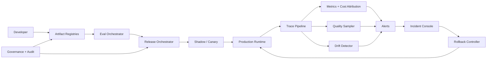

# Chapter 24: LLMOps and Production Lifecycle Management

## Context

> [!info] Quick Reference
> - **Pattern:** End-to-end lifecycle for prompts, models, retrieval indexes, evals, deployment, monitoring, rollback, and governance
> - **Scale:** 50 product teams, 200 prompt/model deployments/week, 1B requests/month
> - **Key Techniques:** prompt registry, model registry, eval gates, canaries, shadow traffic, trace replay, cost observability, incident response
> - **Primary Concerns:** silent quality regressions, model drift, prompt sprawl, cost spikes, rollback, compliance
> - **Cross-references:** [[chapter-04|Chapter 4]] (serving), [[chapter-05|Chapter 5]] (evaluation), [[chapter-08|Chapter 8]] (telemetry), [[chapter-20|Chapter 20]] (audit trail), [[chapter-26|Chapter 26]] (fine-tuning and adapter lifecycle), [[chapter-28|Chapter 28]] (cost optimization), [[chapter-29|Chapter 29]] (observability and incident response)

**Problem statement:** Design the operational platform and lifecycle practices required to ship, monitor, evaluate, and safely evolve LLM-backed systems across an organization.

### Real-World Examples

- A prompt change improves average user rating but doubles tool calls and causes a 35% monthly cost spike. Without per-version cost attribution, the team discovers it only after finance escalates.
- A model upgrade passes generic benchmarks but regresses citation accuracy for legal workflows. Shadow evaluation catches the issue before production rollout.

### Design Contract

| Dimension | Target | Why It Matters |
|---|---:|---|
| Product teams | 50 teams | self-service must coexist with governance |
| Deployments | 200 prompt/model/index/tool changes per week | release automation and eval gates are mandatory |
| Traffic | 1B requests/month | traces, metrics, and costs need sampling and aggregation strategy |
| Reproducibility | reconstruct any high-risk response | audits require full artifact bundle, not just logs |
| Rollback | prompt/model/index/policy independently revertible | coupled rollbacks are slow and dangerous |
| Monitoring | quality, safety, latency, cost, and drift by segment | global averages hide production failures |
| Governance | risk-tiered approval | low-risk teams can move fast; regulated use cases stay controlled |

LLMOps should be framed as production change management for probabilistic systems. It is not just "monitor the model"; prompts, tools, retrieval indexes, policies, and provider versions all change user-visible behavior.

---

## Step 1: Understand the Problem and Establish Design Scope

### Simulated Dialogue

**Interviewer:** Design LLMOps for a company with many LLM applications.  
**Candidate:** I will manage prompts, models, retrieval indexes, eval datasets, deployment gates, runtime traces, and incident response as first-class production artifacts. [[glossary#LLMOps|LLMOps]] extends MLOps because prompts, tools, retrieved context, and model providers all change behavior.

**Candidate:** What artifacts change frequently?  
**Interviewer:** Prompt templates daily, retrieval indexes hourly, model/provider versions monthly, and guardrail policies weekly.

**Candidate:** What failures worry you most?  
**Interviewer:** Silent quality regression, safety regression, cost blowups, and inability to reproduce an answer during audit.

### Functional Requirements

- **Version prompts, models, tools, schemas, policies, and retrieval indexes.** Each of these artifacts changes behavior independently of code deployments. Without explicit versioning, a prompt edited in-place makes it impossible to attribute a regression to a specific change or roll back to a known-good state.
- **Run offline evals before deployment and online evals after release.** Offline evals catch regressions against curated golden sets before any user sees the change; online evals detect issues that only surface under real traffic distribution, including queries the golden set did not anticipate.
- **Support shadow mode, canaries, A/B tests, and rollbacks.** Progressive delivery reduces blast radius: shadow mode validates behavior without user impact, canaries surface regressions on a small traffic slice, and A/B tests generate statistically valid quality and business-metric comparisons before full rollout.
- **Attribute latency, cost, and quality to artifact versions.** Because multiple teams share provider APIs and retrieval infrastructure, attribution must be version-granular — otherwise a prompt change that doubles tool calls is invisible until a billing spike reaches finance.
- **Detect [[glossary#Model Drift|drift]], safety regressions, and cost anomalies.** Production inputs shift over time as user behavior evolves; a model or prompt that passed evals at launch can silently degrade as the real distribution diverges from the golden set distribution.
- **Reproduce historical outputs for debugging and audits.** Regulated use cases (legal, financial, medical) require the ability to present the exact context the model received and the exact output it generated for any given request, even months after the fact.
- **Provide governance workflows for high-risk domains.** Self-service velocity for low-risk changes must coexist with mandatory human review, approvals, and audit evidence for high-risk deployments — one set of controls cannot serve both needs.

### Non-Functional Requirements

- **Reproducibility:** reconstruct model, prompt, tools, retrieved context, and parameters for any request. This means storing not just the artifact IDs but the full inference configuration, retrieved chunk IDs, and any sampling seeds so that a response can be replayed byte-for-byte during an audit or incident investigation.
- **Release safety:** no deployment without risk-appropriate eval gates. The definition of "risk-appropriate" must be codified per use-case tier: a marketing copy generator can ship with automated smoke tests, while a medical-decision assistant requires expanded adversarial sets and senior reviewer sign-off.
- **Observability:** per-stage latency, cost, quality, safety, and user feedback, broken down by artifact version and user segment. Segment-level breakdowns are required because a change that improves average quality by 2% can simultaneously regress a minority language segment by 20%, a fact that global averages hide entirely.
- **Velocity:** self-service for teams without bypassing controls. Teams should be able to propose, test, and ship low-risk changes in hours; the platform should make the safe path the fast path by automating eval gates rather than relying on manual review queues.
- **Compliance:** immutable audit logs for regulated workflows, with tamper-evident storage and configurable retention periods (e.g., 7 years for financial services). The audit record must include not just the output but the complete artifact bundle that produced it.

### Back-of-the-Envelope Estimation

- Requests/month: 1B
- Trace sampling: 5% full traces = 50M traces/month
- Full trace average: 30KB compressed
- Trace storage: `50M * 30KB ~= 1.5TB/month`
- Deployments/week: 200
- Eval examples per deployment: 2K standard + 500 domain-specific
- LLM-as-judge cost if 2.5K examples * 2 judge calls * 200 deployments = 1M judge calls/week

---

## Step 2: Propose High-Level Design and Get Buy-In

### Core Architecture Components

- **[[glossary#Prompt Registry|Prompt Registry]]:** stores versioned templates, variable schemas, few-shot examples, owner contacts, and changelogs. Each commit is immutable and content-addressed so that a given version ID always refers to exactly the same bytes — making prompt versions as reliable as container image digests.
- **Model Registry:** tracks provider, model ID, adapter checkpoint, tokenizer version, inference hyperparameters, and validation status. It also stores cost-per-token, context window, and capability tags so the Release Orchestrator can enforce compatibility checks when pairing a model with a prompt or tool schema.
- **Index Registry:** manages retrieval index versions including the source document snapshot timestamp, embedding model ID, chunking strategy, and ACL policy revision. Because retrieval silently changes answers, index versions must be treated with the same rigor as model versions.
- **Eval Store:** maintains golden task sets, adversarial injection cases, synthetic stress tests, rubric definitions, and judge-model calibration records. Calibration records are critical: they document how closely the judge model agrees with human raters so teams can trust automated gate decisions.
- **Release Orchestrator:** coordinates the full pre-production pipeline — triggering eval runs, collecting gate signals, managing shadow deployments and canaries, and executing rollback plans. It enforces that no artifact bundle reaches production without meeting the eval thresholds defined for its risk tier.
- **Observability Pipeline:** ingests structured traces from the runtime, computes per-version latency percentiles (p50/p95/p99), TTFT, TPOT, cost/request, cache hit rate, and error rates, and routes sampled outputs to the Quality Sampler and Drift Detector. Sampling is necessary at 1B requests/month to control storage costs while retaining statistical significance.
- **Drift Detector:** compares live production distributions against baselines captured at release time — covering input query embedding distribution, retrieval relevance scores, output length distribution, safety classifier scores, and policy violation rates. An embedding-space shift of more than 5% from the baseline centroid can trigger an automated re-eval recommendation.
- **Incident Console:** provides triage dashboards with blast-radius estimates (request count, unique tenants, revenue exposure), one-click rollback to any prior artifact bundle, trace replay for root-cause analysis, and postmortem artifact generation. The console is the single pane of glass that on-call engineers use during incidents.
- **Governance Layer:** enforces risk-tier assignment during artifact registration, routes high-risk deployments to human reviewers, maintains immutable approval records, enforces audit-log retention policies, and generates compliance evidence packages for regulated use cases.

### Pipeline A: Pre-Production Release

1. Developer proposes prompt/model/tool/index change.
2. Registry creates immutable version with owner and changelog.
3. Eval orchestrator runs unit tests, golden tasks, safety tests, and regression suites.
4. Cost and latency simulator estimates production impact.
5. Risk tier determines whether approval is required.
6. Release orchestrator deploys to shadow or canary.
7. Promotion occurs only if eval, latency, safety, and cost gates pass.

### Pipeline B: Production Monitoring

1. Runtime emits trace with request ID, artifact versions, retrieval candidates, tool calls, and model params.
2. Metrics aggregator computes p50/p95/p99 latency, TTFT, TPOT, cost, cache hit rate, and error rates.
3. Quality monitor samples outputs for LLM-as-judge and human review.
4. Drift detector compares production distributions against baselines.
5. Alerting routes anomalies to owning team with suggested rollback.
6. Incident console supports trace replay and blast-radius analysis.

### Release Flow Walkthrough

Example change: upgrade the support assistant from prompt `support.v41` to `support.v42`.

1. **Developer submits change:** prompt diff, rationale, owner, target app, and risk tier.
2. **Prompt registry:** creates immutable version `support.v42` and links it to the previous version.
3. **Static checks:** validate required variables, output schema, forbidden instructions, and policy tags.
4. **Offline eval:** run golden support tickets, adversarial injection cases, multilingual cases, and escalation scenarios.
5. **Cost simulation:** estimate token and tool-call delta against recent traffic samples.
6. **Shadow mode:** run `support.v42` on mirrored production traffic without showing users the output.
7. **Canary:** expose to 1-5% of low-risk traffic if shadow metrics pass.
8. **Promotion:** gradually increase traffic while tracking quality, safety, latency, and cost.
9. **Rollback:** revert only the prompt version if cost or quality regresses; leave model and index untouched.
10. **Eval expansion:** add any canary failures to the regression suite.

### Artifact Bundle Example

Every production response should be attributable to a complete bundle:

```json
{
  "artifact_bundle": {
    "prompt_version": "support.v42",
    "model_version": "provider/model-2026-05-01",
    "index_version": "kb_2026_05_29_0800",
    "tool_schema_versions": {
      "crm.lookup_customer": "v7",
      "ticket.create": "v3"
    },
    "guardrail_policy": "support_policy.v18",
    "inference_config": {
      "temperature": 0.2,
      "max_output_tokens": 500
    }
  },
  "trace_id": "trace_456"
}
```

This is the minimum practical unit of reproducibility. Without it, a team can know what code ran but still not know what behavior the user experienced.

### Mermaid Architecture Diagram



---

## Step 3: Design Deep Dive

### 1) Artifact Versioning

Every production response should be attributable to a complete artifact bundle. Partial attribution — knowing the code version but not the prompt version, or knowing the model but not the retrieval index — is the most common root cause of "we can't reproduce this incident" postmortems.

> **Why version every artifact dimension rather than just code:** LLM systems have multiple independent behavioral dimensions, each controlled by a different artifact. A code deployment does not capture a prompt edit; a model upgrade does not capture a retrieval index snapshot. Without versioning all dimensions, regression attribution becomes guesswork and rollbacks risk reverting unrelated changes along with the culprit.

| Artifact | Version Fields | Why It Matters |
|---|---|---|
| Prompt | SHA-256 of the template bytes, few-shot example set ID, declared variable schema | A single word change in a system prompt can shift task-success rate by 5–15% and alter token consumption; without content-addressing, two deployments with the same human-readable name may produce different behavior. |
| Model | provider ID, model name, snapshot date, LoRA adapter checkpoint hash, tokenizer version | The same model name at different providers or release dates can have different vocabulary, RLHF alignment, and context windows; mistaking model versions is a common source of silent quality regression after provider infrastructure updates. |
| Retrieval index | source document snapshot timestamp, embedding model ID, chunking strategy, overlap size, ACL policy revision | Stale indexes silently serve outdated facts; a knowledge base updated after a policy change but before an index rebuild means the LLM answers from old context, which is especially dangerous in compliance-critical workflows. |
| Tool schema | name, argument types, permissions, endpoint version, implementation hash | Agent behavior — including which tools the model chooses to call and in what order — is sensitive to argument name and description wording; a schema rename can shift tool-call success rate by 10–20% without any change to the underlying implementation. |
| Guardrail policy | policy rule set hash, threshold values, classifier model version | A guardrail policy that is updated to reduce false positives may simultaneously increase the rate of policy violations reaching users; tracking policy versions independently allows the safety team to roll back thresholds without touching the product prompt. |
| Inference config | temperature, max_tokens, top-p, frequency_penalty, stop sequences | Temperature alone can shift response variance enough to change benchmark pass rates by 3–8%; without versioning inference config, A/B tests that accidentally use different temperature settings produce invalid comparisons. |

### 2) Evaluation Gates

Evaluation should be layered by risk. A risk-tiered gate structure ensures that low-risk teams are not bottlenecked by heavyweight review processes while high-risk use cases are never allowed to bypass safety controls. The gates are cumulative: a change cannot skip an earlier gate by passing a later one.

> **Why tier evaluation gates by risk rather than apply flat requirements:** Flat eval requirements create perverse incentives — teams either over-engineer simple changes to meet heavyweight gates, or they route around the process entirely. Tiering gates by risk makes the safe path the fast path for the majority of changes while concentrating human review effort where consequences of failure are highest.

| Gate | Low Risk | High Risk |
|---|---|---|
| Prompt unit tests | Required; covers variable substitution, required output fields, and schema conformance — typically runs in under 60 seconds. | Required; expanded to cover all declared output schema variants and all enumerated tool-call paths, typically 200–500 test cases. |
| Golden task regression | Sampled subset of ~200 representative tasks; a delta of more than 2% absolute on task-success rate blocks promotion. | Full suite of 2,000+ domain-specific tasks, including edge cases and minority-language variants; a delta of more than 0.5% on safety metrics blocks promotion regardless of quality improvement. |
| Safety/adversarial tests | Basic injection and jailbreak set (~100 cases) drawn from a shared red-team library; any policy violation blocks promotion. | Expanded red-team set (~1,000 cases) including domain-specific attacks such as medical misinformation, legal liability induction, and PII extraction; requires sign-off from the safety team. |
| Retrieval eval | Run only if the change touches the retrieval index or embedding model; measures nDCG@10 and answer-grounding rate against a held-out query set. | Always required regardless of whether the retrieval index changed; a 3% drop in grounding rate blocks promotion even if the LLM output quality improves. |
| Human review | Optional; recommended when the change affects tone, brand voice, or subjective quality dimensions that automated metrics cannot reliably measure. | Mandatory; at least two qualified domain reviewers must approve on a stratified sample of 50+ outputs before the change can proceed to shadow mode. |
| Shadow traffic | Optional; used when the team wants validation under real query distribution before committing to a canary. | Required for a minimum of 24 hours or 100,000 shadow requests, whichever comes first; quality and safety metrics must be within defined thresholds before canary begins. |
| Canary | 5% of production traffic with auto-promotion after 1 hour if quality, cost, and safety metrics remain within ±5% of baseline. | 1% of production traffic with manual promotion only after human review of canary metrics; minimum canary duration is 48 hours regardless of traffic volume. |

Metrics tracked at each gate:

- **Task success rate:** the primary quality signal; measures whether the model completed the intended task as judged by automated rubric or human evaluator.
- **Unsupported-claim rate:** fraction of responses that assert facts not present in the retrieved context or known model knowledge; critical for [[glossary#RAG (Retrieval-Augmented Generation)|RAG]] workflows where [[glossary#Hallucination (LLM)|hallucination]] directly misleads users.
- **Policy violation rate:** fraction of outputs flagged by the guardrail classifier; a regression here blocks promotion regardless of other metric improvements.
- **Human preference win rate:** in pairwise comparisons between the new and old artifact bundle, the fraction of cases where human raters prefer the new output; a win rate below 50% relative to baseline is a regression signal even if absolute scores improve.
- **Tool-call success rate:** for agentic workflows, the fraction of tool invocations that returned a valid result; a drop here often signals schema incompatibility or latent prompt change that altered tool-selection behavior.
- **Cost/request:** estimated from token counts and provider pricing; a delta greater than 10% triggers a cost review even if quality improves.
- **p95 TTFT and end-to-end latency:** latency regressions at p95 are often invisible in average metrics but directly affect user experience for the tail; a p95 TTFT regression of more than 200ms blocks promotion for latency-sensitive use cases.

### 3) Observability and Incident Response

A useful trace answers: what did the model know, what did it do, and why did the system allow it? Traces that capture only the final output are insufficient for production debugging — the trace must capture the full decision chain from request receipt through retrieval, prompt construction, model invocation, tool calls, guardrail evaluation, and response delivery.

> **Why traces must capture the full decision chain, not just the final output:** LLM bugs are often not bugs in the traditional sense — the code ran correctly, but the composition of artifacts produced an unintended result. Diagnosing these requires replaying the exact context the model received. Without traces that include retrieved chunk IDs, tool call arguments and results, and guardrail labels, engineers spend hours reconstructing context from logs that were never designed to support that use case.

Trace fields:

```json
{
  "request_id": "req_123",
  "prompt_version": "support.v42",
  "model_version": "provider/model-2026-05-01",
  "index_version": "kb_2026_05_29_0800",
  "retrieved_chunk_ids": ["c1", "c7"],
  "tool_calls": [{"tool": "refund.lookup", "status": "success"}],
  "latency_ms": {"retrieval": 120, "ttft": 840, "total": 2200},
  "cost_usd": 0.018,
  "safety_labels": ["allowed"],
  "output_hash": "sha256:..."
}
```

Incident workflow:

1. **Detect anomaly or user report.** Automated detection typically triggers from a threshold breach in quality-score percentiles, policy violation rate, or cost/request — whichever crosses its alert threshold first. User reports are the fallback for issues that automated monitors miss, such as subtle tone regressions or context-window overflow in rare query patterns.
2. **Identify affected artifact versions.** Cross-reference the anomaly timestamp against the deployment log to find the artifact bundle(s) active when the issue began. A version timeline view in the Incident Console narrows the candidate set to changes deployed within the regression window.
3. **Estimate blast radius by request count, tenant, and risk class.** Quantify the scope before deciding rollback strategy: a regression affecting 500 low-stakes marketing queries warrants a different urgency level than one affecting 50 medical-workflow queries. Blast-radius data drives SLA breach risk and customer communication decisions.
4. **Roll back prompt/model/index/policy independently when possible.** Independent revertibility is the reason artifacts are versioned separately. Rolling back only the prompt without touching the model avoids introducing a model regression to fix a prompt regression, which compounds the incident.
5. **Replay traces against candidate fix.** Before promoting the fix to production, replay a representative sample of affected traces through the new artifact bundle in a staging environment. Replay confirms that the fix resolves the regression without introducing new failures on the same traffic patterns.
6. **Add failing cases to regression eval.** Every incident that survives to production represents an eval gap. Systematically adding the failing cases to the regression suite reduces the probability of the same class of failure reaching production again.
7. **Publish postmortem with prevention actions.** Postmortems should include the detection delay (time from incident start to alert), the rollback time, the blast-radius estimate, and specific platform or process changes that will prevent recurrence — not just a description of what happened.

### Production Bottlenecks and Mitigations

- **Eval suite too slow:** split smoke, standard, and exhaustive eval tiers so that a prompt typo fix runs only the 60-second smoke tier while a model upgrade runs the full 2-hour exhaustive suite. Without tiering, teams either wait hours for simple changes or skip evals entirely — both outcomes are worse than a well-designed tiered system.
- **LLM-as-judge drift:** calibrate the judge model against human labels quarterly and track judge-human agreement (Cohen's kappa or Pearson correlation) as a first-class metric. A judge model that drifts from 0.82 to 0.71 correlation with human raters is producing unreliable gate signals, and changes promoted on the basis of those signals may silently regress.
- **Prompt sprawl:** require every prompt registration to declare an owner (team and individual), a changelog entry, a deprecation schedule, and a dependency graph listing which products and pipelines consume the prompt. Without these controls, organizations of 50+ teams accumulate hundreds of orphaned prompt versions that consume eval compute and create confusion during incidents.
- **Cost attribution gaps:** attach artifact versions to every metric, trace, and cost record at ingestion time so that cost aggregations can be sliced by prompt version, model version, or tenant without expensive post-hoc joins. A prompt change that doubles tool calls and costs an extra $40K/month is undetectable in undifferentiated cost dashboards.
- **Rollback coupling:** deploy prompts, policies, models, and indexes as independently revertible artifacts and test rollback paths as part of the release process. Coupled rollbacks — where reverting a model also reverts a prompt or index that was intentionally changed — are a leading cause of extended incidents because each rollback introduces new uncertainty.

### Advanced Techniques

- **Trace replay:** rerun a sample of real production requests — with their actual retrieved context and tool responses captured — against a new artifact bundle before release. Trace replay is more powerful than synthetic eval because it validates behavior on the exact queries the system received in production, including query distributions and retrieval failures that the eval team never anticipated.
- **Counterfactual eval:** compare old and new artifact bundle outputs side by side using the same retrieved context, so that differences in output quality are attributable to the prompt or model change rather than to retrieval variance. Without holding the retrieved context constant, a counterfactual eval that shows a 5% quality improvement may actually be measuring an improvement in retrieval rather than the artifact under test.
- **Synthetic regression generation:** after each incident, use an LLM to cluster the failing traces by failure mode and generate synthetic variants of the failure pattern to expand the regression suite. This converts each production failure into a class of eval cases that would have caught the issue pre-release, progressively tightening the eval coverage gap.
- **Segment-level monitoring:** monitor quality, safety, latency, and cost metrics broken down by language, tenant tier, document type, risk class, and query intent cluster. Global averages are structurally misleading — a model change that improves English task-success rate by 3% while degrading Spanish by 8% looks like a net improvement in aggregate metrics but is a regression for a significant user segment.
- **Policy simulation:** before changing guardrail thresholds, run the proposed policy configuration against a historical traffic sample to estimate the delta in block rate, false positive rate, and false negative rate. A threshold reduction that cuts false positives by 15% may simultaneously allow 2% more genuinely harmful outputs through — policy simulation makes this trade-off explicit and auditable before it becomes a production incident.

---

## Step 4: Wrap Up

### Final Design Summary

LLMOps turns prompts, models, indexes, tools, and policies into governed production artifacts. The platform provides versioning, eval gates, progressive delivery, observability, drift detection, rollback, and audit replay so teams can ship quickly without losing control of quality, safety, and cost.

### Wrap-Around Concerns

- **Risk:** silent regression after prompt/model change. Mitigation: eval gates, shadow traffic, and segment-level monitoring.
- **Risk:** audit cannot reproduce answer. Mitigation: store artifact versions, retrieved context IDs, inference params, and trace metadata.
- **Risk:** cost spike from agent/tool behavior. Mitigation: per-version cost attribution and budgets.

---

## Step 5: Interviewer Curveballs

### Interviewer Follow-ups & Frequently Asked Questions (FAQ)

Q: How is LLMOps different from traditional MLOps?  
**The Ideal Answer:** Traditional MLOps focuses heavily on datasets, model training pipelines, deployment packaging (containers, serving frameworks), and monitoring of model output distributions. The assumption is that behavior changes only when a new model artifact is produced through training. LLMOps extends this by treating prompts, retrieved context, tool schemas, inference parameters, guardrail policies, and external provider versions as independent behavior-changing artifacts, each of which can alter user-visible output without any code or model training change. A traditional MLOps system that only versions model checkpoints will miss regressions caused by a prompt edit or a retrieval index rebuild. Additionally, LLMOps must handle probabilistic, non-deterministic outputs where "the same input" produces different outputs, making regression detection a statistical problem rather than a deterministic pass/fail check. Strong answers also note that the eval loop in LLMOps is fundamentally more expensive because LLM-as-judge or human evaluation is required — a contrast to classical ML where accuracy on a labeled test set is cheap to compute.

**Deep Dive & Trade-offs:**
- Treat prompts, retrieval index versions, tool schemas, inference parameters, and guardrail policies as first-class versioned artifacts: a system that only versions model checkpoints will silently miss a regression introduced by a prompt edit or an index rebuild, because no model artifact changed.
- Because outputs are non-deterministic, regression detection becomes statistical rather than a deterministic pass/fail diff — you compare distributions of quality scores across many samples, not a single expected output, which raises the cost and complexity of the eval gate.
- Provider version drift is a behavior-changing event unique to LLMOps: a managed model can change under a moving alias without any deploy on your side, so the lifecycle must pin versioned endpoints and monitor for external drift.
- The eval loop itself is expensive — LLM-as-judge or human review per candidate change at 200 deployments/week is a real cost center, so eval suites must be scoped by risk tier rather than run exhaustively on every change.

**The Interviewer's Rubric:** A strong answer demonstrates that LLMOps generalizes MLOps to a wider set of behavior-changing artifacts (prompts, context, tools, policies, provider versions) and treats regression detection as a statistical problem over non-deterministic outputs. The rubric penalizes answers that reduce the difference to "LLMs are bigger models" or that assume model-checkpoint versioning alone is sufficient to catch production regressions.

Q: A model upgrade improves benchmark score but worsens production quality. What do you do?  
**The Ideal Answer:** Keep the old model live and immediately pause the canary or shadow promotion of the new model. Run domain-specific evals against the production query distribution rather than the benchmark distribution — benchmark improvements frequently do not generalize to narrow production query types, especially in legal, medical, or enterprise-domain workflows. Inspect the failing traces segment by segment: the regression may be concentrated in a specific language, query intent type, or context length range rather than uniformly distributed. Present the data to the model team with concrete examples from production traces showing where the new model underperforms, and negotiate a re-evaluation using the domain-specific golden set rather than the public benchmark. Promote only when domain-specific task-success rate and user-facing metrics (e.g., task completion rate from product analytics) meet or exceed the baseline from the old model. A strong answer also notes that benchmark gaming is a known phenomenon, and that a robust LLMOps practice requires maintaining a private, production-representative eval suite that cannot be over-fit by model providers.

**Deep Dive & Trade-offs:**
- Keep the old model live and pause the canary or shadow promotion immediately: the upgrade is only a candidate until it passes the production-distribution gate, and reverting a not-yet-promoted change costs nothing while a promoted regression incurs user harm.
- Segment the failing traces before concluding anything — the regression is often concentrated in one language, intent type, or context-length band rather than uniform, and that segmentation is the evidence you bring back to the model team.
- Public benchmarks and the production query distribution are different distributions; benchmark gains routinely fail to transfer to narrow legal, medical, or enterprise workflows, which is exactly why a private golden set is the promotion criterion rather than the benchmark.
- Gate promotion on domain task-success rate and product-analytics metrics (e.g., task completion rate) meeting or exceeding the old model, not on the benchmark delta.

**The Interviewer's Rubric:** A strong answer separates benchmark distribution from production distribution and uses a private, production-representative golden set plus segment-level trace analysis as the promotion gate. The rubric penalizes candidates who promote on benchmark improvement alone, or who cannot localize a regression to a specific segment before escalating to the model team.

Q: What is the minimum trace needed for auditability?  
**The Ideal Answer:** The minimum viable audit trace includes: request ID (globally unique, used to join all downstream records), user and tenant identifiers with the policy context that was active at request time, prompt version ID and model version ID, inference parameters (temperature, max tokens, stop sequences), retrieval index version and the IDs of every retrieved chunk (not just the top-k selected for the prompt but all candidates considered), tool call records including arguments and return values for each invocation, guardrail classifier decisions with the specific rules triggered, a cryptographic hash of the final output so that content tampering can be detected, end-to-end latency and per-stage latency, cost in USD, and a UTC timestamp. Without the retrieved chunk IDs, the trace cannot reconstruct what the model knew. Without the tool call records, the trace cannot explain agent behavior. Without the output hash, the audit cannot verify that the stored response matches what was delivered. Strong answers note that the trace must be tamper-evident (written to an append-only store) and that its retention period must match the regulatory requirement for the use case, which for financial services is commonly 7 years.

**Deep Dive & Trade-offs:**
- Each omitted field disables a distinct audit capability: without retrieved chunk IDs you cannot reconstruct what the model knew; without tool call arguments and returns you cannot explain agent behavior; without the output hash you cannot prove the stored response matches what was delivered.
- Capture all retrieved candidates, not just the selected top-k, plus the index version: an audit frequently needs to show why the relevant chunk was or was not surfaced, which requires the full candidate set and the index it came from.
- Tamper-evidence is a storage-design requirement, not a field — the trace must land in an append-only store keyed by the globally unique request ID so all downstream records join and so no record can be silently rewritten.
- Retention is set by the regulatory regime, not by engineering convenience: financial-services use cases commonly require 7-year retention, which drives the choice of cold-storage tiering and the cost model for the audit store.

**The Interviewer's Rubric:** A strong answer enumerates the join key (request ID), the artifact versions (prompt, model, index), the full retrieval candidate set, tool call records, guardrail decisions, and an output hash, and explains which audit question each field answers. The rubric penalizes answers that list raw logs without tamper-evident append-only storage, omit the retrieved chunk IDs or output hash, or ignore the regulatory retention requirement.

---

## Practical Implementation

### Prompt Registry Client with Immutable Versioning

This example shows a minimal prompt registry that content-addresses templates so that the same version ID always refers to the same bytes, and that records a full audit trail on every registration.

```python
import hashlib
import json
from dataclasses import dataclass, field
from datetime import datetime, timezone
from typing import Optional

@dataclass
class PromptVersion:
    version_id: str           # SHA-256 of the canonical template bytes
    name: str                 # Human-readable prompt name (e.g., "support.v42")
    template: str             # The raw template string with {{variable}} placeholders
    variable_schema: dict     # JSON Schema describing allowed variables
    owner_email: str
    changelog: str
    risk_tier: str            # "low", "medium", "high"
    registered_at: str
    parent_version_id: Optional[str] = None   # Previous version for lineage tracking
    tags: list[str] = field(default_factory=list)


class PromptRegistry:
    """
    Content-addressed prompt registry.
    A version_id is the SHA-256 of the canonical template bytes,
    guaranteeing that the same ID always refers to the same behavior.
    """

    def __init__(self, store: dict):
        # store is a dict-backed stub; swap for DynamoDB, Postgres, etc.
        self._store: dict[str, PromptVersion] = store
        self._name_index: dict[str, list[str]] = {}  # name -> [version_ids]

    def register(
        self,
        name: str,
        template: str,
        variable_schema: dict,
        owner_email: str,
        changelog: str,
        risk_tier: str = "low",
        parent_version_id: Optional[str] = None,
        tags: list[str] | None = None,
    ) -> PromptVersion:
        # Canonical bytes: UTF-8 of the template; deterministic hash
        template_bytes = template.encode("utf-8")
        version_id = hashlib.sha256(template_bytes).hexdigest()

        if version_id in self._store:
            # Idempotent: same content, same ID — no duplicate write
            return self._store[version_id]

        version = PromptVersion(
            version_id=version_id,
            name=name,
            template=template,
            variable_schema=variable_schema,
            owner_email=owner_email,
            changelog=changelog,
            risk_tier=risk_tier,
            registered_at=datetime.now(timezone.utc).isoformat(),
            parent_version_id=parent_version_id,
            tags=tags or [],
        )
        self._store[version_id] = version
        self._name_index.setdefault(name, []).append(version_id)
        return version

    def get(self, version_id: str) -> PromptVersion:
        if version_id not in self._store:
            raise KeyError(f"Prompt version {version_id!r} not found")
        return self._store[version_id]

    def latest(self, name: str) -> PromptVersion:
        ids = self._name_index.get(name, [])
        if not ids:
            raise KeyError(f"No versions registered for prompt {name!r}")
        # Versions are appended in registration order; last is latest
        return self._store[ids[-1]]

    def lineage(self, version_id: str) -> list[PromptVersion]:
        """Walk the parent chain and return ancestry, oldest first."""
        chain = []
        current_id: Optional[str] = version_id
        while current_id:
            v = self.get(current_id)
            chain.append(v)
            current_id = v.parent_version_id
        chain.reverse()
        return chain


# --- Usage ---
store = {}
registry = PromptRegistry(store)

v41 = registry.register(
    name="support",
    template="You are a support agent. Customer issue: {{issue}}. Be concise.",
    variable_schema={"issue": {"type": "string"}},
    owner_email="alice@example.com",
    changelog="Initial support prompt",
    risk_tier="low",
)

v42 = registry.register(
    name="support",
    template="You are a support agent. Customer issue: {{issue}}. Resolve in under 3 steps.",
    variable_schema={"issue": {"type": "string"}},
    owner_email="alice@example.com",
    changelog="Constrain response to 3-step resolution to reduce tool calls",
    risk_tier="low",
    parent_version_id=v41.version_id,
)

print(f"v41 id: {v41.version_id[:12]}...")
print(f"v42 id: {v42.version_id[:12]}...")
print(f"Lineage: {[v.name + ':' + v.version_id[:8] for v in registry.lineage(v42.version_id)]}")
```

### Eval Gate Runner with Risk-Tiered Pass Thresholds

This snippet shows how a Release Orchestrator applies risk-tiered thresholds to an eval result set before deciding whether to promote an artifact bundle.

```python
from dataclasses import dataclass
from typing import Literal

RiskTier = Literal["low", "medium", "high"]

@dataclass
class EvalResult:
    task_success_rate: float      # 0.0 – 1.0
    policy_violation_rate: float  # 0.0 – 1.0; must stay near zero
    cost_per_request_usd: float
    p95_latency_ms: float
    unsupported_claim_rate: float # 0.0 – 1.0; hallucination proxy

@dataclass
class EvalGateConfig:
    min_task_success_rate: float
    max_policy_violation_rate: float
    max_cost_delta_fraction: float    # fraction increase vs baseline allowed
    max_p95_latency_ms: float
    max_unsupported_claim_rate: float

GATE_CONFIGS: dict[RiskTier, EvalGateConfig] = {
    "low": EvalGateConfig(
        min_task_success_rate=0.80,
        max_policy_violation_rate=0.005,
        max_cost_delta_fraction=0.10,
        max_p95_latency_ms=3000,
        max_unsupported_claim_rate=0.10,
    ),
    "medium": EvalGateConfig(
        min_task_success_rate=0.85,
        max_policy_violation_rate=0.002,
        max_cost_delta_fraction=0.05,
        max_p95_latency_ms=2500,
        max_unsupported_claim_rate=0.05,
    ),
    "high": EvalGateConfig(
        min_task_success_rate=0.92,
        max_policy_violation_rate=0.001,
        max_cost_delta_fraction=0.02,
        max_p95_latency_ms=2000,
        max_unsupported_claim_rate=0.02,
    ),
}


def evaluate_gate(
    result: EvalResult,
    baseline: EvalResult,
    tier: RiskTier,
) -> tuple[bool, list[str]]:
    """
    Returns (passed, list_of_failures).
    Each failure is a human-readable string explaining what threshold was breached.
    """
    config = GATE_CONFIGS[tier]
    failures = []

    if result.task_success_rate < config.min_task_success_rate:
        failures.append(
            f"task_success_rate {result.task_success_rate:.3f} < "
            f"threshold {config.min_task_success_rate:.3f}"
        )

    if result.policy_violation_rate > config.max_policy_violation_rate:
        failures.append(
            f"policy_violation_rate {result.policy_violation_rate:.4f} > "
            f"threshold {config.max_policy_violation_rate:.4f}"
        )

    cost_delta = (result.cost_per_request_usd - baseline.cost_per_request_usd) / max(
        baseline.cost_per_request_usd, 1e-9
    )
    if cost_delta > config.max_cost_delta_fraction:
        failures.append(
            f"cost_delta +{cost_delta:.1%} > threshold +{config.max_cost_delta_fraction:.1%}"
        )

    if result.p95_latency_ms > config.max_p95_latency_ms:
        failures.append(
            f"p95_latency_ms {result.p95_latency_ms:.0f} > "
            f"threshold {config.max_p95_latency_ms:.0f}"
        )

    if result.unsupported_claim_rate > config.max_unsupported_claim_rate:
        failures.append(
            f"unsupported_claim_rate {result.unsupported_claim_rate:.3f} > "
            f"threshold {config.max_unsupported_claim_rate:.3f}"
        )

    return len(failures) == 0, failures


# --- Usage ---
baseline = EvalResult(
    task_success_rate=0.87,
    policy_violation_rate=0.001,
    cost_per_request_usd=0.015,
    p95_latency_ms=1800,
    unsupported_claim_rate=0.03,
)

candidate = EvalResult(
    task_success_rate=0.89,
    policy_violation_rate=0.001,
    cost_per_request_usd=0.031,   # doubled — will breach cost gate
    p95_latency_ms=1750,
    unsupported_claim_rate=0.02,
)

passed, failures = evaluate_gate(candidate, baseline, tier="medium")
print(f"Gate passed: {passed}")
for f in failures:
    print(f"  FAILED: {f}")
# Gate passed: False
# FAILED: cost_delta +106.7% > threshold +5.0%
```

### Structured Trace Emitter with Artifact Bundle

This class shows how a production runtime should emit a structured trace that captures the full artifact bundle alongside latency and cost, enabling per-version attribution and audit replay.

```python
import time
import hashlib
import json
from dataclasses import dataclass, field, asdict
from typing import Any

@dataclass
class ToolCallRecord:
    tool_name: str
    tool_schema_version: str
    arguments: dict
    result_status: str    # "success", "error", "timeout"
    latency_ms: float

@dataclass
class ArtifactBundle:
    prompt_version_id: str
    model_version: str
    index_version: str
    tool_schema_versions: dict[str, str]   # tool_name -> version
    guardrail_policy_version: str
    inference_config: dict                 # temperature, max_tokens, etc.

@dataclass
class ProductionTrace:
    request_id: str
    tenant_id: str
    artifact_bundle: ArtifactBundle
    retrieved_chunk_ids: list[str]
    tool_calls: list[ToolCallRecord]
    guardrail_labels: list[str]
    output_hash: str                       # SHA-256 of the final response text
    latency_breakdown_ms: dict[str, float] # stage -> ms
    cost_usd: float
    timestamp_utc: str


class TraceEmitter:
    """
    Wraps a request execution and emits a structured trace to a sink.
    In production, sink writes to an append-only store (e.g., S3 + Athena,
    BigQuery, or a dedicated trace store).
    """

    def __init__(self, sink):
        self._sink = sink  # callable(trace_dict) -> None

    def emit(
        self,
        request_id: str,
        tenant_id: str,
        bundle: ArtifactBundle,
        retrieved_chunk_ids: list[str],
        tool_calls: list[ToolCallRecord],
        guardrail_labels: list[str],
        output_text: str,
        latency_breakdown_ms: dict[str, float],
        cost_usd: float,
        timestamp_utc: str,
    ) -> ProductionTrace:
        output_hash = "sha256:" + hashlib.sha256(
            output_text.encode("utf-8")
        ).hexdigest()

        trace = ProductionTrace(
            request_id=request_id,
            tenant_id=tenant_id,
            artifact_bundle=bundle,
            retrieved_chunk_ids=retrieved_chunk_ids,
            tool_calls=tool_calls,
            guardrail_labels=guardrail_labels,
            output_hash=output_hash,
            latency_breakdown_ms=latency_breakdown_ms,
            cost_usd=cost_usd,
            timestamp_utc=timestamp_utc,
        )
        self._sink(asdict(trace))
        return trace


# --- Usage (stub) ---
emitted_traces = []

emitter = TraceEmitter(sink=emitted_traces.append)

bundle = ArtifactBundle(
    prompt_version_id="abc123def456",
    model_version="provider/model-2026-05-01",
    index_version="kb_2026_05_29_0800",
    tool_schema_versions={"crm.lookup_customer": "v7", "ticket.create": "v3"},
    guardrail_policy_version="support_policy.v18",
    inference_config={"temperature": 0.2, "max_output_tokens": 500},
)

trace = emitter.emit(
    request_id="req_789",
    tenant_id="tenant_acme",
    bundle=bundle,
    retrieved_chunk_ids=["chunk_c1", "chunk_c7"],
    tool_calls=[
        ToolCallRecord("crm.lookup_customer", "v7", {"customer_id": "cust_42"},
                       "success", 95.3)
    ],
    guardrail_labels=["allowed"],
    output_text="Your refund of $49.99 has been processed and will arrive in 3-5 days.",
    latency_breakdown_ms={"retrieval": 120, "ttft": 840, "total": 2200},
    cost_usd=0.018,
    timestamp_utc="2026-05-30T14:32:01Z",
)

print(f"Trace emitted: {trace.request_id}, output_hash={trace.output_hash[:20]}...")
```

---

## Exercises

### Design

**Exercise 1 — Multi-Tenant Governance Architecture**  
Design an LLMOps governance layer for a SaaS platform with three customer risk tiers: consumer (low), enterprise (medium), and regulated-industry (high, e.g., financial services). Each tier has different requirements for eval gate depth, approval workflows, audit log retention, and rollback SLAs. Specify: (a) how artifact risk tiers are assigned and enforced at registration time; (b) the approval routing rules and how you prevent tier downgrade without an explicit re-review; (c) how you structure audit log storage to satisfy a 7-year retention requirement for the regulated tier while keeping storage costs manageable for the consumer tier; (d) how you implement tenant-scoped rollback so that reverting an artifact for one customer does not affect others sharing the same model version.

**Exercise 2 — Cost Attribution System for Agentic Workflows**  
Design a cost attribution pipeline for an agentic LLM system where a single user request can trigger 0–20 tool calls, each of which may itself invoke nested LLM calls. The system serves 50 product teams and needs to attribute per-request costs to: (a) artifact version, (b) team, (c) tenant, and (d) specific tool invocation chain. Address: how you capture cost at every LLM call boundary including nested calls; how you aggregate costs without double-counting when a tool call triggers a sub-agent; what alerting thresholds you set per team to surface cost anomalies within one billing cycle; and how you handle cost attribution when a single request spans multiple artifact bundle versions due to mid-request policy updates.

### Implementation

**Exercise 3 — Drift Detector for Input Distribution**  
Implement a drift detector that uses embedding-space distance to flag when the production query distribution has shifted significantly from the distribution captured at the last model deployment. The detector should: (a) maintain a compressed representation of the baseline distribution (e.g., cluster centroids from K-means on the first 10,000 production queries after each deployment); (b) compute a rolling drift score for new queries using average distance to the nearest baseline centroid; (c) emit an alert when the 7-day rolling drift score exceeds a configurable threshold; (d) support per-segment drift detection so that drift in Spanish queries is detected independently from drift in English queries. Use cosine distance and include unit tests that verify the detector fires on a synthetic shifted distribution.

**Exercise 4 — Shadow Traffic Harness with Async Comparison**  
Implement a shadow traffic harness that mirrors production requests to a candidate artifact bundle without affecting the live response. The harness should: (a) intercept requests after retrieval and before model invocation; (b) asynchronously invoke the candidate bundle with the same retrieved context and log the response without blocking the live path; (c) compute a quality comparison score using a simple heuristic (e.g., output length delta and ROUGE-L against the live output as a baseline proxy); (d) write comparison results to a shadow evaluation store keyed by request ID so they can be queried by artifact version; (e) enforce a configurable timeout so that slow candidate responses do not accumulate unbounded background tasks.

### Debug

**Exercise 5 — Silent Regression Root-Cause Drill**  
You are on-call and receive an alert: the policy violation rate for the `legal-assistant` application has increased from 0.3% to 1.8% over the past 6 hours. The code has not been deployed. Using the LLMOps platform described in this chapter, walk through the complete incident investigation process: (a) identify which artifacts changed in the past 24 hours and how you narrow the candidate set; (b) explain how you use trace replay to reproduce the violation pattern on a sample of affected requests; (c) describe how you determine whether the root cause is a prompt change, a retrieval index update, a model provider infrastructure change, or a guardrail policy threshold change; (d) specify the exact rollback sequence if the root cause is an index rebuild that introduced stale policy documents into the knowledge base; (e) describe what you add to the regression eval suite to prevent this class of incident from reaching production again. Include the specific trace fields you would query and the eval cases you would generate from the failing traces.

---

## End of Chapter

- **Key takeaway:** LLMOps treats every shippable thing—prompt, retrieval index, guardrail policy, model version—as an immutable, versioned artifact bundle that moves through eval gates before reaching production, and keeps moving through continuous monitoring after. The defining insight is that LLM regressions are usually *silent* and *codeless*: quality degrades with no deploy, because a prompt edit, an index rebuild, or a provider-side model change shifted behavior. Reproducible artifact lineage plus trace replay is what makes root-causing possible at all.
- **What to practice:** Size a cost-attribution and observability pipeline for an agentic system: given 10M requests/day, a mean of 4 LLM calls per request (including nested sub-agent calls), and full trace retention, compute trace storage volume per day, the sampling rate needed to keep observability spend under a fixed budget, and the per-team/per-tenant aggregation cardinality. Then size audit-log retention cost for a 7-year regulated tier versus a 30-day consumer tier.
- **Interview drill:** You are on-call. Policy-violation rate on a production app jumps from 0.3% to 1.8% over 6 hours with zero code deploys. Walk through the full investigation: enumerate which non-code artifacts changed in the window, use trace replay to reproduce the failure on affected request IDs, isolate whether the cause is a prompt change, an index rebuild that admitted stale documents, a guardrail threshold change, or provider drift, specify the exact tenant-scoped rollback sequence, and define the regression eval cases you mine from the failing traces to block recurrence.

---

<!-- nav-footer -->
[[chapter-23|← Chapter 23]] | [[README|Contents]] | [[chapter-25|Chapter 25 →]]
