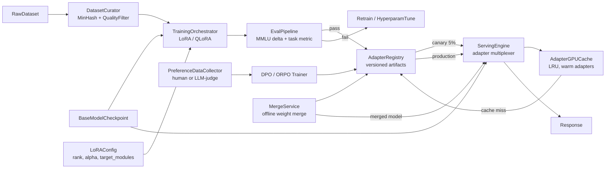

# Chapter 26: Fine-Tuning and Adaptation

## Context

> [!info] Quick Reference
> - **Pattern:** Parameter-efficient adaptation of a pretrained base model for a specific task or domain, with adapters served separately from the base weights
> - **Scale:** Single GPU (A100 80GB) for 7B LoRA training; multi-GPU DDP for 70B; adapter multiplexing at serving time supports 10–100 adapters per base model replica
> - **Key Techniques:** LoRA (low-rank adaptation), QLoRA (4-bit quantized LoRA), instruction tuning, DPO, ORPO, continual learning with EWC, adapter merging and hot-swap serving
> - **Primary Concerns:** Training compute, dataset quality, catastrophic forgetting, serving overhead of adapter loading, evaluation regression against the base model
> - **Cross-references:** [[chapter-02|Chapter 2]] (LLM stack patterns), [[chapter-05|Chapter 5]] (evaluation and guardrails), [[chapter-25|Chapter 25]] (prompt engineering — must precede fine-tuning decision), [[chapter-21|Chapter 21]] (RAG platform — alternative to fine-tuning for knowledge injection), [[chapter-04|Chapter 4]] (PagedAttention KV cache and continuous batching deep dive)

**Problem statement:** Design a production fine-tuning and adaptation system that takes a pretrained base model and a domain-specific dataset, produces a task-specialized model that outperforms the base on target metrics, and serves it efficiently without duplicating base model weights across every adapter variant.

### Real-World Examples

- A legal tech company needs a model that produces clause-level contract analysis in a strict JSON schema with jurisdiction-specific terminology. Zero-shot GPT-4 achieves 71% schema compliance. After instruction tuning a Mistral-7B with 8,000 curated (contract, analysis) pairs using LoRA rank-16, schema compliance reaches 97% and per-request cost drops by 4× (smaller model, no few-shot examples required in the prompt).
- A code intelligence company serves 40 customer-specific code-completion models, each fine-tuned on a different proprietary codebase. Serving 40 full model copies would require 40 × 14GB = 560GB of GPU memory. Using LoRA adapter multiplexing on a single Deepseek-Coder-7B base, all 40 adapters fit in an additional 800MB, reducing GPU fleet size from 12 nodes to 2.

---

## Step 1: Understand the Problem and Establish Design Scope

### Simulated Dialogue

**Interviewer:** Design a fine-tuning and model adaptation system for an enterprise LLM platform.  
**Candidate:** Before proposing a design, I need to understand the task characteristics, data availability, latency requirements, and serving constraints. Let me ask a few questions.

**Candidate:** What is the primary reason the customer wants to fine-tune rather than use the base model with prompting?  
**Interviewer:** Two cases: one customer wants to enforce a very specific output format consistently; another wants to inject domain knowledge not present in the base model.

**Candidate:** For the format-enforcement case — have they tried structured prompting and schema validation with retries?  
**Interviewer:** Yes, they have 500-600 curated examples, and dynamic few-shot gets them to 84% compliance. Fine-tuning is being evaluated to close the remaining gap.

**Candidate:** Good. 500–600 labeled examples is the practical minimum threshold for fine-tuning to outperform well-optimized prompting. That number also determines whether [[glossary#LoRA (Low-Rank Adaptation)|LoRA]] or full fine-tune is feasible. What is the model size and GPU availability?  
**Interviewer:** They have access to 2–4 A100 80GB GPUs and want to fine-tune 7B and potentially 13B models.

**Candidate:** At 7B parameters, full fine-tune with [[glossary#Adam (Adaptive Moment Estimation)|Adam]] optimizer states requires roughly 112GB GPU RAM — beyond a single A100. LoRA reduces trainable parameters from 7B to ~4M and fits in a single A100 in bfloat16. That is the direction I'd recommend. Are multiple tasks being trained simultaneously, or is this one model per task?  
**Interviewer:** Multiple tasks — eventually 20–30 fine-tuned variants for different customers.

**Candidate:** That changes the serving model. We cannot run 30 separate base model copies. We need adapter multiplexing — a single base model process with adapters hot-swapped or batched by adapter ID. How strict is the latency requirement?  
**Interviewer:** Interactive product, p95 < 2 seconds [[glossary#TTFT (Time To First Token)|time-to-first-token (TTFT)]].

**Candidate:** Adapter hot-swap adds 10–30ms of adapter load latency. That is within budget at < 2s TTFT if adapters are cached in GPU memory. Last question: does the customer need the model to retain general capabilities, or is specialization-only acceptable?  
**Interviewer:** Retain general capabilities — it is a customer-facing product where the model must handle off-topic questions gracefully.

**Candidate:** Then we need a regularized training regime — LoRA inherently preserves base weights (only the adapter is trained), so catastrophic forgetting of general capabilities is mitigated by design. For alignment tuning we would use [[glossary#DPO (Direct Preference Optimization)|DPO]] rather than [[glossary#RLHF (Reinforcement Learning from Human Feedback)|RLHF]] for this scale.

### Functional Requirements

- Accept a task-specific dataset (instruction-response pairs or preference pairs) and produce a fine-tuned adapter artifact.
- Support LoRA and QLoRA training on 7B–70B parameter base models on commodity A100 hardware.
- Implement dataset curation pipeline: deduplication, format normalization, quality filtering.
- Support instruction tuning and preference optimization (DPO or ORPO).
- Serve multiple adapter variants on a single base model without duplicating weights.
- Support hot-swap of adapters with < 50ms added latency per swap.
- Evaluate fine-tuned models against held-out test sets and report delta from base model performance.

### Non-Functional Requirements

- **Training time:** 7B model with 10,000 examples and LoRA rank-16 completes in < 4 hours on 1× A100 80GB.
- **GPU efficiency:** QLoRA fits a 7B model in < 12GB VRAM; bfloat16 LoRA fits in < 40GB VRAM.
- **Serving memory:** 30 LoRA adapters (rank-16, 7B model, attention-only) add < 900MB to base model VRAM.
- **Adapter load latency:** cold-load of an adapter from disk to GPU < 200ms; from warm cache < 30ms.
- **Quality gate:** promoted fine-tuned model must not regress > 2% on MMLU relative to the base model; must beat the base model on the target task metric by >= 5%.
- **Reproducibility:** training runs are versioned with dataset hash, hyperparameter config, and base model checkpoint reference.

### Back-of-the-Envelope Estimation

#### Training Compute

Assume:

- **Base model:** 7B parameters, bfloat16 (14GB model weights)
- **LoRA rank:** 16, applied to query and value projections in all 32 attention layers
- **Trainable parameters:** `32 layers × 2 projections × 2 matrices (A, B) × rank-16 × hidden-dim-4096 / 4096 = 32 × 2 × 2 × 16 × 4096 = ~8.4M parameters` (~0.12% of 7B)
- **Dataset:** 10,000 instruction-response pairs, average 512 tokens each
- **Batch size:** 4 (gradient accumulation × 8 = effective batch 32)
- **Epochs:** 3
- **Forward + backward pass time on A100:** ~0.8s per step at batch 4

Total steps: `10,000 × 3 / 32 = 937 steps`  
Training time: `937 × 0.8s ≈ 750s ≈ 12 minutes` per epoch × 3 = **~36 minutes** (excluding data loading, checkpoint saves)

Practical wall-clock with overhead: **2–4 hours** for a full run with eval checkpoints every 200 steps.

#### Adapter Serving Memory

- 7B base model in bfloat16: 14GB
- Each LoRA adapter (rank-16, Q+V projections, 32 layers): `32 × 2 × 2 × 16 × 4096 × 2 bytes (bf16) = ~33MB`
- 30 adapters resident in GPU memory: `30 × 33MB = ~990MB`
- Single A100 80GB: 14GB (base) + 1GB (adapters) + ~20GB (KV cache at batch-32 and 2048 context) = **~35GB** — well within the 80GB budget

#### Dataset Cost

- 10,000 examples curated manually: ~$0.50/example = $5,000
- 10,000 examples from GPT-4 distillation: ~$0.02/example (500 tokens in + 200 tokens out at $2.50/1M and $10/1M) = $200
- QA filtering pass on distilled data: human review of 10% sample = $500

Distillation path: **~$700 total vs $5,000 manual** — 7× cheaper, but requires quality filtering to remove hallucinated examples.

---

## Step 2: Propose High-Level Design and Get Buy-In

### Core Architecture Components

- **Dataset Curator:** ingests raw (prompt, response) or (prompt, chosen, rejected) pairs; runs deduplication (MinHash), format normalization, length filtering, and quality scoring.
- **Training Orchestrator:** schedules training jobs on GPU nodes; injects LoRA config into the base model; manages gradient checkpointing, mixed precision, and optimizer state.
- **Adapter Registry:** versioned store of adapter artifacts (weights file, LoRA config, base model checkpoint reference, eval results, deployment status). Each artifact is addressed by a content hash of the dataset + hyperparameter config + base model ID, enabling reproducible training runs and point-in-time rollback without storing duplicate model weights.
- **Eval Pipeline:** runs fine-tuned adapter against the held-out test set and an MMLU subset; computes task metric delta and general capability delta from the base model; enforces the promotion gate (task delta >= +5%, MMLU delta >= -2%). Rejects adapters that pass task metrics but regress on general capability — catching overfitting to narrow task distributions.
- **Serving Engine:** loads the base model once into GPU memory and keeps it resident; manages an LRU adapter weight cache sized to the top-20 most recently active adapters; routes incoming requests to the correct adapter by `adapter_id`; handles hot-swap in < 200ms on cold cache miss by loading from the Adapter Registry.
- **Preference Data Collector:** (for DPO/ORPO) surfaces model outputs to human annotators or LLM-as-judge for pairwise preference annotation; outputs (prompt, chosen, rejected) triplets formatted for DPO training. Tracks inter-annotator agreement (Cohen's kappa) and flags annotation batches below kappa=0.6 for re-annotation.
- **Merge Service:** offline job triggered for adapters exceeding 30% of total traffic; permanently merges adapter A and B matrices into base model weights (`W_merged = W₀ + BA × α/r`) to produce a zero-overhead serving artifact. Merged models are stored as separate base model variants in the registry — not as adapters — because they cannot be un-merged without reloading the original base weights.

### Pipeline A: Fine-Tuning a New Adapter

1. Raw dataset uploaded to the Dataset Curator. The upload triggers a content hash computation and a duplicate-run check against the registry — if a prior training run used the same dataset hash and LoRA config, the existing adapter is returned without re-training.
2. Deduplication (MinHash, Jaccard threshold 0.85), format normalization to ChatML, length filter (discard examples > 4,096 tokens or response < 10 tokens), quality score filter using perplexity-based outlier removal (remove bottom 10th percentile by base model perplexity on the response).
3. Training Orchestrator launches LoRA training job: injects rank-16 adapters into Q and V projections for all 32 attention layers, trains with AdamW at lr=2e-4 on a cosine schedule with 100-step linear warmup, for 3 epochs with gradient accumulation across 8 micro-batches for an effective batch size of 32.
4. Checkpoint saved every 200 gradient steps to object storage (S3 or GCS); Eval Pipeline immediately runs the checkpoint against the held-out 10% eval split to detect [[glossary#Overfitting|overfitting]] (rising eval loss while train loss decreases) and enable [[glossary#Early Stopping|early stopping]].
5. At training completion: full task benchmark evaluation and MMLU 10-subject delta check against the base model. Both results are recorded in the registry entry to enable historical quality trending across adapter versions.
6. If both eval gates pass (task delta >= +5%, MMLU delta >= -2%): adapter artifact is registered in the Adapter Registry with status `canary` and the training data hash, hyperparameter config, and base model checkpoint reference stored as immutable metadata.
7. 5% of production traffic for that customer is routed to the canary adapter; live quality metrics (task-specific accuracy, p95 latency, error rate) are tracked in a 24-hour monitoring window against the production baseline.
8. Promote to production (100% traffic) or roll back to the previous adapter version via a single registry status update — no redeployment of the serving engine is required because the adapter is loaded by ID at request time.

### Pipeline B: Request-Time Adapter Serving

1. Request arrives with `adapter_id` and prompt. The serving engine validates that the `adapter_id` exists in the registry and is in `production` or `canary` status; unknown or deprecated adapter IDs return a 404 before the forward pass begins.
2. Serving Engine checks adapter GPU cache keyed by `adapter_id`: cache hit (adapter tensors already resident in GPU VRAM) → proceed directly to forward pass with zero swap overhead; cache miss → load adapter from Adapter Registry to GPU in < 200ms cold (NVMe read + PCIe transfer) or < 30ms warm (CPU RAM to GPU via PCIe).
3. Forward pass: base model weights remain frozen on GPU throughout; adapter A and B matrices are applied as additive weight deltas `(B × A × α/r)` at each targeted projection layer before the attention computation — no weight overwriting occurs, so the base model state is unchanged after the request.
4. Response is generated token-by-token via autoregressive decoding and streamed back to the caller; after generation completes, the adapter tensors remain in the GPU LRU cache — not evicted — because the next request for the same customer is highly likely to use the same adapter ID within seconds.

### Mermaid Architecture Diagram



---

## Step 3: Design Deep Dive

The four deep-dive areas represent the core system concerns that a production fine-tuning platform must solve. LoRA and QLoRA mechanics govern the memory and compute feasibility of training — without understanding rank, scaling, and quantization, you cannot reason about GPU budgets. Dataset curation is the highest-leverage intervention in the entire pipeline: a model trained on 1,000 well-curated examples consistently outperforms one trained on 100,000 noisy examples, making quality filtering a first-class engineering concern rather than a preprocessing afterthought. The alignment method — whether RLHF, DPO, or ORPO — determines the infrastructure complexity and the quality ceiling for preference-shaped behavior. Finally, adapter serving mechanics determine whether the system is economically viable at scale: serving 30 customers from one base model rather than 30 separate model copies is the difference between a 2-node and a 12-node GPU fleet.

Focus areas for this chapter:

1. **LoRA / QLoRA Mechanics**
2. **Dataset Curation and Instruction Tuning**
3. **RLHF vs DPO vs ORPO**
4. **Serving Fine-Tuned Adapters**

---

### 1) LoRA / QLoRA Mechanics

#### Low-Rank Decomposition

LoRA (Hu et al., 2022) decomposes the weight update for a linear layer into two low-rank matrices:

```text
W = W₀ + ΔW = W₀ + B × A
```

Where:
- `W₀` ∈ ℝ^(d×k) — frozen pretrained weight matrix
- `A` ∈ ℝ^(r×k) — down-projection; initialized with random Gaussian
- `B` ∈ ℝ^(d×r) — up-projection; initialized with zeros (so ΔW = 0 at training start)
- `r` — the rank hyperparameter (r << min(d, k))

During the forward pass, the output is:

```text
h = W₀x + (B × A)x × (α / r)
```

The `α / r` scaling factor decouples the learning rate sensitivity from the rank choice. `α` is typically set equal to `r` (scaling factor = 1.0) or to `2r` for a slight boost.

> **Why LoRA over full fine-tune:** Full fine-tune of a 7B model requires 112GB+ GPU RAM for Adam optimizer states (2x parameter copies in fp32). LoRA inserts rank-4 matrices only into attention projections — reducing trainable parameters from 7B to ~4M, fitting a single A100 80GB in bfloat16.

> **Why initialize B to zeros:** If both A and B are initialized randomly, the initial output of `BA` is a non-zero random matrix, which creates large gradient noise at the start of training and destabilizes convergence. Initializing B to zero ensures `ΔW = 0` at step 0, so training starts from the pretrained behavior and diverges gradually rather than catastrophically.

#### What Rank r Controls

The rank `r` determines the expressivity of the adapter:

- `r=4`: ~2.1M trainable params for a 7B model. Sufficient for format adherence and simple style tasks.
- `r=16`: ~8.4M trainable params. Sufficient for most instruction-tuning and domain-adaptation tasks.
- `r=64`: ~33.6M trainable params. Diminishing returns for most tasks; justified only for highly complex style transfer or tasks requiring large distributional shifts.

> **Why r=16:** r=4 underperforms on style-transfer tasks; r=64 shows diminishing returns past r=16 at 4× parameter cost. r=16 is the empirical sweet spot for code and instruction tasks.

> **Why not r=4 for domain adaptation:** Domain adaptation requires the adapter to shift the model's probability distribution toward the target domain's vocabulary, syntax, and reasoning patterns. At r=4, the low-rank bottleneck underfits this distributional shift — the adapter does not have enough capacity to represent the change in output distribution, leading to inconsistent domain adherence at inference time.

#### Which Layers to Target

LoRA is typically applied to the query (Q) and value (V) projection matrices in each attention layer. Applying to all four projections (Q, K, V, O) increases expressivity at 2× the parameter count.

| Target Modules | Params (7B, r=16) | Use Case |
|---|---|---|
| Q, V only | ~4.2M | Format adherence, style, instruction following |
| Q, K, V, O | ~8.4M | Domain knowledge injection, significant vocabulary shift |
| Q, K, V, O + MLP up/gate | ~16.8M | Maximum adaptation; approaches full fine-tune quality |

> **Why Q and V, not K:** The key matrix K acts as a lookup index in attention — it determines which positions are attended to. Modifying K disrupts the positional indexing learned during pretraining more severely than modifying Q (the query) or V (the content aggregated at each position). Empirical results show Q+V at r=16 consistently matches Q+K+V+O at r=8 while training faster.

#### QLoRA: 4-Bit Quantization

QLoRA (Dettmers et al., 2023) combines LoRA with 4-bit NormalFloat quantization of the frozen base model weights:

1. Base model weights are quantized to NF4 (4-bit NormalFloat) and remain frozen.
2. LoRA adapter matrices A and B are trained in bfloat16.
3. During the forward pass, base weights are dequantized to bfloat16 for computation, then immediately discarded (not stored in full precision).

Memory comparison for a 7B model:

| Method | GPU RAM | Notes |
|---|---|---|
| Full fine-tune (bfloat16) | ~112GB | Includes Adam optimizer states (2× param copies in fp32) |
| LoRA (bfloat16 base) | ~40GB | Frozen base in bf16 + adapter states |
| QLoRA (NF4 base) | ~10–12GB | Quantized base + bf16 adapter states |

> **Why NF4 over INT4 quantization:** INT4 uniformly maps values to 16 discrete levels, which wastes bits on the tails of the weight distribution (where very few weights actually live). NF4 uses a non-uniform quantization grid derived from a normal distribution — matching the empirical distribution of transformer weights. This reduces quantization error by ~30% at the same bit-width, recovering quality that INT4 loses in the rare but high-magnitude tail weights.

> **Why not quantize the adapter matrices:** The adapter matrices A and B have far fewer parameters than the base model, so the memory saving from quantizing them is negligible (~3MB at r=16). More importantly, they are the only trainable parameters — quantizing them would introduce gradient quantization error that destabilizes training. The benefit is near zero; the cost is significant.

#### Trade-off Table: Adaptation Methods

| Method | GPU RAM (7B) | Training Time | Quality vs Base | Catastrophic Forgetting | Best For |
|---|---|---|---|---|---|
| Full fine-tune | 112GB+ | Hours–days | Best (upper bound) | Severe | Large compute budgets, large datasets (100K+) |
| LoRA (bf16) | 40GB | 1–4 hours | 90–95% of full FT | None (base frozen) | Most production use cases |
| QLoRA (NF4) | 10–12GB | 2–6 hours (slower dequant) | 85–92% of full FT | None (base frozen) | Single GPU, 7B–13B models |
| Adapter (prefix) | 14GB | Fast (~30 min on A100 for 10K examples) | 70–80% of full FT; competitive on style tasks but weaker on domain shift | None (base frozen; only prefix vectors trained) | Lightweight style or tone adaptation where minimal parameter count is prioritized over peak quality |
| Prompt tuning | 14GB | Very fast (~5–15 min); only soft prompt vectors are updated, not any model weights | 60–75% of full FT; quality ceiling is low because no weight change occurs in the model | None | Tasks with < 1,000 examples where a format or persona change is the only goal and quality ceiling does not need to match SFT |

---

### 2) Dataset Curation and Instruction Tuning

#### Quality Over Quantity

The most impactful dataset finding from production fine-tuning: 1,000 high-quality examples consistently outperform 100,000 low-quality examples. The LIMA paper (Zhou et al., 2023) demonstrated this with 1,000 curated instruction pairs producing a model competitive with models trained on 52,000 examples.

Why: a language model's pretraining gives it broad capabilities. Fine-tuning does not teach new facts — it teaches the model how to apply its existing knowledge in a specific format, style, and domain. A single high-quality example of the target format provides more signal than 100 noisy examples where the target behavior is inconsistently demonstrated.

> **Why quality filtering matters more at small dataset sizes:** At 10,000 examples, one noisy example is 0.01% of the data — negligible. At 1,000 examples, one noisy example is 0.1% — still small, but ten noisy examples (1%) can measurably shift the output distribution toward the noise. At 500 examples (the practical minimum), noisy examples have disproportionate influence and can dominate gradient updates for entire hyperparameter steps.

#### Dataset Curation Pipeline

**Step 1: Deduplication (MinHash LSH)**

Near-duplicate examples waste training compute and cause the model to memorize specific phrasings rather than generalize. MinHash with Locality Sensitive Hashing detects near-duplicates at scale:

1. Tokenize each example; extract character-level n-grams (n=3).
2. Compute k=128 MinHash signatures per example.
3. Use LSH with b=32 bands and r=4 rows: examples with Jaccard similarity > 0.85 are near-duplicates.
4. Keep one example per near-duplicate cluster (prefer the longer, more detailed example).

At 100,000 examples, MinHash deduplication runs in O(n) time and typically removes 15–30% of web-scraped data.

> **Why Jaccard threshold 0.85, not 1.0 (exact duplicate):** Exact duplicate detection misses paraphrases and near-identical examples with trivial surface differences (whitespace, punctuation). Near-duplicates with Jaccard > 0.85 provide redundant gradient signal — the model is updated in the same direction for two examples that are functionally identical. At 0.85 threshold, we capture paraphrases while retaining genuinely diverse examples that differ in content.

**Step 2: Format Normalization**

All examples must follow the same conversation format as the target inference format. Common issues in assembled datasets:

- Mixed chat formats: ChatML, Alpaca, ShareGPT, plain text.
- Inconsistent role markers: "Human:", "User:", "### Instruction:".
- Trailing whitespace and encoding artifacts.

Normalize to a single canonical format (e.g., ChatML) before training. A model trained on mixed formats learns multiple format patterns simultaneously, leading to inconsistent output format at inference time.

**Step 3: Length Filtering**

- Discard examples where the input prompt is > 4,096 tokens (exceeds training context length).
- Discard examples where the response is < 10 tokens (likely degenerate: "Yes.", "OK.") unless the task intentionally produces short outputs.
- Discard examples where response length > 4× the median response length (likely runaway generation or copy-pasted noise).

**Step 4: Quality Scoring**

Two practical approaches:

| Method | Cost | Quality | Best For |
|---|---|---|---|
| Perplexity filter | Free — requires only a forward pass through the base model, no annotation labor | Medium — catches incoherent or off-domain text but cannot assess correctness or helpfulness | Removing responses that the base model already considers highly unlikely, which are rarely useful training examples |
| LLM-as-judge scoring | $0.001–0.005/example using GPT-4o; ~100× cheaper than human review at scale | High — structured rubrics (helpfulness, correctness, format compliance) correlate well with human preference at 0.8–0.9 Spearman rank | Ranking all examples by quality score and discarding the bottom 10–20% before training |
| Human review (10% sample) | $0.50–$1.50/example depending on task complexity; use for 10% audit of auto-filtered data | Ground truth — direct measure of the actual quality signal the model should learn; no proxy errors | Calibrating and validating the thresholds set by automated filters; identifying systematic failure modes in LLM-as-judge |
| Reward model scoring | One-time reward model training cost (~4 GPU-hours for a 7B RM) plus $0.0005/example inference | High — directly aligned with the downstream preference objective if the reward model was trained on the same task domain | Tasks where a domain-specific reward model already exists from a previous RLHF run and can be reused to score new data cheaply |

> **Why perplexity filtering works for noise detection:** A high-quality instruction-following dataset should have responses with moderate perplexity under the base model — low enough that the model "knows" the domain, but not so low that the response is a verbatim regurgitation of training data. Responses with very high perplexity (unintelligible, off-topic) or very low perplexity (memorized boilerplate) are filtered.

**Step 5: Negative Example Sourcing**

For tasks requiring refusals or boundary enforcement (e.g., "do not answer questions outside domain X"), the dataset must include negative examples: inputs that should trigger a refusal, paired with well-formed refusal responses. Without negatives, the model never learns the refusal behavior — every fine-tuning gradient pushes toward compliance.

Sources:
- Red-team generation: GPT-4 prompted to generate adversarial inputs for the specific domain. Effective because it produces inputs that are grammatically fluent and semantically adjacent to the in-scope task, which are exactly the cases where the model is most likely to incorrectly comply rather than refuse.
- Production logs: real user inputs that fall outside the intended task scope. These are the highest-fidelity negative examples because they represent actual user behavior — not hypothetical adversarial inputs. Capturing 500–1,000 real out-of-scope examples from production logs and adding well-formed refusal responses dramatically improves boundary enforcement.
- Synthetic mutation: paraphrase valid inputs to create out-of-scope variants by changing the subject, domain, or intent. Cheaper than red-teaming but lower coverage — mutation may not generate the implicit out-of-scope patterns that users actually produce.

> **Why negative examples must be explicitly included in the training set:** Instruction tuning gradients are computed only on examples in the training set. If the training set contains only positive (in-scope, comply) examples, every gradient update pushes the model toward compliance — the model has no learning signal that says "refuse this type of input." At inference time, the model has learned to maximize response quality on in-scope inputs and has no learned behavior for out-of-scope inputs, so it defaults to compliance. Including negative examples (out-of-scope input paired with a well-formed refusal) directly trains the decision boundary between comply and refuse.

#### Instruction Tuning Format

The standard instruction tuning objective is supervised fine-tuning (SFT) on next-token prediction, with loss computed only on the response tokens (not the prompt tokens):

```text
Loss = -Σ log P(y_t | y_<t, x)   for t in response_positions_only
```

Masking the prompt from the loss prevents the model from being penalized for the prompt format, which is not the behavior we want to shape. Training loss on prompt tokens typically hurts instruction-following quality.

> **Why mask prompt tokens from loss:** Including prompt tokens in the loss creates a gradient signal that nudges the model toward generating prompt-like text — the opposite of what instruction tuning targets. The model should learn to produce responses, not to predict the next token of an instruction. Prompt masking is standard in every production instruction tuning framework.

---

### 3) RLHF vs DPO vs ORPO

#### RLHF (Reinforcement Learning from Human Feedback)

RLHF consists of three stages:

1. **SFT stage:** supervised fine-tuning on a curated dataset (same as instruction tuning).
2. **Reward modeling stage:** train a reward model R(prompt, response) on human preference pairs (chosen, rejected).
3. **RL stage:** use PPO (Proximal Policy Optimization) to maximize E[R(prompt, π(prompt))] while keeping the policy close to the SFT model via KL divergence penalty.

Infrastructure requirements:
- SFT model (active policy): 1 copy
- Reward model: 1 copy (typically same size as SFT model)
- Reference model (SFT model frozen): 1 copy
- Value function: 1 additional head or separate model

Effective GPU requirement: **3–4× the base model size** in GPU memory simultaneously.

> **Why not RLHF for domain adaptation:** RLHF requires a trained reward model, PPO loop, and reference model — 3× the infrastructure of DPO. For domain adaptation (not alignment), DPO on preference pairs achieves comparable quality at 1/3 compute.

#### DPO (Direct Preference Optimization)

DPO (Rafailov et al., 2023) eliminates the reward model and RL loop entirely. It directly optimizes the policy using preference pairs (prompt, chosen, rejected) via a closed-form loss derived from the RLHF objective:

```text
L_DPO(π_θ) = -E[(p,y_w,y_l)] [ log σ( β log(π_θ(y_w|p)/π_ref(y_w|p)) - β log(π_θ(y_l|p)/π_ref(y_l|p)) ) ]
```

Where:
- `y_w` = chosen (preferred) response
- `y_l` = rejected (less preferred) response
- `π_ref` = reference model (frozen SFT model)
- `β` = temperature controlling KL divergence penalty strength (typical: 0.1–0.5)

Infrastructure requirements: **2 copies of the model** (active policy + frozen reference).

> **Why DPO over RLHF for most production cases:** DPO is a supervised loss — it trains with standard gradient descent on labeled preference pairs. No PPO rollouts, no reward model inference per step, no critic network. Training stability is dramatically better (PPO has notoriously tight hyperparameter sensitivity), and the infrastructure is identical to SFT training. Quality delta between DPO and RLHF on alignment tasks is small (< 5% on most benchmarks) and shrinks further when the SFT model is high quality.

> **Why RLHF still applies for frontier alignment:** DPO requires a fixed preference dataset — it cannot explore new response distributions during training. RLHF's online RL loop allows the policy to generate novel responses that the reward model scores in real time, enabling the discovery of behaviors not represented in the static preference dataset. For frontier model alignment (where capability gains come from RL exploration), RLHF remains necessary.

#### ORPO (Odds Ratio Preference Optimization)

ORPO (Hong et al., 2024) eliminates the reference model requirement. It combines SFT loss and preference optimization into a single loss:

```text
L_ORPO = L_SFT + λ × L_OR
L_OR = -E [ log σ( log(odds(y_w|p)) - log(odds(y_l|p)) ) ]
odds(y|p) = P(y|p) / (1 - P(y|p))
```

Infrastructure requirements: **1 copy of the model** (no reference model needed).

> **Why ORPO for resource-constrained training:** Eliminating the reference model halves GPU memory for the training process relative to DPO. This matters when the model is large (70B) or GPU budget is tight. ORPO also avoids the distribution mismatch that DPO can exhibit when the SFT model diverges significantly from the reference — a common failure mode in multi-round fine-tuning where the reference model is stale.

> **Why not ORPO by default:** ORPO's odds ratio formulation can produce unstable gradients when response token probabilities approach 0 or 1 — common early in training. DPO's log-ratio formulation is more numerically stable across training stages. For most production use cases with a well-warmed SFT model, DPO is preferred. ORPO is the right choice only when a second model copy is prohibitively expensive.

#### Trade-off Table: Alignment Methods

| Method | GPU Copies | Dataset Required | Stability | Quality (vs RLHF) | Best For |
|---|---|---|---|---|---|
| RLHF (PPO) | 3–4× the base model size simultaneously (policy, reference, reward model, value head) | Preference pairs for reward model training (5K–50K pairs) plus SFT data | Low — PPO has notoriously tight hyperparameter sensitivity; reward hacking and KL collapse are common failure modes requiring careful β and clip-ratio tuning | Baseline upper bound — best for frontier model alignment where online exploration is necessary | Frontier model alignment where the reward model must score novel response distributions not covered by the static preference dataset |
| DPO | 2× (active policy + frozen reference model loaded simultaneously during training) | Preference pairs only (2K–20K pairs); no reward model training data needed | High — standard supervised gradient descent with no RL loop; training loss is monotone and interpretable, making hyperparameter search straightforward | 95–98% of RLHF on most alignment benchmarks; gap widens only for tasks requiring exploration of novel behaviors | Production alignment tuning where a static preference dataset is available and infrastructure cost is a constraint |
| ORPO | 1× (no reference model; SFT and preference loss combined in a single training pass) | Preference pairs only; same as DPO but model learns format and preference simultaneously | Medium — odds ratio gradient can become numerically unstable when response token probabilities are near 0 or 1, requiring careful learning rate warmup | 90–95% of RLHF; slight quality ceiling below DPO due to odds ratio formulation instability and absence of reference model anchor | Resource-constrained settings (single-GPU training for a 13B–70B model) or iterative fine-tuning rounds where the reference model is stale |
| SFT only | 1× (single model copy; simplest possible training setup) | Instruction-response pairs only; no preference annotation required | Very high — standard cross-entropy loss on next-token prediction; no RL, no contrastive objectives, no reference model divergence | N/A — no preference signal is incorporated; quality is bounded by the quality of labeled responses in the training set | Format, schema, or domain adaptation tasks where any response that meets the format constraint is acceptable and quality ordering is not meaningful |

#### When to Use Each Method

Decision framework:

1. **Use SFT only** when: task is format/schema adherence; no human preference data exists; dataset is < 1,000 examples; latency budget for data collection is zero.
2. **Use DPO** when: you have preference pairs (or can generate them with LLM-as-judge); you want alignment to quality/tone preferences beyond what SFT captures; you have two copies of GPU memory available.
3. **Use ORPO** when: GPU memory is the binding constraint; you are fine-tuning iteratively and the SFT model has drifted from its original reference.
4. **Use RLHF** when: you are training a frontier general-purpose model; quality requires online exploration of novel response distributions; you have the infrastructure for a full RL loop.

---

### 4) Serving Fine-Tuned Adapters

#### Adapter Multiplexing

A single base model process can serve multiple LoRA adapters simultaneously using adapter multiplexing:

1. Base model weights are loaded once into GPU memory and remain static.
2. Each adapter's A and B matrices are stored as separate tensors, keyed by adapter ID.
3. Incoming requests are tagged with an adapter ID. The serving engine groups requests by adapter ID within each batch.
4. During the forward pass, the correct adapter delta `(BA × α/r)` is added to the frozen base weight at each targeted layer.

For homogeneous batches (all requests use the same adapter), the overhead is a single matrix addition per targeted layer per forward pass — negligible compute cost.

For heterogeneous batches (multiple adapters in one batch), the overhead is:
- One matrix addition per adapter per targeted layer per forward pass.
- If batch has 8 distinct adapters and 32 layers with 2 targeted projections: `8 × 32 × 2 = 512` extra matrix additions per batch.

At modern GPU compute rates, 512 small matrix additions (rank-16 matrices) add < 0.5ms to the forward pass — well within the 2s TTFT budget.

> **Why multiplexing on a single base rather than separate fine-tuned models:** 30 separate 7B fine-tuned models require `30 × 14GB = 420GB GPU memory` — 6 full A100 80GB nodes. LoRA multiplexing on a single base requires `14GB + 30 × 33MB = ~15GB` — one A100. The cost difference is roughly 5× in GPU fleet size, 5× in power consumption, and 5× in serving infrastructure complexity.

#### Adapter Hot-Swap

When a request arrives for an adapter not currently resident in GPU memory, the serving engine must load it:

- **Cold load (from disk):** adapter file is ~33MB for a 7B rank-16 adapter. NVMe SSD read speed ~3GB/s → disk read time ~11ms. PCIe transfer to GPU ~15GB/s → transfer time ~2ms. Total: **~13–15ms cold load**.
- **Warm load (from CPU RAM):** adapter tensor cached in host RAM. PCIe transfer only: **~2ms**.
- **Cache hit (GPU RAM):** adapter tensors already resident. Forward pass proceeds immediately with **0ms overhead**.

GPU adapter cache management: LRU eviction with a configurable cache budget (e.g., top-20 most recently used adapters always resident). This keeps the 80th-percentile hot adapters in cache, amortizing cold load latency for the long tail.

> **Why LRU over frequency-based eviction:** In production, adapter request patterns are bursty — a customer using adapter A intensively for 10 minutes then going idle. LRU naturally retains the adapters that are currently active. A frequency-based policy might evict a newly introduced adapter that has low historical frequency but is now the most active, causing repeated cold loads during the burst.

#### Adapter Merging for Zero-Overhead Serving

For adapters with very high traffic (e.g., top 3 adapters account for 80% of requests), the adapter delta can be merged permanently into the base weights:

```text
W_merged = W₀ + B × A × (α / r)
```

A merged model is a standard dense model with no adapter overhead — forward passes are identical to the base model in cost. The trade-off: the merged model cannot be easily un-merged (requires re-loading the original base weights).

When to merge:
- Adapter serves > 30% of total traffic, meaning the adapter's forward-pass overhead is paid on enough requests that eliminating it provides a measurable fleet-level compute saving — roughly 0.5ms × 30% of requests per second.
- Adapter is stable (no planned updates in the next 30 days) — merging locks the adapter weights into the base model, so any adapter update requires re-merging a new base model copy, which takes 15–30 minutes of offline processing.
- Zero added latency is required at the p99 level (real-time interactive product with a p99 TTFT budget so tight that even the sub-millisecond adapter delta overhead is unacceptable).

> **Why not merge all adapters by default:** Merging creates a separate full model copy per adapter, eliminating the memory efficiency that multiplexing provides. At 30 adapters, merging all produces `30 × 14GB = 420GB` GPU memory requirement — negating the entire benefit of LoRA serving. Merge only the highest-traffic adapters that justify a dedicated model replica.

#### Continual Learning and Catastrophic Forgetting

When a new task dataset is used to further fine-tune a model that already has an adapter (e.g., updating adapter for quarterly domain knowledge refresh), naive retraining overwrites the adapter weights toward the new data distribution, causing the model to "forget" behaviors learned in the previous training round.

**Mitigation 1: Elastic Weight Consolidation (EWC)**

EWC adds a regularization penalty proportional to the Fisher information of each parameter:

```text
L_EWC = L_task + λ × Σᵢ Fᵢ × (θᵢ - θᵢ*)²
```

Where `Fᵢ` is the diagonal Fisher information for parameter `i` and `θᵢ*` are the parameter values from the previous training round. Parameters that were important for the previous task (high Fisher information) are penalized more heavily for changing.

> **Why EWC rather than simply freezing important parameters:** Freezing completely prevents adaptation of important parameters — the model cannot update them even when the new task requires it. EWC is a soft constraint: parameters important for previous tasks are updated slowly, not blocked entirely. This allows the model to gradually adapt while minimizing forgetting.

**Mitigation 2: Replay Buffers**

Maintain a small buffer (1–5% of new dataset size) of examples from the previous training data. Include replay examples in each training batch. The model sees both old and new data simultaneously, preventing it from fully fitting to the new distribution.

> **Why LoRA inherently mitigates catastrophic forgetting:** The base model weights are frozen during LoRA training — they cannot change regardless of the adapter gradient. Catastrophic forgetting occurs when the same parameters are updated for conflicting tasks. LoRA sidesteps this by separating base (frozen) from adaptation (adapter). The only forgetting risk is within the adapter parameters themselves — which only arises in multi-round continual LoRA training on the same adapter.

**Mitigation 3: Task Vectors**

LoRA adapters can be treated as task vectors in weight space. Arithmetic on adapter weights produces meaningful behavior interpolations:

- `adapter_A + adapter_B` = model that exhibits behaviors of both tasks simultaneously.
- `adapter_merged - adapter_A` = model that retains adapter_merged's capabilities but reduces adapter_A's influence.

This enables composable specialization: a base adapter for domain vocabulary + a separate adapter for output format, combined at inference time by summing adapter weights.

> **Why task vector arithmetic works:** LoRA adapters are low-rank perturbations in the same linear weight space as the frozen base model. Because the base weights are fixed and the adapters represent directions of change rather than absolute weight values, adding two adapters is equivalent to applying both perturbations simultaneously. The linearity holds approximately when the two tasks are not strongly opposed (e.g., combining a "medical domain" adapter with a "JSON format" adapter works well; combining a "verbose" adapter with a "terse" adapter produces cancellation). Empirically, adapter arithmetic degrades gracefully — the interpolated model rarely performs worse than either individual adapter on both tasks.

---

## Practical Implementation

### 1. Fine-Tuning Pipeline (Pseudocode)

```text
FUNCTION run_finetuning_pipeline(
    base_model_id: str,
    raw_dataset_path: str,
    lora_config: LoRAConfig,
    training_config: TrainingConfig,
    output_adapter_path: str
):

    # Stage 1: Dataset Curation
    raw_examples = load_jsonl(raw_dataset_path)
    deduplicated = minhash_deduplicate(raw_examples, jaccard_threshold=0.85)
    normalized = normalize_format(deduplicated, target_format="chatml")
    length_filtered = filter_by_length(normalized, min_tokens=10, max_tokens=4096)
    quality_scored = score_quality(length_filtered, method="perplexity", base_model=base_model_id)
    curated = filter_by_quality_score(quality_scored, percentile_threshold=0.10)  # remove bottom 10%
    train_set, eval_set = split(curated, eval_fraction=0.10)

    # Stage 2: Model Preparation
    model = load_base_model(base_model_id, dtype="nf4" if training_config.use_qlora else "bfloat16")
    model = inject_lora_adapters(model, config=lora_config)
    model = enable_gradient_checkpointing(model)
    optimizer = AdamW(trainable_params(model), lr=training_config.learning_rate)
    scheduler = cosine_schedule(optimizer, warmup_steps=100, total_steps=estimate_steps(train_set, training_config))

    # Stage 3: Training Loop
    FOR epoch IN range(training_config.num_epochs):
        FOR batch IN dataloader(train_set, batch_size=training_config.batch_size):
            with autocast(dtype=bfloat16):
                logits = model(batch.input_ids)
                loss = cross_entropy(logits, batch.labels, ignore_index=-100)  # -100 masks prompt tokens
            loss.backward()
            clip_grad_norm(model.parameters(), max_norm=1.0)
            optimizer.step(); scheduler.step(); optimizer.zero_grad()

        # Checkpoint every 200 steps; eval on held-out set
        IF step % 200 == 0:
            eval_metrics = evaluate(model, eval_set)
            save_adapter_checkpoint(model, output_adapter_path, step=step, metrics=eval_metrics)

    # Stage 4: Final Evaluation and Registration
    final_eval = evaluate(model, eval_set)
    mmlu_delta = compute_mmlu_delta(model, base_model_id, num_subjects=10)
    task_metric = evaluate_task_specific(model, task_benchmark)

    IF mmlu_delta >= -0.02 AND task_metric >= base_task_metric + 0.05:
        save_adapter(model, output_adapter_path)
        register_adapter(AdapterRegistry, adapter_path=output_adapter_path,
                         base_model=base_model_id, eval_results=final_eval,
                         status="canary", ab_weight=0.05)
        RETURN AdapterRegistration(status="success", eval=final_eval)
    ELSE:
        RETURN AdapterRegistration(status="eval_gate_failed", eval=final_eval)
```

### 2. LoRA Training with peft + transformers

```python
# lora_training.py
# Runnable LoRA fine-tuning script using peft and transformers.
# Trains a 7B model on instruction-response pairs with LoRA rank-16.
# Requires: pip install peft transformers datasets accelerate bitsandbytes trl

from __future__ import annotations
import json
from dataclasses import dataclass, field
from typing import Optional

import torch
from datasets import Dataset
from peft import (
    LoraConfig,
    TaskType,
    get_peft_model,
    prepare_model_for_kbit_training,
)
from transformers import (
    AutoModelForCausalLM,
    AutoTokenizer,
    BitsAndBytesConfig,
    TrainingArguments,
)
from trl import SFTTrainer, DataCollatorForCompletionOnlyLM


# --- Configuration -----------------------------------------------------------

@dataclass
class LoRATrainingConfig:
    base_model_id: str = "mistralai/Mistral-7B-v0.1"
    dataset_path: str = "data/curated_train.jsonl"
    output_dir: str = "adapters/mistral-7b-task-v1"
    use_qlora: bool = True          # Set False for full bfloat16 LoRA on large GPU

    # LoRA hyperparameters
    lora_r: int = 16                # Rank. Sweet spot for instruction + domain tasks.
    lora_alpha: int = 16            # Scaling: alpha/r = 1.0. Use 2*r for stronger adaptation.
    lora_dropout: float = 0.05
    target_modules: list[str] = field(
        default_factory=lambda: ["q_proj", "v_proj"]
        # Add "k_proj", "o_proj" for stronger domain shift; adds 2x params.
    )

    # Training hyperparameters
    num_train_epochs: int = 3
    per_device_train_batch_size: int = 4
    gradient_accumulation_steps: int = 8   # Effective batch size = 4*8 = 32
    learning_rate: float = 2e-4
    max_seq_length: int = 2048
    warmup_ratio: float = 0.03
    lr_scheduler_type: str = "cosine"
    save_steps: int = 200
    eval_steps: int = 200
    logging_steps: int = 50
    fp16: bool = False
    bf16: bool = True               # bfloat16 is preferred on A100; use fp16 on older GPUs


# --- Dataset Loading ----------------------------------------------------------

def load_instruction_dataset(path: str) -> Dataset:
    """
    Loads a JSONL dataset with fields: {"prompt": str, "response": str}.
    Formats into ChatML conversation format for SFT training.

    Why ChatML: it is the most widely supported format across open-weight models
    and inference frameworks (vLLM, llama.cpp, TGI). Standardizing on it avoids
    format re-encoding at serving time.
    """
    records = []
    with open(path) as f:
        for line in f:
            obj = json.loads(line)
            # Format as ChatML conversation string
            text = (
                "<|im_start|>system\n"
                "You are a helpful assistant.\n<|im_end|>\n"
                f"<|im_start|>user\n{obj['prompt']}\n<|im_end|>\n"
                f"<|im_start|>assistant\n{obj['response']}\n<|im_end|>"
            )
            records.append({"text": text})
    return Dataset.from_list(records)


# --- Model and Tokenizer Setup -----------------------------------------------

def load_model_and_tokenizer(config: LoRATrainingConfig):
    """
    Loads the base model with optional 4-bit quantization (QLoRA).

    Why load_in_4bit with bnb_4bit_compute_dtype=bfloat16:
    The model weights are stored in NF4 (4-bit) but computation uses bfloat16.
    This gives NF4 memory efficiency while retaining bfloat16 gradient precision
    in the LoRA adapter matrices, which are never quantized.
    """
    tokenizer = AutoTokenizer.from_pretrained(config.base_model_id)
    tokenizer.pad_token = tokenizer.eos_token
    tokenizer.padding_side = "right"  # Required for SFT loss masking

    if config.use_qlora:
        bnb_config = BitsAndBytesConfig(
            load_in_4bit=True,
            bnb_4bit_quant_type="nf4",           # NormalFloat4: lower error than INT4 on normal-distributed weights
            bnb_4bit_compute_dtype=torch.bfloat16,
            bnb_4bit_use_double_quant=True,       # Quantize the quantization constants themselves (~0.4 bits/param saving)
        )
        model = AutoModelForCausalLM.from_pretrained(
            config.base_model_id,
            quantization_config=bnb_config,
            device_map="auto",
            torch_dtype=torch.bfloat16,
        )
        model = prepare_model_for_kbit_training(model)
    else:
        model = AutoModelForCausalLM.from_pretrained(
            config.base_model_id,
            torch_dtype=torch.bfloat16,
            device_map="auto",
        )

    return model, tokenizer


# --- LoRA Injection ----------------------------------------------------------

def inject_lora(model, config: LoRATrainingConfig):
    """
    Injects LoRA adapter matrices into the target modules.

    Why bias="none": training the bias terms provides marginal quality improvement
    at 2x the number of extra parameters relative to the adapter matrices.
    The bias terms in attention projections encode additive shifts that LoRA's
    rank-r update already handles through the B matrix (initialized to zero,
    which covers the same additive shift in the output space).
    """
    lora_config = LoraConfig(
        task_type=TaskType.CAUSAL_LM,
        r=config.lora_r,
        lora_alpha=config.lora_alpha,
        lora_dropout=config.lora_dropout,
        target_modules=config.target_modules,
        bias="none",
        inference_mode=False,
    )
    return get_peft_model(model, lora_config)


# --- Training ----------------------------------------------------------------

def train(config: LoRATrainingConfig) -> None:
    dataset = load_instruction_dataset(config.dataset_path)
    train_size = int(0.9 * len(dataset))
    train_dataset = dataset.select(range(train_size))
    eval_dataset = dataset.select(range(train_size, len(dataset)))

    model, tokenizer = load_model_and_tokenizer(config)
    model = inject_lora(model, config)

    # Print trainable parameter count for verification
    model.print_trainable_parameters()

    # DataCollator that masks prompt tokens from loss computation.
    # Why: we want the model to learn to generate the response, not predict the prompt.
    response_template = "<|im_start|>assistant\n"
    collator = DataCollatorForCompletionOnlyLM(
        response_template=response_template,
        tokenizer=tokenizer,
    )

    training_args = TrainingArguments(
        output_dir=config.output_dir,
        num_train_epochs=config.num_train_epochs,
        per_device_train_batch_size=config.per_device_train_batch_size,
        gradient_accumulation_steps=config.gradient_accumulation_steps,
        learning_rate=config.learning_rate,
        warmup_ratio=config.warmup_ratio,
        lr_scheduler_type=config.lr_scheduler_type,
        bf16=config.bf16,
        fp16=config.fp16,
        logging_steps=config.logging_steps,
        save_steps=config.save_steps,
        eval_steps=config.eval_steps,
        evaluation_strategy="steps",
        save_total_limit=3,
        load_best_model_at_end=True,
        metric_for_best_model="eval_loss",
        report_to="none",           # Replace with "wandb" for production tracking
        gradient_checkpointing=True,  # Reduces activation memory ~40% at 20% compute cost
        optim="paged_adamw_8bit" if config.use_qlora else "adamw_torch",
    )

    trainer = SFTTrainer(
        model=model,
        train_dataset=train_dataset,
        eval_dataset=eval_dataset,
        tokenizer=tokenizer,
        args=training_args,
        data_collator=collator,
        dataset_text_field="text",
        max_seq_length=config.max_seq_length,
    )

    trainer.train()
    trainer.save_model(config.output_dir)
    tokenizer.save_pretrained(config.output_dir)
    print(f"Adapter saved to {config.output_dir}")


if __name__ == "__main__":
    cfg = LoRATrainingConfig(
        base_model_id="mistralai/Mistral-7B-v0.1",
        dataset_path="data/curated_train.jsonl",
        output_dir="adapters/mistral-7b-task-v1",
        use_qlora=True,
    )
    train(cfg)
```

### 3. Adapter Hot-Swap Serving

```python
# adapter_serving.py
# Runnable adapter multiplexing server using peft + transformers.
# Loads a single base model and hot-swaps LoRA adapters per request.
# In production, replace with vLLM's LoRA serving API for higher throughput.
# Requires: pip install peft transformers fastapi uvicorn

from __future__ import annotations
import time
from collections import OrderedDict
from pathlib import Path
from threading import Lock

import torch
from fastapi import FastAPI, HTTPException
from peft import PeftModel
from pydantic import BaseModel
from transformers import AutoModelForCausalLM, AutoTokenizer, pipeline


# --- Adapter Cache -----------------------------------------------------------

class AdapterCache:
    """
    LRU cache for LoRA adapter weight tensors in GPU memory.
    Thread-safe via a lock; suitable for single-process serving.

    Why LRU: adapter request patterns are bursty. The most recently used
    adapter is the most likely to be needed again in the next few seconds.
    LRU retains the current active adapter in cache, avoiding repeated
    cold loads during a user session.
    """

    def __init__(self, max_adapters: int = 20):
        self.max_adapters = max_adapters
        self._cache: OrderedDict[str, "PeftModel"] = OrderedDict()
        self._lock = Lock()
        self._stats = {"hits": 0, "misses": 0, "evictions": 0}

    def get(self, adapter_id: str) -> "PeftModel | None":
        with self._lock:
            if adapter_id in self._cache:
                self._cache.move_to_end(adapter_id)   # Mark as most recently used
                self._stats["hits"] += 1
                return self._cache[adapter_id]
            self._stats["misses"] += 1
            return None

    def put(self, adapter_id: str, model: "PeftModel") -> None:
        with self._lock:
            if adapter_id in self._cache:
                self._cache.move_to_end(adapter_id)
            else:
                if len(self._cache) >= self.max_adapters:
                    evicted_id, _ = self._cache.popitem(last=False)  # Remove LRU
                    self._stats["evictions"] += 1
                    # GPU memory freed when the PeftModel tensor is garbage collected
                    print(f"[AdapterCache] Evicted adapter: {evicted_id}")
                self._cache[adapter_id] = model

    @property
    def stats(self) -> dict:
        with self._lock:
            return dict(self._stats, size=len(self._cache))


# --- Serving Engine ----------------------------------------------------------

class AdapterServingEngine:
    """
    Serves a single base model with multiple LoRA adapters.

    How adapter swap works:
    1. The base model (frozen weights) is loaded once into GPU memory.
    2. For each adapter, a PeftModel wraps the base and loads adapter weights.
    3. PeftModel forward pass adds the adapter delta (B×A) at each targeted layer.
    4. When swapping adapters, only the adapter weight tensors change — the base
       model weights remain in GPU memory and are not reloaded.

    Why PeftModel instead of manual weight injection:
    PeftModel handles the layer-level wiring, device placement, and forward pass
    hooks automatically. Manual injection at each layer is error-prone and
    breaks with model architecture changes. PeftModel is the production-standard
    interface maintained by Hugging Face.
    """

    def __init__(
        self,
        base_model_id: str,
        adapters_root: str,
        max_cached_adapters: int = 20,
    ):
        self.base_model_id = base_model_id
        self.adapters_root = Path(adapters_root)
        self.cache = AdapterCache(max_adapters=max_cached_adapters)

        print(f"[ServingEngine] Loading base model: {base_model_id}")
        self.tokenizer = AutoTokenizer.from_pretrained(base_model_id)
        self.tokenizer.pad_token = self.tokenizer.eos_token

        self.base_model = AutoModelForCausalLM.from_pretrained(
            base_model_id,
            torch_dtype=torch.bfloat16,
            device_map="auto",
        )
        self.base_model.eval()
        print("[ServingEngine] Base model loaded.")

    def _load_adapter(self, adapter_id: str) -> PeftModel:
        """
        Loads a LoRA adapter from disk and wraps the base model.
        Cold load: ~15ms for a 33MB adapter (NVMe SSD + PCIe transfer).
        """
        adapter_path = self.adapters_root / adapter_id
        if not adapter_path.exists():
            raise FileNotFoundError(f"Adapter not found: {adapter_path}")

        t0 = time.perf_counter()
        model = PeftModel.from_pretrained(
            self.base_model,
            str(adapter_path),
            is_trainable=False,
        )
        model.eval()
        elapsed_ms = (time.perf_counter() - t0) * 1000
        print(f"[ServingEngine] Loaded adapter '{adapter_id}' in {elapsed_ms:.1f}ms")
        return model

    def get_model(self, adapter_id: str) -> PeftModel:
        """Returns the cached adapter model or loads it on cache miss."""
        model = self.cache.get(adapter_id)
        if model is None:
            model = self._load_adapter(adapter_id)
            self.cache.put(adapter_id, model)
        return model

    @torch.inference_mode()
    def generate(
        self,
        adapter_id: str,
        prompt: str,
        max_new_tokens: int = 512,
        temperature: float = 0.1,
    ) -> str:
        model = self.get_model(adapter_id)
        inputs = self.tokenizer(prompt, return_tensors="pt").to(model.device)

        output_ids = model.generate(
            **inputs,
            max_new_tokens=max_new_tokens,
            temperature=temperature,
            do_sample=temperature > 0,
            pad_token_id=self.tokenizer.eos_token_id,
        )
        # Decode only the newly generated tokens (not the input prompt)
        new_tokens = output_ids[0][inputs["input_ids"].shape[1]:]
        return self.tokenizer.decode(new_tokens, skip_special_tokens=True)


# --- FastAPI Server ----------------------------------------------------------

app = FastAPI(title="LoRA Adapter Serving Engine")

# Initialize once at startup (replace paths for your environment)
engine = AdapterServingEngine(
    base_model_id="mistralai/Mistral-7B-v0.1",
    adapters_root="adapters/",
    max_cached_adapters=20,
)


class GenerateRequest(BaseModel):
    adapter_id: str
    prompt: str
    max_new_tokens: int = 512
    temperature: float = 0.1


class GenerateResponse(BaseModel):
    adapter_id: str
    response: str
    cache_stats: dict


@app.post("/generate", response_model=GenerateResponse)
def generate(req: GenerateRequest) -> GenerateResponse:
    try:
        response_text = engine.generate(
            adapter_id=req.adapter_id,
            prompt=req.prompt,
            max_new_tokens=req.max_new_tokens,
            temperature=req.temperature,
        )
    except FileNotFoundError as e:
        raise HTTPException(status_code=404, detail=str(e))

    return GenerateResponse(
        adapter_id=req.adapter_id,
        response=response_text,
        cache_stats=engine.cache.stats,
    )


@app.get("/cache/stats")
def cache_stats() -> dict:
    return engine.cache.stats


@app.post("/cache/warmup")
def warmup(adapter_ids: list[str]) -> dict:
    """Pre-load adapters into GPU cache before traffic arrives."""
    loaded = []
    for aid in adapter_ids:
        try:
            engine.get_model(aid)
            loaded.append(aid)
        except FileNotFoundError:
            pass
    return {"loaded": loaded, "cache_stats": engine.cache.stats}


# Run with: uvicorn adapter_serving:app --host 0.0.0.0 --port 8000
```

---

## Step 4: Wrap Up

### Final Design Summary

- **LoRA over full fine-tune for 7B–70B models:** reduces trainable parameters from billions to millions, fitting training on a single A100 80GB. Base weights stay frozen, eliminating catastrophic forgetting risk and enabling adapter multiplexing at serving time. Full fine-tune is justified only at 100K+ labeled examples and maximum quality requirements.
- **DPO over RLHF for production alignment:** DPO achieves 95–98% of RLHF quality at 1/3 the infrastructure — no reward model, no PPO loop, no value network. Use RLHF only when the task requires online exploration of novel behaviors not represented in the static preference dataset.
- **Adapter multiplexing over separate model copies:** 30 LoRA adapters on a single base model require ~15GB GPU RAM vs 420GB for 30 separate full models. Serving cost is 5× lower with < 1ms added forward-pass overhead for homogeneous batches.
- **Quality gate before production promotion:** fine-tuned adapters must pass MMLU delta >= -2% and task metric delta >= +5% relative to the base model before any production traffic. Without a gate, regressions ship silently. The gate catches underfitting (insufficient training data, wrong hyperparameters) and alignment failures (DPO divergence, reward hacking).

### Wrap-Around Concerns

- **Release engineering:** promote adapters through a canary + shadow path before they touch real traffic. A newly trained LoRA adapter must first clear the quality gate (MMLU delta >= -2%, task metric delta >= +5%) offline, then receive 1–5% of live traffic on the multiplexed base model while its quality and safety metrics are compared against the incumbent adapter. Because adapters are deltas atop a frozen base, rollback is a registry pointer swap — the prior adapter is re-attached in under a second with no model reload. The rollback trigger must be a pre-agreed threshold (e.g., "if task win-rate drops more than 5 points or refusal rate rises above baseline, revert automatically") rather than a manual call under incident pressure.
- **Governance:** treat every adapter as a versioned, auditable artifact bound to its training inputs. Each adapter in the registry must record its base model version, LoRA rank/alpha, the DPO preference dataset version and its content hash, the hyperparameters, and the full quality-gate report, so any production behavior can be traced back to the exact data and config that produced it. Preference datasets and training corpora must be versioned and approval-gated, and dataset-contamination checks (13-gram overlap filtering against eval benchmarks) must be logged as part of the lineage so benchmark scores can be trusted. Approval to promote is a recorded decision, not an implicit side effect of training completing.
- **Cost controls:** exploit adapter multiplexing and right-size the training fleet. Serving 30 adapters on one base model holds GPU cost ~5× below 30 separate full models, so the registry should consolidate adapters onto shared bases and reclaim idle ones rather than spinning up dedicated copies. Training cost is bounded by defaulting to single-A100-80GB LoRA jobs and reserving full fine-tunes for the 100K+ labeled-example, maximum-quality cases that justify them; per-job token and step budgets prevent a misconfigured run (wrong learning rate, too many epochs) from burning a fleet for days. Track break-even per adapter — a $500 fine-tune that saves $0.01/call breaks even at 50K calls — and retire adapters whose call volume never reaches it.
- **Drift controls:** track quality per adapter and per base model version so regressions are attributable. Task win-rate, MMLU delta, and refusal/alignment-violation rates must be stored against each adapter version, since a new base model release or a re-trained adapter can re-introduce catastrophic forgetting or DPO divergence that the prior version had suppressed. Production quality signals should be compared continuously against the gate baseline; a sustained drop below the +5% task-metric margin or a creep in MMLU degradation past -2% triggers re-evaluation and, if needed, a retrain on a refreshed preference set with a general-instruction regularizer (5–10% FLAN/OpenHermes mix) to restore retained behavior.

---

## Step 5: Interviewer Curveballs

### Interviewer Follow-ups & Frequently Asked Questions (FAQ)

Q: When should you fine-tune vs use RAG vs prompt-engineer, and what thresholds drive the decision?

**The Ideal Answer:** Use prompt engineering first — it has zero training cost and zero serving complexity. Move to RAG when knowledge is too large for a prompt (> 10K tokens of context) or must be updated frequently without retraining. Move to fine-tuning when: (1) you have > 500 labeled examples, (2) task-specific style or schema adherence cannot be achieved through prompting, (3) latency budget requires shorter prompts (fine-tuned model needs no few-shot examples), or (4) inference cost must be reduced (a fine-tuned 7B model can replace a GPT-4 call for a narrow task at 1/30th the cost). Never fine-tune for knowledge injection — the model will hallucinate knowledge not in training data; use RAG for knowledge, fine-tuning for behavior.

**Deep Dive & Trade-offs:**
- The 500-example threshold is a practical minimum, not a guarantee. Below 500 examples, fine-tuning rarely outperforms dynamic few-shot prompting with a strong base model.
- RAG and fine-tuning are not mutually exclusive: fine-tune for style/format, use RAG for dynamic knowledge retrieval.
- Cost of fine-tuning is amortized over inference calls. Break-even: if fine-tuning costs $500 and saves $0.01/call (smaller model or fewer few-shot tokens), break-even is 50,000 calls.
- Quality plateau test: if dynamic few-shot with 5 examples reaches >= 90% of fine-tune quality on your eval set, fine-tuning is premature optimization.

**The Interviewer's Rubric:** The interviewer is checking whether the candidate has a concrete decision framework with thresholds, not just "it depends."

---

Q: What happens when you set LoRA rank too high or too low?

**The Ideal Answer:** Too low (r=1–2): the adapter bottleneck is too narrow — it cannot represent the required distributional shift, leading to underfitting on the target task even with sufficient data. Style transfer and domain adaptation tasks show the clearest degradation. Too high (r=128–256): the adapter approaches a full-rank update for that layer, losing the parameter efficiency benefit. Training time increases, and the adapter may overfit the training set if data is limited. Empirically, r=16 is the sweet spot for instruction and code tasks; r=8 suffices for simple format tasks; r=64 is justified only for tasks requiring large distributional shifts (e.g., adapting an English model to a low-resource language).

**Deep Dive & Trade-offs:**
- The rank controls the intrinsic dimensionality of the adaptation. If the task requires a low-dimensional shift (formatting change), low rank suffices. High-dimensional shifts (new domain vocabulary, new reasoning patterns) need higher rank.
- A practical rank-selection heuristic: start at r=16, evaluate. If still underfitting on the eval set, try r=32. If overfitting (train loss << eval loss), reduce to r=8 and increase regularization (lora_dropout=0.1).
- Alpha/rank ratio matters independently: alpha=32 at r=16 (scaling=2.0) amplifies adapter influence and can destabilize training on small datasets. Start with alpha=r (scaling=1.0).

**The Interviewer's Rubric:** The interviewer is checking mechanistic understanding of LoRA rank, not memorized "r=16 is best."

---

Q: Your fine-tuned model performs well on the task benchmark but shows 15% degradation on MMLU. What happened and how do you fix it?

**The Ideal Answer:** This is catastrophic forgetting of general capabilities — the fine-tuning gradient pushed the model strongly toward the task distribution, overwriting some of the general-purpose knowledge encoded in the pretrained weights. Likely causes: too high a learning rate (2e-3 instead of 2e-4), too many epochs on a small dataset, or full fine-tune instead of LoRA. Fix: if using LoRA, verify the base weights are actually frozen (peft should handle this — check for accidental requires_grad=True on base params). If using full fine-tune, switch to LoRA. If LoRA was used but degradation is in the adapter, add an EWC penalty term weighted by the Fisher information from the base model, or add MMLU examples to the training mix as a regularizer (10% of training data).

**Deep Dive & Trade-offs:**
- With LoRA, MMLU degradation should be < 2% because base weights are frozen. A 15% degradation with LoRA suggests either the base weights were not actually frozen or the evaluation is comparing the wrong checkpoints.
- Full fine-tune MMLU degradation of 15% on a 7B model fine-tuned with lr=2e-4 for 3 epochs on 10K examples is typical — the task gradient is strong relative to the pretraining distribution.
- The minimum MMLU regularization: include 5% of training data as general instruction-following examples from a dataset like FLAN or Open Hermes. This forces the model to retain general behavior alongside task-specific adaptation.
- If MMLU degradation is acceptable for the use case (pure task-specific deployment), skip MMLU gating and evaluate only on task-specific held-out set and real-user quality metrics.

**The Interviewer's Rubric:** The interviewer is checking whether the candidate can diagnose the failure mode and propose a targeted fix, not just say "reduce learning rate."

---

Q: How do you handle dataset contamination — training data that overlaps with your evaluation benchmark?

**The Ideal Answer:** Contamination inflates benchmark metrics and gives false confidence in model quality. Prevention: before training, hash all evaluation benchmark examples (n-gram fingerprints) and filter any training examples with n-gram overlap > 13-grams. Detection post-hoc: if the fine-tuned model dramatically outperforms the base on a benchmark by > 20 points, suspect contamination. Remediation: remove contaminated examples, retrain, and evaluate on a held-out task-specific test set you control (not public benchmarks).

**Deep Dive & Trade-offs:**
- The 13-gram threshold for contamination detection is standard (used by GPT-4 and LLaMA evaluation papers). Shorter n-grams produce too many false positives; longer n-grams miss paraphrase contamination.
- For instruction tuning datasets sourced from web scrapes or LLM-generated data, contamination with MMLU and other public benchmarks is common — studies have found 5–15% contamination rates in popular open datasets.
- The safest evaluation practice: maintain a private held-out test set that was never published and never used in any public dataset. Public benchmarks should be treated as supplementary, not primary, evaluation signals for fine-tuned models.
- Contamination in preference datasets for DPO is a different risk: if the chosen/rejected pairs were generated using the evaluation benchmark prompts, the model learns to prefer the "correct" answer for those exact prompts without generalizing.

**The Interviewer's Rubric:** The interviewer is checking awareness of data hygiene practices in fine-tuning, not just training mechanics.

---

Q: How would you serve 100 LoRA adapters on a single A100 80GB without running out of memory?

**The Ideal Answer:** 100 adapters at 33MB each = 3.3GB of adapter weights — well within the 80GB budget alongside the 14GB base model. All 100 adapters can reside in GPU memory simultaneously. The constraint is not memory but routing: the serving engine must batch requests by adapter ID to avoid switching adapters mid-batch, which would require serializing computation. Use a request queue partitioned by adapter ID; accumulate up to 32 requests for the same adapter or wait up to 10ms (whichever comes first), then dispatch as a homogeneous batch. For a cold-start adapter that has never been requested, load it on first request (< 15ms) and keep it in the always-resident pool.

**Deep Dive & Trade-offs:**
- At 100 adapters × 33MB = 3.3GB, all fit in memory with room to spare. The memory constraint becomes binding at ~2,000 adapters (66GB for adapters alone).
- Homogeneous batching (same adapter ID per batch) is zero-overhead. Heterogeneous batching (multiple adapter IDs per batch) requires one weight delta computation per adapter per targeted layer — workable at 8 adapters per batch but inefficient at 32+.
- vLLM's LoRA serving implementation (as of v0.4+) supports this pattern natively with `--enable-lora --max-loras 100`. In production, prefer vLLM over a custom serving implementation for its PagedAttention KV cache and continuous batching.
- For adapters beyond GPU memory capacity: use CPU offloading with adapter weights pinned in host RAM, accepting the PCIe transfer overhead (~2ms per swap) rather than disk I/O (~15ms).

**The Interviewer's Rubric:** The interviewer is checking whether the candidate can reason about memory budgets and batching strategies at scale, not just describe LoRA in theory.

---

Q: A customer wants to continually update their fine-tuned model weekly with new data. How do you prevent quality drift over time?

**The Ideal Answer:** The risk is two-directional: (1) forgetting — the new training overwrites behaviors learned in previous rounds; (2) drift — the model gradually optimizes for the most recent distribution, losing coverage of the full task distribution. Mitigations: (1) use LoRA — base weights are frozen, so only the adapter is updated, limiting forgetting to the adapter parameter space. (2) maintain a curated replay buffer of 5–10% of previous training data; include it in every weekly training run. (3) add a quality gate that compares the new adapter against both the task benchmark and a set of "golden" examples from the first training run. (4) version every weekly adapter in the registry with its training data hash for debugging regressions.

**Deep Dive & Trade-offs:**
- Replay buffer size trade-off: 5% replay provides substantial forgetting protection; 20% replay slows adaptation to the new distribution. The right fraction depends on how much the weekly data distribution shifts relative to the historical data.
- An alternative to replay: EWC penalty weighted by Fisher information. More principled than replay but adds computational overhead (computing Fisher information requires one forward pass per training example from the previous round).
- Weekly training cadence with small datasets (500 new examples/week) risks overfitting to the latest week. Better: batch weekly data and retrain monthly with the full accumulated dataset, or use a sliding window of the last 4 weeks + 5% historical replay.
- Monitoring for drift: track the distribution of model output embeddings over time using a reference set. Significant cluster shift (cosine distance > 0.05 from week-1 embeddings on the reference set) is an early warning signal for behavioral drift.

**The Interviewer's Rubric:** The interviewer is checking whether the candidate treats continual learning as a systems problem with monitoring and gates, not just a training loop change.

---

Q: What is the difference between instruction tuning and preference tuning, and when do you need both?

**The Ideal Answer:** Instruction tuning (SFT) teaches the model *what* to do — it learns to produce outputs in the correct format, domain, and style by maximizing the likelihood of labeled responses. Preference tuning (DPO/RLHF) teaches the model *which of multiple valid responses is better* — it learns a relative quality ordering from (chosen, rejected) pairs. You need both when: the task has a correct format (SFT handles this) AND quality varies significantly among format-correct responses (preference tuning handles this). Example: a medical summarization model needs SFT to learn the correct JSON schema and domain terminology, then DPO to learn to prefer summaries that are more concise and avoid hedging language — a preference signal that SFT cannot capture from a single labeled response.

**Deep Dive & Trade-offs:**
- SFT alone is sufficient when the task has a single correct output (code that either passes tests or does not; JSON that either validates or does not). Preference tuning adds no value when there is no meaningful quality ordering among correct responses.
- Preference tuning alone (without SFT) typically produces poor results because the model has no anchor for the correct format. The (chosen, rejected) signal teaches relative preference but not the absolute target behavior.
- SFT → DPO is the standard production order. Some research shows SFT → RLHF → DPO (using RLHF-generated preference pairs for DPO) outperforms SFT → DPO directly, at the cost of one additional RLHF training round.
- For purely format/schema tasks where any model-generated response either satisfies the schema or not, skip DPO entirely. Reserve the data collection and training cost for tasks where human preference signal is meaningfully correlated with output quality.

**The Interviewer's Rubric:** The interviewer is checking whether the candidate understands the distinct learning signal each method provides, not just the implementation mechanics.

---

Q: Your DPO training loss decreases but validation reward accuracy stays at 50% (random). What is wrong?

**The Ideal Answer:** The DPO model is fitting to formatting or length differences between chosen and rejected responses, not to quality differences. This is a dataset problem: the preference pairs are not cleanly annotated. Common causes: annotators prefer longer responses regardless of quality (length bias), prefer responses in a specific format, or the chosen/rejected label is noisy (disagreement between annotators). Fix: audit the preference dataset for spurious correlations — compute the average length ratio between chosen and rejected responses. If chosen responses are > 20% longer on average, length bias is present. Resample preference pairs to have balanced length distributions, or filter pairs where the only observable difference is length.

**Deep Dive & Trade-offs:**
- 50% reward accuracy on the validation set means the DPO model has not learned any preference signal — the training loss decrease is coming from learning to produce responses that superficially resemble the chosen examples (same length, same format) without actually capturing quality differences.
- The β parameter in DPO controls KL divergence penalty strength. Very low β (< 0.05) allows the model to diverge strongly from the reference model — sometimes causing reward hacking on noisy preference signals. Increase β to 0.5 to constrain the policy closer to the reference model, reducing the model's ability to exploit noisy labels.
- Always audit preference datasets with these statistics before training: (1) average chosen/rejected length ratio, (2) inter-annotator agreement (Cohen's kappa — target > 0.6 for DPO), (3) correlation between chosen selection and response position (position bias: annotators preferring the first option shown).
- If the preference dataset cannot be cleaned, fall back to SFT on the chosen responses only, discarding the rejected responses entirely. This loses the contrastive signal but avoids training on noisy preference labels.

**The Interviewer's Rubric:** The interviewer is checking whether the candidate can diagnose training failures at the data level, not just the model or algorithm level.

---

## Exercises

**[Design] Exercise 1: Fine-Tuning Decision Framework**  
A B2B SaaS company has three use cases: (A) a customer support chatbot that must always respond in a specific tone and never discuss competitors, (B) a code review assistant that flags security vulnerabilities in Python using their internal security policy document (50 pages, updated monthly), (C) a medical terminology normalizer that maps free-text clinical notes to ICD-10 codes with 99% accuracy. For each use case, decide between prompt engineering, RAG, and fine-tuning. Justify each decision with concrete thresholds: how many labeled examples would change your recommendation, what latency or cost constraint tips the decision, and what failure mode makes your chosen approach the safer bet.

*Key considerations:* (1) For use case A, evaluate whether a system prompt plus a few-shot style example achieves the tone requirement before committing to fine-tuning — if dynamic few-shot gets the chatbot to 90% tone adherence, the marginal gain from fine-tuning may not justify the data collection cost. (2) For use case B, the monthly-update cadence of the security policy document is a strong signal toward RAG — fine-tuning on a document that changes every 30 days requires a full retraining cycle each month, whereas RAG only requires re-indexing the updated document. Quantify the retraining cost: if monthly fine-tuning takes 4 GPU-hours at $3/GPU-hour = $12/month, compare that to RAG serving infrastructure costs. (3) For use case C, 99% accuracy on ICD-10 mapping is a precision target — evaluate the base model's zero-shot accuracy first; if it is already at 85%, determine whether the remaining gap (85% → 99%) can be closed by fine-tuning with 2,000–5,000 labeled (note, ICD-10 code) pairs, or whether the error cases require structured medical knowledge graphs that RAG can provide more reliably. (4) Consider the evaluation strategy for each approach: what is the held-out test set, how is it constructed, and does it reflect the distribution of live production inputs rather than idealized examples.

**[Design] Exercise 2: Multi-Tenant Adapter Serving Architecture**  
You are designing a serving system for a platform that offers fine-tuned LLMs as a service: each of 500 enterprise customers has a unique LoRA adapter (7B base model, rank-16). Design the full serving architecture: GPU fleet sizing, adapter cache strategy, request routing, SLA guarantees (p95 TTFT < 2s), and the cold-start mitigation plan for adapters that have not been requested in 24 hours. Include: how you would handle a spike where 50 customers all send traffic simultaneously with adapters not currently in cache, and how the serving cost per customer scales with traffic patterns.

*Key considerations:* (1) Compute the memory budget: 500 adapters × 33MB = 16.5GB — all 500 fit in an A100 80GB alongside the 14GB base model with room for KV cache. The constraint is not memory but request throughput and batching efficiency. Calculate how many concurrent requests a single A100 can serve at the target p95 TTFT. (2) Adapter routing strategy: requests must be queued by adapter ID to maximize batch homogeneity. A request from customer A waiting 10ms for a homogeneous batch is preferable to immediately forwarding it in a heterogeneous batch that runs 3× slower due to per-adapter delta overhead at each layer. Design the queue with a max-wait-time parameter (e.g., 10ms) beyond which the request is dispatched individually rather than batching. (3) Cold-start spike handling: 50 simultaneous cold-load requests at 15ms each cannot all be satisfied within the 2s TTFT budget if the loading is serialized. Parallelize adapter loads across CPU threads (PCIe bandwidth is the ceiling at ~15GB/s, not thread count) and quantify: 50 × 33MB / 15GB/s = 110ms total transfer time if pipelined — well within budget. (4) Per-customer cost modeling: a customer who generates 100 requests/day amortizes the adapter cold-start overhead very differently from a customer generating 100,000 requests/day. Model whether low-traffic customers should share GPU nodes or be offloaded to CPU-hosted inference with adapters in host RAM.

**[Implementation] Exercise 1: DPO Training Loop**  
Implement a DPO training step function from scratch using PyTorch (no TRL library). Your function signature: `dpo_loss(policy_model, reference_model, prompt_ids, chosen_ids, rejected_ids, beta=0.1) -> Tensor`. Compute the log probability of the chosen and rejected responses under both the policy and reference models, apply the DPO loss formula, and return the scalar loss. Handle the case where chosen and rejected responses have different lengths by padding to the same length with a mask. Explain why you compute log probabilities over response tokens only, not prompt tokens.

*Key considerations:* (1) Log probability computation: the log probability of a sequence is the sum of per-token log probabilities over the response positions — use `log_softmax` over the vocabulary dimension and index by the actual token IDs. Sum (not mean) over the sequence length to avoid length bias in the loss, but normalize by sequence length if chosen and rejected responses differ significantly in length. (2) Numerical stability: the DPO loss involves computing `log(π_θ(y|x) / π_ref(y|x)) = log π_θ - log π_ref`. Both values can be large negative numbers; compute their difference in log space rather than computing probabilities first and then taking a ratio, which will underflow to zero. (3) Reference model handling: the reference model must be run with `torch.no_grad()` to avoid computing gradients through it — only the policy model should accumulate gradients. If memory is tight, run the reference model in a separate forward pass after the policy forward pass and detach before the loss computation. (4) Validate that the loss decreases correctly: a correctly implemented DPO loss should start near `log(0.5) ≈ -0.693` (random initial policy) and decrease as the policy learns to assign higher probability to chosen responses relative to rejected ones.

**[Implementation] Exercise 2: MinHash Deduplication Pipeline**  
Implement a dataset deduplication pipeline that: (1) extracts character-level 3-grams from each text example, (2) computes 128 MinHash signatures using a fixed set of hash functions, (3) uses LSH with 32 bands and 4 rows per band to identify near-duplicate candidate pairs, (4) filters candidates to Jaccard similarity > 0.85 using exact MinHash comparison, and (5) returns a deduplicated dataset keeping the longer example from each near-duplicate cluster. Test on a dataset of 10,000 examples where 20% are near-duplicates. Report the number of examples removed and the wall-clock time for the full pipeline.

*Key considerations:* (1) LSH false positive rate: the band/row configuration (32 bands × 4 rows) gives a collision probability of approximately `1 - (1 - s^4)^32` where s is the Jaccard similarity. At s=0.85, this is ~99.8% detection probability with a false positive rate that must be filtered by the exact Jaccard check in step 4. Compute the expected number of false positive candidate pairs for your dataset size and verify that the exact comparison step is fast enough to process them within the time budget. (2) Union-Find for clustering: naive pairwise duplicate removal (keep one from each pair) misses transitive duplicates — if A≈B and B≈C but A is not directly compared to C, all three should be in the same cluster. Use a Union-Find (disjoint set) data structure to group all near-duplicates transitively before selecting which to keep. (3) Hash function seeding: the 128 hash functions must be fixed and deterministic across runs so that the deduplication is reproducible — any non-determinism in the hash functions produces different deduplication outcomes on the same dataset, making training runs non-reproducible. (4) Benchmark the time complexity: for 10,000 examples, the LSH bucket hashing step should complete in O(n × k) = O(10,000 × 128) operations; verify empirically that the pipeline runtime scales sub-quadratically as dataset size grows to 1M examples.

**[Debug] Exercise 3: Adapter Serving Regression**  
A production fine-tuned adapter for customer support classification achieves 96% accuracy in offline evaluation but only 78% accuracy in live production. The offline eval set has 1,000 examples; production handles 50,000 requests per day. Diagnose at least three distinct causes for this offline-online accuracy gap and for each: identify the observable signal that would confirm the hypothesis (what metric, log, or sample to look at), describe the minimum change to fix it, and explain whether the fix requires a data change, model change, or serving infrastructure change. At least one of your causes must involve the adapter caching and hot-swap mechanism.

*Key considerations:* (1) Distribution shift is the most common cause of offline-online gap at this scale — 50,000 production requests per day contains a far richer and noisier input distribution than 1,000 curated eval examples. Sample 500 production requests, compare their text length distribution, vocabulary overlap with training data, and category distribution against the offline eval set; if the production inputs are structurally different, the fix is a data change (add production samples to the eval set and retraining set). (2) For the adapter caching hypothesis: if the serving engine evicts the adapter mid-session and cold-loads a different adapter checkpoint (e.g., due to a bug in the adapter ID lookup), the wrong adapter weights are applied for a subset of requests — producing random-quality outputs that drag average accuracy from 96% to 78%. The observable signal is a bimodal accuracy distribution in production logs: some requests score near 96% and others near chance level. Check the serving engine's cache eviction logs for unexpected evictions correlated with the accuracy drops. (3) Prompt format mismatch: if the offline eval examples were formatted in ChatML but production requests arrive in a different format (raw text, Alpaca-style, or missing system prompt), the model sees an input distribution it was never trained on. The fix is a serving infrastructure change — add a prompt normalization step before the adapter forward pass. (4) Tokenization edge cases at production scale: 50,000 requests expose tokenization edge cases (special characters, mixed languages, very long inputs that hit the 4,096 token limit and are silently truncated) that 1,000 curated examples did not. Log the input lengths and character distributions of the 22% failing cases and compare against passing cases to identify the boundary condition.

---

## End of Chapter

- **Key takeaway:** Parameter-efficient fine-tuning decouples adaptation from the base model: LoRA/QLoRA train low-rank deltas (a rank-16 adapter on a 7B model is ~33MB versus 14GB of base weights), which makes it economical to serve hundreds of customer-specific adapters by hot-swapping deltas against one shared, cached base. Preference alignment (DPO/ORPO) often beats full RLHF in operational simplicity because it removes the separate reward model and PPO loop. The recurring trap is the offline-online gap—high eval accuracy collapsing in production from distribution shift, prompt-format mismatch, or adapter-cache bugs.
- **What to practice:** Size a multi-tenant adapter-serving fleet: 500 customers, each with a rank-16 adapter (~33MB) on a 7B base, target p95 TTFT < 2s on A100 80GB. Compute the adapter memory budget against the 14GB base plus KV cache, the cold-start transfer time for a 50-adapter simultaneous miss over a ~15GB/s PCIe link if loads are pipelined, and the per-customer amortized cost difference between a 100-req/day and a 100,000-req/day tenant.
- **Interview drill:** A fine-tuned support-classification adapter scores 96% on a 1,000-example offline set but only 78% in production at 50,000 requests/day. Walk through diagnosing at least three distinct causes—distribution shift, prompt-format mismatch, and an adapter cache/hot-swap eviction loading the wrong checkpoint—naming for each the observable signal (e.g., a bimodal production accuracy distribution pointing at cache eviction), the minimal fix, and whether that fix is a data, model, or serving-infrastructure change.

---

<!-- nav-footer -->
[[chapter-25|← Chapter 25]] | [[README|Contents]] | [[chapter-27|Chapter 27 →]]
