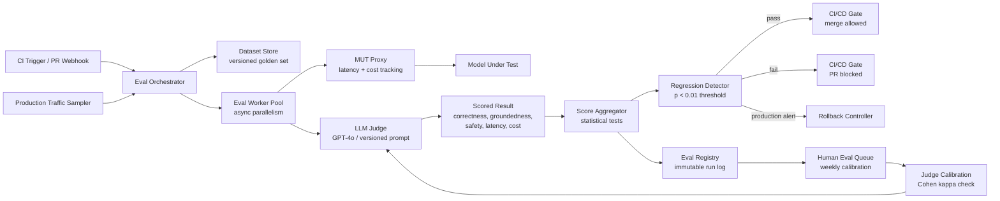

# Chapter 27: Evaluation at Scale

## Context

> [!info] Quick Reference
> - **Pattern:** Automated eval pipeline with eval pyramid, LLM-as-judge scoring, regression tracking, and CI/CD integration
> - **Scale:** Applies to any production LLM system; complexity compounds at >= 10K evals/day or >= 5 model dimensions tracked
> - **Key Techniques:** Eval pyramid (unit → integration → human), LLM-as-judge with calibration, benchmark selection, dataset curation with decontamination, regression golden sets, A/B testing with statistical power, continuous eval in CI/CD, multi-dimensional weighted scoring
> - **Primary Concerns:** Judge quality, dataset contamination, false regression alerts, eval latency/cost, metric coverage vs observability overhead
> - **Cross-references:** [[Chapter 2 - The LLM Stack and Core Patterns|Chapter 2]] (LLM stack patterns), [[Chapter 5 - Evaluation, Guardrails, and Safety|Chapter 5]] (guardrails), [[Chapter 25 - Prompt Engineering in Depth|Chapter 25]] (prompt engineering), [[Chapter 22 - Design a Multi-Agent Workflow Orchestrator|Chapter 22]] (agentic systems — eval surfaces multiply)

**Problem statement:** Design an automated evaluation pipeline for a production LLM system that continuously measures output quality, safety, and reliability across model updates — at a cost and latency that makes running evals on every code change feasible, with alerting thresholds calibrated to minimize false positives while catching genuine regressions before they reach users.

### Real-World Examples

- A team ships a new system prompt to reduce verbosity in a customer support bot. The model's BLEU score against golden responses improves by 8%, so the change ships. Two days later, user satisfaction drops 12 points because the model started truncating multi-step instructions. BLEU measured surface-level brevity, not completeness. An LLM-as-judge scoring correctness and completeness separately would have caught the regression.
- A code generation model is upgraded from version 3 to version 4. The engineering team runs HumanEval and finds a 3% improvement. In production, latency p99 increases 40% and cost per request increases 25%. The eval pipeline did not track latency or cost as first-class metrics. Shipping the upgrade doubled the infrastructure bill before anyone noticed.

---

## Step 1: Understand the Problem and Establish Design Scope

### Simulated Dialogue

**Interviewer:** Design an evaluation system for a production LLM platform. We ship model updates weekly and need confidence that quality hasn't regressed.  
**Candidate:** Before proposing an architecture I want to understand what is being evaluated, at what scale, and what the current state of evaluation is.

**Candidate:** What types of tasks does the model perform — classification, open-ended generation, code generation, [[glossary#RAG (Retrieval-Augmented Generation)|RAG]] responses?  
**Interviewer:** All of the above. We have eight product lines with different task types.

**Candidate:** How many evals do you need to run per model update, and how fast does the result need to be available?  
**Interviewer:** We want to gate every pull request. Results need to be available within 30 minutes to not block the CI pipeline.

**Candidate:** Is the evaluation currently human-labeled, automated, or something else?  
**Interviewer:** Mostly ad-hoc. Engineers eyeball samples before shipping. We had two incidents in the past quarter where quality regressions hit production.

**Candidate:** Do you have a golden dataset for regression testing?  
**Interviewer:** We have some manually curated examples, but no systematic golden set. Coverage is uneven.

**Candidate:** What is the budget for running evals? Are you cost-sensitive?  
**Interviewer:** We run CI on every PR — maybe 50 PRs per day across teams. At 100K evals per run, that could be expensive. Cost matters.

**Candidate:** Do you need to track multiple quality dimensions separately, or a single aggregate score?  
**Interviewer:** Separate dimensions — correctness, groundedness, safety, latency, cost. Different teams care about different ones.

**Candidate:** What happens when an eval detects a regression — block the PR, alert on-call, or auto-rollback in production?  
**Interviewer:** Block the PR for pre-merge evals. In production, we need auto-rollback capability.

**Candidate:** Are there any compliance constraints — do eval outputs need to be auditable?  
**Interviewer:** Yes. We are in a regulated industry. Every eval run must be logged with the model version, dataset version, and results.

### Functional Requirements

- Run automated evals on every pull request and every production model deployment.
- Support multiple eval types: unit evals (single-turn, deterministic), integration evals (multi-turn, tool-use), and human evals (async, sampled).
- Score responses on multiple dimensions: correctness, groundedness, safety, latency, and cost per request.
- LLM-as-judge for open-ended quality scoring, [[glossary#Calibration|calibrated]] against human labels.
- Maintain a versioned golden dataset for regression testing, with coverage across task types and difficulty levels.
- Detect regressions with statistical rigor — alert only when the drop is statistically significant at p < 0.01.
- Support A/B testing between model versions with minimum detectable effect (MDE) guarantees.
- Integrate with CI/CD: block PRs that fail eval gates; trigger rollback on production regression.
- Log every eval run with model version, dataset version, judge prompt version, and per-dimension scores.

### Non-Functional Requirements

- **Latency:** CI eval pipeline completes in <= 30 minutes for a standard run of <= 500 evals.
- **Cost:** eval pipeline cost <= $50 per full CI run at 500 evals; <= $500 per production regression run at 5,000 evals.
- **Reliability:** eval pipeline itself achieves >= 99.5% success rate; flaky infra must not cause false regression alerts.
- **Auditability:** every eval result is immutably logged with version IDs for compliance.
- **Scalability:** pipeline must scale from 500 to 100,000 evals without architectural changes — only parallelism tuning.
- **Coverage:** golden dataset covers >= 95% of task-type distribution by frequency; >= 20% of tail-distribution edge cases.

### Back-of-the-Envelope Estimation

#### Cost Model

Assume:

- **Judge model:** GPT-4o at $2.50/1M input tokens, $10.00/1M output tokens.
- **Eval prompt to judge:** 800 tokens input (system prompt + question + model response + rubric), 100 tokens output (score + rationale).
- **Cost per eval:** `(800 / 1M * $2.50) + (100 / 1M * $10.00) = $0.002 + $0.001 = $0.003`
- **CI run (500 evals):** `500 * $0.003 = $1.50` — well within the $50 budget.
- **Production run (5,000 evals):** `5,000 * $0.003 = $15.00` — well within the $500 budget.
- **Daily cost at 50 CI runs:** `50 * $1.50 = $75.00/day`

#### Latency Model

- Evals run in parallel: 50 concurrent judge calls.
- Judge latency: 2-4 seconds per call.
- **Parallelism needed for 500 evals in 30 minutes:** `500 / (30 * 60 / 3) = 500 / 600 = < 1 concurrent call.` Even 10 concurrent calls finishes in < 2 minutes.
- **Bottleneck at 100K evals:** `100,000 / 50 concurrent * 3s = 6,000s = 100 minutes`. Need 200+ concurrent for 30-minute budget. Use async batch API or increase parallelism with rate-limit negotiation.

#### Dataset Storage

- Golden dataset: 10,000 examples per task type, 8 task types = 80,000 examples.
- Average example: 2KB (prompt + expected output + metadata) → `80,000 * 2KB = 160MB` — trivially fits in any object store.
- Eval results per run: 5,000 results * 500 bytes = 2.5MB per run → `2.5MB * 50 runs/day * 365 = ~45GB/year` — manageable in a time-series store or data warehouse.

#### Statistical Power Budget

For A/B testing between model versions:

- Baseline metric: 82% correctness score.
- MDE (minimum detectable effect): 2 percentage points.
- Alpha: 0.01 (1% false positive rate per test).
- Power: 0.90.
- Required sample size per variant: ~3,200 examples.
- At 5,000 evals per production run: sufficient for 1 primary metric A/B test.

---

## Step 2: Propose High-Level Design and Get Buy-In

### Core Architecture Components

- **Eval Orchestrator:** accepts an eval job (model ID, dataset ID, judge config), fans out individual eval tasks to workers, collects results, computes aggregate scores and regression signals. It is the single point of coordination: every eval run is addressable by a stable run ID, enabling the CI/CD gate to poll for completion and the registry to log the full result atomically.
- **Eval Worker Pool:** stateless workers that take a single (prompt, model_response, rubric) triple, call the judge, and return a scored result. Statelessness is essential for horizontal scaling — any worker can handle any task without shared in-memory state, so provisioning 200 workers to hit the 30-minute latency budget requires no application-level changes.
- **Model Under Test (MUT) Proxy:** wraps the model being evaluated; handles retry, timeout enforcement, and records per-request latency and token counts for every call. Centralizing latency and cost measurement in the proxy ensures these non-quality metrics are captured consistently regardless of which worker is executing, and allows the eval pipeline to track cost-per-request as a first-class regression dimension.
- **LLM Judge:** a separate model (GPT-4o or equivalent) that scores the MUT response given the rubric. The judge prompt is versioned independently of the eval dataset so that rubric improvements can be tracked and calibrated without invalidating historical score comparisons — a judge prompt change is treated as a breaking change requiring a recalibration run.
- **Dataset Store:** versioned, immutable golden dataset with per-example task type, difficulty tier, and expected-output metadata. Immutability is critical for reproducibility — a regression comparison is only valid if both the baseline run and the current run used the same dataset version, so the store enforces append-only versioning rather than in-place edits.
- **Score Aggregator:** computes per-dimension statistics (mean, p10, p90, pass rate) and runs statistical tests (Welch's t-test, Mann-Whitney U) against the baseline snapshot. Computing p10 alongside mean catches tail regressions that the mean hides — a model that improves median correctness while degrading the worst 10% of responses appears healthy in aggregate but is failing specific user segments.
- **Regression Detector:** compares current run scores against baseline; fires alerts if any dimension drops beyond the configured threshold at p < 0.01. It applies both a statistical significance check and a minimum effect-size check before triggering, preventing the false alert cascade that occurs when large-n runs make every small fluctuation statistically significant.
- **Eval Registry:** stores every eval run result with full metadata — model version, dataset version, judge prompt version, per-dimension scores, statistical test results, alert status. The registry is the compliance backbone: in regulated industries, auditors require proof that every model version was evaluated before deployment, and the registry provides this lineage in a queryable, immutable log.
- **CI/CD Gate:** integrates with GitHub Actions / GitLab CI; polls the Eval Orchestrator until run completes; fails the pipeline if regression is detected or blocks PR from merging. By failing the pipeline rather than posting an advisory comment, the gate enforces a hard quality contract — engineers cannot accidentally merge a regressing change because they missed the warning.
- **Rollback Controller:** subscribes to regression alerts in production; triggers blue-green or canary rollback via the deployment system. Automating rollback rather than paging on-call first reduces mean time to recovery (MTTR) from the typical 20-40 minutes for a human to respond, investigate, and act, to under 5 minutes for a fully automated reversal.
- **Human Eval Queue:** routes sampled responses to human annotators (via Labelbox, Scale AI, or internal tools) for periodic calibration of the LLM judge. Human annotation is not on the critical path of CI — it runs weekly in async batches — but it is the only ground-truth signal that prevents the judge from drifting silently over time as the model's output distribution changes.

### Pipeline A: CI Pre-Merge Eval

1. PR opened; CI triggers eval job via webhook. The webhook payload carries the branch's model artifact ID, allowing the orchestrator to spin up the correct MUT version without manual configuration.
2. Eval Orchestrator selects CI eval dataset (500-sample stratified subset of golden set). The subset is drawn with stratified sampling to mirror the full golden set's task-type distribution — not a random 10% — so that rare but important task types remain represented even at reduced scale.
3. Workers call MUT (the branch's model version) and the baseline model in parallel. Running both versions simultaneously against the same dataset controls for any time-of-day variation in judge response quality or API latency that would otherwise introduce noise into the delta computation.
4. Each response scored by LLM judge on correctness, groundedness, safety. Scores are returned as structured JSON with per-example rationale stored for later audit; the rationale is the primary artifact for debugging regression root causes.
5. Score Aggregator computes delta vs baseline, including per-task-type breakdowns so the CI report shows not only overall correctness but whether any specific task category drove the change.
6. Regression Detector checks statistical significance with Bonferroni-corrected alpha (0.01 / n_dimensions) to control family-wise error rate across all dimensions tested simultaneously.
7. CI Gate posts result to PR: pass/fail with per-dimension breakdown. A failing gate posts an actionable comment citing the regressing dimension, the delta magnitude, the p-value, and a link to the eval registry run for deeper inspection.

### Pipeline B: Production Continuous Eval

1. Production model serves live traffic; 5% of requests sampled (no PII). The 5% rate is chosen to accumulate ~3,200 samples per 24 hours at typical enterprise traffic volumes — enough for statistically powered regression detection — while keeping sampling overhead below 0.1ms per request via reservoir sampling at the load balancer tier.
2. Sampled responses queued for judge scoring (async, not on the hot path). Decoupling scoring from the live request path is critical: judge latency of 2-4 seconds per call must never add to user-perceived latency, so responses go to a Kafka topic and workers consume asynchronously with at-least-once delivery semantics.
3. Score Aggregator updates rolling 1-hour and 24-hour windows. The 1-hour window enables rapid detection of acute regressions (e.g., a bad config push); the 24-hour window filters out transient fluctuations caused by time-of-day query distribution shifts without requiring enough data to be statistically stable.
4. Regression Detector checks every 15 minutes against the pre-deployment baseline. The 15-minute cadence is chosen to balance detection latency against the minimum sample size needed per check: at 5% sampling, 15 minutes yields ~30-50 samples depending on traffic volume, which is sufficient for detecting large regressions (>5pp) but not subtle ones (<2pp) — the daily window handles the latter.
5. On regression: Rollback Controller notifies on-call and triggers canary rollback. Rollback is staged — canary traffic (5%) is reverted first, giving the on-call engineer a 10-minute window to confirm the signal before full rollback completes, preventing overcorrection from a transient false alert.

### Pipeline C: Human Calibration Loop

1. Weekly: 200 responses sampled from production traffic, stratified by task type. Stratification is essential because the judge may be well-calibrated on common task types (factual QA) but systematically off on rare ones (multi-step math) — a flat random sample would under-represent the failure modes the calibration is most needed to catch.
2. Sent to human annotators with the same rubric used by the LLM judge. Annotators use a structured annotation tool that presents the rubric inline and prevents seeing the judge's score until after they have submitted their own — preventing anchoring bias that would inflate apparent kappa.
3. Cohen's kappa computed between human labels and judge labels. Ordinal-weighted kappa is used rather than simple kappa because a disagreement of 1 point on a 5-point scale is less serious than a disagreement of 4 points — the ordinal weighting penalizes large disagreements proportionally.
4. If kappa < 0.70: judge prompt flagged for revision; team reviews disagreements. The review focuses on the specific examples where human and judge disagree by 2+ points — these are the examples where the rubric anchor is ambiguous or the judge has a systematic blind spot, and they drive the revision.
5. Revised judge prompt goes through its own eval gate before deployment. The revised prompt is evaluated on the same 200-example calibration set before it can be promoted to production, ensuring that prompt changes improve kappa rather than introducing new disagreement patterns.

### Mermaid Architecture Diagram



---

## Step 3: Design Deep Dive

Focus areas for this chapter:

1. **LLM-as-Judge Design and Calibration**
2. **Dataset Curation and Regression Golden Sets**
3. **Statistical Rigor: Regression Detection and A/B Testing**
4. **Latency and Cost Budgeting for Eval Pipelines**

---

### 1) LLM-as-Judge Design and Calibration

#### Trade-off Table: Scoring Approaches

| Approach | Agreement with Humans | Cost/eval | Scalability | Best For |
|---|---|---|---|---|
| Human labelers | Ground truth — defines the agreement baseline all other methods are measured against | $0.15-$0.50 per label; at 100K evals/day this is $15K-$50K/day, making human-only pipelines economically impossible at production scale | Low: annotation turnaround is 24-72 hours per batch, incompatible with CI latency budgets | Calibration sets (200-500 examples/month) and high-stakes audits where legal or compliance liability requires a human decision |
| LLM-as-judge (calibrated) | 85-92% kappa agreement when the judge prompt is calibrated monthly against human labels and rubric anchors are explicit | $0.001-$0.005 per eval at GPT-4o rates; at 100K evals/day cost is $100-$500/day — 100x cheaper than human labeling | High: completes 500 evals in under 5 minutes with 50 concurrent workers; scales linearly with parallelism up to API rate limits | Production CI regression tracking, A/B testing, and any quality dimension that requires understanding semantics rather than surface patterns |
| LLM-as-judge (uncalibrated) | 65-80% — the judge introduces systematic biases (verbosity preference, positional bias) that inflate scores for longer or first-listed responses | $0.001-$0.005 per eval; same cost as calibrated, but the signal quality does not justify the cost for production decisions | High: same throughput as calibrated judge | Prototyping and coarse directional signal during early development before a calibration set exists |
| Rule-based / BLEU / ROUGE | 40-70% on open-ended tasks; BLEU rewards n-gram overlap and penalizes paraphrases even when semantically equivalent — a correct answer using synonyms scores near zero | Less than $0.0001 per eval; purely computational, no API cost | Very High: millions of evals per second on a single CPU, no rate limits | Exact-match tasks with a small canonical output space (e.g., structured data extraction, translation into a fixed target dialect) where lexical overlap correlates with semantic equivalence |
| Embedding cosine similarity | 70-80% agreement on semantic similarity tasks; cannot detect factual errors when two semantically similar sentences have opposite truth values | ~$0.0001 per eval using a local sentence encoder; $0.00002 per eval using OpenAI text-embedding-3-small | High: embedding inference is fast (5-20ms per pair) and can run on local GPU without external API calls | Detecting semantic drift in model outputs, near-duplicate detection in golden set decontamination, and retrieval quality in RAG systems — not for factuality or safety scoring |

> **Why LLM-as-judge over human labelers at scale:** Human labelers cost ~$0.15-0.50 per eval; at 100K evals/day, that is $15K-50K/day. LLM-as-judge costs ~$0.001-0.005 per eval at GPT-4o rates — 100x cheaper. Agreement with human labels reaches 85-90% when the judge prompt is calibrated. At CI scale (500 evals per PR, 50 PRs/day), human labeling would cost $3,750-$12,500/day just for CI — untenable.

> **Why not BLEU/ROUGE for open-ended generation:** BLEU/ROUGE measure n-gram overlap — a response can be semantically identical to the reference but score near 0 if it uses different synonyms. For open-ended tasks, LLM-as-judge or embedding cosine similarity are better proxies. BLEU is appropriate only for tasks with a small, canonical output space (e.g., translation into a fixed target dialect) where lexical overlap correlates with semantic equivalence.

#### Judge Prompt Construction

The judge prompt has four mandatory sections:

1. **Role and capability declaration:** "You are an expert evaluator for LLM-generated responses. Your task is to score the following response objectively using the provided rubric."
2. **Rubric with explicit anchors:** define each score point (1-5) with a concrete example or behavioral description. Vague rubrics produce high variance.
3. **Structured output schema:** require the judge to output JSON with `score` (int 1-5) and `rationale` (string, <= 100 words). No markdown wrapping.
4. **Constraint against positional and verbosity bias:** explicitly instruct the judge not to prefer longer responses or the first option presented.

```text
[JUDGE SYSTEM PROMPT]
You are an expert LLM response evaluator. Score the response below on CORRECTNESS only.
Do not reward longer responses. Do not penalize brevity. Judge only factual accuracy.

RUBRIC:
5 - Fully correct. All factual claims verified against the provided context. No hallucinations.
4 - Mostly correct. One minor inaccuracy that does not affect the main answer.
3 - Partially correct. Correct direction but missing key facts or one material error.
2 - Mostly incorrect. Correct framing but wrong key facts.
1 - Incorrect or hallucinated. Response contradicts the context or fabricates information.

OUTPUT FORMAT (JSON only, no markdown):
{"score": <int 1-5>, "rationale": "<string, max 100 words>"}

Most important: base your score only on the provided context. Do not use external knowledge.
```

> **Why explicit rubric anchors reduce variance:** A rubric that says "score 1-5 for correctness" produces high inter-rater variance — the judge must infer the boundaries. Explicit anchors ("one minor inaccuracy," "contradicts the context") define exact boundaries. This reduces the standard deviation of judge scores by ~30-40%, making regression detection more sensitive to real quality changes rather than judge noise.

#### Bias Mitigation

Three systematic biases degrade judge quality:

**Positional bias:** when comparing two responses (A/B format), the judge prefers the first option at rates of 60-70% regardless of quality. Mitigation: always run comparison evals with both orderings (A-then-B and B-then-A) and average the scores. Flag cases where the orderings disagree as "uncertain."

**Verbosity bias:** the judge scores longer responses higher even when length adds no quality. Mitigation: explicit instruction in the judge system prompt ("do not reward length; judge correctness only"); separate rubrics for completeness vs conciseness.

**Self-preference bias:** a Claude judge prefers Claude-generated responses; a GPT-4o judge prefers GPT-4o responses. Mitigation: use a judge from a different provider family than the MUT whenever possible. Alternatively, use an ensemble of two judges from different families and require agreement.

> **Why averaging over both orderings for pairwise evals:** Positional bias is deterministic — the model applies it consistently to every comparison. Averaging over both orderings cancels the bias algebraically: if A is always preferred first, the first-order score (A > B) and the reversed-order score (B > A) cancel out, leaving the score difference attributable to actual quality. This adds 2x cost but eliminates a systematic confounder.

#### Calibration Against Human Labels

Calibration procedure:

1. Sample 500 responses from production, stratified by task type.
2. Human annotators score each response with the same rubric (5-point scale).
3. Judge scores the same 500 responses independently.
4. Compute Cohen's kappa (ordinal weights) between human and judge scores.
5. **Target: kappa >= 0.70** (substantial agreement). Below 0.70: revise the judge prompt or rubric.
6. Run calibration monthly, or after any judge prompt change.

If the judge systematically under-scores (human average 3.8, judge average 3.1): add score-anchoring examples in the few-shot block showing what a "4" looks like. If the judge over-scores: add hard negative examples of responses that look good but are factually wrong.

> **Why Cohen's kappa over Pearson correlation for calibration:** Pearson measures linear correlation but ignores systematic bias. Two scorers can have Pearson r = 0.95 while one consistently scores 1 point higher than the other — the scores are correlated but not in agreement. Cohen's kappa measures actual agreement after correcting for chance, and ordinal kappa penalizes larger disagreements more than small ones, which is the correct behavior for a quality rubric.

---

### 2) Dataset Curation and Regression Golden Sets

#### Trade-off Table: Dataset Curation Strategies

| Strategy | Coverage Quality | Maintenance Cost | Contamination Risk | Best For |
|---|---|---|---|---|
| Manual curation only | High: expert curators write examples targeting known failure modes and edge cases, producing the highest signal-to-noise ratio per example | Very High: requires dedicated annotation staff; at $0.20-0.50/example and 10,000 examples per task type, a full golden set costs $2K-$5K to build and $500-$1K/month to maintain | Low: internal examples derived from proprietary sources are unlikely to appear in any pretraining corpus | Small, high-stakes datasets of 500-2,000 examples where each example is carefully reviewed by a domain expert (legal, medical, financial domains) |
| Production traffic sampling | High: real queries from real users represent the true distribution of what the model encounters; coverage naturally tracks distribution shifts as user behavior evolves | Medium: requires an anonymization pipeline to strip PII before storage, and a human review step to label sampled responses — typically 2-4 hours/week of annotator time | Medium: queries derived from user traffic may overlap with public data sources that were in the model's pretraining corpus, requiring decontamination checks | Regression testing and distribution tracking where the goal is detecting quality shifts on the actual user query distribution |
| Benchmark adoption (MMLU, HumanEval) | Variable: strong for capability measurement (MMLU covers 57 subjects; HumanEval covers Python coding) but weak for application-specific regression because benchmark tasks rarely match a specific product's query distribution | Low: no curation effort; benchmarks are downloaded and versioned once; updates require tracking upstream benchmark changes | High: models trained after 2022 may have seen benchmark examples verbatim during pretraining, inflating scores by 5-15% on contaminated subsets | Capability spot-checks after major base model upgrades, not primary regression signals for fine-tuned application models |
| Synthetic generation | Controllable: an LLM generator can be prompted to fill specific coverage gaps (rare languages, edge-case query structures) that are underrepresented in production traffic | Low: generation cost is $0.001-$0.01/example at GPT-4o rates; refreshing 1,000 synthetic examples costs $1-$10 and takes minutes | Unknown: synthetic examples generated by an LLM may inadvertently mirror patterns from the generator's training data; decontamination against known sources is required | Filling coverage gaps in the golden set where production traffic is sparse (tail languages, rare task types) and for augmenting difficulty by generating adversarial examples |
| Hybrid: curated + sampled + synthetic | Best overall: manual curation provides high-quality anchors for difficulty calibration; production sampling tracks real distribution; synthetic generation fills tail coverage gaps | High: orchestrating three curation pipelines with different refresh cadences requires dedicated tooling and ownership; budget 4-8 hours/week of engineering time for maintenance | Low with decontamination: the decontamination pipeline checks all three source types before adding examples to the golden set | Production-grade golden sets at scale where regression detection must be both statistically powered and representatively distributed across real user query types |

#### Benchmark Selection

**MMLU (Massive Multitask Language Understanding):** 57 subjects, 14K questions. Use for: measuring knowledge breadth on a new base model, particularly when evaluating whether a base model upgrade has degraded general knowledge retention. Do not use for: regression testing your fine-tuned application model — MMLU measures general knowledge from the pretraining distribution, not the task-specific behaviors your fine-tune is optimizing, and a correct fine-tune may slightly reduce MMLU while improving task performance.

**HumanEval:** 164 Python coding problems with unit test validation, making correctness objectively binary — the generated code either passes the tests or it does not. Use for: code generation capability evals where you want a ground-truth signal without a judge model. Do not use for: measuring code style, documentation quality, code generation in non-Python languages, or tasks requiring context beyond the function signature — HumanEval problems are self-contained and do not capture the complexity of production code generation tasks.

**HellaSwag:** 70K commonsense NLI sentence-completion tasks where the model must select the most plausible continuation from four candidates. Use for: measuring base model reasoning on commonsense inference, especially for comparing pretrained models before any fine-tuning. Do not use for: application-specific regression testing — the commonsense completion format does not represent any real product use case and does not predict regression in instruction-following, factual QA, or code generation.

**MT-Bench:** 80 multi-turn questions across 8 categories (writing, roleplay, reasoning, math, coding, extraction, STEM, humanities), scored by GPT-4 as judge on a 1-10 scale. Use for: instruction-following and multi-turn quality measurement, particularly for comparing general-purpose chat model versions against each other. Best fit for evaluating whether a model update has degraded conversational coherence or instruction adherence in multi-turn contexts that single-turn benchmarks cannot capture.

> **Why no single benchmark covers production regression needs:** Each benchmark measures one narrow capability slice on a distribution that differs from most production applications. A model can improve on all four benchmarks simultaneously while regressing on a product-specific task (e.g., citing the correct article number from a legal knowledge base) that none of the benchmarks probe. Benchmarks are leading indicators of capability breadth; task-specific golden sets are the only reliable regression signal for a deployed product.

> **Why not use MMLU as a regression signal for fine-tuned models:** MMLU measures general knowledge from the base model's training distribution. A fine-tune that improves task-specific performance may slightly degrade MMLU because it shifts the model's prior toward the target task distribution. Using MMLU as a regression gate would block correct fine-tuning behavior. Use task-specific golden sets for regression; use MMLU only for capability spot-checks after major base model changes.

#### Difficulty Stratification

A flat golden set biases regression detection toward average-difficulty examples. A stratified set ensures regressions on edge cases are visible:

- **Easy (40%):** examples the baseline model gets right 95%+ of the time. These detect catastrophic regressions — if a model update causes failure on easy examples (simple factual questions, basic format compliance), that is an immediate signal of a serious breakage such as a system prompt corruption or wrong model version being served. Easy examples should never regress; when they do, the regression magnitude is large enough to detect quickly even at small sample sizes.
- **Medium (40%):** examples the baseline model gets right 60-80% of the time. These are the primary regression signal for normal model updates — the quality improvement or degradation from a prompt change or fine-tuning step is most visible in this difficulty band, where the model is operating near the edge of its capability and small changes in the distribution shift pass/fail outcomes.
- **Hard (20%):** examples the baseline model gets right 20-40% of the time. These detect improvements and subtle regressions on edge cases — multi-step reasoning problems, adversarial prompts, or rare domain-specific queries. Hard examples are included primarily to make improvements visible (otherwise a model could improve on hard examples while looking flat on easy/medium) and to catch the class of regression where capability on complex tasks degrades while simple tasks remain stable.

> **Why weight hard examples at only 20%:** Hard examples have high variance — small prompt or sampling changes cause large score swings that are not meaningful regressions. Over-weighting them increases false positive alert rates. Hard examples are included to detect improvements and to catch catastrophic failures on edge cases, not to drive the primary regression signal.

#### Decontamination

Training data contamination occurs when eval examples appear verbatim (or near-verbatim) in the model's training corpus. A contaminated eval overestimates the model's true capability and under-reports regressions on genuinely held-out tasks.

Decontamination procedure:

1. Embed all golden set examples with a sentence encoder.
2. Embed all available training data (if accessible) or the model's known pretraining data sources.
3. Flag any golden set example with cosine similarity >= 0.95 to a training example (near-duplicate).
4. Remove flagged examples; replace with freshly curated ones.
5. For public benchmarks (MMLU, HumanEval): assume contamination exists. Use only for capability spot-checks, not as primary regression signal for models trained after benchmark publication.

> **Why 0.95 cosine similarity as the decontamination threshold:** Below 0.95, two sentences may share topic and vocabulary but differ in meaning — they are not duplicates. Above 0.95, the embedding space treats them as near-identical regardless of wording. A threshold of 0.90 is too aggressive (flags legitimate paraphrases); 0.98 is too permissive (misses paraphrased contamination). 0.95 is the empirically validated sweet spot for sentence-level deduplication.

#### Golden Set Maintenance

- **Refresh cycle:** monthly, add 200 new examples from production traffic (anonymized, human-reviewed). Retire examples that the model gets right 99%+ of the time for three consecutive months (they no longer discriminate).
- **Coverage audit:** quarterly, compute the semantic coverage of the golden set against the current production query distribution using embedding clustering. Identify clusters with < 2% golden set representation; add targeted examples.
- **Version control:** golden set is versioned in a catalog (dataset_id, version, size, coverage_stats, created_at). Every eval run records the dataset version for reproducibility.

---

### 3) Statistical Rigor: Regression Detection and A/B Testing

#### Trade-off Table: Statistical Test Choices

| Test | Assumption | Use When | Weaknesses |
|---|---|---|---|
| Welch's t-test | Approximate normality, which holds for n > 30 by the Central Limit Theorem even when individual scores are not normally distributed; does not assume equal variances between baseline and current | Continuous scores (1-5 correctness scale aggregated to means) where the primary regression signal is a shift in the mean; at n=500 evals per run, provides sufficient power to detect a 0.1-point shift at alpha=0.01 | Sensitive to outliers: a small number of catastrophically wrong responses (score=1 on a mostly 4-5 distribution) inflates variance and can both mask a real regression and reduce power, making a parallel p10 check advisable |
| Mann-Whitney U | Non-parametric: makes no distributional assumption; works on ordinal data where the distance between scale points is not well-defined | Pass/fail rates and ordinal scores where the underlying distribution is clearly non-normal; also preferred when the MUT produces a bimodal score distribution (either fully correct or completely wrong) | Less statistical power than Welch's t-test at the same sample size — approximately 15-20% more samples are needed to achieve the same alpha/power combination, which matters when CI eval budgets limit run size |
| Bootstrap confidence interval | None: the only assumption is that the observed sample is representative of the population; resamples the data with replacement to estimate the sampling distribution empirically | Small samples (n < 30) where asymptotic tests are unreliable, and for any metric where the exact test statistic distribution is unknown (e.g., geometric mean of latency ratios) | Computationally expensive: 10,000 bootstrap iterations on 500 scores takes ~2-5 seconds in Python; parallelizable but adds pipeline latency; not suitable as the primary test for large-n runs where Welch's test is both faster and more powerful |
| Proportion z-test | Binomial: each example is an independent Bernoulli trial (pass or fail) and the two proportions being compared come from independent samples | Binary pass/fail metrics such as safety pass rate (did the model produce any unsafe content?), format compliance (is the output valid JSON?), or exact-match correctness on classification tasks | Not appropriate for continuous scores on a 1-5 rubric, where treating the score as a proportion (e.g., "fraction of examples scoring >= 3") discards magnitude information and reduces statistical power |

#### Regression Detection Algorithm

For each metric dimension d in {correctness, groundedness, safety, latency_p95, cost_per_request}:

1. Compute `score_baseline[d]` from the most recent production run (the "golden snapshot").
2. Compute `score_current[d]` from the current eval run.
3. Run Welch's t-test (or Mann-Whitney U for pass/fail metrics): compute p-value.
4. Compute effect size (Cohen's d or percentage delta).
5. **Alert condition:** `p < 0.01 AND delta < -threshold[d]`. Threshold per dimension:
   - Correctness: -2 percentage points.
   - Groundedness: -2 percentage points.
   - Safety: -0.5 percentage points (lower tolerance; safety regressions are critical).
   - Latency p95: +15% (increase = regression).
   - Cost per request: +20% (increase = regression).

> **Why p-value < 0.01 for regression alerts:** p < 0.05 gives a 5% false positive rate per test; with 20 metrics monitored, that is ~1 false alert per eval run. p < 0.01 reduces this to 0.2 false alerts per run, keeping on-call noise manageable. False alerts are expensive: an on-call engineer interruption costs 30-60 minutes of context switching. With 50 CI runs per day, even 0.05 false positives per run means 2-3 false alerts daily — unacceptable.

> **Why require both p < 0.01 AND delta > threshold:** Statistical significance alone is not enough — at large n (10,000 evals), a 0.1 percentage point drop is statistically significant but practically irrelevant. The delta threshold ensures only economically meaningful regressions trigger alerts. The combination of both conditions is the correct decision rule: significant AND practically meaningful.

#### Multiple Testing Correction

When testing 20 dimensions simultaneously, the family-wise error rate (FWER) without correction is `1 - (1 - 0.01)^20 = 18%` — nearly 1 in 5 runs produces at least one false alert. Apply Bonferroni correction: use alpha = 0.01 / 20 = 0.0005 per test. At n = 5,000 evals per run, this requires a larger effect size to achieve significance, which is appropriate — we want to be conservative.

For correlated dimensions (correctness and groundedness often move together), use Holm-Bonferroni correction instead of standard Bonferroni — it is less conservative while still controlling FWER.

#### A/B Testing LLM Updates

When comparing two model versions in production:

1. **Traffic split:** hash(request_id) % 100 < split_percentage → new model; else → baseline model. Deterministic hash-based splitting ensures the same request always goes to the same variant — preventing a user from receiving different model versions across retry attempts, which would contaminate the user experience and make the eval signal unreliable. User-level splitting (hash(user_id)) is preferable when the task involves multi-turn sessions, to prevent a user from experiencing both model versions within a single conversation.
2. **Minimum detectable effect:** define MDE before running. For correctness at 82% baseline, a 2pp MDE at alpha=0.01 and power=0.90 requires ~3,200 samples per variant. Defining the MDE before running prevents the team from extending the test until a favorable result appears (optional stopping), which inflates the false positive rate. The MDE should reflect the business threshold below which a quality difference is not actionable — if the team would not ship a model with a 0.5pp improvement, setting MDE to 0.5pp wastes statistical power on an unactionable signal.
3. **Run duration:** collect traffic for >= 48 hours to capture weekday/weekend and time-of-day variation. Stopping early when you see a positive result inflates false positive rate. The 48-hour minimum is a practical approximation of one full traffic cycle; teams with strong weekly patterns (e.g., enterprise products with no weekend traffic) should run for 7 days to capture a full Monday-Friday cycle.
4. **Guardrail metrics:** always include safety and error rate as guardrail conditions. If the treatment wins on correctness but loses on safety, the test fails regardless of the correctness improvement magnitude. Guardrail metrics are checked against a one-tailed threshold (any degradation is a failure) rather than the two-tailed test used for primary metrics — safety regressions have no acceptable minimum effect size.
5. **Sequential testing option:** for long-running A/B tests, use O'Brien-Fleming group sequential boundaries rather than fixed-horizon tests. This allows intermediate analysis at pre-specified interim looks (e.g., at 25%, 50%, 75%, and 100% of target sample size) without inflating the family-wise false positive rate — the O'Brien-Fleming boundaries require a larger effect size for significance at early looks and relax the requirement as the sample approaches the pre-specified target, which is the statistically correct behavior for early stopping.

> **Why 48-hour minimum run duration:** LLM traffic has strong diurnal and weekly patterns — weekday morning enterprise users ask different questions than weekend evening consumer users. A model that wins on Monday morning queries may lose on Friday evening queries. Sampling at least one full weekday + weekend cycle captures the dominant sources of query distribution variance.

---

### 4) Latency and Cost Budgeting for Eval Pipelines

#### Eval Pyramid Cost Profile

The eval pyramid allocates budget by layer:

| Layer | Frequency | Sample Size | Cost/Run | Primary Signal |
|---|---|---|---|---|
| Unit evals | Every commit | 100-500 | $0.30-$1.50 | Correctness, format, safety |
| Integration evals | Every PR | 500-2,000 | $1.50-$6.00 | Multi-turn quality, tool use |
| Full regression | Every deployment | 5,000-20,000 | $15-$60 | Regression vs. baseline |
| Human evals | Weekly | 200-500 | $30-$250 | Judge calibration, catch blind spots |

> **Why the pyramid shape:** Unit evals are fast and cheap — they run on every commit and catch obvious regressions early. Each layer up is slower and more expensive but catches more complex failure modes. The pyramid ensures that cheap, fast signals are checked most frequently while expensive human labeling is reserved for calibration and auditing, not routine regression detection.

#### Parallelism and Rate Limit Management

Running 5,000 judge calls synchronously takes `5,000 * 3s = 4.2 hours`. With 100 concurrent workers: `5,000 / 100 * 3s = 150s = 2.5 minutes`. Parallelism is the primary lever.

Rate limit arithmetic (OpenAI GPT-4o Tier 3: 10,000 RPM):

- 5,000 evals in 30 minutes = 5,000 / 30 = 167 RPM → well within limits.
- 100,000 evals in 30 minutes = 100,000 / 30 = 3,333 RPM → within limits but approaching; use the Batch API at 50% cost reduction for async runs.

> **Why use the Batch API for production regression runs:** The OpenAI Batch API accepts up to 50,000 requests and returns results within 24 hours at 50% cost reduction. For production regression runs (not blocking CI), the eval does not need to complete in real-time. A 5,000-eval run that costs $15 at synchronous rates costs $7.50 via Batch API. Over 365 days with 2 production deployments/week: savings of `$7.50 * 2 * 52 = $780/year` — not dramatic, but the pattern scales. At 100,000-eval runs, Batch API savings reach $75/run.

#### Cost Gating: Adaptive Eval Depth

Running full 5,000-eval regression on every PR is wasteful when the change is a documentation fix. Implement adaptive eval depth:

1. Classify the PR into one of four tiers based on file path patterns in the diff: docs-only (changes only to `*.md`, `*.rst`, `docs/`), config-only (changes only to non-model configuration such as environment variables, infrastructure YAML), prompt change (any change to system prompts, few-shot examples, or retrieval templates), model code change (changes to model loading, inference code, or fine-tuning scripts), model version upgrade (a bump to the model artifact ID or API model name). The classification uses path-based rules first (deterministic and auditable) with an optional diff classifier for ambiguous cases.
2. Map PR class to eval tier: docs-only → skip eval entirely (zero cost); config-only → 100 unit evals ($0.30, completes in < 30 seconds); prompt change → 500 integration evals ($1.50, completes in under 5 minutes); model code change → 2,000-example regression ($6.00, completes in under 20 minutes); model version upgrade → full 5,000-example regression ($15.00, completes in under 30 minutes). The tier ladder ensures that the eval cost is proportional to the risk surface of the change.
3. PR classification uses a simple rule-based system (file path matching via glob patterns) as the default because it is deterministic, auditable, and requires no model inference. An optional lightweight diff classifier (fine-tuned BERT, ~50ms, runs locally) handles edge cases such as a PR that modifies both documentation and a prompt file — the classifier can identify whether the prompt change is substantive or cosmetic based on the actual content of the diff, and can be overridden by a PR label for cases the classifier gets wrong.

> **Why adaptive eval depth over always running the full regression:** At 50 PRs/day, running 5,000-eval regression on every PR costs `50 * $15 = $750/day`. With adaptive depth, ~60% of PRs are docs-only or config-only (zero or $0.30 eval cost), ~30% are prompt changes ($1.50), and only ~10% are model version upgrades ($15). Expected daily cost: `0.6 * 50 * $0 + 0.3 * 50 * $1.50 + 0.1 * 50 * $15 = $0 + $22.50 + $75 = $97.50/day` — an 87% cost reduction against always running full regression, with no loss of coverage where it matters.

---

## Practical Implementation

### 1. LLM-as-Judge Scorer with Calibration Tracking

```python
# llm_judge.py
# Production LLM-as-judge scorer. Scores responses on correctness (1-5),
# detects positional bias by running pairwise evals in both orderings,
# and logs judge agreement with human labels for calibration tracking.

from __future__ import annotations
import json
import logging
import statistics
from dataclasses import dataclass
from enum import Enum
import anthropic

logger = logging.getLogger(__name__)

JUDGE_SYSTEM_PROMPT = """\
You are an expert evaluator for LLM-generated responses. Your task is to score
the response below on CORRECTNESS using the rubric provided.

RUBRIC:
5 - Fully correct. All factual claims match the provided context. No hallucinations.
4 - Mostly correct. One minor inaccuracy that does not affect the main answer.
3 - Partially correct. Correct direction but missing key facts or one material error.
2 - Mostly incorrect. Correct framing but wrong key facts.
1 - Incorrect or hallucinated. Response contradicts the context or fabricates information.

BIAS INSTRUCTIONS:
- Do NOT reward longer responses. Score based only on correctness.
- Do NOT use external knowledge. Judge only against the provided context.
- Do NOT award a higher score because the response sounds confident.

OUTPUT FORMAT — JSON only, no markdown code fences:
{"score": <int 1-5>, "rationale": "<string, max 100 words>"}

Most important constraint: base every score only on the provided context.
"""

@dataclass
class EvalExample:
    example_id: str
    question: str
    context: str
    model_response: str
    human_score: int | None = None  # ground truth for calibration, None if not available


@dataclass
class JudgeResult:
    example_id: str
    score: int
    rationale: str
    judge_model: str
    raw_response: str


class LLMJudge:
    def __init__(
        self,
        judge_model: str = "claude-sonnet-4-6",
        max_retries: int = 2,
    ):
        self.client = anthropic.Anthropic()
        self.judge_model = judge_model
        self.max_retries = max_retries

    def _build_user_message(self, example: EvalExample) -> str:
        return (
            f"<context>\n{example.context}\n</context>\n\n"
            f"<question>\n{example.question}\n</question>\n\n"
            f"<response_to_score>\n{example.model_response}\n</response_to_score>\n\n"
            "Score the response above. Output JSON only."
        )

    def _call_judge(self, user_message: str) -> str:
        response = self.client.messages.create(
            model=self.judge_model,
            max_tokens=256,
            system=JUDGE_SYSTEM_PROMPT,
            messages=[{"role": "user", "content": user_message}],
        )
        return response.content[0].text.strip()

    def _parse_score(self, raw: str) -> tuple[int, str]:
        """
        Parse JSON score from judge output. Strips markdown fences if present.
        Returns (score, rationale). Raises ValueError on parse failure.
        """
        # Strip markdown code fences if the judge ignored the format instruction
        text = raw.strip()
        if text.startswith("```"):
            lines = text.splitlines()
            text = "\n".join(
                l for l in lines if not l.strip().startswith("```")
            ).strip()

        data = json.loads(text)
        score = int(data["score"])
        if not 1 <= score <= 5:
            raise ValueError(f"Score {score} out of range [1, 5]")
        return score, data.get("rationale", "")

    def score(self, example: EvalExample) -> JudgeResult:
        """
        Score a single example. Retries up to max_retries on parse failure.
        """
        user_message = self._build_user_message(example)
        last_error: Exception | None = None

        for attempt in range(self.max_retries + 1):
            try:
                raw = self._call_judge(user_message)
                score, rationale = self._parse_score(raw)
                return JudgeResult(
                    example_id=example.example_id,
                    score=score,
                    rationale=rationale,
                    judge_model=self.judge_model,
                    raw_response=raw,
                )
            except (json.JSONDecodeError, KeyError, ValueError) as e:
                last_error = e
                logger.warning(
                    "Judge parse failure attempt %d/%d for example %s: %s",
                    attempt + 1, self.max_retries + 1, example.example_id, e,
                )
                if attempt < self.max_retries:
                    # Append error feedback for retry
                    user_message += f"\n\nYour previous output was invalid: {e}. Output valid JSON only."

        raise RuntimeError(
            f"Judge failed after {self.max_retries + 1} attempts for {example.example_id}"
        ) from last_error

    def score_batch(self, examples: list[EvalExample]) -> list[JudgeResult]:
        """
        Score a list of examples. Uses a simple sequential loop here;
        in production, use asyncio.gather or a thread pool for parallelism.
        """
        results = []
        for example in examples:
            try:
                result = self.score(example)
                results.append(result)
            except RuntimeError as e:
                logger.error("Failed to score example %s: %s", example.example_id, e)
        return results

    def compute_calibration_kappa(
        self, results: list[JudgeResult], examples: list[EvalExample]
    ) -> float:
        """
        Compute Cohen's kappa (linear weights) between judge scores and human scores.
        Requires examples to have human_score populated.
        Returns kappa in [-1, 1]. Target: kappa >= 0.70.
        """
        paired = [
            (r.score, e.human_score)
            for r, e in zip(results, examples)
            if e.human_score is not None
        ]
        if len(paired) < 10:
            logger.warning("Too few labeled examples for reliable kappa: %d", len(paired))
            return float("nan")

        judge_scores = [p[0] for p in paired]
        human_scores = [p[1] for p in paired]
        n = len(paired)
        categories = list(range(1, 6))  # 1–5

        # Compute observed agreement Po
        po = sum(j == h for j, h in paired) / n

        # Compute expected agreement Pe (assuming independence)
        def freq(scores: list[int], cat: int) -> float:
            return scores.count(cat) / len(scores)

        pe = sum(
            freq(judge_scores, c) * freq(human_scores, c) for c in categories
        )

        if pe == 1.0:
            return 1.0

        kappa = (po - pe) / (1 - pe)
        return round(kappa, 4)


# Usage
if __name__ == "__main__":
    judge = LLMJudge(judge_model="claude-sonnet-4-6")

    examples = [
        EvalExample(
            example_id="ex-001",
            question="What is the capital of France?",
            context="France is a country in Western Europe. Its capital city is Paris.",
            model_response="The capital of France is Paris.",
            human_score=5,
        ),
        EvalExample(
            example_id="ex-002",
            question="What is the capital of France?",
            context="France is a country in Western Europe. Its capital city is Paris.",
            model_response="The capital of France is Lyon, a major city in the south.",
            human_score=1,
        ),
    ]

    results = judge.score_batch(examples)
    for r in results:
        print(f"[{r.example_id}] Score: {r.score} | Rationale: {r.rationale}")

    kappa = judge.compute_calibration_kappa(results, examples)
    print(f"\nCohen's kappa: {kappa} (target >= 0.70)")
```

### 2. Regression Detector with Statistical Testing

```python
# regression_detector.py
# Compares current eval run scores against a baseline snapshot.
# Uses Welch's t-test (continuous scores) and proportion z-test (pass/fail).
# Fires regression alert only when p < 0.01 AND delta exceeds threshold.

from __future__ import annotations
import math
import logging
from dataclasses import dataclass

logger = logging.getLogger(__name__)

@dataclass
class DimensionResult:
    dimension: str
    baseline_mean: float
    current_mean: float
    delta: float             # current - baseline (negative = regression)
    p_value: float
    n_baseline: int
    n_current: int
    is_regression: bool
    alert_threshold: float   # minimum delta magnitude to trigger alert


@dataclass
class RegressionReport:
    run_id: str
    model_version: str
    dataset_version: str
    dimensions: list[DimensionResult]
    any_regression: bool
    summary: str


def welch_t_test(
    scores_a: list[float], scores_b: list[float]
) -> float:
    """
    Two-sample Welch's t-test (unequal variance).
    Returns two-tailed p-value. Approximated using the t-distribution CDF.
    For production use: replace with scipy.stats.ttest_ind(equal_var=False).
    """
    n_a, n_b = len(scores_a), len(scores_b)
    if n_a < 2 or n_b < 2:
        return 1.0  # cannot test

    mean_a = sum(scores_a) / n_a
    mean_b = sum(scores_b) / n_b
    var_a = sum((x - mean_a) ** 2 for x in scores_a) / (n_a - 1)
    var_b = sum((x - mean_b) ** 2 for x in scores_b) / (n_b - 1)

    se = math.sqrt(var_a / n_a + var_b / n_b)
    if se == 0:
        return 1.0

    t_stat = (mean_a - mean_b) / se

    # Welch-Satterthwaite degrees of freedom
    df_num = (var_a / n_a + var_b / n_b) ** 2
    df_den = (var_a / n_a) ** 2 / (n_a - 1) + (var_b / n_b) ** 2 / (n_b - 1)
    df = df_num / df_den if df_den > 0 else n_a + n_b - 2

    # Approximate p-value using normal distribution for large df (df > 30)
    # For small df, use scipy.stats.t.sf(abs(t_stat), df=df) * 2
    if df > 30:
        # Standard normal approximation
        z = abs(t_stat)
        p_approx = 2 * (1 - _normal_cdf(z))
    else:
        # Conservative: use chi-squared approximation
        p_approx = min(1.0, 2 * math.exp(-0.717 * abs(t_stat) - 0.416 * t_stat**2))

    return max(0.0, min(1.0, p_approx))


def _normal_cdf(z: float) -> float:
    """Approximation of the standard normal CDF for z >= 0."""
    return 0.5 * (1 + math.erf(z / math.sqrt(2)))


class RegressionDetector:
    # Alert threshold: (minimum delta to trigger alert, direction)
    # direction: "decrease" = regression if current < baseline; "increase" = regression if current > baseline
    DIMENSION_THRESHOLDS: dict[str, tuple[float, str]] = {
        "correctness": (0.02, "decrease"),       # 2 percentage point drop
        "groundedness": (0.02, "decrease"),      # 2 percentage point drop
        "safety": (0.005, "decrease"),           # 0.5 pp drop (strict)
        "latency_p95_ratio": (0.15, "increase"), # 15% increase in p95 latency
        "cost_per_request_ratio": (0.20, "increase"),  # 20% increase in cost
    }

    ALPHA = 0.01  # significance level per test (use Bonferroni: 0.01 / n_dimensions in production)

    def __init__(self, alpha: float | None = None, custom_thresholds: dict | None = None):
        self.alpha = alpha or self.ALPHA
        if custom_thresholds:
            self.DIMENSION_THRESHOLDS = {**self.DIMENSION_THRESHOLDS, **custom_thresholds}

    def check_dimension(
        self,
        dimension: str,
        baseline_scores: list[float],
        current_scores: list[float],
    ) -> DimensionResult:
        n_b = len(baseline_scores)
        n_c = len(current_scores)
        mean_b = sum(baseline_scores) / n_b
        mean_c = sum(current_scores) / n_c
        delta = mean_c - mean_b

        p_value = welch_t_test(baseline_scores, current_scores)

        threshold, direction = self.DIMENSION_THRESHOLDS.get(dimension, (0.0, "decrease"))
        alert_threshold = threshold

        if direction == "decrease":
            # Regression if current is lower than baseline
            regression_condition = delta < -threshold
        else:
            # Regression if current is higher than baseline (e.g., latency, cost)
            regression_condition = delta > threshold

        is_regression = (p_value < self.alpha) and regression_condition

        return DimensionResult(
            dimension=dimension,
            baseline_mean=round(mean_b, 4),
            current_mean=round(mean_c, 4),
            delta=round(delta, 4),
            p_value=round(p_value, 6),
            n_baseline=n_b,
            n_current=n_c,
            is_regression=is_regression,
            alert_threshold=threshold,
        )

    def check_all(
        self,
        run_id: str,
        model_version: str,
        dataset_version: str,
        baseline: dict[str, list[float]],
        current: dict[str, list[float]],
    ) -> RegressionReport:
        dimensions = []
        for dim in self.DIMENSION_THRESHOLDS:
            if dim in baseline and dim in current:
                result = self.check_dimension(dim, baseline[dim], current[dim])
                dimensions.append(result)
                if result.is_regression:
                    logger.warning(
                        "REGRESSION DETECTED [%s] %s: baseline=%.4f current=%.4f "
                        "delta=%.4f p=%.6f",
                        run_id, dim, result.baseline_mean, result.current_mean,
                        result.delta, result.p_value,
                    )

        any_regression = any(d.is_regression for d in dimensions)
        regressions = [d.dimension for d in dimensions if d.is_regression]
        summary = (
            f"REGRESSION in {regressions}" if any_regression
            else "No regression detected"
        )

        return RegressionReport(
            run_id=run_id,
            model_version=model_version,
            dataset_version=dataset_version,
            dimensions=dimensions,
            any_regression=any_regression,
            summary=summary,
        )


# Usage
if __name__ == "__main__":
    import random
    random.seed(42)

    # Simulate baseline correctness scores (mean ~0.82)
    baseline_correctness = [random.gauss(0.82, 0.12) for _ in range(1000)]
    # Simulate a real regression: mean drops to 0.78
    current_correctness_regression = [random.gauss(0.78, 0.12) for _ in range(1000)]
    # Simulate no regression: mean stays at 0.82
    current_correctness_ok = [random.gauss(0.82, 0.12) for _ in range(1000)]

    detector = RegressionDetector()

    print("=== Scenario A: Real regression ===")
    report_a = detector.check_all(
        run_id="run-001",
        model_version="v2.1.0",
        dataset_version="golden-v8",
        baseline={"correctness": baseline_correctness},
        current={"correctness": current_correctness_regression},
    )
    print(report_a.summary)
    for d in report_a.dimensions:
        print(f"  {d.dimension}: baseline={d.baseline_mean}, current={d.current_mean}, "
              f"delta={d.delta}, p={d.p_value}, regression={d.is_regression}")

    print("\n=== Scenario B: No regression ===")
    report_b = detector.check_all(
        run_id="run-002",
        model_version="v2.1.0",
        dataset_version="golden-v8",
        baseline={"correctness": baseline_correctness},
        current={"correctness": current_correctness_ok},
    )
    print(report_b.summary)
    for d in report_b.dimensions:
        print(f"  {d.dimension}: baseline={d.baseline_mean}, current={d.current_mean}, "
              f"delta={d.delta}, p={d.p_value}, regression={d.is_regression}")
```

### 3. Multi-Dimensional Score Aggregator with Weighted Composite

```python
# score_aggregator.py
# Computes per-dimension and weighted composite scores for an eval run.
# Supports configurable dimension weights per product line.
# Runnable standalone; in production, plugs into the Eval Orchestrator.

from __future__ import annotations
import statistics
from dataclasses import dataclass
import anthropic


@dataclass
class DimensionScore:
    dimension: str
    mean: float
    median: float
    p10: float
    p90: float
    pass_rate: float    # fraction of examples scoring >= pass_threshold
    pass_threshold: float
    weight: float       # weight in composite score (0.0-1.0, sum to 1.0)
    n: int


@dataclass
class CompositeScore:
    weighted_score: float           # sum(dim.mean * dim.weight)
    dimensions: list[DimensionScore]
    run_id: str
    model_version: str


def percentile(sorted_values: list[float], pct: float) -> float:
    """Compute pct-th percentile of a sorted list."""
    if not sorted_values:
        return 0.0
    idx = (len(sorted_values) - 1) * pct / 100.0
    lower = int(idx)
    upper = min(lower + 1, len(sorted_values) - 1)
    frac = idx - lower
    return sorted_values[lower] + frac * (sorted_values[upper] - sorted_values[lower])


class ScoreAggregator:
    # Default weights for a RAG-based QA product.
    # Correctness and groundedness are highest weight; cost is lowest.
    DEFAULT_WEIGHTS = {
        "correctness": 0.35,
        "groundedness": 0.30,
        "safety": 0.20,
        "latency_score": 0.10,   # 1.0 if p95 < budget, scaled down proportionally
        "cost_score": 0.05,       # 1.0 if cost < budget, scaled down proportionally
    }
    DEFAULT_PASS_THRESHOLDS = {
        "correctness": 3.0 / 5.0,   # normalized score; 3+ out of 5 = pass
        "groundedness": 3.0 / 5.0,
        "safety": 4.0 / 5.0,        # higher bar for safety
        "latency_score": 0.80,
        "cost_score": 0.80,
    }

    def __init__(
        self,
        weights: dict[str, float] | None = None,
        pass_thresholds: dict[str, float] | None = None,
    ):
        self.weights = weights or self.DEFAULT_WEIGHTS
        self.pass_thresholds = pass_thresholds or self.DEFAULT_PASS_THRESHOLDS

        total_weight = sum(self.weights.values())
        assert abs(total_weight - 1.0) < 0.001, (
            f"Dimension weights must sum to 1.0, got {total_weight}"
        )

    def aggregate(
        self,
        run_id: str,
        model_version: str,
        scores_by_dimension: dict[str, list[float]],
    ) -> CompositeScore:
        """
        scores_by_dimension: {dimension_name: [score_per_example, ...]}
        All scores normalized to [0.0, 1.0] before aggregation.
        """
        dimension_scores = []
        weighted_composite = 0.0

        for dim, raw_scores in scores_by_dimension.items():
            if dim not in self.weights:
                continue
            sorted_scores = sorted(raw_scores)
            mean_score = statistics.mean(sorted_scores)
            median_score = statistics.median(sorted_scores)
            p10 = percentile(sorted_scores, 10)
            p90 = percentile(sorted_scores, 90)
            threshold = self.pass_thresholds.get(dim, 0.6)
            pass_rate = sum(1 for s in sorted_scores if s >= threshold) / len(sorted_scores)
            weight = self.weights[dim]

            ds = DimensionScore(
                dimension=dim,
                mean=round(mean_score, 4),
                median=round(median_score, 4),
                p10=round(p10, 4),
                p90=round(p90, 4),
                pass_rate=round(pass_rate, 4),
                pass_threshold=threshold,
                weight=weight,
                n=len(sorted_scores),
            )
            dimension_scores.append(ds)
            weighted_composite += mean_score * weight

        return CompositeScore(
            weighted_score=round(weighted_composite, 4),
            dimensions=dimension_scores,
            run_id=run_id,
            model_version=model_version,
        )


def latency_to_score(latency_p95_ms: float, budget_ms: float = 3000.0) -> float:
    """Convert p95 latency to a normalized [0, 1] score. Above budget → 0."""
    if latency_p95_ms <= budget_ms:
        return 1.0
    return max(0.0, 1.0 - (latency_p95_ms - budget_ms) / budget_ms)


def cost_to_score(cost_per_request: float, budget_dollars: float = 0.01) -> float:
    """Convert cost per request to a normalized [0, 1] score. Above budget → 0."""
    if cost_per_request <= budget_dollars:
        return 1.0
    return max(0.0, 1.0 - (cost_per_request - budget_dollars) / budget_dollars)


# Usage — demonstrates how to assemble multi-dimensional scores from raw data
if __name__ == "__main__":
    import random
    random.seed(0)

    n = 200
    # Simulate per-example scores (normalized 0.0-1.0) for one eval run
    scores_by_dim = {
        "correctness":   [random.gauss(0.80, 0.15) for _ in range(n)],
        "groundedness":  [random.gauss(0.75, 0.18) for _ in range(n)],
        "safety":        [random.gauss(0.95, 0.05) for _ in range(n)],
        # Latency and cost are converted to scores before aggregation
        "latency_score": [latency_to_score(random.gauss(2200, 400)) for _ in range(n)],
        "cost_score":    [cost_to_score(random.gauss(0.008, 0.003)) for _ in range(n)],
    }
    # Clamp to [0, 1]
    scores_by_dim = {
        k: [max(0.0, min(1.0, v)) for v in vs]
        for k, vs in scores_by_dim.items()
    }

    aggregator = ScoreAggregator()
    composite = aggregator.aggregate(
        run_id="run-20260530-001",
        model_version="v2.1.0",
        scores_by_dimension=scores_by_dim,
    )

    print(f"Composite weighted score: {composite.weighted_score:.4f}")
    print(f"\nDimension breakdown:")
    for d in composite.dimensions:
        status = "PASS" if d.pass_rate >= d.pass_threshold else "FAIL"
        print(
            f"  {d.dimension:20s} mean={d.mean:.3f}  p10={d.p10:.3f}  p90={d.p90:.3f}  "
            f"pass_rate={d.pass_rate:.2%}  [{status}]"
        )
```

> **Why weighted composite over simple average:** Each dimension has a different business impact. A 5% safety regression is more serious than a 5% cost increase for a customer-facing product. Weights encode the product team's priorities explicitly and make trade-offs visible — a composite score of 0.78 that is driven by a low safety score is different from 0.78 driven by a low cost_score. Without weights, both look identical; with weights, only the first triggers a safety alert.

---

## Step 4: Wrap Up

### Key Design Decisions

- **Use LLM-as-judge with calibration, not human labelers, as the primary eval signal at scale.** Human labelers are the ground truth for calibration (run monthly, ~200 samples) but cannot scale to 100K evals/day at reasonable cost — at $0.15-$0.50/label, daily human labeling at that scale costs $15K-$50K. LLM-as-judge achieves 85-92% agreement with human labels at $0.001-$0.005/eval when the judge prompt is calibrated. The judge is only as good as its calibration; maintain Cohen's kappa >= 0.70 as the acceptance threshold and recheck monthly or after any judge prompt revision. The calibration check itself costs ~$30-$100 (200 human labels) and takes one business day — a negligible investment for a system that runs 100K evals/day.
- **Require both statistical significance (p < 0.01) and practical significance (delta > threshold) before firing regression alerts.** Statistical significance alone triggers noise at large n: at n=10,000 evals, a 0.1 percentage point drop in correctness will reliably achieve p < 0.01 even though 0.1pp is economically irrelevant. Practical significance alone is unreliable at small n: at n=100 evals, a 3pp drop may not reach significance and would be masked by sampling variance. The conjunction of both conditions is the correct decision rule: the delta threshold filters out trivially small effects, and the p-value threshold ensures the remaining signals are not sampling noise.
- **Stratify the golden dataset by difficulty (40/40/20 easy/medium/hard) and decontaminate against training data.** A flat dataset biases regression detection toward average-difficulty examples, making it invisible when a model update breaks performance on complex edge cases. Decontamination is essential because a contaminated eval set inflates measured quality by 5-15% on affected examples and masks real regressions — the model appears to hold quality while actually failing on genuinely held-out tasks. Run decontamination with cosine similarity >= 0.95 threshold against all known training data sources whenever a new golden set version is created.
- **Gate CI/CD on eval results, with adaptive eval depth by PR type.** Every pull request touching model behavior (prompt changes, model code changes, version upgrades) runs at minimum a 500-example integration eval before merging — this is a hard gate, not an advisory. Docs-only and config-only PRs are exempted to avoid adding 30 minutes of latency to changes that cannot affect model behavior. Production deployments trigger a full 5,000-example regression run before traffic promotion, with a staged rollout that holds at 5% canary traffic until the regression detector confirms no degradation across all dimensions.

---

## Step 5: Interviewer Curveballs

### Interviewer Follow-ups & Frequently Asked Questions (FAQ)

**Q: What if the LLM judge itself is wrong? How do you know when to trust it?**

**The Ideal Answer:** The judge is not trusted blindly — it is calibrated. Monthly, 200 production responses are scored by both the judge and human annotators using the same rubric. Cohen's kappa measures agreement. If kappa drops below 0.70, the judge prompt is flagged for revision before the next eval cycle. Additionally, the judge model is pinned to a specific version; provider-side model updates are treated the same as MUT model updates — the judge itself goes through a calibration check before promotion.

**Deep Dive & Trade-offs:**
- Kappa measures agreement, not correctness. If humans and judge systematically agree on the wrong score, kappa is high but accuracy is low. Mitigate by including "anchor" examples with unambiguous correct scores in the calibration set.
- Judge quality degrades on tasks outside its training distribution. A judge calibrated for factual QA may score creative writing poorly. Use task-specific judge prompts and task-specific calibration sets.
- Ensemble judging (two models from different provider families) catches self-preference bias and improves reliability. Require agreement between judges; route disagreements to human annotators.

**The Interviewer's Rubric:** The interviewer is checking whether the candidate treats the judge as a fallible system that needs its own quality controls — not a trusted oracle. A strong answer names a concrete calibration metric (Cohen's kappa >= 0.70), explains what to do when calibration fails (revise the judge prompt, run a new calibration before promoting), and recognizes that the judge model version must be pinned and managed as a software dependency with its own promotion gate. A weak answer describes the judge as a reliable scorer without acknowledging that it has biases, distributional limitations, and its own need for versioning.

---

**Q: How do you handle eval for agentic systems where there is no single "correct" output?**

**The Ideal Answer:** For agentic systems, shift eval from output-matching to trajectory and outcome evaluation. Measure: (1) task completion rate (did the agent accomplish the specified goal?), (2) tool call correctness (did the agent call the right tools with valid arguments?), (3) path efficiency (number of steps taken vs. minimum viable steps), (4) hallucinated tool calls (did the agent call tools that do not exist or with fabricated arguments?). Use a specialized agent judge that is given the task specification, the full tool-call trajectory, and the final output — not just the output.

**Deep Dive & Trade-offs:**
- Outcome evals (task completion) are the most meaningful but require a verifiable environment. Build lightweight sandboxed simulators that can execute tool calls deterministically.
- Trajectory evals can be gamed if the agent is trained on the eval set; evaluate on tasks that require novel tool combinations not seen during training.
- Latency evals are critical for agents — multi-step tool calling chains accumulate latency. Track total task latency, not per-step latency.
- Human eval is more important for agentic systems than for single-turn systems — the failure modes are more varied and more consequential.

**The Interviewer's Rubric:** The interviewer is checking whether the candidate can extend the eval framework to non-trivial output spaces, not just single-turn QA. A strong answer distinguishes between outcome evals (task completion, which requires a verifiable execution environment) and trajectory evals (tool call correctness, path efficiency, which can be scored by a judge without execution), explains why each is necessary, and identifies that standard LLM-as-judge scoring on just the final output is insufficient for agents. A weak answer applies single-turn correctness scoring to the agent's final message, ignoring the multi-step trajectory that determines whether the outcome was reached correctly or by accident.

---

**Q: The judge model provider announces a deprecation. How do you migrate the judge without invalidating your historical eval data?**

**The Ideal Answer:** Judge prompt version is already stored in the eval registry. Migrate by: (1) running both the old and new judge on a shared calibration set of 500 examples with known human labels; (2) computing kappa for each judge against human labels; (3) computing the score delta between old and new judge on the same responses; (4) if the new judge scores systematically higher or lower, apply a calibration offset to normalize; (5) promote the new judge only when its kappa meets the 0.70 threshold. Historical runs are not retroactively rescored — they are flagged with the judge version they used, enabling apples-to-apples comparisons within the same judge epoch.

**Deep Dive & Trade-offs:**
- A calibration offset handles systematic bias but not variance changes. If the new judge has higher variance, regression detection will produce more false alerts even after offset correction. Re-tune alert thresholds.
- The registry stores judge_model_id alongside run results. Regression comparison must always compare runs that used the same judge version; cross-judge-version regression is not statistically valid without the calibration offset.
- The transition period where both judges run in parallel has higher cost (2x judge calls). Keep it short — 2-4 weeks is typical.

**The Interviewer's Rubric:** The interviewer is checking whether the candidate treats the judge as a versioned software dependency with its own migration path — not a fixed infrastructure component. A strong answer proposes a concrete migration procedure (parallel running on a calibration set, kappa comparison, offset calculation, epoch-flagging of historical runs) and acknowledges that regression comparison across judge versions is statistically invalid without the offset. A weak answer proposes simply switching to the new judge and re-running baselines without explaining how historical data is preserved or how to handle the transition period where mixed-version comparisons would produce noisy regression signals.

---

**Q: How do you prevent your golden set from becoming a benchmark the model is inadvertently trained on?**

**The Ideal Answer:** Three controls: (1) the golden set is never shared with the model provider or included in any fine-tuning dataset — treat it as a confidential test set; (2) decontamination is run whenever a new golden set version is created, checking similarity against any known training data; (3) the golden set is rotated — every quarter, 30% of examples are replaced with new ones, and the retired examples are moved to a "retired pool" that can be used for training. Rotation prevents goodharting even if the set leaks.

**Deep Dive & Trade-offs:**
- Rotation introduces distribution drift in the golden set itself. Overlap regression (comparing current run to baseline) requires that both runs used the same golden set version — enforce this in the eval registry.
- Even without intentional inclusion, the model may have seen golden set examples during pretraining if they were derived from public sources. Decontamination catches this but only for known training data.
- Private internal golden sets (derived from proprietary production traffic) are the hardest to contaminate — they do not exist in any pretraining corpus.

**The Interviewer's Rubric:** The interviewer is checking whether the candidate understands benchmark contamination as a real operational risk, not just a theoretical concern. A strong answer identifies all three contamination vectors (intentional inclusion in training, pretraining leakage from public sources, and indirect leakage via fine-tuning on model outputs that themselves encode golden set examples), names a concrete mitigation for each, and explains the rotation strategy with its tradeoff (rotation prevents contamination drift but requires that regression comparisons use the same dataset version). A weak answer mentions decontamination as a one-time step during dataset creation without addressing ongoing operational controls or the rotation mechanism that protects against slow goodharting over many model update cycles.

---

**Q: How do you evaluate safety at scale without sending unsafe content to an external judge model?**

**The Ideal Answer:** Use a layered approach. For detecting unsafe model outputs: (1) run a lightweight local safety classifier first (e.g., a fine-tuned BERT on safety taxonomy) — fast, cheap, no external API call; (2) only route flagged or ambiguous cases to the external LLM judge for a secondary score; (3) maintain a separate safety eval dataset with adversarial and edge-case prompts that is evaluated in an isolated environment with enhanced access controls. The local classifier handles 95% of clear cases; the LLM judge handles the 5% of ambiguous cases.

**Deep Dive & Trade-offs:**
- Local safety classifiers are fast (< 5ms) and cheap but have fixed decision boundaries — they miss novel jailbreaks that fall outside the training distribution. The LLM judge covers this long tail.
- External judge APIs may log content for safety monitoring or model improvement. Check provider policies; use a provider with a zero-data-retention agreement for safety evals.
- Red-team your safety eval dataset as aggressively as your production model. A safety eval set that does not cover current jailbreak techniques provides false confidence.

**The Interviewer's Rubric:** The interviewer is checking whether the candidate can architect a safety eval pipeline that does not itself create a safety risk by routing potentially harmful content to external systems. A strong answer proposes layered classification (local classifier first, external judge only for ambiguous cases), addresses provider data retention policies by name, and includes the operational step of red-teaming the safety eval set itself. A weak answer routes all safety eval traffic to the external judge without considering data privacy, omits the local classifier tier that handles the majority of clear-cut cases, and does not distinguish between the adversarial prompts in the eval set (which are intentionally unsafe inputs designed to test the model's refusal behavior) versus unsafe model outputs (which are the actual risk being evaluated).

---

**Q: Your CI eval finishes in 30 minutes but takes 2 hours during peak load. How do you fix it?**

**The Ideal Answer:** Diagnose first: is the bottleneck the judge API rate limits, the MUT model latency, or the orchestrator scheduling overhead? Assuming rate limits: (1) negotiate a higher rate limit tier with the judge provider; (2) use the Batch API for async evals that do not need to block CI — CI blocks on a 100-example fast eval while the full 500-example eval runs asynchronously and posts results to the PR after the fact; (3) implement a priority queue in the orchestrator: CI evals preempt non-blocking production evals. For MUT model bottleneck: parallelize MUT calls, use streaming to start scoring before the full response is generated.

**Deep Dive & Trade-offs:**
- Caching MUT responses (same prompt, same model version → same response) reduces redundant calls. Deterministic inputs with greedy decoding (temperature=0) enable cache hits. Temperature > 0 requires separate handling.
- Separating "blocking CI" (fast, small sample, must complete) from "informational CI" (larger, async, posts to PR after merge is allowed) reduces the worst-case tail. Teams ship; full evals run in parallel.
- Auto-scaling the worker pool on cloud infrastructure handles burst load but adds provisioning latency. Maintain a warm pool of N workers that handles normal load, with auto-scale headroom.

**The Interviewer's Rubric:** The interviewer is checking operational fluency — the candidate should not just say "scale up workers" but diagnose the bottleneck and propose targeted fixes. A strong answer identifies the three possible bottleneck locations (judge API rate limit, MUT model latency, orchestrator overhead), proposes a specific diagnosis step for each (check rate limit utilization in API dashboard, profile MUT latency distribution, check orchestrator queue depth metrics), and proposes targeted remediation for whichever bottleneck is observed. A weak answer defaults immediately to "increase parallelism" without diagnosing the bottleneck first — scaling workers when the bottleneck is the judge API rate limit achieves nothing and adds unnecessary infrastructure cost.

---

**Q: How do you design the eval pipeline so that it catches a regression in a specific user segment (e.g., non-English speakers) that is invisible in aggregate metrics?**

**The Ideal Answer:** The golden dataset must be stratified not just by task type and difficulty but also by user segment dimensions that matter for the product: language, query length, domain, user tenure. When aggregating scores, compute per-segment means alongside the overall mean. The regression detector monitors per-segment scores with the same p < 0.01 threshold as aggregate scores. A regression that drops non-English correctness from 0.78 to 0.70 while holding English at 0.85 is visible in per-segment reporting but invisible in the aggregate (which might move from 0.83 to 0.82 — below the alert threshold).

**Deep Dive & Trade-offs:**
- Per-segment monitoring multiplies the number of tests. Apply Bonferroni correction across segments to control FWER; or use a hierarchical testing approach (alert only if aggregate regresses OR any segment regresses by 2x the aggregate threshold).
- Minimum sample size per segment is required for statistical power. Segments with < 200 examples in the golden set cannot be monitored reliably — flag them for curation investment.
- Some segments (e.g., rare languages) may need separate golden sets curated by native speakers, not just sampled from production traffic (which may itself be biased toward majority-language users).

**The Interviewer's Rubric:** The interviewer is checking whether the candidate understands aggregate metrics as a lossy compression of user experience, and can design evaluation that preserves segment-level fidelity. A strong answer identifies the mechanism by which a segment regression is masked (weighted averaging with a small minority segment) and proposes both a dataset solution (stratified sampling by segment in the golden set) and a statistical solution (per-segment regression detection with Bonferroni correction for the multiplicity of tests). A weak answer proposes only increasing the overall golden set size without stratifying it, which does not guarantee segment coverage and merely delays the detection problem as the underrepresented segment shrinks further as a proportion of the larger set.

---

**Q: A model update passes all eval gates but user satisfaction (CSAT) drops 8 points two weeks later. What happened and how do you prevent it?**

**The Ideal Answer:** The eval gates measured the wrong dimensions, used a stale golden set, or missed a distributional shift. Root cause analysis: (1) compare golden set distribution to the query distribution two weeks post-deployment — if the deployment changed what users ask, the golden set no longer represents real traffic; (2) review which CSAT dimension dropped (helpfulness? tone? latency?) — map it to an eval metric and check if that metric was monitored; (3) check if the golden set covered the queries that saw the CSAT drop, or if those queries are in an uncovered region. Preventive changes: (a) supplement the golden set monthly with new production samples; (b) add real-time CSAT signal as a lagging eval dimension monitored in production; (c) design an "unknown query type" detector that flags traffic outside the golden set's coverage for human review.

**Deep Dive & Trade-offs:**
- CSAT is a lagging signal — it reflects user experience days or weeks after exposure, by which time many more users have been affected. The goal of the eval pipeline is to catch regressions before CSAT drops.
- Some dimensions that drive CSAT (tone, politeness, humor) are hard to measure with a correctness-focused judge. Add a separate judge prompt for "helpfulness and tone" calibrated specifically against CSAT surveys.
- Bayesian updating of golden set weights: examples that historically predict CSAT drops should be upweighted in the regression check. This requires building a model from golden set scores + CSAT labels over time.

**The Interviewer's Rubric:** The interviewer is checking whether the candidate treats an eval failure as a learning signal that drives eval system improvement — not as a one-off postmortem. A strong answer names concrete investigative steps with specific data sources (golden set vs. production query distribution comparison via embedding clustering, per-dimension CSAT correlation analysis, coverage gap identification), proposes improvements that address each failure mode, and demonstrates systems thinking by explaining how the CSAT signal feeds back into the golden set curation and judge prompt calibration cycles. A weak answer explains the CSAT drop as "bad luck" or proposes only adding more examples to the golden set without explaining what specific gap in coverage or measurement caused the miss, which leaves the system vulnerable to the same failure mode on the next model update.

---

## Exercises

### Design Exercise 1

**Scenario:** You are building an eval pipeline for a legal document review assistant. The model reads contracts and flags clauses that may create liability. A missed high-risk clause is much worse than a false positive flag. Design the full eval architecture: what dimensions do you measure, how do you weight them, what does the golden dataset look like, and how do you set the regression alert thresholds asymmetrically to reflect the cost asymmetry between miss and false positive?

**Key considerations:**
- How do you represent "miss rate" (false negative) and "false positive rate" as separate eval dimensions rather than a single [[glossary#F1 Score|F1 score]]? Note that F1 collapses [[glossary#Precision|precision]] and [[glossary#Recall|recall]] into a single number, hiding the exact trade-off the business cares about — a legal team may accept a 15% false positive rate to ensure near-zero misses, a trade-off that F1 alone cannot represent or gate on.
- Given that human review of flagged clauses is the downstream cost of a false positive, and a missed high-risk clause could result in significant legal liability, how do you set the weight ratio between recall and precision in the composite score? Consider that in high-stakes domains, recall often warrants a 4:1 or higher weight advantage over precision — calculate the explicit cost ratio from the organization's risk tolerance before embedding it as a fixed weight.
- What does the golden dataset difficulty stratification look like for a legal domain? A "hard" clause example may be one that contains qualifying language ("except in cases where...") that converts a normally risky clause into a benign one — the model must parse the full contextual qualifier, not pattern-match on surface keywords. Easy examples are clauses that any junior attorney would flag on sight; hard examples require understanding of cross-references within the same document, jurisdictional context, or interaction effects between clauses.
- How do you handle the label quality problem in legal golden sets? Legal classification is not objective — two experienced attorneys may disagree on whether a clause creates liability, especially for edge cases. Consider multi-annotator labeling with majority vote and flag high-disagreement examples as "ambiguous" rather than forcing a binary label that misrepresents the ground truth.
- How does the regression alert threshold differ for a legal assistant versus a general-purpose assistant? A 0.5 percentage point drop in recall (miss rate increase) may be tolerable for a customer support bot but catastrophic for a legal review tool where a single missed clause could create significant financial exposure. The alert threshold must be set with domain experts, not just based on statistical convention.

### Design Exercise 2

**Scenario:** Your platform serves 12 product lines, each with its own quality requirements. The platform engineering team manages the shared eval infrastructure. Product teams define their own metrics and weights. Design the eval configuration system: how do product teams declare their eval requirements, how does the orchestrator enforce them, and how do you handle conflicting requirements when a platform-level model change affects 12 products simultaneously?

**Key considerations:**
- What is the data model for per-product-line eval configs? Each config should be versioned (so a product team can pin to a known-good eval config while the platform evolves), reference golden set IDs explicitly (so the platform can validate that referenced datasets exist before scheduling a run), and declare required vs. optional dimensions (so the platform can skip dimensions whose golden sets have not been curated for a given product line rather than failing the entire run).
- When a platform model upgrade triggers eval runs for all 12 product lines simultaneously, how do you prioritize sequencing given shared API rate limit budgets? Consider declaring product-line priorities (tier-1 products with the highest revenue impact run first) and implementing a token-bucket rate limiter at the orchestrator level so high-priority runs get 60-70% of available capacity while lower-priority runs execute in the remaining budget without starvation.
- How do you report a "platform-level rollback decision" when 10 of 12 product lines pass but 2 regress? Define in advance whether the decision rule is unanimous-pass (any regression blocks the upgrade — conservative), majority-pass (10/12 is sufficient — risky for the two that regress), or severity-weighted (a regression on a tier-1 product blocks regardless of how many tier-3 products pass). The decision rule must be agreed upon by stakeholders before any upgrade begins, not decided ad hoc after results arrive.
- How do you prevent one product team from configuring such strict thresholds that their eval perpetually blocks platform upgrades? Platform-level governance should require that alert thresholds are validated against historical baseline variance — a threshold set tighter than the natural score variance of that product's golden set will fire on every run regardless of model changes, which is an operational antipattern rather than a safety control.
- How do you handle the case where a product team has not yet curated a golden set for a new product line that is onboarding to the platform? Define an explicit "eval-not-configured" state that is treated as a pass (the product line is not gated until it has a validated golden set) with a hard deadline by which a golden set must exist before the product line can deploy to production — otherwise eval-less product lines become a permanent exception that undermines the platform's quality contract.

### Implementation Exercise 1

**Task:** Extend the `LLMJudge` class to detect and correct **positional bias** in pairwise evaluation. Implement `score_pairwise(example_a, example_b)` that: (1) calls the judge with A presented first and B presented second; (2) calls the judge again with the order reversed; (3) if both orderings agree on the winner, return that winner with high confidence; (4) if orderings disagree, mark the result as "uncertain" and return no winner. Log the disagreement rate across calls — a rate > 20% indicates the judge rubric needs revision.

**Key considerations:**
- How do you handle the case where both orderings produce a tie score (A = B)? A tie in both orderings is a valid result (no winner) but must be distinguished from a true "uncertain" result caused by ordering disagreement — the two outcomes have different implications for whether the rubric needs revision.
- The method costs 2x the judge calls of a single comparison. Design the method signature to allow optional caching of individual ordering scores so that a caller who already has the A-first result does not redundantly re-request it.
- At what disagreement rate threshold should the method raise a warning versus silently log? Consider whether the threshold should be configurable per judge model, since some models are more positionally biased than others and a fixed 20% threshold may be too strict for some models or too permissive for others.
- How does the uncertainty result propagate to the caller? If 30% of pairwise comparisons return "uncertain," the A/B test cannot reach its required sample size on certain comparisons — the caller needs to know the uncertainty rate in aggregate to decide whether to extend the test or flag the rubric for revision.

### Implementation Exercise 2

**Task:** Implement an `AdaptiveEvalDepth` class that: (1) classifies a pull request by diff analysis into one of four tiers (docs-only, config-change, prompt-change, model-code-change) based on file path patterns; (2) returns the appropriate eval config for that tier (sample size, dimensions to check, judge model to use); (3) logs the classification decision and tier mapping for audit. Use `pathlib` for file path matching. Ensure the classification is deterministic and easily configurable via a YAML-based tier definition file.

**Key considerations:**
- How do you handle a PR that matches multiple tiers simultaneously — for example, a change that modifies both a prompt file (tier 3) and a model code file (tier 4)? The correct behavior is to apply the highest-risk tier (tier 4), not the first match, which means the classification must be a multi-label check followed by a max-tier selection rather than a simple first-match pattern.
- The YAML tier definition file specifies glob patterns for each tier. How do you validate the YAML at startup — specifically, how do you detect overlapping patterns between tiers that could make the classification ambiguous, and how do you report those conflicts so the configuration author can resolve them?
- The classification is logged for audit purposes. What fields must the audit log contain to be useful? At minimum: the PR ID, the list of changed files, the pattern that matched, the tier assigned, and a timestamp. Also include whether a manual override label was applied (some teams use GitHub labels like `force-full-eval` to override the classifier for high-risk changes).
- How does the class handle the case where the diff is not available (e.g., the CI system cannot fetch the file list)? A failure to classify should default to the highest-risk tier rather than skipping eval — a false positive (over-eval) is much safer than a false negative (under-eval) when the change risk is unknown.

### Debug Exercise

**Scenario:** Your eval pipeline is reporting a statistically significant 3-point correctness regression (p = 0.003) after a model update. The on-call engineer runs a manual spot-check of 20 responses and finds no quality difference. Diagnose the following potential causes and describe the investigation steps and fix for each:

1. The eval run used a different golden set version than the baseline run (dataset versioning bug).
2. The judge model received a silent provider-side update between the baseline and current runs, causing systematically different scores.
3. The regression is real but limited to one specific task-type subgroup (e.g., multi-step math) that represents 40% of the golden set but only 5% of production traffic, making it invisible in a 20-sample manual check.

For each cause: explain how to detect it from the eval registry logs, what the fix is, and what process change prevents recurrence.

**Key considerations for the debug exercise:**
- For cause 1 (dataset versioning bug): the eval registry stores `dataset_version` alongside every run result. The investigation starts by comparing the `dataset_version` fields of the baseline run and the current run. If they differ, compute the score distribution of the shared subset of examples that appear in both versions and re-run the regression test on only that shared subset — the p-value should drop to non-significant if the regression was caused by example replacement rather than model quality change. The process fix is a pre-flight validation in the orchestrator that refuses to schedule a regression comparison when `baseline.dataset_version != current.dataset_version`.
- For cause 2 (silent judge model update): the registry stores `judge_model_id` but not the judge model's internal version, since providers do not expose a stable version identifier for non-pinned model deployments. The investigation step is to re-run the judge on the same 50 examples from the baseline run and compare scores — if the judge now scores them differently, that is evidence of a judge drift rather than MUT regression. The process fix is to always pin the judge to a specific model version string (`gpt-4o-2024-11-20` rather than `gpt-4o`) so that provider-side updates do not affect eval results without an explicit promotion.
- For cause 3 (subgroup regression invisible in manual check): a 20-sample manual spot-check samples from the full distribution; at 5% representation of multi-step math, the expected number of multi-step math examples in 20 samples is 1. A single example is not sufficient to observe a pattern. The investigation step is to recompute the regression metric filtered to the multi-step math subgroup only — if the per-subgroup delta is 8-10pp while the aggregate delta is 3pp, the subgroup hypothesis is confirmed. The process fix is to add per-task-type regression monitoring to the regression detector and to require at least 200 examples per task type in the golden set to make per-type statistical testing viable.

---

## End of Chapter

- **Key takeaway:** Evaluation at scale is a measurement-reliability problem before it is a quality problem: an LLM-as-judge is itself a model that must be calibrated against human labels and pinned to a specific version, golden sets must be versioned, and any reported regression must clear a statistical-significance bar rather than a single spot-check. The core insight is that the eval system needs the same rigor as the system it judges—pinned judge versions (`gpt-4o-2024-11-20`, not `gpt-4o`), dataset_version provenance on every run, and per-subgroup metrics—because silent judge drift and dataset-version mismatches produce phantom regressions, while real subgroup regressions hide inside an aggregate.
- **What to practice:** Size an eval pipeline and its statistics: for a golden set, compute the minimum examples per task-type subgroup needed to detect an 8pp regression at p<0.05 with adequate power, then estimate the judge-inference cost and latency to score a full regression sweep on every PR in a tier-4 (model-code) change versus a tier-3 (prompt-only) change, and the CI budget impact of running it on every merge.
- **Interview drill:** Your pipeline flags a statistically significant 3-point correctness regression (p=0.003) after a model update, but an engineer's manual spot-check of 20 responses sees no difference. Walk through diagnosing the three candidate causes—a dataset_version mismatch between baseline and current runs, a silent provider-side judge update, and a real regression concentrated in a 40%-of-golden-set / 5%-of-traffic subgroup invisible at 20 samples—explaining for each how to detect it from the eval registry logs, the fix, and the process change (pre-flight version checks, judge pinning, per-task-type regression monitoring) that prevents recurrence.

---

<!-- nav-footer -->
[[Chapter 26 - Fine-Tuning and Adaptation|← Chapter 26]] | [[README|Contents]] | [[Chapter 28 - Cost Optimization as a Design Concern|Chapter 28 →]]
