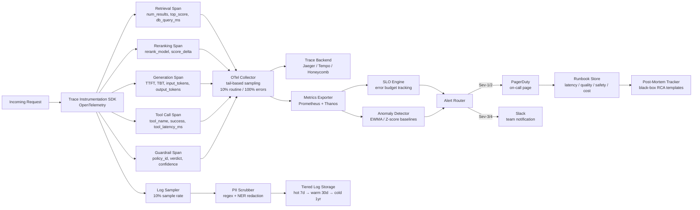

# Chapter 29: Observability and Incident Response for LLM Systems

## Context

> [!info] Quick Reference
> - **Pattern:** End-to-end observability stack for LLM systems covering distributed tracing, metrics, prompt/response logging, anomaly detection, and structured incident runbooks
> - **Scale:** Applies at >= 100 QPS where manual inspection breaks down; essential at >= 1K QPS where cost and quality drift become invisible without instrumentation
> - **Key Techniques:** Span decomposition (retrieval, reranking, generation, tool call), SLO burn rate alerting, sampled prompt logging with PII scrubbing, retention tiering, anomaly detection on LLM-specific signals, post-mortem frameworks for black-box models
> - **Primary Concerns:** Non-determinism makes baseline drift ambiguous; token billing ties observability cost to request volume; quality is a metric with no ground truth at runtime; black-box model internals make root cause identification probabilistic not deterministic
> - **Cross-references:** [[Chapter 2 - The LLM Stack and Core Patterns|Chapter 2]] (LLM stack patterns), [[Chapter 5 - Evaluation, Guardrails, and Safety|Chapter 5]] (guardrails), [[Chapter 22 - Design a Multi-Agent Workflow Orchestrator|Chapter 22]] (agentic systems — trace depth multiplies), [[Chapter 27 - Evaluation at Scale|Chapter 27]] (evaluation at scale — offline quality signal complements online observability)

**Problem statement:** Design a complete observability and incident response system for a production LLM platform serving 5,000 QPS across multiple product surfaces — covering distributed tracing, metrics collection, prompt/response logging, anomaly detection, alerting, and structured incident runbooks — such that any latency regression, quality regression, safety incident, or cost spike is detected within 5 minutes and root cause is isolatable to a specific pipeline component within 15 minutes.

### Real-World Examples

- A [[glossary#RAG (Retrieval-Augmented Generation)|RAG]]-based customer support system shows a 40% increase in p95 latency. Without span-level tracing, the on-call engineer spends 45 minutes bisecting before discovering that the [[glossary#Vector Database / ANN Index|vector database]] query time tripled due to a missing index on a new [[glossary#Embedding|embedding]] dimension. A retrieval span with a `db_query_ms` attribute would have surfaced this in the first dashboard view.
- A code generation assistant starts producing responses with a 3x higher refusal rate after a silent model provider update. Because the system logs only final outputs (not intermediate reasoning), there is no signal to distinguish between: (a) user query [[glossary#Distribution Shift|distribution shifting]] toward policy-violating requests, (b) provider-side model update increasing refusal sensitivity, or (c) a system prompt injection in a recent deploy. Without per-component metrics, all three hypotheses take the same investigation path.

---

## Step 1: Understand the Problem and Establish Design Scope

### Simulated Dialogue

**Interviewer:** Design an observability and incident response system for a production LLM platform. We process around 5,000 requests per second across multiple product lines.  
**Candidate:** Before proposing an architecture I want to understand what components are in the pipeline and what kinds of incidents have occurred.

**Candidate:** What does the request pipeline look like — pure generation, RAG, agentic, or all of the above?  
**Interviewer:** All of the above. Some products are simple chat, some are RAG-based QA, some use tool-calling agents.

**Candidate:** What does "incident" mean here — latency SLO breach, quality regression, safety violation, cost spike, or all four?  
**Interviewer:** All four. We had a cost spike last quarter that took three days to trace back to a [[glossary#KV Cache|KV cache]] misconfiguration. That was unacceptable.

**Candidate:** Do you have any distributed tracing today, or are you starting from scratch?  
**Interviewer:** We have basic request-level logs but no span-level tracing across pipeline components. Retrieval and generation are unobservable separately.

**Candidate:** What is your latency SLO target and what is the current incident detection time?  
**Interviewer:** SLO is p95 < 3 seconds end-to-end. Current detection time is around 20-30 minutes — we rely on user complaints and dashboards that are checked manually.

**Candidate:** Are there compliance or privacy constraints on logging prompt and response content?  
**Interviewer:** Yes. We have GDPR obligations. Prompts may contain PII — names, emails, account numbers. We cannot store raw prompts in a logging system that isn't privacy-controlled.

**Candidate:** What is the acceptable storage budget for observability data?  
**Interviewer:** We haven't thought about it carefully. Logging everything at 5K QPS feels expensive.

**Candidate:** Do you have existing alerting infrastructure — PagerDuty, OpsGenie, Slack — and an on-call rotation?  
**Interviewer:** Yes, PagerDuty with a follow-the-sun rotation. Alert fatigue is a known problem. We get paged at 3 AM for things that turn out to be noise.

**Candidate:** After an incident, do you do structured post-mortems? And is there a playbook for "quality regression" specifically?  
**Interviewer:** We do post-mortems informally. No playbooks for LLM-specific failures — just the general incident response template.

### Functional Requirements

- **Distributed tracing across all pipeline stages** — retrieval, reranking, generation, tool call, and guardrail evaluation must each produce a distinct span with stage-specific attributes (e.g., `retrieval.top_score`, `gen.ttft_ms`, `guardrail.verdict`), enabling per-component latency isolation during incident triage without code bisection.
- **Real-time metrics for latency, throughput, token economy, and quality proxies** — specifically: TTFT (time to first token), TBT (time between tokens), e2e latency, request throughput, input/output token counts, KV cache hit rate, refusal rate, truncation rate, and retrieval similarity score distributions; these signals must be queryable at 1-minute granularity with labels for `product_line`, `model_version`, and `region`.
- **Sampled prompt/response logging with PII scrubbing before storage** — sampling rate is configurable per product line (default 10%), with forced 100% inclusion of all error requests and guardrail-blocked requests; PII scrubbing using regex + NER redaction occurs synchronously before the first log write so that no unscrubed content reaches any storage system.
- **Anomaly detection on LLM-specific signals** — automated baseline tracking and alerting for KV cache hit rate drops (> 20 percentage point decline), latency distribution shifts (p95 increases > 50% from EWMA baseline), sudden refusal rate changes (> 2x baseline for 5+ minutes), and token throughput degradation (> 30% decline from rolling average).
- **SLO burn rate alerting integrated with PagerDuty** — four severity levels (Sev-1 through Sev-4) with defined detection windows (1h, 6h, 24h, 72h), burn rate thresholds aligned with the Google SRE Workbook standard, and each alert linked to a specific runbook with a named escalation contact.
- **Structured incident runbooks for four incident classes** — latency regression, quality regression, safety incident, and cost spike; each runbook must be executable by an on-call engineer without domain-specific context, with exact dashboard URLs, metric thresholds, and per-diagnosis mitigation steps rather than general guidance.
- **Post-mortem process adapted for LLM black-box root cause analysis** — post-mortems must enumerate hypotheses with supporting or refuting evidence, identify the proximate observable cause (not a model-internal assertion), and explicitly document when root cause is unattributable due to provider-side black-box behavior.

### Non-Functional Requirements

- **Detection time:** any SLO breach detectable within 5 minutes of onset.
- **Root cause isolation:** on-call engineer can isolate the failing pipeline component within 15 minutes using trace and metric data.
- **Storage cost:** observability storage budget <= $10K/month at 5K QPS.
- **Logging overhead:** tracing and logging add <= 5ms to request p50 latency.
- **PII compliance:** no raw PII stored in observability systems; scrubbing occurs before any log write.
- **Alert noise:** false positive page rate <= 1 per on-call shift; alert fatigue is treated as a first-class metric.
- **Retention:** traces hot 7 days, warm 30 days, cold 1 year; aggregated metrics retained indefinitely at 1-minute granularity.

### Back-of-the-Envelope Estimation

#### Tracing Volume

Assume:

- **Request rate:** 5,000 QPS.
- **Spans per request:** 6 (root, retrieval, reranking, generation, guardrail, response write).
- **Bytes per span:** 500 bytes (attributes + timestamps + trace metadata).
- **Trace write rate:** `5,000 * 6 * 500 bytes = 15 MB/s = 54 GB/hour = ~1.3 TB/day`.
- **With 10% trace sampling (tail-based, keeping errors + slow requests):** `~130 GB/day` — manageable in a time-series store.

#### Log Storage Cost

Assume full prompt/response logging at 5K QPS:

- **Average exchange size:** 2K tokens = ~1.5 KB text.
- **Log write rate (unsampled):** `5,000 * 1.5 KB = 7.5 MB/s = 648 GB/day`.
- **At $0.023/GB/month (S3):** `648 GB/day * 30 days * $0.023 = $447/month` for storage alone.
- **At 10% sampling:** `$45/month` for storage — a 10x reduction.
- **Processing cost** (ingestion, scrubbing pipeline): add ~3x → total ~$135/month at 10% sampling.
- **Full logging at 2K tokens/exchange at 5K QPS = 2M tokens/min = ~$0.04/min = $57K/month** for token-equivalent processing cost if piped through an LLM scrubber. This is why statistical sampling, not full logging, is the correct approach.

#### Metric Cardinality

- **Dimensions:** product_line (8), model_version (5), region (3), request_type (4) = 480 unique label combinations.
- **Metrics per combination:** ~20 (latency percentiles, token counts, error rates, etc.).
- **At 1-minute granularity, 30 days:** `480 * 20 * 43,200 = 414M data points/month`.
- **In Prometheus/Thanos at ~2 bytes/sample:** `~800 MB/month` — trivial.

---

## Step 2: Propose High-Level Design and Get Buy-In

### Core Architecture Components

- **Trace Instrumentation SDK:** thin wrapper around OpenTelemetry that emits spans for each pipeline stage. Language-native (Python/Go), < 1ms overhead per span. Propagates trace context across async boundaries via baggage headers.
- **Trace Collector:** OpenTelemetry Collector sidecar that receives spans, applies tail-based sampling (100% for errors and requests > 2x p95 latency; 10% otherwise), and forwards to the trace backend.
- **Trace Backend:** distributed trace storage (Jaeger, Tempo, or Honeycomb). Indexed on trace_id, span_kind, model_version, product_line, error status. Query interface for waterfall views and span-level attribute search.
- **Metrics Pipeline:** Prometheus scraping per-service metric endpoints; Thanos for long-term storage and cross-cluster aggregation. Custom LLM metrics exposed via a `/metrics` endpoint on each service.
- **Log Ingestion Pipeline:** sampled prompt/response logs flow through a PII scrubbing service before reaching any storage system. Scrubber uses regex + NER-based PII detection and redaction. Logs written to tiered object storage (S3/GCS) with lifecycle policies.
- **Anomaly Detector:** streaming anomaly detection over the metrics pipeline using Z-score or EWMA-based baselines. Detects sudden shifts in refusal rate, latency distribution, token throughput, and KV cache hit rate.

> **Why EWMA-based baselines over fixed thresholds for anomaly detection:** LLM workloads have strong diurnal patterns — traffic peaks at business hours and troughs overnight, which means a fixed threshold like "alert if refusal rate > 3%" produces false positives during low-traffic troughs (where even 2 refusals in 10 requests appears as 20%) and misses genuine regressions during peak traffic (where 3% is statistically distinguishable from baseline). Exponentially weighted moving average (EWMA) baselines track the recent history of each signal with recency bias, producing a dynamic expected value and standard deviation that adapt to the traffic pattern. A Z-score alert fires when the observed value is more than N standard deviations from the EWMA-predicted value, which is meaningful regardless of absolute traffic level. For LLM-specific signals like KV cache hit rate and retrieval top score, EWMA correctly distinguishes a genuine drift from normal noise because it maintains a smoothed baseline that accounts for recent gradual shifts without flagging them as anomalies.
- **SLO Engine:** computes real-time error budget consumption from SLO definitions (e.g., p95 latency < 3s, error rate < 0.1%). Fires burn rate alerts when budget is consumed faster than sustainable.
- **Alert Router:** receives alerts from the SLO Engine and Anomaly Detector; maps alert type to runbook; pages on-call via PagerDuty for Sev-1/2; posts to Slack for Sev-3/4.
- **Runbook Store:** versioned Markdown runbooks for each incident class. Linked from alert pages automatically. Each runbook has a step-by-step diagnosis tree and escalation contacts.
- **Post-Mortem Tracker:** structured post-mortem database linked to incident records. Templates adapted for LLM black-box incidents where root cause may be probabilistic.

> **Why tail-based sampling over head-based sampling:** Head-based sampling (sample at request ingress with probability p) cannot know whether a request will be slow or error-prone until it completes. Tail-based sampling buffers spans until the root span closes, then applies the sampling decision. This guarantees 100% capture of error traces and latency outliers — the traces that matter most for incident investigation — while sampling out routine fast traces that add cost without insight.

> **Why a dedicated PII scrubbing service before any log write:** Once PII enters a log system, it is nearly impossible to fully purge — replicas, backups, and exported datasets propagate it. Scrubbing at ingestion, before first write, ensures PII never reaches storage. GDPR right-to-erasure obligations become trivial when logs contain only scrubbed text.

> **Why separate span kinds for retrieval, reranking, generation, and tool calls:** When a RAG pipeline degrades, root cause is either retrieval (wrong chunks returned) or generation (correct chunks, bad synthesis). A unified "pipeline latency" span cannot distinguish these failure modes. Separate spans with per-kind attributes (e.g., `retrieval.num_results`, `retrieval.top_score`, `generation.input_tokens`) make root cause isolation a dashboard lookup rather than a code bisect.

### Mermaid Architecture Diagram



---

## Step 3: Design Deep Dive

### 1) Distributed Tracing for LLM Pipelines

#### Span Design

Each LLM pipeline request produces a trace with six canonical span kinds. Span attributes are the primary observability surface — they carry the data that makes traces actionable.

**Root span (`llm.request`):**

| Attribute | Type | Description |
|---|---|---|
| `request.id` | string | UUID for the end-to-end request |
| `product_line` | string | which product surface initiated the request |
| `model.id` | string | model version identifier |
| `model.provider` | string | openai, anthropic, etc. |
| `request.type` | enum | chat, rag, agent, tool_call |
| `latency.e2e_ms` | float | end-to-end latency in milliseconds |
| `error` | bool | whether the request resulted in an error |
| `error.type` | string | timeout, model_error, guardrail_block, etc. |

**Retrieval span (`llm.retrieval`):**

| Attribute | Type | Description |
|---|---|---|
| `retrieval.query_embedding_ms` | float | time to embed the query |
| `retrieval.db_query_ms` | float | time for the vector DB query |
| `retrieval.num_results` | int | number of chunks returned |
| `retrieval.top_score` | float | similarity score of the top chunk |
| `retrieval.min_score` | float | similarity score of the lowest-ranked chunk returned |
| `retrieval.index_version` | string | which index version was queried |

**Reranking span (`llm.reranking`):**

| Attribute | Type | Description |
|---|---|---|
| `reranking.model_id` | string | reranker model identifier |
| `reranking.input_count` | int | number of chunks fed to reranker |
| `reranking.output_count` | int | number of chunks after reranking |
| `reranking.latency_ms` | float | reranker inference latency |
| `reranking.top_score_delta` | float | score change of top chunk after reranking |

**Generation span (`llm.generation`):**

| Attribute | Type | Description |
|---|---|---|
| `gen.ttft_ms` | float | time to first token in milliseconds |
| `gen.tbt_mean_ms` | float | mean time between tokens |
| `gen.tbt_p95_ms` | float | p95 time between tokens |
| `gen.input_tokens` | int | prompt token count |
| `gen.output_tokens` | int | completion token count |
| `gen.finish_reason` | enum | stop, length, content_filter, tool_calls |
| `gen.cache_hit` | bool | KV cache hit for this request |
| `gen.cost_usd` | float | estimated cost for this generation |

**Tool call span (`llm.tool_call`):**

| Attribute | Type | Description |
|---|---|---|
| `tool.name` | string | name of the tool invoked |
| `tool.call_count` | int | number of times this tool was called in the request |
| `tool.latency_ms` | float | total tool execution latency |
| `tool.success` | bool | whether the tool call returned without error |
| `tool.error_type` | string | if failed: timeout, auth_error, schema_error |

**Guardrail span (`llm.guardrail`):**

| Attribute | Type | Description |
|---|---|---|
| `guardrail.policy_id` | string | which policy was evaluated |
| `guardrail.verdict` | enum | allow, block, flag |
| `guardrail.confidence` | float | classifier confidence score |
| `guardrail.latency_ms` | float | guardrail evaluation latency |

> **Why separate retrieval spans from generation spans:** When a RAG pipeline degrades, root cause is either retrieval (wrong chunks returned) or generation (correct chunks, bad synthesis). A unified span makes it impossible to distinguish these failure modes from a trace waterfall view. Separate spans with per-kind attributes allow the on-call engineer to compare `retrieval.top_score` histograms before and after a degradation event — a drop in top score pinpoints retrieval failure immediately without a code bisect.

#### Trace Propagation Across Async Boundaries

LLM pipelines are rarely fully synchronous. A tool call may spawn a background job; a streaming response may outlive the HTTP connection; a retrieval service may be called over an internal RPC boundary with its own threading model. Trace context must propagate across all of these boundaries, or the trace waterfall fragments into disconnected spans that cannot be assembled into a coherent request timeline.

The core problem is that OpenTelemetry's in-process context propagation (using Python's `contextvars` or Go's `context.Context`) is automatically thread-local and does not survive crossing process or queue boundaries. When a span is started in Process A and a child span is started in Process B (the retrieval service), Process B has no way to know it is a child of Process A's span unless the trace context is explicitly serialized and transmitted. The W3C Trace Context standard defines a wire format for this serialization (`traceparent` header), and OpenTelemetry implements it as a built-in propagator. Correctly instrumenting async boundaries is the single most common failure mode in distributed tracing rollouts — a system that looks well-instrumented locally but has broken propagation across service boundaries produces orphaned spans that are invisible in waterfall views.

> **Why W3C `traceparent` header over proprietary formats:** The W3C Trace Context specification (RFC) is supported by every major tracing library, APM vendor, and service mesh. Using a proprietary header (e.g., Zipkin's `X-B3-TraceId`) creates a translation layer problem at every service boundary where the instrumentation library differs. Standardizing on `traceparent` means any service in the call chain — including third-party retrieval services, external tool APIs, and future acquired microservices — can propagate trace context without code changes if they are instrumented with any W3C-compliant library.

**Pattern: W3C `traceparent` header propagation**

For synchronous HTTP sub-calls (retrieval service, reranking service): inject the W3C `traceparent` header in the outbound request. The receiving service extracts the header and creates a child span under the same trace.

**Pattern: Baggage for cross-process metadata**

For metadata that must be accessible in every downstream span without explicit passing (e.g., `product_line`, `request.type`): use OpenTelemetry Baggage. Set baggage at the root span; each downstream service reads it to populate its own span attributes.

**Pattern: async queue propagation**

For tasks queued via Celery, SQS, or Kafka: serialize the `traceparent` into the message envelope. The consumer deserializes and creates a linked span (use `LINK` relationship, not `CHILD_OF`, since the consumer may process the message seconds or minutes later).

> **Why `LINK` instead of `CHILD_OF` for async queue spans:** The `CHILD_OF` relationship implies that the child span's start time is within the parent span's active duration — this is true for synchronous sub-calls (a retrieval span starts and ends while the root request span is open) but false for queue consumers, which may start minutes or hours after the producer span closed. Using `CHILD_OF` for async consumers produces trace waterfalls with negative span durations or spans that appear before their claimed parent, breaking timeline visualizations in every trace UI. The `LINK` relationship correctly represents a causal dependency between two traces without implying a temporal containment relationship, enabling the trace backend to display the producer trace and consumer trace as separate but linked timelines that can be navigated between.

#### Trade-off Table: Tracing Backend Options

| Backend | Setup Complexity | Query Capability | Cost at 130 GB/day | Best For |
|---|---|---|---|---|
| Jaeger (self-hosted) | Medium — requires deploying and operating Cassandra or Elasticsearch as the backing store, plus the Jaeger collector and query services; expect 2–4 engineer-days to stand up with proper HA. | Good — the Jaeger UI renders span waterfalls and supports JSON-based attribute filtering, but free-text search across span attributes requires an Elasticsearch backend and becomes slow beyond 10M spans/day. | ~$100/month storage — only storage costs apply since compute runs on your own infrastructure; factor in ~$200/month for the backing store cluster at this data volume. | Cost-sensitive teams with existing Kubernetes infrastructure who want zero vendor dependency and are willing to own operational burden. |
| Tempo + Grafana | Low — deploys as a single Kubernetes StatefulSet backed by object storage (S3/GCS); integrates natively with Grafana dashboards already used for Prometheus metrics, reducing the dashboard sprawl problem. | Excellent — TraceQL enables structured queries like `{ span.retrieval.top_score < 0.5 && duration > 2s }`, making it possible to find degraded retrieval spans directly without manual trace browsing. | ~$80/month storage — Tempo writes traces directly to S3-compatible object storage at standard rates; no proprietary storage format means data is portable and cheap. | Teams already operating Grafana + Prometheus who want traces, metrics, and logs in a unified UI without a second vendor contract. |
| Honeycomb | Very Low — SDK instrumentation via one environment variable (`HONEYCOMB_API_KEY`); no collector infrastructure to manage; data flows directly from the application to Honeycomb's SaaS ingest. | Excellent — BubbleUp statistical analysis automatically surfaces which span attributes differ between slow and fast traces, reducing incident triage from minutes of manual dashboard reading to a single click. | ~$2,000–$5,000/month — priced per event (span); at 130 GB/day (~260M events/day at ~500 bytes/event) and typical per-event pricing around $0.01–$0.02 per 1K events, costs reach this range before any volume discounts. | Teams that prioritize MTTR reduction and can absorb higher cost in exchange for eliminating the need to write custom analysis queries during incidents. |
| Datadog APM | Low — agent-based collection; Datadog's auto-instrumentation patches popular frameworks automatically; integrates with Datadog Logs and Metrics in a single pane, eliminating cross-tool navigation during incidents. | Good — Datadog's trace UI supports service maps, error tracking, and latency distributions per endpoint, but high-cardinality attribute search (e.g., filtering by a custom `retrieval.index_version` field) requires the APM Indexed Spans feature at additional cost. | ~$3,000–$8,000/month — Datadog charges per host for APM plus per-GB for indexed spans; at 130 GB/day the indexed span cost dominates; aggressively tuning which span attributes are indexed can halve this figure. | Teams already paying for Datadog Logs and Infrastructure monitoring where the all-in-one platform value outweighs the higher per-unit cost vs. self-hosted alternatives. |
| AWS X-Ray | Low (on AWS) — automatic integration with AWS Lambda, API Gateway, and ECS via X-Ray daemon sidecars; no additional infrastructure to provision for AWS-native deployments. | Limited — X-Ray's console supports service maps and trace filtering on HTTP status codes and response times, but does not support custom attribute search (e.g., querying by `retrieval.top_score`), making LLM-specific incident investigation difficult; investigators must export traces to S3 and query via Athena for custom attributes. | ~$50/month — priced at $5 per 1M traces recorded and $0.50 per 1M traces retrieved; at 5K QPS with 10% sampling that is 43M traces/day × $5/M = $215K/month, so X-Ray is only affordable at aggressive head-based sampling (< 0.1%), which eliminates the tail-latency capture needed for LLM incident triage. | Simple AWS-native stacks with low QPS (< 100 QPS) where cost is negligible and the team has no existing tracing infrastructure to migrate from. |

---

### 2) Metrics and Alerting Design

#### Key LLM-Specific Metrics

Beyond standard web service metrics (request rate, error rate, p50/p95/p99 latency), LLM systems require a distinct set of metrics that classical APM tools do not track by default.

**Latency decomposition:**

- `llm_ttft_seconds` — time to first token. The primary user-perceived latency signal for streaming responses. SLO: p95 < 1.0s.
- `llm_tbt_seconds` — time between tokens (per-token inter-arrival time). High TBT creates a stutter effect even when TTFT is low. Alert threshold: p95 > 150ms for 3 consecutive minutes.
- `llm_e2e_latency_seconds` — full request latency including retrieval, reranking, generation, and guardrail. SLO: p95 < 3.0s.

**Token economy:**

- `llm_input_tokens_total` — counter of input tokens, labeled by `model_id` and `product_line`. Drives cost attribution.
- `llm_output_tokens_total` — counter of output tokens. Combined with input tokens to compute per-request cost.
- `llm_token_throughput_tps` — tokens per second (output). A drop in throughput signals model-side compute saturation or rate limiting.
- `llm_kv_cache_hit_rate` — fraction of requests served (at least partially) from the KV cache. A drop in cache hit rate causes TTFT to increase and cost to rise simultaneously.

> **Why `llm_kv_cache_hit_rate` is a first-class operational metric:** The KV cache stores the attention key-value tensors for the prompt prefix, allowing the model to skip recomputing those tensors on repeated or similar prefixes. A high cache hit rate (typically 60–80% for stable system prompts) reduces TTFT by 300–800ms and reduces input token billing cost by 80–90% (most providers charge cached tokens at 10–20% of uncached rate). A drop in cache hit rate has a compound effect: TTFT increases (users notice immediately), and cost increases simultaneously — the only operational event that worsens both user experience and cost in lockstep. This dual impact makes cache hit rate the single most important cost-performance signal in LLM systems and the first metric to check in both latency regression and cost spike runbooks.

**Quality proxies (measurable at runtime without ground truth):**

- `llm_refusal_rate` — fraction of requests where `finish_reason == content_filter` or response contains a refusal pattern. A spike indicates either user behavior change or model policy change.
- `llm_truncation_rate` — fraction of responses where `finish_reason == length` (output hit max_tokens). High truncation rate indicates the context window budget is misconfigured.
- `llm_retrieval_top_score` (histogram) — distribution of similarity scores for the top retrieved chunk. A downward shift indicates query distribution drift or index quality degradation.
- `llm_empty_response_rate` — fraction of responses with zero output tokens. Should be near zero; any spike is an error signal.

**Cost and efficiency:**

- `llm_cost_per_request_usd` (histogram) — cost per request computed from token counts and model pricing. Alert on p99 > budget threshold.
- `llm_context_window_utilization` — fraction of max context window used. Approaching 1.0 causes truncation and increases cost.

#### SLO Burn Rate Alerting

Define SLOs in terms of an error budget over a rolling window. Example SLO: "p95 latency < 3 seconds for 99.5% of requests over a 30-day window."

**Error budget:** 0.5% of requests may exceed 3s p95 latency. At 5,000 QPS over 30 days: `5,000 * 86,400 * 30 * 0.005 = 64.8M` bad request seconds of budget.

**Burn rate alerts fire when the budget is consumed faster than sustainable:**

| Alert Name | Burn Rate | Detection Window | Severity | Action |
|---|---|---|---|---|
| Critical latency burn | 14x | 1 hour | Sev-1 | Page on-call immediately |
| High latency burn | 6x | 6 hours | Sev-2 | Page on-call within 15 min |
| Elevated latency burn | 3x | 24 hours | Sev-3 | Slack notification, no page |
| Low latency burn | 1.5x | 72 hours | Sev-4 | Weekly review ticket |

A "14x burn rate" means the system is consuming 14% of its 30-day error budget per hour — exhausting the entire budget in ~50 hours if uncorrected.

> **Why SLO burn rate alerts over static thresholds:** A static p95 > 500ms alert fires during any traffic spike even if the SLO is not at risk. Burn rate alerts fire when the error budget is being consumed faster than sustainable — e.g., consuming 5% of a monthly budget in 1 hour. During planned maintenance windows, the burn rate is temporarily high but expected; burn rate alerts can be silenced for the maintenance window without disabling the underlying SLO. Static threshold alerts require manual tuning for every traffic pattern change; burn rate alerts self-adjust because they are normalized against the request volume.

#### Alert Fatigue Mitigation

Alert fatigue is treated as a first-class operational metric: track `pages_per_on_call_shift` and `false_positive_page_rate` in the post-mortem tracker. Targets: <= 5 pages per shift, <= 20% false positive rate.

Alert fatigue is not merely uncomfortable — it is operationally dangerous. When engineers receive more than 5–8 pages per on-call shift, their response to each subsequent page degrades: they acknowledge alerts faster without fully investigating, apply mitigations speculatively without confirming root cause, and develop habituation to alarms that desensitizes them to genuine Sev-1 pages. Research from Google's SRE practice documents that on-call engineers who receive > 10 pages per shift have a statistically significant higher rate of missed incidents and post-incident review quality degradation. For LLM systems specifically, alert fatigue is exacerbated by the non-determinism of quality signals — a refusal rate that fluctuates naturally by ±0.5% around a baseline creates a fertile source of noise alerts if threshold-based alerting is applied naively. The goal is not to reduce alerting coverage but to ensure every page is actionable, every alert has a corresponding runbook, and every false positive is treated as a defect in the alerting system that must be corrected.

> **Why tracking false positive page rate as a metric rather than relying on subjective feedback:** Engineers habituate to noise and stop reporting false positives explicitly — the signal disappears from retrospectives even as the underlying problem persists. Measuring `false_positive_page_rate` requires that every on-call page is categorized as true positive or false positive within 24 hours of resolution (this is part of the post-mortem process). The measurement creates accountability: if the metric shows that the retrieval latency alert has a 45% false positive rate over the last 30 days, the alert definition must be revised before the next on-call rotation, not deferred to a quarterly review.

Mitigation strategies:

1. **Multi-window burn rate:** require the burn rate threshold to be exceeded in both a short window (1h) and a long window (6h) before paging — this eliminates transient spikes that self-resolve within the hour without consuming significant error budget. A spike that lasts 15 minutes and clears will not fire the 6-hour window check, preventing the 3 AM page for an incident that resolved before the engineer was awake.
2. **Alert grouping:** group correlated alerts (e.g., retrieval latency spike + e2e latency spike) into a single incident using the alert router's dependency metadata, so that a retrieval outage that simultaneously triggers four downstream alerts generates one page, not four. The router suppresses child alerts when a parent alert is already open and routes them as additional context to the same incident ticket.
3. **Runbook-driven alert definitions:** every alert must have a linked runbook that describes a concrete diagnostic action — if a runbook cannot be written for an alert because there is no actionable response, the alert should not exist. The discipline of writing the runbook before enabling the alert is a forcing function that eliminates vanity metrics (alerts that notify but do not guide action).
4. **Monthly alert review:** metrics on alert volume, true/false positive rates, and mean time to resolve (MTTR) per alert type are reviewed monthly in a dedicated 30-minute meeting — alerts with a false positive rate > 30% over the prior month are revised or removed before the next on-call rotation, creating a continuous improvement loop rather than a set-and-forget alerting regime.

---

### 3) Prompt/Response Logging with Sampling and PII Scrubbing

#### Sampling Strategy

Prompt/response log sampling is the mechanism by which a statistically representative subset of exchanges is written to storage while the remainder is discarded. Unlike trace sampling — where every request generates at least a root span and span-level attributes — prompt/response logs contain the full text of user inputs and model outputs, which are both privacy-sensitive and storage-intensive. The goal of sampling is to collect enough content for quality analysis, incident replay, and model evaluation without incurring the storage, processing, and compliance costs of full logging.

Sampling rate selection involves a three-way tension: statistical validity (enough samples to detect quality regressions with low false-negative rate), storage cost (every 10x increase in sampling rate multiplies storage costs proportionally), and compliance exposure (every logged exchange containing PII that survives the scrubber is a potential data subject access request or erasure obligation). The 10% default resolves this tension for most production workloads above 100 QPS: at 500 QPS sampled (10% of 5K QPS), you collect 43.2M exchanges per day, which is orders of magnitude more than needed for statistically valid quality analysis (where 100K–1M samples per month is typically sufficient for detecting regressions at the 1% level with 95% confidence). Higher sampling rates provide diminishing returns for quality analysis while linearly increasing cost and compliance surface area.

**10% sampling** is the recommended default for production prompt/response logging at >= 100 QPS.

Sampling implementation:

```text
sample_decision = hash(request_id) % 100 < sample_rate_pct
```

- Deterministic: the same request always makes the same sampling decision. This is important for deduplication and replay.
- Stratified override: regardless of the global sample rate, always log: (a) all requests where `error == true`; (b) all requests where `guardrail.verdict == block`; (c) all requests flagged by the anomaly detector.
- Per-product-line configurability: safety-sensitive products may log at 50%; high-volume, low-stakes products may log at 1%.

> **Why sample 10% of prompts/responses for logging:** Full logging at 1,000 QPS with 2K tokens/exchange = 2M tokens/min = ~$0.04/min = $57K/month just for storage processing costs. At 5,000 QPS the figure quintuples. 10% sampling retains statistical validity for quality analysis — at 500 QPS sampled, you collect 43M logged exchanges per day, far more than needed for representative analysis. The 90% not logged is not lost for incident investigation because trace data (span attributes, latency, token counts) is collected at 100% and covers the operational signal. Prompt/response content is needed only for quality analysis and incident replay, where 10% is sufficient.

#### PII Scrubbing Pipeline

The scrubbing pipeline must run before any log is written to storage. Scrubbing is irreversible — once written, scrubbed logs cannot be un-scrubbed.

**Two-layer scrubbing:**

Layer 1 — Rule-based (fast, < 1ms):
- Email addresses: `\b[A-Za-z0-9._%+-]+@[A-Za-z0-9.-]+\.[A-Z|a-z]{2,}\b` → `[EMAIL]`
- US phone numbers: multiple patterns → `[PHONE]`
- SSN: `\b\d{3}-\d{2}-\d{4}\b` → `[SSN]`
- Credit card numbers (Luhn-valid patterns): → `[CC_NUMBER]`
- IP addresses: → `[IP_ADDRESS]`
- Dates of birth (contextual): → `[DOB]`

Layer 2 — NER-based (slower, 5-15ms, applied after layer 1):
- Named entity recognition model identifies PERSON, ORG, GPE entities.
- Entities in context that match PII patterns (e.g., "My name is John Smith") are replaced with `[PERSON]`.
- False positive rate of NER is acceptable — over-redaction is preferable to under-redaction for compliance.

**Scrubbing placement:** the scrubbing service is a synchronous pass-through in the logging pipeline, not an async enrichment step. The log is held in memory until scrubbing completes; the scrubbed version is then written. No intermediate write of unscrubed content occurs.

#### Retention Tiers

| Tier | Age Range | Storage Class | Query Latency | Cost/TB/month | Use Case |
|---|---|---|---|---|---|
| Hot | 0–7 days | SSD-backed object store (e.g., S3 Intelligent-Tiering with Expedited retrieval, or a self-managed MinIO cluster on NVMe) | < 100ms — fast enough for interactive trace browsing during an active incident; engineers can paginate through thousands of log entries without waiting | ~$230 | Active incident investigation where the on-call engineer needs sub-second query response to move quickly through the diagnosis tree |
| Warm | 7–30 days | Standard object store (S3 Standard or GCS Standard) — data is compressed with Zstandard at ~3:1 ratio before write to reduce storage costs by two-thirds at the expense of ~10ms decompression overhead per query | < 5s — acceptable for post-mortem work where the engineer is reading sequentially rather than interactively browsing; most post-mortem log retrieval is a batch fetch of 50–200 records, not a real-time stream | ~$23 | Post-mortem replay where specific request IDs from an incident trace are retrieved for manual review, and scheduled quality analysis jobs that run overnight and tolerate latency |
| Cold | 30 days–1 year | S3 Glacier Instant Retrieval or GCS Archive — first-byte latency is 1–3 minutes; data is stored in compressed columnar format (Parquet) to minimize egress costs for analytical queries | Minutes — suitable only for compliance audits (e.g., GDPR data subject access requests) and rare deep forensic investigations where the engineer knows the exact request IDs in advance and can tolerate a retrieval wait | ~$4 | Regulatory compliance (retain proof of PII scrubbing for 1 year), rare forensic investigations, and capacity planning analysis that joins historical token counts with infrastructure cost data |
| Delete | > 1 year | Automated lifecycle policy deletes objects; deletion is verified by a daily audit job that checks for objects with `creation_date > 365 days` and alerts if any are found, since failure to delete can be a GDPR violation | — | $0 | GDPR right-to-erasure compliance: the 1-year limit is the maximum retention period for personal data in many GDPR interpretations; automatic deletion ensures no manual process failure creates a compliance gap |

> **Why tiered retention instead of a single storage class:** Storing all 30 days of logs in hot SSD-backed storage would cost ~$230/TB/month × 1.5 TB (51.8 GB/day × 30 days) = ~$345/month just for the warm-tier volume. Moving data to standard S3 after 7 days reduces that to ~$35/month for the same data — a 10x reduction. Lifecycle policies automate the tier transitions with zero operational overhead after initial configuration. The key invariant is that hot-tier availability matches the incident response window: 99% of incidents are investigated within 48 hours, so 7 days of hot storage provides a 3x safety margin at the optimal cost-performance point.

**Storage cost math at 10% sampling, 5K QPS:**

- Sampled rate: 500 exchanges/second.
- Per-exchange size after scrubbing: ~1.2 KB.
- Daily write: `500 * 86,400 * 1.2 KB = 51.8 GB/day`.
- Hot tier (7 days): `51.8 * 7 = 363 GB at $230/TB = $84/month`.
- Warm tier (23 additional days): `51.8 * 23 = 1,191 GB at $23/TB = $27/month`.
- Cold tier (11 months): `51.8 * 335 = 17,353 GB at $4/TB = $69/month`.
- **Total: ~$180/month** — well within the $10K/month observability budget.

#### Trade-off Table: LLM Observability Platform Options

| Platform | Tracing | Metrics | Prompt Logging | LLM-Specific Features | Cost |
|---|---|---|---|---|---|
| LangFuse (self-hosted) | Basic — supports parent-child span hierarchy for LLM calls and tool invocations, but lacks distributed tracing across independent microservices; adequate for monolithic pipelines, insufficient for multi-service architectures. | Basic — provides aggregate cost and latency dashboards but does not expose a Prometheus-compatible metrics endpoint, requiring a separate metrics pipeline for SLO alerting. | Yes (built-in) — stores prompts and responses natively in its PostgreSQL backend; must configure retention policies manually to comply with GDPR right-to-erasure requirements. | Trace hierarchy for session-level analysis, evaluation score integration (human and automated), and per-trace cost attribution that rolls up to daily spend dashboards. | Free (infra only) — self-hosting requires a PostgreSQL instance and a web server; at 5K QPS expect ~500 GB/month database growth without aggressive sampling, translating to ~$50–$150/month infra cost. |
| LangFuse (cloud) | Good — cloud offering adds multi-tenant trace isolation, automatic retention management, and UI improvements; still does not bridge to infrastructure-level tracing (e.g., vector DB span timing). | Good — cloud dashboards include cost-per-product-line breakdowns and latency trend charts; missing: configurable alerting on metric thresholds, which requires exporting data to an external alerting tool. | Yes — SaaS-managed with configurable data residency (EU region available for GDPR); PII scrubbing must be implemented in the application layer before data leaves your environment. | Session tracking for multi-turn conversations, automated cost tracking per model version, and native integration with offline evaluation pipelines for closing the feedback loop between production traces and eval datasets. | $100–$2,000/month — tiered by monthly trace volume; at 5K QPS with 10% sampling (~43M traces/month) the cost lands in the $500–$1,500 range; enterprise contracts include SLA guarantees and SSO. |
| LangSmith | Good — LangChain-native instrumentation reduces integration effort for LangChain-based pipelines to near zero; non-LangChain pipelines require the LangSmith REST API, adding ~50–100 lines of custom instrumentation code. | Good — provides latency and error rate dashboards per chain and per LLM call, with comparison views across dataset runs; lacks Prometheus integration, requiring a separate metrics pipeline for burn rate alerting. | Yes — prompt and response logging is the core product feature; supports annotation workflows where human reviewers can label sampled logs directly in the UI, creating training data from production traces. | Dataset curation from production traces (one-click to add a trace to an evaluation dataset), automated evaluation against golden sets, and regression testing on prompt versions — the strongest eval-feedback loop of any listed platform. | $0.50–$2.00/1K traces — at 5K QPS with 10% sampling that is 43.2M traces/month, placing cost at $21K–$86K/month at list price; volume discounts and enterprise agreements typically reduce this by 50–70% at this scale. |
| OpenTelemetry DIY | Excellent — full OpenTelemetry SDK gives complete control over span schema, sampling, and backend routing; supports any combination of Jaeger, Tempo, Honeycomb, or Datadog as the backend without SDK changes. | Excellent — Prometheus native metrics with full label cardinality control; integrates directly with Thanos for long-term retention and cross-cluster federation; no constraints imposed by a vendor's data model. | Custom — requires building a log sampling and storage pipeline from scratch; the flip side is full control over PII scrubbing implementation, retention tiers, and storage backends without any vendor data-sharing concerns. | None built in — every LLM-specific signal (refusal rate, retrieval quality proxy, KV cache hit rate) must be implemented as custom metrics and custom span attributes; this is a build-vs-buy decision that pays off at teams with > 3 platform engineers. | Infra only ($500–$5K/month) — cost scales with backend choice; Tempo + Grafana + Prometheus on Kubernetes lands around $500–$1,000/month at this scale; adding Thanos for long-term retention adds ~$200/month in S3 costs. |
| Datadog LLM Observability | Excellent — end-to-end tracing from HTTP gateway through retrieval, generation, and tool calls with automatic correlation to Datadog Logs and Metrics; the single-pane view eliminates cross-tool navigation during incidents. | Excellent — 400+ built-in LLM metrics including TTFT, token throughput, and cost; configurable SLO monitoring with burn rate alerting natively in the Datadog SLO widget without external tooling. | Yes — LLM Observability product stores prompts and responses with configurable sampling; includes built-in sensitive data scanning (regex + ML) that can substitute for a custom PII scrubbing pipeline. | Built-in LLM dashboards with model comparison views, automatic anomaly detection on token and latency signals using Datadog's Watchdog ML engine, and one-click drill-down from a cost spike alert to the specific model and product line driving it. | $3K–$15K/month — pricing is a function of hosts, indexed logs, and APM spans; LLM Observability adds a per-event charge on top; at 5K QPS the combined cost frequently exceeds $10K/month, making it viable primarily for organizations already standardized on Datadog where incremental cost is acceptable. |
| Arize AI | Good — Arize provides tracing for LLM pipelines with native support for embedding-space visualization; trace depth for complex agentic systems (> 5 tool calls per request) may reach rendering limits in the UI. | Good — includes embedding drift metrics, input distribution shift detection, and output quality proxies that go beyond what standard APM tools track; integrates with Prometheus via export for use in existing alerting pipelines. | Yes — prompt and response logging with built-in embedding storage for similarity search across historical requests; this enables retrieval of the most similar past requests to a current incident prompt, which is uniquely useful for quality regression debugging. | Hallucination detection via LLM-as-judge scoring on sampled responses, embedding drift monitoring to detect query distribution shift before it affects quality metrics, and cohort analysis to compare quality across user segments or model versions. | $1K–$10K/month — tiered by monthly prediction volume and feature set; hallucination detection and embedding drift monitoring are add-on modules at additional cost; suitable for teams where quality monitoring is the primary observability gap and latency/cost monitoring is already covered elsewhere. |

> **Why OpenTelemetry as the instrumentation foundation regardless of backend:** OpenTelemetry is vendor-neutral. Instrumentation written with the OTel SDK can be forwarded to Jaeger, Tempo, Honeycomb, Datadog, or Grafana Cloud by changing the exporter configuration — no code changes. LangFuse and LangSmith provide higher-level abstractions that are LLM-specific but create vendor lock-in at the instrumentation layer. The recommended pattern is: OTel for infrastructure-level tracing (latency, error rates, span waterfall) + LangFuse/LangSmith for application-level LLM tracing (prompt versions, evaluation results, cost attribution). Both can coexist.

---

### 4) Incident Runbooks and Post-Mortems

#### Runbook: Latency Regression

**Trigger:** SLO burn rate alert — p95 e2e latency consuming error budget at > 6x rate.

**Step 1 — Localize the degraded span (target: 5 minutes):**
1. Open the trace backend. Filter: `latency.e2e_ms > 3000` and `time_range: last_15m`.
2. Compare the waterfall breakdown across slow traces. Is the latency concentrated in `llm.retrieval`, `llm.generation`, or `llm.tool_call`?
3. Check span-level metrics: `llm_retrieval_db_query_ms p95` and `llm_ttft_seconds p95`. One will be elevated.

**Step 2 — Retrieval latency elevated:**
1. Check `retrieval.index_version` on the slow spans — did an index version change recently?
2. Check vector DB dashboards for query latency and index memory pressure.
3. Check `retrieval.num_results` — a sudden increase in results returned increases reranking latency.
4. **Mitigation:** roll back the index version, reduce `num_results` cap, or increase vector DB replica count.

**Step 3 — Generation latency elevated (TTFT spike):**
1. Check `llm_kv_cache_hit_rate` — a drop in cache hit rate is the most common cause of TTFT spikes.
2. Check `llm_token_throughput_tps` — a drop in throughput indicates model-side compute pressure or rate limiting.
3. Check model provider status page — provider incidents cause generation latency spikes that are outside your control.
4. **Mitigation:** check KV cache configuration (context length changes evict cache), enable prompt prefix caching if not already on, or failover to a secondary provider.

**Escalation:** if root cause is not isolated within 15 minutes, escalate to the model infrastructure team lead.

#### Runbook: Quality Regression

**Trigger:** anomaly detection alert on `llm_refusal_rate` (>2x baseline for 5 minutes) or `llm_empty_response_rate` (>0.5% for 3 minutes). Also triggered by user-facing CSAT alert or manual report.

**Step 1 — Distinguish model-side vs. input-side (target: 5 minutes):**
1. Open sampled logs (hot tier). Filter: requests from the last 30 minutes where `guardrail.verdict == block` or response contains a refusal pattern.
2. Are the queries themselves policy-violating (adversarial user behavior shift)? Or are benign queries being refused (model sensitivity shift)?
3. Check whether a model version or system prompt changed in the last 2 hours (deployment log).

**Step 2 — Model version change as root cause:**
1. Compare `llm_refusal_rate` time series against deployment timestamps.
2. If the spike aligns with a deployment: roll back the model version or system prompt.
3. If the model version is unchanged: check provider-side model update notices (some providers update models silently).

**Step 3 — System prompt change as root cause:**
1. Retrieve the system prompt version from the deployment log for the time of regression onset.
2. Compare against the previous system prompt — did a change introduce language that increases refusal sensitivity?
3. **Mitigation:** revert system prompt; run eval pipeline against the previous version to confirm recovery.

**Step 4 — Retrieval quality regression:**
1. Check `llm_retrieval_top_score` histogram — a left shift (lower scores) indicates the wrong chunks are being retrieved.
2. Check whether the embedding model or index was updated.
3. **Mitigation:** roll back embedding model version; re-index if index corruption is suspected.

#### Runbook: Safety Incident

**Trigger:** `guardrail.verdict == block` rate drops unexpectedly (guardrail may be broken), or a safety violation is reported by a user or internal monitor.

**Step 1 — Confirm guardrail is functioning (target: 3 minutes):**
1. Run the guardrail canary: a set of known-policy-violating prompts that should always be blocked. These run every 5 minutes.
2. If canary prompts are not being blocked: the guardrail service is degraded. Page the safety engineering team immediately (Sev-1).
3. If canary prompts are blocked: the guardrail is functioning; the incident is a guardrail miss on a novel attack pattern.

**Step 2 — Scope the incident:**
1. Retrieve sampled logs for requests in the incident window. How many requests reached the same attack pattern?
2. Identify the pattern: jailbreak, prompt injection, data extraction attempt, or other.
3. Assess downstream impact: did any violating content reach users? Is there evidence of data exfiltration?

**Step 3 — Containment:**
1. Add a temporary blocklist rule for the identified attack pattern in the guardrail service.
2. If the attack surface is broad (many variations), enable a stricter safety mode on the model (lower temperature, more restrictive system prompt) as a temporary measure.
3. Notify the legal and trust-and-safety teams within 30 minutes of scope assessment.

**Step 4 — Post-incident:**
1. The attack pattern is added to the guardrail test suite.
2. The safety eval golden set is updated to cover the pattern.
3. A post-mortem is filed within 48 hours.

#### Runbook: Cost Spike

**Trigger:** `llm_cost_per_request_usd p99 > 2x` baseline for 10 consecutive minutes, or daily cost forecast exceeds budget by > 20%.

**Step 1 — Identify the cost driver (target: 5 minutes):**
1. Check `llm_input_tokens_total` and `llm_output_tokens_total` by product_line and model_id. Which combination is elevated?
2. Check `llm_context_window_utilization` — approaching 1.0 indicates context is bloated (retrieved chunks too long, conversation history not truncated).
3. Check `llm_kv_cache_hit_rate` — a drop increases per-token cost because cached tokens are billed at a discount.

**Step 2 — Token count spike:**
1. Retrieve sampled logs for the most expensive requests (sort by `gen.cost_usd` descending).
2. Are input prompts unusually long? Is the retrieval pipeline injecting too many chunks?
3. **Mitigation:** cap `num_results` for retrieval; truncate conversation history beyond N turns; reduce max_tokens for output.

**Step 3 — Model version change as cost driver:**
1. Check whether a model upgrade was deployed recently. Higher-capability models (e.g., Opus vs. Sonnet) may have been accidentally applied to high-volume product lines.
2. **Mitigation:** revert to the cost-appropriate model for the affected product line.

#### Post-Mortems for LLM Incidents

LLM incidents have a structural challenge: the model is a black box. "The model started generating worse responses" is not a falsifiable root cause. The post-mortem framework must be adapted.

**Adapted post-mortem structure:**

1. **Incident timeline:** timestamps of onset, detection, mitigation, resolution. Detection gap is a key metric.
2. **Observable symptoms:** what metrics and traces showed the incident. Not what we believe caused it.
3. **Hypotheses tested:** enumerate each root cause hypothesis considered during investigation. For each: what evidence was gathered, what was found, how the hypothesis was confirmed or eliminated.
4. **Proximate cause:** the most specific observable change correlated with the incident onset (e.g., "KV cache hit rate dropped from 72% to 18% at 14:23 UTC, coinciding with a context length increase from 4K to 8K tokens").
5. **Contributing factors:** conditions that made the incident worse or harder to detect (e.g., "we had no TTFT SLO — only e2e latency, which masked the TTFT spike for 12 minutes").
6. **Counterfactual root cause (black-box models):** when the proximate cause is a provider-side model update or unexplained model behavior change, state this explicitly: "The model's output distribution shifted in a way that is not attributable to any configuration change on our side. We cannot determine the model-internal root cause." This is a valid finding; the follow-up actions are: improve detection (observability), improve resilience (fallback models), and file a report with the provider.
7. **Action items:** specific, owner-assigned, deadline-bounded changes to the system.

> **Why enumerate hypotheses rather than assert root cause in LLM post-mortems:** In classical systems, root cause is usually deterministic — a specific code path, configuration value, or hardware failure. In LLM systems, the same observable symptom (quality regression) can have five different root causes (model update, retrieval drift, system prompt change, user behavior shift, guardrail misconfiguration). Post-mortems that skip hypothesis enumeration and assert a root cause create false confidence. The hypothesis log is also a learning artifact — future incidents with the same symptom profile can shortcut investigation by consulting the historical hypothesis list.

---

## Practical Implementation

### 1. Trace Schema (Pseudocode)

```python
# trace_schema.py
# Canonical span schema for LLM pipeline traces.
# Pseudocode — maps directly to OpenTelemetry Span attributes.
# In production, use the opentelemetry-sdk and emit these as span attributes.

# ─── Root Span ───────────────────────────────────────────────────────────────
ROOT_SPAN = {
    "name": "llm.request",
    "kind": "SERVER",
    "attributes": {
        "request.id":          "str  # UUID, propagated to all child spans",
        "product_line":        "str  # e.g., 'customer_support', 'code_assist'",
        "model.id":            "str  # e.g., 'claude-sonnet-4-6'",
        "model.provider":      "str  # e.g., 'anthropic', 'openai'",
        "request.type":        "enum[chat, rag, agent, tool_call]",
        "latency.e2e_ms":      "float  # set on span end",
        "error":               "bool",
        "error.type":          "str | None  # timeout, model_error, guardrail_block",
        "user.id_hash":        "str  # SHA-256 of user_id, not raw ID",
    }
}

# ─── Retrieval Span ───────────────────────────────────────────────────────────
RETRIEVAL_SPAN = {
    "name": "llm.retrieval",
    "kind": "CLIENT",
    "parent": "llm.request",
    "attributes": {
        "retrieval.query_embedding_ms": "float",
        "retrieval.db_query_ms":        "float  # time inside vector DB",
        "retrieval.num_results":        "int    # chunks returned",
        "retrieval.top_score":          "float  # cosine similarity of rank-1 chunk",
        "retrieval.min_score":          "float  # cosine similarity of rank-N chunk",
        "retrieval.index_version":      "str    # e.g., 'idx-2026-05-30-v3'",
        "retrieval.collection":         "str    # vector DB collection name",
    }
}

# ─── Reranking Span ───────────────────────────────────────────────────────────
RERANKING_SPAN = {
    "name": "llm.reranking",
    "kind": "CLIENT",
    "parent": "llm.request",
    "attributes": {
        "reranking.model_id":        "str",
        "reranking.input_count":     "int",
        "reranking.output_count":    "int",
        "reranking.latency_ms":      "float",
        "reranking.top_score_delta": "float  # score change of rank-1 chunk",
    }
}

# ─── Generation Span ──────────────────────────────────────────────────────────
GENERATION_SPAN = {
    "name": "llm.generation",
    "kind": "CLIENT",
    "parent": "llm.request",
    "attributes": {
        "gen.ttft_ms":           "float  # time to first token",
        "gen.tbt_mean_ms":       "float  # mean inter-token time",
        "gen.tbt_p95_ms":        "float  # p95 inter-token time",
        "gen.input_tokens":      "int",
        "gen.output_tokens":     "int",
        "gen.finish_reason":     "enum[stop, length, content_filter, tool_calls]",
        "gen.cache_hit":         "bool   # KV cache hit",
        "gen.cost_usd":          "float  # estimated, based on token counts",
        "gen.context_util":      "float  # input_tokens / max_context_tokens",
    }
}

# ─── Tool Call Span ───────────────────────────────────────────────────────────
TOOL_CALL_SPAN = {
    "name": "llm.tool_call",
    "kind": "CLIENT",
    "parent": "llm.generation",   # child of generation, not root
    "attributes": {
        "tool.name":        "str",
        "tool.call_count":  "int   # calls to this tool in this request",
        "tool.latency_ms":  "float",
        "tool.success":     "bool",
        "tool.error_type":  "str | None  # timeout, auth_error, schema_error",
    }
}

# ─── Guardrail Span ───────────────────────────────────────────────────────────
GUARDRAIL_SPAN = {
    "name": "llm.guardrail",
    "kind": "INTERNAL",
    "parent": "llm.request",
    "attributes": {
        "guardrail.policy_id":   "str",
        "guardrail.verdict":     "enum[allow, block, flag]",
        "guardrail.confidence":  "float  # classifier score",
        "guardrail.latency_ms":  "float",
        "guardrail.stage":       "enum[input, output]  # input or output guardrail",
    }
}
```

### 2. OpenTelemetry Span Instrumentation (Runnable Python)

```python
# llm_tracing.py
# Runnable OpenTelemetry instrumentation for an LLM RAG pipeline.
# Emits spans for retrieval and generation stages with all canonical attributes.
# Install: pip install opentelemetry-sdk opentelemetry-exporter-otlp-proto-grpc anthropic

from __future__ import annotations
import time
import hashlib
import logging
from dataclasses import dataclass
from typing import Iterator

from opentelemetry import trace
from opentelemetry.sdk.trace import TracerProvider
from opentelemetry.sdk.trace.export import BatchSpanProcessor, ConsoleSpanExporter
from opentelemetry.sdk.resources import Resource
from opentelemetry.trace import SpanKind, StatusCode

import anthropic

logger = logging.getLogger(__name__)

# ── Tracer Setup ──────────────────────────────────────────────────────────────

def setup_tracer(service_name: str = "llm-pipeline") -> trace.Tracer:
    """
    Configure OpenTelemetry tracer with a console exporter (for local testing).
    In production: replace ConsoleSpanExporter with OTLPSpanExporter pointing
    to your collector endpoint.
    """
    resource = Resource.create({"service.name": service_name})
    provider = TracerProvider(resource=resource)
    provider.add_span_processor(BatchSpanProcessor(ConsoleSpanExporter()))
    trace.set_tracer_provider(provider)
    return trace.get_tracer(service_name)


tracer = setup_tracer()


# ── Data Classes ──────────────────────────────────────────────────────────────

@dataclass
class RetrievalResult:
    chunks: list[str]
    top_score: float
    min_score: float
    db_query_ms: float
    index_version: str = "idx-default"


@dataclass
class GenerationResult:
    content: str
    input_tokens: int
    output_tokens: int
    ttft_ms: float
    finish_reason: str
    cache_hit: bool
    cost_usd: float


# ── Simulated Retrieval ───────────────────────────────────────────────────────

def retrieve_chunks(query: str, num_results: int = 5) -> RetrievalResult:
    """
    Simulated retrieval. In production: call your vector DB here.
    The actual DB call should be wrapped in the span context created by the caller.
    """
    start = time.perf_counter()
    time.sleep(0.05)  # simulate 50ms DB query
    elapsed_ms = (time.perf_counter() - start) * 1000

    return RetrievalResult(
        chunks=[f"Chunk {i}: relevant context about '{query}'" for i in range(num_results)],
        top_score=0.87,
        min_score=0.61,
        db_query_ms=elapsed_ms,
    )


# ── Instrumented Pipeline ─────────────────────────────────────────────────────

class InstrumentedLLMPipeline:
    def __init__(self, model: str = "claude-haiku-4-5", product_line: str = "demo"):
        self.client = anthropic.Anthropic()
        self.model = model
        self.product_line = product_line
        # Pricing for cost attribution (per 1M tokens)
        self.input_price_per_m = 0.80   # claude-haiku-4-5 input
        self.output_price_per_m = 4.00  # claude-haiku-4-5 output

    def _hash_user_id(self, user_id: str) -> str:
        return hashlib.sha256(user_id.encode()).hexdigest()[:16]

    def handle_request(
        self,
        query: str,
        user_id: str,
        request_id: str,
    ) -> str:
        """
        Handle a single RAG request. Creates a root span and child spans
        for retrieval and generation.
        """
        with tracer.start_as_current_span(
            "llm.request",
            kind=SpanKind.SERVER,
        ) as root_span:
            root_span.set_attributes({
                "request.id": request_id,
                "product_line": self.product_line,
                "model.id": self.model,
                "model.provider": "anthropic",
                "request.type": "rag",
                "user.id_hash": self._hash_user_id(user_id),
            })

            try:
                # ── Retrieval span ────────────────────────────────────────────
                retrieval_result = self._retrieval_span(query)

                # ── Generation span ───────────────────────────────────────────
                gen_result = self._generation_span(query, retrieval_result.chunks)

                root_span.set_attribute("latency.e2e_ms", 0.0)  # set by span end time
                root_span.set_attribute("error", False)
                root_span.set_status(StatusCode.OK)
                return gen_result.content

            except Exception as exc:
                root_span.set_attribute("error", True)
                root_span.set_attribute("error.type", type(exc).__name__)
                root_span.set_status(StatusCode.ERROR, str(exc))
                raise

    def _retrieval_span(self, query: str) -> RetrievalResult:
        with tracer.start_as_current_span(
            "llm.retrieval",
            kind=SpanKind.CLIENT,
        ) as span:
            embed_start = time.perf_counter()
            # In production: embed query here
            time.sleep(0.01)  # simulate 10ms embedding
            embed_ms = (time.perf_counter() - embed_start) * 1000

            result = retrieve_chunks(query)

            span.set_attributes({
                "retrieval.query_embedding_ms": round(embed_ms, 2),
                "retrieval.db_query_ms": round(result.db_query_ms, 2),
                "retrieval.num_results": len(result.chunks),
                "retrieval.top_score": result.top_score,
                "retrieval.min_score": result.min_score,
                "retrieval.index_version": result.index_version,
            })
            span.set_status(StatusCode.OK)
            return result

    def _generation_span(self, query: str, chunks: list[str]) -> GenerationResult:
        context = "\n\n".join(chunks)
        system_prompt = (
            "You are a helpful assistant. Answer the user's question using only "
            "the provided context. If the context does not contain the answer, say so."
        )
        user_message = f"<context>\n{context}\n</context>\n\nQuestion: {query}"

        with tracer.start_as_current_span(
            "llm.generation",
            kind=SpanKind.CLIENT,
        ) as span:
            ttft_ms = 0.0
            first_token_time: float | None = None
            content_parts: list[str] = []
            start = time.perf_counter()

            with self.client.messages.stream(
                model=self.model,
                max_tokens=512,
                system=system_prompt,
                messages=[{"role": "user", "content": user_message}],
            ) as stream:
                for text in stream.text_stream:
                    if first_token_time is None:
                        first_token_time = time.perf_counter()
                        ttft_ms = (first_token_time - start) * 1000
                    content_parts.append(text)

            final_message = stream.get_final_message()
            input_tokens = final_message.usage.input_tokens
            output_tokens = final_message.usage.output_tokens
            finish_reason = final_message.stop_reason or "stop"
            cost_usd = (
                input_tokens / 1_000_000 * self.input_price_per_m
                + output_tokens / 1_000_000 * self.output_price_per_m
            )
            max_context = 200_000  # claude-haiku-4-5 context window

            span.set_attributes({
                "gen.ttft_ms": round(ttft_ms, 2),
                "gen.input_tokens": input_tokens,
                "gen.output_tokens": output_tokens,
                "gen.finish_reason": finish_reason,
                "gen.cache_hit": False,      # set from response headers in production
                "gen.cost_usd": round(cost_usd, 6),
                "gen.context_util": round(input_tokens / max_context, 4),
            })
            span.set_status(StatusCode.OK)

            return GenerationResult(
                content="".join(content_parts),
                input_tokens=input_tokens,
                output_tokens=output_tokens,
                ttft_ms=ttft_ms,
                finish_reason=finish_reason,
                cache_hit=False,
                cost_usd=cost_usd,
            )


# ── Entry Point ───────────────────────────────────────────────────────────────

if __name__ == "__main__":
    import uuid
    logging.basicConfig(level=logging.INFO)

    pipeline = InstrumentedLLMPipeline(
        model="claude-haiku-4-5",
        product_line="demo",
    )

    response = pipeline.handle_request(
        query="What is the capital of France?",
        user_id="user-abc-123",
        request_id=str(uuid.uuid4()),
    )
    print(f"\nResponse: {response}")
```

### 3. SLO Burn Rate Calculator (Runnable Python)

```python
# slo_burn_rate.py
# Computes SLO error budget consumption and burn rate from a stream of latency samples.
# Runnable standalone. In production, this logic runs inside the SLO Engine
# which reads from Prometheus/Thanos and writes alert states to the Alert Router.
#
# SLO definition: p95 latency < threshold for >= (1 - error_rate_budget) of requests.

from __future__ import annotations
import math
import time
import random
from dataclasses import dataclass
from collections import deque
from typing import Deque


@dataclass
class SLODefinition:
    name: str
    latency_threshold_ms: float   # SLO: p95 must be below this
    error_budget_fraction: float  # fraction of requests allowed to exceed threshold
    window_days: int              # error budget is defined over this many days


@dataclass
class BurnRateResult:
    slo_name: str
    window_seconds: int
    error_rate: float          # fraction of requests exceeding threshold in window
    error_budget: float        # allowed error rate (= slo.error_budget_fraction)
    burn_rate: float           # error_rate / error_budget
    budget_remaining: float    # 1.0 = full budget; 0.0 = exhausted
    alert_level: str           # OK, sev4, sev3, sev2, sev1


# Burn rate thresholds per alert severity.
# These are Google SRE Workbook-standard values.
BURN_RATE_THRESHOLDS = [
    # (burn_rate_multiple, detection_window_seconds, severity)
    (14.4, 3_600,   "sev1"),   # 1-hour window  → critical
    (6.0,  21_600,  "sev2"),   # 6-hour window  → high
    (3.0,  86_400,  "sev3"),   # 24-hour window → elevated
    (1.5,  259_200, "sev4"),   # 72-hour window → low
]


class SLOBurnRateCalculator:
    """
    Sliding-window SLO burn rate calculator.
    Maintains a ring buffer of (timestamp, latency_ms) tuples for each window.
    """

    def __init__(self, slo: SLODefinition):
        self.slo = slo
        # One ring buffer per detection window
        self._windows: dict[int, Deque[tuple[float, float]]] = {
            window_s: deque()
            for _, window_s, _ in BURN_RATE_THRESHOLDS
        }

    def record(self, latency_ms: float) -> None:
        """Record a single request's latency. Call on every request."""
        now = time.monotonic()
        for window_s, buf in self._windows.items():
            buf.append((now, latency_ms))
            # Evict entries outside the window
            cutoff = now - window_s
            while buf and buf[0][0] < cutoff:
                buf.popleft()

    def _error_rate_in_window(self, window_s: int) -> float:
        buf = self._windows[window_s]
        if not buf:
            return 0.0
        bad = sum(1 for _, lat in buf if lat > self.slo.latency_threshold_ms)
        return bad / len(buf)

    def evaluate(self) -> list[BurnRateResult]:
        """
        Evaluate burn rate for all defined windows.
        Returns one BurnRateResult per window, sorted by severity (worst first).
        """
        results = []
        budget = self.slo.error_budget_fraction

        for burn_threshold, window_s, severity in BURN_RATE_THRESHOLDS:
            error_rate = self._error_rate_in_window(window_s)
            burn_rate = (error_rate / budget) if budget > 0 else float("inf")
            budget_remaining = max(0.0, 1.0 - (error_rate / budget))
            alert_level = severity if burn_rate >= burn_threshold else "ok"

            results.append(BurnRateResult(
                slo_name=self.slo.name,
                window_seconds=window_s,
                error_rate=round(error_rate, 6),
                error_budget=budget,
                burn_rate=round(burn_rate, 3),
                budget_remaining=round(budget_remaining, 4),
                alert_level=alert_level,
            ))

        return results

    def worst_alert(self) -> BurnRateResult:
        """Return the most severe active alert across all windows."""
        severity_order = {"sev1": 0, "sev2": 1, "sev3": 2, "sev4": 3, "ok": 4}
        results = self.evaluate()
        return min(results, key=lambda r: severity_order.get(r.alert_level, 5))


# ── Entry Point ───────────────────────────────────────────────────────────────

if __name__ == "__main__":
    slo = SLODefinition(
        name="e2e_latency_p95",
        latency_threshold_ms=3000.0,
        error_budget_fraction=0.005,   # 0.5% of requests may exceed 3s
        window_days=30,
    )
    calculator = SLOBurnRateCalculator(slo)

    random.seed(42)
    print("=== Simulating normal traffic (1 hour, 5K QPS) ===")
    normal_count = 5_000 * 3_600
    sample_every = 1000  # record 1 in 1000 for simulation speed
    for i in range(normal_count // sample_every):
        # Normal latency: mean 1200ms, std 400ms; ~0.3% exceed 3000ms naturally
        lat = random.gauss(1200, 400)
        calculator.record(max(50, lat))
        # Simulate time progression
        for buf in calculator._windows.values():
            if buf:
                ts, v = buf[-1]
                # shift timestamps forward (simulation shortcut)
                buf[-1] = (ts + sample_every / 5_000, v)

    result = calculator.worst_alert()
    print(f"Alert level: {result.alert_level}")
    print(f"Error rate: {result.error_rate:.4%}")
    print(f"Burn rate: {result.burn_rate:.2f}x")
    print(f"Budget remaining: {result.budget_remaining:.2%}")

    print("\n=== Simulating latency spike (burn rate incident) ===")
    # Inject a spike: 20% of requests exceed 3s — 40x the budget
    spike_count = 5_000 * 300  # 5 minutes
    for i in range(spike_count // sample_every):
        if random.random() < 0.20:
            lat = random.gauss(5000, 800)  # slow requests
        else:
            lat = random.gauss(1200, 400)
        calculator.record(max(50, lat))

    result = calculator.worst_alert()
    print(f"Alert level: {result.alert_level}")
    print(f"Error rate: {result.error_rate:.4%}")
    print(f"Burn rate: {result.burn_rate:.2f}x  (>= 14.4x → Sev-1)")
    print(f"Budget remaining: {result.budget_remaining:.2%}")

    print("\n=== All window evaluations ===")
    for r in calculator.evaluate():
        hours = r.window_seconds // 3600
        window_label = f"{hours}h" if hours >= 1 else f"{r.window_seconds}s"
        print(
            f"  [{window_label:4s}] burn={r.burn_rate:6.2f}x  "
            f"error_rate={r.error_rate:.4%}  "
            f"budget_remaining={r.budget_remaining:.2%}  "
            f"alert={r.alert_level}"
        )
```

---

## Step 4: Wrap Up

### Final Design Summary

- **Decompose pipeline spans into retrieval, reranking, generation, tool call, and guardrail spans — never use a unified "pipeline latency" span.** Root cause isolation during an incident depends on span-level granularity. A unified span makes retrieval failures and generation failures observationally identical; separate spans with per-kind attributes reduce mean time to diagnose from 45 minutes to under 15 minutes.
- **Use SLO burn rate alerts instead of static threshold alerts, and treat alert fatigue as a first-class operational metric.** Burn rate alerts eliminate the false positives that static threshold alerts generate during traffic spikes and planned maintenance. Track pages-per-shift and false-positive-page-rate monthly; any alert with a false positive rate > 30% is revised or removed before the next on-call rotation.
- **Sample prompt/response logs at 10% by default with forced inclusion of all errors and guardrail blocks, and scrub PII before first write.** Full logging at production QPS is economically untenable and creates GDPR liability. 10% sampling provides statistically valid quality signal at 1/10 the cost. PII-at-rest is a compliance incident waiting to happen; scrubbing at ingestion eliminates the risk permanently.
- **Adapt post-mortem structure to explicitly enumerate hypotheses and accept "model-internal root cause is not accessible" as a valid finding.** LLM incidents involve a black-box model; asserting root cause without evidence creates false confidence. Enumerated hypotheses, each with supporting or refuting evidence, are both more honest and more useful for preventing recurrence than a single asserted root cause.

### Wrap-Around Concerns

- **Release engineering:** roll out instrumentation and SLO changes the same way you roll out the model — behind canary and shadow comparison. A new span schema, a changed sampling rule, or a revised SLO target must first run on a small slice of traffic so that span cardinality, ingestion cost, and burn-rate behavior can be validated before fleet-wide rollout, since a mis-specified attribute can explode cardinality and blow up the metrics backend. Burn-rate alert definitions are versioned config, and a new alert ships in "observe-only" mode for one on-call rotation before it is allowed to page, so a noisy rule is caught before it fatigues the team. Rollback of an alert or sampling change is a config revert, not a redeploy.
- **Governance:** the trace and log pipeline is itself a compliance surface and must be governed as one. Prompt/response logs are PII-scrubbed at ingestion before the first write, and the scrubbing rules are versioned so any change to what is redacted has an approval and audit history; 10% default sampling with forced inclusion of all errors and guardrail blocks is policy, not an ad hoc tuning knob. Trace retention, access to raw logs, and the correlation-ID schema that links user input through retrieval, generation, and guardrail spans are documented controls reviewed for GDPR exposure. Post-mortems are governed artifacts that enumerate hypotheses with evidence rather than asserting unverifiable model-internal root causes.
- **Cost controls:** observability cost is dominated by log volume and span cardinality, so both are budgeted explicitly. The 10% sampling default delivers a statistically valid quality signal at roughly 1/10 the cost of full logging, and high-volume span attributes (anything emitted at 100%, like per-token TBT series) are reviewed for cardinality before they ship. Ingestion and storage have monthly budget alarms, and any new span kind or attribute is cost-estimated against projected QPS before rollout so a single instrumentation change cannot silently multiply the metrics bill. Alert fatigue is tracked as a cost too — pages-per-shift and false-positive-page-rate are monitored monthly, and any alert above a 30% false-positive rate is revised or removed.
- **Drift controls:** track signal quality per model, route, and region so degradation is attributable rather than discovered late. TTFT, TBT, and quality metrics are sliced by model and route version, because a model-provider change can shift TBT (compute throttling) independently of TTFT (cold start / KV cache), and conflating them hides intra-response stutter under a healthy dashboard. SLO burn rates and error budgets are evaluated per slice, so a regression isolated to one route or region pages on its own budget instead of being averaged away. Sampling-driven quality signals are periodically re-baselined to ensure the 10% sample still represents the live distribution as traffic mix evolves.

---

## Step 5: Interviewer Curveballs

Q: Your TTFT SLO is p95 < 1 second but users complain about stutter even when TTFT is fast. What is missing from your observability?

**The Ideal Answer:** Time-between-tokens (TBT) is not captured. TTFT measures when the user sees the first token; TBT measures the inter-token arrival time during streaming. A p95 TTFT of 600ms with a TBT p95 of 800ms produces a response that starts quickly then halts for seconds at a time — far worse user experience than a slow TTFT with smooth streaming. Add `gen.tbt_mean_ms` and `gen.tbt_p95_ms` as span attributes and define a separate TBT SLO (e.g., p95 TBT < 150ms). Track both in the SLO engine with independent error budgets; a TBT violation is operationally distinct from a TTFT violation — the latter is usually a cold-start or KV cache miss, while the former often indicates model-side compute throttling or network throughput issues between the model provider and your gateway.

**Deep Dive & Trade-offs:**
- TTFT and TBT are independent failure modes with independent root causes: TTFT regressions trace to cold starts or KV cache misses, while TBT regressions trace to model-side compute throttling or network throughput between the provider and the gateway, so they need separate SLOs and separate error budgets.
- The perceived experience is dominated by the worse of the two: a fast 600ms TTFT followed by an 800ms p95 TBT reads to the user as a response that starts then stalls, which is worse than a slow-but-smooth stream.
- Emit `gen.tbt_mean_ms` and `gen.tbt_p95_ms` as span attributes at 100% so that TBT can be sliced by route, model, and region — averaging TBT across a request hides intra-response stalls that the per-token series exposes.
- A standalone TBT SLO (e.g., p95 < 150ms) lets streaming-stutter incidents page independently of TTFT, instead of being masked under a healthy TTFT dashboard.

**The Interviewer's Rubric:** A strong answer identifies time-between-tokens as the missing streaming metric and defines it with its own SLO and error budget distinct from TTFT. The rubric penalizes answers that treat TTFT as a sufficient proxy for streaming quality, or that propose only a single end-to-end latency number that cannot distinguish a slow start from a stuttering stream.

---

Q: A model provider silently updates their model and your quality regresses. How do you detect it and what is your response?

**The Ideal Answer:** Detection requires a canary set of golden prompts with known expected outputs, run every 5 minutes against the production endpoint. When the canary score drops, compare the deployment log — if no configuration change occurred on your side, the cause is likely a provider-side update. Response: (a) open an incident with the provider and request the previous model version or a stable alias; (b) failover to a secondary provider or a pinned model snapshot if available; (c) document in the post-mortem that root cause is external and not precisely attributable. Proactive mitigation: always use versioned model endpoints (e.g., `claude-sonnet-4-6` not `claude-sonnet-latest`), and establish a contractual SLA with the provider that prohibits silent model updates within a stable version alias.

**Deep Dive & Trade-offs:**
- A golden-prompt canary with known expected outputs run every 5 minutes against the live endpoint is the only signal that fires when nothing on your side changed; tying the canary drop to your deployment log is what isolates an external cause from a self-inflicted regression.
- Pinning a versioned endpoint (`claude-sonnet-4-6`) instead of a moving alias (`...-latest`) is the cheap proactive control — it converts silent provider drift into an explicit, scheduled migration you choose to perform.
- Failover options trade off against each other: a pinned snapshot preserves behavior exactly but ages out of support, while a secondary provider preserves availability but introduces behavior differences that your eval suite must re-validate before cutover.
- Attribution honesty matters in the post-mortem — an externally-caused regression is often not precisely attributable, and the contractual SLA prohibiting silent updates within a stable alias is the durable fix rather than chasing root cause inside your own stack.

**The Interviewer's Rubric:** A strong answer pairs a continuously-running golden-prompt canary with versioned endpoint pinning and a concrete failover plan, and correctly attributes root cause to the provider when no internal change occurred. The rubric penalizes answers that rely on user complaints for detection, use moving aliases in production, or claim precise root cause for a change that happened inside an opaque provider system.

---

Q: Your KV cache hit rate drops from 70% to 15% overnight. Walk through your investigation.

**The Ideal Answer:** A KV cache hit rate drop simultaneously causes TTFT to spike and cost to increase, since cached tokens are billed at a discount. Investigation: (1) check whether the system prompt or prompt prefix changed — KV cache is keyed on the prompt prefix; any change invalidates the cache for all sessions; (2) check whether the max context length was increased — expanding context shifts the cache key boundary; (3) check whether a new product line was onboarded with a different system prompt that does not share the cached prefix; (4) check provider-side documentation for any cache key invalidation notice. Mitigation: restore the previous prompt prefix; if context length was increased, restructure the prompt so the system prompt and static preamble remain in the cached prefix and only the user query follows. A 55-point drop in cache hit rate at 5K QPS increases TTFT by ~300ms and cost by ~20% simultaneously — this is a cost spike incident, not just a cache tuning issue.

**Deep Dive & Trade-offs:**
- KV cache is keyed on the prompt prefix, so the highest-probability causes are prefix-mutating changes: a system-prompt edit, a context-length increase that shifts the cache key boundary, or a new product line onboarded with a non-shared preamble — investigate these before suspecting provider infrastructure.
- The blast radius depends on what changed: a system-prompt edit invalidates the cache for every session at once (a cliff), whereas a new product line only erodes the aggregate hit rate proportional to its traffic share (a slope), and the shape of the drop tells you which.
- The fix is prompt layout, not just rollback: keep the system prompt and all static preamble first so they stay inside the cached prefix and let only the variable user query follow, which preserves cache hits even when context length grows.
- Frame it as a cost incident, not a latency tuning task — at 5K QPS a 55-point hit-rate drop raises TTFT ~300ms and cost ~20% simultaneously because cached tokens are billed at a discount, so the incident severity is driven by spend as much as by latency.

**The Interviewer's Rubric:** A strong answer recognizes that KV cache is prefix-keyed and walks an ordered investigation through prefix-mutating changes before external causes, then proposes a prompt-layout fix that keeps static content in the cached prefix. The rubric penalizes answers that treat the drop as pure cache tuning while ignoring the simultaneous cost impact, or that cannot name the specific changes that invalidate a prefix-keyed cache.

---

Q: You need to debug a quality regression that only affects 2% of requests. How do you find them?

**The Ideal Answer:** Rare-event debugging requires two mechanisms. First, forced logging: the 10% sampler must always include requests flagged by the anomaly detector or by a quality proxy signal (e.g., `retrieval.top_score < 0.5`, `gen.finish_reason == content_filter`, response length < 20 tokens for a query expecting a detailed answer). Second, trace search: the trace backend must support high-cardinality attribute search. Query for traces where `retrieval.top_score < 0.5` or `gen.finish_reason == length` in the last 24 hours. Retrieve the associated sampled logs for those traces. The combination of span-level attributes (which are collected at 100%) and forced logging of anomalous requests ensures that rare degraded requests appear in the observability data even at a 10% baseline sampling rate.

**Deep Dive & Trade-offs:**
- Uniform 10% sampling is the wrong tool for a 2% failure population — random sampling captures only ~10% of an already-rare event, so the fix is biased sampling: force-log any request flagged by an anomaly detector or quality proxy regardless of the sampler decision.
- Span attributes collected at 100% (e.g., `retrieval.top_score`, `gen.finish_reason`) are the search index that lets you find the rare traces even when their full logs were sampled out; high-cardinality attribute search on the trace backend is what makes this practical.
- The two mechanisms are complementary, not redundant: forced logging guarantees the payload exists for flagged requests, while attribute search lets you discover which requests to flag retroactively over a 24-hour window.
- Choosing the proxy signals is a precision/recall trade-off — proxies like `top_score < 0.5`, `finish_reason == content_filter`, or implausibly short responses catch most degraded requests but will force-log some healthy ones, so the thresholds must be tuned to keep forced-log volume affordable.

**The Interviewer's Rubric:** A strong answer rejects uniform sampling for rare events and combines 100%-collected span attributes with forced logging of proxy-flagged requests plus high-cardinality trace search. The rubric penalizes answers that propose simply raising the global sampling rate (expensive and still misses most of the 2%) or that lack a concrete set of anomaly proxies to trigger forced logging.

---

Q: How do you measure retrieval quality at runtime without ground truth labels?

**The Ideal Answer:** Use retrieval quality proxies — signals that correlate with retrieval quality without requiring ground truth. Three reliable proxies: (1) `retrieval.top_score` distribution — a downward shift in the similarity score of the top-ranked chunk indicates query-index misalignment, either from query distribution drift or index degradation; (2) answer self-containedness — a post-generation heuristic that checks whether the response references the retrieved context (high correlation: good retrieval) or introduces external facts (possible hallucination: bad retrieval); (3) refusal rate for retrieval-bound queries — if the model starts responding "I don't have information about this" at higher rates, it is a signal that retrieved chunks are not answering the queries. None of these is a perfect proxy, but tracking all three in combination provides a reliable early warning system that acts within minutes of retrieval degradation, compared to the hours or days it takes for user complaints to surface.

**Deep Dive & Trade-offs:**
- Without ground-truth labels you measure proxies that correlate with retrieval quality rather than quality directly: the top-chunk similarity-score distribution, answer self-containedness, and refusal rate for retrieval-bound queries each capture a different failure surface.
- Each proxy has a characteristic blind spot — `top_score` drift catches query-index misalignment but not a well-scored-but-irrelevant chunk; self-containedness catches external-fact hallucination but misclassifies legitimately model-known answers; refusal rate is lagging and noisy — which is why no single proxy is trusted alone.
- The payoff is latency of detection: proxies fire within minutes of retrieval degradation versus hours or days for user complaints, trading some precision for a dramatically faster signal.
- A downward shift in `top_score` is ambiguous between query distribution drift and index degradation, so the proxy detects the problem but a follow-up diagnostic (compare query mix vs. index version) is still needed to localize the cause.

**The Interviewer's Rubric:** A strong answer proposes multiple complementary proxies (score distribution, self-containedness, refusal rate), explains why each is individually imperfect, and justifies tracking them together for minutes-scale early warning. The rubric penalizes answers that claim a single proxy is sufficient, or that assume runtime retrieval quality can only be measured with labeled ground truth.

---

Q: The on-call engineer gets paged at 3 AM for a Sev-2 alert. The runbook says "check vector DB dashboards." What makes this runbook good or bad?

**The Ideal Answer:** This runbook is too vague and therefore bad. A good runbook for a 3 AM page must be executable without deep context. The runbook should specify: (a) the exact dashboard URL, not "the vector DB dashboard"; (b) the specific metric to check and the threshold that indicates a problem (e.g., "if `retrieval.db_query_ms p95 > 200ms`, the DB is under load"); (c) the specific action to take for each diagnosis (e.g., "if load is high: check active queries; if an index scan is running, kill it with `SELECT pg_cancel_backend(<pid>)`"); (d) the escalation contact if the mitigation does not resolve the alert within 15 minutes. Runbook quality is a lagging indicator of operational maturity — if runbooks cannot be followed by an engineer who did not build the system, they are documentation, not runbooks.

**Deep Dive & Trade-offs:**
- The test of a 3 AM runbook is executability without context: "check the vector DB dashboard" fails it because it assumes the reader knows which dashboard, which metric, and what value is bad — a good runbook hard-codes the exact URL, the specific metric, and the threshold.
- Each diagnosis must map to a concrete action, including the literal command (e.g., cancel a runaway index scan with `SELECT pg_cancel_backend(<pid>)`), so the on-call engineer acts rather than improvises under pressure.
- A bounded escalation path is part of the runbook, not an afterthought: a named contact and a time box (e.g., escalate if unresolved in 15 minutes) prevents a junior responder from thrashing on an unfamiliar system.
- There is a trade-off between specificity and staleness — hard-coded URLs and PIDs make the runbook executable but require maintenance as infrastructure changes, so runbook freshness must itself be owned and reviewed.

**The Interviewer's Rubric:** A strong answer judges the runbook by whether an engineer who did not build the system can execute it cold, and rewrites it with exact dashboards, thresholds, per-diagnosis actions, and a time-boxed escalation contact. The rubric penalizes answers that accept vague pointers to dashboards or that omit the explicit actions and escalation path needed at 3 AM.

---

Q: How do you design observability for an agentic system where a single user request triggers 15+ tool calls across 4 external APIs?

**The Ideal Answer:** Each tool call gets its own span (`llm.tool_call`) as a child of the generation span. For external API calls within each tool, use an additional child span (`http.client` or `rpc.client`) so the full call chain is visible. The trace waterfall for an agentic request should show: root span → generation span → tool_call_1 span → external API span → tool_call_2 span → external API span → ... → final generation span. Critical attributes: `tool.call_count` on the root span (total tool invocations for the request), `tool.success` per tool span, cumulative `gen.cost_usd` across all generation turns. For alerting: define an agentic-specific SLO (e.g., p95 task completion time < 30 seconds, tool error rate < 5%) and track `max_tool_call_depth` as a signal for runaway agent loops. An agent that makes 50 tool calls instead of 15 is both a cost anomaly and a possible control failure.

**Deep Dive & Trade-offs:**
- Span hierarchy is the core decision: each tool call is a child of the generation span and each external API call is a further child span, so the trace waterfall reconstructs the full root → generation → tool_call → external-API chain instead of a flat list that hides causality.
- High fan-out (15+ tool calls across 4 APIs) creates a span-volume cost trade-off — emitting a span per tool and per external call at 100% is expensive, so head-based sampling at the root must preserve whole traces rather than orphaning child spans.
- Roll up cross-cutting signals onto the root span — `tool.call_count`, cumulative `gen.cost_usd` across all turns, and `max_tool_call_depth` — so a runaway-loop or cost anomaly is a single-span lookup rather than a manual sum over the waterfall.
- Agentic systems need their own SLOs (e.g., p95 task completion < 30s, tool error rate < 5%) because per-call latency looks healthy even when a request makes 50 calls instead of 15, which is simultaneously a cost anomaly and a possible control failure.

**The Interviewer's Rubric:** A strong answer designs a nested span hierarchy with per-tool and per-external-call spans, rolls up aggregate attributes (call count, cumulative cost, max depth) onto the root, and defines agentic-specific SLOs including runaway-loop detection. The rubric penalizes flat single-span traces that lose the call chain, or monitoring that watches per-call latency while missing request-level cost and loop anomalies.

---

Q: A cost spike alert fires at 2x the normal daily cost. Both token counts and request volume look normal. What else could cause this?

**The Ideal Answer:** Three non-obvious cost drivers beyond token counts and volume: (1) model tier escalation — a routing bug may have sent requests to a premium model (e.g., Opus at $15/M tokens vs. Haiku at $0.80/M tokens); check `model.id` label in the cost metric — a sudden appearance of a new model ID at high volume is the culprit; (2) KV cache hit rate drop — cached tokens are billed at a fraction of uncached tokens (e.g., Anthropic bills cached input at 10% of uncached rate); a 60-point drop in cache hit rate can double effective cost with identical token counts and volume; (3) output token inflation — the model started generating significantly longer responses (e.g., a system prompt change removed a response length constraint); check `gen.output_tokens p99` — a shift from 200 to 600 output tokens triples output cost with flat volume. Instrument all three as separate metrics in the cost attribution dashboard so these are a five-second lookup rather than a multi-hour investigation.

**Deep Dive & Trade-offs:**
- When token counts and volume are flat, cost can still double from three hidden drivers: model-tier escalation (a routing bug sending traffic to a premium model like Opus at $15/M vs. Haiku at $0.80/M), a KV cache hit-rate drop (cached input billed at ~10% of uncached, so a 60-point drop nearly doubles effective cost), and output-token inflation (a prompt change lifting p99 output from 200 to 600 tokens).
- Each driver has a specific signal to instrument: a new `model.id` appearing at high volume, a fall in the cache-hit-rate metric, and a rise in `gen.output_tokens p99` — so the dashboard turns a multi-hour forensic into a five-second lookup.
- "Token counts look normal" is ambiguous and hides two of these: aggregate input tokens can be flat while their cache-discount mix shifts, and total tokens can look normal while the output/input split moves — so you must separate input vs. output and cached vs. uncached, not just sum tokens.
- Pre-instrumenting these three metrics is a cost trade-off — extra cardinality on the cost dashboard — paid in exchange for fast incident attribution, which is worthwhile precisely because cost spikes are high-severity and otherwise slow to diagnose.

**The Interviewer's Rubric:** A strong answer goes beyond token count and volume to name model-tier escalation, cache-hit-rate drop, and output-token inflation as cost drivers, each with a concrete metric to check. The rubric penalizes answers that stop at "tokens and volume look fine" without decomposing cost into model tier, cache discount, and output length, or that propose a manual investigation instead of pre-instrumented attribution.

---

## Exercises

**[Design] Exercise 1: Multi-Tenant Observability Isolation**

You operate a shared LLM platform serving 20 enterprise customers. Each customer has strict data isolation requirements — their traces, logs, and metrics must not be co-mingled with other customers' data in any storage system, dashboard, or alert. Design the observability architecture: how do you isolate trace storage, enforce metric label scoping, ensure sampled logs are customer-partitioned, and handle incidents that span multiple customers (e.g., a model provider outage)? Address the cost implications of 20 isolated observability stacks vs. a shared stack with enforced tenant boundaries, and describe the data model that enables a platform-level engineer to aggregate across all tenants without reading any individual tenant's log content.

Key considerations:
- **Isolation boundary definition:** distinguish between logical isolation (a `tenant_id` label that prevents UI-level cross-tenant access but shares underlying storage) and physical isolation (separate storage buckets, separate trace collection namespaces, separate metric time-series databases per tenant); justify which is appropriate given typical enterprise GDPR, SOC 2, and data residency requirements.
- **Shared vs. isolated cost model:** 20 fully isolated Tempo + Grafana + Prometheus stacks at $500/month each = $10K/month, identical in cost to a single Datadog LLM Observability deployment; the break-even analysis should account for the operational overhead of operating 20 stacks (patching, capacity planning, incident response isolation) vs. the risk surface of a shared stack where a misconfigured label selector could expose one tenant's data to another.
- **Cross-tenant aggregation without content access:** design a two-layer data model where span attributes include `tenant_id` as an indexed label but log content is stored in tenant-isolated S3 prefixes (e.g., `s3://obs-logs/tenant-{id}/`); platform-level engineers query the metric layer (which contains only numeric signals aggregated by tenant) and can never access the log content layer without explicit tenant-scoped credentials.
- **Cross-tenant incident handling:** when a model provider outage affects all 20 tenants simultaneously, a single platform-level incident must be opened without merging tenant-specific observability data; design the alert routing so provider-level alerts fire from a shared infrastructure monitoring stack that is distinct from the tenant-scoped observability stack.
- **Tenant onboarding:** describe how a new tenant (tenant-21) is onboarded to the observability system — which resources are provisioned (bucket policies, metric label allowlists, dashboard templates), what the onboarding time target is (< 1 engineer-hour), and how isolation is verified before the tenant goes live.

**[Design] Exercise 2: Observability for Offline Batch LLM Workloads**

Your platform runs nightly batch jobs that process 500K documents through an LLM pipeline. These jobs are not real-time and do not have latency SLOs — but they have cost SLOs ($0.80/1K documents) and quality SLOs (hallucination proxy < 5%). Design an observability system for batch workloads: what span schema makes sense when there is no user-facing latency, how do you detect cost overruns mid-job before the full budget is consumed, how do you sample logs for quality auditing at 500K documents/night, and how do you integrate batch job results into the same post-mortem tracker used for real-time incidents?

Key considerations:
- **Batch span schema adaptation:** replace TTFT and TBT with batch-specific signals: `batch.documents_processed`, `batch.documents_failed`, `batch.cost_usd_cumulative`, `batch.estimated_total_cost_usd` (extrapolated from current rate), and `batch.progress_pct`; the root span covers the entire job duration (potentially 4–8 hours) rather than a single request.
- **Mid-job cost overrun detection:** implement a cost circuit breaker that checks `batch.cost_usd_cumulative / batch.progress_pct * 100` against the budget every 1,000 documents; if the projected total cost exceeds the SLO budget by > 20%, pause the job and page the on-call engineer before the full budget is consumed — at $0.80/1K documents for 500K documents, the total budget is $400; a 20% overrun threshold fires at $80 overage, limiting maximum exposure to $480.
- **Log sampling for 500K documents:** at 500K documents/night with 2K tokens/document, full logging is 1B tokens/night (~750 GB); apply 1% sampling (5,000 documents) for quality auditing, stratified to ensure: all failed documents are always logged, documents with hallucination proxy score > threshold are always logged, and the 1% baseline sample is distributed evenly across the document corpus (not clustered at job start/end).
- **Quality SLO definition for batch:** "hallucination proxy < 5%" must be operationalized as a measurable signal — define the hallucination proxy (e.g., fraction of responses where LLM-as-judge scores the response as "not grounded in context" > 0.5 confidence), run the proxy evaluator on the sampled 5,000 documents in parallel with the main job, and fail the batch job's quality SLO if the proxy rate exceeds 5% on the sample.
- **Post-mortem integration:** batch job results (cost, quality, failure rate) should write a structured completion record to the post-mortem tracker on every run — not just failed runs — so that trend analysis can detect gradual drift (e.g., hallucination proxy creeping from 2% to 4.5% over 30 nights) before it crosses the SLO threshold.

**[Implementation] Exercise 3: PII Scrubbing Pipeline**

Implement a `PIIScrubber` class with the following interface:

```python
class PIIScrubber:
    def scrub(self, text: str) -> tuple[str, list[str]]:
        # Returns: (scrubbed_text, list_of_pii_types_found)
        ...
```

The scrubber must: (1) detect and redact email addresses, US phone numbers, SSNs, and credit card numbers using regex; (2) use the `spacy` `en_core_web_sm` model to detect PERSON entities and redact them; (3) replace each detected PII type with a typed placeholder (e.g., `[EMAIL]`, `[PHONE]`, `[PERSON]`); (4) return a list of detected PII types for logging (not the PII values themselves — the list is used to track what types of PII are appearing in prompts without storing the PII). Write at least five unit tests covering: no PII present, email only, SSN in a sentence, PERSON entity, and a mixed case with three PII types in one prompt.

Key considerations:
- **Ordering of scrubbing layers:** apply regex rules before NER so that email addresses and phone numbers are already replaced with typed placeholders before the NER model processes the text; NER models may mis-classify email addresses as PERSON entities, and removing them first prevents double-redaction artifacts like `[PERSON] [EMAIL]` in a single span.
- **Regex anchoring and false positives:** SSN regex (`\b\d{3}-\d{2}-\d{4}\b`) will match formatted version numbers (e.g., `1.0.3-2024-05` is not an SSN) — consider requiring that the pattern appear near words like "social security" or "SSN" within a 50-token window, or accept the false positive rate (over-redaction is preferable to under-redaction for compliance).
- **NER model loading cost:** `spacy.load("en_core_web_sm")` takes ~200ms on first load and holds ~50MB of memory; load the model once at class instantiation, not per `scrub()` call; the per-call NER inference cost is 5–15ms per 500 tokens, which must be measured against the <= 5ms logging overhead budget stated in the NFRs.
- **Idempotency:** running `scrub()` on already-scrubbed text (containing `[EMAIL]`, `[PERSON]` etc.) should return the same text unchanged — verify that placeholders are not re-matched by any regex pattern.
- **Performance test:** include a benchmark test that measures `scrub()` latency on a 2K-token prompt; if it exceeds 20ms, document the trade-off and suggest async scrubbing with a 5ms regex-only fast path for the synchronous logging write path.

**[Implementation] Exercise 4: Adaptive Log Sampler**

Implement an `AdaptiveLogSampler` that: (1) applies a configurable base sample rate (default 10%) using deterministic hashing on `request_id`; (2) overrides to 100% sampling for requests where `error == True`, `guardrail_verdict == "block"`, or `latency_ms > 2 * slo_threshold_ms`; (3) supports per-`product_line` sample rates loaded from a config dict; (4) exposes a `stats()` method returning a dict with keys `total_seen`, `total_sampled`, `forced_samples`, `base_rate_samples`, and `effective_sample_rate`. Write the class so it is thread-safe (using `threading.Lock` or `collections.Counter`) and testable without mocking.

Key considerations:
- **Deterministic hashing correctness:** the hash-based sampling decision (`hash(request_id) % 100 < sample_rate_pct`) must produce the same decision for the same `request_id` regardless of when or on which replica it is evaluated — verify with a test that calls `should_sample()` for the same `request_id` 100 times and asserts all results are identical.
- **Thread safety scope:** the `stats()` counters must be updated atomically to avoid a race condition between the sampler's `total_seen` increment and the `total_sampled` increment; using `threading.Lock` around the entire decision-and-count block (not just the counter increment) ensures that `effective_sample_rate = total_sampled / total_seen` is always consistent with the individual counter values.
- **Config hot-reload:** in production, sample rates change without a service restart (e.g., during an incident, the safety team raises the sampling rate for a product line to 100%); design the config dict to be replaceable atomically via a `update_config()` method that swaps the reference under the lock, so in-flight `should_sample()` calls always see a consistent config snapshot.
- **Forced vs. base rate accounting:** the `forced_samples` count must track only samples that would NOT have been included by the base rate — i.e., samples where both `error == True` (or other force conditions) AND `hash(request_id) % 100 >= sample_rate_pct`; counting base-rate samples that happen to also be errors as "forced" would overcount the forced category.
- **Edge case: sample_rate_pct == 100:** verify that at 100% sampling, no requests are excluded and `effective_sample_rate` equals exactly 1.0; this is the safety incident mode where all content must be logged for forensic completeness.

**[Debug] Exercise 5: Phantom Latency Regression**

Your p95 latency SLO alert fires at 14x burn rate. You open the trace backend and filter for slow traces (e2e > 3s). The waterfall shows that the `llm.generation` span accounts for 2.8s of the 3.1s total — but the `gen.ttft_ms` attribute on those spans is only 250ms. The on-call engineer concludes the generation model is slow and opens a ticket with the model provider. Three hours later, the provider reports no incidents and the alert clears on its own.

Diagnose the following: (a) why does a 250ms TTFT not contradict a 2.8s generation span duration; (b) what span attribute is missing from the schema that would have immediately identified the root cause; (c) the alert cleared without any remediation — enumerate three conditions under which a latency spike self-resolves, and for each, describe the metric signal that would confirm it; (d) what process change prevents a three-hour false-escalation to an external provider before internal root cause investigation is complete?

Key considerations for a complete answer:
- **TBT vs. TTFT distinction:** TTFT (time to first token) and TBT (time between tokens) are independent metrics that measure different bottlenecks — a fast TTFT with high TBT produces a slow total generation span; your answer to (a) should quantify how a 250ms TTFT and a 2.8s total span duration constrain the value of TBT (if output was 100 tokens, mean TBT must have been approximately (2800 - 250) / 100 = 25.5ms, which is within range of acceptable but for long outputs becomes the dominant latency component).
- **Missing attribute identification:** the answer to (b) should name specific attributes — `gen.tbt_mean_ms` and `gen.tbt_p95_ms` — and explain that a 2.8s span with 250ms TTFT and, say, 200 output tokens implies a mean TBT of ~12.75ms which is normal; but if output tokens was 2,000 (due to max_tokens misconfiguration), mean TBT of ~1.275ms with a p95 much higher would immediately flag the root cause as output length explosion, not model latency.
- **Self-resolution conditions:** for (c), consider: (1) a brief traffic surge where slow requests entered the queue, were processed, and the queue drained — confirmed by `llm_token_throughput_tps` returning to baseline after the spike window; (2) a transient KV cache eviction event that cleared when a background cache warm-up job completed — confirmed by `llm_kv_cache_hit_rate` recovering to baseline without intervention; (3) a time-limited rate limit from the model provider that expired — confirmed by `gen.finish_reason == rate_limit_error` appearing and disappearing in the span data over the incident window.
- **Process change for (d):** the answer must address both the diagnostic process (a structured internal checklist that exhausts all internal hypotheses before escalating externally) and the tooling (a pre-escalation dashboard that shows internal root cause indicators — deployment log, cache hit rate, model version — with explicit checkboxes that the on-call engineer must complete and clear before a provider ticket is opened, with an estimated 15-minute time box for internal investigation).

---

## End of Chapter

- **Key takeaway:** Observability for LLM systems is not generic APM with token counts bolted on. The non-deterministic, multi-stage nature of RAG pipelines means you must trace every span (retrieval, rerank, generation, tool calls, guardrails) with LLM-specific attributes — TTFT and TBT as independent metrics, finish_reason, token counts, and cache hit rates — and you must scrub PII from prompt/response logs at sampling time, not query time. Alert on SLO burn rate, not raw thresholds, so a slow burn (1x) pages differently from a fast burn (14.4x consuming a month's error budget in an hour). The system that detects, attributes, and remediates an incident in minutes is the one whose spans already carry the attribute that names the root cause.
- **What to practice:** Given a 99.9% availability SLO over a 30-day window, compute the total error budget in request-minutes, then derive the multi-window burn-rate alert thresholds (the Google SRE pair: 14.4x over 1h/5m short-window, 6x over 6h, 3x over 1d). Separately, given a 2.8s generation span with a 250ms TTFT and 200 output tokens, compute the mean TBT (~12.75ms) and show how the same span at 2,000 output tokens reframes the root cause as output-length explosion rather than model latency.
- **Interview drill:** "Your p95 end-to-end latency just doubled from 1.4s to 2.9s and an SLO burn-rate alert fired at 14.4x. Walk me through how you localize the regression to a single span using distributed traces, which three span attributes you inspect first, how you distinguish a retrieval slowdown from a generation slowdown from a tool-call timeout, and how your runbook decides whether to roll back, shed load, or escalate to the model provider — and what gate prevents a false external escalation before internal hypotheses are exhausted."

---

<!-- nav-footer -->
[[Chapter 28 - Cost Optimization as a Design Concern|← Chapter 28]] | [[README|Contents]] | [[Chapter 30 - Privacy, Compliance, and Data Governance for LLM Systems|Chapter 30 →]]
