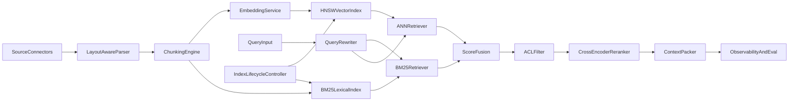

# Chapter 3: Data Pipelines and Vector Infrastructure

## Context

> [!info] Quick Reference
> - **Pattern:** Ingestion pipeline + hybrid retrieval
> - **Scale:** 5M documents, 300M+ chunks, 500 QPS retrieval
> - **Key Techniques:** Parent-child chunking, BM25 + dense hybrid, cross-encoder reranking, blue-green index swap
> - **Primary Concerns:** Recall@K targets, embedding freshness, ACL enforcement, index lifecycle
> - **Cross-references:** [[Chapter 2 - The LLM Stack and Core Patterns|Chapter 2]] (RAG pattern), [[Chapter 5 - Evaluation, Guardrails, and Safety|Chapter 5]] (eval), [[Chapter 7 - Design an Enterprise Semantic Search Engine|Chapter 7]] (enterprise search case study)

**Problem statement:** Design scalable ingestion, embedding, indexing, and hybrid retrieval infrastructure that preserves relevance under fast-changing enterprise corpora.

### Real-World Examples

- A global knowledge base with PDFs, wikis, and tickets sees [[glossary#Recall|recall]] drop after parser upgrades; chunking and index lifecycle become the real bottleneck.
- A legal search product improves citation accuracy by moving from fixed chunks to parent-child chunking plus [[glossary#Cross-Encoder Reranking|cross-encoder reranking]].

---

## Step 1: Understand the Problem and Establish Design Scope

### Simulated Dialogue

**Interviewer:** Design the data pipeline and vector infrastructure for an enterprise knowledge platform.  
**Candidate:** I need to understand the corpus profile, freshness requirements, and retrieval quality bar first.

**Candidate:** What document types and volume are we handling?  
**Interviewer:** 5M documents: PDFs, HTML, Markdown, Confluence pages, Jira tickets. Growing at 50K docs/week.

**Candidate:** How fresh must retrieval results be?  
**Interviewer:** New/updated docs must be searchable within 30 minutes. Some sources are near-real-time (tickets).

**Candidate:** What is the retrieval quality contract?  
**Interviewer:** Recall@10 >= 0.85 on benchmark queries, with citation precision >= 0.90.

### Functional Requirements

- Ingest documents from heterogeneous sources (PDF, HTML, Markdown, structured DB exports).
- Parse layout-aware content preserving tables, headers, code blocks, and section hierarchy.
- Chunk documents with configurable strategies (fixed, semantic, parent-child).
- Generate embeddings and maintain both vector and lexical indexes.
- Support hybrid retrieval (BM25 + dense vector) with cross-encoder reranking.
- Enforce document-level ACLs at retrieval time.

### Non-Functional Requirements

- **Freshness:** incremental indexing within 30 minutes of source update.
- **Scale:** 300M+ chunks indexed, 500+ retrieval QPS at p95 < 120ms.
- **Consistency:** zero-downtime index updates via alias swaps.
- **Cost:** embedding cost bounded to < $800/day at steady state.
- **Durability:** index rollback within 5 minutes on quality regression.

### Back-of-the-Envelope Estimation

#### Corpus Sizing

- Documents: 5M, average 8 pages, ~2,400 tokens/page
- Total tokens: `5M * 8 * 2,400 = 96B tokens`
- Chunks (avg 512 tokens, 50% overlap): `~375M chunks`

#### Embedding Compute

- Model: `text-embedding-3-small` (1536-dim, $0.02/1M tokens)
- Full re-embed cost: `96B tokens * $0.02/1M = ~$1,920` (one-time)
- Incremental daily: `50K docs/week ≈ 7,200 docs/day * 8 pages * 2,400 tokens = 138M tokens/day`
- Incremental cost: `~$2.76/day`

#### Vector Storage

- 375M vectors at 1536-dim, float32: `375M * 6KB = ~2.25TB raw`
- With HNSW index overhead + metadata + replicas (x2.5): **~5.6TB**
- HNSW memory for search: ~60-80GB RAM per shard (serving-layer requirement)

#### Retrieval Throughput

- Target: 500 QPS hybrid retrieval
- Per-query: BM25 lookup (~15ms) + ANN search (~25ms) + reranker on top-50 (~60ms) + ACL filter (~10ms)
- p95 target: **< 120ms** end-to-end retrieval

> **Why < 120ms retrieval p95:** The retrieval stage is one component within a larger inference pipeline that must hit a TTFT of 700–1,200ms for a RAG path. Allocating 120ms to retrieval leaves sufficient budget for gateway overhead (~80ms), model prefill, and post-processing; exceeding this budget forces trade-offs elsewhere, typically in reranker depth or [[glossary#Context Window|context window]] size.

#### Ingestion Throughput

- Daily new chunks: `~57,600 chunks/day` (incremental)
- Full re-index (375M chunks at 500 chunks/sec): **~8.7 days** → requires parallelized pipeline

---

## Step 2: Propose High-Level Design and Get Buy-In

### Core Architecture Components

The architecture separates concerns across two independent pipelines—ingestion and retrieval—connected by shared versioned indexes. This separation allows each pipeline to scale independently: ingestion throughput can be increased without touching the retrieval path, and retrieval latency can be tuned without affecting the ingestion queue. Both pipelines share the Index Lifecycle Controller, which enforces the quality gate and alias swap protocol as the coordination point.

- **Source Connectors:** CDC listeners for database sources (capturing row-level changes via log tailing), scheduled crawlers for web-based sources (Confluence, Jira, internal wikis), and webhook receivers for event-driven sources (document management systems that emit update events). Each connector is responsible for deduplicating events—a document update that triggers multiple CDC events must result in only one re-embedding job, keyed by content hash to avoid redundant embedding API calls.
- **Parser Layer:** Layout-aware extraction that goes beyond raw text extraction to preserve structural information: tables are extracted as Markdown tables rather than linearized rows, headers are preserved as section metadata, and code blocks are detected and tagged with language identifiers. Uses format-specific parsers (PyMuPDF for PDFs, BeautifulSoup for HTML, python-docx for Word documents) because a single generic parser produces significantly lower extraction quality than purpose-built parsers for each format.
- **Chunking Engine:** Configurable strategy selector that reads a per-source chunking configuration and applies the appropriate strategy (fixed, semantic, or parent-child) to each document. Tags every output chunk with `doc_id`, `source_type`, `section_path`, `chunk_index`, `parent_id` (if applicable), `acl_groups`, `chunk_strategy`, and `content_hash`—this metadata is the foundation for both ACL filtering at retrieval time and provenance tracing during quality audits.
- **Embedding Service:** Batched embedding generation that groups chunks into batches of 100–500 tokens total to maximize throughput per API call, with exponential backoff retry logic for rate limit errors and a dead-letter queue for chunks that fail after three retries. Enforces a daily cost circuit breaker that pauses the embedding queue if projected daily spend exceeds the $800 cap, alerting on-call before any cost overrun occurs.
- **Index Manager:** Dual-write coordinator that sends each chunk's vector to the HNSW index and the raw text plus metadata to the BM25/Elasticsearch index atomically within the same pipeline step. Tracks write success for both destinations independently—a failure in either index triggers a retry and, if retries are exhausted, routes the chunk to the dead-letter queue rather than silently dropping it from one index but not the other (which would create a split-brain inconsistency between the two retrieval channels).

> **Why HNSW for the vector index:** HNSW (Hierarchical Navigable Small World) builds a multi-layer proximity graph that achieves sub-linear query time at high recall, making it the dominant production [[glossary#Vector Database / ANN Index|ANN]] algorithm. The main alternative—IVF-PQ (inverted file with product [[glossary#Quantization|quantization]])—uses significantly less memory but requires a training pass and degrades recall as the index grows unless the number of clusters is carefully retuned. HNSW's recall-latency tradeoff is more predictable and requires fewer operational tuning decisions.
- **Retrieval Service:** Hybrid search orchestrator that runs BM25 and ANN queries in parallel, applies RRF fusion, enforces ACL filtering, and invokes the cross-encoder reranker on the fused candidate set. The service exposes a single retrieval API with a pluggable strategy interface so that callers can request different retrieval configurations (e.g., BM25-only for exact-match queries, hybrid for semantic queries) without the caller needing to know which indexes are consulted.
- **Index Lifecycle Controller:** Versioned index manager that assigns monotonically increasing version numbers to each index build, stores quality gate results alongside each version, manages the named alias that production traffic resolves against, and provides a one-call rollback API that re-points the alias to the previous version without any data movement. The controller also enforces the rule that no two index versions with different `embedding_model_version` values can be deployed to the same alias—preventing cross-model contamination at the infrastructure level.
- **Observability:** Instrumentation layer tracking parser success rate per document type (alerting on > 2% failure), embedding API latency and cost per day (alerting on projection > $800), index freshness lag histogram (alerting on p95 > 30 minutes), and live retrieval Recall@K and MRR sampled from a held-out benchmark query set run hourly against the production index. These four signals together cover the end-to-end pipeline: if any one stage degrades silently, at least one of these metrics will catch it before users file a quality complaint.

### Pipeline A: Document Ingestion Pipeline

1. Source connector detects new/updated documents via CDC or scheduled crawl.
2. Parser extracts text with layout preservation; routes failures to dead-letter queue.
3. Chunking engine applies configured strategy; tags each chunk with doc_id, section, position, ACL.
4. Embedding service generates vectors in batches (rate-limited to stay within cost envelope).
5. Index writer dual-writes vectors to HNSW index and text to BM25 index.
6. Quality gate samples random chunks and validates embedding coherence and parse fidelity.
7. Index lifecycle controller promotes new version via alias swap once quality gate passes.

### Pipeline B: Hybrid Retrieval Pipeline

1. Query arrives; ACL context resolved from auth token.
2. Query rewriter expands/reformulates query for both lexical and semantic channels.
3. BM25 retriever returns top-100 lexical matches; ANN retriever returns top-100 dense matches.
4. Score fusion (reciprocal rank fusion or weighted combination) produces merged top-100 candidate set.
5. ACL filter removes unauthorized chunks.
6. Cross-encoder reranker scores top-50 candidates; returns top-K (typically 5-10) with scores.
7. Context packer assembles chunks within token budget; returns with chunk metadata and citations.

### Mermaid Architecture Diagram



---

## Step 3: Design Deep Dive

Focus areas for this chapter:

1. **Chunking Strategies**
2. **Hybrid Retrieval Architecture**
3. **Vector Index Lifecycle Management**

### 1) Chunking Strategies

Chunking determines retrieval granularity and directly impacts recall, precision, and cost.

#### Chunking Trade-off Table

| Approach | Strengths | Weaknesses | Best For |
|---|---|---|---|
| Fixed-size (512 tokens, 50% overlap) | Predictable chunk count simplifies index sizing and cost estimation; trivial to implement and parallelize across workers | Splits arbitrarily at token boundaries, frequently cutting mid-sentence or mid-table, which degrades embedding coherence and forces the reranker to work harder | Homogeneous, paragraph-structured text where semantic precision is less critical; suitable for MVP or proof-of-concept indexing |
| Semantic (sentence/paragraph boundary) | Preserves natural meaning units so each chunk's embedding captures a coherent idea, improving ANN precision by 5–15% over fixed-size on narrative corpora | Variable chunk sizes make token budget planning difficult and can produce chunks ranging from 50 to 1,500 tokens, widening the tail latency distribution in context assembly | Narrative documents such as policy manuals, knowledge-base articles, and HR documentation where sentence integrity matters |
| Parent-child | Dense child embeddings improve ANN retrieval precision; expanding to the parent for generation provides enough surrounding context to avoid truncated answers; empirically improves citation precision by 10–20% | Requires storing both child and parent texts plus a `parent_id` join, adding roughly 1.8x storage overhead; pipeline complexity increases because both chunk tiers must be maintained in sync | Long-form technical or legal documents where evidence is localized to a sentence but the answer requires the full surrounding section for coherent generation |
| AST/symbol-aware | Preserves function and class boundaries, ensuring code chunks are syntactically complete and embeddable as coherent units; avoids the common failure of splitting a function across two chunks | Requires language-specific parsers (tree-sitter, libcst, etc.) and parsing infrastructure for each supported language; maintenance burden scales with the number of languages in the corpus | Code repositories, API documentation, or any corpus where code snippets are the primary retrieval target |

**Parent-child chunking in detail:**
- **Parent chunk:** 1,500-2,000 tokens covering a full section or subsection.
- **Child chunk:** 256-512 tokens, each linked to parent via `parent_id`.

> **Why 256–512 tokens for child chunks:** Embedding models lose discriminative power on very long sequences because the pooled representation averages across too many tokens. Short child chunks (256–512 tokens) produce embeddings that capture the specific topic of that passage, improving ANN retrieval precision. The parent chunk then provides the surrounding context needed for coherent generation.

- **Retrieval:** search child chunks for precision; expand to parent for full context assembly.
- **Storage overhead:** ~1.8x compared to flat chunking.
- **When to use:** any corpus where answer evidence spans multiple paragraphs but retrieval must be precise.

#### Parsing Failures and Mitigations

- **PDFs with scanned images:** Scanned PDFs have no embedded text layer, so text extraction returns empty strings silently, creating empty chunks that pollute the index with zero-information vectors. Route these through an OCR pipeline (Tesseract for speed, DocTR or AWS Textract for layout-sensitive documents) before the chunking stage; tag the output with `source_type=ocr` so quality audits can filter and benchmark OCR-derived chunks separately.
- **Complex tables:** Naive line-by-line extraction collapses table structure, destroying column alignment and making the resulting text semantically incoherent. Convert tables to structured Markdown format using tools such as Camelot (PDF) or BeautifulSoup (HTML), and embed the entire table together with its caption as a single chunk; this preserves the relational meaning of cell values and improves retrieval precision for data-lookup queries by 15–30%.
- **Code blocks:** Fixed-token chunking applied to code frequently splits a function at an arbitrary line, embedding half a method body as one chunk and the other half as another—neither chunk is semantically complete. Detect code fences or indentation blocks, preserve the original language tag, and enforce function or class boundaries as hard split points; use AST-based splitting (tree-sitter) when the code language is known, falling back to line-count heuristics for unknown languages.
- **Dead-letter queue for unparseable documents:** Any document that causes an unhandled parser exception should be routed to a dead-letter queue rather than silently dropped, because silent drops create invisible coverage gaps that degrade recall without triggering any alert. Instrument the queue depth and emit an alert whenever the parse failure rate exceeds 2% of documents processed in a 30-minute window; schedule periodic manual review of the dead-letter queue to identify systematic parser bugs or document format variants that warrant a parser fix rather than individual document triage.

### 2) Hybrid Retrieval Architecture

#### Retrieval Strategy Trade-off Table

| Approach | Recall@10 | p95 Latency | Infra Cost | Best For |
|---|---|---|---|---|
| BM25 only | 0.55–0.65, acceptable for structured corpora with controlled vocabulary but fails badly on paraphrase queries | ~15ms; operates entirely on inverted index with no GPU dependency, making it the cheapest option to scale horizontally | Low: standard Elasticsearch or OpenSearch cluster, no GPU; cost scales with document volume, not query complexity | Exact-match requirements such as product IDs, legal citation numbers, error codes, or any domain where keyword overlap between query and document is high |
| Dense vector only | 0.70–0.80; captures semantic similarity well but recall is bounded by embedding model quality and can miss rare domain terms absent from training data | ~25ms including ANN scan on an HNSW index; highly sensitive to `ef_search` setting—lower values reduce latency but also reduce recall by up to 10 points | Medium: HNSW index requires 60–80GB RAM per shard at 375M vectors; GPU embedding at query time adds cost if not cached | Semantic or paraphrase queries where exact keyword overlap is low, such as "how do I reset my password" matching "account recovery procedure" |
| Hybrid (BM25 + dense) | 0.80–0.88; RRF fusion reliably outperforms either channel alone because it hedges coverage: BM25 catches keyword matches that dense misses and vice versa | ~40ms; involves two parallel retrieval calls plus a lightweight fusion step; parallelization on separate hardware limits the combined latency to the slower of the two retrievers | Medium-High: requires both an Elasticsearch/OpenSearch cluster and an HNSW vector index; operational complexity increases but infra cost is manageable at this scale | General-purpose enterprise search where queries span both structured identifiers and open-ended semantic questions across the same corpus |
| Hybrid + cross-encoder reranker | 0.85–0.92; cross-encoder's full attention over `(query, chunk)` pairs catches relevance nuances that bi-encoder embeddings cannot; the gain is most pronounced when the top fusion candidates include near-miss paraphrases | ~100ms; the reranker dominates latency—top-50 at 1.2ms/pair on GPU consumes ~60ms alone; the remaining ~40ms covers retrieval, fusion, and ACL filtering | High: dedicated GPU pool for reranker (4–8 GPUs at 500 QPS); if the reranker pool is undersized, it becomes the throughput bottleneck for the entire retrieval path | High-precision RAG applications where citation accuracy is a product requirement, such as legal search, compliance Q&A, or medical documentation retrieval |

**Score fusion methods:**
- **Reciprocal Rank Fusion (RRF):** `score = sum(1 / (k + rank_i))`. Simple, robust, no tuning needed. Default recommendation.

> **Why RRF as the default over weighted linear combination:** Linear combination requires normalizing scores across BM25 and dense retrievers whose raw score distributions are incompatible—BM25 scores are corpus-frequency-dependent while dense cosine scores are bounded by geometry. RRF sidesteps this by using only rank position, making it robust to score distribution differences with no hyperparameter tuning. Studies consistently show RRF performs on par with or better than tuned linear combination on new corpora.

- **Weighted linear combination:** `score = alpha * bm25_norm + (1-alpha) * dense_norm`. Requires tuning alpha per corpus. Use when one channel dominates.

**Cross-encoder reranking:**
- Reranker takes `(query, chunk)` pairs and produces relevance scores.
- Typical model: ~110M params, ~1.2ms/pair on GPU.
- Reranking top-50 candidates: `~60ms` on dedicated GPU.

> **Why top-50 candidates for reranking:** Reranking fewer than 20 candidates risks the relevant document not being in the set (recall ceiling too low); reranking more than 100 at 1.2ms/pair pushes latency above 120ms on its own, exceeding the retrieval SLO. Top-50 is the empirical sweet spot where the marginal recall gain from adding more candidates becomes negligible while latency stays within budget.

- Quality lift: +5-12% Recall@5 over fusion alone.
- **Throughput bottleneck:** at 500 QPS, reranking requires dedicated GPU pool (~4-8 GPUs for reranker alone).

**ACL-aware retrieval:**
- Pre-filter approach: inject ACL predicates into index query. Faster but requires ACL-indexed metadata.
- Post-filter approach: retrieve broadly, then filter. Simpler but wastes retrieval budget on unauthorized chunks.
- **Recommended:** pre-filter for low-cardinality ACLs (< 1K groups); post-filter + over-retrieve for high-cardinality.

> **Why pre-filter below 1K groups:** With a small number of ACL groups, the filter predicate in the vector query adds minimal overhead (~5–10ms) because the ANN index can prune candidates using indexed metadata. Above 1K groups, the filter predicate becomes a multi-value set intersection that degrades ANN performance; at that scale, over-retrieving and post-filtering is often faster because it decouples ACL logic from the ANN scan path.

### 3) Vector Index Lifecycle Management

#### Index Lifecycle Trade-off Table

| Strategy | Update Latency | Risk | Rollback Speed | Best For |
|---|---|---|---|---|
| In-place upsert | Seconds to minutes per batch; each upsert is immediately visible to live queries, which means a bad batch affects users before you can react | High: a partially applied update leaves the index in an inconsistent state with no safe rollback path; there is no previous version to restore because the old vectors have been overwritten | None: the original state is gone once overwritten; recovery requires a full rebuild from source, which may take hours or days on a large corpus | Development and testing environments only, where fast iteration matters more than correctness guarantees and the index can be rebuilt cheaply |
| Blue-green alias swap | Minutes to hours depending on corpus size; the new index is built entirely in the background before any traffic is shifted, so users experience no degradation during build | Low: the old index remains fully intact and queryable throughout the entire build process; the alias flip is an atomic operation that takes effect in milliseconds | Instant: re-pointing the alias back to the old index version takes a single API call and requires no data movement; old index is kept hot for 24 hours as a rollback target | Production default for any corpus where correctness and zero-downtime updates are required; the 2x storage cost during the swap window is the only meaningful trade-off |
| Shadow index + canary eval | Hours to days for large corpora; involves building a full shadow index, routing a percentage of live traffic to it, and measuring quality metrics before committing | Minimal: the live index is never touched until canary evaluation confirms the new index meets or exceeds quality gates; any regression aborts the rollout automatically | Instant: canary routing is a traffic-split configuration change; at the first sign of regression, traffic is shifted back to the production index without any index operation | High-stakes corpora such as legal, medical, or financial search where even a temporary quality regression has business or compliance consequences that outweigh the higher operational overhead |

**Blue-green index lifecycle:**
1. Build new index version in background with updated embeddings/chunks.
2. Run automated quality gate: sample 200 benchmark queries, measure Recall@10, MRR, citation precision.

> **Why 200 benchmark queries for the quality gate:** Fewer than 100 queries produce high variance in Recall@K estimates, making it easy for a regression to fall within sampling noise. 200 queries bring the 95% confidence interval for a Recall@10 of 0.85 to approximately ±0.05, which is tight enough to catch the 2% regression threshold reliably without making the gate prohibitively expensive to run.

3. If quality gate passes (no regression > 2% on any metric), swap alias to new index.
4. Keep old index hot for 24h as rollback target.
5. If quality regresses post-swap, revert alias within 5 minutes.

> **Why alias swap over in-place upsert:** In-place upserts modify a live index, meaning a failed write can leave the index in a partially updated state with no safe rollback path. An alias swap is an atomic pointer operation—the old index remains fully intact and queryable until the swap succeeds, enabling instant rollback to the previous version without data loss or query disruption.

**Embedding version management:**
- Tag every chunk with `embedding_model_version` and `index_version`.
- Never mix embeddings from different model versions in one index (cosine distances are incomparable).
- On model upgrade: full re-embed into shadow index → canary eval → alias swap.

**Index freshness monitoring:**
- Track `source_updated_at` vs `indexed_at` per document.
- Alert if p95 freshness lag exceeds SLA (30 minutes).
- Dashboard: freshness histogram, parse failure rate, embedding queue depth.

### Production Bottlenecks and Mitigations

- **Embedding queue backlog**
  - Symptom: freshness SLA violation; documents stuck in queue.
  - Mitigation: horizontal scaling of embedding workers, priority queue for high-value sources, batch size tuning.

- **ANN recall degradation at high compression**
  - Symptom: Recall@10 drops below 0.80 as index grows.
  - Mitigation: tune HNSW `ef_construction` and `M` parameters; consider IVF-PQ only for cost-constrained scenarios.

> **Why tune `M` and `ef_construction` before switching to IVF-PQ:** Higher `M` (connections per node) and `ef_construction` (candidate pool during graph build) improve graph quality and recall at the cost of memory and build time, but the recall-latency tradeoff remains controllable at query time via `ef_search`. IVF-PQ uses quantization that permanently degrades recall and is hard to reverse once the index is built, making HNSW parameter tuning the lower-risk first response to recall degradation.

- **Metadata DB saturation from ACL filter queries**
  - Symptom: retrieval p95 spikes from metadata lookups.
  - Mitigation: read replicas, connection pooling, cache hot ACL groups with short TTL (60s).

- **Parser failures on edge-case documents**
  - Symptom: dead-letter queue grows; coverage gaps in index.
  - Mitigation: fallback to raw text extraction, alerting on failure rate, periodic manual review.

- **Stale embeddings after schema/content drift**
  - Symptom: retrieval quality degrades silently over weeks.
  - Mitigation: scheduled quality audits (weekly Recall@K sampling), triggered re-embedding on schema changes.

### Advanced Techniques

- **Parent-child chunking** for large document retrieval with precise grounding. Index dense child chunks (256–512 tokens) for high-precision ANN retrieval, then expand each retrieved child to its parent (1,500–2,000 tokens) for context assembly. This decouples the granularity used for retrieval from the granularity used for generation, delivering both precision in ranking and completeness in the answer. The trade-off is roughly 1.8x storage overhead and a metadata join at retrieval time.
- **Cross-encoder reranking** as a quality amplifier applied after hybrid fusion. Unlike bi-encoders that embed query and document independently, cross-encoders perform full attention across the concatenated `(query, chunk)` pair, capturing fine-grained lexical and structural relevance signals that bi-encoder cosine similarity misses. The typical gain is +5–12% Recall@5 over fusion alone, but it requires a dedicated GPU pool and adds ~60ms to retrieval latency at 500 QPS with top-50 reranking.
- **Semantic caching** for repeated or near-duplicate retrieval patterns. Hash the query embedding vector (e.g., using locality-sensitive hashing) and cache the top-K result set with a TTL of 60–300 seconds. On cache hit, retrieval latency drops from ~100ms to under 5ms. Effective when query diversity is low—enterprise knowledge bases often see the same 200–500 queries accounting for 40–60% of daily traffic—but requires cache invalidation logic tied to index updates to avoid serving stale results after a document changes.
- **Matryoshka embeddings** for variable-precision search across different latency tiers. Models trained with Matryoshka Representation Learning (MRL) embed documents into vectors where the first N dimensions already form a useful lower-dimensional representation. This enables a two-stage retrieval: a fast coarse pass using 128-dim truncated vectors to narrow 375M chunks to a candidate set of 1,000, followed by a fine-grained rerank using the full 1,536-dim vectors on that candidate set. The coarse pass can run 3–5x faster than full-dimensional ANN, reducing overall retrieval latency without sacrificing final recall.
- **Incremental HNSW** for near-real-time index updates without a full rebuild. Standard HNSW supports online insertion of new vectors by traversing the existing graph and adding edges at the appropriate layers. This allows new documents to become searchable within seconds of embedding, rather than waiting for a full rebuild cycle. The limitation is that deleted documents require a tombstone-based soft delete—actual graph compaction requires a periodic background rebuild—so index quality degrades slightly over time if deletions are frequent, making a weekly full rebuild advisable even when using incremental updates.

---

## Practical Implementation

```python
# Parent-child chunker: indexes small child chunks, retrieves parent context
# Demonstrates: precision at retrieval + completeness at generation
from sentence_transformers import SentenceTransformer
import uuid

encoder = SentenceTransformer("all-MiniLM-L6-v2")

def chunk_words(text: str, size: int, overlap: int) -> list[str]:
    words = text.split()
    return [" ".join(words[i : i + size]) for i in range(0, len(words), size - overlap)]

def build_parent_child_index(document: str, parent_size=300, child_size=100, overlap=20):
    parents = chunk_words(document, parent_size, overlap=50)
    records = []
    for parent in parents:
        pid = str(uuid.uuid4())
        for child in chunk_words(parent, child_size, overlap):
            records.append({
                "parent_id":   pid,
                "parent_text": parent,
                "child_vec":   encoder.encode(child).tolist(),
            })
    return records

def retrieve_with_parent_context(query: str, index: list[dict], top_k=5) -> list[str]:
    import numpy as np
    q = encoder.encode(query)
    scored = sorted(index, key=lambda r: float(np.dot(q, r["child_vec"]) /
        (np.linalg.norm(q) * np.linalg.norm(r["child_vec"]) + 1e-9)), reverse=True)
    seen, parents = set(), []
    for r in scored:
        if r["parent_id"] not in seen:
            seen.add(r["parent_id"])
            parents.append(r["parent_text"])
        if len(parents) == top_k:
            break
    return parents
```

```python
# Hybrid retrieval with Reciprocal Rank Fusion (RRF)
# Demonstrates: combining BM25 sparse and dense vector results without a shared score scale
from rank_bm25 import BM25Okapi
from sentence_transformers import SentenceTransformer
import numpy as np

encoder = SentenceTransformer("all-MiniLM-L6-v2")

def rrf_score(rank: int, k: int = 60) -> float:
    return 1.0 / (k + rank + 1)

def hybrid_retrieve(query: str, corpus: list[str], top_k: int = 10) -> list[str]:
    tokenized   = [doc.lower().split() for doc in corpus]
    bm25_scores = BM25Okapi(tokenized).get_scores(query.lower().split())
    bm25_ranks  = np.argsort(-bm25_scores)

    q_vec        = encoder.encode(query)
    doc_vecs     = encoder.encode(corpus)
    dense_scores = (doc_vecs @ q_vec) / (np.linalg.norm(doc_vecs, axis=1) * np.linalg.norm(q_vec) + 1e-9)
    dense_ranks  = np.argsort(-dense_scores)

    rrf: dict[int, float] = {}
    for rank, idx in enumerate(bm25_ranks):
        rrf[int(idx)] = rrf.get(int(idx), 0.0) + rrf_score(rank)
    for rank, idx in enumerate(dense_ranks):
        rrf[int(idx)] = rrf.get(int(idx), 0.0) + rrf_score(rank)

    fused = sorted(rrf, key=rrf.get, reverse=True)[:top_k]
    return [corpus[i] for i in fused]
```

---

## Step 4: Wrap Up

### Final Design Summary

The design treats retrieval correctness as a systems problem: robust parsing, configurable chunking, hybrid retrieval with reranking, and versioned index lifecycle controls with automated quality gates.

### Wrap-Around Concerns

- **Release engineering:** Every index change must go through the blue-green lifecycle—build shadow index, pass quality gate (Recall@10 regression < 2% on 200 benchmark queries), flip alias, keep old index hot for 24 hours. This process must be automated and triggered by CI/CD so that parser upgrades, model upgrades, or chunking strategy changes never bypass quality validation. The rollback path (re-pointing the alias) must be executable by on-call engineers in under five minutes without any data movement.
- **Governance:** Every chunk must carry `embedding_model_version`, `parser_version`, `chunk_strategy`, `indexed_at`, and `source_acl` metadata fields. Embedding model version tracking prevents cosine-space corruption when multiple model versions coexist. ACL audit logs provide a compliance paper trail proving that unauthorized documents were never surfaced to users. Chunk provenance metadata enables root-cause analysis when a citation is wrong—the engineer can trace the exact chunk back to the source document, parser version, and chunking parameters that produced it.
- **Cost controls:** Embedding API costs should be instrumented and capped at $800/day with an automated circuit breaker that pauses ingestion workers and pages on-call if the daily spend trajectory is exceeded. HNSW shard budgets must be set based on the 60–80GB RAM requirement per shard and reviewed each quarter as the corpus grows. Reranker GPU allocation should be right-sized using observed QPS and adjusted based on GPU utilization metrics—underutilized GPUs at < 40% utilization are a signal to consolidate; sustained > 80% utilization is a signal to add capacity before latency SLOs are violated.
- **Drift controls:** Weekly automated quality audits should run the benchmark query set against the live production index and compare Recall@K, MRR, and citation precision against the baseline established at the last successful index swap. Freshness lag monitoring should alert if the p95 lag between `source_updated_at` and `indexed_at` exceeds the 30-minute SLA for more than 5% of documents. Parser failure rate alerting at > 2% of documents in any 30-minute window catches systematic parser regressions before they create visible coverage gaps in retrieval quality.

---

## Step 5: Interviewer Curveballs

### Interviewer Follow-ups & Frequently Asked Questions (FAQ)

Q: Your Recall@10 dropped from 0.87 to 0.72 after a parser upgrade. How do you debug?

**The Ideal Answer:** First, immediately rollback the alias to the pre-upgrade index to restore user-facing quality. Then compare chunk distributions between old and new parser outputs—check average chunk length, boundary positions, and whether structured elements like tables and headers are being correctly detected. Run the full benchmark query set against both the old and new shadow indexes in parallel to isolate which document types and query categories are most affected. Finally, fix the parser regression and validate with the quality gate before promoting the new index.

**Deep Dive & Trade-offs:**
- Parser changes can shift chunk boundaries in subtle ways: a change that improves header detection may inadvertently alter where sections split, moving key evidence from one chunk to another and breaking the ANN ranking for queries that previously hit exactly the right chunk.
- Maintaining a shadow index built with the old parser version is essential for this debug workflow—without it, you have no comparison baseline and must rebuild from scratch, which on a 5M-document corpus takes days.
- The debug workflow should follow: rollback alias → reproduce regression on benchmark → bisect parser change (diff the parser config or version) → fix and rebuild shadow index → re-run quality gate → promote.

**The Interviewer's Rubric:** Checking whether you treat retrieval quality as a testable, rollbackable property—specifically, whether you reach for the rollback lever first (to protect users) before investigating root cause, and whether you have an instrumented benchmark rather than relying on subjective user reports.

Q: How do you handle a 50M-document corpus where full re-embedding takes 10 days?

**The Ideal Answer:** Decompose the problem into incremental and full-rebuild paths. For daily operations, re-embed only changed documents (typically < 1% of corpus daily), keeping freshness within SLA. For a full model upgrade, parallelize embedding across a worker pool—10 workers reduce 8.7 days to ~21 hours, and 50 workers bring it to ~4.2 hours at linear cost. Schedule full rebuilds during low-traffic windows and use the blue-green shadow index pattern so the live index is never degraded during the rebuild. Prioritize high-value document sources (e.g., recently modified, frequently queried) in the embedding queue to ensure the most important content is fresh first.

**Deep Dive & Trade-offs:**
- At 500 chunks/sec single-threaded and 375M total chunks, a full rebuild is mathematically ~8.7 days. The only way out is horizontal parallelism—embedding workers are embarrassingly parallel because each chunk is independent, so linear speedup is achievable up to the API rate limit or GPU cluster size.
- Incremental re-embedding requires a reliable change detection mechanism (CDC from the source, content hash comparison, or `updated_at` watermarks) so that unchanged documents are never unnecessarily re-embedded—at $0.02/1M tokens, re-embedding 50M unchanged documents costs ~$115K at a 7.5B token corpus, which is avoidable overhead.
- During a full model upgrade rebuild, the old index continues serving production traffic until the canary evaluation passes. If the rebuild is interrupted (e.g., worker failure, API outage), checkpointing the embedding progress to a persistent queue allows the job to resume from the last completed batch rather than restarting from zero.

**The Interviewer's Rubric:** Checking whether you can reason about embedding compute at production scale—specifically, whether you know the single-threaded throughput number, can do the parallelism math, and understand the distinction between an incremental update strategy (daily operations) and a full rebuild strategy (model upgrades), rather than treating all re-embedding as a single monolithic operation.

Q: When would you choose post-filter ACLs over pre-filter?

**The Ideal Answer:** Use pre-filter when ACL group cardinality is low (under ~1K distinct groups) and the filter predicate can be evaluated efficiently as indexed metadata in the vector query. Switch to post-filter when cardinality is high—with thousands of groups, the ANN index must evaluate a large set intersection for every query, degrading recall and latency simultaneously. In that regime, over-retrieving (e.g., top-200 instead of top-100) and post-filtering is faster because the ANN scan runs without ACL constraints and the filter is a simple hash lookup applied to the candidate set.

**Deep Dive & Trade-offs:**
- Pre-filter requires storing ACL group IDs as indexed metadata fields on every chunk. At high cardinality (e.g., 10K groups, each document belonging to 3–5 groups), the metadata payload per chunk grows significantly and the ANN index's internal filter evaluation becomes a dominant cost, pushing p95 latency above SLO.
- Post-filter requires over-retrieval to compensate for the chunks that will be filtered out. If a user has access to 30% of the corpus, you need to retrieve roughly 3.3x your target K to expect K authorized results in the output—retrieving top-300 to return top-10 authorized results. This inflates the reranker input size proportionally, compounding latency cost.
- The hybrid approach—pre-filter on a small set of coarse access tiers (public, internal, confidential) and post-filter on fine-grained per-document permissions—is often the best practical compromise: it reduces the unauthorized chunk rate into the reranker without bloating the ANN metadata.

**The Interviewer's Rubric:** Checking ACL-aware retrieval design maturity—a strong answer quantifies the cardinality threshold (~1K groups), explains why high cardinality degrades ANN pre-filtering specifically (set intersection cost inside the ANN scan), and proposes over-retrieval as the mechanism that makes post-filtering viable rather than just saying "post-filter is simpler."

Q: How do you keep retrieval quality stable when the embedding model is upgraded?

**The Ideal Answer:** Treat an embedding model upgrade as a complete index rebuild, never a partial migration. Build a full shadow index with the new model running in parallel, ensuring every chunk is re-embedded from scratch so no vector in the index was produced by a different model. Run the benchmark query set against both the old and shadow indexes and compare Recall@K, MRR, and citation precision; promote the shadow index via alias swap only if the new model matches or exceeds the old on all quality gates. Keep the old index live for 24 hours post-swap as a rollback target.

**Deep Dive & Trade-offs:**
- Cosine distances produced by different embedding models are geometrically incompatible—a query vector from model A and a document vector from model B occupy different latent spaces, so the cosine similarity value is meaningless. Even a minor model version bump (e.g., `text-embedding-3-small` v1 to v2) can shift the embedding space enough to degrade recall by 5–15% if the index is partially migrated.
- The shadow rebuild requires 2x storage during the migration window. For a 5.6TB index, this means approximately 11.2TB of storage is temporarily needed. Storage cost is almost always preferable to the alternative of serving degraded retrieval quality to users during an in-place migration.
- Tag every chunk at write time with `embedding_model_version` and `index_version` as metadata fields. This enables post-hoc audits to verify that every vector in a given index was produced by exactly one model version, and makes it easy to answer questions like "are there any model-v1 vectors in our production index?" during incident investigations.

**The Interviewer's Rubric:** Checking embedding lifecycle management sophistication—specifically, whether you understand why mixing embedding versions is semantically incorrect (not just operationally messy), can articulate the shadow index pattern with its storage cost, and treat this as a standard deployment process rather than a one-off event requiring manual steps.

Q: What is the cost-optimal reranker deployment at 500 QPS?

**The Ideal Answer:** Start with the math: at 1.2ms per (query, chunk) pair on a GPU, reranking top-50 candidates takes ~60ms per request. At 500 QPS, that is 500 concurrent requests × 60ms = 30 GPU-seconds of reranker compute per second. A single T4 GPU can sustain roughly 5–8 concurrent batched reranking requests, so 4–8 GPUs depending on batch efficiency and request concurrency. The cost-optimal configuration batches across concurrent in-flight requests to maximize GPU utilization, rather than servicing each request in strict isolation.

**Deep Dive & Trade-offs:**
- CPU reranking at ~12–25ms/pair is 10–20x slower than GPU; at 500 QPS with top-50 candidates, a CPU-only fleet would require hundreds of cores to absorb the load, making it more expensive than GPU at any reasonable scale above ~50 QPS.
- Batching across concurrent requests is the key utilization lever. If 10 requests arrive simultaneously, their top-50 candidate sets can be packed into a single reranker batch of 500 pairs, processed in one GPU kernel call. This improves GPU utilization from ~20% (one request at a time) to ~80%+ (batched), cutting the effective GPU count needed by 4x.
- The graceful degradation strategy—skipping the reranker under extreme load and returning fusion-ranked results directly—should be implemented as a circuit breaker with a configurable activation threshold (e.g., reranker queue depth > 200 outstanding requests). Quality drops by ~5–12% Recall@5 in degraded mode, which is acceptable for short duration surges but must be visible in dashboards and generate a low-severity alert.

**The Interviewer's Rubric:** Checking whether you can size reranker infrastructure with real math—a strong answer multiplies QPS × latency to derive concurrent GPU demand, explains why batching is the utilization lever rather than simply adding more GPUs, and proposes a concrete graceful degradation fallback rather than treating the reranker as an all-or-nothing component.

Q: How do you detect stale embeddings before users notice quality degradation?

**The Ideal Answer:** Layer three monitoring strategies. First, run a weekly automated quality audit that executes the full benchmark query set against the live index and compares Recall@K, MRR, and citation precision against the last known-good baseline—alert on any regression greater than 2% on any metric. Second, sample and anonymize production queries weekly and run them through the same evaluation pipeline so that real query distribution drift is captured even when the synthetic benchmark doesn't cover the new query patterns. Third, track an `embedding_age` histogram per index and alert when more than 20% of chunks have an `indexed_at` timestamp older than 30 days relative to the corpus's update frequency.

**Deep Dive & Trade-offs:**
- Synthetic benchmarks are built from a fixed query set that reflects the corpus and query distribution at the time the benchmark was created. As the corpus evolves—new products, new terminology, new document types—the benchmark becomes progressively less representative, and a stable benchmark score can coexist with real quality degradation on the new content. Production query sampling catches this drift.
- The `embedding_age` histogram is particularly important after schema or content drift events: if a large portion of the corpus was updated but the incremental indexing pipeline had a silent failure, the histogram will show a spike in stale chunks before any benchmark score degrades enough to trigger an alert.
- Supplement automated monitoring with a human-in-the-loop review of flagged queries—queries where the top-1 retrieved chunk has a cross-encoder reranker score below a threshold (e.g., 0.60) are candidates for manual inspection, often revealing systematic failure modes that automated metrics aggregate away.

**The Interviewer's Rubric:** Checking proactive quality monitoring beyond reactive incident response—a strong answer presents multiple complementary signals (synthetic benchmark, production sample, age histogram) and explains why each catches failure modes the others miss, rather than relying on a single monitoring approach.

Q: What is the single most impactful improvement you would add to a BM25-only retrieval system?

**The Ideal Answer:** Add dense vector retrieval and combine it with BM25 using Reciprocal Rank Fusion. The expected Recall@10 lift is +15–25% on semantic and paraphrase queries, which are the dominant failure mode for BM25—queries like "how do I renew my subscription" fail to match a document titled "account renewal process" because none of the query tokens appear in the document. RRF fusion is the right first choice over a cross-encoder reranker because it is simpler to deploy, adds only ~25ms to latency, and is hyperparameter-free.

**Deep Dive & Trade-offs:**
- BM25's fundamental limitation is that it is a term-frequency model: if a query term does not appear in a document, BM25 assigns that document a score of zero regardless of semantic relevance. This means entire classes of queries—paraphrases, synonyms, abstract questions—will never retrieve the correct document no matter how large the BM25 candidate pool is.
- RRF fusion requires running two retrieval systems in parallel (BM25 and ANN), which doubles the retrieval infrastructure cost and adds operational complexity. The QPS-normalized cost increase is modest at 500 QPS, but the team must now operate and monitor two index types. This is the right trade-off to make before considering a cross-encoder reranker, which adds a third component with GPU dependency.
- A cross-encoder reranker should be the second improvement after hybrid fusion, not the first, because it provides a smaller absolute lift (+5–12% Recall@5) at higher implementation and infrastructure cost. Adding a reranker to a BM25-only system is a mistake because the recall ceiling of BM25 means the correct document is often not even in the top-50 candidate set, and a reranker can only improve ranking within the candidates it receives.

**The Interviewer's Rubric:** Checking prioritization judgment for retrieval improvements—a strong answer explains why dense retrieval addresses BM25's structural limitation (not just a marginal improvement), justifies choosing RRF over a reranker as the first step using cost/complexity reasoning, and understands that a reranker cannot recover recall that was never achieved at the retrieval stage.

Q: How do you size HNSW parameters for a 375M-vector index?

**The Ideal Answer:** Start with `M=16` and `ef_construction=200` as the baseline configuration validated across multiple large-scale production deployments. At index build time, higher `ef_construction` builds a denser and more accurate graph at the cost of longer build time—`ef_construction=200` roughly doubles build time versus the default of 100 but improves recall by 2–4 points, which is worth the cost for a production corpus. At query time, tune `ef_search` as the primary dial: start at 128, measure Recall@10 on a held-out benchmark, and decrease until recall falls below the 0.85 target—this is the minimum latency configuration. Never set `ef_search` below 64 on an index this large.

> **Why M=16 as the default:** M controls the number of bi-directional links per node in the HNSW graph. M=16 is the empirical sweet spot validated across multiple production deployments—M=8 saves memory but noticeably degrades recall on large indexes (>100M vectors), while M=32 roughly doubles memory usage per vector with diminishing recall returns beyond M=16. Increase M only if recall is the primary constraint and memory budget allows.

**Deep Dive & Trade-offs:**
- Higher `M`: better recall, more memory (~2x at M=32 vs M=16).
- Higher `ef_construction`: better graph quality, slower build time.
- `ef_search` is the runtime knob: higher = better recall, more latency.
- At 375M vectors, expect ~5.6TB storage and ~60-80GB RAM per shard for serving.

**The Interviewer's Rubric:** Checking hands-on familiarity with ANN index tuning—a strong answer distinguishes between the build-time parameters (`M`, `ef_construction`) that cannot be changed without rebuilding the index and the query-time parameter (`ef_search`) that can be tuned at any time, demonstrates knowledge of the memory footprint implications, and connects parameter choices to the concrete Recall@10 target rather than citing numbers in isolation.

## Exercises

**[Design] Exercise 1: Hybrid Retrieval for a Legal Document Corpus**
You are designing retrieval infrastructure for a legal research platform with 2M case documents, where citation precision >= 0.92 and Recall@10 >= 0.88 are hard requirements. Design the end-to-end retrieval pipeline including chunking strategy, retrieval approach, and reranking configuration. Key considerations: how do you handle multi-page legal opinions where the relevant holding may be one sentence in a 40-page document? How do you tune the BM25/dense fusion weight for a corpus with heavy exact-match citation requirements (case numbers, statute identifiers) alongside semantic reasoning queries? What is your GPU sizing for the reranker at 200 QPS if you need to rerank top-75 candidates to achieve the citation precision target?

**[Design] Exercise 2: Zero-Downtime Embedding Model Migration**
Your current production index uses `text-embedding-3-small` (1536-dim) across 375M chunks. You need to migrate to a new model that produces 3072-dim vectors with higher Recall@K on your benchmark but requires a full re-embed. Design the migration plan with zero production downtime and a rollback capability within 5 minutes if quality degrades post-cutover. Key considerations: how do you manage the 2x storage requirement during migration? What does your quality gate look like, and what metrics must it cover to be sufficient for promotion? How do you handle documents that are updated during the multi-day rebuild window—do they get the old or new embedding in the shadow index, and why does it matter?

**[Implementation] Exercise 3: Incremental Ingestion Pipeline with Freshness Monitoring**
Implement an incremental ingestion pipeline that processes document updates from a simulated change stream (a list of `{doc_id, content, updated_at}` events), applies parent-child chunking, generates embeddings, and updates the index. Add a freshness monitoring component that tracks `source_updated_at` vs `indexed_at` per document and emits an alert when the p95 freshness lag across the last 1,000 events exceeds a configurable SLA threshold. Key considerations: your implementation must handle out-of-order events (a document may arrive with an older `updated_at` than a previously processed version), must not re-embed a document whose content hash is unchanged, and must correctly update the parent-child metadata when a document's content changes.

**[Implementation] Exercise 4: RRF Fusion with Per-Source Weight Adjustment**
Extend the `hybrid_retrieve` function from the chapter to support per-source weighting, where documents tagged with `source_type=authoritative` receive a 1.5x RRF weight boost relative to documents tagged `source_type=user_generated`. Implement the fusion logic, write unit tests covering the edge cases (all results from one source, tie-breaking, empty retrieval from one channel), and add a parameter that allows the caller to disable one retrieval channel for A/B testing purposes. Key considerations: the weighting must be applied to the RRF contribution before the final sort, not as a post-hoc score adjustment; verify that the function still returns the correct top-K when the authoritative source has lower raw BM25/dense scores but enough RRF weight to rank above user-generated content.

**[Debug] Exercise 5: Diagnosing Silent Recall Regression**
Your weekly automated quality audit reports that Recall@10 on the benchmark query set dropped from 0.86 to 0.78 over the past two weeks, but no deployment events are recorded in the index lifecycle log. No parser changes, no embedding model changes, and no chunking parameter changes were made. Formulate a systematic debug plan that covers at least five distinct root causes you would investigate, ranked by likelihood and checking cost. Key considerations: your plan must include checks for corpus-level changes (document volume, document length distribution, source coverage gaps) as well as infrastructure-level changes (HNSW parameter drift, index shard rebalancing, ACL filter cardinality growth); you should be able to articulate how each potential cause would manifest differently in the monitoring metrics and what the remediation would be for the two most likely causes.

---

## End of Chapter

- **Key takeaway:** Retrieval quality is a pipeline problem, not just a model problem. Parser fidelity, chunking strategy, hybrid fusion, and index lifecycle controls all compound.
- **What to practice:** Walk through a full ingestion pipeline from raw document to indexed chunk, explaining each decision with trade-offs.
- **Interview drill:** Given a Recall@10 regression, explain your debug workflow from symptom to root cause to rollback.

---

<!-- nav-footer -->
[[Chapter 2 - The LLM Stack and Core Patterns|← Chapter 2]] | [[README|Contents]] | [[Chapter 4 - Serving, Scaling, and Optimizing LLMs|Chapter 4 →]]
