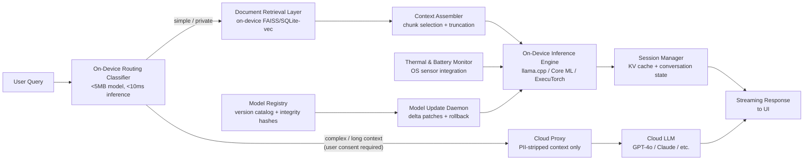

# Chapter 31: Edge and On-Device LLM Deployment

## Context

> [!info] Quick Reference
> - **Pattern:** Quantized model running on local hardware with a hybrid edge-cloud routing layer, on-device update delivery, and thermal-aware inference scheduling
> - **Scale:** Applies to any LLM feature where privacy, latency, or offline operation matter; architecture complexity scales with device heterogeneity and fleet size
> - **Key Techniques:** INT4/INT8 quantization (GGUF, GPTQ, AWQ), inference runtime selection (llama.cpp, MLC-LLM, Core ML, ExecuTorch), hybrid edge-cloud confidence routing, delta model update delivery, KV cache sizing for constrained RAM, battery and thermal throttle management
> - **Primary Concerns:** RAM budget per device class, quantization perplexity loss vs compression ratio, runtime portability vs performance, model update bandwidth, thermal and battery impact of continuous inference
> - **Cross-references:** [[Chapter 2 - The LLM Stack and Core Patterns|Chapter 2]] (LLM stack patterns), [[Chapter 5 - Evaluation, Guardrails, and Safety|Chapter 5]] (guardrails), [[Chapter 21 - Design an Advanced RAG Platform|Chapter 21]] (inference optimization), [[Chapter 22 - Design a Multi-Agent Workflow Orchestrator|Chapter 22]] (agentic systems), [[Chapter 25 - Prompt Engineering in Depth|Chapter 25]] (prompt engineering)

**Problem statement:** Design an end-to-end system that deploys a large language model directly on user devices — mobile phones, laptops, and embedded hardware — while satisfying hard RAM, battery, and thermal constraints, preserving user privacy by keeping data on-device, and gracefully routing to the cloud when the query complexity exceeds local capability.

### Real-World Examples

- A healthcare app wants to run a medical summarization assistant on a physician's iPhone. Patient notes must not leave the device for HIPAA compliance. A full Llama-3-8B at FP16 requires 16GB of VRAM — far beyond mobile RAM. With INT4 [[glossary#Quantization|quantization]] (GGUF Q4_K_M), a Phi-3-mini-3.8B model fits in 2.4GB, runs at 12 tokens/second on the Apple A17 Neural Engine via Core ML, and never transmits any patient data.
- A code autocomplete tool inside an IDE (similar to GitHub Copilot's offline mode) requires sub-100ms first-token [[glossary#Latency (TTFT, TPOT, Tail)|latency]] to feel responsive. A cloud-based model adds 150-300ms network round-trip. Running a quantized Gemma-2B locally via llama.cpp with Metal acceleration on an M-series MacBook delivers first tokens in 40-60ms with zero network dependency, enabling offline operation on flights and in restricted-network enterprise environments.

---

## Step 1: Understand the Problem and Establish Design Scope

### Simulated Dialogue

**Interviewer:** Design a system to run an LLM directly on end-user devices. We want to start with iOS and Android phones, then expand to laptops.  
**Candidate:** Before proposing an architecture I want to clarify the device targets, use case, privacy requirements, and what "running on device" actually means for this product.

**Candidate:** What is the primary use case — chat assistant, code completion, document summarization, something else?  
**Interviewer:** Primarily a personal assistant that answers questions about documents the user has on their device. Think notes, PDFs, emails.

**Candidate:** What is the privacy requirement — is the concern regulatory, or is it user trust?  
**Interviewer:** Both. We have enterprise customers in healthcare and legal. Data must not leave the device. We cannot use cloud APIs for any user content.

**Candidate:** What devices must we support? Specifically, what is the minimum RAM we need to target?  
**Interviewer:** High-end iPhones (A17, 8GB RAM), high-end Android flagships (Snapdragon 8 Gen 3, 12GB RAM), and Windows laptops. We can exclude low-end devices for now.

**Candidate:** What response quality floor do you need? Is a small model — say, 1-3B parameters — acceptable for the core use case?  
**Interviewer:** We ran user tests. A 3B model is acceptable for simple Q&A and summarization. For complex multi-document reasoning, users expect cloud quality. So we need both.

**Candidate:** What is the acceptable first-token latency from the user's perspective?  
**Interviewer:** Under 500ms. Ideally under 200ms for simple queries. Users notice anything over a second.

**Candidate:** Does the product need to work offline — fully, partially, or not at all?  
**Interviewer:** Offline for simple queries is a hard requirement. Offline for complex queries is a nice-to-have. If offline and the query is complex, we can degrade gracefully.

**Candidate:** How frequently do model weights need to be updated on-device? And what is our bandwidth budget for update delivery?  
**Interviewer:** Monthly model updates are fine. The app is already ~300MB; we cannot ship multi-gigabyte OTA updates. Users would uninstall.

**Candidate:** What are the thermal and battery constraints — can we run inference in the background continuously, or only on user-triggered requests?  
**Interviewer:** Foreground only. We cannot drain the battery. Users already complain about AI apps killing battery life. Inference must not run when the app is backgrounded.

### Functional Requirements

- Run a quantized LLM locally on supported devices (iPhone 14+, Android flagship, Windows laptop) with no network requirement for simple queries.
- Answer questions about on-device documents (notes, PDFs, emails) without transmitting user content to any external server.
- Route complex queries (multi-document reasoning, queries requiring >4K context, low-confidence edge cases) to a cloud LLM endpoint, with user consent.
- First-token latency <= 500ms for on-device inference on target devices; <= 200ms for short queries.
- Offline operation for simple queries when no network is available; graceful degradation for complex queries.
- Monthly model updates delivered as delta patches, not full weight downloads.
- Inference runs only in foreground; thermal throttling prevents sustained inference above device temperature thresholds.

### Non-Functional Requirements

- **RAM:** on-device model + [[glossary#KV Cache|KV cache]] + runtime overhead must stay within 60% of available device RAM (leaving headroom for the OS and other apps). Target: <= 3GB total for a 6GB device, <= 5GB for an 8GB device.
- **Battery:** on-device inference must not exceed 10% battery drain per 30-minute active session under normal use.
- **Thermal:** inference must throttle or stop if device temperature exceeds thermal threshold (typically 40°C skin temperature on mobile).
- **Latency:** first token <= 500ms; [[glossary#Throughput|throughput]] >= 8 tokens/second on target devices.
- **Update bandwidth:** monthly model delta <= 200MB; full model download <= 800MB (on first install, Wi-Fi recommended).
- **Privacy:** zero user content transmitted to cloud unless user explicitly approves routing to cloud for a specific query.
- **Availability:** on-device inference must be available regardless of network connectivity for queries within the model's capability envelope.

### Back-of-the-Envelope Estimation

#### RAM Constraint Math

A model's memory footprint depends on parameter count and quantization precision:

```text
memory_bytes = num_parameters * bytes_per_parameter
```

For a 7B parameter model:

| Precision | Bytes/param | Model size | Fits in 6GB phone? |
|---|---|---|---|
| FP32 | 4 | 28 GB | No |
| FP16 / BF16 | 2 | 14 GB | No |
| INT8 | 1 | 7 GB | No (exceeds 6GB) |
| INT4 (Q4_K_M) | 0.5 | 3.5 GB | Yes, with ~2.5GB remaining |
| INT4 + KV cache | 0.5 model + 0.6GB KV | ~4.1 GB | Yes (6GB device: 1.9GB remaining) |

For a 3B parameter model (Phi-3-mini, Gemma-2B range):

| Precision | Model size | KV cache (2K ctx) | Total | Fits in 4GB phone? |
|---|---|---|---|---|
| FP16 | 6 GB | 0.3 GB | 6.3 GB | No |
| INT8 | 3 GB | 0.3 GB | 3.3 GB | Marginal |
| INT4 (Q4_K_M) | 1.7 GB | 0.3 GB | 2.0 GB | Yes (headroom: 2GB) |

**KV cache sizing for 2K context window:**

```text
kv_cache_bytes = 2 * num_layers * num_kv_heads * head_dim * context_length * bytes_per_element
```

For Phi-3-mini (32 layers, 32 KV heads, 96 head_dim, 2048 context, INT8):

```text
kv = 2 * 32 * 32 * 96 * 2048 * 1 byte = 2 * 32 * 32 * 96 * 2048
   = 402,653,184 bytes ≈ 384 MB
```

For longer 4K context at INT8: doubles to ~768MB — significant on mobile. Quantizing the KV cache to INT8 (from FP16) halves this, a common optimization in llama.cpp and MLC-LLM.

#### Throughput Budget

User perceives >= 8 tokens/second as "smooth" streaming. At 8 tok/s:

- Simple query, 200-token response: 200 / 8 = 25 seconds total generation. With streaming (tokens appear as generated), this is acceptable for document Q&A.
- Short factual answer, 50 tokens: 50 / 8 = 6.25 seconds — acceptable.
- Long summarization, 500 tokens: 500 / 8 = 62.5 seconds — borderline; surface a progress indicator.

llama.cpp on Apple M2 (CPU only) achieves ~25-40 tok/s for Phi-3-mini INT4. On iPhone A17 via Metal: ~15-20 tok/s. Android Snapdragon 8 Gen 3 with ARM NEON: ~10-15 tok/s.

#### Update Bandwidth Budget

Delta update strategy: monthly, update only changed weight tensors (fine-tune deltas or LoRA adapters):

- Full Phi-3-mini Q4_K_M: ~2.3 GB (first install, Wi-Fi)
- Monthly LoRA adapter update: 50-150 MB (adapter rank 64, delta weights only)
- Monthly full quantized weight refresh: ~500-800 MB (if architecture changes require full re-quantization)

---

## Step 2: Propose High-Level Design and Get Buy-In

### Core Architecture Components

- **On-Device Inference Engine:** the quantized model weights loaded into device RAM plus a hardware-specific runtime (llama.cpp with Metal on iOS/macOS, Core ML for ANE access, ExecuTorch for Llama-family models on Android). The engine manages the KV cache lifecycle — allocating cache at session start, growing it incrementally with each turn, and evicting oldest tokens via a sliding window when the context budget is exhausted. It also acts as the primary consumer of thermal throttle signals from the Thermal Monitor, adjusting its inter-token delay and max token count in real time.
- **On-Device Routing Classifier:** a lightweight binary classifier (<5MB, <10ms inference) that operates on every incoming query before the LLM is invoked. It computes structural features — token count, detected PII patterns, estimated context size after document retrieval — combined with a learned complexity score from a TF-IDF + logistic regression model. The output is one of three routing decisions: `LOCAL` (run on device), `CLOUD_WITH_CONSENT` (prompt the user, then route to the cloud proxy), or `LOCAL_DEGRADED` (offline and complex — run locally with a quality warning).
- **Document Retrieval Layer:** an on-device vector search system combining a small embedding model (all-MiniLM-L6-v2 at 23MB, or a distilled 6-layer variant at 14MB) with a persistent FAISS flat index or SQLite-vec for storage. At query time, the user's query is embedded, the top-K most relevant document chunks are retrieved by cosine similarity, and those chunks are ranked and truncated to fit within the device's context budget before being passed to the inference engine. The index is built incrementally as new documents are added to the app, with background re-indexing on Wi-Fi.
- **Cloud Proxy (Optional, Consent-Gated):** a thin middleware service (not the LLM itself) that sits between the on-device app and the cloud LLM provider. When the user approves cloud routing for a query, the on-device app sends only the specific retrieved document chunks (not raw originals) plus the user query to the proxy; the proxy runs a named-entity PII masking pass, forwards the sanitized payload to the cloud LLM (e.g., GPT-4o or Claude), and streams the response back. Raw documents and conversation history that was not explicitly retrieved never leave the device.
- **Model Update Daemon:** a background service responsible for detecting, downloading, verifying, and applying model weight updates without interrupting foreground inference. On iOS it runs as a background `URLSession` transfer (not a persistent process, which iOS would kill); on Android it uses `WorkManager` with a Wi-Fi connectivity constraint. The daemon downloads delta patches incrementally with resume support, verifies the SHA-256 hash against the Model Registry manifest before applying, and performs an atomic rename swap — never touching the active model path until the new model is fully verified.
- **Thermal and Battery Monitor:** a platform-specific sensor integration layer that polls `ProcessInfo.thermalState` (iOS) or `PowerManager.getThermalHeadroom()` (Android) on a 2-second interval during active inference. It publishes throttle events on an internal bus; the Inference Engine subscribes and applies the appropriate generation config (reduced `max_tokens`, inter-token delays, or full stop) without requiring any coordination with the UI layer. Battery state is monitored via `UIDevice.batteryLevel` (iOS) / `BatteryManager` (Android), triggering additional constraints below 20% and 10% charge thresholds.
- **Session Manager:** maintains the active conversation's turn history, accumulated KV cache state, and document context across multiple user queries within a single session. When the running token count (query + history + retrieved chunks) approaches the device's `MAX_DEVICE_CONTEXT_TOKENS` limit, the Session Manager applies a sliding-window truncation strategy: it drops the oldest complete conversation turns (never partial turns, which would corrupt the chat format) until the context fits, then logs a `history_truncated` metric event. It also handles session serialization to disk so that long conversations can be resumed across app restarts without re-building the KV cache from scratch.

### Mermaid Architecture Diagram



> **Why a separate on-device routing classifier instead of always using the edge model to decide:** The edge model itself cannot cheaply introspect whether a query exceeds its own capability — asking it to do so requires a full inference pass. A lightweight binary/multi-class classifier (DistilBERT-tiny or a simple TF-IDF + logistic regression, <5MB) can score query complexity in <10ms without running the full LLM, adding negligible latency to the routing decision.

> **Why PII stripping in the cloud proxy, not document redaction in the retrieval layer:** Documents are retrieved and chunked before routing is decided. If the routing classifier sends a query to cloud, only the specific retrieved chunks (not raw documents) are transmitted, and those chunks are PII-stripped (named entity recognition masks names, dates, identifiers). This minimizes data exposure even when cloud routing is approved by the user.

> **Why a dedicated Model Update Daemon separate from the main app process:** On iOS and Android, background processes have strict CPU, memory, and network quotas. A separate daemon (or a background URLSession on iOS) can download deltas incrementally over time without interrupting foreground inference or violating OS background execution policies. Atomic patch application with rollback ensures the model is never left in a partial state if the app is killed mid-update.

---

## Step 3: Design Deep Dive

### 1) Quantization for Edge

The fundamental tension in edge quantization is compression ratio vs quality retention. Every bit reduction cuts model size but degrades [[glossary#Perplexity|perplexity]]. Quantization maps the continuous distribution of FP16 weight values (each representable to one part in 65,536) onto a much coarser discrete grid — at INT4, only 16 distinct values are available per weight. The reconstruction error from this mapping accumulates across layers: each layer's output is slightly wrong, and that error is the input to the next layer. Quantization-aware training (QAT) bakes this error into the forward pass during training so the model learns to compensate, but QAT requires retraining from scratch. Post-training quantization (PTQ) methods like GPTQ and AWQ minimize reconstruction error layer-by-layer using a small calibration dataset — achieving near-QAT quality without retraining, which is the only practical option for large pre-trained models. The key practical insight is that quantization sensitivity is non-uniform across a model's layers: aggressive quantization of the right 70% of layers can achieve the same perplexity delta as uniform quantization of 40% of layers, meaning careful layer selection is worth engineering effort.

#### Quantization Format Comparison: GGUF Q4_K_M vs Q8_0

GGUF is llama.cpp's native weight format. It stores quantized weights with per-block scaling factors and supports mixed-precision quantization (different layers quantized to different bit widths).

| Format | Bits/weight | Phi-3-mini size | Llama-3.2-3B size | Perplexity delta vs FP16 | Recommended for |
|---|---|---|---|---|---|
| FP16 | 16 | 7.6 GB | 6.0 GB | 0 (baseline) | Server / high-VRAM GPU |
| Q8_0 | 8 | 4.1 GB | 3.2 GB | +0.02 (negligible) | Laptop, 8GB+ devices |
| Q6_K | 6 | 3.1 GB | 2.4 GB | +0.08 | Laptop, 8GB devices |
| Q5_K_M | 5 | 2.6 GB | 2.0 GB | +0.15 | 6GB devices, quality-sensitive |
| Q4_K_M | 4 | 2.2 GB | 1.7 GB | +0.25-0.40 | Mobile, default choice |
| Q3_K_M | 3 | 1.7 GB | 1.3 GB | +0.70-1.20 | Embedded, <3GB RAM only |
| Q2_K | 2 | 1.1 GB | 0.9 GB | +2.0-4.0 | Avoid unless extremely RAM-constrained |

"K" variants use k-means clustering for quantization codebooks ("importance-aware"). Q4_K_M uses 4-bit for most weights and 6-bit for attention and feedforward "important" layers, achieving better quality than naive 4-bit at the same average bit-width.

> **Why INT4 quantization for 7B on mobile:** A 7B model at FP16 = 14GB — exceeds any phone. INT8 = 7GB — still over the 4-6GB available on mobile after OS and app overhead. INT4 (GGUF Q4_K_M) ≈ 4.1GB, fitting within a 6GB device while retaining 95-97% of FP16 perplexity on most benchmarks (WikiText-103 perplexity delta < 0.5). For a 3B model (Phi-3-mini), Q4_K_M ≈ 2.2GB — fits in 4GB devices with room for KV cache.

#### GPTQ vs AWQ: Post-Training Quantization Methods

Both GPTQ and AWQ are weight-only post-training quantization methods that produce INT4 weights without retraining.

| Method | Core Idea | Quality at INT4 | Quantization Speed | Runtime Support | Best For |
|---|---|---|---|---|---|
| GPTQ | Second-order weight updates (Hessian-based) minimize per-layer reconstruction error | Good — PPL delta ~0.3-0.5 | Slow (hours for 7B) | ONNX Runtime, vLLM, AutoGPTQ | GPU server, offline quantization |
| AWQ (Activation-aware Weight Quantization) | Identifies "salient" weights via activation magnitudes; protects them with higher precision | Better — PPL delta ~0.2-0.3 | Faster than GPTQ | llama.cpp (via export), MLC-LLM | Mobile, quality-critical |
| GGUF Q4_K_M | k-means codebook per weight block, importance-weighted layer selection | Good — PPL delta ~0.25-0.40 | Fast (minutes) | llama.cpp natively | Mobile, easiest deployment |
| BitsAndBytes NF4 | NormalFloat4 distribution-aware quantization | Good for fine-tuning | N/A (training-time) | HuggingFace Transformers | Fine-tuning on GPU, not mobile |

> **Why AWQ over GPTQ for mobile deployment:** AWQ identifies the small fraction of weights (~1%) that have outsized impact on activations and preserves them at higher precision. This achieves lower perplexity delta at the same average bit-width compared to GPTQ, which applies uniform reconstruction pressure. For mobile, where every 0.1 perplexity point matters for user-perceived quality, AWQ's quality advantage at 4-bit is meaningful. GPTQ's Hessian computation also requires GPU — impractical for on-device quantization.

#### Importance-Weighted Quantization: Which Layers Stay at Higher Precision

Not all layers are equally sensitive to quantization. Empirically across transformer architectures:

- **Embedding layer:** highly sensitive to quantization because each row of the embedding matrix is accessed for exactly one token per forward pass — there is no averaging effect from batch processing. Quantizing embeddings from FP16 to INT4 introduces per-token reconstruction error that propagates through every subsequent layer, noticeably degrading coherence and vocabulary precision. Keep at FP16 or INT8; the embedding layer is typically only 1-3% of total parameter count, so the RAM cost of keeping it at higher precision is small.
- **First and last transformer layers:** the first layers transform raw token embeddings into contextual representations, and the last layers decode those representations back to logit space — both transitions are highly sensitive to numerical precision loss. Empirically, perplexity increases 2-3× faster when quantizing these boundary layers compared to middle layers at the same bit-width. Q4_K_M's "K" variants automatically apply 6-bit quantization to the first two and last two transformer layers while using 4-bit for the interior.
- **Attention QKV projections:** moderately sensitive because the query-key dot product is a scaled inner product — even small weight errors compound when summed across the full `head_dim` (typically 64-128 values). Keeping QKV projections at 5-bit or 6-bit rather than 4-bit reduces attention pattern errors noticeably on reasoning tasks, at the cost of ~10-15% additional RAM for those layers specifically. For RAM-constrained deployments, 4-bit QKV is acceptable if the overall perplexity budget allows a delta of ≤ 0.5.
- **FFN layers (middle transformer blocks):** the feedforward sublayers in the middle blocks of a deep transformer are the least quantization-sensitive components because their activations are distributed across many neurons — the law of large numbers smooths out individual weight quantization errors before the output is residually added. Safely quantize these to 4-bit across all middle layers; they typically constitute 60-70% of total parameters, making this the primary source of the compression benefit.
- **LM head (output projection):** must be kept at FP16. The LM head is a single linear projection from hidden dimension to vocabulary size (often 32K-128K tokens); each of the 32K+ output logits depends directly on the precision of the corresponding row in this matrix. INT4 quantization of the LM head introduces systematic bias toward high-frequency tokens, measurably raising top-1 accuracy on common tokens while causing rare-token generation to collapse — a perceptible quality drop on any vocabulary-diverse output.

---

### 2) Inference Runtime Selection

The runtime determines which hardware backends are used, which quantization formats are supported, and what portability trade-offs apply. Choosing the wrong runtime can leave 2-4x throughput on the table: a Phi-3-mini INT4 model running on llama.cpp with CPU-only kernels on an iPhone achieves ~10 tok/s, while the same model compiled for Core ML and routed to the Apple Neural Engine reaches 30+ tok/s. The runtime choice is also a build-system and deployment commitment — switching from llama.cpp to Core ML requires a new model conversion pipeline, new integration code, and iOS-only binary artifacts, which has significant implications for Android parity and CI/CD complexity. Most production deployments use a runtime adapter layer that exposes a common inference API while swapping the backend per platform: llama.cpp for Android and cross-platform CI, Core ML for iOS production builds, ONNX Runtime for Windows laptop targets.

#### Trade-off Table: Inference Runtimes for Edge

| Runtime | Primary Targets | Quantization Support | Hardware Backends | Portability | Throughput on Mobile ARM | Best For |
|---|---|---|---|---|---|---|
| llama.cpp | CPU (all), Metal (macOS/iOS), CUDA, Vulkan | GGUF (Q2-Q8, K-variants) | ARM NEON, AVX-512, Apple Metal, CUDA | High (C++, no framework deps) | 10-20 tok/s (3B INT4) | Most mobile/laptop deployments |
| MLC-LLM | iOS, Android, WebGPU, CUDA | INT4 (AWQ, TVM-compiled) | Apple Metal, Vulkan, WebGPU | Medium (TVM compilation per device) | 15-25 tok/s (3B INT4) | Best mobile GPU throughput |
| ONNX Runtime | Windows, Linux, Android | INT8, INT4 (limited) | AVX-512, ARM NEON, CUDA, DirectML | Very High (any ONNX model) | 6-12 tok/s (3B INT4) | Windows laptops, enterprise |
| Core ML | iOS, macOS only | INT4, INT8, FP16 | Apple Neural Engine (ANE), GPU, CPU | Low (Apple ecosystem only) | 20-35 tok/s via ANE | iPhone/Mac, best ANE utilization |
| ExecuTorch | iOS, Android (Meta's mobile PyTorch) | INT4, INT8, FP16 | XNNPACK, Metal, Vulkan | Medium (PyTorch ecosystem) | 12-18 tok/s (3B INT4) | Meta's LLMs on mobile (Llama) |

> **Why llama.cpp over ONNX Runtime for mobile CPU inference:** ONNX Runtime is optimized for AVX-512 server CPUs and achieves excellent throughput on Intel/AMD server hardware. On ARM mobile chips, ONNX Runtime's ARM NEON kernels are less optimized than llama.cpp's hand-tuned ARM NEON and Apple Metal kernels, which were written specifically for mobile architectures. llama.cpp achieves 2-3x higher throughput on mobile ARM chips in head-to-head benchmarks. For laptops with Intel/AMD CPUs, the gap narrows and ONNX Runtime is a viable alternative.

> **Why Core ML for iOS when performance is the priority:** Core ML routes computation to Apple's Neural Engine (ANE), a dedicated ML accelerator present in A15+ chips. The ANE achieves 15.8 TOPS on A16 Bionic. Core ML models compiled for ANE achieve 2-4x the throughput of CPU-only llama.cpp on iPhone for the same model. The trade-off is ecosystem lock-in (iOS/macOS only) and a more complex conversion pipeline (PyTorch → Core ML via coremltools). Use Core ML for iOS-first products; use llama.cpp for cross-platform portability.

> **Why ExecuTorch for Llama-family models on mobile:** Meta designed ExecuTorch specifically as the mobile deployment path for the Llama model family. It integrates directly with the PyTorch export pipeline and ships with pre-optimized operator kernels for XNNPACK (CPU) and Metal/Vulkan (GPU). If you are deploying Llama-3.2-1B or Llama-3.2-3B, ExecuTorch provides the lowest-friction path from training to device — model quantization, delegation, and packaging are handled by `torch.export` and the ExecuTorch SDK.

#### Runtime Selection Decision Tree

```text
Is the target device Apple (iPhone/Mac)?
  → Yes + ANE performance is priority → Core ML
  → Yes + cross-platform code sharing needed → llama.cpp with Metal backend
  → No
Is the target Android with GPU?
  → Yes + best GPU throughput needed → MLC-LLM (Vulkan)
  → Yes + lowest integration effort → llama.cpp with Vulkan backend
Is the model a Llama-family model?
  → Yes + mobile-first → ExecuTorch
Is the target Windows laptop / Linux server?
  → ONNX Runtime (DirectML for Windows GPU) or llama.cpp (CUDA/CPU)
```

---

### 3) Hybrid Edge-Cloud Architecture and Routing

Pure on-device deployment fails when queries require reasoning beyond the local model's capability. Pure cloud deployment leaks user data and has 200-800ms network round-trips. Hybrid routing balances both.

#### Routing Classifier Design

The routing classifier must be:
- **On-device:** cannot make a network call to decide whether to make a network call.
- **Fast:** < 10ms inference. Adding 10ms to every query is acceptable; 100ms is not.
- **Lightweight:** < 5MB model size. Cannot allocate 500MB for the router when the LLM itself is already at the RAM limit.

Classifier features (computed locally, no LLM needed):

| Feature | Computation | Signal |
|---|---|---|
| Query token count | Tokenizer (shared with LLM) | Proxy for context length requirement |
| Query complexity score | TF-IDF similarity to complexity template set | Distinguishes "what is X?" from "compare and contrast X, Y, Z across..." |
| Number of document references | Regex count of "document," "file," "in the email," etc. | Multi-document queries need more context |
| Estimated context length | Query tokens + retrieved chunk tokens | Direct test: will it fit in the device's max context? |
| Privacy flag | Named entity detection on query | "my social security number," "patient ID" → force local |
| User's explicit preference | App setting (always local / always cloud / auto) | Override all other signals |

Routing decision logic (pseudocode):

```text
function route_query(query, user_preference):
    if user_preference == ALWAYS_LOCAL:
        return LOCAL

    if user_preference == ALWAYS_CLOUD:
        return CLOUD if network_available() else LOCAL

    # Auto mode: run classifier
    features = extract_features(query)

    # Hard constraints → force local
    if features.privacy_flag == HIGH:
        return LOCAL

    # Capability constraints → force cloud
    estimated_context = features.query_tokens + features.retrieved_chunk_tokens
    if estimated_context > MAX_DEVICE_CONTEXT:
        return CLOUD_WITH_CONSENT if network_available() else LOCAL_DEGRADED

    # Complexity threshold → confidence-based routing
    complexity_score = classifier.predict(features)  # 0.0-1.0
    if complexity_score > COMPLEXITY_THRESHOLD:      # e.g., 0.75
        return CLOUD_WITH_CONSENT if network_available() else LOCAL_DEGRADED

    return LOCAL
```

> **Why hybrid edge-cloud with confidence routing:** Pure edge fails on queries requiring >4K context or multi-step reasoning where small models hallucinate. Pure cloud has 200-800ms round-trip and transmits user content to external servers. An on-device routing classifier (<10ms) directs simple/private queries to edge and complex queries to cloud. This achieves median latency of ~150ms (edge path) while maintaining cloud-quality responses for complex queries — without any data leaving the device unless the user explicitly approves.

#### Routing Accuracy vs. Latency Trade-off Table

| Classifier Type | Size | Inference Time | Routing Accuracy | Notes |
|---|---|---|---|---|
| Rule-based (token count + regex) | 0 MB | <1 ms | 70-80% | No ML, deterministic |
| TF-IDF + logistic regression | <1 MB | 1-3 ms | 80-87% | sklearn, good baseline |
| DistilBERT-tiny fine-tuned | 14 MB | 5-15 ms | 90-93% | Best quality, larger RAM |
| MobileNet-text (custom) | 3 MB | 3-8 ms | 87-91% | Good size/quality balance |

Recommendation: TF-IDF + logistic regression for v1 (fast to build, adequate accuracy); DistilBERT-tiny for v2 if routing errors are causing user-visible quality issues.

#### Consent Model for Cloud Routing

When the classifier routes to cloud, the app must:
1. Surface a consent prompt: "This question is complex. Send to cloud AI for a better answer? Your document content will not be shared — only your question and relevant excerpts."
2. Allow the user to proceed or cancel (falls back to local inference with a quality caveat).
3. Store per-session consent so users are not re-prompted on every query within a session.
4. Log consent events for compliance auditing.

---

### 4) Model Update Delivery, Battery, and Thermal Management

#### Model Update Delivery

Shipping a 2.3GB full model update monthly violates the bandwidth budget. Delta updates deliver only changed weights.

**Delta update strategies:**

| Strategy | Update Size | Complexity | Rollback Support | Best For |
|---|---|---|---|---|
| Full model re-download | 100% (2-5 GB) | Low: a single CDN fetch replaces the model directory atomically; no diff computation needed | Yes — retain the previous model directory for 7 days; rollback is a directory rename | Major architecture changes that alter layer count or weight shapes, making partial patches invalid |
| LoRA adapter delta | 50-200 MB | Medium: the base model weights stay frozen on disk; only the adapter tensors (rank 64 ≈ 2% of total weights) are downloaded and hot-swapped | Yes — swapping to the old adapter is instantaneous since the base model never changes; corrupted adapter just falls back to base | Behavioral fine-tune updates (tone, safety, domain adaptation) where the base model architecture is unchanged across versions |
| Weight tensor diff (bsdiff) | 100-500 MB | Medium: bsdiff generates a binary patch between old and new GGUF files; applying it requires writing a temporary output file, consuming 2× the model's disk space during patching | Yes — the old GGUF file is retained until the new file's SHA-256 is verified; apply is atomic via rename | Incremental weight updates where quantization format is unchanged; most efficient when <30% of tensors change between versions |
| Quantization re-packing | Varies (10-100% of model size) | High: requantizing to a new GGUF variant requires downloading calibration data or the new quantized tensors, then validating perplexity before activating | Yes — old quantized file kept until new file passes perplexity regression gate | Switching quantization strategy (e.g., Q4_K_M → Q5_K_M after a device RAM increase) without changing the underlying model weights |

**Update delivery pipeline:**

1. Model Registry publishes a version manifest: `{model_id, version, base_hash, delta_url, delta_hash, min_app_version}`.
2. Update Daemon checks the manifest on Wi-Fi, once daily.
3. Downloads the delta file incrementally (resumable, background URLSession on iOS).
4. Verifies SHA-256 hash of downloaded delta against the manifest.
5. Applies delta to the current model weights in a staging directory.
6. Verifies the resulting model hash against the manifest's `expected_model_hash`.
7. Atomically swaps the staging model into the active model directory (rename, not copy).
8. Retains the previous model version for 7 days for rollback.

> **Why atomic rename for model swapping instead of in-place overwrite:** Model weight files are memory-mapped during inference. An in-place overwrite while the model is loaded causes undefined behavior — the runtime may read corrupted weights mid-inference. A rename to a new path leaves the old file accessible to the current process (the OS keeps it open via the file descriptor) and makes the new path available for the next session startup. Rollback is as simple as renaming back.

#### A/B Testing On-Device

On-device A/B testing presents a unique challenge compared to server-side A/B testing: the treatment (the model weights) is baked into the device at update time, not selected per request at a central server. This means the experiment assignment must happen before the model is downloaded, and the device must download only the variant it is assigned to — it cannot lazy-load the alternative. Assignment is deterministic so that a device always sees the same variant for the same experiment, preventing the experience from changing under the user mid-experiment:

```python
variant = hash(device_id + experiment_id) % 100
if variant < rollout_percentage:
    active_model = "model_v2"
else:
    active_model = "model_v1"
```

The device_id must be stable across app reinstalls for the experiment to be valid — use the platform's persistent identifier (iOS `UIDevice.identifierForVendor` persists within an app install, Android `Settings.Secure.ANDROID_ID` persists across reinstalls). Experiment assignments are fetched from the Model Registry manifest at update check time, not at query time, so the routing decision adds zero latency to inference.

Quality signals (user feedback, task completion, session length) are logged locally in a privacy-preserving event store and uploaded (anonymized and aggregated — never at the individual user level) on Wi-Fi for analysis. The upload must be differential-privacy-protected if the app's privacy policy prohibits individual-level behavioral telemetry, which is typical for healthcare and legal enterprise apps. Minimum detectable effect for a model quality improvement is typically 2-3% on task completion rate, requiring ~5,000 device-sessions per variant for 80% statistical power.

> **Why deterministic hash assignment instead of a server-side cohort API:** A server-side cohort assignment (device calls an API to get its variant) requires a network round-trip and introduces a dependency on network availability for every app startup. A deterministic hash is computed locally in microseconds, produces the same result on every call without any state, and eliminates the failure mode where the device is assigned to a variant it cannot download because the assignment API is down.  

#### Battery and Thermal Management

**Thermal state machine:**

| Thermal State | Device Temp | Inference Action |
|---|---|---|
| Normal (<35°C) | No throttle applied — device thermal sensors report nominal heat dissipation | Run at full batch size with the highest token generation rate the hardware supports; KV cache and context window operate at their configured maximums |
| Warm (35-38°C) | Mild throttle — sustained inference is heating the SoC faster than passive cooling dissipates | Reduce batch size to 1 (already minimum for autoregressive decoding) and insert a 20ms inter-token sleep to introduce CPU idle time between decode steps, allowing the SoC to partially cool between computations |
| Hot (38-40°C) | Hard throttle — skin temperature approaching regulatory thermal limits; iOS `.serious` / Android `THERMAL_STATUS_SEVERE` | Cap max_tokens per response to 200 (preventing long sustained computation bursts), insert 50ms inter-token delay, and surface a subtle "Running slower to protect your device" UI indicator so users understand the degradation |
| Critical (>40°C) | Stop inference immediately — skin temp at or above Apple/Google OEM safety thresholds; continued inference risks thermal shutdown | Halt generation mid-token, return the partial response to the UI with a `truncated=True` flag, display a "Device needs to cool down" toast, and poll `thermalState` every 5 seconds — resuming only when state drops to Warm or below |

**iOS implementation** uses `ProcessInfo.thermalState` (`.nominal`, `.fair`, `.serious`, `.critical`). **Android** uses the `PowerManager` thermal headroom API (available API 30+).

**Battery state integration:**

- If battery < 20% and not charging: reduce max_tokens from 512 to 256, disable streaming (batch the full response) to reduce CPU wake-ups.
- If battery < 10% and not charging: surface a toast "AI responses paused to save battery" and route all queries to cloud (with consent) or return cached responses.

> **Why batch size 1 for thermal throttling:** On mobile, the primary thermal driver during LLM inference is the memory bandwidth required to load weight matrices from DRAM. Batch size 1 means one token is generated per weight load — there is no further reduction possible. Throttle via inter-token delay instead, which inserts CPU idle time (allowing heat to dissipate) between token generation steps without changing the computation graph.

**Background vs foreground scheduling:**

- iOS: inference is suspended when the app enters background (`applicationDidEnterBackground`). No background inference allowed — Apple's CPU time limits would kill the process in ~30 seconds.
- Android: inference is bound to a foreground service. When the user navigates away, the foreground service can continue briefly (30-60 seconds) but should checkpoint and pause.
- Laptop: no foreground restriction. Implement a user-visible "running locally" indicator in the system tray; pause inference if the user locks the screen (lid-close event).

---

## Practical Implementation

### 1. Pseudocode: Hybrid Routing Logic

```python
# hybrid_router.py
# Pseudocode for on-device hybrid edge-cloud routing.
# In production: classifier is a TF-IDF + logistic regression model
# serialized to <1MB and loaded at app startup.

from __future__ import annotations
from dataclasses import dataclass
from enum import Enum


class RoutingDecision(Enum):
    LOCAL = "local"
    CLOUD_WITH_CONSENT = "cloud_with_consent"
    LOCAL_DEGRADED = "local_degraded"  # offline + complex → local, warn user


@dataclass
class QueryFeatures:
    query_tokens: int
    retrieved_chunk_tokens: int
    privacy_flag: bool          # True if query contains PII patterns
    complexity_score: float     # 0.0 (simple) to 1.0 (complex), from classifier
    network_available: bool
    user_preference: str        # "auto" | "always_local" | "always_cloud"


# Device capability constants — loaded from config at startup
MAX_DEVICE_CONTEXT_TOKENS = 2048   # conservative; set per device class
COMPLEXITY_THRESHOLD = 0.72        # tuned on held-out routing eval set


def route_query(features: QueryFeatures) -> RoutingDecision:
    """
    Determine where to run inference for a given query.
    Priority order:
      1. User preference override
      2. Privacy hard constraint → always local
      3. Context length hard constraint → cloud or degraded
      4. Complexity soft constraint → cloud with consent
      5. Default → local
    """

    # 1. User preference override
    if features.user_preference == "always_local":
        return RoutingDecision.LOCAL
    if features.user_preference == "always_cloud":
        if features.network_available:
            return RoutingDecision.CLOUD_WITH_CONSENT
        else:
            return RoutingDecision.LOCAL_DEGRADED  # offline fallback

    # 2. Privacy hard constraint — never send to cloud regardless of complexity
    if features.privacy_flag:
        return RoutingDecision.LOCAL

    # 3. Context length hard constraint
    estimated_context = features.query_tokens + features.retrieved_chunk_tokens
    if estimated_context > MAX_DEVICE_CONTEXT_TOKENS:
        if features.network_available:
            return RoutingDecision.CLOUD_WITH_CONSENT
        else:
            return RoutingDecision.LOCAL_DEGRADED

    # 4. Complexity soft constraint
    if features.complexity_score > COMPLEXITY_THRESHOLD:
        if features.network_available:
            return RoutingDecision.CLOUD_WITH_CONSENT
        else:
            return RoutingDecision.LOCAL_DEGRADED  # best effort locally

    # 5. Default: run locally
    return RoutingDecision.LOCAL


def extract_features(
    query: str,
    retrieved_chunks: list[str],
    network_available: bool,
    user_preference: str,
    tokenizer,       # shared tokenizer with the on-device LLM
    pii_detector,   # fast regex-based NER, no ML required
    complexity_clf,  # TF-IDF + LR classifier, <1MB
) -> QueryFeatures:
    """
    Extract routing features from a raw query.
    All computation is local and completes in <10ms.
    """
    query_tokens = len(tokenizer.encode(query))
    chunk_tokens = sum(len(tokenizer.encode(c)) for c in retrieved_chunks)
    privacy_flag = pii_detector.contains_pii(query)
    complexity_score = complexity_clf.predict_proba([query])[0][1]  # prob(complex)

    return QueryFeatures(
        query_tokens=query_tokens,
        retrieved_chunk_tokens=chunk_tokens,
        privacy_flag=privacy_flag,
        complexity_score=complexity_score,
        network_available=network_available,
        user_preference=user_preference,
    )
```

### 2. Runnable Python: On-Device Inference with llama-cpp-python

```python
# on_device_inference.py
# Runnable on macOS (Metal) or Linux (CPU).
# Install: pip install llama-cpp-python
# Model: download Phi-3-mini-4k-instruct Q4_K_M from HuggingFace GGUF repo.
#   huggingface-cli download microsoft/Phi-3-mini-4k-instruct-gguf \
#       Phi-3-mini-4k-instruct-q4.gguf --local-dir ./models/

from __future__ import annotations
import time
import os
import logging
from pathlib import Path

logger = logging.getLogger(__name__)

# Detect whether llama-cpp-python is available
try:
    from llama_cpp import Llama
    LLAMA_CPP_AVAILABLE = True
except ImportError:
    LLAMA_CPP_AVAILABLE = False
    logger.warning("llama-cpp-python not installed. Run: pip install llama-cpp-python")


# Configuration — adjust for your device
MODEL_PATH = Path("./models/Phi-3-mini-4k-instruct-q4.gguf")
N_CTX = 2048           # context window; reduce to 1024 to save KV cache RAM
N_GPU_LAYERS = -1      # -1 = offload all layers to GPU (Metal on macOS, CUDA on Linux)
                        #  0 = CPU only (for devices without GPU support)
N_THREADS = 4          # match to device CPU core count for optimal throughput
MAX_TOKENS = 256        # cap output length to control latency and battery use
TEMPERATURE = 0.1       # low temperature for factual Q&A; increase for creative tasks


def load_model(model_path: Path, n_gpu_layers: int = N_GPU_LAYERS) -> "Llama | None":
    """
    Load the GGUF model with Metal/CUDA GPU offloading if available.
    Returns None if model file is not found (graceful offline degradation).
    """
    if not LLAMA_CPP_AVAILABLE:
        return None
    if not model_path.exists():
        logger.error("Model not found at %s. Download it first.", model_path)
        return None

    logger.info("Loading model from %s (n_gpu_layers=%d)...", model_path, n_gpu_layers)
    t0 = time.perf_counter()

    model = Llama(
        model_path=str(model_path),
        n_ctx=N_CTX,
        n_gpu_layers=n_gpu_layers,
        n_threads=N_THREADS,
        use_mmap=True,          # memory-map weights — reduces RAM copy overhead
        use_mlock=False,        # do not lock RAM pages (mobile OS will reclaim if needed)
        verbose=False,          # suppress llama.cpp debug output
    )

    elapsed = time.perf_counter() - t0
    logger.info("Model loaded in %.2fs", elapsed)
    return model


def run_inference(
    model: "Llama",
    user_query: str,
    document_context: str,
    max_tokens: int = MAX_TOKENS,
    temperature: float = TEMPERATURE,
    stream: bool = True,
) -> str:
    """
    Run on-device inference with a document-grounded prompt.
    Streams tokens to stdout if stream=True.
    Returns the full generated text.
    """
    # Build a minimal prompt in Phi-3 instruct format
    system_prompt = (
        "You are a helpful assistant. Answer the user's question using only the "
        "information in the provided document context. If the answer is not in the "
        "context, say so clearly. Do not make up information."
    )

    prompt = (
        f"<|system|>\n{system_prompt}<|end|>\n"
        f"<|user|>\nDocument context:\n{document_context}\n\n"
        f"Question: {user_query}<|end|>\n"
        f"<|assistant|>\n"
    )

    t_start = time.perf_counter()
    generated_tokens = 0
    output_text = ""

    if stream:
        print("Assistant: ", end="", flush=True)
        for token_chunk in model(
            prompt,
            max_tokens=max_tokens,
            temperature=temperature,
            stop=["<|end|>", "<|user|>"],
            stream=True,
        ):
            chunk_text = token_chunk["choices"][0]["text"]
            print(chunk_text, end="", flush=True)
            output_text += chunk_text
            generated_tokens += 1

        print()  # newline after streaming
    else:
        result = model(
            prompt,
            max_tokens=max_tokens,
            temperature=temperature,
            stop=["<|end|>", "<|user|>"],
            stream=False,
        )
        output_text = result["choices"][0]["text"]
        generated_tokens = result["usage"]["completion_tokens"]

    elapsed = time.perf_counter() - t_start
    tok_per_sec = generated_tokens / elapsed if elapsed > 0 else 0

    logger.info(
        "Generated %d tokens in %.2fs (%.1f tok/s)",
        generated_tokens, elapsed, tok_per_sec,
    )
    return output_text


def estimate_ram_usage_mb(model_path: Path) -> float:
    """
    Estimate model RAM footprint from file size.
    GGUF file size ≈ model weight memory (mmap = no additional copy on disk-mapped systems).
    Add ~300MB for runtime overhead (KV cache, scratch buffers).
    """
    if not model_path.exists():
        return 0.0
    size_bytes = model_path.stat().st_size
    size_mb = size_bytes / (1024 ** 2)
    overhead_mb = 300  # runtime buffers + KV cache at N_CTX=2048
    return size_mb + overhead_mb


if __name__ == "__main__":
    logging.basicConfig(level=logging.INFO)

    # Check RAM before loading
    estimated_mb = estimate_ram_usage_mb(MODEL_PATH)
    print(f"Estimated RAM usage: {estimated_mb:.0f} MB")

    model = load_model(MODEL_PATH)
    if model is None:
        print("Could not load model. Exiting.")
        raise SystemExit(1)

    # Example: document-grounded Q&A
    document = """
    Meeting notes — Q4 Planning (2026-05-28):
    The team agreed to prioritize the on-device inference feature for the iOS app.
    Timeline: MVP by end of Q3 2026. Budget allocated: $450K for ML infrastructure.
    Key risk: model size exceeds App Store binary limit of 4GB.
    Mitigation: ship model as a separate downloadable asset via CDN on first launch.
    Owner: Priya Singh (ML platform lead).
    """

    query = "What is the key risk identified in the meeting and how will it be mitigated?"

    print(f"\nQuery: {query}\n")
    response = run_inference(
        model=model,
        user_query=query,
        document_context=document.strip(),
        stream=True,
    )
```

### 3. Runnable Python: Quantized Transformers with Bitsandbytes (Laptop / Linux)

```python
# quantized_transformers_inference.py
# Runs a quantized HuggingFace model locally using bitsandbytes INT4 (NF4).
# Use case: laptop or Linux workstation with CUDA GPU (e.g., RTX 4060, 8GB VRAM).
# Install: pip install transformers accelerate bitsandbytes
# Note: bitsandbytes INT4 requires CUDA. For CPU-only, use llama-cpp-python instead.

from __future__ import annotations
import time
import logging
import torch
from typing import Generator

logger = logging.getLogger(__name__)

# Optional imports — fail gracefully if not installed
try:
    from transformers import (
        AutoModelForCausalLM,
        AutoTokenizer,
        BitsAndBytesConfig,
        TextIteratorStreamer,
    )
    from threading import Thread
    HF_AVAILABLE = True
except ImportError:
    HF_AVAILABLE = False
    logger.warning("transformers or bitsandbytes not installed.")


MODEL_ID = "microsoft/Phi-3-mini-4k-instruct"   # ~3.8B params, fits in 2.3GB at INT4
MAX_NEW_TOKENS = 256
DEVICE = "cuda" if torch.cuda.is_available() else "cpu"


def build_bnb_config() -> "BitsAndBytesConfig":
    """
    Configure INT4 NormalFloat (NF4) quantization with double quantization.
    Double quantization quantizes the quantization constants themselves,
    saving an additional ~0.4 bits per parameter on average.
    """
    return BitsAndBytesConfig(
        load_in_4bit=True,
        bnb_4bit_quant_type="nf4",          # NormalFloat4: better than uniform INT4 for weights
        bnb_4bit_use_double_quant=True,     # quantize the scaling constants too
        bnb_4bit_compute_dtype=torch.bfloat16,  # compute in BF16, store in NF4
    )


def load_model_and_tokenizer(model_id: str):
    """
    Load the model with INT4 NF4 quantization.
    Falls back to FP32 CPU if CUDA is not available (slow but functional for testing).
    """
    if not HF_AVAILABLE:
        raise RuntimeError("transformers and bitsandbytes required.")

    tokenizer = AutoTokenizer.from_pretrained(model_id, trust_remote_code=True)

    if DEVICE == "cuda":
        logger.info("Loading %s with INT4 NF4 quantization on CUDA...", model_id)
        bnb_config = build_bnb_config()
        model = AutoModelForCausalLM.from_pretrained(
            model_id,
            quantization_config=bnb_config,
            device_map="auto",          # multi-GPU or CPU offload if needed
            trust_remote_code=True,
            torch_dtype=torch.bfloat16,
        )
    else:
        # CPU fallback: load in FP32 (slow; use llama-cpp-python for CPU production)
        logger.warning("CUDA not available. Loading in FP32 on CPU (slow).")
        model = AutoModelForCausalLM.from_pretrained(
            model_id,
            trust_remote_code=True,
            torch_dtype=torch.float32,
        )

    model.eval()
    logger.info("Model loaded. Device map: %s", getattr(model, "hf_device_map", DEVICE))
    return model, tokenizer


def estimate_vram_mb(model) -> float:
    """Estimate VRAM used by the model parameters."""
    total_bytes = sum(p.nbytes for p in model.parameters())
    return total_bytes / (1024 ** 2)


def generate_streaming(
    model,
    tokenizer,
    prompt: str,
    max_new_tokens: int = MAX_NEW_TOKENS,
) -> str:
    """
    Generate a response with streaming token output.
    Uses TextIteratorStreamer for non-blocking generation in a background thread.
    """
    inputs = tokenizer(prompt, return_tensors="pt").to(model.device)
    input_len = inputs["input_ids"].shape[-1]

    streamer = TextIteratorStreamer(
        tokenizer,
        skip_prompt=True,
        skip_special_tokens=True,
    )

    generation_kwargs = {
        **inputs,
        "max_new_tokens": max_new_tokens,
        "temperature": 0.1,
        "do_sample": True,
        "streamer": streamer,
        "pad_token_id": tokenizer.eos_token_id,
    }

    # Run generation in a background thread so we can stream in the main thread
    thread = Thread(target=model.generate, kwargs=generation_kwargs)
    t_start = time.perf_counter()
    thread.start()

    output_text = ""
    token_count = 0
    print("Assistant: ", end="", flush=True)
    for new_text in streamer:
        print(new_text, end="", flush=True)
        output_text += new_text
        token_count += 1

    thread.join()
    elapsed = time.perf_counter() - t_start
    print()  # newline

    tok_per_sec = token_count / elapsed if elapsed > 0 else 0
    logger.info(
        "Generated ~%d tokens in %.2fs (%.1f tok/s) | Input: %d tokens",
        token_count, elapsed, tok_per_sec, input_len,
    )
    return output_text


def build_phi3_prompt(system: str, user: str) -> str:
    """Build a Phi-3 instruct format prompt."""
    return (
        f"<|system|>\n{system}<|end|>\n"
        f"<|user|>\n{user}<|end|>\n"
        f"<|assistant|>\n"
    )


if __name__ == "__main__":
    logging.basicConfig(level=logging.INFO)

    if not HF_AVAILABLE:
        print("Install dependencies: pip install transformers accelerate bitsandbytes")
        raise SystemExit(1)

    model, tokenizer = load_model_and_tokenizer(MODEL_ID)

    vram_mb = estimate_vram_mb(model)
    print(f"Estimated model VRAM: {vram_mb:.0f} MB (INT4 NF4)")

    system = (
        "You are a concise technical assistant. Answer accurately and briefly. "
        "Do not add unnecessary disclaimers."
    )
    user = (
        "Explain the difference between GPTQ and AWQ quantization for LLMs "
        "in 3 sentences."
    )

    prompt = build_phi3_prompt(system, user)
    print(f"\nUser: {user}\n")

    response = generate_streaming(model, tokenizer, prompt)
```

---

## Step 4: Wrap Up

### Final Design Summary

- **Use GGUF Q4_K_M quantization via llama.cpp as the default for mobile, with Q8_0 for laptop deployments.** Q4_K_M delivers the best quality-to-size ratio for 3-7B models on 4-8GB mobile devices, retaining 95-97% of FP16 perplexity. Q8_0 is appropriate for laptops with 8GB+ VRAM where the additional 1.8GB overhead is acceptable in exchange for near-lossless quality.
- **Use Core ML for iOS production builds, llama.cpp for cross-platform development.** Core ML routes to the Apple Neural Engine on A15+ chips, achieving 2-4x throughput over CPU-only inference. During development and for Android/Windows targets, llama.cpp provides a single codebase with Metal, Vulkan, CUDA, and CPU backends.
- **Implement hybrid routing with an on-device TF-IDF + logistic regression classifier, not a neural routing model.** A sub-1MB TF-IDF + LR classifier achieves 80-87% routing accuracy at <3ms inference time. A neural classifier improves accuracy to 90-93% but costs 14MB and 5-15ms — acceptable for v2 if routing errors are causing user-visible quality issues. Always enforce privacy hard constraints and context length hard constraints before the classifier score.
- **Deliver model updates as LoRA adapter deltas (50-200MB) rather than full weight re-downloads (2-5GB).** Monthly full model downloads would cause user churn and fail on metered data connections. LoRA adapter updates apply a delta atop the frozen base model weights, delivering behavior improvements at 5-10% of the full download size, with atomic apply and 7-day rollback support.

### Wrap-Around Concerns

- **Release engineering:** on-device releases decouple the thin app binary (<100MB runtime, tokenizer, routing classifier) from the model weights and adapters delivered as CDN assets, so a model update is a delta download rather than an app-store review cycle. LoRA adapter deltas (50-200MB) are applied atomically atop the frozen base weights with 7-day rollback support, and updates are staged behind a phased rollout so a regression is caught on a small device cohort before reaching the fleet. Because the rollback is a local revert to the prior adapter, a bad update recovers without a re-download, and downloads are scheduled Wi-Fi-first (iOS `isDiscretionary`, Android `NETWORK_WIFI`) with resumable, cloud-only-mode fallback so a failed apply never bricks the app.
- **Governance:** model artifacts and routing policy are versioned and auditable across the fleet. Each base model version, its quantization format (Q4_K_M for mobile, Q8_0 for laptop), and every LoRA adapter delta is tracked with a content hash so any device's behavior can be tied to the exact weights and adapter it is running. The on-device router's privacy hard constraints — which always keep designated-sensitive queries local and out of any cloud path before the classifier score is even consulted — are governed policy, not tunable heuristics, and changes to them are approved and version-stamped. Telemetry returned from devices is consented and minimized, consistent with the on-device-first privacy posture.
- **Cost controls:** the architecture pushes inference cost onto the device and minimizes network spend. Hybrid routing keeps 80-87% of queries on-device via the sub-1MB TF-IDF + LR classifier (<3ms), so cloud inference is reserved for the genuinely hard or long-context cases, directly bounding server-side token cost. Update economics are controlled by shipping adapter deltas at 5-10% of a full re-download, avoiding the churn and data-cost of monthly 2-5GB pulls, and by excluding the model directory from device backup so reproducible weights are not re-shipped through iCloud/backup storage. The decision to defer the 14MB neural router to v2 keeps the default footprint small unless routing errors justify the added size and latency.
- **Drift controls:** quality is tracked per model version, quantization level, and device class, since on-device behavior varies with hardware. Routing accuracy (the 80-87% target) is monitored for regression, because a drop pushes more traffic to cloud or, worse, mis-routes privacy-sensitive queries; a sustained decline is the trigger to retrain the classifier or escalate to the neural router. Quantization quality is re-validated whenever a base model changes — Q4_K_M is expected to hold 95-97% of FP16 perplexity, and a new model that fails that bar is not promoted. Adapter deltas are evaluated against the prior version on representative device tiers (Core ML / ANE on A15+, Metal/Vulkan/CPU elsewhere) so a delta that regresses on one backend is caught before fleet rollout.

---

## Step 5: Interviewer Curveballs

### Interviewer Follow-ups and Frequently Asked Questions

Q: The App Store has a 4GB binary size limit. Your quantized model is 2.3GB. How do you ship the app?

**The Ideal Answer:** The model weights are not bundled inside the app binary — they are downloaded on first launch as a separate asset from a CDN. The app ships with a <100MB download (runtime, tokenizer, routing classifier) and triggers a one-time 2.3GB model download on first open, preferably on Wi-Fi. On iOS, use `URLSession` with `isDiscretionary = true` to schedule downloads on Wi-Fi only. Show a progress bar and allow the app to be used in "cloud-only mode" until the download completes. On Android, use `DownloadManager` with `NETWORK_WIFI`. The model directory is excluded from iCloud backup (`URLResourceKey.isExcludedFromBackupKey = true`) to avoid re-downloading after a device restore.

**Deep Dive & Trade-offs:**
- Bundling the weights in the binary is a non-starter not only because of the 4GB App Store cap but because app updates would re-ship the full 2.3GB on every release; shipping a thin <100MB binary and downloading weights as a CDN asset decouples model versioning from app versioning, so a model update is a delta download rather than a store review cycle.
- The first-launch download must be designed for failure: `isDiscretionary = true` and `NETWORK_WIFI` defer to Wi-Fi to avoid burning cellular data, but the download can be interrupted by app backgrounding or connectivity loss, so it must be resumable and the app must remain usable in cloud-only mode until the local model is present.
- Excluding the model directory from iCloud/backup is both a correctness and a cost decision: weights are reproducible from the CDN and re-downloading is cheaper than bloating every device backup by 2.3GB, and it avoids the failure mode where a restored device ships stale weights that no longer match the current model version.

**The Interviewer's Rubric:** A strong answer separates the thin binary from the on-demand weight download, names the platform-specific Wi-Fi-preferring download APIs, and treats cloud-only mode as the graceful state during download. The rubric penalizes answers that try to compress the model under 4GB to fit the binary (missing the update-cost and versioning problems) or that assume the download always succeeds without a resumable, cloud-fallback path.

Q: A user's phone runs out of RAM mid-inference and the OS kills your app process. How do you handle this?

**The Ideal Answer:** The KV cache state is lost when the process is killed — there is no way to resume mid-generation. Design the inference as a stateless request-response: if the process is killed, the user sees an interrupted response and can re-submit. Mitigate by monitoring available system RAM before starting inference (`os_proc_available_memory` on iOS, `ActivityManager.MemoryInfo` on Android). If available RAM falls below a safety threshold (e.g., < 500MB free), truncate the context window, reduce `max_tokens`, or defer inference with a user-visible "low memory" warning. The KV cache is the primary adjustable RAM consumer — reducing context from 4096 to 1024 tokens cuts KV cache size by 75%. A rubric for full credit: (a) correctly identifies that KV cache, not model weights, is the primary variable to shrink under memory pressure; (b) mentions OS-level memory pressure APIs (not just polling free RAM) — iOS sends `didReceiveMemoryWarning` before OOM kill, which is the last chance to release the KV cache buffer before the OS terminates the process; (c) discusses graceful UX: the partial response should be surfaced to the user with an explanation rather than vanishing silently; (d) addresses proactive mitigation — a pre-inference RAM check that blocks the inference call rather than letting the OS kill the process mid-generation is strictly better than reactive recovery.

**Deep Dive & Trade-offs:**
- Treat inference as stateless request-response: the KV cache holds the only in-flight generation state and cannot be checkpointed and resumed across a process kill, so the recovery contract is that an interrupted response is surfaced as a partial result and the user can re-submit, not silently retried in a way that hides the OOM.
- The KV cache, not the model weights, is the adjustable RAM lever — weights are a fixed resident cost, while the cache scales with context length, so reducing context from 4096 to 1024 tokens cuts cache size roughly 75% and is the fastest way to fit inference into a constrained memory envelope.
- Reactive and proactive controls compose: subscribe to OS memory-pressure signals (iOS `didReceiveMemoryWarning`) to release the cache as a last resort before an OOM kill, but prefer a pre-inference RAM check (`os_proc_available_memory`, `ActivityManager.MemoryInfo`) that truncates context, lowers `max_tokens`, or defers with a "low memory" warning before any compute is scheduled.

**The Interviewer's Rubric:** A strong answer identifies the KV cache (not model weights) as the variable to shrink under memory pressure, uses OS memory-pressure callbacks rather than only polling free RAM, and prefers a proactive pre-inference check over reactive mid-generation recovery while surfacing partial output gracefully. The rubric penalizes answers that try to resume generation across a process kill (impossible — the KV state is gone) or that let the OS terminate the process silently instead of degrading the request in advance.

Q: How do you validate that the quantized on-device model produces safe outputs, given that safety alignment can degrade under aggressive quantization?

**The Ideal Answer:** Safety alignment is a property of the model's learned weights, not the quantization format. INT4 quantization at perplexity delta < 0.5 does not meaningfully change the model's refusal behavior — the safety-relevant weights are in attention heads and specific FFN neurons that are not disproportionately harmed by 4-bit quantization. Validate by running the model's safety eval suite (red-team prompts, jailbreak attempts, harmful content probes) against both the FP16 baseline and the quantized version before release, and require that the safety refusal rate not regress by more than 0.5 percentage points. For models where safety is non-negotiable, apply importance-weighted quantization (AWQ) to protect safety-critical attention layers, or keep those layers at 6-8 bit while quantizing FFN layers at 4 bit.

**Deep Dive & Trade-offs:**
- The core claim is that safety is a property of the learned weights, not the serialization format: at INT4 with a perplexity delta < 0.5 the refusal behavior is largely preserved because the safety-relevant capacity lives in attention heads and specific FFN neurons that 4-bit quantization does not disproportionately damage — so quantization is not assumed safe, it is measured safe.
- Validation must be empirical and gated: run the full safety eval suite (red-team prompts, jailbreak attempts, harmful-content probes) against both the FP16 baseline and the quantized build, and treat a refusal-rate regression beyond ~0.5 percentage points as a release blocker rather than shipping on the assumption that quantization is behavior-neutral.
- When safety is non-negotiable there is a precision-budget trade-off: importance-weighted schemes like AWQ protect safety-critical attention layers, or mixed precision keeps those layers at 6-8 bit while FFN layers run at 4 bit — buying back alignment robustness at a modest size cost rather than uniformly quantizing everything.

**The Interviewer's Rubric:** A strong answer establishes that safety lives in the weights and then proves it with a before/after eval comparison gated on a numeric refusal-rate threshold, rather than reasoning about quantization in the abstract. The rubric penalizes answers that assume aggressive quantization automatically breaks safety (without measuring) or that assume it is automatically safe (without a regression gate), and rewards naming mixed-precision/AWQ protection of safety-critical layers as the mitigation.

Q: The model is 2.3GB on disk but users on Android report it using 4GB of RAM. Why?

**The Ideal Answer:** Three causes. First, llama.cpp memory-maps the GGUF file (mmap), so the 2.3GB file is mapped into the process's virtual address space — but physical RAM usage depends on which pages are accessed, not the total file size. If all model layers are accessed during inference (they are), the full 2.3GB is resident. Second, the KV cache adds 300-800MB depending on context length and quantization. Third, llama.cpp maintains scratch buffers for intermediate computations — typically 200-400MB for a 3B model. Total: 2.3GB (weights) + 0.5GB (KV cache at 2K ctx) + 0.3GB (scratch) ≈ 3.1GB — the remainder is Android's memory allocator fragmentation and Dalvik/ART heap overhead. Fix by reducing N_CTX from 4096 to 2048, enabling KV cache quantization (INT8 KV), and using `use_mlock=False` to allow the OS to page out cold weight pages.

**Deep Dive & Trade-offs:**
- On-disk size and resident RAM diverge because llama.cpp mmaps the GGUF file: the 2.3GB maps into virtual address space, but physical residency depends on which pages are touched — and since inference touches every layer, effectively the full 2.3GB becomes resident, so "disk size" is a floor, not the total.
- The overhead beyond weights is itemizable: a 300-800MB KV cache (context-length and KV-quantization dependent) plus 200-400MB of scratch buffers for intermediate activations bring a 3B model to roughly 3.1GB, and the gap to the reported 4GB is Android allocator fragmentation and ART/Dalvik heap overhead rather than a leak.
- The fixes target each contributor: lowering N_CTX from 4096 to 2048 shrinks the KV cache, INT8 KV-cache quantization halves its footprint, and `use_mlock=False` lets the OS page out cold weight pages under pressure — each trades a little latency or quality for headroom, so the right combination depends on how tight the device's memory budget is.

**The Interviewer's Rubric:** A strong answer explains the mmap distinction between file size and resident pages, then decomposes the excess RAM into KV cache, scratch buffers, and allocator/runtime overhead with rough magnitudes before proposing targeted fixes. The rubric penalizes answers that treat 4GB RAM for a 2.3GB model as a bug or memory leak, or that propose a single fix without identifying which RAM consumer it addresses.

Q: A competitor ships the same Phi-3-mini model but claims 3x faster inference on Android than your llama.cpp implementation. How do you investigate and close the gap?

**The Ideal Answer:** First, validate the benchmark methodology — is the competitor measuring first-token latency, sustained throughput, or batch size > 1? These give very different numbers. If the comparison is valid, the likely gap is hardware backend utilization. llama.cpp on Android defaults to CPU with ARM NEON; the competitor may be using MLC-LLM with Vulkan GPU compute or a custom NNAPI backend. Profile with Android's GPU profiler (Mali Graphics Debugger or Adreno Profiler) to identify whether inference is CPU-bound or memory-bandwidth-bound. If GPU is underutilized, rebuild llama.cpp with Vulkan backend enabled and benchmark again. For models optimized for specific SoCs (e.g., Snapdragon 8 Gen 3's Hexagon NPU), Qualcomm's AI Engine Direct SDK can provide an additional 2-4x speedup over generic Vulkan by using the NPU's matrix multiplication units directly.

**Deep Dive & Trade-offs:**
- Before chasing the gap, validate the benchmark: first-token latency, sustained throughput, and batch>1 throughput produce very different numbers, so a "3x faster" claim is often a methodology mismatch rather than a real backend advantage — establishing apples-to-apples measurement is the first deliverable.
- If the comparison is fair, the most likely cause is backend utilization: llama.cpp on Android defaults to CPU with ARM NEON, while a competitor may use MLC-LLM with Vulkan GPU compute or an NNAPI backend, so profiling with a GPU profiler to determine whether inference is CPU-bound or memory-bandwidth-bound tells you whether moving to GPU will actually help.
- Closing the gap is a ladder of increasing specificity and cost: rebuild llama.cpp with the Vulkan backend for generic GPU acceleration, and for specific SoCs go further to vendor NPU paths (Qualcomm AI Engine Direct on Hexagon) for an additional 2-4x — but each step trades portability and engineering effort for per-device speed, so the gain must justify maintaining SoC-specific build variants.

**The Interviewer's Rubric:** A strong answer validates benchmark methodology before conceding a gap, then uses profiling to localize the bottleneck to a hardware backend rather than guessing, and proposes Vulkan/NPU acceleration with awareness of the portability cost. The rubric penalizes answers that immediately assume the competitor is faster and start optimizing without confirming the comparison is valid or identifying whether the workload is CPU- or bandwidth-bound.

Q: How do you handle a model that needs to be updated because a security vulnerability was found in the base model's weights (a "jailbreak" that bypasses all safety training)?

**The Ideal Answer:** A weights-level jailbreak cannot be patched without retraining or fine-tuning — quantization or system prompts alone cannot close a weights-level vulnerability. The response is an emergency delta update: (1) immediately disable the affected model via a server-side kill switch that the app checks on startup (a simple version blacklist endpoint); (2) fall back to cloud-only mode until the patched model is downloaded; (3) expedite the release of a fine-tuned model that closes the jailbreak, quantize it, and push a priority update through the model update pipeline. The kill switch is a critical component of the update architecture — without it, you cannot remotely disable a compromised on-device model. A rubric for full credit: (a) distinguishes between system-prompt-level mitigations (adding refusal instructions to the system prompt — these are bypassed by a weights-level jailbreak) versus fine-tune-level fixes (actually closing the jailbreak, which requires a new model release); (b) correctly identifies that the kill switch must be checked on every app launch, not just on model update check — devices that are offline for weeks must still hit the blacklist endpoint before being allowed to run the compromised model; (c) discusses the kill switch fail-safe behavior: if the kill switch endpoint is unreachable, fail closed (block inference) rather than fail open, especially in a healthcare context where harmful outputs carry liability; (d) mentions the timeline pressure: fine-tuning and re-quantizing a patched model takes 1-3 days, during which cloud-only mode is the only safe option for all affected devices.

**Deep Dive & Trade-offs:**
- The vulnerability class determines the fix class: a weights-level jailbreak cannot be closed by quantization changes or system-prompt refusal instructions, because those operate above the weights — only fine-tuning or retraining actually removes the behavior, so system-prompt mitigations are at best a stopgap that a determined attacker bypasses.
- The kill switch is the load-bearing control and must be checked on every app launch, not only during the model-update check, so a device that has been offline for weeks still hits the blacklist endpoint before it is permitted to run a compromised model — the revocation must reach devices that are not actively updating.
- Fail-safe direction matters: if the kill-switch endpoint is unreachable the system should fail closed (block local inference, fall back to cloud-only) rather than fail open, especially in a healthcare context where a harmful output carries liability — and the timeline reality is that fine-tuning and re-quantizing a patched model takes 1-3 days, making cloud-only the only safe operating mode in the interim.

**The Interviewer's Rubric:** A strong answer distinguishes system-prompt mitigations (bypassed by a weights-level jailbreak) from fine-tune-level fixes, mandates a per-launch kill-switch check that even long-offline devices must pass, and specifies fail-closed behavior when the endpoint is unreachable. The rubric penalizes answers that try to patch a weights-level vulnerability with prompt instructions, that check the kill switch only on update, or that fail open and let a compromised model keep running when revocation cannot be confirmed.

Q: Your on-device model is a fine-tune of Llama-3.2-3B. The user claims the model gave them harmful medical advice. How do you investigate and attribute responsibility?

**The Ideal Answer:** On-device inference means the full conversation is local — there is no server-side log. Investigation relies on: (1) client-side conversation logs if the app stores them (with user consent under the privacy policy); (2) the specific model version identifier stored in the app; (3) reproduction of the claim using the same model version and prompt. Attribution requires showing that the model version the user had installed at the time of the incident produced the harmful output when given the reported prompt. This is why model version identifiers (stored in the app's local state) and reproducible quantization pipelines (same GGUF file hash for all users on the same version) are critical. Mitigation: add the triggering prompt pattern to the safety eval suite and require a safety regression check before any future model update ships.

**Deep Dive & Trade-offs:**
- On-device inference removes the server-side log that cloud systems rely on for investigation, so attribution shifts to client-side evidence: locally stored conversation logs (only if captured with consent under the privacy policy), the model version identifier in the app's local state, and reproduction using that exact version and prompt.
- Reproducibility is what makes attribution defensible: because all users on a given version share the same GGUF file hash, you can reconstruct the precise model the user ran and demonstrate whether it produced the reported output for the reported prompt — without a deterministic, hash-pinned quantization pipeline, you cannot prove which artifact was actually on the device.
- The privacy/forensics tension is real: storing conversation logs locally aids investigation but is itself a data-collection decision that must be disclosed and consented to, so the design choice is to log minimally and with consent rather than assume server-side visibility that does not exist; the closing mitigation is to add the triggering prompt to the safety eval suite so a regression gate prevents the same failure in future releases.

**The Interviewer's Rubric:** A strong answer recognizes that on-device inference means no server log and pivots to client-side version identifiers, hash-pinned reproducibility, and consented local logs for attribution. The rubric penalizes answers that assume a server-side transcript exists, that cannot tie the user's installed version to a reproducible artifact, or that ignore the consent constraints on storing conversations locally.

Q: The team wants to run a 13B parameter model on the same mobile devices. How do you approach this?

**The Ideal Answer:** A 13B model at Q4_K_M is approximately 7.9GB — exceeding the available RAM on any phone (8GB total, ~5-6GB available to apps). Three approaches: (1) Layer-offloading: keep the first N transformer layers in device RAM and stream remaining layers from flash storage. llama.cpp supports `n_gpu_layers` partial offloading. Flash read speed on modern phones (NVMe-equivalent, ~1-2 GB/s) means streaming 4GB from storage adds ~2-4 seconds per inference pass — too slow for interactive use. (2) Speculative decoding with a small draft model: run the 3B model as a draft, verify tokens with a 13B model on cloud. Achieves near-13B quality at 3B latency for most tokens. (3) Mixture-of-Experts (MoE) models: a Mixtral-style architecture activates only 2 of 8 expert FFN layers per token — a "13B" MoE has 13B total parameters but only 2-3B active parameters per forward pass, making it 4B-equivalent in RAM and compute. This is the most viable long-term path for large models on mobile.

**Deep Dive & Trade-offs:**
- The hard constraint is RAM: a 13B model at Q4_K_M is roughly 7.9GB, which exceeds the ~5-6GB available to apps on an 8GB phone, so the question is not "how to quantize harder" but "how to avoid holding all 13B of weights resident at once."
- Layer-offloading (stream remaining transformer layers from flash via `n_gpu_layers`-style partial offload) is technically possible but throughput-bound: even at ~1-2 GB/s flash, streaming ~4GB per forward pass adds 2-4 seconds of latency, which is acceptable for batch jobs but breaks interactive use — a clear latency-for-capacity trade.
- The two viable paths trade differently: speculative decoding uses the local 3B as a draft and verifies with a cloud 13B, achieving near-13B quality at near-3B local latency but reintroducing a network dependency; MoE (Mixtral-style, 2-of-8 experts active) keeps 13B total parameters but only 2-3B active per token, making it ~4B-equivalent in RAM and compute and the most viable fully-on-device long-term path.

**The Interviewer's Rubric:** A strong answer leads with the RAM constraint (13B Q4 exceeds app-available memory), then evaluates layer-offloading, cloud-verified speculative decoding, and MoE against latency, quality, and connectivity rather than picking one blindly. The rubric penalizes answers that claim a 13B model fits with "more aggressive quantization" or that ignore the flash-streaming latency penalty that makes naive offloading unusable for interactive inference.

---

## Exercises

**[Design] Exercise 1: Multi-Tier Device Class Strategy**

Your app targets three device tiers: (a) high-end: iPhone 15 Pro, Pixel 8 Pro — 8-12GB RAM, dedicated NPU; (b) mid-range: iPhone 13, Pixel 6a — 4-6GB RAM, no dedicated NPU acceleration; (c) laptop: M2 MacBook, Windows with RTX 3060 — 16-32GB RAM, Metal or CUDA. Design the model selection and quantization strategy for each tier. Include: which model (Llama-3.2-1B, Gemma-2B, Phi-3-mini, or a 7B model) you would run on each tier; which runtime (Core ML, llama.cpp, ExecuTorch, ONNX) and which quantization format (Q4_K_M, Q8_0, FP16); how the hybrid routing thresholds differ by tier; and how the app detects which tier it is running on at install time and selects the appropriate model bundle.

*Key considerations:* How does the app handle the case where a device is borderline between tiers — for example, an iPhone 13 with 6GB RAM that iOS reports as having only 3.8GB available after OS reservation? Consider whether the routing complexity threshold should be raised on mid-range tiers (routing more queries to cloud) or lowered (trusting the local model more) to compensate for the smaller model's lower capability. Address how the initial first-launch model download flow differs by tier — a laptop can download 5GB over Wi-Fi acceptably, but a mid-range phone should download a 1.7GB bundle by default. Consider what happens when a user upgrades their device: does the app automatically detect the new tier and offer to download the higher-quality model bundle? Describe what device-capability signals are reliably available at runtime (total RAM, CPU core count, Neural Engine presence, SoC model string) versus signals that require inference benchmarking at first launch.

**[Design] Exercise 2: Fleet-Wide Emergency Model Rollback**

Your monthly model update (shipped to 10M devices over 5 days) contains a jailbreak vulnerability discovered 48 hours into the rollout. 30% of devices have already downloaded and activated the new model. Design the emergency response system: the kill switch mechanism (how does the device check for revocation, how fast does it propagate, what is the fallback behavior when the kill switch endpoint is unreachable?); the re-download pipeline (how do you prioritize 3M affected devices for patch delivery without saturating your CDN?); the user communication flow; and how you prevent the same vulnerability from shipping in the future (what gate is missing from the current update pipeline?).

*Key considerations:* The kill switch must handle the adversarial case where a malicious actor deliberately prevents the device from reaching the revocation endpoint (e.g., network manipulation). Discuss whether the kill switch should fail open (continue using the vulnerable model if the endpoint is unreachable) or fail closed (fall back to cloud-only mode). Address the 70% of devices still running the old model: does the emergency patch suspend the rest of the rollout, or does it accelerate delivery to complete the rollout with the fixed version? Consider the legal and compliance implications — if this is a healthcare app, what notification obligations apply to enterprise customers whose data may have been accessed via the jailbreak during the 48-hour exposure window? Identify the specific missing gate: a pre-release red-team jailbreak evaluation suite with a numeric refusal-rate threshold (e.g., jailbreak success rate must be < 0.1% on a 500-prompt adversarial set) that blocks the model from entering the update pipeline if not passed.

**[Implementation] Exercise 1: Adaptive Context Truncation**

Implement a `ContextTruncator` class that, given a conversation history and a new user query, assembles the maximum-fit context for a model with a fixed token budget. Requirements: (1) always include the full system prompt and the current user query; (2) include as many previous conversation turns as possible, starting from the most recent; (3) if retrieved document chunks are provided, include them after the system prompt but before conversation history; (4) log a warning when turns are dropped. The class must accept a `tokenizer` (any HuggingFace-compatible tokenizer), a `max_tokens` budget, and return both the assembled prompt string and a boolean indicating whether any history was dropped.

*Key considerations:* Handle the edge case where even the system prompt plus the current query alone exceed `max_tokens` — the method should raise a descriptive error rather than silently produce an empty or malformed prompt. Consider whether turns must always be dropped as complete units (both the user turn and its corresponding assistant turn together) or whether partial turn retention is acceptable; dropping half a conversation exchange (the user question without the assistant answer) can corrupt the model's understanding of conversation state. Address the token count caching problem: calling `tokenizer.encode()` on every turn on every truncation check is O(n²) in conversation length — add a `token_counts` cache so each turn is tokenized only once. For the document chunk insertion logic, consider whether chunks should be ranked by relevance score (highest relevance first) or recency — and what to do when a single chunk is larger than the entire remaining token budget after accounting for required content.

**[Implementation] Exercise 2: Thermal-Aware Inference Scheduler**

Implement a `ThermalAwareScheduler` class that wraps a llama.cpp inference call and adjusts generation parameters based on simulated thermal state. The class should: (1) accept a `get_thermal_state()` callable that returns one of `{normal, warm, hot, critical}`; (2) map thermal states to generation configs (`max_tokens`, `inter_token_delay_ms`, whether to stream or batch); (3) check thermal state before each inference call and every 10 tokens during generation; (4) if state transitions to `critical` mid-generation, stop generation, return the partial response with a `truncated=True` flag, and surface a user-visible message. Write unit tests using a mock `get_thermal_state()` that transitions states mid-inference.

*Key considerations:* The thermal state check every 10 tokens adds a system call (polling the OS sensor API) on a hot path; the implementation should measure and bound this overhead to < 1ms per check — use a monotonic clock assertion in unit tests to enforce this. Address hysteresis: if the thermal state oscillates between `warm` and `hot` every few tokens (which real devices do), the generation config will thrash — add a minimum dwell time (e.g., state must persist for 5 consecutive checks before triggering a config change). Consider thread safety: on Android, the thermal polling callback arrives on a binder thread while generation runs on a worker thread — the `get_thermal_state()` callable must be thread-safe, and your unit tests should verify there are no race conditions by using `threading.Thread` to deliver mid-inference state transitions. The `truncated=True` flag must be propagated correctly through all return paths including the streaming case, where the partial response has already been partially consumed by the UI by the time the `critical` state is detected.

**[Debug] Exercise: KV Cache RAM Explosion**

A user reports that your on-device assistant crashes with an OOM error after a long conversation (20+ turns). Your llama.cpp configuration sets `n_ctx=4096`. The device has 6GB RAM; the Q4_K_M model uses 2.2GB. Diagnose the following potential root causes and for each, describe how to detect it from device logs or llama.cpp debug output, what the fix is, and what guard prevents recurrence:

1. The KV cache is allocated for the full `n_ctx=4096` at model load time, regardless of actual conversation length — consuming 1.5GB even for 50-token queries.
2. Each conversation turn appends to the KV cache without eviction — after 20 turns of 200 tokens each, the context exceeds 4000 tokens and llama.cpp re-allocates the KV cache buffer, doubling peak RAM.
3. The document retrieval layer is inserting the full 3000-token document into every turn's context rather than caching the document tokens in the KV cache once and reusing them across turns.

*Key considerations:* For root cause 1, explain the specific llama.cpp log line that reveals upfront KV allocation (look for `llama_kv_cache_init: kv self size = X MB` in verbose output) and show the config change (`n_ctx=1024` at load time, then `llama_kv_cache_seq_rm` for dynamic management). For root cause 2, explain that the fix requires implementing a sliding-window context eviction policy — but note that naively dropping the oldest KV entries breaks coherence if those entries contain the system prompt; the correct approach is to evict from turn boundaries (always keep the system prompt) and to use `llama_kv_cache_seq_shift` rather than a full context clear. For root cause 3, the fix (prefix caching / prompt caching for the static document portion) requires that the document tokens always appear at the same position in every prompt — if the retrieval layer re-ranks chunks between turns, the prefix changes and the cached KV entries are invalidated, defeating the optimization. Address how you would write a regression test that detects KV cache growth: instrument `estimate_ram_usage_mb()` to assert that RAM usage does not grow by more than 100MB between conversation turn 5 and turn 20 under normal operation.

---

## End of Chapter

- **Key takeaway:** On-device LLM deployment is a memory- and thermal-budget problem before it is a quality problem. INT4 (GGUF Q4_K_M) quantization is what makes a 3B model fit in roughly 2.2GB on a 6GB phone, but the model weights are only part of the footprint — the KV cache scales with n_ctx and can dominate peak RAM, so you size n_ctx to the real conversation length and manage it dynamically rather than pre-allocating the full 4096. Pick the runtime for the silicon (llama.cpp with Metal/NEON on-device, bitsandbytes only where CUDA exists), route hard or long queries to the cloud with a sub-1MB on-device classifier, and treat OTA model updates, battery drain, and thermal throttling as first-class constraints the architecture must respect.
- **What to practice:** Compute the on-device RAM budget for a Q4_K_M 3B model at n_ctx=4096: add the ~2.2GB quantized weights to the KV cache size, where KV bytes ≈ 2 (K and V) × n_layers × n_ctx × n_kv_heads × head_dim × bytes_per_element, and show how dropping n_ctx to 1024 frees enough headroom to avoid OOM on a 6GB device. Then estimate the daily energy cost of N on-device inferences at a given tokens/sec and battery capacity, and find the query-length threshold at which cloud routing becomes cheaper on the energy budget.
- **Interview drill:** "Design an offline-capable mobile assistant that must answer within 2s on a mid-range phone with no network. Walk me through quantization choice and the accuracy/size trade-off, runtime selection, how you size and dynamically evict the KV cache so a 20-turn conversation doesn't OOM (sliding-window eviction that preserves the system prompt, prefix caching for static retrieved documents), how the hybrid router decides on-device vs. cloud, and how you deliver model updates over the air without draining the battery or thermally throttling the device mid-generation."

---

<!-- nav-footer -->
[[Chapter 30 - Privacy, Compliance, and Data Governance for LLM Systems|← Chapter 30]] | [[README|Contents]] | End →
