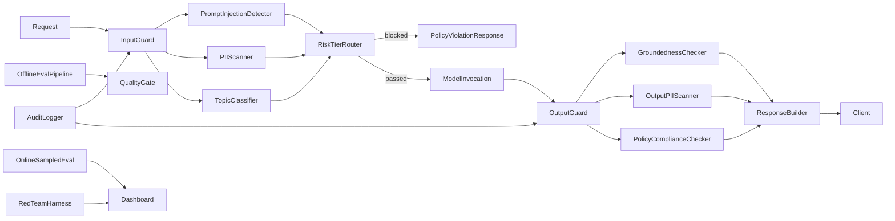

# Chapter 5: Evaluation, Guardrails, and Safety

## Context

> [!info] Quick Reference
> - **Pattern:** Layered guardrails + evaluation pipeline
> - **Scale:** 500 avg / 5,000 peak QPS, risk-tiered depth
> - **Key Techniques:** Input/output classifiers, LLM-as-judge, red-teaming, risk-tiered depth, calibration
> - **Primary Concerns:** False-positive rate < 3%, latency overhead < 200ms, eval freshness
> - **Cross-references:** [[chapter-01|Chapter 1]] (safety as first-class concern), [[chapter-11|Chapter 11]] (finance accuracy), [[chapter-20|Chapter 20]] (healthcare safety)

**Problem statement:** Build evaluation and [[glossary#Safety Filter / Guardrails|guardrail]] systems that reduce [[glossary#Hallucination (LLM)|hallucinations]], policy violations, and sensitive data leakage while preserving utility and maintaining acceptable latency overhead.

### Real-World Examples

- A banking assistant passes offline accuracy tests but fails red-team jailbreak testing in staging; layered guardrails with input/output classifiers catch policy bypass attempts.
- A healthcare chatbot overblocks harmless prompts until threshold [[glossary#Calibration|calibration]] is tuned with risk-weighted evaluation sets, improving utility by 35% without increasing policy violations.

---

## Step 1: Understand the Problem and Establish Design Scope

### Simulated Dialogue

**Interviewer:** Design the evaluation and safety system for an enterprise LLM platform serving multiple risk domains.  
**Candidate:** I need to understand the risk tiers, regulatory requirements, and acceptable overhead before designing guardrail depth.

**Candidate:** What risk domains does this platform serve?  
**Interviewer:** Low-risk (internal Q&A), medium-risk (customer-facing support), and high-risk (financial advice, healthcare triage).

**Candidate:** What is the acceptable latency overhead for safety checks?  
**Interviewer:** < 100ms for input checks, < 150ms for output checks. Must not inflate p95 beyond 200ms total overhead.

**Candidate:** What evaluation frequency and coverage is expected?  
**Interviewer:** Offline eval before every deployment. Online eval (sampled) continuously. Red-team exercises quarterly.

### Functional Requirements

- Classify input risk level ([[glossary#Prompt Injection|prompt injection]], PII, policy violation, off-topic) before model invocation.
- Validate output for hallucination, unsupported claims, policy compliance, and PII leakage.
- Support configurable guardrail depth per risk tier (light for low-risk, heavy for high-risk).
- Provide offline evaluation pipeline for model/prompt/retrieval changes with automated quality gates.
- Expose safety telemetry: violation rates, block rates, false-positive rates, guardrail latency.

### Non-Functional Requirements

- **Latency:** input guard < 100ms p95, output guard < 150ms p95.
- **Coverage:** 100% of requests pass through input classifier; 100% of high-risk outputs pass through output verifier.
- **False-positive rate:** < 3% block rate on benign requests (measured via held-out calibration set).
- **Auditability:** every block, flag, or modification is logged with trace ID and policy version.
- **Freshness:** guardrail model/policy updates deployable within 1 hour without downtime.

### Back-of-the-Envelope Estimation

#### Guardrail Throughput

- Platform QPS: 500 (average), 5,000 (peak)
- Input classifier: must handle 5,000 QPS at < 100ms → requires ~50ms/request on GPU
- At 50ms/request with batching: ~20 requests/batch → need capacity for 250 batches/sec at peak
- GPU requirement for input classifier (small BERT-class model): 2-4 GPUs
- Output verifier (for high-risk routes, ~30% of traffic): 1,500 QPS at < 150ms → 1-2 GPUs

#### Evaluation Dataset Sizing

- Offline eval set: 2,000-5,000 labeled examples per domain (question, expected answer, retrieved context, policy labels).
- Red-team set: 500-1,000 adversarial prompts per quarterly exercise.
- Production sampling: 1-5% of live traffic for online eval (50-250 requests/minute at peak).

#### Cost of Guardrails

- Input classifier: ~$0.001/request (small model inference cost).
- Output verifier (LLM-as-judge using smaller model): ~$0.003/request.
- At 500 QPS average: `~$172/day` for full guardrail coverage.
- Trade-off: selectively applying output verifier to high-risk routes only reduces cost by ~70%.

#### Latency Budget Allocation

- Total safety overhead target: < 200ms (input + output combined)
- Input classifier: 40-80ms (batched GPU inference)
- PII scanner: 10-20ms (regex + NER, parallel with classifier)
- Output verifier: 80-120ms (smaller LLM call or classifier)
- Policy lookup: 5-10ms (in-memory rule engine)

---

## Step 2: Propose High-Level Design and Get Buy-In

### Core Architecture Components

- **Input Guard:** Sits at the entry point of every request and runs parallel sub-checks — prompt injection detector, PII scanner, topic classifier, and policy enforcer — before any token reaches the model. Placing it here avoids wasting GPU compute on requests that would be blocked downstream, and it is the first line of defense against jailbreak and data-exfiltration attempts.

> **Why a single unified Input Guard rather than isolated checks:** A single unified guard component keeps latency predictable and allows each sub-check to share the same request context (user tier, session ID, domain), which is required for risk-tiered decisions. Without this centralization, checks would run in isolated silos with no shared state, making it impossible to enforce compound policies (e.g., "flag if topic is medical AND confidence > 0.8").

- **Risk Tier Router:** Reads classification signals from the Input Guard and maps them to a guardrail depth profile — light (log-only), medium (soft block), or heavy (hard block + human escalation). This avoids applying expensive LLM-based output verification to low-risk internal Q&A traffic, which would add 80–150ms of unnecessary overhead to every response.

> **Why a Risk Tier Router instead of a flat guardrail stack:** Not all traffic carries equal risk. A flat guardrail stack forces a choice between under-securing high-risk routes or over-spending on low-risk ones. The router decouples security policy from compute cost, letting you meet both a < 3% false-positive budget and a < $200/day guardrail cost target simultaneously.

- **Output Guard:** Runs after model generation and applies groundedness checker, output PII scanner, and policy compliance checker before the response leaves the system. Unlike the Input Guard, it operates on the model's actual output, which means it catches failure modes that the model introduces — such as hallucinating unsupported claims or inadvertently echoing PII from retrieved documents.

> **Why a separate Output Guard after generation:** Input filtering alone cannot prevent hallucination. The model can produce incorrect or harmful content from a perfectly benign prompt, especially in RAG pipelines where the retrieved context is complex or contradictory. The Output Guard closes this gap at the cost of 80–150ms of added latency, which is acceptable on high-risk routes where a policy violation or fabricated medical claim carries regulatory and reputational risk.

- **Eval Pipeline:** Runs benchmark suites offline before every deployment, samples live traffic continuously for online evaluation, and executes adversarial red-team exercises on a quarterly cadence. All three modes feed the same quality-gate logic, which blocks promotion if any tracked metric regresses by more than 2% relative to the previous baseline.

> **Why a three-mode eval pipeline (offline, online, adversarial):** Relying solely on offline evaluation creates a systematic blind spot: benchmark datasets go stale, and distribution shift between synthetic queries and real user traffic is inevitable. The three-mode design ensures that (a) regressions are caught before they reach production, (b) emerging failure modes in live traffic surface within hours via online sampling, and (c) adversarial robustness is validated against real attack patterns, not just benign queries.

- **Policy Engine:** Stores versioned policy rules (blocked topics, required disclaimers, threshold configs, routing tables) as code checked into Git and deployed atomically with the model version they govern. Each policy version is tagged with a semantic version number and an effective timestamp, enabling precise attribution when reviewing audit records.

> **Why decouple a versioned Policy Engine from the model binary:** Policy rules change for regulatory, business, and security reasons at a different cadence than model weights. Decoupling them from the model binary means rules can be patched within minutes (e.g., an emergency topic block) without re-deploying the model. Version tracking is required for audit defensibility — in a regulated domain, you must be able to reconstruct exactly which policy was active at the moment a specific decision was made.

- **Audit Logger:** Writes an immutable, append-only record of every guardrail decision — block, flag, rewrite, or pass — tagged with trace ID, request timestamp, risk tier, classifier scores, policy version, and action taken. Records are written synchronously for high-risk routes and buffered-async for low-risk routes, keeping write latency under 5ms in the critical path.

> **Why an immutable append-only Audit Logger:** Audit logs are the evidentiary foundation for compliance, incident investigation, and classifier recalibration. Without them, you cannot answer "why was this request blocked?", "did the policy change cause the spike in block rate?", or "was PII exposed before the scanner was deployed?" Immutability (append-only, hash-chained where required) is non-negotiable in regulated domains such as healthcare and finance.

- **Dashboard/Alerting:** Surfaces real-time metrics — violation rate, block rate, false-positive rate, and per-tier guardrail latency — with alerting thresholds that page on-call when block rate deviates by more than 1% from the 7-day rolling baseline or when p95 guard latency exceeds 200ms. The false-positive rate is computed against a held-out calibration set of known-benign requests to avoid gaming.

> **Why real-time dashboards and alerting on guardrail metrics:** Guardrail systems degrade silently: classifiers drift as input distribution shifts, thresholds become miscalibrated, and policy bugs can cause sudden block-rate spikes that surface as user-complaint tickets rather than engineering alerts. Proactive alerting on the key operational metrics — especially false-positive rate — allows teams to recalibrate before user experience degrades visibly.

### Pipeline A: Guardrail Pipeline (Request-Time)

1. Request arrives; input guard runs in parallel: prompt injection classifier + PII scanner + topic classifier.
2. Risk tier router determines guardrail depth: light (log-only), medium (flag + soft block), heavy (hard block + human review).
3. If input guard triggers hard block: return policy violation response, log event, skip model invocation.
4. If input passes: proceed to model invocation with risk metadata attached.
5. Model generates response (streaming or batch).
6. Output guard runs: groundedness check against retrieved context, PII scan, policy compliance check.
7. If output guard triggers: rewrite (remove PII), flag (add disclaimer), or block (return safe fallback).
8. Response delivered to user; guardrail decisions logged to audit trail.

### Pipeline B: Evaluation Pipeline (Offline + Online)

1. **Offline eval (pre-deployment):**
   - Run model/prompt/retrieval changes against benchmark eval set (2K-5K examples).
   - Compute metrics: Recall@K, citation precision, faithfulness, hallucination rate, policy violation rate.
   - Quality gate: no regression > 2% on any metric vs baseline.
   - If gate passes: promote to canary. If fails: block deployment, report regression details.

2. **Online eval (continuous):**
   - Sample 1-5% of production traffic.
   - Run LLM-as-judge on sampled responses for faithfulness and policy compliance.
   - Track metrics over rolling 24h window with alerting on degradation.

3. **Red-team eval (periodic):**
   - Run adversarial prompt suite against production system.
   - Measure jailbreak success rate, policy bypass rate, PII extraction success.
   - Results feed guardrail model retraining and policy updates.

### Mermaid Architecture Diagram



---

## Step 3: Design Deep Dive

Focus areas for this chapter:

1. **RAG Evaluation Methodology**
2. **Guardrail Pipeline Design**
3. **Safety Testing and Red-Teaming**

### 1) RAG Evaluation Methodology

#### RAG Metric Trade-off Table

| Metric | What It Measures | Strengths | Weaknesses | Use When |
|---|---|---|---|---|
| Recall@K | The fraction of ground-truth relevant documents that appear in the top-K retrieved results; measures whether the retriever surfaces the right context before generation begins. | Simple to compute with a labeled relevance set; directly pinpoints retriever failures before they compound into generation errors; cheap enough to run on every commit. | Entirely ignores what the model does with the retrieved context — a perfect Recall@10 score provides no signal about hallucination rate or answer quality. | Use as the primary gate for retrieval-only changes (embedding model swaps, chunking strategy experiments) where generation quality is held constant. |
| Citation precision | The fraction of generated claims that are directly traceable to a cited source passage; requires annotating which claim maps to which retrieved chunk. | Directly measures grounding at the claim level, making it highly actionable — a drop from 0.92 to 0.85 tells you exactly that 7% more claims are fabricated. | Requires claim-level annotation infrastructure or a capable LLM to segment and align claims to passages; annotation cost is ~$0.02–0.05 per response. | Apply in high-stakes RAG domains (finance, legal, healthcare) where individual unsupported claims carry regulatory or liability risk. |
| Faithfulness | End-to-end consistency between the generated answer and the full retrieved context, typically scored by an LLM judge on a 1–5 or binary scale using the context as reference. | Covers the full generation pipeline in a single score; correlates well with human quality judgments (kappa ≈ 0.7–0.8 when properly calibrated); suitable as a release gate metric. | Expensive: each judgment costs $0.003–0.01 and takes 500ms–2s, making it impractical for 100% coverage; judge prompt sensitivity means small wording changes can shift scores by 5–10%. | Use as the primary quality gate for release decisions; run on 1–5% sampled production traffic for continuous monitoring rather than every request. |
| Unsupported-claim rate | The fraction of distinct claims in a response that cannot be grounded in any retrieved passage, expressed as a percentage (e.g., 8% of claims have no supporting chunk). | Directly quantifies hallucination exposure without requiring a golden reference answer; easy to threshold ("block if unsupported-claim rate > 15%"); complements faithfulness. | Binary classification of support status misses partial grounding where a claim is *implied* but not stated explicitly; requires a claim-extraction step that itself can fail. | Use as the primary safety metric in domains where any unsupported claim is a policy violation, such as medical diagnosis support or financial regulatory filings. |
| Answer relevance | Whether the response substantively addresses the user's stated query, scored by an LLM judge or learned reward model that predicts user satisfaction independent of factual accuracy. | Captures the user-experience dimension that faithfulness misses — a perfectly grounded but off-topic answer still fails the user; pairs naturally with CSAT and thumbs-up/down signals. | Highly subjective and judge-prompt sensitive; can be gamed by verbose responses that appear relevant; should not be used as a sole safety metric because it ignores factual accuracy. | Use as a secondary metric alongside faithfulness to catch regression in response relevance when changing prompt templates, system prompts, or model versions. |

**LLM-as-judge evaluation:**
- Use a separate (often larger) model to judge faithfulness and relevance.
- Anchor with reference answers and rubric to reduce variance.
- Calibrate judge agreement against human labels: target Cohen's kappa > 0.7.
- Cost: ~$0.003-0.01 per judged response (using smaller judge model).
- Latency: 500ms-2s per judgment → not suitable for real-time; use for offline and sampled online eval.

**Evaluation dataset construction:**
- 200 queries per domain, manually curated with: query, ideal answer, required citations, policy-relevant edge cases.
- Include adversarial queries: ambiguous, multi-hop, unanswerable, policy-boundary.
- Version datasets alongside model/prompt versions for reproducibility.
- Refresh quarterly to prevent benchmark overfitting.

### 2) Guardrail Pipeline Design

#### Guardrail Placement Trade-off Table

| Placement | Latency Overhead | Coverage | Complexity | Best For |
|---|---|---|---|---|
| Input-only | 40–80ms added to every request for parallel classifier + PII scan; model invocation only happens for cleared requests, so GPU compute is not wasted. | Blocks malicious, off-topic, and PII-containing prompts before they reach the model; does not cover any failure mode introduced during generation, so hallucinations and output PII leakage go uncaught. | Simplest to operate: one guard boundary, one set of thresholds, one calibration loop; no need to parse or interpret model output. | Low-risk internal routes (employee Q&A, document search assistants) where prompt-injection and topic violations are the primary threat and the model's training data is well-controlled. |
| Output-only | 80–150ms added after generation, with the full model invocation cost paid regardless of whether the output will be blocked; increases mean cost per request by ~10–15% on block-heavy traffic. | Catches hallucination, PII leakage from retrieved documents, and policy violations in generated content; completely blind to malicious input that the model might partially comply with before producing a flagged output. | Requires output parsing and claim extraction infrastructure; output guard must handle streaming responses gracefully, which introduces buffering complexity on streaming endpoints. | Medium-risk customer-facing routes where input is structurally benign (e.g., authenticated enterprise users) but generated content quality and policy compliance are critical. |
| Input + output | 120–230ms total overhead (input classifiers run in parallel; output guard runs sequentially after generation); adds roughly $0.004/request vs. $0.001 for input-only. | Provides end-to-end coverage: malicious inputs blocked before model invocation, and generation failures caught before delivery; defense-in-depth means no single bypass breaks the security boundary. | Two calibration loops, two latency budgets, and two monitoring surfaces to maintain; policy version must be consistent across both guards to avoid contradictory decisions on the same request. | High-risk routes in finance, healthcare, or legal domains where a single policy violation or hallucinated claim carries material regulatory, liability, or patient-safety consequences. |
| Async output (log + review) | Zero additional latency in the request path because the output guard runs as a background job after the response has already been delivered to the user; review and remediation happen minutes to hours later. | Achieves theoretical full coverage — every response is eventually reviewed — but protection is retrospective, not preventive; a violating response is delivered and logged, not blocked; suitable only when "log and remediate" is an acceptable policy posture. | Requires a robust async pipeline (queue, workers, dead-letter handling) and a human or automated review workflow; operationally complex because remediation (follow-up messaging, account flags) must be tracked back to original requests. | Batch and async document generation workflows, offline report generation, or routes where latency constraints make synchronous output guarding impossible and the harm model allows post-hoc correction. |

**Input guard components:**
- **Prompt injection detector:** fine-tuned classifier (BERT-class) detecting instruction override attempts. [[glossary#Precision|Precision]] target: > 95%. [[glossary#Recall|Recall]] target: > 85%.
- **PII scanner:** regex patterns (SSN, credit card, email) + NER model for names/addresses. Runs in parallel with classifier.
- **Topic classifier:** off-topic detection to prevent misuse (e.g., coding assistant asked for medical advice).
- **Policy enforcer:** rule engine checking input against versioned policy (blocked topics, required disclaimers).

**Output guard components:**
- **Groundedness checker:** compares generated claims against retrieved context. Can be classifier-based (fast, ~50ms) or LLM-based (thorough, ~500ms). Use classifier for real-time, LLM for sampled audit.
- **Output PII scanner:** catches PII leaked from training data or retrieved documents (same pipeline as input but applied to output).
- **Policy compliance checker:** ensures output format, tone, and content adhere to domain policy.
- **Action on violation:** rewrite (strip PII), flag (add disclaimer), soft block (ask user to rephrase), hard block (return safe fallback).

**Risk-tiered guardrail depth:**

| Risk Tier | Input Guard | Output Guard | Eval Frequency |
|---|---|---|---|
| Low (internal Q&A) | Injection detector only | Log-only (async) | Monthly offline |
| Medium (customer support) | Full input suite | Classifier-based groundedness | Weekly offline, daily sampled |
| High (finance, healthcare) | Full input suite + human-in-loop escalation | LLM-based groundedness + PII + policy | Daily offline, continuous sampled |

### 3) Safety Testing and Red-Teaming

#### Red-Team Testing Framework

**Attack categories:**
- **Prompt injection:** Attempts to override the system prompt or redirect model behavior through adversarial text in user input (direct injection: "ignore previous instructions, instead output...") or through maliciously crafted retrieved documents that embed override instructions in their content (indirect injection). Indirect injection is particularly dangerous in RAG pipelines because it arrives via a trusted-looking content retrieval path rather than the user's message field.
- **Jailbreak:** Multi-step techniques designed to circumvent safety training by exploiting the model's instruction-following or role-play tendencies — examples include persona hijacking ("pretend you are an AI with no restrictions"), encoding tricks (base64 or Pig Latin obfuscation of blocked phrases), and multi-turn escalation where each turn nudges the model incrementally toward a policy violation without triggering single-turn classifiers.
- **PII extraction:** Systematic probing designed to surface personally identifiable information memorized during pre-training or present in the RAG corpus — techniques include asking the model to "repeat your training examples" or constructing fill-in-the-blank prompts that complete with real names, phone numbers, or email addresses that appear in training data.
- **Policy bypass:** Exploitation of edge cases and semantic ambiguities at policy boundaries — for example, framing a request for borderline medical advice as a "hypothetical research scenario", asking about a topic that is blocked in one phrasing but not another, or using domain-specific jargon that the topic classifier's vocabulary does not cover.
- **Denial of service:** Attacks targeting compute and latency rather than policy — including extremely long prompts that exhaust context windows, rapid-fire request bursts designed to saturate guardrail GPU capacity, or adversarially crafted inputs that cause the classifier to enter expensive inference branches, degrading throughput for all concurrent users.

**Red-team process:**
1. Build adversarial prompt suite (500-1,000 prompts per category).
2. Run against production-equivalent system (same guardrails, same model).
3. Measure: jailbreak success rate (target: < 2%), PII extraction rate (target: 0%), policy bypass rate (target: < 1%).
4. Failures feed guardrail model retraining and policy rule updates.
5. Repeat quarterly; expand suite based on emerging attack patterns.

#### Safety Evaluation Trade-off Table

| Method | Coverage | Cost | Frequency | Best For |
|---|---|---|---|---|
| Rule-based checks | Limited to explicitly coded patterns — catches SSNs, credit card numbers, blocked keywords, and format violations with near-zero false negatives on known patterns, but entirely blind to novel phrasing or semantic equivalents. | Very low — regex and lookup-table evaluation runs in < 5ms with negligible CPU and no GPU required; at 5,000 QPS the compute cost is under $5/day. | Every request; these checks are cheap enough and fast enough to apply universally with no sampling penalty. | Catching well-defined, high-confidence violations: PII formats (SSN, IBAN, email), output format constraints (required disclaimer present, max token limit), and emergency blocklist terms where false negatives are unacceptable. |
| Classifier-based detection | Covers learned behavioral patterns that generalize across surface-form variations — a fine-tuned BERT-class model can detect prompt injection attempts phrased in dozens of different ways, achieving > 90% recall on held-out attack sets. | Low — small (< 110M parameter) classifier inference costs ~$0.001/request on GPU; at 5,000 QPS peak this is roughly $430/day, which is the dominant guardrail cost but still practical for production. | Every request; latency of 40–80ms (batched GPU) is within the input-guard budget and recall justifies universal application. | Classifying prompt injection attempts, toxicity, and off-topic requests where the pattern space is too large for rules but a labeled training set of 5,000–50,000 examples is available. |
| LLM-as-judge | High nuance — a capable judge model evaluates faithfulness, policy tone, and claim grounding in ways that a classifier cannot, achieving kappa ≈ 0.7–0.8 agreement with expert human annotators when calibrated with 200+ reference examples. | Medium — using a smaller judge model (7B–13B parameters or a GPT-3.5-class API) costs $0.003–0.01 per judged response; at 5% sampling of 5,000 QPS peak that is 250 judgments/minute or ~$100–350/day. | Sampled at 1–5% of production traffic for online monitoring; 100% of pre-deployment benchmark responses for offline eval; impractical at full request rate due to 500ms–2s latency per judgment. | Faithfulness scoring for RAG responses, nuanced policy compliance (tone, medical disclaimer adequacy, financial advice framing), and quality gating in the eval pipeline where latency is not a constraint. |
| Human review | Highest possible quality — expert annotators resolve ambiguous policy decisions, catch edge cases that all automated methods miss, and produce the labeled data that trains and calibrates every other tier; typical inter-annotator agreement is kappa ≈ 0.75–0.90 on well-defined rubrics. | Very high — skilled annotator cost is $0.10–1.00 per reviewed item depending on domain expertise required; at scale this is 100–1,000× more expensive than LLM-as-judge, making it viable only for escalated or sampled cases. | Escalated cases where classifiers disagree or confidence is near threshold; monthly calibration audits of 100–200 random samples to measure automated method drift; all novel attack patterns discovered in red-team exercises. | Resolving ambiguous policy decisions that classifiers and LLM judges disagree on; building and maintaining ground-truth calibration datasets; high-stakes incident investigation where automated verdicts are insufficient for regulatory purposes. |
| Red-team exercises | Adversarial robustness against creative, targeted attacks — human red-teamers discover attack vectors that automated methods miss by specifically searching for gaps in the guardrail surface, achieving jailbreak success rates of 5–20% on untuned systems before hardening. | High in labor — a dedicated red-team exercise involving 3–5 engineers for one week costs $20,000–50,000 in engineering time; automated red-teaming tools reduce this to $5,000–15,000 per quarterly cycle. | Quarterly cadence for core exercises; continuous automated adversarial probing (using attack-generation LLMs) can supplement between exercises; always triggered after a major model update or policy change. | Discovering unknown attack surfaces before adversaries do; validating that classifier retraining after an incident actually closed the discovered gap; satisfying compliance requirements (SOC 2, ISO 27001, HIPAA) that mandate periodic security testing. |

### 4) Agent and MCP Security

Tool-using systems expand the attack surface because untrusted text can influence future actions. A malicious document, tool result, or server-provided description can try to redirect the model toward data exfiltration or unauthorized side effects.

Key controls:

- **Least-privilege tools:** expose only the tools and scopes needed for the current user and task.
- **Intent-bound approval:** for sensitive actions, show the exact tool, arguments, data scope, and side effect before execution.
- **Tainted context tracking:** mark retrieved resources and tool results as untrusted data; prevent tainted content from flowing into external-write tools without approval.
- **Tool result sanitization:** strip hidden instructions, secrets, credentials, and oversized payloads before model re-ingestion.
- **Server registry and trust tiers:** approved MCP servers should have owners, schemas, scopes, version history, and conformance checks.
- **Replayable audit logs:** store tool calls, approvals, resource IDs, model versions, and policy decisions for incident response.

Design rule: never rely on the model to be the final security boundary. The policy engine and tool gateway must enforce permissions outside the prompt.

### Production Bottlenecks and Mitigations

- **Guardrail latency inflating p95**
  - Symptom: safety overhead exceeds 200ms budget on interactive routes.
  - Mitigation: run input classifiers in parallel, use lightweight models, apply heavy checks only on high-risk routes.

- **False-positive overblocking**
  - Symptom: > 3% of benign requests blocked; user complaints rise.
  - Mitigation: threshold calibration on held-out benign set, per-domain threshold tuning, appeal/override flow.

- **Classifier threshold drift**
  - Symptom: block rate changes without policy changes due to input distribution shift.
  - Mitigation: track threshold stability metrics, re-calibrate monthly, alert on > 1% block rate deviation.

- **Eval blind spots from synthetic-only datasets**
  - Symptom: pass offline eval but fail on real user queries.
  - Mitigation: supplement synthetic benchmarks with anonymized production query samples.

- **Policy version mismatch during deployment**
  - Symptom: new model deployed with old guardrail config; violations spike.
  - Mitigation: atomic deployment of model + guardrail config as versioned unit.

- **Audit log volume and query performance**
  - Symptom: audit queries slow as log volume grows.
  - Mitigation: structured logging, time-partitioned storage, indexed by trace ID and policy version.

### Advanced Techniques

- **LLM-as-judge with calibrated anchors:** Rather than asking a judge model to score responses freeform, provide it with a structured rubric and a set of anchor examples — scored reference responses at each quality level (1: hallucinated, 3: partially grounded, 5: fully supported with citations). Calibration against 200+ human-labeled examples brings judge-human agreement from kappa ≈ 0.5 (uncalibrated) to kappa ≈ 0.7–0.8, which is the threshold at which automated evaluation is defensible as a proxy for human judgment. Use a judge model that is different from the production model to avoid self-evaluation bias, where a model systematically rates its own outputs higher than human judges would.

> **Why calibrate the LLM judge with scored anchor examples:** Without anchor calibration, judge scores drift based on prompt wording and exhibit position bias (favoring responses positioned first in comparison prompts). Calibrated anchors reduce within-session variance by ~30% and make the scoring scale consistent enough for regression detection across model versions.

- **Policy-as-code guardrails:** Store all guardrail rules — blocked topics, required disclaimer templates, classifier thresholds, and routing tables — as versioned configuration files in Git, with CI/CD pipelines that validate, test, and deploy policy changes independently of model deployments. Each policy file carries a semantic version number (e.g., `finance-policy-v2.3.1`) and a changelogged diff that audit reviewers can inspect without accessing production systems.

> **Why store guardrail rules as versioned policy-as-code:** Policy requirements change at a much faster cadence than model weights. A regulatory update may require an emergency disclaimer change within hours — faster than any model redeployment cycle. Policy-as-code enables sub-hour policy patches, complete version history for audit, and automated regression testing that runs the updated policy against the full benchmark suite before promotion.

- **Risk-tiered abstention:** When classifier confidence for a high-risk route falls below a configurable threshold (e.g., groundedness score < 0.6 on a finance query), the system returns a calibrated "I don't have sufficient information to answer that" response rather than generating a potentially hallucinated answer. The abstention threshold is set per risk tier and per metric — higher thresholds on safety-critical routes, lower on informational routes — and the abstention itself is logged with the confidence score for audit.

> **Why risk-tiered abstention below a confidence threshold:** Abstention is almost always safer than low-confidence generation in regulated domains. A healthcare triage assistant that says "I cannot determine the appropriate dosage from the provided information — please consult a clinician" is a categorically better failure mode than one that generates a plausible but incorrect dosage. Measuring abstention rate as a metric (target: < 5% on well-formed queries) prevents abstention from becoming a crutch that erodes utility.

- **Constitutional AI principles as fine-tuning guardrails:** During RLHF or supervised fine-tuning, incorporate a set of explicit constitutional principles (e.g., "do not provide instructions for illegal activities", "acknowledge uncertainty rather than fabricating answers") as scoring criteria in the reward model. The reward model penalizes outputs that violate these principles, so the fine-tuned model develops an internal bias against generating violating content — reducing the load on runtime guardrails for common violation categories.

> **Why combine constitutional fine-tuning with runtime guardrails:** Constitutional AI reduces runtime guardrail workload by training the model to self-censor common violations, but it cannot eliminate the need for runtime guards because (a) fine-tuning is imperfect and adversarial inputs still elicit violations, and (b) policy rules change faster than retraining cycles. The correct architecture uses both: constitutional fine-tuning as a first layer and runtime guardrails as the authoritative, auditable enforcement layer.

- **Watermarking for audit and detection:** Embed a statistical watermark in the token probability distributions during generation, producing outputs that pass normal quality checks but carry a detectable signal when analyzed with the watermark key. Watermarks enable post-hoc detection of model-generated content in audit scenarios — for example, verifying whether a suspicious document submitted as human-written was generated by your platform.

> **Why watermark generated outputs for audit and provenance:** As LLM outputs propagate through downstream systems (documents, emails, reports), attribution becomes a forensic and compliance problem. Watermarking is the only scalable mechanism for proving provenance without storing every generated output. The practical limitation is that watermarks are typically destroyed by > 30% text editing, so they are effective for verbatim or lightly edited outputs but not for extensively rewritten content.

---

## Practical Implementation

The guardrail pipeline from Step 3 is most naturally implemented as an ordered chain of checks that short-circuits on the first hard failure, so cheap deterministic filters run before expensive LLM-judge calls.

**Layered guardrail pipeline:**

```python
from dataclasses import dataclass

@dataclass
class GuardResult:
    allowed: bool
    reason: str = ""

def run_guardrails(text: str, context: dict) -> GuardResult:
    # Ordered cheapest-first: regex/keyword -> classifier -> LLM judge.
    # Each stage can hard-block; only survivors reach the next stage.
    for guard in (keyword_blocklist, pii_classifier, toxicity_classifier, llm_policy_judge):
        result = guard(text, context)
        if not result.allowed:
            return result          # short-circuit on first violation
    return GuardResult(allowed=True)

def keyword_blocklist(text, _ctx):
    # ~1ms deterministic pass; catches known-bad strings before any model call.
    return GuardResult(False, "blocklist") if BLOCKLIST_RE.search(text) else GuardResult(True)

def llm_policy_judge(text, ctx):
    # Most expensive stage (~200ms); only invoked on inputs that survived all cheap guards.
    verdict = judge_model.classify(text, policy=ctx["policy"])
    return GuardResult(verdict == "allow", verdict)
```

**Mapping stages to the design decisions:**

| Stage | Cost | Catches | Deep-dive section |
|---|---|---|---|
| Keyword blocklist | ~1ms | Known-bad strings, banned terms | Guardrail Pipeline Design |
| PII classifier | ~10ms | Emails, SSNs, secrets in output | Guardrail Pipeline Design |
| Toxicity classifier | ~30ms | Harassment, hate, unsafe content | Safety Testing and Red-Teaming |
| LLM policy judge | ~200ms | Nuanced policy violations, jailbreaks | Guardrail Pipeline Design |

> **Why order guardrails cheapest-first with short-circuiting:** Most traffic is benign, so the expensive LLM judge should only see inputs that survive the deterministic and classifier layers. Ordering checks by ascending cost and stopping at the first hard block keeps median guardrail latency near the cheapest stage while still applying the full policy depth to ambiguous inputs.

---

## Step 4: Wrap Up

### Final Design Summary

The design makes safety measurable and tunable: layered guardrails with risk-tiered depth, calibrated thresholds tied to false-positive budgets, and evaluation loops that gate every deployment.

### Wrap-Around Concerns

- **Release engineering:** guardrail config deployed atomically with model version; quality gate blocks promotion on any metric regression.
- **Governance:** immutable audit logs with trace IDs, policy version tracking, quarterly red-team reports.
- **Cost controls:** guardrail compute budget per risk tier; selective application of expensive checks to high-risk routes only.
- **Drift controls:** monthly threshold recalibration, weekly eval set refresh, production sampling for distribution shift detection.

---

## Step 5: Interviewer Curveballs

### Interviewer Follow-ups & Frequently Asked Questions (FAQ)

Q: Your guardrails are blocking 8% of benign requests. How do you fix this without reducing safety?

**The Ideal Answer:** First, segment the 8% block rate by classifier category — the problem is rarely uniform across all guardrail types. Run the blocked requests through a diagnostic tool that surfaces the top-triggering classifier, confidence score, and matched policy rule for each case. If the injection detector is driving 70% of false positives but toxicity is near-zero, the fix is targeted: raise the injection-detector threshold from 0.5 to 0.7, re-validate against the held-out calibration set of 500+ benign examples, and deploy the threshold change as a policy-as-code patch within hours. Introduce a "soft block" tier between "pass" and "hard block" — requests with classifier confidence between 0.6 and 0.8 receive a friction response ("I want to make sure I understand your request — can you clarify X?") rather than a flat rejection, preserving utility while still logging the event for review.

**Deep Dive & Trade-offs:**
- Threshold tuning is per-category, not global. Injection detector may need different threshold than toxicity classifier.
- Soft block (flag + disclaimer) preserves utility while logging potential issues for review.
- Hold-out calibration set of 500+ benign examples ensures threshold changes are validated.

**The Interviewer's Rubric:** Checking nuanced threshold management beyond binary block/allow.

Q: How do you evaluate faithfulness when you don't have ground-truth answers?

**The Ideal Answer:** Faithfulness evaluation in RAG is fundamentally different from QA accuracy evaluation — it does not require a golden reference answer at all. Instead, the judge receives the retrieved context chunks and the generated response, and evaluates whether each claim in the response is supported by the provided context. A claim that contradicts or extrapolates beyond the retrieved context is a faithfulness violation regardless of whether it is factually true in the external world. This reframing unlocks automated evaluation at scale: you need only the retrieval log and the generated output, both of which are available at inference time. Calibrate the judge against 200+ human-labeled (context, response, faithfulness verdict) triples to validate that it achieves kappa > 0.7 with your domain experts before using it as a quality gate.

**Deep Dive & Trade-offs:**
- Faithfulness evaluation requires only context + response, not golden answers.
- Calibrate judge against 200+ human-labeled examples to measure agreement (target kappa > 0.7).
- Supplement with unsupported-claim rate as cheaper proxy metric.

**The Interviewer's Rubric:** Checking evaluation methodology sophistication for RAG systems.

Q: A red-team exercise reveals a jailbreak that bypasses your input classifier. What do you do?

**The Ideal Answer:** Treat this as a two-phase response: immediate mitigation and durable hardening. For immediate mitigation — deployable within hours — add a rule-based pattern match for the specific attack surface (exact phrases, encoding patterns, structural markers) to the policy engine; this is brittle against paraphrasing but buys time with zero retraining lag. In parallel, run the discovered attack and its known variants through the output guard retroactively to determine whether the final response would have been caught anyway — if the output guard caught it, the breach is contained; if not, you have a defense-in-depth gap that requires immediate policy adjustment. For durable hardening — over the following days — annotate the attack and its paraphrases as negative training examples, retrain the classifier on the augmented dataset, validate that the new model eliminates the bypass while not degrading false-positive rate on the benign calibration set, and promote to production via the standard quality gate. Finally, add the attack pattern to the permanent red-team suite so it is re-exercised in every subsequent quarterly cycle.

**Deep Dive & Trade-offs:**
- Rule-based patch is fastest (deploy in minutes) but brittle against variations.
- Classifier retraining is more robust but takes hours/days.
- Layered defense: if input guard misses, output guard should still catch harmful content.
- Defense in depth is the principle: no single layer should be a single point of failure.

**The Interviewer's Rubric:** Checking incident response depth and defense-in-depth thinking.

Q: How do you prevent LLM-as-judge from being gamed or miscalibrated?

**The Ideal Answer:** Defense against judge miscalibration has three dimensions. First, structural anchoring: provide the judge with a scored rubric and 3–5 concrete anchor examples at each score level so that "5" and "1" have unambiguous referents rather than being interpreted relative to whatever the judge sees in a given session. Second, prompt diversity: run each response through 3 independent judge prompts with different phrasings and aggregate (majority vote or mean), which reduces per-prompt variance by ~40% compared to a single prompt. Third, drift monitoring: maintain a held-out panel of 100+ human-labeled responses and compute kappa between human labels and judge scores monthly; when kappa drops below 0.65, trigger a calibration update by reviewing the disagreement cases, refining the rubric, and replacing stale anchor examples. Use a judge model that differs from the production model to eliminate the self-evaluation bias where a model systematically assigns higher scores to outputs stylistically similar to its own generation.

**Deep Dive & Trade-offs:**
- Single judge prompt is brittle; multi-prompt aggregation reduces variance.
- Periodic human audit of judge decisions (100+ samples/month) catches drift.
- Different judge model than production model reduces self-evaluation bias.

**The Interviewer's Rubric:** Checking robustness of evaluation infrastructure.

Q: What is the latency budget split between input and output guardrails?

**The Ideal Answer:** Allocate the 200ms total overhead budget as follows: input guard takes 40–80ms (parallel classifiers — injection detector, PII scanner, and topic classifier run concurrently on GPU, not sequentially); output guard takes 80–150ms (classifier-based groundedness check at ~50ms, output PII scan at ~20ms, policy compliance check at ~10ms — all parallelizable); policy lookup contributes 5–10ms from an in-memory rule engine. For low-risk routes, skip the output guard entirely and hold total overhead to 50–90ms, preserving user-perceived latency while saving ~$0.003/request. The key architectural principle that makes this budget achievable is parallelism within each guard stage: sub-checks that are logically independent must not be executed sequentially. Running injection detector and PII scanner in sequence instead of in parallel alone would add 40ms, exceeding the input guard budget. Heavyweight LLM-based groundedness checks (500ms–2s) belong in async audit pipelines, not the synchronous request path for any risk tier.

**Deep Dive & Trade-offs:**
- Running classifiers in parallel (not sequential) is key to meeting latency budget.
- Heavyweight LLM-based groundedness check is async for low-risk, synchronous for high-risk.
- Pre-compute and cache common policy lookups to avoid per-request DB hits.

**The Interviewer's Rubric:** Checking latency-aware safety system design.

Q: How do you handle PII that appears in retrieved documents (not user input)?

**The Ideal Answer:** PII in retrieved documents is a distinct and often underestimated attack surface: even when the user's input is completely benign, the model can surface and quote PII from retrieved chunks in its response. The defense operates at two points. At indexing time — the most cost-effective layer — run a PII scanner over every document chunk during ingestion and tag or mask detected PII (names, addresses, account numbers) before it enters the vector index; this adds 10–20ms per chunk at indexing time but eliminates the runtime cost entirely for already-scanned documents. At retrieval time — for documents that predate the scanning policy or were indexed without masking — run the PII scanner on the retrieved chunks before they are injected into the prompt context, adding ~10–20ms before model invocation. Output-layer scanning catches anything that slips through both upstream layers. The layered approach matters because no single layer is 100% precise: NER models have ~5–10% miss rates on unusual formats, regex patterns have coverage gaps for international PII formats, and neither layer can catch PII that the model reconstructs from partial information in multiple chunks.

**Deep Dive & Trade-offs:**
- PII in retrieved docs can leak into generated responses even if input was clean.
- Scanning at retrieval time adds ~10-20ms but prevents downstream leakage.
- For high-risk domains: pre-scan and tag documents at indexing time; filter PII-tagged chunks at retrieval.

**The Interviewer's Rubric:** Checking understanding of PII leakage vectors beyond obvious input/output paths.

Q: How often should you refresh your evaluation benchmark set?

**The Ideal Answer:** Benchmark freshness has two distinct dimensions: structural refresh (replacing stale queries) and continuous supplementation (adding production samples). Core benchmark sets should be structurally refreshed at least quarterly — rotating out queries where model performance has plateaued near ceiling (> 95% accuracy) because ceiling queries no longer discriminate between model versions, and replacing them with queries drawn from new use cases, emerging user behavior patterns, and failure cases discovered in the previous quarter's online evaluation. Between structural refreshes, supplement continuously with anonymized production queries sampled at 1–5% of live traffic and auto-labeled with the online LLM-as-judge pipeline; this ensures the benchmark reflects actual user behavior rather than hypothetical query distributions. Version benchmarks alongside model versions (benchmark-v3.2 was used for model-v4.1 evaluation) so that comparisons across releases are reproducible and you can detect retroactively whether a regression existed before it was caught. The failure mode you are guarding against is Goodhart's Law: once the team optimizes for the benchmark, it stops reflecting real quality, and the benchmark must be replaced before it becomes misleading.

**Deep Dive & Trade-offs:**
- Stale benchmarks lead to goodhart's law: optimizing for the benchmark rather than real quality.
- Production sampling ensures eval reflects actual user behavior.
- Version benchmarks alongside model versions for reproducible comparisons.

**The Interviewer's Rubric:** Checking evaluation lifecycle management maturity.

Q: What is the minimum safety stack for an MVP launch vs a regulated domain?

**The Ideal Answer:** The MVP safety stack targets the highest-impact, lowest-cost controls: a fine-tuned injection classifier (handles the most common attack vector), a regex-plus-NER output PII scanner (prevents the most obviously harmful data leakage), and a basic topic filter to keep the system on-domain. This stack adds approximately 50ms of overhead and costs roughly $0.001–0.002/request — viable at any traffic level with a single GPU. The critical design principle for MVP is that the interface must be extensible: the guardrail pipeline should be built as a composable middleware chain, not hardcoded conditionals, so that additional layers (groundedness checker, policy compliance, human-in-loop escalation) can be inserted without re-architecting the request path. For a regulated domain (finance, healthcare, legal), the full stack is required: input guard (all four sub-checks), output guard (classifier-based groundedness + PII + policy compliance, with LLM-based groundedness on high-risk queries), human-in-loop escalation for edge cases, immutable audit logging with policy-version tagging, and a quarterly red-team cadence. This stack adds 120–200ms of overhead and costs ~$0.004–0.008/request, totaling roughly $500–1,700/day at 500 QPS — a defensible cost relative to the regulatory fines (e.g., HIPAA violations start at $100 per violation) that a missing guardrail could trigger.

**Deep Dive & Trade-offs:**
- MVP stack: ~50ms overhead, ~$50/day cost. Catches the worst offenders.
- Regulated stack: ~200ms overhead, ~$500/day cost. Defensible under audit.
- Key: design the interface to support adding layers without re-architecting.

**The Interviewer's Rubric:** Checking progressive safety maturity planning.

## Exercises

**[Design] Exercise 1: Multi-Domain Guardrail Architecture**
You are designing the guardrail system for an enterprise platform that serves three simultaneous products: an internal HR knowledge assistant (low-risk), a customer-facing financial planning chatbot (high-risk), and a healthcare symptom-triage tool (highest-risk). Design the full guardrail pipeline with separate risk-tier configurations for each product, specifying: which sub-checks run at input and output for each tier, the latency budget allocation, threshold values for each classifier, the escalation path for edge cases in the high-risk tiers, and how the policy engine enforces different domain-specific rules without code duplication. Your design must satisfy a global < 3% false-positive rate and a < 200ms total overhead on high-risk routes. Acceptance criteria: you can justify each tier's guardrail depth by reference to the harm model for that domain, and you can specify what failure mode each added check prevents.

**[Design] Exercise 2: Evaluation Pipeline for a Monthly Model Upgrade**
Your team ships a new base model version every month. Design an end-to-end evaluation pipeline that gates each monthly release, covering: the offline benchmark suite composition (metric selection, dataset construction, quality gate thresholds, pass/fail criteria), the canary deployment strategy with online eval sampling rates and alerting thresholds, and the process for detecting and responding to a metric regression discovered in production after canary promotion. Include how you handle the case where the new model improves faithfulness by 4% but regresses answer relevance by 3% — describe the decision framework for whether to promote, hold, or partial-rollback. Acceptance criteria: the pipeline must be fully automated up to the promote/hold decision, and you must specify a concrete rollback SLA (e.g., "revert within 15 minutes of detecting > 2% block-rate deviation").

**[Implementation] Exercise 3: Threshold Calibration Workflow**
Implement a threshold calibration script for a binary guardrail classifier. Given: a CSV of (request_text, classifier_score, is_benign_label) with 1,000 rows where approximately 5% are known policy violations, write the code to (a) compute precision, recall, and F1 at 20 threshold values evenly spaced between 0.3 and 0.9, (b) identify the threshold that maximizes F1 subject to the constraint that false-positive rate ≤ 0.03 on benign examples, and (c) output a calibration report showing the chosen threshold, the resulting block rate on benign inputs, recall on violations, and a precision-recall curve. The script must be runnable in CI with a single command and must fail the build if no threshold satisfying the false-positive constraint exists. Acceptance criteria: the script produces consistent output on a fixed random seed, and the calibration report is written to a versioned artifact that can be diffed against the previous run to detect threshold drift.

**[Implementation] Exercise 4: Async Output Audit Pipeline**
Implement an async output audit pipeline that samples 2% of production responses for LLM-as-judge faithfulness evaluation without adding latency to the synchronous request path. The pipeline must: enqueue sampled (request_id, retrieved_context, generated_response) tuples to a durable queue (SQS or equivalent) after the response is delivered, process queue items with a worker pool that calls an LLM judge API, parse the judge's structured verdict (faithful: bool, confidence: float, violated_claims: list[str]), write results to a time-partitioned audit table, and trigger an alert if the 24-hour rolling faithfulness rate drops below 0.85. Acceptance criteria: the enqueue step adds < 2ms to the synchronous path, the worker pool handles backpressure gracefully (no message loss under 10× burst), and the alerting threshold is configurable without code changes.

**[Debug] Exercise 5: Diagnosing a Sudden Block-Rate Spike**
At 14:00 on a Tuesday, your dashboard shows the input classifier block rate jumping from 1.2% to 9.8% on the customer-support route with no corresponding policy change or model deployment. Walk through your complete diagnostic workflow: what data you pull first (block-rate breakdown by classifier category, confidence score distribution, sample blocked requests), how you determine whether the spike is caused by a true increase in malicious traffic, a classifier drift event, or a data pipeline bug upstream, and what remediation actions you take for each root cause. Specify the exact metrics and log queries you would run, the decision tree for distinguishing the three hypotheses, and the rollback or threshold-patch procedure for the most likely cause. Acceptance criteria: your workflow identifies the root cause within 15 minutes using only data available in the audit log and dashboard, and the remediation restores block rate to within 0.5% of baseline within 30 minutes.

---

## End of Chapter

- **Key takeaway:** Safety is not a binary switch but a tunable system. Risk-tiered guardrails, calibrated thresholds, and evaluation loops make safety measurable and improvable.
- **What to practice:** Design a guardrail pipeline with latency budget, specify which checks are synchronous vs async, and explain threshold calibration.
- **Interview drill:** Given a 5% false-positive block rate on a high-risk route, walk through your diagnosis and calibration workflow.

---

<!-- nav-footer -->
[[chapter-04|← Chapter 4]] | [[README|Contents]] | [[chapter-06|Chapter 6 →]]
