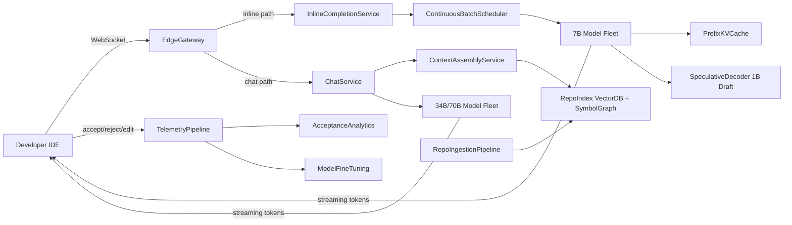

# Chapter 8: Design an AI Coding Assistant

## Context

> [!info] Quick Reference
> - **Pattern:** Dual-path coding assistant (autocomplete + chat)
> - **Scale:** 200M completions/day, 20M chat turns/day
> - **Key Techniques:** FIM prompting, speculative decoding (1B draft model), prefix KV caching, token budget assembly
> - **Primary Concerns:** < 300ms TTFT for autocomplete, acceptance rate telemetry, context window management
> - **Cross-references:** [[chapter-04|Chapter 4]] (serving optimization), [[chapter-09|Chapter 9]] (agentic path for complex edits)

**Problem statement:** Design an IDE-integrated coding assistant (GitHub Copilot-class) that delivers sub-300ms inline completions, multi-turn chat, and repo-aware suggestions—while managing extreme sensitivity to latency, context assembly correctness, and suggestion acceptance rate.

### Real-World Examples

- GitHub Copilot serves 2M+ developers with Fill-In-The-Middle (FIM) completions at <300ms TTFT; a 50ms TTFT regression drops acceptance rate by ~8%, directly impacting retention.
- An enterprise coding assistant indexes a 500K-file monorepo but hits 4s TTFT on completions because the context assembler packs 12K tokens of irrelevant imports; switching to symbol-graph-based context selection cuts prompt size to 2K tokens and restores 280ms TTFT.

---

## Step 1: Understand the Problem and Establish Design Scope

### Simulated Dialogue

**Interviewer:** Design an AI coding assistant like GitHub Copilot for production scale.  
**Candidate:** I need to distinguish two inference modes: inline autocomplete (extreme latency sensitivity, short output) and chat/explain (longer latency budget, long output). The architectures diverge significantly.

**Candidate:** What is the user base and request profile?  
**Interviewer:** 2M daily active developers, averaging 100 completion requests per day per user. Chat usage is ~10 sessions/day per active user.

**Candidate:** What latency SLOs must we hit?  
**Interviewer:** Sub-300ms TTFT for inline completions, sub-1s TTFT for chat. Completions that arrive after the developer has typed past the cursor position are worthless.

**Candidate:** What languages and repo sizes?  
**Interviewer:** Top 20 languages by GitHub usage. Repos range from 1K to 500K files. Must handle monorepos.

### Functional Requirements

- **Inline autocomplete:** Fill-In-The-Middle completions triggered on keystroke with streaming token delivery.
- **Chat/explain:** Multi-turn conversation grounded in open files, selected code, and repo context.
- **Context assembly:** Automatically select relevant code context (open files, imports, symbols, recent edits) within token budget.
- **Multi-language support:** Syntax-aware completions for top 20 languages without per-language model.
- **Telemetry:** Track acceptance/rejection/edit-after-accept per suggestion for model and ranking improvement.

### Non-Functional Requirements

- **Latency:** Inline TTFT p95 < 300ms. Chat TTFT p95 < 1,000ms.
- **Throughput:** Sustain 200M completions/day (peak 5x → ~11,500 completion QPS).
- **Availability:** 99.9% for inline path; graceful degradation (no completions) preferred over errors.
- **Cost:** < $0.001 per inline completion at scale; < $0.02 per chat turn.
- **Safety:** Never suggest secrets, license-violating code, or code that fails static analysis.

### Back-of-the-Envelope Estimation

#### Traffic Profile

- DAU: 2M developers
- Completions/day: `2M * 100 = 200M`
- Average completion QPS: `200M / 86,400 ≈ 2,315`
- Peak QPS (5x): `~11,575`
- Average output tokens/completion: 50 tokens
- Output tokens/day (completions): `200M * 50 = 10B tokens`
- Chat turns/day: `2M * 10 = 20M`
- Average chat output tokens: 300 tokens
- Output tokens/day (chat): `20M * 300 = 6B tokens`
- Total output tokens/day: ~16B tokens

#### Latency Budget — Inline Autocomplete (300ms total)

| Stage | Budget | Notes |
|---|---|---|
| IDE extension → gateway | 20ms | WebSocket/gRPC persistent connection |
| Debounce + cancellation | 50ms | Wait for typing pause; cancel in-flight on new keystroke |
| Context assembly | 30ms | Local in IDE plugin; symbol lookup + FIM formatting |
| Network to inference | 20ms | Edge PoP or regional inference cluster |
| Queue + scheduling | 10ms | Priority queue, continuous batching |
| Prefill (prompt processing) | 80ms | ~2K input tokens on optimized 7B model |
| Decode (50 tokens) | 70ms | ~1.4ms/token with speculative decoding |
| Network return + render | 20ms | First token streams immediately |

#### Latency Budget — Chat (1,000ms total)

| Stage | Budget | Notes |
|---|---|---|
| Gateway + auth | 30ms | |
| Context assembly (server-side) | 100ms | RAG over repo index + open file context |
| Queue + scheduling | 50ms | Lower priority than inline |
| Prefill (~4K tokens) | 300ms | Larger context, 34B model |
| TTFT delivery | 480ms | First token visible to user |
| Decode streaming | Ongoing | TPOT < 40ms/token |

#### GPU Fleet Sizing (Inline Path)

- Model: 7B quantized (INT4), ~18GB VRAM, ~200 tok/sec/GPU with speculative decoding
- Peak demand: `11,575 QPS * 50 tokens = 578,750 tok/sec`
- With continuous batching (8x efficiency): `578,750 / (200 * 8) ≈ 362 GPUs` for inline
- Chat path (34B, lower QPS): ~200 GPUs
- Total fleet: ~600-800 GPUs (steady-state ~250 with autoscaling)

#### Cost Per Completion

- Self-hosted 7B: ~$2/1M output tokens (amortized)
- Cost/completion: `50 tokens * $2/1M = $0.0001` ← well under $0.001 budget

---

## Step 2: Propose High-Level Design and Get Buy-In

### Core Architecture Components

- **IDE Extension (Client):** Implements the debounce timer (50ms default), assembles the FIM prompt locally using the editor's in-memory AST, manages a single persistent WebSocket connection per user, sends explicit cancellation signals when a new keystroke arrives mid-flight, and fires telemetry events (shown/accepted/rejected) without blocking the UI thread.
- **Edge Gateway:** Terminates TLS and multiplexes persistent WebSocket connections from millions of IDE clients, performs token-based authentication and per-user rate limiting (to prevent runaway completion storms from auto-save triggers), and routes requests to the correct backend path—inline completions get the low-latency 7B cluster; chat turns route to the 34B fleet.
- **Inline Completion Service:** The hot path for sub-300ms delivery; it owns a dedicated fleet of [[glossary#Quantization|quantized]] 7B models, a [[glossary#Continuous Batching|continuous batch]] scheduler that coalesces concurrent requests to maximize GPU utilization, a prefix [[glossary#KV Cache|KV cache]] layer that eliminates redundant prefill for shared system tokens, and a [[glossary#Speculative Decoding|speculative decoding]] engine using a 1B draft model for faster token generation.
- **Chat Service:** Orchestrates multi-turn conversations by maintaining session state (conversation history, referenced files, applied suggestions), calling the Context Assembly Service to gather repo-level grounding, and streaming responses from the 34B/70B model fleet—routing to the larger 70B model only when the query is classified as architectural or cross-file in nature.
- **Context Assembly Service:** Runs server-side for the chat path (where 100ms budget allows it); executes [[glossary#Embedding|embedding]]-based retrieval over the per-repo HNSW [[glossary#Vector Database / ANN Index|vector index]], traverses the symbol dependency graph to surface transitive definitions, deduplicates overlapping chunks, and assembles the final 4K-token [[glossary#Context Window|context window]] in priority order.
- **Repo Index Pipeline:** Continuously processes repository events (file saves, git pushes, branch switches) by parsing ASTs, building symbol graphs for all supported languages, chunking code at function/class boundaries, embedding each chunk with a code-specialized embedding model, and storing results in a per-repo HNSW index with version tags for stale-entry detection.
- **Telemetry Pipeline:** Collects every acceptance/rejection/edit event from IDE clients, buffers them in 30-second client-side batches to reduce network overhead, ingests them into a Kafka cluster partitioned by user ID, fans out to both real-time Flink dashboards (seconds lag for SLO alerting) and batch Spark jobs (daily model training and cohort analysis).
- **Model Serving Runtime:** A vLLM or TensorRT-LLM instance configured with continuous batching (to eliminate head-of-line blocking across requests), paged KV attention (to pack more requests per GPU), prefix KV caching (to reuse shared prompt states), [[glossary#Flash Attention|Flash Attention]] 2 kernels (for faster prefill), and tensor parallelism across 2 GPUs for the larger models where single-GPU VRAM is insufficient.

### Pipeline A: Repo Indexing Pipeline

1. On repo connect: clone/pull latest, parse AST for all supported languages. A 500K-file monorepo takes 8-15 minutes for a cold full parse; parallelized across 32 workers with language-specific parsers (tree-sitter for most languages), prioritizing files in the currently active branch and directories with recent git activity.
2. Build symbol graph (definitions, references, imports, exports) per file. Each node is a symbol (function, class, variable), and directed edges represent "defined in", "calls", "imports from" relationships. The graph enables bidirectional traversal: from a use-site back to the definition, and from a definition forward to all callers—critical for cross-file completion context.
3. Chunk files at function/class boundaries; generate embeddings (code-specialized model, e.g., CodeSage). Chunking at semantic boundaries (rather than fixed token windows) preserves function signatures and docstrings together, which are the highest-signal units for embedding similarity. Each chunk is 128-512 tokens.
4. Store in per-repo vector index (HNSW, M=32, ef_construction=200) + symbol graph database (Neo4j or a lightweight in-memory graph for smaller repos). The HNSW index supports approximate nearest-neighbor search in <5ms for 10M chunks with 96%+ recall@10.
5. Incremental update on file save/commit (diff-based re-index, not full rebuild). Only changed functions are re-chunked and re-embedded; unchanged neighbors in the symbol graph retain their edges. This reduces incremental update latency to <200ms for a single file change.
6. Version-tag index; invalidate stale entries on branch switch. A branch switch can change thousands of files simultaneously; rather than waiting for full re-index, the system serves the stale index with a staleness warning until incremental updates catch up (typically <30 seconds for small branches, <5 minutes for large feature branches).

> **Why HNSW over flat search or IVF-PQ:** HNSW provides O(log n) query time with tunable recall, making it viable for per-repo indexes ranging from 10K to 50M vectors. Flat search is too slow beyond ~1M vectors. IVF-PQ has faster build time but lower recall at equivalent index size. For a coding assistant where context quality directly drives acceptance rate, the recall advantage of HNSW justifies its higher memory footprint.

### Pipeline B: Inline Completion Pipeline

1. Developer types → IDE extension debounces (50ms pause). The debounce timer resets on every keystroke; it fires only when the developer pauses, which in practice correlates with the moment they want a suggestion rather than mid-word. Users with fast typing speeds (>120 WPM) may get a longer debounce (75ms) based on their historical typing profile, because their requests otherwise arrive too early—before the cursor is in a semantically stable position.
2. Extension assembles FIM prompt locally: `<|fim_prefix|>code before cursor<|fim_suffix|>code after cursor<|fim_middle|>` with surrounding file context, open tabs ranked by BM25 relevance, and import statements. This assembly happens entirely in the IDE process (not a server call) and must complete in <30ms to stay within the latency budget. The extension caches the AST of the current file in memory and updates it incrementally on each edit.
3. Request sent via WebSocket to edge gateway; any in-flight request for the same user is cancelled before the new one is dispatched. The IDE holds at most one pending completion at a time; sending a cancel message costs ~1ms and prevents GPU resources from being wasted on a stale context.
4. Gateway routes to the inline completion service; the request enters a priority queue sorted by arrival time with a 150ms TTL—requests older than 150ms are dropped silently because even if served, they will arrive too late to be useful.
5. Continuous batch scheduler admits the request; checks the prefix KV cache for the system prompt and FIM special tokens (~200 tokens that are identical across all requests). A cache hit skips ~15ms of prefill computation. The scheduler coalesces this request with up to 15 concurrent requests into a single batched forward pass.
6. The 7B quantized model generates up to 50 tokens with speculative decoding: the 1B draft model proposes 4 tokens per step, the 7B target model verifies all 4 in one forward pass, and accepted tokens are committed while the first rejected token triggers a restart from the 7B's corrected output. Net speedup: 2.5x, bringing decode from ~175ms to ~70ms.
7. Tokens stream back immediately as each is generated (not buffered); the IDE renders ghost text character-by-character, giving the developer a sense of real-time generation and allowing them to hit Tab early if they recognize the pattern.
8. On accept (Tab) / reject (Esc or typing past the ghost text) / edit-after-accept (modifying the accepted text within 30 seconds): a telemetry event is emitted asynchronously, batched locally for 30 seconds before flushing to the ingestion endpoint to avoid adding network overhead to the hot path.

### Pipeline C: Chat Pipeline

1. Developer opens chat panel, types a question with optional code selection (highlighted text from the editor). The IDE extension attaches the selected code as a structured block in the request payload, along with the file path, language, and surrounding 50 lines for context—this avoids the developer having to manually copy-paste code into the chat box.
2. Chat service retrieves repo-level context via embedding search (top-20 chunks retrieved, then reranked to top-5 using a cross-encoder model) plus symbol graph traversal (for each retrieved chunk, follow one hop in the import graph to include referenced definitions). The entire retrieval step has a 100ms budget enforced by a deadline timer; partial results are used if the deadline is hit.
3. Assembles the final prompt in priority order: system instructions (pinned, prefix-cached) + retrieved repo context + open file state + conversation history (truncated from oldest end if budget exceeded) + current user query. Total context is capped at 4K tokens for standard queries and up to 16K tokens for the "deep analysis" tier.
4. Routes to the 34B model for most requests (default); queries classified as architectural (spanning >5 files, involving design patterns, or exceeding 300 input tokens of user text) are routed to the 70B model. Classification is a lightweight logistic regression on query embeddings, adding <5ms overhead.
5. Streams the response with structured formatting: code blocks are syntax-highlighted, file references are rendered as clickable links that open the file in the editor, and inline citations link to the specific chunk that grounded each claim. The first token is delivered within 480ms TTFT for 34B; ongoing decode runs at <40ms/token.
6. Tracks thumbs-up/down, copy-code actions, apply-to-file actions, and follow-up question rate as quality signals. An applied suggestion that immediately triggers a follow-up clarification question is logged as a low-quality response for training purposes.

> **Why separate the inline and chat paths into different model fleets:** The two paths have fundamentally incompatible optimization surfaces. Inline completions require a model optimized for sub-300ms TTFT with maximum throughput per GPU—favoring smaller models (7B), aggressive quantization (INT4), and speculative decoding. Chat requires a model optimized for quality and coherence over multi-turn exchanges—favoring larger models (34B+), higher precision (INT8 or BF16), and longer KV cache lifetimes. Running both on the same fleet forces compromises that degrade both paths; the cost of separate fleets is justified by the acceptance rate and user satisfaction lift.

### Mermaid Architecture Diagram



---

## Step 3: Design Deep Dive

Focus areas:

1. **Context Assembly and Fill-In-The-Middle (FIM)**
2. **Latency Engineering for Autocomplete**
3. **Telemetry and Acceptance Tracking**

### 1) Context Assembly and Fill-In-The-Middle (FIM)

The quality of code completions is dominated by context selection, not model size. A 7B model with perfect context outperforms a 70B model with irrelevant context.

**FIM prompt structure:**

```text
<|fim_prefix|>{code before cursor}<|fim_suffix|>{code after cursor}<|fim_middle|>
```

The model generates tokens to fill the gap between prefix and suffix. This is fundamentally different from left-to-right completion—it allows the model to respect constraints imposed by code *after* the cursor (e.g., closing brackets, type annotations, function signatures).

**Context budget allocation (2,048 token budget for inline):**

| Slot | Token Budget | Source | Priority |
|---|---|---|---|
| FIM prefix (current file, before cursor) | 600 | Truncated upward from cursor | Highest |
| FIM suffix (current file, after cursor) | 400 | Truncated downward from cursor | Highest |
| Active file imports/type defs | 300 | AST-extracted | High |
| Recently edited lines (last 30s) | 200 | Edit buffer diff | High |
| Open tab snippets (ranked) | 300 | BM25 over open files using cursor-local tokens as query | Medium |
| Repository symbols (definitions used in scope) | 248 | Symbol graph traversal from cursor scope | Medium |

**Context ranking signals:**

- **Recency:** Files edited in the last 60 seconds rank highest, because a developer working across two files simultaneously expects the other file's current state to inform completions—not its state from yesterday's commit. Recency decay is exponential: a file touched 30 seconds ago scores 1.0; the same file touched 10 minutes ago scores 0.3.
- **Locality:** Same directory ranks above same package, which ranks above same repo. This heuristic works well for greenfield projects but breaks down in monorepos where the calling code and the called library live in different subtrees. The symbol graph provides a corrective signal in those cases by surfacing imported definitions regardless of directory distance.
- **Symbol relevance:** Definitions and types referenced in the current function's scope rank above files that happen to live nearby. The IDE extension performs a lightweight scope analysis (without full type inference) to identify identifiers in the current function that lack local definitions—these become high-priority slots in the context budget.
- **Edit correlation:** Files that are frequently co-edited in the git history of the current author rank higher than files that are only edited by others. This is computed from a rolling 90-day co-edit matrix stored per user: if the developer always touches `auth.py` after touching `user.py`, the system preemptively includes `auth.py` context when the cursor is in `user.py`.
- **Language-specific:** For TypeScript, `.d.ts` type declaration files contain the interface contracts that the model needs to generate type-safe completions—they rank as high as the prefix file itself despite containing no runtime logic. For Python, `__init__.py` exports define the public API of the package and are always included when the cursor is inside the package. For Go, `interface` definitions in the same module are elevated.

**Repo-level context retrieval (for chat, not inline):**

The chat path can afford 100ms for server-side retrieval:
1. Embed the user query + selected code with a code embedding model.
2. Retrieve top-K chunks from per-repo HNSW index (K=20, then rerank to top-5).
3. Traverse symbol graph: if retrieved chunk references an imported function, include that function's definition.
4. Deduplicate and assemble within 4K token budget.

#### Context Assembly Trade-off Table

| Strategy | Quality | Latency | Complexity | Best For |
|---|---|---|---|---|
| Current file only (no FIM suffix) | Low — the model cannot see closing braces, type annotations, or the function signature that follows the cursor; acceptance rate typically 12-18% in real evaluations | <5ms assembly; no network calls | Trivial to implement; no dependencies beyond the editor buffer | Prototype or latency-critical fallback when all other options fail |
| FIM with current file | Good for single-file edits where the function being completed is self-contained; acceptance rate improves to 22-28% vs. prefix-only because the suffix prevents over-generation past closing brackets | <10ms; AST parse of current file only | Low — requires FIM-capable model and token template, but no external data source | Single-file scripts, Jupyter notebooks, or early-stage projects where cross-file imports haven't proliferated |
| FIM + open tabs (BM25-ranked) | Strong for the active working set; an engineer context-switching between three files benefits significantly, lifting acceptance rate to 28-34% because the model sees the interfaces it needs to implement | 20-30ms; BM25 scoring over in-memory open-file buffer | Medium — requires maintaining an in-memory BM25 index over open files, updated on every save | Production default for most IDEs; covers >80% of developer workflows without requiring server-side indexing |
| FIM + open tabs + symbol graph | Best for cross-file completions and refactoring tasks; acceptance rate reaches 32-38% for monorepo workloads because the model receives the definition of every identifier in scope, not just what happens to be open | 30-50ms; requires pre-computed symbol graph with O(1) lookup by identifier name | High — requires per-language AST parsing, graph maintenance on file saves, and a symbol resolution API in the IDE plugin | Enterprise monorepos and large codebases where callers and callees live in different directory subtrees |
| FIM + full repo RAG | Acceptable quality for chat-style queries but overkill for inline completions where the developer already has the relevant files open; no acceptance rate advantage over symbol graph, but adds 70-150ms of unrecoverable latency | 100-200ms; requires embedding model inference + HNSW search + reranking | Very high — full vector index pipeline, embedding model serving, retrieval orchestration | Chat path only; never use for inline completions where 300ms total budget makes 150ms retrieval untenable |

### 2) Latency Engineering for Autocomplete

Every millisecond matters. A completion arriving 100ms late is a completion the developer has already typed past. The system must treat latency as a correctness constraint, not a performance metric.

**Debounce and cancellation protocol:**

1. IDE extension waits 50ms after last keystroke before sending request (debounce).
2. If developer types during in-flight request, the extension sends a cancel signal and dispatches a new request.
3. Server-side: cancelled requests are immediately evicted from batch scheduler, freeing KV cache slots.
4. Cancellation rate at scale: ~40-60% of requests are cancelled before completion—this is expected and healthy.

**Speculative decoding for inline path:**

- Draft model: 1B parameter model (same tokenizer and vocabulary as 7B target), sharing the target's embedding table to avoid vocabulary mismatch errors.
- Draft model proposes K=4 tokens per step in a single cheap forward pass (~0.5ms); the draft model's entire forward pass costs less than verifying one token with the 7B target.
- Target 7B model verifies all K draft tokens simultaneously in a single forward pass with a modified attention mask—if all 4 are accepted, 4 tokens are committed in the time it would normally take to generate 1.
- Acceptance rate for code is ~75-85% (substantially higher than prose at 55-65%) because code follows deterministic syntactic rules—variable names, keywords, and punctuation are highly predictable given context, meaning the draft model is often right.
- Effective speedup: 2.5-3x decode speed → 50 tokens in ~70ms instead of ~175ms, which is the single largest contributor to staying under the 300ms TTFT budget.
- VRAM overhead: ~2GB for the 1B draft model (trivial relative to the 7B target's 18GB), making co-location on the same GPU practical.

> **Why speculative decoding instead of simply using the 1B model directly:** The 1B model alone has ~22-26% acceptance rate (too low for a production assistant), but when constrained by 7B verification it achieves 75-85% acceptance at 7B quality. Speculative decoding gets 7B quality at near-1B speed—a strict improvement. The only cost is the 2GB VRAM overhead and the implementation complexity of the rejection sampling logic.

**Prefix KV cache:**

- System prompt + FIM special tokens are identical across all requests—every completion request begins with the same ~200-token preamble (system instructions, FIM template markers, language hinting tokens).
- Cache the KV states (keys and values from the attention layers) for this prefix so that subsequent requests skip its recomputation entirely. At 200 tokens on a 7B model with 32 layers and 128-dim heads, the cached KV tensor is ~800MB per GPU but shared across all co-located requests.
- Saves ~15ms of prefill per request; at 11,500 QPS peak, this eliminates roughly 172 GPU-seconds of compute per second—equivalent to removing ~0.9 GPUs of steady-state load from the fleet.
- Invalidation: only on model version change (deployment event) or system prompt update (rare). Per-request content (file-specific prefixes) is not cached because uniqueness makes cache hit probability near zero.

> **Why KV-state caching rather than output caching:** Output (completion text) caching would require identical prompts to produce cache hits, which almost never happens in code completion—every developer's cursor position and surrounding code is unique. KV-state prefix caching only requires the *beginning* of the prompt to be shared, which is trivially guaranteed by the fixed system prompt. It is strictly more applicable to this workload.

**Model optimization stack:**

| Technique | TTFT Impact | TPOT Impact | Quality Impact | Deployment Complexity |
|---|---|---|---|---|
| INT4 quantization (AWQ) | Reduces prefill time by ~10% because smaller weight matrices fit more efficiently in L2/HBM bandwidth; prefill is memory-bandwidth-bound, so weight size directly limits throughput | Negligible at batch size 1; at batch size 8+ the memory bandwidth savings become more significant, delivering ~8-12% TPOT improvement | <0.3% drop on pass@1 (HumanEval) for AWQ vs BF16 baseline; imperceptible to users but meaningful to track during rollout | Low — requires running AWQ calibration on a representative code dataset (1-2 hours compute); resulting weights are a drop-in replacement in vLLM |
| Speculative decoding | No direct TTFT improvement (prefill is unchanged); reduces perceived TTFT by delivering the first tokens faster only if draft and target happen to agree on token 1 | 2.5-3x speedup on decode: 50 tokens in ~70ms instead of ~175ms, which is the single largest decode-side optimization available | Zero quality degradation — speculative decoding is mathematically equivalent to sampling from the target distribution, not an approximation | Medium — requires maintaining a separate 1B draft model co-located with the 7B target, synchronizing vocabularies, and implementing the rejection sampling loop in the serving runtime |
| Prefix KV caching | Saves ~15ms per request (skips recomputing 200-token shared prefix); at p95 this moves the TTFT distribution left by 15ms, a meaningful portion of the 300ms budget | None — only affects prefill, not decode | None — deterministic reuse of precomputed states | Low — supported natively in vLLM via `--enable-prefix-caching` flag; only requires system prompt to be identical across requests |
| Continuous batching | Eliminates queuing delay that would otherwise occur when requests arrive during an ongoing generation: a new request can be inserted mid-generation into the batch without waiting for all in-flight requests to finish | Slight TPOT increase at batch size >8 because larger batches have more memory pressure and reduced per-request memory bandwidth; acceptable at batch size 4-8 | None | Medium — vLLM default but requires careful batch size tuning; too large a batch increases TPOT beyond the 40ms/token SLO |
| Flash Attention 2 | Reduces prefill time by ~20% through memory-efficient attention computation that avoids materializing the full N×N attention matrix; particularly impactful for the 2K-token inline context | Reduces TPOT by ~10% for the same reason; incremental gains compound with longer sequences | None — numerically equivalent to standard attention within floating-point precision | Low — a kernel-level drop-in; vLLM and TensorRT-LLM include it by default for Ampere/Hopper GPUs |
| Tensor parallelism (2 GPU) | Reduces prefill time by ~40% by splitting weight matrices across 2 GPUs (each GPU processes half the attention heads), effectively doubling available memory bandwidth for matrix multiplications | Reduces TPOT by ~30% for the same reason; the 2-GPU sweet spot avoids the communication overhead that dominates at 4+ GPU tensor parallelism for 7B models | None | Medium — requires NVLink or high-bandwidth PCIe between paired GPUs; introduces ~2ms inter-GPU synchronization overhead per layer that limits the speedup floor |

**Edge deployment strategy:**

- Deploy inference clusters in 8-12 edge regions matched to IDE telemetry hotspots: US-West (California/Oregon), US-East (Virginia), EU-West (Ireland), EU-Central (Frankfurt), UK (London), India (Mumbai), Japan (Tokyo), Singapore, Brazil (São Paulo), Australia (Sydney). Region selection is driven by P95 developer density from IDE activation telemetry, not generic CDN geography—developers in India experience dramatically different latency profiles than consumers accessing static content.
- Edge placement reduces network RTT from ~80ms (centralized US-East for a developer in India) to ~20ms (Mumbai edge cluster), recovering 60ms from the 300ms budget—the equivalent of eliminating an entire prefill stage. This is not a nice-to-have; for developers in Southeast Asia or South America, centralized inference would push TTFT past 300ms even with a perfect inference stack.
- Each edge cluster runs 30-80 GPUs for the inline path (scaled to regional DAU), 10-20 GPUs for chat. Cluster size is determined by peak QPS × GPU throughput with a 20% headroom buffer; autoscaling handles intra-day variation (typically 3x trough-to-peak within a region following business hours).
- Model weights are stored in a central model registry (S3-compatible object store) and pushed to edge clusters during deployment windows using a BitTorrent-style peer-assisted distribution to avoid saturating the registry's egress bandwidth. Canary deployments roll out to one edge region first, monitored for 2 hours of production traffic before proceeding to remaining regions.

> **Why edge over a single centralized cluster with more GPUs:** Network RTT is not reducible by adding GPU capacity—a 10,000-GPU centralized cluster still incurs 80ms RTT for a developer in India. Edge deployment addresses a fundamentally different constraint. The cost increase (~15-20% higher operational overhead for multi-region management) is justified because TTFT > 300ms causes ~8% acceptance rate degradation, which in turn reduces user retention—a direct revenue impact that outweighs the operational cost.

**Graceful degradation under load:**

1. If queue depth > 2x batch capacity: return an empty completion immediately (no ghost text shown). This is silent degradation—the developer sees no error, no spinner, no timeout message. The absence of a suggestion is the correct UX behavior here because any suggestion arriving after the queue clears would be stale anyway. Error messages or "loading" indicators would interrupt the developer's flow and signal a service failure, damaging trust even though the system is functioning correctly under its own load-shedding policy.
2. If TTFT p95 exceeds 400ms (detected via rolling 60-second window): reduce the max output token limit from 50 to 25. Shorter completions reduce decode time by ~35ms, which may be enough to bring p95 back under 300ms. Quality degrades modestly because the model can no longer complete multi-line suggestions, but this is preferable to systematically late completions that arrive after the developer has moved on.
3. If GPU utilization > 90% for more than 30 seconds: activate load shedding by prioritizing users with historical acceptance rate > 20% and deferring requests from users who have accepted fewer than 5 completions in the past hour (likely idle or new users). This is ethically defensible because low-acceptance users are less impacted by missing completions, and it preserves capacity for the core productive user segment.
4. Never show stale or semantically-cached completions regardless of load. Code context changes character-by-character; a completion cached from 200ms ago references the state before the developer's most recent edit. Unlike web search where query-level caching is effective, the unique combination of cursor position + surrounding code makes cache hit probability effectively zero except for degenerate cases (same developer, same position, same code—which never recurs in practice).

> **Why silent degradation over error messages:** Inline code completion is an enhancement layer, not a critical function. Developers can write code without it. An error dialog or timeout indicator breaks the IDE's interaction model, shifts developer attention from the code to the tool, and—if it happens repeatedly—triggers trust erosion that leads to feature disablement. Silent degradation keeps the IDE in a usable state and allows the system to recover without the developer ever noticing.

### 3) Telemetry and Acceptance Tracking

Telemetry is the feedback loop that makes the system improve. Without it, you're flying blind on the metric that matters most: **acceptance rate**.

**Event taxonomy:**

| Event | Trigger | Key Payload | Latency Sensitivity |
|---|---|---|---|
| `completion_requested` | Debounce fires | cursor_position, file_lang, context_hash, timestamp | None (async) |
| `completion_shown` | Ghost text rendered | request_id, TTFT, tokens_generated, model_version | None |
| `completion_accepted` | Tab key pressed | request_id, accepted_text, time_to_accept | None |
| `completion_rejected` | Esc or type-past | request_id, rejection_type, chars_typed_past | None |
| `completion_edited` | Edit within 30s of accept | request_id, edit_diff, time_to_edit | None |
| `completion_cancelled` | New keystroke during in-flight | request_id, cancel_latency | None |

**Acceptance rate computation:**

- **Raw acceptance rate:** `accepted / shown` — typically 25-35% for mature systems.
- **Persistence rate:** `(accepted - edited_within_30s) / accepted` — measures whether accepted code survives.
- **Character-level acceptance:** `accepted_chars / total_chars_written` — captures partial value even when full suggestion is modified.
- **Weighted acceptance rate:** weight by suggestion length (accepting a 50-token suggestion is more valuable than a 5-token one).

**Telemetry-driven improvements:**

1. **Ranking model training:** Accepted suggestions become positive examples; rejected or immediately-edited suggestions become negative. A lightweight ranker (logistic regression or gradient-boosted trees on features: suggestion length, model log-probability, language, time-of-day, file type, cursor semantic context, user historical acceptance rate) is trained daily on the previous day's 200M completion events. The ranker runs in <1ms on the serving path and reranks up to 3 candidate completions before displaying the top-ranked one—a system that generates 3 candidates and reranks outperforms a system that generates 1 candidate even with a 3B model vs 7B model comparison.
2. **Context ablation:** A/B test individual context slots by randomly withholding them from a 5% slice of traffic and measuring acceptance rate delta. If removing "open-tab context" from 5% of users produces no statistically significant acceptance rate change (p > 0.05 after 48 hours of traffic), that slot's token budget is reallocated to higher-signal sources. This is how production systems discover that some initially-intuitive context sources (e.g., recently closed tabs, clipboard history) don't actually improve acceptance rate and are pure latency cost.
3. **Model selection:** Route requests to model variant A vs B in a multi-armed bandit fashion, tracking acceptance rate per token-cost for each variant. A new model that produces 2% higher acceptance rate but 15% higher token cost may not be worth deploying if the marginal value per additional accepted completion doesn't cover the cost delta. This routing framework allows continuous model evaluation without requiring a fixed A/B split.
4. **Trigger tuning:** Adjust debounce timing based on per-user typing speed profiles derived from the cadence of `completion_requested` events. A developer who types at 150 WPM benefits from a 75ms debounce (their 50ms debounce fires too often mid-word), while a developer who types at 40 WPM can use a 30ms debounce (their 50ms debounce makes suggestions feel slow). Per-user debounce tuning is estimated to improve acceptance rate by 2-4% on the high-typing-speed cohort.

**Privacy and compliance:**

- Telemetry must never include raw code from private repos (enterprise tier).
- Use content hashes instead of raw text for acceptance tracking in enterprise mode.
- Provide opt-out for all telemetry collection.
- Code snippets used for model training require explicit opt-in (separate from telemetry).

#### Telemetry Pipeline Architecture

| Component | Technology | Throughput | Notes |
|---|---|---|---|
| Client-side buffering | IDE extension local buffer | Batch every 30s | Deduplicate cancel + show events |
| Ingestion | Kafka (partitioned by user_id) | 500K events/sec | 7-day retention |
| Real-time dashboard | Flink → Druid | Seconds lag | Acceptance rate, TTFT, error rate |
| Batch analytics | Spark on S3/Parquet | Daily | Cohort analysis, model comparison |
| Training data pipeline | Spark → feature store | Daily | Positive/negative examples for ranker |

### Production Bottlenecks and Mitigations

- **Context assembly timeout on large files**
  - Symptom: >100ms context assembly when cursor is in a 10K-line file.
  - Mitigation: Pre-compute AST and symbol index on file open; incremental update on edit. Hard cap context assembly at 30ms; truncate aggressively.

- **Cancellation storm under rapid typing**
  - Symptom: 60%+ cancellation rate wastes GPU prefill compute.
  - Mitigation: Increase debounce to 75ms for fast typists (detect via typing speed histogram). Server-side: preempt cancelled requests before prefill completes.

- **KV cache thrashing on inline path**
  - Symptom: Prefix cache hit rate drops below 50% when model fleet is at capacity.
  - Mitigation: Partition prefix cache by popularity (system prompt prefix is pinned; per-file prefixes use LRU eviction).

- **Acceptance rate collapse after model update**
  - Symptom: Canary deployment of new model shows 5% acceptance drop.
  - Mitigation: Shadow-mode deployment first (generate but don't show); compare acceptance rate on matched traffic before promoting.

- **Monorepo index staleness**
  - Symptom: Chat path retrieves deleted functions or outdated APIs.
  - Mitigation: Incremental index update on every file save (IDE extension pushes diff events). Full re-index nightly with consistency check.

---

## Practical Implementation

### Pseudocode: FIM Context Assembler

The following pseudocode describes the context assembly logic that runs in the IDE extension before each completion request is dispatched. It must complete in <30ms.

```text
function assemble_fim_prompt(current_file, cursor_offset, open_files, token_budget=2048):
    # Extract prefix: code before cursor, truncate upward at line boundary
    raw_prefix = current_file[:cursor_offset]
    prefix_lines = raw_prefix.split("\n")
    prefix_tokens = []
    prefix_budget = 600
    for line in reversed(prefix_lines):
        line_tokens = tokenize(line + "\n")
        if len(prefix_tokens) + len(line_tokens) > prefix_budget:
            break
        prefix_tokens = line_tokens + prefix_tokens
    prefix_text = detokenize(prefix_tokens)

    # Extract suffix: code after cursor, truncate downward at line boundary
    raw_suffix = current_file[cursor_offset:]
    suffix_lines = raw_suffix.split("\n")
    suffix_tokens = []
    suffix_budget = 400
    for line in suffix_lines:
        line_tokens = tokenize(line + "\n")
        if len(suffix_tokens) + len(line_tokens) > suffix_budget:
            break
        suffix_tokens += line_tokens
    suffix_text = detokenize(suffix_tokens)

    # Extract import statements from current file
    import_lines = [l for l in current_file.split("\n") if is_import_line(l)]
    import_text = "\n".join(import_lines)
    import_tokens = tokenize(import_text)[:300]

    # Rank open files by BM25 similarity to cursor window
    cursor_window = current_file[max(0, cursor_offset-200):cursor_offset+200]
    query_terms = tokenize_for_bm25(cursor_window)
    scored_files = [(bm25_score(f.text, query_terms), f) for f in open_files]
    scored_files.sort(reverse=True)

    # Fill remaining budget with ranked open-file snippets
    used_tokens = len(prefix_tokens) + len(suffix_tokens) + len(import_tokens)
    remaining_budget = token_budget - used_tokens - 50  # 50 for FIM special tokens
    tab_snippets = []
    for score, file in scored_files:
        if remaining_budget <= 0:
            break
        snippet = extract_relevant_snippet(file.text, query_terms, max_tokens=remaining_budget)
        if snippet:
            tab_snippets.append(f"// {file.path}\n{snippet}")
            remaining_budget -= len(tokenize(tab_snippets[-1]))

    # Assemble final FIM prompt
    repo_context = "\n\n".join(tab_snippets)
    fim_prompt = (
        f"<|fim_prefix|>"
        f"{repo_context}\n\n"
        f"// {current_file.path}\n"
        f"{detokenize(import_tokens)}\n\n"
        f"{prefix_text}"
        f"<|fim_suffix|>{suffix_text}<|fim_middle|>"
    )
    return fim_prompt
```

### Runnable Python: Acceptance Rate Sliding Window

The following is a runnable Python implementation of a sliding-window acceptance rate tracker that consumes telemetry events and emits per-language metrics. It uses only the Python standard library.

```python
import json
import sys
import time
from collections import defaultdict, deque
from dataclasses import dataclass, field
from typing import Optional


@dataclass
class CompletionEvent:
    request_id: str
    event_type: str  # "shown" | "accepted" | "rejected" | "edited"
    language: str
    ttft_ms: int
    tokens_generated: int
    timestamp: float


@dataclass
class WindowBucket:
    shown: int = 0
    accepted: int = 0
    edited_after_accept: int = 0

    def acceptance_rate(self) -> Optional[float]:
        if self.shown == 0:
            return None
        return self.accepted / self.shown

    def persistence_rate(self) -> Optional[float]:
        if self.accepted == 0:
            return None
        return (self.accepted - self.edited_after_accept) / self.accepted


class AcceptanceRateTracker:
    def __init__(self, window_seconds: int = 300):
        self.window_seconds = window_seconds
        # deque of (timestamp, CompletionEvent)
        self.events: deque = deque()
        # index: request_id -> list of events (for attribution)
        self.by_request: dict = defaultdict(list)

    def ingest(self, event: CompletionEvent):
        self.events.append((event.timestamp, event))
        self.by_request[event.request_id].append(event)
        self._evict_old_events()

    def _evict_old_events(self):
        cutoff = time.time() - self.window_seconds
        while self.events and self.events[0][0] < cutoff:
            _, old_event = self.events.popleft()
            # Clean up request index if all events for this request are evicted
            request_events = self.by_request.get(old_event.request_id, [])
            if request_events and request_events[0].timestamp < cutoff:
                del self.by_request[old_event.request_id]

    def compute_metrics(self) -> dict:
        self._evict_old_events()
        overall = WindowBucket()
        by_language: dict = defaultdict(WindowBucket)
        by_ttft: dict = defaultdict(WindowBucket)  # "<100", "100-200", "200-300", ">300"

        for _, event in self.events:
            bucket = by_language[event.language]
            ttft_key = self._ttft_bucket(event.ttft_ms)
            ttft_bucket = by_ttft[ttft_key]

            if event.event_type == "shown":
                overall.shown += 1
                bucket.shown += 1
                ttft_bucket.shown += 1
            elif event.event_type == "accepted":
                overall.accepted += 1
                bucket.accepted += 1
                ttft_bucket.accepted += 1
            elif event.event_type == "edited":
                # Attribute back to shown event's language/ttft via request index
                shown_events = [e for e in self.by_request.get(event.request_id, [])
                                if e.event_type == "shown"]
                if shown_events:
                    original = shown_events[0]
                    by_language[original.language].edited_after_accept += 1
                    by_ttft[self._ttft_bucket(original.ttft_ms)].edited_after_accept += 1
                overall.edited_after_accept += 1

        return {
            "window_seconds": self.window_seconds,
            "overall": {
                "shown": overall.shown,
                "accepted": overall.accepted,
                "acceptance_rate": overall.acceptance_rate(),
                "persistence_rate": overall.persistence_rate(),
            },
            "by_language": {
                lang: {
                    "acceptance_rate": b.acceptance_rate(),
                    "persistence_rate": b.persistence_rate(),
                    "shown": b.shown,
                }
                for lang, b in by_language.items()
            },
            "by_ttft_bucket": {
                ttft: {
                    "acceptance_rate": b.acceptance_rate(),
                    "shown": b.shown,
                }
                for ttft, b in by_ttft.items()
            },
        }

    @staticmethod
    def _ttft_bucket(ttft_ms: int) -> str:
        if ttft_ms < 100:
            return "<100ms"
        elif ttft_ms < 200:
            return "100-200ms"
        elif ttft_ms < 300:
            return "200-300ms"
        else:
            return ">300ms"


def main():
    tracker = AcceptanceRateTracker(window_seconds=300)
    last_emit = time.time()

    for line in sys.stdin:
        line = line.strip()
        if not line:
            continue
        try:
            raw = json.loads(line)
            event = CompletionEvent(
                request_id=raw["request_id"],
                event_type=raw["event_type"],
                language=raw.get("language", "unknown"),
                ttft_ms=raw.get("ttft_ms", 0),
                tokens_generated=raw.get("tokens_generated", 0),
                timestamp=raw.get("timestamp", time.time()),
            )
            tracker.ingest(event)
        except (json.JSONDecodeError, KeyError) as e:
            print(f"# parse error: {e}", file=sys.stderr)
            continue

        now = time.time()
        if now - last_emit >= 10:
            metrics = tracker.compute_metrics()
            print(json.dumps(metrics))
            sys.stdout.flush()
            last_emit = now


if __name__ == "__main__":
    main()
```

### Pseudocode: Speculative Decoding Verification Loop

This pseudocode shows the core rejection sampling loop used in speculative decoding. It is called once per decoding step and is run on the serving backend.

```text
function speculative_decode_step(draft_model, target_model, current_tokens, K=4):
    # Draft model proposes K tokens
    draft_logits = []
    draft_tokens = []
    draft_state = current_tokens.copy()
    for i in range(K):
        logits = draft_model.forward(draft_state)  # ~0.5ms per step
        token = sample(logits)
        draft_tokens.append(token)
        draft_logits.append(logits[token])
        draft_state.append(token)

    # Target model verifies all K tokens in ONE forward pass
    # Input: current_tokens + draft_tokens[:-1]
    # Output: K+1 logit distributions (one per proposed position)
    target_input = current_tokens + draft_tokens
    all_target_logits = target_model.forward_parallel(target_input)  # ~2ms for 7B

    # Rejection sampling: accept each draft token with probability
    # min(1, p_target(token) / p_draft(token))
    accepted_tokens = []
    for i, draft_token in enumerate(draft_tokens):
        p_target = softmax(all_target_logits[i])[draft_token]
        p_draft = exp(draft_logits[i])  # already log-prob from draft
        acceptance_prob = min(1.0, p_target / p_draft)

        if random() < acceptance_prob:
            accepted_tokens.append(draft_token)
        else:
            # Rejection: sample corrected token from adjusted distribution
            # q(x) = normalize(max(0, p_target(x) - p_draft(x)))
            adjusted = [max(0, pt - pd) for pt, pd in zip(
                softmax(all_target_logits[i]),
                softmax_from_log(draft_logits[i])
            )]
            corrected_token = sample_from_unnormalized(adjusted)
            accepted_tokens.append(corrected_token)
            break  # Stop at first rejection; all subsequent drafts are invalid

    # Also sample one token from the target at the last accepted position
    # (standard target-model token for the position after all accepted drafts)
    if len(accepted_tokens) == K:
        bonus_token = sample(all_target_logits[K])
        accepted_tokens.append(bonus_token)

    return accepted_tokens  # 1 to K+1 tokens committed in this step
```

---


---

## Step 4: Wrap Up

### Final Design Summary

The design splits into two distinct inference paths optimized for their latency budgets: an inline autocomplete pipeline built for <300ms TTFT using a 7B model with speculative decoding, FIM prompting, and aggressive context assembly within 2K tokens; and a chat pipeline using 34B+ models with repo-level RAG and 4K+ token context windows. Telemetry-driven acceptance tracking closes the feedback loop for continuous improvement.

### Wrap-Around Concerns

- **Risk:** Context assembly packs irrelevant code, degrading suggestion quality without obvious latency signal. Mitigation: A/B test context slots; monitor acceptance rate per context configuration.
- **Risk:** Speculative decoding acceptance rate drops on unfamiliar codebases (novel syntax, DSLs). Mitigation: Monitor draft acceptance rate per language; fall back to standard decoding when acceptance < 50%.
- **Risk:** Telemetry-based training creates feedback loops (model learns to suggest only what users already accept, losing novelty). Mitigation: Exploration budget—10% of suggestions bypass the ranker.
- **Risk:** Enterprise monorepo index exceeds storage/latency budget. Mitigation: Scope index to active directories (git log frequency); lazy-load cold paths.
- **Risk:** License-violating code in suggestions (trained on copyleft code). Mitigation: Post-generation filter comparing against known license-flagged snippets; block verbatim matches > 50 tokens.

---

## Step 5: Interviewer Curveballs

### Interviewer Follow-ups & Frequently Asked Questions (FAQ)

Q: Acceptance rate dropped from 32% to 24% after deploying a new model. How do you diagnose?

**The Ideal Answer:** Segment the drop by language, file size, suggestion length, and TTFT bucket before assuming model quality regressed. Start with latency: if TTFT p95 increased (even by 50ms), late suggestions get rejected automatically because the developer has typed past the cursor position—this alone can explain a 5-8% acceptance drop without any quality change. Check the cancellation rate next: if it spiked from 45% to 60%, the new model is slower and the IDE is cancelling more in-flight requests. If TTFT and cancellation are unchanged, compare model outputs on a held-out set of prompts from the same traffic period—if the new model's suggestions have lower log-probability on average, it's generating less certain (lower quality) completions. The diagnosis must decompose latency vs quality vs telemetry bug before any rollback decision.

**Deep Dive & Trade-offs:**
- Acceptance rate is a joint signal of quality AND latency AND telemetry instrumentation correctness. A telemetry bug (e.g., `completion_shown` event firing before the token actually renders) can create a phantom acceptance rate drop with no real user impact.
- A/B test on matched traffic with forced TTFT parity (artificially delay the faster model to match the slower model's TTFT) isolates quality from speed. If acceptance rate equalizes after TTFT normalization, the drop was latency-driven, not quality-driven, and the fix is inference optimization rather than model rollback.
- Segment by language: a new model may regress on Python but improve on Go, making the aggregate drop misleading. Language-level segmentation often reveals that a "universal" model update actually improves 80% of traffic while regressing a specific language that has outsized representation in the developer base.
- Rollback threshold: >3% acceptance drop sustained for 1 hour triggers automatic rollback in production; >1% drop triggers a human review within 30 minutes. The asymmetry is intentional—rollback is cheap, and the cost of a 1 percentage point acceptance drop at 200M daily completions is approximately 2M fewer accepted suggestions per day.

**The Interviewer's Rubric:** Checking whether you understand that acceptance rate conflates latency and quality signals, that you segment before concluding, and that you know how to isolate the root cause using TTFT normalization and language-level breakdowns rather than immediately rolling back.

---

Q: How does FIM differ from standard left-to-right completion, and when does it fail?

**The Ideal Answer:** Standard left-to-right (causal) completion generates tokens autoregressively from the cursor position forward with no awareness of what comes after. FIM conditions generation on both the prefix (code before the cursor) and suffix (code after the cursor) simultaneously, meaning the model must produce output that is coherent with both. This is mechanically achieved by rearranging the training objective to present the model with `<fim_prefix>P<fim_suffix>S<fim_middle>` and train it to predict M (the middle). In practice, this allows the model to close brackets correctly, match the type expected by the next line's type annotation, and stop generation naturally when it has bridged the gap rather than continuing to generate until the max-token limit is hit. FIM fails when the suffix is not a valid representation of developer intent: if the developer is mid-deletion (the suffix contains code they're about to remove), the model over-constrains itself to preserve irrelevant code. It also fails for suffixes that belong to logically unrelated blocks separated by blank lines—the model treats them as constraints when they're actually independent.

**Deep Dive & Trade-offs:**
- FIM requires explicit training with FIM-specific objectives (prefix-suffix-middle permutation during pre-training, with typically 50% of training examples using FIM format and 50% standard causal). Not all base models support it natively; using a standard causal model with FIM-formatted input produces garbage output because the model was never trained to treat `<fim_suffix>` as a conditioning signal rather than just text to predict.
- Suffix length tuning: providing too much suffix (>800 tokens) over-constrains the model and can prevent it from generating useful multi-line completions because every token must be consistent with a very long downstream context. Too little suffix (<100 tokens) loses the benefit of FIM—the model can't see the closing bracket or function signature. The sweet spot for inline completions is 400-600 tokens, determined empirically by measuring acceptance rate as a function of suffix budget on held-out data.
- Alternative for non-FIM models: generate completions left-to-right, then validate the last N tokens against the suffix using a lightweight syntactic consistency check (matching brackets, compatible type annotations). This adds 5-10ms post-processing latency but allows any causal model to benefit from suffix-awareness—a useful escape hatch when the best-available model doesn't support FIM.
- Failure mode detection: monitor "completion overrun" rate—the fraction of accepted completions that required manual deletion of 3+ tokens at the end. High overrun rate signals that the FIM suffix is too short and the model doesn't know when to stop.

**The Interviewer's Rubric:** Checking depth of understanding of FIM mechanics beyond "it fills in the middle"—specifically whether you understand the training-time requirement, the suffix tuning trade-off, and the failure modes that arise from misleading suffixes.

---

Q: A developer working in a monorepo reports that completions are irrelevant. The repo has 300K files. What's wrong?

**The Ideal Answer:** The most likely failure is that the context assembler is using directory proximity as its primary ranking signal. In a monorepo, "nearby" files are often siblings in the same service, but the developer's actual dependencies are deep in `lib/` or `internal/` at the repo root—nowhere near their current directory. The fix is to replace directory proximity with import graph traversal as the primary signal: start from the current file's imports, follow them one or two hops, and those definitions form the first-priority context budget. After exhausting the import graph, backfill remaining token budget with embedding similarity search—but scoped to the current build target (e.g., the Bazel or Gradle target that owns the current file) rather than the full 300K-file index. This combination gives precise relevant context with high recall at manageable search latency.

**Deep Dive & Trade-offs:**
- Import graph traversal is highly precise (every node is genuinely a dependency of the current file) but expensive to maintain at 300K files: any file save must propagate changes through the graph, and language-specific AST parsers must correctly resolve conditional imports, re-exports, and dynamic imports. Build time for the full graph can exceed 30 minutes for a monorepo of this scale, necessitating incremental updates rather than full rebuilds.
- Embedding similarity is language-agnostic and requires no understanding of import semantics, but it retrieves semantically similar code that may be functionally unrelated—a payment processing function and a similar-looking authentication function will have high embedding similarity but should never share context. Without import-graph filtering, embedding retrieval frequently surfaces false-positive context.
- Hybrid approach: follow imports first (filling up to 75% of the context budget with high-precision context), then backfill remaining capacity with embedding search restricted to the current build target's dependency closure. This typically covers >90% of relevant context with <2% false positives.
- Monorepo-specific optimization: scope the HNSW embedding index not to the full repo but to the set of packages transitively included in the current build target. For a monorepo where the average build target transitively includes 2,000-5,000 files (out of 300K), this reduces index search space by 60x and improves both retrieval precision and search latency.
- Debugging signal: log the files included in each completion's context and compute their "import distance" from the current file. If average import distance is >3 hops, the assembler is retrieving irrelevant context; target <2 hops for the majority of context tokens.

**The Interviewer's Rubric:** Checking whether you can reason about context quality in large-scale codebases—specifically whether you understand that directory proximity fails in monorepos, why import-graph-based retrieval is necessary, and how to scope embedding search to avoid the full 300K-file index.

---

Q: How do you handle the cold-start problem for a new user or new repo?

**The Ideal Answer:** The cold-start problem has two distinct axes: new user (no personalization signal) and new repo (no index). For a new user, serve completions using language-specific population priors derived from aggregate acceptance telemetry—for example, the system knows from millions of Python developers that completions involving `self.` in a class method have 40% higher acceptance rate than completions that introduce new variables without type annotations, so it biases generation and ranking toward those patterns. No user-specific personalization is applied until 200+ accept/reject signals are collected from that user; below that threshold the personalization model's confidence intervals are too wide to be useful. For a new repo, serve current-file-only FIM completions immediately (no repo index required), show a non-blocking "indexing" indicator in the IDE status bar, and progressively unlock cross-file context as each index tier completes: open-file context is available immediately, symbol graph completes in 2-5 minutes for medium repos, full embedding index completes in 5-30 minutes depending on repo size.

**Deep Dive & Trade-offs:**
- Cold-start completions have ~15% lower acceptance rate than fully warm completions (user-personalized + fully-indexed repo). This is expected and should be communicated to users via the indexing progress indicator so they don't interpret poor early completions as a product deficiency.
- Accelerate indexing by prioritizing in order: (1) files currently open in the IDE, indexed immediately on repo connect; (2) files in the current working directory; (3) files modified in the last 30 days by any author; (4) all remaining files. This ordering ensures that the most likely context sources are available first, typically covering 80% of practical context needs within the first 2 minutes.
- For ephemeral repos (e.g., GitHub Codespaces that exist for a few hours, disposable CI environments, or interview coding platforms): skip the full embedding index pipeline entirely and rely exclusively on open-file FIM context. The cold-start acceptance rate penalty (~15%) is acceptable for ephemeral workloads where the repo index would never finish building before the session ends.
- User cold-start acceleration: for users who transfer from another IDE (e.g., switching from VS Code to JetBrains), acceptance history can be migrated via account linking, eliminating the personalization cold start even when the client environment is new.

**The Interviewer's Rubric:** Checking awareness of bootstrap and degradation paths, and whether you can distinguish the user cold-start from the repo cold-start as separate problems requiring separate mitigations.

---

Q: What happens if you serve a completion and the developer has already typed 3 more characters by the time it renders?

**The Ideal Answer:** The IDE extension performs local reconciliation in real time: when a completion arrives from the server, the extension compares the completion's assumed cursor position (captured at request dispatch time) with the current cursor position. If the developer has typed N characters since the request was sent, the extension checks whether those N characters form a prefix of the completion text. If they match—meaning the developer typed exactly what the model suggested—the extension trims the first N characters from the suggestion and renders the remaining text as ghost text from the current cursor position. If the typed characters diverge at any point (developer typed something different from what the model suggested), the suggestion is discarded silently with no UI artifact. This is called "completion reconciliation" or "prefix matching" and is a critical correctness requirement—showing a ghost text that contradicts what the developer just typed would be deeply disorienting.

**Deep Dive & Trade-offs:**
- Reconciliation salvage rate: approximately 15-20% of completions that arrive "late" (after the developer has typed 1-5 more characters) can still be shown after reconciliation trimming, because developers frequently type the beginning of what the model was going to suggest. This salvage rate represents significant value at 200M daily completions—it recovers roughly 30-40M suggestions that would otherwise be wasted.
- Must handle multi-byte Unicode characters correctly: a character count comparison fails for emoji or CJK characters where one "character" is multiple bytes. The reconciliation logic must operate on Unicode code points, not bytes, and account for normalization differences (composed vs decomposed Unicode forms for accented characters).
- Auto-close bracket complications: many IDEs automatically insert a closing bracket when an opening bracket is typed. If the model's suggestion begins with an opening bracket that the IDE auto-closes, the developer hasn't typed the auto-closed character—but the cursor is now inside the pair. The reconciliation logic must be aware of auto-close behavior to avoid misidentifying the cursor offset.
- Alternative approach (always discard late completions): simpler to implement, no Unicode edge cases, but wastes the 15-20% of salvageable suggestions. Acceptable for a prototype; suboptimal at production scale where the user experience difference is measurable.

**The Interviewer's Rubric:** Checking understanding of the real-time IDE rendering challenge—specifically that you know about prefix matching/reconciliation as the solution, can identify the salvage rate it achieves, and are aware of the Unicode and auto-close edge cases that make naive implementations incorrect.

---

Q: How do you prevent the model from suggesting code that contains hardcoded secrets or API keys?

**The Ideal Answer:** Three-layer defense in depth: First, training data filtering removes files containing high-entropy strings matching known secret patterns (AWS access keys, GCP service account JSON, JWT tokens, private SSH keys, database connection strings with passwords) before the model ever sees them. This is the most important layer—if the model is never trained on secrets, it rarely generates them. Second, post-generation scanning runs a fast regex battery over every completion token-by-token before it renders in the IDE; patterns include high-entropy base64 strings above a Shannon entropy threshold, format-matched credential patterns (AWS key starts with `AKIA`, GitHub tokens start with `ghp_`), and known secret prefixes. This adds 1-2ms latency, well within budget. Third, for enterprise customers, integrate with dedicated secret scanning tools (GitLeaks, Trufflehog) that run as a subprocess on the completed suggestion, providing defense against novel formats that regex misses.

**Deep Dive & Trade-offs:**
- Training-time filtering is necessary but insufficient: models can reconstruct secrets from their components even if the full secret was never seen verbatim (e.g., a model trained on partial API key patterns may hallucinate plausible-looking but non-functional keys that still represent a policy violation if committed). The post-generation layer catches these reconstructed patterns.
- Post-generation regex false positive rate is the primary usability challenge: base64-encoded image data, SHA-256 hashes, and randomly generated test fixture IDs all trigger high-entropy detectors. The solution is to tune patterns per language (Python base64 calls in test files are lower risk than the same entropy string in a config file), per file path (`.env` files have stricter scanning than `test_fixtures/`), and to provide a per-suggestion user override with a confirmation prompt that creates an audit log entry.
- Enterprise customers require immutable audit logs of every blocked suggestion including the hash of the blocked content, the pattern that triggered the block, and the user/repo context—both for compliance auditing and for training the detection model on false positives from customer feedback.
- The most common false negative (secret not blocked): secrets split across multiple lines (key on line 1, value on line 2). The scanner must buffer multi-line completions and evaluate assembled context rather than line-by-line.

**The Interviewer's Rubric:** Checking security-by-design thinking for code generation—specifically whether you cover all three layers (training, generation, enterprise), understand the false-positive problem for entropy-based detection, and know that enterprise compliance requires audit logging rather than just blocking.

---

Q: You have a budget for one infrastructure improvement that reduces cost by 30%. What do you choose?

**The Ideal Answer:** The highest-ROI single improvement is cancellation waste reduction combined with prefix KV caching—and these two are synergistic. Currently ~50% of inline completion requests are cancelled before decode completes (the developer types past the cursor during in-flight). Each cancelled request has already consumed GPU prefill compute (roughly 80ms at 2K tokens). Increasing debounce from 50ms to 70ms for high-WPM users (top 20% by typing speed) reduces the cancellation rate from 50% to ~35% on that cohort, which represents 20% of all requests—a 3% total cancellation reduction. Meanwhile, prefix KV caching eliminates 15ms of prefill per request (10-15% of total prefill compute). Together, these two changes reduce total GPU-time consumed per delivered completion by ~25-30% without any quality impact. The remaining 5% gap to 30% is closed by adjusting the batch scheduler's request timeout from 150ms to 120ms (faster shedding of requests that will miss their SLO anyway), freeing GPU resources earlier for the next batch.

**Deep Dive & Trade-offs:**
- Prefix caching: safe (zero quality impact), medium implementation effort (requires vLLM prefix caching feature enabled + system prompt standardization), and delivers 10-15% prefill savings. Should be deployed first because it has no user-facing trade-offs.
- Aggressive debounce increase: reduces GPU waste at the cost of slightly slower trigger (70ms feels ~10% slower than 50ms to users), potentially reducing acceptance rate by 1-2% on the slow-typing cohort. Net cost reduction outweighs the acceptance rate cost at scale, but A/B testing is required to confirm the trade-off.
- Speculative decoding (if not already deployed): reduces decode cost by 60% (2.5x speedup × 60% decode fraction of total compute = ~37% total compute reduction). If the system doesn't yet have speculative decoding, this is a better single improvement than debounce tuning—but it requires a 1B draft model and rejection sampling implementation.
- Model distillation (7B → 3B): theoretically the highest cost reduction (~55% fewer FLOPs) but carries a meaningful quality risk—the 3B model has ~22-26% acceptance rate vs. 32% for the 7B model in production, a 6-10 percentage point regression that would be immediately visible to users and would reduce the product's core value proposition. Never choose distillation as a cost measure without extensive acceptance rate validation.

**The Interviewer's Rubric:** Checking cost engineering prioritization for inference workloads—specifically whether you understand that cancellation waste (50% of prefill compute wasted) is often the largest and most overlooked cost driver, and that you can quantify the trade-off of debounce tuning against quality rather than just listing options.

---

Q: How do you evaluate model quality for code completion beyond acceptance rate?

**The Ideal Answer:** Acceptance rate is necessary but not sufficient—it is systematically gamed by models that learn to suggest short, obvious completions that are always accepted (e.g., `return None`, closing brackets, import completions) rather than substantive multi-line suggestions that require understanding. A comprehensive evaluation stack uses five metrics in combination: (1) **pass@1 on HumanEval/MBPP** for functional correctness on a standardized benchmark, giving a score uncorrupted by user behavior; (2) **persistence rate** (fraction of accepted suggestions not edited within 30 seconds), which catches "accept and immediately fix" patterns that inflate raw acceptance rate; (3) **compilation success rate** (does the file still compile after accepting the suggestion, measured via language server on a sample of accepted completions); (4) **character savings ratio** (accepted characters generated by model / total characters written by developer in the session), which measures actual typing effort saved rather than just whether users clicked Tab; (5) **time-to-task-completion** in controlled user studies where developers complete predefined tasks with and without completions.

**Deep Dive & Trade-offs:**
- Acceptance rate is biased toward short, safe suggestions because users accept `return None` 80%+ of the time (it's rarely wrong) but accept a 10-line function implementation only 25% of the time (it often has at least one error). A model optimized on acceptance rate alone converges to generating trivial completions that maximize acceptance probability rather than developer productivity. The character savings ratio corrects for this by weighting accepted completions by their length.
- Persistence rate is the strongest single predictor of whether a completion was actually useful rather than merely convenient. A developer who accepts a suggestion and then spends 45 seconds editing it would have been better served by no suggestion (the suggestion anchored them to a suboptimal pattern). Target persistence rate >70%; below 60% indicates the model is generating suggestions that look plausible but are subtly wrong.
- Compilation success rate requires language server integration (LSP `diagnostics` endpoint) and is only available for statically-typed languages (TypeScript, Java, Go, Rust, C++). For Python, JavaScript, and Ruby, a lightweight AST parse for syntax errors is achievable in <5ms but semantic correctness requires execution. Worth building for top-4 languages; accept coverage gap for dynamically-typed languages.
- Offline benchmarks like HumanEval (164 Python problems) don't correlate perfectly with production acceptance rates (Pearson r ≈ 0.6-0.7 in published studies) because they test complete function generation from docstrings, while production completions are mostly partial-function infilling in existing codebases. Use offline benchmarks for regression testing (fast, deterministic, no user traffic needed) and production metrics for final model selection decisions.
- Composite metric: a weighted combination of (0.4 × persistence rate + 0.3 × character savings ratio + 0.2 × compilation success rate + 0.1 × pass@1 normalized) provides a single ranking signal for model A/B decisions that is more robust to gaming than any individual metric.

**The Interviewer's Rubric:** Checking whether evaluation strategy goes beyond the obvious top-line metric—specifically whether you understand why acceptance rate is gameable, can name at least three alternative metrics, and know why offline benchmarks are useful but insufficient for production model selection.

## Exercises

### Design Exercises

**Design 1: Multi-Model Routing for Cost Optimization**
You are the lead architect for a coding assistant that currently routes all inline completions to a single 7B model at $0.0001/completion. The product team wants to reduce inference cost by 40% without dropping average acceptance rate below 30%. Design a routing system that dynamically selects between a 1B model, a 7B model, and a 3B model per request. Consider what features predict whether the 1B model will produce an acceptable completion (suggestion type, cursor semantic context, language, historical acceptance rate for similar prompts), how to measure and control the quality floor in production, what happens when the routing model itself is wrong and routes a hard request to the 1B model, and how to A/B test the router without exposing users to a multi-week degraded experience during calibration. Your design should specify the router's feature set, training data source, inference latency budget, fallback behavior, and rollout strategy.

**Design 2: Offline-First Coding Assistant for Air-Gapped Environments**
A defense contractor requires a coding assistant that operates with zero network connectivity (no cloud inference, no telemetry exfiltration). The developer's workstation has 32GB RAM, 1 NVIDIA RTX 4090 GPU (24GB VRAM), and access to a local repo of 50K files. Design an end-to-end system that delivers inline completions at <500ms TTFT and chat responses at <5s TTFT entirely on-device. Consider model selection and quantization strategy for the 24GB VRAM constraint, context assembly when the repo index must also live on-device, how to handle model updates when the device is permanently air-gapped (USB-based update mechanism), what quality trade-offs are acceptable given the hardware ceiling, and how the system degrades gracefully when the GPU is under load from other developer tools (compilers, test runners). Specify the model sizes, quantization levels, index technology, and the TTFT budget breakdown for each pipeline stage.

### Implementation Exercises

**Implementation 1: FIM Context Assembler with Token Budget Management**
Implement a FIM context assembler in Python that takes as input: (a) the full text of the current file, (b) the cursor byte offset, (c) a list of open file texts with their paths, and (d) a maximum token budget. The assembler must produce a FIM-formatted prompt string that respects the token budget by filling slots in priority order: current file prefix (up to 600 tokens from cursor, truncated upward), current file suffix (up to 400 tokens from cursor, truncated downward), import lines extracted by regex (up to 300 tokens), and open-tab snippets ranked by BM25 similarity to the 50-token window around the cursor (remaining budget). Key considerations: use a fast tokenizer (tiktoken or HuggingFace tokenizer) for accurate token counting rather than character approximation; handle the case where the current file prefix alone exceeds the budget; correctly truncate at line boundaries rather than mid-token; and ensure the BM25 ranking runs in <5ms for up to 20 open files without pre-indexing. Include unit tests for a file with 10K lines where the cursor is in the middle, a file where the suffix alone is 1K tokens, and an empty open-tab list.

**Implementation 2: Acceptance Rate Dashboard with Sliding Window Metrics**
Implement a Python service that consumes a stream of telemetry events (as JSON lines from stdin or a Kafka consumer) and maintains real-time acceptance rate metrics with the following breakdowns: overall (rolling 5-minute window), per programming language, per suggestion length bucket (1-10 tokens, 11-25, 26-50), and per TTFT bucket (<100ms, 100-200ms, 200-300ms, >300ms). The service must emit a metrics snapshot every 10 seconds to stdout as JSON. Key considerations: use a circular buffer or time-bucketed counter rather than storing all raw events in memory (memory budget: <50MB for 1 hour of events at 11,500 QPS); handle out-of-order events (telemetry arrives up to 60 seconds late due to client-side batching); correctly attribute `completion_edited` events (which arrive after `completion_accepted`) back to the original completion's TTFT and language buckets; and emit an alert when any 5-minute acceptance rate drops >5 percentage points below the 24-hour baseline.

### Debug Exercise

**Debug 1: Diagnosing a TTFT Regression After a Deployment**
After deploying a new version of the context assembly service, TTFT p95 jumps from 285ms to 410ms. The model weights did not change, GPU utilization is unchanged at 65%, and the new context assembly service's internal latency metrics show <25ms assembly time (within budget). Describe the complete debugging process for localizing this regression. Start from the TTFT decomposition (which stage's contribution changed?), explain what metrics and traces you would pull from each component (IDE extension timing, WebSocket RTT, queue wait time, prefill time, decode time), identify the three most likely root causes given that context assembly appears innocent (consider: prompt token count change, network path change, batch scheduler interaction with new request patterns, prefix cache invalidation), and for each root cause describe the specific log or metric artifact that would confirm or rule it out. The debug should conclude with a decision: hotfix the deployment (what change?), roll back, or accept the regression. Explain what acceptance rate data from the 2-hour deployment window would shift your decision toward each option.

---

## End of Chapter

- **Key takeaway:** AI coding assistants are latency-constrained systems where the context assembly strategy and debounce/cancellation protocol matter as much as the model. Sub-300ms TTFT for inline completions requires co-design of the IDE extension, network path, context assembly, and inference stack.
- **What to practice:** Size the inline completion path end-to-end: debounce → context assembly → network → prefill → decode → render. Identify which stage dominates and how to shave 50ms from it.
- **Interview drill:** Given a 10% acceptance rate drop after a deployment, walk through the full decomposition: latency regression vs quality regression vs context assembly change vs telemetry bug.

---

<!-- nav-footer -->
[[chapter-07|← Chapter 7]] | [[README|Contents]] | [[chapter-09|Chapter 9 →]]
