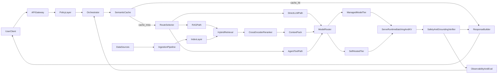

# Chapter 1: A Framework for LLM System Design Interviews

## Context

> [!info] Quick Reference
> - **Pattern:** Interview Framework
> - **Scale:** 1.5M DAU, 18M requests/day
> - **Key Techniques:** 5-step framework, back-of-envelope estimation, trade-off tables
> - **Primary Concerns:** Scope discipline, cost-latency-safety balance, rollback design
> - **Cross-references:** [[chapter-02|Chapter 2]] (pattern selection), [[chapter-03|Chapter 3]] (retrieval), [[chapter-05|Chapter 5]] (safety)

**Problem statement:** Build a repeatable framework for answering any LLM system design interview question with production-grade technical depth in 40-45 minutes.

### Real-World Examples

- A fintech team designs an internal LLM assistant and must justify why RAG is safer than fine-tuning for policy updates every week.
- A healthcare startup interview asks for a triage bot design where abstention and escalation logic matter more than fluent prose.

---

## Step 1: Understand the Problem and Establish Design Scope

### Simulated Dialogue

**Interviewer:** Design a framework for LLM system design interviews.  
**Candidate:** I will scope product goals, risk profile, and numeric constraints first, then map them to architecture and trade-offs.

**Candidate:** Should this framework optimize for startup speed, enterprise reliability, or both?  
**Interviewer:** Both. It must work for MVP and regulated enterprise contexts.

**Candidate:** What constraints must always be quantified?  
**Interviewer:** Latency, token cost, scale, safety, and rollback strategy.

### Functional Requirements

- Provide a reusable **5-step response structure** for any LLM system design prompt.
- Force explicit design choices for **retrieval**, **model routing**, and **safety controls**.
- Include concrete fallback paths for low-confidence, high-risk, and degraded-runtime states.
- Produce outputs that are implementable and measurable, not conceptual only.

### Non-Functional Requirements

- **Interview execution:** reach credible high-level design in <= 10 minutes.
- **Latency discipline:** include **TTFT** and **TPOT** budgets, not just total latency.
- **Cost visibility:** show token economics and serving cost envelope.
- **Scalability:** demonstrate burst handling and bottleneck containment.
- **Safety and compliance:** include guardrails, auditability, and deterministic escalation.

### Back-of-the-Envelope Estimation

Assume a representative production assistant:

- **DAU:** 1.5M
- **Requests/day:** 18M
- **Average input tokens:** 1,600
- **Average output tokens:** 280
- **RAG usage:** 65%
- **Peak multiplier:** 12x avg traffic

#### Throughput

- Average QPS: `18,000,000 / 86,400 ~= 208`
- Peak QPS: `~2,500`
- Target capacity planning: `3,000-3,500 QPS` (peak + failover margin)

#### Token Volume and API Cost

- Input tokens/day: `18M * 1,600 = 28.8B`
- Output tokens/day: `18M * 280 = 5.04B`
- Cost/day formula:
  - `daily_cost = (28,800 * input_price_per_1M) + (5,040 * output_price_per_1M)`

#### Latency Budget (Interactive Path)

- Gateway + auth: 80ms
- Retrieval + rerank: 250ms
- Scheduler/queue: 150ms
- **TTFT:** 900ms
- Decode (TPOT ~28 ms/token for first 120 tokens streamed): ~3.4s full body
- Post-check + formatting: 220ms
- **p95 end-to-end:** ~5.0s

#### Context and Vector Storage Sizing

- Corpus chunks: 300M
- Embedding dim: 1536, float32 (`~6KB/vector`)
- Raw vector footprint: `~1.8TB`
- + metadata/index overhead/replicas (x2.2 to x3): **4.0-5.5TB**

#### Self-hosted VRAM Planning (Order-of-Magnitude)

- Small inference tier (7B class, quantized): ~16-24GB VRAM/GPU
- Mid tier (13B-34B quantized/mixed): ~40-80GB VRAM/GPU
- Large tier (70B class): multi-GPU (>=160GB aggregate VRAM) with tensor parallelism

---

## Step 2: Propose High-Level Design and Get Buy-In

### Core Architecture Components

- **Client + Gateway:** auth, rate limits, tenant isolation, trace IDs.
- **Policy Layer:** prompt policy, data policy, risk class, output schema constraints.
- **Orchestrator:** route selection (`direct`, `RAG`, `tool`, `agentic`).
- **Retrieval Stack:** query rewrite, hybrid search, **cross-encoder reranking**.
- **Model Router:** selects provider/model tier by complexity, SLO, and cost budget.
- **Serving Runtime:** **continuous batching**, prefix/KV cache, streaming transport.
- **Cache Hierarchy:** retrieval cache, **semantic cache**, response cache.
- **Safety Stack:** input filter, runtime policy checks, output verifier.
- **Observability/Eval:** latency histograms (TTFT/TPOT), cost/query, quality and safety metrics.

### Pipeline A: Data Ingestion / Indexing Pipeline

1. Ingest source documents/events and normalize to canonical schema.
2. Parse layout-aware text (headers, tables, code blocks, entities).
3. Chunk using policy (fixed, semantic, or **parent-child chunking**).
4. Generate embeddings and index vectors + lexical terms + ACL metadata.
5. Run index QA (coverage, parser failure rate, duplicate chunks).
6. Promote index version via alias swap; keep rollback alias hot.

### Pipeline B: Inference / Query Pipeline

1. Receive request; apply auth, quota, and policy checks.
2. Classify intent/complexity and choose execution mode.
3. Retrieve/rerank context (if needed) with token budget packing.
4. Route to model tier and execute with streaming output.
5. Apply output guardrails and grounding verification.
6. Return response + citations + trace; emit telemetry to eval loop.

### Mermaid Architecture Diagram

---

## Step 3: Design Deep Dive

Focus areas for this chapter:

1. **Interview Scoping for LLM Systems**
2. **Cost-Latency-Quality-Safety Trade-off Engine**
3. **Production Failure Modes and Mitigations**

### 1) Interview Scoping for LLM Systems

A high-signal interview answer starts with 6 non-negotiable clarifications:

- **Risk class:** low-risk assistant vs regulated domain.
- **Grounding contract:** citation required, optional, or prohibited.
- **Freshness SLA:** static corpus, hourly, near-real-time.
- **Latency SLO:** TTFT and p95 completion targets.
- **Cost envelope:** max cost/query and monthly ceiling.
- **Fallback contract:** abstain, escalate, or degrade mode.

### 2) Cost-Latency-Quality-Safety Trade-off Engine

#### Retrieval Strategy

| Approach | Strengths | Weaknesses | Use When |
|---|---|---|---|
| Keyword (BM25) | Fast, exact token match | Misses semantic paraphrase | IDs, legal refs, code symbols |
| Dense Vector | Semantic recall | Can miss literals, ANN cost | Natural language queries |
| Hybrid + Rerank | Best precision/recall balance | More infra + tuning | Default enterprise baseline |

#### Chunking Strategy

| Approach | Strengths | Weaknesses | Use When |
|---|---|---|---|
| Fixed-size chunking | Simple, predictable | Semantic boundary loss | MVP, homogeneous docs |
| Semantic chunking | Better relevance | Variable chunk counts | Narrative or policy docs |
| Parent-child chunking | Good recall + precise grounding | More metadata complexity | Large docs, long-context QA |

#### Model Hosting Strategy

| Approach | Strengths | Weaknesses | Use When |
|---|---|---|---|
| Managed APIs | Fast launch, low ops burden | Rate limits, variable latency, recurring token cost | Early stage / bursty demand |
| Self-hosted | Lower unit cost at scale, full control | GPU ops complexity, OOM risk, on-call burden | Stable high-volume routes |
| Hybrid | Resilience + economics | Routing/policy complexity | Most mature production systems |

#### Caching Strategy

| Approach | Strengths | Weaknesses | Use When |
|---|---|---|---|
| No cache | Simpler correctness | High latency + cost | Early prototyping only |
| Semantic cache | Big latency/cost wins | Staleness and threshold tuning | FAQ-like repeated intents |
| KV/prefix cache | Major TTFT gains | VRAM pressure and eviction tuning | Repeated templates/session prompts |

### 3) Production Bottlenecks and Mitigations

- **Provider rate limiting**
  - Symptom: burst traffic returns 429/5xx; retry storms amplify load.
  - Mitigation: token bucket at gateway, jittered retries, provider failover routing.

- **GPU OOM during long prompts**
  - Symptom: inference crashes on long context or large batch.
  - Mitigation: max token guardrails, dynamic batch sizing, prompt truncation policy.

- **Queue saturation / head-of-line blocking**
  - Symptom: TTFT spikes despite high GPU utilization.
  - Mitigation: priority lanes, request class isolation, bounded queue + shed policy.

- **Stale embeddings / index drift**
  - Symptom: retrieval relevance degrades gradually.
  - Mitigation: embedding version tags, shadow re-index, alias swap rollback.

- **DB/metadata connection exhaustion**
  - Symptom: ACL and metadata lookup becomes p95 bottleneck.
  - Mitigation: read replicas, pooling limits, metadata caching with TTL.

- **Agentic hallucination loops**
  - Symptom: repeated tool calls with no convergence.
  - Mitigation: max step budgets, loop detection hash, hard stop + human handoff.

### Advanced Techniques to Explicitly Mention in Interviews

- **Continuous batching** for GPU throughput stability.
- **KV caching** for repeated prefixes/system prompts.
- **Semantic caching** with freshness-aware invalidation.
- **Cross-encoder reranking** for high-precision context selection.
- **Parent-child chunking** for large documents.
- **LoRA adapters** for domain specialization without full model fine-tuning.

### Applied Framework Insights

- Treat system design answers as **budget allocation** problems (token, latency, risk, cost).
- Every component must justify itself with a measurable metric.
- Always include rollback and degrade modes; production systems fail in partial ways, not binary ways.

---

## Step 4: Wrap Up

### Final Design Summary

A strong LLM interview design framework is a **deterministic decision graph**:

- quantify first,
- route by complexity/risk,
- optimize with caching/batching/reranking,
- and enforce safety + rollback as first-class design constraints.

### Wrap-Around Concerns

- **Release engineering:** canary + shadow traffic + rollback trigger.
- **Governance:** policy versioning and audit-complete traces.
- **Cost controls:** route-level token caps, cache hit-rate targets, and monthly budget alarms.
- **Drift controls:** retrieval quality and safety metrics tracked by model/index version.

---

## Step 5: Interviewer Curveballs

### Interviewer Follow-ups & Frequently Asked Questions (FAQ)

Q: Your p95 TTFT jumped from 900ms to 2.4s overnight; where do you look first?

**The Ideal Answer:** I check queue wait and cache hit-rate regressions first, then provider throttling and scheduler saturation.

**Deep Dive & Trade-offs:**
- Inspect queue depth, batch size, and route distribution.
- If semantic cache hit-rate fell, TTFT naturally rises due to more cold executions.
- Apply temporary mitigation: stricter token caps, route easy intents to faster model tier.

**The Interviewer's Rubric:** The interviewer is checking incident triage depth under LLM-specific latency constraints.

Q: How do you decide between managed and self-hosted serving for one route?

**The Ideal Answer:** I compare all-in unit cost and SLO risk at projected steady-state volume; if stable traffic and ops maturity exist, migrate that route to self-hosted.

**Deep Dive & Trade-offs:**
- Managed wins for launch speed and low ops overhead.
- Self-hosted wins when throughput is predictable and high enough to amortize GPUs.
- Hybrid routing keeps managed as burst/failover path.

**The Interviewer's Rubric:** The interviewer is checking economic reasoning beyond architecture buzzwords.

Q: What token budget policy would you enforce by default?

**The Ideal Answer:** Hard max input/output per route, with context packing quotas per section and mandatory truncation strategy.

**Deep Dive & Trade-offs:**
- Example route budget: 8k total tokens, 4k retrieval, 2k instructions, 2k response cap.
- Prevents OOM, tail latency blowups, and cost spikes.
- Pair with reranking to keep most relevant evidence.

**The Interviewer's Rubric:** The interviewer is checking whether you can operationalize context-window limits.

Q: How do you prevent stale vector index quality without constant full re-embedding?

**The Ideal Answer:** Incremental re-embedding for changed documents plus periodic sampled quality audits and shadow indexes.

**Deep Dive & Trade-offs:**
- Full re-embedding is expensive; incremental keeps freshness affordable.
- Shadow index + alias swap enables safe migration.
- Track Recall@K and citation precision per index version.

**The Interviewer's Rubric:** The interviewer is checking lifecycle management maturity.

Q: What breaks first at 10x traffic spikes?

**The Ideal Answer:** Queueing and upstream rate limits break first, then cache misses amplify model load.

**Deep Dive & Trade-offs:**
- Protect critical routes with reserved capacity.
- Introduce deterministic degrade modes (cache-only summaries or concise outputs).
- Never allow unbounded retries.

**The Interviewer's Rubric:** The interviewer is checking resilience design under burst load.

Q: How do you stop agent tool loops in production?

**The Ideal Answer:** Add max-step budgets, loop-signature detection, and a forced terminal action (abstain/escalate).

**Deep Dive & Trade-offs:**
- Track repeated tool calls with similar inputs.
- Enforce a strict step ceiling (e.g., 6-10) by task class.
- Escalate to human or deterministic fallback when exceeded.

**The Interviewer's Rubric:** The interviewer is checking control-plane safety for agentic systems.

Q: What minimum metric pack proves architecture health weekly?

**The Ideal Answer:** TTFT p95, TPOT p95, cost/query, retrieval Recall@K, citation precision, policy violation rate.

**Deep Dive & Trade-offs:**
- Latency without quality is misleading.
- Quality without cost is unsustainable.
- Safety without acceptance can over-block users.

**The Interviewer's Rubric:** The interviewer is checking multidimensional operating discipline.

Q: Why include LoRA adapters in a system design interview at all?

**The Ideal Answer:** They provide domain adaptation at far lower training/serving cost than full fine-tuning, with faster iteration.

**Deep Dive & Trade-offs:**
- Adapter routing introduces lifecycle and compatibility complexity.
- Good for domain-specific style/format control.
- Keep rollback to base model path for safety.

**The Interviewer's Rubric:** The interviewer is checking whether you know practical adaptation techniques beyond prompt-only approaches.

## End of Chapter

- **Key takeaway:** The strongest interview answers tie architecture choices to measurable SLOs, cost budgets, and safety outcomes.
- **What to practice:** Be able to defend one default design and one fallback design with clear trade-offs.
- **Interview drill:** Explain how you would detect regressions, roll back safely, and communicate risk to stakeholders.
