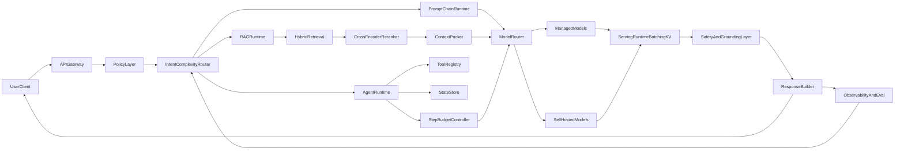

# Chapter 2: The LLM Stack and Core Patterns

## Context

> [!info] Quick Reference
> - **Pattern:** Multi-pattern platform (prompt chain + RAG + agentic)
> - **Scale:** 16M requests/day, pattern split 50/35/15%
> - **Key Techniques:** Intent routing, model tiering, continuous batching, semantic caching
> - **Primary Concerns:** Pattern selection, managed vs self-hosted, router drift
> - **Cross-references:** [[chapter-01|Chapter 1]] (framework), [[chapter-03|Chapter 3]] (retrieval), [[chapter-04|Chapter 4]] (serving)

**Problem statement:** Design a production LLM stack and decision framework for choosing between **prompt chaining**, **RAG**, and **agentic orchestration** under strict latency, cost, and safety constraints.

### Real-World Examples

- A SaaS company routes invoice classification to a small model, customer policy Q&A to RAG, and dispute-resolution workflows to an agentic path.
- An enterprise migration uses managed APIs for launch, then moves stable high-volume routes to self-hosted GPUs for unit-cost reduction.

---

## Step 1: Understand the Problem and Establish Design Scope

### Simulated Dialogue

**Interviewer:** Design the LLM stack for a multi-product AI platform.  
**Candidate:** I will first quantify traffic, latency budgets, and risk classes, then define pattern routing and serving architecture.

**Candidate:** Do all use cases require retrieval and tool use?  
**Interviewer:** No. Some are deterministic form-like tasks; others require fresh enterprise knowledge or multi-step tool workflows.

**Candidate:** Is this managed-API-first or self-hosted-first?  
**Interviewer:** Managed first, but it must support migration to self-hosted tiers when volume grows.

**Candidate:** What hard constraints are non-negotiable?  
**Interviewer:** p95 latency targets, budget controls, policy compliance, and auditable behavior.

### Functional Requirements

- Support three execution patterns in one platform:
  - **Prompt chaining** for deterministic workflows,
  - **RAG** for grounded, citation-backed answers,
  - **Agentic flows** for tool-heavy, multi-step tasks.
- Route requests dynamically across model tiers and providers.
- Enforce policy checks and deterministic fallback behavior.
- Provide traceable outputs with quality and cost telemetry.

### Non-Functional Requirements

- **Latency:** route-specific targets (TTFT, TPOT, end-to-end p95).
- **Scale:** absorb burst traffic (>=10x average) without cascading failures.
- **Cost:** per-route token budgets and monthly envelope controls.
- **Reliability:** graceful degradation under provider failures and rate limits.
- **Security/compliance:** tenant isolation, audit logging, and output policy enforcement.

### Back-of-the-Envelope Estimation (Platform Mix)

Assume:

- **Requests/day:** 16M
- Pattern split:
  - Prompt chain: 50%
  - RAG: 35%
  - Agentic: 15%
- Per-request token profile:
  - Prompt chain: 700 input / 140 output
  - RAG: 2,200 input / 280 output
  - Agentic: 4,800 input / 500 output

#### Throughput

- Average QPS: `16,000,000 / 86,400 ~= 185`
- Peak QPS (12x burst): `~2,220`
- Capacity target with failover margin: `~2,800 QPS`

#### Token Volume

- Prompt input: `8M * 700 = 5.6B`
- RAG input: `5.6M * 2200 = 12.32B`
- Agentic input: `2.4M * 4800 = 11.52B`
- **Total input/day:** `~29.44B`

- Prompt output: `8M * 140 = 1.12B`
- RAG output: `5.6M * 280 = 1.568B`
- Agentic output: `2.4M * 500 = 1.2B`
- **Total output/day:** `~3.888B`

#### Latency Envelope by Pattern

- Prompt chain: TTFT 400-800ms, p95 full response 1.5-2.5s
- RAG: TTFT 700-1200ms, p95 full response 3-5s
- Agentic: TTFT 900-1500ms, p95 full response 6-12s (bounded by tool fan-out)

#### Cost Formula

- `daily_cost = (input_tokens/1M * input_price) + (output_tokens/1M * output_price)`
- Key implication: agentic path is lower volume but high cost/query due to multi-step calls and larger outputs.

#### VRAM Planning for Model Tiers (Order-of-Magnitude)

- Fast route tier (7B quantized): ~16-24GB VRAM
- Balanced route tier (13B-34B): ~40-80GB VRAM
- Complex route tier (70B): >=160GB aggregate VRAM with multi-GPU parallelism

---

## Step 2: Propose High-Level Design and Get Buy-In

### Core Architecture Components

- **API Gateway + Policy Layer:** auth, quotas, tenant policy, request classification.
- **Intent and Complexity Router:** select prompt chain vs RAG vs agentic path.
- **Prompt Runtime:** template/version registry, schema-constrained outputs.
- **Retrieval Runtime:** hybrid retrieval + **cross-encoder reranking** + context packing.
- **Agent Runtime:** planner/executor loop, tool registry, state store, step budgets.
- **Model Router:** provider + model-tier selection using SLO/cost/risk policy.
- **Serving Runtime:** streaming, **continuous batching**, prefix/KV cache.
- **Safety Runtime:** input policy checks, runtime controls, output verification.
- **Observability + Eval:** TTFT/TPOT histograms, route cost/query, quality and safety drift.

### Pipeline A: Stack Preparation / Data and Runtime Setup

1. Register prompts, schemas, tool contracts, and policy rules.
2. Build retrieval assets (indexes, embeddings, metadata filters).
3. Configure model catalog by route tier (fast/balanced/complex).
4. Set route-level token and latency budgets with fallback chains.
5. Publish runtime config via versioned release and rollback handles.

### Pipeline B: Runtime Query Execution

1. Validate request, apply auth and policy constraints.
2. Classify intent and complexity score.
3. Route to prompt-chain, RAG, or agentic execution graph.
4. Execute with bounded token/time budgets and streaming enabled.
5. Apply safety and grounding validators.
6. Return response + trace metadata; feed telemetry into evaluation loop.

### Mermaid Architecture Diagram

---

## Step 3: Design Deep Dive

Focus areas for this chapter:

1. **Pattern Selection: RAG vs Agent**
2. **Prompt Chaining Design**
3. **Model Routing and Tiering**

### 1) Pattern Selection: Prompt Chaining vs RAG vs Agentic

| Pattern | Strengths | Failure Modes | Best Fit |
|---|---|---|---|
| Prompt Chaining | Low latency/cost, deterministic control | brittle if knowledge is external/fresh | forms, transformations, structured workflows |
| RAG | Grounded answers, fresh knowledge | retrieval misses, stale index drift | enterprise QA, policy assistant, search copilots |
| Agentic | strong for multi-step/tool tasks | loop risk, high tail latency, high cost/query | research agents, workflow automation |

**Decision Rule:**
- Start with prompt chaining.
- Add RAG if external knowledge freshness/citations are required.
- Escalate to agentic only if multi-hop/tool orchestration is unavoidable.

### 2) Prompt Chaining Design

High-quality chaining requires control-plane rigor:

- Step-level contracts: each step has strict input/output schema.
- Chain-level guards: max step count, max token budget, timeout budget.
- Validation hooks: cheap deterministic validators between steps.
- Model specialization: use smaller tiers for classify/rewrite; larger tier for synthesis only when needed.

**Why this matters:**
- One giant prompt often inflates context and TTFT.
- Multi-step chains can reduce total cost if most steps run on cheap tiers.

### 3) Model Routing and Tiering

| Routing Strategy | Pros | Cons | Recommended Use |
|---|---|---|---|
| Static route map | simple and predictable | poor adaptation to drift | early MVP |
| Rule-based dynamic routing | transparent, debuggable | manual tuning burden | most production systems |
| Learned router model | adaptive and potentially optimal | harder explainability and governance | very mature orgs with robust eval infra |

Suggested route policy signals:

- Intent class and complexity score,
- Required grounding strictness,
- Current provider health/rate-limit status,
- Cost budget remaining for route/time window.

### Additional Trade-offs

#### Managed vs Self-hosted Serving

| Approach | Strengths | Weaknesses |
|---|---|---|
| Managed API | fast onboarding, minimal ops | recurring high cost, rate-limit volatility |
| Self-hosted | better unit economics at scale, more control | infra complexity, GPU OOM and maintenance burden |
| Hybrid | resilience + economics | policy/routing complexity |

#### Cache Strategy

| Cache | Strengths | Weaknesses | Use Case |
|---|---|---|---|
| No cache | correctness simplicity | highest latency/cost | prototyping only |
| Semantic cache | major wins on repeated intents | stale/near-match risk | support/FAQ-like patterns |
| KV/prefix cache | TTFT reduction for repeated prefixes | VRAM pressure and eviction complexity | templated prompts, multi-turn sessions |

### Production Bottlenecks and What Breaks First

- **Provider rate limiting:** burst traffic causes 429/5xx and retry storms.
  - Mitigation: gateway token buckets, circuit breakers, jittered backoff.

- **Router misclassification drift:** too many hard requests routed to cheap tier or vice versa.
  - Mitigation: weekly router eval, route confusion matrix, rollback policy.

- **Database/metadata connection exhaustion:** ACL/policy lookups become p95 bottleneck.
  - Mitigation: connection pooling caps, read replicas, TTL metadata cache.

- **Stale vector embeddings/index skew:** RAG quality drops without obvious errors.
  - Mitigation: embedding versioning, shadow index tests, alias swap rollbacks.

- **Agentic hallucination loops:** repeated tool calls with no convergence.
  - Mitigation: max steps, loop signature detection, deterministic exit/escalation.

- **GPU OOM in self-hosted tiers:** long prompts + high batch pressure crash workers.
  - Mitigation: strict token caps, dynamic batch shrink, route downgrade under pressure.

### Advanced Techniques to Name and Use Correctly

- **Continuous batching** for throughput and queue stability.
- **KV caching** to reduce TTFT on repeated prefixes.
- **Semantic caching** with freshness- and policy-aware invalidation.
- **Cross-encoder reranking** for precision in RAG route.
- **Parent-child chunking** where large documents need both recall and precise citation.
- **LoRA adapters** for domain adaptation without full fine-tune overhead.

### Applied Stack Insights

- Treat execution patterns as economic and reliability decisions, not just model choices.
- Route-specific budgets outperform one-size-fits-all architecture.
- Every optimization must be measured against quality and safety regressions.

---

## Step 4: Wrap Up

### Final Design Summary

The LLM stack should run as a **policy-driven execution platform**:

- classify and route by complexity/risk,
- use the cheapest path that meets quality and safety,
- and maintain strict controls for latency, cost, and fallback behavior.

### Wrap-Around Concerns

- **Routing drift:** periodic recalibration and rollback guardrails.
- **Provider concentration risk:** maintain active failover and diversification.
- **Prompt/runtime governance:** version everything and gate releases on eval.
- **Operational debt:** unmanaged tool growth and chain complexity increase failure rates.

---

## Step 5: Interviewer Curveballs

### Interviewer Follow-ups & Frequently Asked Questions (FAQ)

Q: If you can keep only two patterns in v1, which ones and why?

**The Ideal Answer:** I keep prompt chaining + RAG; they cover deterministic flows and grounded knowledge with lower latency/cost than agentic orchestration.

**Deep Dive & Trade-offs:**
- Prompt chains give control and predictable cost.
- RAG handles freshness and citation requirements.
- Agentic path is added only after measured failure patterns justify complexity.

**The Interviewer's Rubric:** The interviewer is checking prioritization and scope discipline.

Q: What hard threshold would trigger moving a route from managed API to self-hosted?

**The Ideal Answer:** When route-level unit economics plus SLO variance consistently beat managed APIs for 4-8 weeks and ops readiness exists.

**Deep Dive & Trade-offs:**
- Include infra, on-call, and incident costs in TCO.
- Keep managed as failover even after migration.
- Require rollback in < 10 minutes.

**The Interviewer's Rubric:** The interviewer is checking practical migration judgment.

Q: How do you detect that your router is harming quality?

**The Ideal Answer:** Track route confusion, quality pass-rate by routed tier, and false downgrade/false escalation rates.

**Deep Dive & Trade-offs:**
- Offline oracle labels + online A/B are both required.
- Cheap-tier overuse often appears as rising unsupported-claim rate.
- Route audits should be versioned and reversible.

**The Interviewer's Rubric:** The interviewer is checking if router quality is treated as a first-class concern.

Q: What is the most common hidden bottleneck in this stack?

**The Ideal Answer:** Metadata and policy lookups; they can dominate p95 latency even when model serving looks healthy.

**Deep Dive & Trade-offs:**
- Router often depends on policy and ACL metadata.
- Connection pool exhaustion can spike TTFT globally.
- Add read replicas and short-lived cache with strict invalidation.

**The Interviewer's Rubric:** The interviewer is testing system-level bottleneck diagnosis.

Q: How do you keep agentic workflows from becoming unbounded cost sinks?

**The Ideal Answer:** Enforce per-request step and token budgets, then force terminal action (abstain/escalate) on budget breach.

**Deep Dive & Trade-offs:**
- Budget-aware planner reduces runaway loops.
- Track cost per successful task, not just per request.
- Prefer deterministic subroutines for repetitive tool actions.

**The Interviewer's Rubric:** The interviewer is checking control-plane cost governance.

Q: When does semantic cache become dangerous?

**The Ideal Answer:** When similarity thresholds are too loose or freshness windows are too long for fast-changing data.

**Deep Dive & Trade-offs:**
- Loose matching returns plausible but stale outputs.
- Use intent-specific thresholds and source-version invalidation.
- High-risk intents should bypass cache unless strict checks pass.

**The Interviewer's Rubric:** The interviewer is checking safe cache policy design.

Q: How do you decide reranker depth in RAG path?

**The Ideal Answer:** I optimize reranker candidate size by balancing retrieval recall gain vs added latency; usually 20-80 candidates depending on corpus.

**Deep Dive & Trade-offs:**
- Too small: misses critical evidence.
- Too large: TTFT inflation and cost increase.
- Tune by query class and monitor citation precision uplift.

**The Interviewer's Rubric:** The interviewer is checking practical retrieval optimization.

Q: What minimum weekly KPI pack proves this stack is healthy?

**The Ideal Answer:** TTFT p95, TPOT p95, cost/query, route distribution, retrieval Recall@K, citation precision, safety violation rate.

**Deep Dive & Trade-offs:**
- Latency-only dashboards miss quality drift.
- Quality-only dashboards ignore economic instability.
- Route-distribution drift often precedes incident spikes.

**The Interviewer's Rubric:** The interviewer is checking multidimensional operational maturity.

## End of Chapter

- **Key takeaway:** Master the four core LLM patterns (direct, RAG, tool-use, agentic) and know when each is the right default. Pattern selection drives every downstream decision.
- **What to practice:** Given a new product brief, classify it into a pattern within 60 seconds and justify why the alternatives are worse.
- **Interview drill:** Sketch a hybrid system that uses two patterns (e.g., RAG + tool-use) and explain the routing logic, failure modes, and cost implications.
