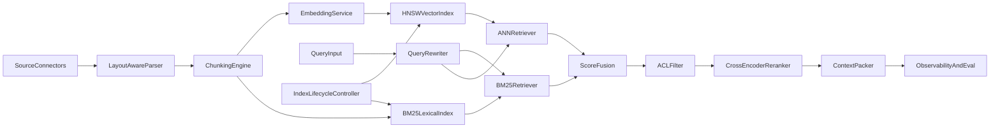

# Chapter 3: Data Pipelines and Vector Infrastructure

## Context

> [!info] Quick Reference
> - **Pattern:** Ingestion pipeline + hybrid retrieval
> - **Scale:** 5M documents, 300M+ chunks, 500 QPS retrieval
> - **Key Techniques:** Parent-child chunking, BM25 + dense hybrid, cross-encoder reranking, blue-green index swap
> - **Primary Concerns:** Recall@K targets, embedding freshness, ACL enforcement, index lifecycle
> - **Cross-references:** [[chapter-02|Chapter 2]] (RAG pattern), [[chapter-05|Chapter 5]] (eval), [[chapter-07|Chapter 7]] (enterprise search case study)

**Problem statement:** Design scalable ingestion, embedding, indexing, and hybrid retrieval infrastructure that preserves relevance under fast-changing enterprise corpora.

### Real-World Examples

- A global knowledge base with PDFs, wikis, and tickets sees recall drop after parser upgrades; chunking and index lifecycle become the real bottleneck.
- A legal search product improves citation accuracy by moving from fixed chunks to parent-child chunking plus cross-encoder reranking.

---

## Step 1: Understand the Problem and Establish Design Scope

### Simulated Dialogue

**Interviewer:** Design the data pipeline and vector infrastructure for an enterprise knowledge platform.  
**Candidate:** I need to understand the corpus profile, freshness requirements, and retrieval quality bar first.

**Candidate:** What document types and volume are we handling?  
**Interviewer:** 5M documents: PDFs, HTML, Markdown, Confluence pages, Jira tickets. Growing at 50K docs/week.

**Candidate:** How fresh must retrieval results be?  
**Interviewer:** New/updated docs must be searchable within 30 minutes. Some sources are near-real-time (tickets).

**Candidate:** What is the retrieval quality contract?  
**Interviewer:** Recall@10 >= 0.85 on benchmark queries, with citation precision >= 0.90.

### Functional Requirements

- Ingest documents from heterogeneous sources (PDF, HTML, Markdown, structured DB exports).
- Parse layout-aware content preserving tables, headers, code blocks, and section hierarchy.
- Chunk documents with configurable strategies (fixed, semantic, parent-child).
- Generate embeddings and maintain both vector and lexical indexes.
- Support hybrid retrieval (BM25 + dense vector) with cross-encoder reranking.
- Enforce document-level ACLs at retrieval time.

### Non-Functional Requirements

- **Freshness:** incremental indexing within 30 minutes of source update.
- **Scale:** 300M+ chunks indexed, 500+ retrieval QPS at p95 < 120ms.
- **Consistency:** zero-downtime index updates via alias swaps.
- **Cost:** embedding cost bounded to < $800/day at steady state.
- **Durability:** index rollback within 5 minutes on quality regression.

### Back-of-the-Envelope Estimation

#### Corpus Sizing

- Documents: 5M, average 8 pages, ~2,400 tokens/page
- Total tokens: `5M * 8 * 2,400 = 96B tokens`
- Chunks (avg 512 tokens, 50% overlap): `~375M chunks`

#### Embedding Compute

- Model: `text-embedding-3-small` (1536-dim, $0.02/1M tokens)
- Full re-embed cost: `96B tokens * $0.02/1M = ~$1,920` (one-time)
- Incremental daily: `50K docs/week ≈ 7,200 docs/day * 8 pages * 2,400 tokens = 138M tokens/day`
- Incremental cost: `~$2.76/day`

#### Vector Storage

- 375M vectors at 1536-dim, float32: `375M * 6KB = ~2.25TB raw`
- With HNSW index overhead + metadata + replicas (x2.5): **~5.6TB**
- HNSW memory for search: ~60-80GB RAM per shard (serving-layer requirement)

#### Retrieval Throughput

- Target: 500 QPS hybrid retrieval
- Per-query: BM25 lookup (~15ms) + ANN search (~25ms) + reranker on top-50 (~60ms) + ACL filter (~10ms)
- p95 target: **< 120ms** end-to-end retrieval

#### Ingestion Throughput

- Daily new chunks: `~57,600 chunks/day` (incremental)
- Full re-index (375M chunks at 500 chunks/sec): **~8.7 days** → requires parallelized pipeline

---

## Step 2: Propose High-Level Design and Get Buy-In

### Core Architecture Components

- **Source Connectors:** CDC listeners, scheduled crawlers, webhook receivers per source type.
- **Parser Layer:** layout-aware extraction (tables, headers, code) with format-specific parsers.
- **Chunking Engine:** configurable strategy selector (fixed, semantic, parent-child) with metadata tagging.
- **Embedding Service:** batched embedding generation with rate limiting and retry logic.
- **Index Manager:** dual-write to vector index (HNSW) and lexical index (BM25/Elasticsearch).
- **Retrieval Service:** hybrid search orchestrator with ACL filtering and cross-encoder reranker.
- **Index Lifecycle Controller:** versioned indexes, alias swap, rollback, and quality gates.
- **Observability:** parser success rate, embedding latency, index freshness lag, retrieval recall/MRR.

### Pipeline A: Document Ingestion Pipeline

1. Source connector detects new/updated documents via CDC or scheduled crawl.
2. Parser extracts text with layout preservation; routes failures to dead-letter queue.
3. Chunking engine applies configured strategy; tags each chunk with doc_id, section, position, ACL.
4. Embedding service generates vectors in batches (rate-limited to stay within cost envelope).
5. Index writer dual-writes vectors to HNSW index and text to BM25 index.
6. Quality gate samples random chunks and validates embedding coherence and parse fidelity.
7. Index lifecycle controller promotes new version via alias swap once quality gate passes.

### Pipeline B: Hybrid Retrieval Pipeline

1. Query arrives; ACL context resolved from auth token.
2. Query rewriter expands/reformulates query for both lexical and semantic channels.
3. BM25 retriever returns top-100 lexical matches; ANN retriever returns top-100 dense matches.
4. Score fusion (reciprocal rank fusion or weighted combination) produces merged top-100 candidate set.
5. ACL filter removes unauthorized chunks.
6. Cross-encoder reranker scores top-50 candidates; returns top-K (typically 5-10) with scores.
7. Context packer assembles chunks within token budget; returns with chunk metadata and citations.

### Mermaid Architecture Diagram

---

## Step 3: Design Deep Dive

Focus areas for this chapter:

1. **Chunking Strategies**
2. **Hybrid Retrieval Architecture**
3. **Vector Index Lifecycle Management**

### 1) Chunking Strategies

Chunking determines retrieval granularity and directly impacts recall, precision, and cost.

#### Chunking Trade-off Table

| Approach | Strengths | Weaknesses | Best For |
|---|---|---|---|
| Fixed-size (512 tokens, 50% overlap) | Predictable count, simple | Splits mid-sentence/table | Homogeneous text, MVP |
| Semantic (sentence/paragraph boundary) | Preserves meaning units | Variable sizes, harder to budget tokens | Narrative docs, policies |
| Parent-child | High recall (parent) + precise grounding (child) | 2x storage, complex metadata | Long docs, legal, technical manuals |
| AST/symbol-aware | Preserves code structure | Language-specific parsers | Code repositories |

**Parent-child chunking in detail:**
- **Parent chunk:** 1,500-2,000 tokens covering a full section or subsection.
- **Child chunk:** 256-512 tokens, each linked to parent via `parent_id`.
- **Retrieval:** search child chunks for precision; expand to parent for full context assembly.
- **Storage overhead:** ~1.8x compared to flat chunking.
- **When to use:** any corpus where answer evidence spans multiple paragraphs but retrieval must be precise.

#### Parsing Failures and Mitigations

- PDFs with scanned images: route through OCR (Tesseract/DocTR) before chunking.
- Complex tables: extract as structured markdown; embed table + caption as one chunk.
- Code blocks: preserve language tags and indentation; do not split across function boundaries.
- Dead-letter queue for unparseable documents with alerting on failure rate > 2%.

### 2) Hybrid Retrieval Architecture

#### Retrieval Strategy Trade-off Table

| Approach | Recall@10 | p95 Latency | Infra Cost | Best For |
|---|---|---|---|---|
| BM25 only | 0.55-0.65 | ~15ms | Low | Exact-match, IDs, legal refs |
| Dense vector only | 0.70-0.80 | ~25ms | Medium (HNSW RAM) | Semantic paraphrase queries |
| Hybrid (BM25 + dense) | 0.80-0.88 | ~40ms | Medium-High | General-purpose enterprise |
| Hybrid + cross-encoder reranker | 0.85-0.92 | ~100ms | High | High-precision RAG |

**Score fusion methods:**
- **Reciprocal Rank Fusion (RRF):** `score = sum(1 / (k + rank_i))`. Simple, robust, no tuning needed. Default recommendation.
- **Weighted linear combination:** `score = alpha * bm25_norm + (1-alpha) * dense_norm`. Requires tuning alpha per corpus. Use when one channel dominates.

**Cross-encoder reranking:**
- Reranker takes `(query, chunk)` pairs and produces relevance scores.
- Typical model: ~110M params, ~1.2ms/pair on GPU.
- Reranking top-50 candidates: `~60ms` on dedicated GPU.
- Quality lift: +5-12% Recall@5 over fusion alone.
- **Throughput bottleneck:** at 500 QPS, reranking requires dedicated GPU pool (~4-8 GPUs for reranker alone).

**ACL-aware retrieval:**
- Pre-filter approach: inject ACL predicates into index query. Faster but requires ACL-indexed metadata.
- Post-filter approach: retrieve broadly, then filter. Simpler but wastes retrieval budget on unauthorized chunks.
- **Recommended:** pre-filter for low-cardinality ACLs (< 1K groups); post-filter + over-retrieve for high-cardinality.

### 3) Vector Index Lifecycle Management

#### Index Lifecycle Trade-off Table

| Strategy | Update Latency | Risk | Rollback Speed | Best For |
|---|---|---|---|---|
| In-place upsert | Seconds | Corruption risk, no rollback | None | Dev/testing only |
| Blue-green alias swap | Minutes | Safe, but 2x storage during swap | Instant (re-point alias) | Production default |
| Shadow index + canary eval | Hours | Safest; validates before exposure | Instant | High-stakes corpora |

**Blue-green index lifecycle:**
1. Build new index version in background with updated embeddings/chunks.
2. Run automated quality gate: sample 200 benchmark queries, measure Recall@10, MRR, citation precision.
3. If quality gate passes (no regression > 2% on any metric), swap alias to new index.
4. Keep old index hot for 24h as rollback target.
5. If quality regresses post-swap, revert alias within 5 minutes.

**Embedding version management:**
- Tag every chunk with `embedding_model_version` and `index_version`.
- Never mix embeddings from different model versions in one index (cosine distances are incomparable).
- On model upgrade: full re-embed into shadow index → canary eval → alias swap.

**Index freshness monitoring:**
- Track `source_updated_at` vs `indexed_at` per document.
- Alert if p95 freshness lag exceeds SLA (30 minutes).
- Dashboard: freshness histogram, parse failure rate, embedding queue depth.

### Production Bottlenecks and Mitigations

- **Embedding queue backlog**
  - Symptom: freshness SLA violation; documents stuck in queue.
  - Mitigation: horizontal scaling of embedding workers, priority queue for high-value sources, batch size tuning.

- **ANN recall degradation at high compression**
  - Symptom: Recall@10 drops below 0.80 as index grows.
  - Mitigation: tune HNSW `ef_construction` and `M` parameters; consider IVF-PQ only for cost-constrained scenarios.

- **Metadata DB saturation from ACL filter queries**
  - Symptom: retrieval p95 spikes from metadata lookups.
  - Mitigation: read replicas, connection pooling, cache hot ACL groups with short TTL (60s).

- **Parser failures on edge-case documents**
  - Symptom: dead-letter queue grows; coverage gaps in index.
  - Mitigation: fallback to raw text extraction, alerting on failure rate, periodic manual review.

- **Stale embeddings after schema/content drift**
  - Symptom: retrieval quality degrades silently over weeks.
  - Mitigation: scheduled quality audits (weekly Recall@K sampling), triggered re-embedding on schema changes.

### Advanced Techniques

- **Parent-child chunking** for large document retrieval with precise grounding.
- **Cross-encoder reranking** as quality amplifier after hybrid fusion.
- **Semantic caching** for repeated retrieval patterns (hash query embedding, cache top-K results with TTL).
- **Matryoshka embeddings** for variable-precision search (coarse fast pass, fine rerank).
- **Incremental HNSW** for near-real-time index updates without full rebuild.

---

## Step 4: Wrap Up

### Final Design Summary

The design treats retrieval correctness as a systems problem: robust parsing, configurable chunking, hybrid retrieval with reranking, and versioned index lifecycle controls with automated quality gates.

### Wrap-Around Concerns

- **Release engineering:** blue-green index swap with automated quality gates and instant rollback.
- **Governance:** embedding model version tracking, ACL audit logs, chunk provenance metadata.
- **Cost controls:** embedding cost caps per day, HNSW shard budgets, reranker GPU allocation limits.
- **Drift controls:** weekly Recall@K sampling, freshness lag monitoring, parser failure rate alerting.

---

## Step 5: Interviewer Curveballs

### Interviewer Follow-ups & Frequently Asked Questions (FAQ)

Q: Your Recall@10 dropped from 0.87 to 0.72 after a parser upgrade. How do you debug?

**The Ideal Answer:** I compare chunk distributions before and after the parser change, check for truncation or boundary shifts, and run A/B retrieval on benchmark queries against old vs new index.

**Deep Dive & Trade-offs:**
- Parser changes can shift chunk boundaries, altering which evidence lands in which chunk.
- Shadow index with old parser provides safe comparison baseline.
- Fix: rollback alias to old index, fix parser, rebuild, re-validate.

**The Interviewer's Rubric:** Checking whether you treat retrieval quality as a testable, rollbackable property.

Q: How do you handle a 50M-document corpus where full re-embedding takes 10 days?

**The Ideal Answer:** Parallelize embedding across a worker pool, use incremental re-embedding for changed docs only, and schedule full re-embeds during low-traffic windows.

**Deep Dive & Trade-offs:**
- At 500 chunks/sec, 375M chunks takes ~8.7 days single-threaded.
- 10 workers: ~21 hours. 50 workers: ~4.2 hours. Cost scales linearly.
- Incremental: only re-embed changed documents (typically < 1% of corpus daily).

**The Interviewer's Rubric:** Checking whether you can reason about embedding compute at production scale.

Q: When would you choose post-filter ACLs over pre-filter?

**The Ideal Answer:** Post-filter when ACL cardinality is high (thousands of distinct groups) and pre-filter index metadata would bloat beyond acceptable limits.

**Deep Dive & Trade-offs:**
- Pre-filter: faster retrieval but requires ACL metadata in vector index (storage + indexing overhead).
- Post-filter: simpler index but wastes retrieval budget on unauthorized chunks; must over-retrieve to hit target K.
- Hybrid: pre-filter on coarse groups, post-filter on fine-grained permissions.

**The Interviewer's Rubric:** Checking ACL-aware retrieval design maturity.

Q: How do you keep retrieval quality stable when the embedding model is upgraded?

**The Ideal Answer:** Never mix embedding versions in one index. Build shadow index with new model, run canary evaluation, and alias-swap only if quality improves.

**Deep Dive & Trade-offs:**
- Cosine distances are incomparable across different embedding models.
- Shadow index requires 2x storage temporarily during migration.
- Canary eval on 200+ benchmark queries with Recall@K and MRR gates.

**The Interviewer's Rubric:** Checking embedding lifecycle management sophistication.

Q: What is the cost-optimal reranker deployment at 500 QPS?

**The Ideal Answer:** Dedicated GPU pool sized for reranker throughput. At ~1.2ms/pair and top-50 reranking, each request takes ~60ms. Need ~30 concurrent slots → 4-8 GPUs depending on batch efficiency.

**Deep Dive & Trade-offs:**
- CPU reranking is 10-20x slower; not viable at 500 QPS.
- Batch reranking across concurrent requests improves GPU utilization.
- Fallback: skip reranker under extreme load, accept quality degradation.

**The Interviewer's Rubric:** Checking whether you can size reranker infrastructure with real math.

Q: How do you detect stale embeddings before users notice quality degradation?

**The Ideal Answer:** Weekly automated quality audit: run benchmark queries against live index, compare Recall@K and MRR to baseline. Alert on any regression > 2%.

**Deep Dive & Trade-offs:**
- Synthetic benchmarks miss real query distribution drift.
- Supplement with sampled production queries (anonymized) for ongoing relevance checks.
- Track `embedding_age` histogram; flag indexes where > 20% of chunks are older than 30 days.

**The Interviewer's Rubric:** Checking proactive quality monitoring beyond reactive incident response.

Q: What is the single most impactful improvement you would add to a BM25-only retrieval system?

**The Ideal Answer:** Add dense vector retrieval with hybrid fusion. Expected lift: +15-25% Recall@10 on semantic/paraphrase queries.

**Deep Dive & Trade-offs:**
- BM25 misses semantic paraphrases entirely.
- Hybrid fusion (RRF) is simple to implement and robust without tuning.
- Cross-encoder reranker adds another +5-12% but at higher latency cost.

**The Interviewer's Rubric:** Checking prioritization judgment for retrieval improvements.

Q: How do you size HNSW parameters for a 375M-vector index?

**The Ideal Answer:** `M=16, ef_construction=200` as starting point. Tune `ef_search` at query time to balance recall vs latency. Monitor Recall@10 on held-out benchmark.

**Deep Dive & Trade-offs:**
- Higher `M`: better recall, more memory (~2x at M=32 vs M=16).
- Higher `ef_construction`: better graph quality, slower build time.
- `ef_search` is the runtime knob: higher = better recall, more latency.
- At 375M vectors, expect ~5.6TB storage and ~60-80GB RAM per shard for serving.

**The Interviewer's Rubric:** Checking hands-on familiarity with ANN index tuning.

## End of Chapter

- **Key takeaway:** Retrieval quality is a pipeline problem, not just a model problem. Parser fidelity, chunking strategy, hybrid fusion, and index lifecycle controls all compound.
- **What to practice:** Walk through a full ingestion pipeline from raw document to indexed chunk, explaining each decision with trade-offs.
- **Interview drill:** Given a Recall@10 regression, explain your debug workflow from symptom to root cause to rollback.
