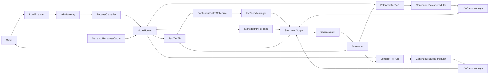

# Chapter 4: Serving, Scaling, and Optimizing LLMs

## Context

> [!info] Quick Reference
> - **Pattern:** Multi-tier LLM serving with optimization stack
> - **Scale:** 20M requests/day, 7B/34B/70B model tiers
> - **Key Techniques:** Continuous batching, speculative decoding, KV/prefix caching, quantization (INT4/INT8)
> - **Primary Concerns:** TTFT/TPOT budgets, GPU OOM, autoscaling, tail latency
> - **Cross-references:** [[chapter-02|Chapter 2]] (model routing), [[chapter-08|Chapter 8]] (coding assistant serving), [[chapter-18|Chapter 18]] (voice agent latency)

**Problem statement:** Engineer low-latency, high-throughput LLM serving with predictable TTFT/TPOT, bounded cost/query, and graceful degradation under traffic spikes.

### Real-World Examples

- A coding assistant launch hits 12x expected traffic; continuous batching and KV caching reduce TTFT from 2.1s to 900ms without additional GPUs.
- A support assistant outage reveals retry storms from provider 429s; queue isolation and deterministic degrade modes restore stability within minutes.

---

## Step 1: Understand the Problem and Establish Design Scope

### Simulated Dialogue

**Interviewer:** Design the serving and scaling infrastructure for a multi-tenant LLM platform.  
**Candidate:** I need to understand the traffic shape, latency SLOs, model mix, and cost targets before proposing architecture.

**Candidate:** What is the request profile?  
**Interviewer:** 20M requests/day, mix of short completions (avg 200 output tokens) and long generations (avg 800 output tokens). Peak is 15x average.

**Candidate:** What latency SLOs must we hit?  
**Interviewer:** Interactive routes: TTFT < 800ms, TPOT < 40ms. Batch routes: p95 completion < 30s.

**Candidate:** What is the model landscape?  
**Interviewer:** Three tiers: 7B quantized (fast), 34B (balanced), 70B (complex). Plus managed API fallback.

### Functional Requirements

- Serve multiple model tiers (7B, 34B, 70B) with automatic routing by request complexity and SLO.
- Support streaming responses with token-level delivery.
- Handle managed API failover when self-hosted capacity is exhausted.
- Enforce per-tenant and per-route token budgets and rate limits.

### Non-Functional Requirements

- **Latency:** TTFT p95 < 800ms (interactive), TPOT p95 < 40ms/token.
- **Throughput:** sustain 3,500 QPS peak with < 5% error rate.
- **Cost:** self-hosted unit cost < 60% of equivalent managed API cost at steady state.
- **Availability:** 99.9% uptime with graceful degradation under overload.
- **GPU utilization:** target > 70% average utilization across serving fleet.

### Back-of-the-Envelope Estimation

#### Traffic Profile

- Requests/day: 20M
- Average QPS: `20M / 86,400 ≈ 231`
- Peak QPS: `~3,470` (15x average)
- Token mix: 60% short (200 output tokens), 40% long (800 output tokens)
- Average output tokens: `0.6 * 200 + 0.4 * 800 = 440 tokens/request`
- Output tokens/day: `20M * 440 = 8.8B tokens`

#### GPU Capacity Planning (Self-Hosted)

- 7B quantized (INT4): ~18GB VRAM, ~120 tokens/sec/GPU
- 34B quantized (INT8): ~40GB VRAM, ~45 tokens/sec/GPU
- 70B (FP16, tensor parallel across 2xA100): ~160GB VRAM, ~25 tokens/sec/GPU

**Peak throughput demand (tokens/sec):**
- Peak QPS * avg output tokens: `3,470 * 440 ≈ 1.53M tokens/sec`
- Route split at peak: 50% fast (7B), 35% balanced (34B), 15% complex (70B)
- 7B demand: `765K tok/sec / 120 = ~6,375 GPU-equivalents` → with continuous batching (4-8x efficiency): **~800-1,600 GPUs**
- 34B demand: `~535K tok/sec / 45 = ~11,900 GPU-equiv` → with batching: **~1,500-3,000 GPUs**
- 70B demand: `~230K tok/sec / 25 = ~9,200 GPU-equiv` → with batching: **~1,150-2,300 GPUs**
- Total fleet: **~3,500-7,000 GPUs** (order-of-magnitude for peak; autoscaling reduces steady-state to ~30% of this)

#### KV Cache Memory

- 70B model, 128K context window, 80 layers, 128 heads, 128 head-dim:
  - Per-token KV: `2 * 80 * 128 * 128 * 2 bytes (FP16) = ~5.2MB/token`
  - 4K context: `~20.5GB KV cache per request`
  - Concurrent batch of 16 requests: `~328GB` → requires careful memory management

#### Cost Comparison

- Managed API (GPT-4 class): ~$30/1M input tokens, ~$60/1M output tokens
- Self-hosted 70B (amortized GPU + ops): ~$8-12/1M output tokens at scale
- Breakeven: self-hosted wins when sustained volume > ~2M output tokens/day per GPU

---

## Step 2: Propose High-Level Design and Get Buy-In

### Core Architecture Components

- **Load Balancer + API Gateway:** TLS termination, tenant auth, rate limiting, request classification.
- **Request Classifier:** estimates complexity/length to select model tier and queue priority.
- **Model Router:** routes to self-hosted tier or managed API fallback based on capacity and SLO.
- **Serving Runtime (per tier):** continuous batching scheduler, KV cache manager, streaming output handler.
- **Autoscaler:** GPU fleet autoscaling based on queue depth, utilization, and latency signals.
- **Cache Hierarchy:** prefix/KV cache (VRAM), semantic response cache (Redis), session prompt cache.
- **Managed API Gateway:** rate-limited client for external provider failover.
- **Observability:** TTFT/TPOT histograms, GPU utilization, queue depth, cache hit rate, error rate by tier.

### Pipeline A: Model Deployment Pipeline

1. Model artifact (weights + tokenizer + config) versioned in model registry.
2. Quantization and optimization applied (GPTQ/AWQ for INT4/INT8, or FP16 for large tier).
3. Serving config generated: max batch size, max sequence length, KV cache budget per GPU.
4. Canary deployment to shadow traffic (5% of production load).
5. Quality gate: compare output quality, latency, and error rate against baseline.
6. Gradual traffic shift (5% → 25% → 50% → 100%) with automatic rollback triggers.

### Pipeline B: Request Serving Pipeline

1. Request arrives at gateway; auth, rate limit, and quota checks applied.
2. Request classifier estimates token count and complexity → assigns model tier and priority.
3. Model router checks self-hosted capacity (queue depth < threshold); falls back to managed API if overloaded.
4. Serving runtime adds request to continuous batch scheduler.
5. Scheduler groups requests by sequence length, manages KV cache allocation, begins prefill.
6. Tokens streamed to client as generated; TTFT and TPOT tracked per request.
7. On completion: response logged, telemetry emitted, cache updated if eligible.

### Mermaid Architecture Diagram

---

## Step 3: Design Deep Dive

Focus areas for this chapter:

1. **Continuous Batching and Scheduling**
2. **KV Cache Management**
3. **Autoscaling and Overload Protection**

### 1) Continuous Batching and Scheduling

Traditional static batching wastes GPU cycles waiting for the longest sequence in a batch to complete. **Continuous batching** (also called iteration-level or in-flight batching) admits new requests and retires completed ones at every decode step.

**How it works:**
- Scheduler maintains a running batch of active requests.
- At each decode iteration, completed requests are evicted and new requests are admitted.
- Prefill (prompt processing) and decode (token generation) can be interleaved or separated.

#### Batching Strategy Trade-off Table

| Strategy | GPU Utilization | TTFT Impact | Complexity | Best For |
|---|---|---|---|---|
| Static batching | 30-50% | High (waits for batch fill) | Low | Dev/testing |
| Continuous batching | 60-80% | Low (admit immediately) | Medium | Production default |
| Chunked prefill | 70-85% | Very low (prefill interleaved) | High | High-throughput serving |
| Disaggregated prefill/decode | 80-90% | Lowest | Very high | Hyperscale platforms |

**Scheduling policies:**
- **FCFS (first-come first-served):** simple, fair, but head-of-line blocking from long prompts.
- **Shortest-job-first (SJF):** lower average latency but starvation risk for long requests.
- **Priority queues:** route-level isolation, SLO-based priority, with starvation timeout.
- **Recommended:** priority queues with SLO-based preemption and starvation guard (max wait 5s).

### 2) KV Cache Management

The KV cache stores computed key/value attention states for previously processed tokens. It is the primary memory bottleneck in LLM serving.

**Memory anatomy for 70B model, single request, 4K context:**
- Per-layer KV: `2 (K+V) * head_dim * num_heads * 2 bytes (FP16)`
- 80 layers, 128 heads, 128 head-dim: `~5.2MB/token`
- 4K context: `~20.5GB` per concurrent request
- Batch of 32: `~656GB` → exceeds single-node capacity

#### KV Cache Optimization Trade-off Table

| Technique | Memory Savings | Quality Impact | Complexity | Best For |
|---|---|---|---|---|
| No optimization (FP16 full) | Baseline | None | None | Small models, low concurrency |
| KV cache quantization (INT8) | ~50% | Minimal (<0.5% quality loss) | Low | Default for large models |
| PagedAttention (vLLM) | Variable (reduces fragmentation) | None | Medium | Production serving engines |
| Sliding window attention | Proportional to window size | Degrades on long-range dependencies | Medium | Long-context with locality |
| Multi-query / grouped-query attention | 4-8x per head | Built into model architecture | None (model-level) | Newer model architectures |

**PagedAttention (vLLM):**
- Manages KV cache as virtual memory pages (blocks of token slots).
- Eliminates fragmentation from pre-allocated contiguous buffers.
- Enables memory sharing for beam search and parallel sampling.
- Production default in vLLM, TensorRT-LLM, and similar serving engines.

**Prefix caching:**
- Cache KV states for common system prompts and instruction prefixes.
- If system prompt is 2K tokens and repeats across 90% of requests, prefix cache saves ~10.4GB recomputation per request (70B model).
- TTFT reduction: skip prefill for cached prefix → TTFT drops by 200-400ms.
- Invalidation: version-tag prefixes; invalidate on prompt template change.

### 3) Autoscaling and Overload Protection

#### Autoscaling Signals

| Signal | Scaling Direction | Lag | Notes |
|---|---|---|---|
| Queue depth (requests waiting) | Scale up | Seconds | Most responsive signal |
| GPU utilization | Scale up/down | Minutes | Smoothed average; avoid thrashing |
| TTFT p95 | Scale up | Minutes | Directly tied to user experience |
| Request error rate (timeouts, OOM) | Scale up (emergency) | Immediate | Circuit-breaker integration |
| Cost budget remaining | Scale down / cap | Hours | Prevents runaway spend |

**Overload protection mechanisms:**
- **Admission control:** reject or defer requests when queue exceeds threshold (e.g., 2x batch capacity).
- **Load shedding:** drop low-priority requests first; serve cached/degraded responses for others.
- **Circuit breaker to managed API:** when self-hosted error rate > 5%, overflow to managed provider.
- **Token budget enforcement:** hard-reject requests exceeding max input/output token limits.
- **Graceful degradation:** reduce max output tokens, skip reranking, serve cache-only summaries.

### Production Bottlenecks and Mitigations

- **GPU OOM during long-context requests**
  - Symptom: CUDA OOM errors, request failures on long prompts.
  - Mitigation: dynamic max sequence length per batch, prompt truncation policy, KV cache quantization.

- **Queue saturation and head-of-line blocking**
  - Symptom: TTFT spikes for all requests when one long prompt dominates.
  - Mitigation: priority queues, chunked prefill, sequence-length-based bucketing.

- **Provider 429 storms during failover**
  - Symptom: managed API rate limits hit during self-hosted outage; cascading failure.
  - Mitigation: token bucket rate limiting on managed API client, jittered retries, request prioritization.

- **KV cache fragmentation**
  - Symptom: effective batch size drops despite available VRAM.
  - Mitigation: PagedAttention, periodic cache compaction, right-sizing page block size.

- **Autoscaler thrashing**
  - Symptom: rapid scale up/down cycles during variable traffic.
  - Mitigation: cooldown periods, smoothed signals, min fleet size floor.

- **Model version mismatch during canary**
  - Symptom: inconsistent outputs during partial rollout.
  - Mitigation: sticky routing by session during canary window, clear version labeling in responses.

### Advanced Techniques

- **Speculative decoding:** small draft model proposes tokens, large model verifies in parallel. 2-3x speedup when acceptance rate > 70%.
- **Continuous batching with chunked prefill** for TTFT stability under mixed workloads.
- **LoRA adapter serving:** load domain-specific adapters on shared base model, hot-swap per request. Adds ~5% overhead per adapter.
- **Tensor parallelism** for models exceeding single-GPU VRAM (70B+ class).
- **Quantized KV cache (INT8)** for 50% memory savings with negligible quality loss.

---

## Step 4: Wrap Up

### Final Design Summary

The design treats serving as latency engineering: route-tiered inference with continuous batching, hierarchical KV cache management, and deterministic overload controls that prioritize user experience under stress.

### Wrap-Around Concerns

- **Release engineering:** canary model deployments with quality gates and automatic rollback.
- **Governance:** model version tracking, GPU allocation audits, cost attribution per tenant/route.
- **Cost controls:** autoscaler cost caps, managed API budget limits, cache hit-rate targets (> 30% for semantic cache).
- **Drift controls:** latency and quality dashboards sliced by model version, route, and traffic cohort.

---

## Step 5: Interviewer Curveballs

### Interviewer Follow-ups & Frequently Asked Questions (FAQ)

Q: TTFT jumped from 700ms to 2.2s overnight. Walk me through your debugging steps.

**The Ideal Answer:** Check queue depth first (did traffic spike or did capacity drop?). Then check cache hit rates (did a deployment invalidate prefix cache?). Then check for routing shifts (are more requests hitting the slow tier?).

**Deep Dive & Trade-offs:**
- Queue depth rise = capacity problem or traffic spike.
- Cache hit-rate drop = deployment-induced invalidation or traffic pattern change.
- Tier shift = request classifier regression or model router misconfiguration.

**The Interviewer's Rubric:** Checking structured incident triage for LLM-specific serving issues.

Q: How do you decide when to add a new model tier vs scaling an existing one?

**The Ideal Answer:** When latency distribution is bimodal (simple requests penalized by sharing queue with complex ones), add a smaller tier. When distribution is unimodal, scale horizontally.

**Deep Dive & Trade-offs:**
- New tier: better SLO isolation but more operational complexity (deployment, monitoring, routing).
- Horizontal scaling: simpler ops but wastes GPU on over-provisioned model for simple requests.

**The Interviewer's Rubric:** Checking fleet architecture reasoning beyond "just add GPUs."

Q: What is the practical limit of continuous batching efficiency?

**The Ideal Answer:** Bounded by KV cache memory. Maximum concurrent requests ≈ `available_VRAM / (per_request_KV_size)`. At 80GB VRAM and 2.5GB KV/request (34B, 2K context), max batch ≈ 32.

**Deep Dive & Trade-offs:**
- KV quantization (INT8) doubles effective batch size.
- PagedAttention reduces fragmentation overhead by 10-20%.
- Trade-off: larger batches improve throughput but increase per-token latency (TPOT).

**The Interviewer's Rubric:** Checking whether you understand the memory-throughput-latency triangle.

Q: When is speculative decoding worth the complexity?

**The Ideal Answer:** When the draft model acceptance rate exceeds ~70% and TPOT reduction matters more than throughput (interactive use cases, not batch).

**Deep Dive & Trade-offs:**
- Draft model adds VRAM overhead (~2-4GB for 1B draft model).
- Low acceptance rate (<50%) can actually increase latency due to wasted compute.
- Best for: long generations where user is streaming and perceives token-by-token speed.

**The Interviewer's Rubric:** Checking nuanced understanding of inference optimization trade-offs.

Q: How do you handle a tenant that sends 10K-token prompts when your system is optimized for 2K average?

**The Ideal Answer:** Route to dedicated long-context queue with separate batch scheduling, enforce maximum context limit per tier, and charge premium pricing for long-context usage.

**Deep Dive & Trade-offs:**
- Long prompts consume 5x KV cache, blocking other requests in shared batch.
- Separate queue prevents head-of-line blocking.
- Consider prompt summarization as pre-processing step if full context is not needed.

**The Interviewer's Rubric:** Checking multi-tenancy fairness and resource isolation thinking.

Q: What GPU utilization target should you set, and why not 100%?

**The Ideal Answer:** Target 70-80% average. Headroom absorbs traffic bursts without queueing. At >90%, any spike causes immediate latency degradation.

**Deep Dive & Trade-offs:**
- 100% utilization = zero burst absorption = queueing on any traffic fluctuation.
- 60% utilization = wasted capacity and poor economics.
- Autoscaler should maintain 70-80% band with scale-up triggered at 85%.

**The Interviewer's Rubric:** Checking capacity planning discipline.

Q: How do you cost-compare self-hosted vs managed API for a specific route?

**The Ideal Answer:** Calculate all-in self-hosted cost (GPU amortization + networking + ops labor + electricity) per 1M output tokens, and compare against managed API per-token pricing at projected steady-state volume.

**Deep Dive & Trade-offs:**
- Self-hosted: high fixed cost, low marginal cost. Wins at sustained high volume.
- Managed: zero fixed cost, high marginal cost. Wins for bursty/low-volume routes.
- Breakeven typically at ~2-5M output tokens/day per GPU depending on model size.

**The Interviewer's Rubric:** Checking total cost of ownership reasoning.

Q: How would you serve LoRA adapters for 50 different tenants on shared infrastructure?

**The Ideal Answer:** Load base model once per GPU. Hot-swap LoRA adapters per request using adapter registry. Use adapter batching to group requests with same adapter.

**Deep Dive & Trade-offs:**
- Each LoRA adapter: ~50-200MB (rank 16-64, applied to attention layers).
- Adapter switch overhead: ~2-5ms per request (negligible).
- Challenge: cache pollution if adapter diversity is high and batch sizes are small.
- Alternative: tenant-dedicated model instances for high-volume tenants.

**The Interviewer's Rubric:** Checking parameter-efficient serving architecture knowledge.

## End of Chapter

- **Key takeaway:** LLM serving is memory-bound, not compute-bound. KV cache management, batching strategy, and overload protection determine whether your system hits latency SLOs at scale.
- **What to practice:** Size a GPU fleet for a specific traffic profile with back-of-the-envelope math including VRAM, throughput, and cost.
- **Interview drill:** Given a TTFT regression, walk through the full debug path from queue depth to cache hit rate to model routing to GPU utilization.
