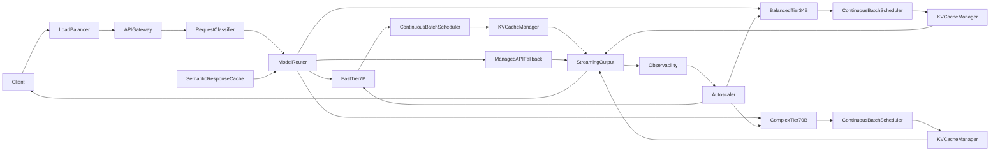

# Chapter 4: Serving, Scaling, and Optimizing LLMs

## Context

> [!info] Quick Reference
> - **Pattern:** Multi-tier LLM serving with optimization stack
> - **Scale:** 20M requests/day, 7B/34B/70B model tiers
> - **Key Techniques:** Continuous batching, speculative decoding, KV/prefix caching, quantization (INT4/INT8)
> - **Primary Concerns:** TTFT/TPOT budgets, GPU OOM, autoscaling, tail latency
> - **Cross-references:** [[chapter-02|Chapter 2]] (model routing), [[chapter-08|Chapter 8]] (coding assistant serving), [[chapter-18|Chapter 18]] (voice agent latency)

**Problem statement:** Engineer low-latency, high-throughput LLM serving with predictable TTFT/TPOT, bounded cost/query, and graceful degradation under traffic spikes.

### Real-World Examples

- A coding assistant launch hits 12x expected traffic; continuous batching and KV caching reduce TTFT from 2.1s to 900ms without additional GPUs.
- A support assistant outage reveals retry storms from provider 429s; queue isolation and deterministic degrade modes restore stability within minutes.

---

## Step 1: Understand the Problem and Establish Design Scope

### Simulated Dialogue

**Interviewer:** Design the serving and scaling infrastructure for a multi-tenant LLM platform.  
**Candidate:** I need to understand the traffic shape, latency SLOs, model mix, and cost targets before proposing architecture.

**Candidate:** What is the request profile?  
**Interviewer:** 20M requests/day, mix of short completions (avg 200 output tokens) and long generations (avg 800 output tokens). Peak is 15x average.

**Candidate:** What latency SLOs must we hit?  
**Interviewer:** Interactive routes: TTFT < 800ms, TPOT < 40ms. Batch routes: p95 completion < 30s.

**Candidate:** What is the model landscape?  
**Interviewer:** Three tiers: 7B quantized (fast), 34B (balanced), 70B (complex). Plus managed API fallback.

### Functional Requirements

- Serve multiple model tiers (7B, 34B, 70B) with automatic routing by request complexity and SLO.
- Support streaming responses with token-level delivery.
- Handle managed API failover when self-hosted capacity is exhausted.
- Enforce per-tenant and per-route token budgets and rate limits.

### Non-Functional Requirements

- **Latency:** TTFT p95 < 800ms (interactive), TPOT p95 < 40ms/token.

> **Why 800ms TTFT and 40ms TPOT:** 800ms is the practical ceiling for interactive response before users perceive a noticeable pause. 40ms TPOT corresponds to approximately 25 tokens per second, which matches human reading speed for dense technical content; faster TPOT is perceptually indistinguishable at reading speed, while slower TPOT makes streaming feel choppy.
- **Throughput:** sustain 3,500 QPS peak with < 5% error rate.
- **Cost:** self-hosted unit cost < 60% of equivalent managed API cost at steady state.

> **Why 60% as the self-hosted cost target:** At parity with managed API pricing, the operational complexity of running a self-hosted GPU fleet (on-call burden, OOM risk, model upgrade friction) is not justified by the economics. A 40% cost reduction creates enough margin to absorb incident costs, ops headcount, and the periods of underutilization that occur during traffic variability—making self-hosted worth the complexity only beyond that threshold.
- **Availability:** 99.9% uptime with graceful degradation under overload.
- **GPU utilization:** target > 70% average utilization across serving fleet.

> **Why 70% and not higher:** At >85–90% utilization, any traffic spike immediately saturates the queue because there is no spare capacity to absorb variance. The 10–30% headroom between the 70% target and 100% is the burst absorption buffer—it is not waste, it is the mechanism that prevents latency spikes. Autoscalers should trigger scale-up at 85% to restore headroom before SLO breach.

### Back-of-the-Envelope Estimation

#### Traffic Profile

- Requests/day: 20M
- Average QPS: `20M / 86,400 ≈ 231`
- Peak QPS: `~3,470` (15x average)
- Token mix: 60% short (200 output tokens), 40% long (800 output tokens)
- Average output tokens: `0.6 * 200 + 0.4 * 800 = 440 tokens/request`
- Output tokens/day: `20M * 440 = 8.8B tokens`

#### GPU Capacity Planning (Self-Hosted)

- 7B quantized (INT4): ~18GB VRAM, ~120 tokens/sec/GPU
- 34B quantized (INT8): ~40GB VRAM, ~45 tokens/sec/GPU
- 70B (FP16, tensor parallel across 2xA100): ~160GB VRAM, ~25 tokens/sec/GPU

**Peak throughput demand (tokens/sec):**
- Peak QPS * avg output tokens: `3,470 * 440 ≈ 1.53M tokens/sec`
- Route split at peak: 50% fast (7B), 35% balanced (34B), 15% complex (70B)
- 7B demand: `765K tok/sec / 120 = ~6,375 GPU-equivalents` → with continuous batching (4-8x efficiency): **~800-1,600 GPUs**
- 34B demand: `~535K tok/sec / 45 = ~11,900 GPU-equiv` → with batching: **~1,500-3,000 GPUs**
- 70B demand: `~230K tok/sec / 25 = ~9,200 GPU-equiv` → with batching: **~1,150-2,300 GPUs**
- Total fleet: **~3,500-7,000 GPUs** (order-of-magnitude for peak; autoscaling reduces steady-state to ~30% of this)

#### KV Cache Memory

- 70B model, 128K context window, 80 layers, 128 heads, 128 head-dim:
  - Per-token KV: `2 * 80 * 128 * 128 * 2 bytes (FP16) = ~5.2MB/token`
  - 4K context: `~20.5GB KV cache per request`
  - Concurrent batch of 16 requests: `~328GB` → requires careful memory management

#### Cost Comparison

- Managed API (GPT-4 class): ~$30/1M input tokens, ~$60/1M output tokens
- Self-hosted 70B (amortized GPU + ops): ~$8-12/1M output tokens at scale
- Breakeven: self-hosted wins when sustained volume > ~2M output tokens/day per GPU

---

## Step 2: Propose High-Level Design and Get Buy-In

### Core Architecture Components

- **Load Balancer + API Gateway:** TLS termination, tenant auth, rate limiting, request classification.
- **Request Classifier:** estimates complexity/length to select model tier and queue priority.
- **Model Router:** routes to self-hosted tier or managed API fallback based on capacity and SLO.
- **Serving Runtime (per tier):** continuous batching scheduler, KV cache manager, streaming output handler.
- **Autoscaler:** GPU fleet autoscaling based on queue depth, utilization, and latency signals.
- **Cache Hierarchy:** prefix/KV cache (VRAM), semantic response cache (Redis), session prompt cache.
- **Managed API Gateway:** rate-limited client for external provider failover.
- **Observability:** TTFT/TPOT histograms, GPU utilization, queue depth, cache hit rate, error rate by tier.

### Pipeline A: Model Deployment Pipeline

1. Model artifact (weights + tokenizer + config) versioned in model registry.
2. Quantization and optimization applied (GPTQ/AWQ for INT4/INT8, or FP16 for large tier).

> **Why AWQ/GPTQ for quantization:** Both AWQ (Activation-aware Weight Quantization) and GPTQ apply calibration data to minimize the quality loss from reducing weights to INT4 or INT8 precision. AWQ preserves the most critical weights by identifying activation magnitude, typically achieving <0.3% quality degradation on benchmarks while halving VRAM requirements. FP16 is used on the largest tier (70B) where quantization artifacts are less acceptable and cost savings from quantization are less critical relative to quality.
3. Serving config generated: max batch size, max sequence length, KV cache budget per GPU.
4. Canary deployment to shadow traffic (5% of production load).
5. Quality gate: compare output quality, latency, and error rate against baseline.
6. Gradual traffic shift (5% → 25% → 50% → 100%) with automatic rollback triggers.

### Pipeline B: Request Serving Pipeline

1. Request arrives at gateway; auth, rate limit, and quota checks applied.
2. Request classifier estimates token count and complexity → assigns model tier and priority.
3. Model router checks self-hosted capacity (queue depth < threshold); falls back to managed API if overloaded.
4. Serving runtime adds request to continuous batch scheduler.
5. Scheduler groups requests by sequence length, manages KV cache allocation, begins prefill.
6. Tokens streamed to client as generated; TTFT and TPOT tracked per request.
7. On completion: response logged, telemetry emitted, cache updated if eligible.

### Mermaid Architecture Diagram

---

## Step 3: Design Deep Dive

Focus areas for this chapter:

1. **Continuous Batching and Scheduling**
2. **KV Cache Management**
3. **Autoscaling and Overload Protection**

### 1) Continuous Batching and Scheduling

Traditional static batching wastes GPU cycles waiting for the longest sequence in a batch to complete. **Continuous batching** (also called iteration-level or in-flight batching) admits new requests and retires completed ones at every decode step.

**How it works:**
- Scheduler maintains a running batch of active requests.
- At each decode iteration, completed requests are evicted and new requests are admitted.
- Prefill (prompt processing) and decode (token generation) can be interleaved or separated.

#### Batching Strategy Trade-off Table

| Strategy | GPU Utilization | TTFT Impact | Complexity | Best For |
|---|---|---|---|---|
| Static batching | 30-50%; GPU idles between batch completions because new requests cannot be admitted until the entire batch finishes | High — every request waits for the slowest sequence in the batch before the next batch begins, causing 2-5x TTFT inflation under load | Low — straightforward to implement; no per-step scheduling logic required | Dev/testing environments and research workloads where throughput consistency matters more than interactive latency |
| Continuous batching | 60-80%; GPU remains occupied as completed requests are evicted and new ones admitted at every decode step | Low — requests are admitted as soon as a slot opens, typically within one decode step (~10-50ms), so TTFT tracks queue depth rather than batch-fill time | Medium — requires per-step scheduler, dynamic sequence length tracking, and careful KV cache slot management | Production default for interactive serving; widely deployed in vLLM, TGI, and TensorRT-LLM |
| Chunked prefill | 70-85%; prefill work is broken into fixed-size chunks interleaved with decode steps, keeping GPU busy without stalling ongoing requests | Very low — decode requests continue generating tokens between prefill chunks, so long-prompt prefill no longer causes TTFT spikes for concurrent short requests | High — requires prefill chunking logic, careful interleaving scheduler, and careful memory budgeting per chunk | High-throughput serving deployments with mixed short/long prompt traffic where TTFT consistency under load is a hard SLO |
| Disaggregated prefill/decode | 80-90%; prefill and decode stages run on separate GPU pools, each optimized for its own compute pattern (matrix-multiply heavy vs. memory-bandwidth heavy) | Lowest achievable — prefill nodes are never blocked by decode backlog, and decode nodes are never stalled by large prefill jobs; sub-200ms TTFT is achievable even at high concurrency | Very high — requires separate fleet management, inter-node KV cache transfer (typically over NVLink or InfiniBand), and coordinated scheduling across two GPU pools | Hyperscale platforms (internal deployments at frontier AI labs) where the engineering investment is justified by sustained traffic at tens of thousands of QPS |

**Scheduling policies:**
- **FCFS (first-come first-served):** simple, fair, but head-of-line blocking from long prompts.
- **Shortest-job-first (SJF):** lower average latency but starvation risk for long requests.
- **Priority queues:** route-level isolation, SLO-based priority, with starvation timeout.
- **Recommended:** priority queues with SLO-based preemption and starvation guard (max wait 5s).

> **Why priority queues over FCFS:** In a mixed workload where short interactive requests share a queue with long batch requests, FCFS allows a single 32K-token prompt to block hundreds of 2K-token interactive requests that could complete in a fraction of the time. Priority queues isolate interactive routes from batch routes, ensuring TTFT SLOs are met for time-sensitive traffic even under heavy batch load. The starvation guard (max wait 5s) prevents indefinite starvation of low-priority requests.

### 2) KV Cache Management

The KV cache stores computed key/value attention states for previously processed tokens. It is the primary memory bottleneck in LLM serving.

**Memory anatomy for 70B model, single request, 4K context:**
- Per-layer KV: `2 (K+V) * head_dim * num_heads * 2 bytes (FP16)`
- 80 layers, 128 heads, 128 head-dim: `~5.2MB/token`
- 4K context: `~20.5GB` per concurrent request
- Batch of 32: `~656GB` → exceeds single-node capacity

#### KV Cache Optimization Trade-off Table

| Technique | Memory Savings | Quality Impact | Complexity | Best For |
|---|---|---|---|---|
| No optimization (FP16 full) | Baseline — 100% VRAM consumed by full-precision KV tensors; maximum batch size is determined purely by available VRAM divided by per-request KV footprint | None — full floating-point fidelity is preserved for every attention computation | None — no additional code or calibration required; ships with every framework by default | Small models (7B and below) or low-concurrency deployments where VRAM is not the primary constraint |
| KV cache quantization (INT8) | ~50% reduction — halves per-request KV footprint, doubling effective batch size on the same hardware (e.g., from 16 to 32 concurrent requests on 80GB A100 with 70B model) | Minimal — benchmark evaluations show <0.5% degradation on MMLU and HumanEval; perceptually indistinguishable in generation quality | Low — most production frameworks (vLLM, TGI, TensorRT-LLM) expose a single flag to enable INT8 KV quantization with no calibration step required | Default choice for 34B and 70B models in production where memory pressure limits batch size and throughput |
| PagedAttention (vLLM) | Variable — primarily reduces memory waste from fragmentation rather than compressing data; in practice reduces wasted VRAM by 15-40% compared to pre-allocated contiguous buffers, allowing 10-30% more concurrent requests | None — purely a memory allocation strategy; attention computation remains numerically identical to naive contiguous allocation | Medium — requires the serving engine to implement virtual memory paging logic for KV blocks; production-ready implementations exist in vLLM and derivatives | Production serving engines handling high request concurrency with variable sequence lengths; effectively required for any system targeting > 50 concurrent requests per GPU |
| Sliding window attention | Proportional to window size — a 4K window on a 128K-context model reduces KV memory by ~97% for tokens beyond the window, making long-context models practical on single-GPU hardware | Degrades on tasks requiring long-range dependencies — question answering across a 50K-token document may suffer catastrophically if the answer is outside the window; retrieval-augmented patterns mitigate this by pre-positioning relevant content | Medium — requires model architecture support (Mistral-style sliding window layers) and careful window size tuning per use case to avoid quality regressions | Use cases with strong locality (e.g., code completion where context is the recent file, or chat where recent turns are most relevant) and where retrieval can substitute for long-range attention |
| Multi-query / grouped-query attention | 4-8x per head — MQA collapses all attention heads to a single shared KV head, reducing KV size by num_heads factor; GQA (e.g., Llama 3's 8-group heads) achieves 4-8x reduction while preserving more of MHA's quality | Built into model architecture — there is no runtime quality trade-off; the trade-off was made during pre-training, and the architecture ships with this characteristic baked in | None at serving time — the savings are automatic once you serve a model pre-trained with MQA or GQA; no runtime configuration is needed | All newer large models; Llama 3, Mistral, Gemma, Falcon, and most post-2023 open-weight models use GQA as the default attention variant |

**PagedAttention (vLLM):**
- Manages KV cache as virtual memory pages (blocks of token slots).
- Eliminates fragmentation from pre-allocated contiguous buffers.
- Enables memory sharing for beam search and parallel sampling.
- Production default in vLLM, TensorRT-LLM, and similar serving engines.

**Prefix caching:**
- Cache KV states for common system prompts and instruction prefixes.
- If system prompt is 2K tokens and repeats across 90% of requests, prefix cache saves ~10.4GB recomputation per request (70B model).
- TTFT reduction: skip prefill for cached prefix → TTFT drops by 200-400ms.
- Invalidation: version-tag prefixes; invalidate on prompt template change.

### 3) Autoscaling and Overload Protection

#### Autoscaling Signals

| Signal | Scaling Direction | Lag | Notes |
|---|---|---|---|
| Queue depth (requests waiting) | Scale up when queue exceeds 2x the serving batch capacity, indicating that incoming work is outpacing current throughput | Seconds — queue depth is observable in real time and reacts immediately to traffic spikes, making it the fastest-responding signal for scale-up decisions | Most responsive signal; use as the primary trigger for reactive scale-up, with a threshold around 1.5x batch capacity to get ahead of queue growth before TTFT degrades |
| GPU utilization | Scale up when smoothed utilization exceeds 85% for > 60s; scale down when below 50% for > 5 minutes | Minutes — raw utilization is noisy due to prefill vs. decode phase differences; must be smoothed over at least 60-second windows to avoid triggering on transient spikes | Use a smoothed moving average (60s window) with separate thresholds for up vs. down to prevent thrashing; never use instantaneous utilization as a scaling signal |
| TTFT p95 | Scale up when p95 TTFT breaches 80% of the SLO budget (e.g., 640ms for an 800ms SLO), providing headroom for scale-up lag | Minutes — TTFT reflects the cumulative effect of queue depth, batch scheduling, and GPU load; it is a lagging indicator but directly tied to whether the SLO is being met | Use as a corroborating signal alongside queue depth; if TTFT is breaching the threshold but queue depth is normal, the root cause may be a routing or cache problem rather than capacity |
| Request error rate (timeouts, OOM) | Scale up immediately (emergency path) and trigger circuit-breaker fallback to managed API simultaneously | Immediate — errors surface within seconds of the underlying problem; treat error rate > 2% as an emergency scale-up trigger | Integrate with circuit-breaker logic so that when error rate spikes the system simultaneously scales up self-hosted capacity and routes overflow to managed API, rather than doing one or the other |
| Cost budget remaining | Scale down or cap when projected spend for the billing period exceeds budget thresholds (e.g., 80% of monthly budget with > 30% of month remaining) | Hours — cost signals are inherently slow-moving and should never gate latency-critical scale-up decisions; use only for scale-down or as a cap on maximum fleet size | Prevents runaway spend during traffic anomalies or DDoS events; configure hard fleet size maximums in the autoscaler to enforce an absolute cost ceiling regardless of other signals |

**Overload protection mechanisms:**
- **Admission control:** reject or defer requests when queue exceeds threshold (e.g., 2x batch capacity).
- **Load shedding:** drop low-priority requests first; serve cached/degraded responses for others.
- **Circuit breaker to managed API:** when self-hosted error rate > 5%, overflow to managed provider.
- **Token budget enforcement:** hard-reject requests exceeding max input/output token limits.
- **Graceful degradation:** reduce max output tokens, skip reranking, serve cache-only summaries.

### Production Bottlenecks and Mitigations

- **GPU OOM during long-context requests**
  - Symptom: CUDA OOM errors, request failures on long prompts. Typically manifests as a spike in 500-class errors specifically correlated with requests exceeding a certain token count, while short requests continue to succeed on the same GPU.
  - Mitigation: Enforce a dynamic max sequence length per batch that is computed from available VRAM at scheduling time rather than set as a static config value. Implement a prompt truncation policy (e.g., truncate from the middle, preserving the system prompt and the most recent user turn) as a last resort before rejection. Enable KV cache quantization (INT8) to halve per-request KV footprint. Add per-request VRAM pre-check in the scheduler so long-context requests are only admitted when sufficient VRAM is available, rather than allowing them to OOM mid-generation.

- **Queue saturation and head-of-line blocking**
  - Symptom: TTFT spikes affect all requests simultaneously, including short ones, when one or a few long-prompt requests enter the queue. The characteristic pattern is a sudden step-change in TTFT p50 (not just p95), because even the median request is now waiting behind a blocked queue.
  - Mitigation: Implement priority queues that route interactive requests (< 2K tokens, latency-sensitive) to a high-priority lane that is served before long-context batch requests. Enable chunked prefill so that large prompts do not monopolize a full decode iteration and block other requests' token generation. Apply sequence-length-based bucketing so that requests are grouped by similar prompt length, reducing the probability that a 32K-token prompt shares a batch slot with a 500-token request.

- **Provider 429 storms during failover**
  - Symptom: During a self-hosted outage or scale-down, all overflow traffic is simultaneously redirected to the managed API. The managed API returns HTTP 429 rate-limit errors at high volume, causing a cascading retry storm that amplifies traffic and extends the outage.
  - Mitigation: Pre-configure token bucket rate limiting on the managed API client set to 80% of the provider's per-minute rate limit, so overflow traffic is smoothed rather than burst-sent. Implement jittered exponential backoff (base 1s, max 30s, jitter 0-100%) to prevent synchronized retry waves. Add request prioritization so that during managed API overflow, only high-priority interactive requests are forwarded to the managed provider and batch requests are queued or rejected with a retryable error. Pre-warm the managed API connection pool and maintain a circuit breaker that opens at > 10% error rate to prevent retry amplification.

- **KV cache fragmentation**
  - Symptom: GPU VRAM reports 60% utilization, but effective batch size has dropped to half its normal value and request queuing is growing. This discrepancy indicates that available VRAM is fragmented into non-contiguous blocks too small for new request KV allocations.
  - Mitigation: Deploy PagedAttention (vLLM) which replaces contiguous pre-allocated KV buffers with virtual memory pages, eliminating external fragmentation. For serving engines that do not support PagedAttention, implement periodic cache compaction during low-traffic windows by migrating KV tensors to consolidate free blocks. Right-size the page block size (typically 16-32 token slots) for your workload's typical sequence length distribution—pages that are too large waste memory for short sequences, while pages that are too small increase per-page metadata overhead.

- **Autoscaler thrashing**
  - Symptom: GPU replicas are provisioned and terminated repeatedly over short intervals (5-15 minutes), causing startup overhead to consume a significant fraction of each replica's useful lifetime. During thrashing, new replicas may not fully warm their model weights before being terminated, leading to periodic TTFT spikes from cold-start serving.
  - Mitigation: Enforce a cooldown period of at least 5-10 minutes between scale-down events; scale-up can remain aggressive. Use smoothed signals (60-second moving average for utilization, 5-minute window for TTFT p95) rather than instantaneous values to prevent thrashing on traffic variability. Set a minimum fleet size floor that is never scaled below, regardless of low utilization—this floor should be sized to handle at least the average-minus-1-sigma traffic level, ensuring baseline serving capacity is always available. Separate scale-up and scale-down policies with different thresholds (scale up at 85% utilization, scale down at 50%) to create hysteresis.

- **Model version mismatch during canary**
  - Symptom: Users in the canary group experience inconsistent outputs across multiple requests in the same session, because some requests are routed to the new model version and others to the old version. Multi-turn conversations are particularly affected, as the model's response style or capability profile may differ between versions.
  - Mitigation: Implement sticky routing by session ID during canary windows, so every request from a given session is consistently routed to the same model version for the duration of the canary. Label responses with a `model-version` header so that quality monitoring can attribute outputs to the correct version and detect regressions. Set rollback triggers on quality gate metrics (e.g., automatic rollback if output quality score drops > 3% relative to baseline on shadow traffic evaluation) so that a bad canary can be reversed within minutes without manual intervention.

### Advanced Techniques

- **Speculative decoding:** A small draft model (typically 1-7B parameters) generates a candidate sequence of k tokens, and the large verifier model processes all k candidates in a single forward pass to accept or reject each one. When the acceptance rate exceeds 70%—meaning the draft model's predictions match what the large model would have generated—wall-clock throughput improves by 2-3x because the expensive verifier model performs far fewer sequential decode steps. The technique is most effective for interactive use cases (coding assistants, chat) where the output vocabulary is predictable; it degrades or provides no benefit for highly creative or open-ended generation tasks where the draft model's acceptance rate falls below 50%.

> **Why:** Autoregressive decode is fundamentally sequential and memory-bandwidth bound, not compute bound. Speculative decoding breaks the sequential bottleneck by parallelizing candidate verification across the large model's spare compute capacity, converting latency into throughput without changing the final output distribution.

- **Continuous batching with chunked prefill:** Rather than processing an entire prompt's prefill in one blocking pass before decode begins, chunked prefill breaks the prefill stage into fixed-size chunks (e.g., 512 or 1024 tokens per chunk) and interleaves them with decode steps for ongoing requests. This prevents a single 32K-token prompt from stalling the decode phase for all other concurrent requests—a problem that causes TTFT spikes of 500ms-2s in systems using naive continuous batching without chunking.

> **Why:** In a naive continuous batching setup, a large prefill job temporarily saturates the GPU's compute capacity, causing decode iterations for all other batched requests to stall until the prefill completes. Chunked prefill bounds this stall to at most one chunk's worth of compute per iteration, keeping TTFT variance low even under mixed short/long prompt traffic.

- **LoRA adapter serving:** The base model weights are loaded once per GPU and shared across all tenants. Per-request, a small adapter matrix (50-200MB for rank-16 to rank-64 adapters applied to Q/K/V/O projection layers) is loaded and applied on top of the base weights. Hot-swapping between adapters adds approximately 2-5ms per request switch, which is negligible relative to generation time. The key challenge arises with high adapter diversity: if 50 different tenants have 50 different adapters and batch sizes per adapter are small (1-2 requests), the adapter caching mechanism must evict and reload frequently, and the effective batching gains are reduced.

> **Why:** Running 50 separate fine-tuned model instances would require 50x the VRAM and operational overhead. LoRA serving allows a single GPU to serve a large number of tenant-specific models by treating the adapter as a lightweight request attribute rather than a model identity, enabling multi-tenant specialization without multi-tenant fleet multiplication.

- **Tensor parallelism:** Models exceeding single-GPU VRAM (typically 70B+ class in FP16 or 34B+ in FP16 without quantization) are sharded across multiple GPUs by splitting weight matrices along the tensor dimension. Each GPU holds a shard of every layer's weights and performs its shard's computation; results are all-reduced across GPUs after each layer. For a 70B model in FP16 requiring ~160GB, a 2xA100 (160GB total) configuration is the minimum; 4xA100 provides headroom for KV cache and larger batch sizes. Tensor parallelism introduces inter-GPU communication overhead (typically 5-15% latency overhead on NVLink), so it should not be applied unless single-GPU fitting is impossible after quantization.

> **Why:** The alternative to tensor parallelism for over-VRAM models is pipeline parallelism (split layers across GPUs), which introduces pipeline bubbles and is generally slower for single-request latency. Tensor parallelism distributes each layer across GPUs, which is better suited for serving where low per-request latency is more important than batch throughput.

- **Quantized KV cache (INT8):** The KV cache tensors—which are intermediate activations, not model weights—are stored in INT8 precision rather than FP16. Because these tensors represent attention keys and values that are only read and written during a single forward pass, quantization artifacts do not accumulate across layers the way they might in weight quantization. Empirically, INT8 KV cache achieves less than 0.5% quality degradation on standard benchmarks while providing exactly 50% memory reduction, which directly translates to doubling the maximum concurrent batch size on the same GPU hardware.

> **Why:** The KV cache is typically the dominant consumer of GPU VRAM in production serving (not the weights, which are static). For a 70B model serving 32 concurrent 4K-context requests, the KV cache alone consumes over 650GB—more than the weight storage. INT8 KV quantization is the highest-ROI memory optimization available because it targets the resource that most directly limits concurrency and throughput.

---

## Step 4: Wrap Up

### Final Design Summary

The design treats serving as latency engineering: route-tiered inference with continuous batching, hierarchical KV cache management, and deterministic overload controls that prioritize user experience under stress.

### Wrap-Around Concerns

- **Release engineering:** canary model deployments with quality gates and automatic rollback.
- **Governance:** model version tracking, GPU allocation audits, cost attribution per tenant/route.
- **Cost controls:** autoscaler cost caps, managed API budget limits, cache hit-rate targets (> 30% for semantic cache).
- **Drift controls:** latency and quality dashboards sliced by model version, route, and traffic cohort.

---

## Step 5: Interviewer Curveballs

### Interviewer Follow-ups & Frequently Asked Questions (FAQ)

Q: TTFT jumped from 700ms to 2.2s overnight. Walk me through your debugging steps.

**The Ideal Answer:** Start with queue depth and request rate to distinguish a traffic surge from a capacity drop—if queue depth tripled but request rate is flat, a deployment or GPU failure likely reduced effective serving capacity. Next inspect prefix cache hit rates, because a model or template deployment that invalidates the cache causes every request to re-run full prefill on system prompts that were previously served from cache, adding 200-500ms of prefill time. If queue depth and cache look healthy, check the model routing distribution: a classifier regression may be misrouting requests to a heavier tier, inflating TTFT for traffic that previously hit the fast 7B tier. Finally, examine per-GPU utilization and error rates to identify whether one or more GPUs has gone OOM or degraded.

**Deep Dive & Trade-offs:**
- Queue depth rise with flat request rate = capacity event (GPU failure, deployment, OOM loop). Check GPU error logs and recent deployment events.
- Cache hit-rate drop from > 30% to < 5% = cache invalidation event, typically from a system prompt template change or serving config deployment. Verify prompt template version in use.
- Tier routing shift = request classifier regression, feature drift, or a model router configuration change. Compare today's tier distribution histogram to yesterday's baseline.
- Isolated per-GPU degradation = a single GPU running a bad batch into OOM repeatedly, starving the scheduler. Check per-replica TTFT, not fleet-average.

**The Interviewer's Rubric:** A strong answer progresses in order from systemic/capacity causes to request-level causes to GPU-level causes, and names LLM-specific artifacts (prefix cache, tier routing, KV OOM) rather than generic latency debugging steps like "check CPU" or "look at the database." The interviewer is specifically checking whether you know which metrics are diagnostic for LLM serving and in what order to examine them.

Q: How do you decide when to add a new model tier vs scaling an existing one?

**The Ideal Answer:** Add a new tier when the TTFT distribution for a given tier shows bimodal behavior—one cluster of requests completing in < 500ms and another consistently exceeding 1.5s—because this is the signature of heterogeneous request complexity sharing a queue. The short tail represents requests that are over-provisioned for the model tier they're on; a smaller, faster model could serve them at lower cost with better latency. Scale horizontally when the distribution is unimodal and the bottleneck is simply volume: every request needs roughly the same GPU time, and you just need more of the same GPU. A new tier also makes sense when cost analysis shows that > 40% of your traffic uses < 10% of the model's capabilities, because that traffic is paying a 10x compute premium for capability it does not need.

**Deep Dive & Trade-offs:**
- New tier adds 3-6 weeks of engineering investment: deployment pipeline changes, classifier training to recognize tier-appropriate requests, monitoring dashboards, and router logic updates. It also doubles the on-call surface for model-related incidents.
- Horizontal scaling of an existing tier is typically a one-day task: add nodes, verify autoscaling thresholds, done. The operational cost is much lower, but you never escape the economics of running an over-provisioned model for simple queries.
- A useful heuristic: if routing a request to a one-tier-smaller model produces acceptable quality > 85% of the time on your quality evaluation set, a new smaller tier will be net-positive in both cost and latency.

**The Interviewer's Rubric:** A strong answer uses request complexity distribution data rather than anecdotal reasoning, and explicitly identifies the operational cost of a new tier. The interviewer is checking that you reason about fleet architecture as an economic and latency trade-off, not just a capacity decision.

Q: What is the practical limit of continuous batching efficiency?

**The Ideal Answer:** The hard ceiling is KV cache memory: maximum concurrent requests equals `available_VRAM / per_request_KV_size`. For a 34B model with 2K-context requests consuming ~2.5GB KV per request on an 80GB A100, that gives a theoretical maximum batch of 32 concurrent requests—but after reserving VRAM for model weights (~70GB in FP16), realistically closer to 4 slots before quantization. This illustrates why KV quantization and smaller models are prerequisites for any meaningful batch size. A secondary limit is TPOT inflation: as batch size increases from 8 to 64, per-token decode latency typically increases proportionally because memory bandwidth is shared across more sequences, meaning TPOT can degrade from 20ms to 80ms per token even though throughput improves.

**Deep Dive & Trade-offs:**
- KV quantization (INT8) doubles effective batch size at the same VRAM envelope, making it the most impactful single optimization for concurrency.
- PagedAttention reduces fragmentation overhead by 10-20% over pre-allocated contiguous buffers, recovering otherwise wasted VRAM from variable-length sequences.
- The memory-throughput-latency triangle: each additional concurrent request adds throughput at the cost of higher TPOT. The optimal batch size is the largest N where TPOT remains within the SLO budget (e.g., 40ms). Beyond that, you are trading user-perceived latency for throughput that the SLO does not allow.
- Compute saturation is a secondary limit: once the GPU's compute units are fully utilized by decode operations, adding more requests does not improve throughput and only inflates latency. For most large models, memory bandwidth is the binding constraint before compute saturation is reached.

**The Interviewer's Rubric:** A strong answer correctly identifies memory bandwidth as the primary constraint, works through a concrete numerical example to show understanding, and explicitly connects batch size to the TPOT SLO rather than treating "larger batch = better" as unconditionally true. The interviewer is probing whether you understand all three vertices of the memory-throughput-latency triangle simultaneously.

Q: When is speculative decoding worth the complexity?

**The Ideal Answer:** Speculative decoding is worth the engineering investment when three conditions hold simultaneously: the draft model's acceptance rate on your production traffic exceeds 70%, your workload is latency-sensitive (TPOT SLO < 40ms) rather than throughput-optimized, and you have VRAM headroom for a draft model without reducing batch size on the verifier. If any of these conditions is not met, the complexity of maintaining draft model versioning, managing acceptance rate monitoring, and handling acceptance rate degradation incidents is unlikely to pay off. For a coding assistant or chat interface where users are actively watching tokens stream, a 2-3x TPOT improvement from 40ms to 15ms per token is very perceptible. For a batch document processing pipeline where users submit a request and return 30 seconds later, speculative decoding provides no user experience benefit.

**Deep Dive & Trade-offs:**
- Draft model overhead: a 1B-parameter draft model consumes ~2-4GB VRAM in FP16; if this reduces your effective batch size from 16 to 12, the concurrency loss may partially offset the per-request speed gain.
- Acceptance rate sensitivity: at 70% acceptance, the expected speedup is approximately 2.5x. At 50%, it drops to roughly 1.5x—barely worth the overhead. Below 40%, speculative decoding actively increases latency because rejected token groups must be re-decoded by the large model.
- Domain specificity: code generation (high syntactic predictability) achieves 75-85% acceptance rates. Open-ended creative writing achieves 40-55%. Acceptance rate is a property of the traffic distribution, not the model, and must be measured on your specific workload.
- Monitoring requirement: acceptance rate can drift as prompt distributions shift. A monitoring alert on acceptance rate falling below 65% is essential to catch regressions before they degrade TPOT SLOs.

**The Interviewer's Rubric:** A strong answer quantifies the acceptance rate threshold, correctly identifies that speculative decoding helps latency but not throughput, and identifies at least one failure mode (acceptance rate degradation or VRAM trade-off). The interviewer is checking for nuanced understanding of inference optimization trade-offs beyond the surface-level "draft model proposes, large model verifies" description.

Q: How do you handle a tenant that sends 10K-token prompts when your system is optimized for 2K average?

**The Ideal Answer:** The immediate structural fix is routing 10K-token prompts to a dedicated long-context queue with its own batch scheduler and KV cache budget, so they never compete for slots with the 2K short-prompt traffic. The long-context queue can use a separate autoscaling policy calibrated for lower QPS and higher per-request cost. At the API layer, enforce a maximum context limit per model tier (e.g., 2K for fast tier, 8K for balanced, 128K for long-context tier) so the request is rejected or redirected at the gateway rather than OOM-ing the batch scheduler. Finally, apply cost attribution: long-context requests consume 5x the KV cache memory of standard requests, so premium per-token pricing for long-context usage ensures economic fairness without requiring tenant-level quotas to be manually enforced.

**Deep Dive & Trade-offs:**
- A single 10K-token prompt on the 34B tier consumes approximately 12.5GB KV cache, potentially evicting 5 concurrent 2K-token requests from memory—a 5x resource disproportion that is invisible to naive FIFO scheduling.
- Separate long-context queue prevents head-of-line blocking for the majority of traffic, but requires a second serving deployment with appropriate memory configuration (e.g., 128K context window enabled, larger KV cache pre-allocation).
- Prompt summarization or truncation as a pre-processing step: if the tenant's use case does not actually require the full 10K tokens (e.g., they are appending an entire document when only recent sections are relevant), a summarization pass or sliding window extraction can reduce the effective context to 2K without quality loss, eliminating the problem without architectural changes.
- Multi-tenant fairness: if a single tenant's long-context traffic accounts for > 20% of total KV cache consumption, per-tenant resource quotas with burst limits prevent one tenant from degrading the SLO for all others.

**The Interviewer's Rubric:** A strong answer addresses three layers: routing isolation to prevent shared-queue interference, capacity management to set realistic limits per tier, and economic incentive alignment so that resource-heavy usage is priced accordingly. The interviewer is checking for multi-tenancy fairness thinking, not just "add a queue."

Q: What GPU utilization target should you set, and why not 100%?

**The Ideal Answer:** The target is 70-80% average utilization, with autoscaler scale-up triggered at 85%. The 15-30% headroom is not waste—it is the burst absorption buffer that prevents any traffic fluctuation from immediately translating into queue depth growth. At 100% utilization, the system has zero spare capacity; even a 1% traffic increase causes queue depth to grow, TTFT to rise, and a latency breach that typically takes 3-5 minutes to resolve through autoscaling spin-up. At 70% utilization, a 20-30% traffic spike is absorbed instantaneously with no queueing, giving the autoscaler time to provision additional capacity before the headroom is consumed.

**Deep Dive & Trade-offs:**
- 100% utilization means an arrival-rate queue forms the moment traffic increases, and the queue grows faster than autoscaling can resolve it. This is the classic result from queueing theory: at 100% utilization (ρ = 1), average queue length diverges to infinity for any positive arrival variance.
- 60% utilization provides excellent burst absorption but is economically wasteful at scale: on a 1,000-GPU fleet, 200 idle GPUs at $2/GPU-hour is $400/hour of preventable cost.
- The 70-80% band balances burst absorption with cost efficiency: enough headroom to absorb 25-40% traffic spikes, while keeping idle capacity below 30%.
- The scale-up trigger at 85% is set above the target band so that normal variability (70-80%) does not trigger constant autoscaling events, but the autoscaler activates before the 100% ceiling is reached.

**The Interviewer's Rubric:** A strong answer invokes queueing theory intuition (utilization approaching 100% causes queue length to diverge) and provides the economic reasoning for why 60% is not the right floor. The interviewer is checking capacity planning discipline and whether you can articulate why the headroom has a specific purpose rather than just being conservative padding.

Q: How do you cost-compare self-hosted vs managed API for a specific route?

**The Ideal Answer:** Calculate the all-in self-hosted cost per 1M output tokens by summing GPU amortization (instance cost ÷ tokens/day × 1M), networking egress, ops labor (on-call hours × engineer rate), electricity, and the amortized cost of incidents and optimization engineering. Then compare against managed API per-token pricing at your projected steady-state volume. The self-hosted number is typically $8-12/1M output tokens for a 70B model at scale; managed API pricing for GPT-4 class models is $40-60/1M output tokens. The critical variable is utilization: self-hosted wins only when GPU utilization is sustained above ~60% because the GPU cost is fixed regardless of whether it is generating tokens or idle.

**Deep Dive & Trade-offs:**
- Self-hosted: high fixed cost (GPU reservation or purchase), low marginal cost per token once deployed. The fixed cost is the same whether you serve 1M or 10M tokens per day on that GPU—so self-hosted only wins when you can fill the capacity.
- Managed API: near-zero fixed cost, high marginal cost that scales linearly with every token. Works perfectly for bursty routes where average utilization would be 10-20%, where provisioning dedicated GPUs would be economically irrational.
- The breakeven formula: `breakeven_tokens = (GPU_daily_cost / (managed_API_price_per_token - self_hosted_variable_cost_per_token))`. At GPU cost of $2.40/hour, managed API at $0.00006/token, and self-hosted variable cost of $0.000012/token, breakeven is approximately 2.1M output tokens/day per GPU—achievable only if that GPU is running at > 50% utilization.
- Hidden self-hosted costs that are frequently underestimated: model upgrade cycles (engineering time to re-quantize, re-evaluate, and re-deploy), OOM incident response, and the operational burden of maintaining CUDA driver compatibility across fleet upgrades.

**The Interviewer's Rubric:** A strong answer provides a concrete calculation formula, names the hidden self-hosted costs (ops labor, incident overhead) beyond the obvious GPU cost, and correctly identifies utilization as the swing variable. The interviewer is checking total cost of ownership reasoning and whether you recognize that self-hosted economics only work when you can fill the capacity you're paying for.

Q: How would you serve LoRA adapters for 50 different tenants on shared infrastructure?

**The Ideal Answer:** The base model is loaded once per GPU and its weights remain static and shared across all tenants. Each LoRA adapter is registered in an adapter registry indexed by tenant ID and model version. At request routing time, the scheduler groups requests by adapter ID and batches same-adapter requests together to maximize the amortization of adapter loading overhead. When a new adapter is needed, it is loaded from the registry to a dedicated VRAM cache (reserving ~10GB for adapter storage across 50 adapters at 200MB each). For high-volume tenants (> 500 requests/minute), dedicated GPU replicas with the adapter baked in are more efficient than hot-swapping.

**Deep Dive & Trade-offs:**
- Adapter sizing: rank-16 adapters applied to Q/K/V/O attention projection layers of a 34B model are approximately 80-120MB. Rank-64 adapters are 300-400MB. Across 50 tenants, total adapter VRAM at rank-16 is ~4-6GB, which is manageable within an 80GB A100's VRAM budget alongside model weights.
- Adapter switching overhead: loading an adapter from CPU memory or object storage to GPU VRAM takes 2-5ms for a pre-pinned adapter already in CPU DRAM, or 50-200ms for a cold load from remote storage. Maintaining a warm GPU-side LRU cache for the top 10-20 most active adapters by request rate eliminates most of this overhead.
- The cache pollution problem: if 50 tenants each have small traffic volumes (10-20 requests/minute each), the GPU-side adapter cache evicts and reloads constantly, negating the efficiency of shared infrastructure. In this regime, grouping tenants by adapter similarity (shared fine-tuning objective) and serving them from a single adapter reduces diversity without degrading quality.
- Alternative for high-volume tenants: once a single tenant generates > 1,000 requests/minute, the economics of a dedicated GPU replica with the adapter baked into the base weights (merged adapter) typically outperform hot-swapping because the per-request adapter-switch overhead is eliminated entirely and batch sizes for that tenant are large enough to saturate the GPU independently.

**The Interviewer's Rubric:** A strong answer addresses both the happy path (warm adapter cache, same-adapter batching) and the failure mode (cache pollution under high adapter diversity), and correctly identifies the threshold at which dedicated replicas outperform shared infrastructure. The interviewer is checking parameter-efficient serving architecture knowledge and multi-tenancy fairness thinking.

## Exercises

**[Design] Exercise 1: Multi-Tier GPU Fleet Sizing**
You are launching a code-generation assistant that will serve 5M requests/day with a 60/40 split between 7B (fast completions, avg 150 output tokens) and 34B (complex completions, avg 600 output tokens) model tiers. Interactive requests must hit TTFT < 600ms and TPOT < 35ms; batch requests must complete within 20s. Derive the GPU fleet size for each tier at peak (assume 10x peak-to-average), state your KV cache and quantization assumptions, and explain how your autoscaler thresholds and min-fleet-floor interact to maintain the TTFT SLO during a 3x unexpected traffic spike. Key considerations: account for VRAM split between model weights and KV cache, choose the quantization level for each tier, and justify your peak QPS multiplier relative to the average.

**[Design] Exercise 2: Graceful Degradation Cascade**
Design a graceful degradation strategy for a multi-tenant LLM platform that handles three failure modes: (a) self-hosted GPU tier OOM due to a traffic spike, (b) managed API provider returning sustained 429s, and (c) a bad model canary that causes quality regression detected mid-rollout. For each failure mode, specify the detection signal, the degradation action (e.g., queue shedding, model downgrade, cache-only response), the recovery trigger, and the tenant communication strategy. Key considerations: your design should prevent each failure mode from cascading into the others, prioritize high-SLO tenants during degradation, and define explicit "all-clear" conditions to exit degraded mode.

**[Implementation] Exercise 3: Prefix Cache Invalidation Logic**
Implement a prefix cache manager that stores KV states for common system prompts and correctly handles invalidation across four events: (a) system prompt template version bump, (b) model weight update (new quantization version deployed), (c) TTL expiry on stale cache entries, and (d) explicit tenant-requested cache flush. The manager should expose a `get_or_compute(prefix_tokens, model_version, tenant_id)` interface and maintain per-prefix hit rate and age metrics. Key considerations: version-tagging must prevent cross-version cache hits, the cache should operate as an LRU bounded by a configurable VRAM budget, and invalidation of a parent prefix must cascade to all child prefixes that share its token prefix.

**[Implementation] Exercise 4: Autoscaler with Hysteresis and Cost Cap**
Implement an autoscaler for a serving fleet that uses three input signals (queue depth, GPU utilization p95, TTFT p95) and produces a target replica count. The autoscaler must: apply a 60-second smoothing window to utilization and TTFT signals, use separate thresholds for scale-up (utilization > 85% for 60s, or queue depth > 2x batch capacity) and scale-down (utilization < 50% for 5 minutes), enforce a cooldown of 8 minutes between consecutive scale-down events, and cap the fleet at a maximum replica count derived from a monthly cost budget parameter. Key considerations: the design must handle the case where queue depth triggers scale-up but cost cap prevents it—define the fallback behavior (admission control, managed API overflow) and ensure the signal smoothing does not introduce enough lag to allow SLO breaches during fast-rising traffic events.

**[Debug] Exercise 5: TPOT Regression Under Normal Load**
Your production monitoring shows that TPOT p95 has risen from 28ms to 65ms over the past 48 hours, but GPU utilization is flat at 72% and request volume is unchanged. TTFT is unaffected. Diagnose the root cause by identifying which metrics to examine next, what each metric reveals, and in what order. Then propose a remediation for each of the three most likely causes. Key considerations: a TPOT regression with stable utilization and stable TTFT is characteristic of changes affecting the decode phase specifically (e.g., batch size composition change, KV cache eviction rate change, or a new class of long-generation requests entering the traffic mix). Your diagnosis should distinguish between these causes using observable signals and propose targeted mitigations rather than generic "add more GPUs" responses.

---

## End of Chapter

- **Key takeaway:** LLM serving is memory-bound, not compute-bound. KV cache management, batching strategy, and overload protection determine whether your system hits latency SLOs at scale.
- **What to practice:** Size a GPU fleet for a specific traffic profile with back-of-the-envelope math including VRAM, throughput, and cost.
- **Interview drill:** Given a TTFT regression, walk through the full debug path from queue depth to cache hit rate to model routing to GPU utilization.
