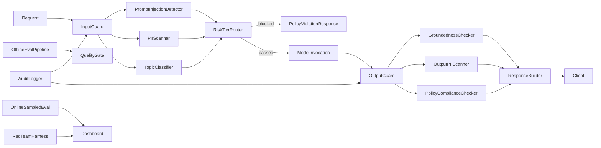

# Chapter 5: Evaluation, Guardrails, and Safety

## Context

> [!info] Quick Reference
> - **Pattern:** Layered guardrails + evaluation pipeline
> - **Scale:** 500 avg / 5,000 peak QPS, risk-tiered depth
> - **Key Techniques:** Input/output classifiers, LLM-as-judge, red-teaming, risk-tiered depth, calibration
> - **Primary Concerns:** False-positive rate < 3%, latency overhead < 200ms, eval freshness
> - **Cross-references:** [[chapter-01|Chapter 1]] (safety as first-class concern), [[chapter-11|Chapter 11]] (finance accuracy), [[chapter-20|Chapter 20]] (healthcare safety)

**Problem statement:** Build evaluation and guardrail systems that reduce hallucinations, policy violations, and sensitive data leakage while preserving utility and maintaining acceptable latency overhead.

### Real-World Examples

- A banking assistant passes offline accuracy tests but fails red-team jailbreak testing in staging; layered guardrails with input/output classifiers catch policy bypass attempts.
- A healthcare chatbot overblocks harmless prompts until threshold calibration is tuned with risk-weighted evaluation sets, improving utility by 35% without increasing policy violations.

---

## Step 1: Understand the Problem and Establish Design Scope

### Simulated Dialogue

**Interviewer:** Design the evaluation and safety system for an enterprise LLM platform serving multiple risk domains.  
**Candidate:** I need to understand the risk tiers, regulatory requirements, and acceptable overhead before designing guardrail depth.

**Candidate:** What risk domains does this platform serve?  
**Interviewer:** Low-risk (internal Q&A), medium-risk (customer-facing support), and high-risk (financial advice, healthcare triage).

**Candidate:** What is the acceptable latency overhead for safety checks?  
**Interviewer:** < 100ms for input checks, < 150ms for output checks. Must not inflate p95 beyond 200ms total overhead.

**Candidate:** What evaluation frequency and coverage is expected?  
**Interviewer:** Offline eval before every deployment. Online eval (sampled) continuously. Red-team exercises quarterly.

### Functional Requirements

- Classify input risk level (prompt injection, PII, policy violation, off-topic) before model invocation.
- Validate output for hallucination, unsupported claims, policy compliance, and PII leakage.
- Support configurable guardrail depth per risk tier (light for low-risk, heavy for high-risk).
- Provide offline evaluation pipeline for model/prompt/retrieval changes with automated quality gates.
- Expose safety telemetry: violation rates, block rates, false-positive rates, guardrail latency.

### Non-Functional Requirements

- **Latency:** input guard < 100ms p95, output guard < 150ms p95.
- **Coverage:** 100% of requests pass through input classifier; 100% of high-risk outputs pass through output verifier.
- **False-positive rate:** < 3% block rate on benign requests (measured via held-out calibration set).
- **Auditability:** every block, flag, or modification is logged with trace ID and policy version.
- **Freshness:** guardrail model/policy updates deployable within 1 hour without downtime.

### Back-of-the-Envelope Estimation

#### Guardrail Throughput

- Platform QPS: 500 (average), 5,000 (peak)
- Input classifier: must handle 5,000 QPS at < 100ms → requires ~50ms/request on GPU
- At 50ms/request with batching: ~20 requests/batch → need capacity for 250 batches/sec at peak
- GPU requirement for input classifier (small BERT-class model): 2-4 GPUs
- Output verifier (for high-risk routes, ~30% of traffic): 1,500 QPS at < 150ms → 1-2 GPUs

#### Evaluation Dataset Sizing

- Offline eval set: 2,000-5,000 labeled examples per domain (question, expected answer, retrieved context, policy labels).
- Red-team set: 500-1,000 adversarial prompts per quarterly exercise.
- Production sampling: 1-5% of live traffic for online eval (50-250 requests/minute at peak).

#### Cost of Guardrails

- Input classifier: ~$0.001/request (small model inference cost).
- Output verifier (LLM-as-judge using smaller model): ~$0.003/request.
- At 500 QPS average: `~$172/day` for full guardrail coverage.
- Trade-off: selectively applying output verifier to high-risk routes only reduces cost by ~70%.

#### Latency Budget Allocation

- Total safety overhead target: < 200ms (input + output combined)
- Input classifier: 40-80ms (batched GPU inference)
- PII scanner: 10-20ms (regex + NER, parallel with classifier)
- Output verifier: 80-120ms (smaller LLM call or classifier)
- Policy lookup: 5-10ms (in-memory rule engine)

---

## Step 2: Propose High-Level Design and Get Buy-In

### Core Architecture Components

- **Input Guard:** prompt injection detector, PII scanner, topic classifier, policy enforcer.
- **Risk Tier Router:** selects guardrail depth based on route/domain risk classification.
- **Output Guard:** hallucination/groundedness checker, PII scanner, policy compliance verifier.
- **Eval Pipeline:** offline benchmark runner, online sampled evaluator, red-team test harness.
- **Policy Engine:** versioned policy rules, threshold configs, and guardrail routing tables.
- **Audit Logger:** immutable log of every guardrail decision with trace ID, policy version, and action.
- **Dashboard/Alerting:** violation rate, block rate, false-positive rate, guardrail latency by risk tier.

### Pipeline A: Guardrail Pipeline (Request-Time)

1. Request arrives; input guard runs in parallel: prompt injection classifier + PII scanner + topic classifier.
2. Risk tier router determines guardrail depth: light (log-only), medium (flag + soft block), heavy (hard block + human review).
3. If input guard triggers hard block: return policy violation response, log event, skip model invocation.
4. If input passes: proceed to model invocation with risk metadata attached.
5. Model generates response (streaming or batch).
6. Output guard runs: groundedness check against retrieved context, PII scan, policy compliance check.
7. If output guard triggers: rewrite (remove PII), flag (add disclaimer), or block (return safe fallback).
8. Response delivered to user; guardrail decisions logged to audit trail.

### Pipeline B: Evaluation Pipeline (Offline + Online)

1. **Offline eval (pre-deployment):**
   - Run model/prompt/retrieval changes against benchmark eval set (2K-5K examples).
   - Compute metrics: Recall@K, citation precision, faithfulness, hallucination rate, policy violation rate.
   - Quality gate: no regression > 2% on any metric vs baseline.
   - If gate passes: promote to canary. If fails: block deployment, report regression details.

2. **Online eval (continuous):**
   - Sample 1-5% of production traffic.
   - Run LLM-as-judge on sampled responses for faithfulness and policy compliance.
   - Track metrics over rolling 24h window with alerting on degradation.

3. **Red-team eval (periodic):**
   - Run adversarial prompt suite against production system.
   - Measure jailbreak success rate, policy bypass rate, PII extraction success.
   - Results feed guardrail model retraining and policy updates.

### Mermaid Architecture Diagram

---

## Step 3: Design Deep Dive

Focus areas for this chapter:

1. **RAG Evaluation Methodology**
2. **Guardrail Pipeline Design**
3. **Safety Testing and Red-Teaming**

### 1) RAG Evaluation Methodology

#### RAG Metric Trade-off Table

| Metric | What It Measures | Strengths | Weaknesses | Use When |
|---|---|---|---|---|
| Recall@K | Retrieved relevant docs in top K | Simple, captures retrieval quality | Ignores generation quality | Retrieval-only eval |
| Citation precision | Generated claims supported by cited source | Directly measures grounding | Requires claim-level annotation | High-stakes RAG |
| Faithfulness | Answer consistency with retrieved context | End-to-end quality signal | Expensive (LLM-as-judge or human) | Release gating |
| Unsupported-claim rate | Fraction of claims not grounded in context | Catches hallucination directly | Binary; misses partial support | Safety-critical domains |
| Answer relevance | Response addresses user query | Captures user satisfaction proxy | Subjective, hard to automate | User-facing quality |

**LLM-as-judge evaluation:**
- Use a separate (often larger) model to judge faithfulness and relevance.
- Anchor with reference answers and rubric to reduce variance.
- Calibrate judge agreement against human labels: target Cohen's kappa > 0.7.
- Cost: ~$0.003-0.01 per judged response (using smaller judge model).
- Latency: 500ms-2s per judgment → not suitable for real-time; use for offline and sampled online eval.

**Evaluation dataset construction:**
- 200 queries per domain, manually curated with: query, ideal answer, required citations, policy-relevant edge cases.
- Include adversarial queries: ambiguous, multi-hop, unanswerable, policy-boundary.
- Version datasets alongside model/prompt versions for reproducibility.
- Refresh quarterly to prevent benchmark overfitting.

### 2) Guardrail Pipeline Design

#### Guardrail Placement Trade-off Table

| Placement | Latency Overhead | Coverage | Complexity | Best For |
|---|---|---|---|---|
| Input-only | 40-80ms | Prevents bad inputs | Misses hallucination | Low-risk routes |
| Output-only | 80-150ms | Catches generation errors | Bad inputs waste compute | Medium-risk routes |
| Input + output | 120-230ms | Full coverage | Highest overhead | High-risk routes |
| Async output (log + review) | 0ms (request path) | Full coverage, delayed action | Violations detected after delivery | Batch/async routes |

**Input guard components:**
- **Prompt injection detector:** fine-tuned classifier (BERT-class) detecting instruction override attempts. Precision target: > 95%. Recall target: > 85%.
- **PII scanner:** regex patterns (SSN, credit card, email) + NER model for names/addresses. Runs in parallel with classifier.
- **Topic classifier:** off-topic detection to prevent misuse (e.g., coding assistant asked for medical advice).
- **Policy enforcer:** rule engine checking input against versioned policy (blocked topics, required disclaimers).

**Output guard components:**
- **Groundedness checker:** compares generated claims against retrieved context. Can be classifier-based (fast, ~50ms) or LLM-based (thorough, ~500ms). Use classifier for real-time, LLM for sampled audit.
- **Output PII scanner:** catches PII leaked from training data or retrieved documents (same pipeline as input but applied to output).
- **Policy compliance checker:** ensures output format, tone, and content adhere to domain policy.
- **Action on violation:** rewrite (strip PII), flag (add disclaimer), soft block (ask user to rephrase), hard block (return safe fallback).

**Risk-tiered guardrail depth:**

| Risk Tier | Input Guard | Output Guard | Eval Frequency |
|---|---|---|---|
| Low (internal Q&A) | Injection detector only | Log-only (async) | Monthly offline |
| Medium (customer support) | Full input suite | Classifier-based groundedness | Weekly offline, daily sampled |
| High (finance, healthcare) | Full input suite + human-in-loop escalation | LLM-based groundedness + PII + policy | Daily offline, continuous sampled |

### 3) Safety Testing and Red-Teaming

#### Red-Team Testing Framework

**Attack categories:**
- **Prompt injection:** direct ("ignore previous instructions") and indirect (injected via retrieved documents).
- **Jailbreak:** role-play, encoding tricks, multi-turn escalation.
- **PII extraction:** probing for training data memorization.
- **Policy bypass:** edge cases at policy boundaries (e.g., borderline medical advice).
- **Denial of service:** extremely long prompts, rapid-fire requests, resource exhaustion.

**Red-team process:**
1. Build adversarial prompt suite (500-1,000 prompts per category).
2. Run against production-equivalent system (same guardrails, same model).
3. Measure: jailbreak success rate (target: < 2%), PII extraction rate (target: 0%), policy bypass rate (target: < 1%).
4. Failures feed guardrail model retraining and policy rule updates.
5. Repeat quarterly; expand suite based on emerging attack patterns.

#### Safety Evaluation Trade-off Table

| Method | Coverage | Cost | Frequency | Best For |
|---|---|---|---|---|
| Rule-based checks | Known patterns only | Very low | Every request | PII, format violations |
| Classifier-based detection | Learned patterns | Low | Every request | Injection, toxicity |
| LLM-as-judge | Nuanced policy checks | Medium | Sampled (1-5%) | Faithfulness, policy compliance |
| Human review | Highest quality | Very high | Escalated cases only | Ambiguous policy decisions |
| Red-team exercises | Adversarial robustness | High (labor) | Quarterly | Attack surface discovery |

### Production Bottlenecks and Mitigations

- **Guardrail latency inflating p95**
  - Symptom: safety overhead exceeds 200ms budget on interactive routes.
  - Mitigation: run input classifiers in parallel, use lightweight models, apply heavy checks only on high-risk routes.

- **False-positive overblocking**
  - Symptom: > 3% of benign requests blocked; user complaints rise.
  - Mitigation: threshold calibration on held-out benign set, per-domain threshold tuning, appeal/override flow.

- **Classifier threshold drift**
  - Symptom: block rate changes without policy changes due to input distribution shift.
  - Mitigation: track threshold stability metrics, re-calibrate monthly, alert on > 1% block rate deviation.

- **Eval blind spots from synthetic-only datasets**
  - Symptom: pass offline eval but fail on real user queries.
  - Mitigation: supplement synthetic benchmarks with anonymized production query samples.

- **Policy version mismatch during deployment**
  - Symptom: new model deployed with old guardrail config; violations spike.
  - Mitigation: atomic deployment of model + guardrail config as versioned unit.

- **Audit log volume and query performance**
  - Symptom: audit queries slow as log volume grows.
  - Mitigation: structured logging, time-partitioned storage, indexed by trace ID and policy version.

### Advanced Techniques

- **LLM-as-judge with calibrated anchors** for nuanced evaluation beyond binary classification.
- **Policy-as-code** guardrails with version-controlled rules in Git, deployed via CI/CD.
- **Risk-tiered abstention** where model returns "I don't know" with confidence score rather than generating potentially harmful content.
- **Constitutional AI principles** as alignment guardrails during fine-tuning.
- **Watermarking** for detecting model-generated content in audit scenarios.

---

## Step 4: Wrap Up

### Final Design Summary

The design makes safety measurable and tunable: layered guardrails with risk-tiered depth, calibrated thresholds tied to false-positive budgets, and evaluation loops that gate every deployment.

### Wrap-Around Concerns

- **Release engineering:** guardrail config deployed atomically with model version; quality gate blocks promotion on any metric regression.
- **Governance:** immutable audit logs with trace IDs, policy version tracking, quarterly red-team reports.
- **Cost controls:** guardrail compute budget per risk tier; selective application of expensive checks to high-risk routes only.
- **Drift controls:** monthly threshold recalibration, weekly eval set refresh, production sampling for distribution shift detection.

---

## Step 5: Interviewer Curveballs

### Interviewer Follow-ups & Frequently Asked Questions (FAQ)

Q: Your guardrails are blocking 8% of benign requests. How do you fix this without reducing safety?

**The Ideal Answer:** Analyze blocked requests to identify false-positive patterns. Raise classifier threshold on specific categories where precision is low. Add a "soft block" tier that flags instead of blocks.

**Deep Dive & Trade-offs:**
- Threshold tuning is per-category, not global. Injection detector may need different threshold than toxicity classifier.
- Soft block (flag + disclaimer) preserves utility while logging potential issues for review.
- Hold-out calibration set of 500+ benign examples ensures threshold changes are validated.

**The Interviewer's Rubric:** Checking nuanced threshold management beyond binary block/allow.

Q: How do you evaluate faithfulness when you don't have ground-truth answers?

**The Ideal Answer:** Use LLM-as-judge with retrieved context as reference. The judge checks whether each generated claim is supported by the provided context, not whether it matches a golden answer.

**Deep Dive & Trade-offs:**
- Faithfulness evaluation requires only context + response, not golden answers.
- Calibrate judge against 200+ human-labeled examples to measure agreement (target kappa > 0.7).
- Supplement with unsupported-claim rate as cheaper proxy metric.

**The Interviewer's Rubric:** Checking evaluation methodology sophistication for RAG systems.

Q: A red-team exercise reveals a jailbreak that bypasses your input classifier. What do you do?

**The Ideal Answer:** Add the attack pattern to training data, retrain classifier, and add a rule-based catch for the specific pattern as immediate mitigation. Then evaluate if output guard would have caught the harmful response.

**Deep Dive & Trade-offs:**
- Rule-based patch is fastest (deploy in minutes) but brittle against variations.
- Classifier retraining is more robust but takes hours/days.
- Layered defense: if input guard misses, output guard should still catch harmful content.
- Defense in depth is the principle: no single layer should be a single point of failure.

**The Interviewer's Rubric:** Checking incident response depth and defense-in-depth thinking.

Q: How do you prevent LLM-as-judge from being gamed or miscalibrated?

**The Ideal Answer:** Anchor with reference rubrics and calibration examples. Use multiple judge prompts and aggregate. Track judge-human agreement over time and retune when it drops below 0.7 kappa.

**Deep Dive & Trade-offs:**
- Single judge prompt is brittle; multi-prompt aggregation reduces variance.
- Periodic human audit of judge decisions (100+ samples/month) catches drift.
- Different judge model than production model reduces self-evaluation bias.

**The Interviewer's Rubric:** Checking robustness of evaluation infrastructure.

Q: What is the latency budget split between input and output guardrails?

**The Ideal Answer:** Input guard: 40-80ms (parallel classifiers). Output guard: 80-150ms (groundedness + PII). Total overhead < 200ms. For low-risk routes, skip output guard to stay under 100ms total.

**Deep Dive & Trade-offs:**
- Running classifiers in parallel (not sequential) is key to meeting latency budget.
- Heavyweight LLM-based groundedness check is async for low-risk, synchronous for high-risk.
- Pre-compute and cache common policy lookups to avoid per-request DB hits.

**The Interviewer's Rubric:** Checking latency-aware safety system design.

Q: How do you handle PII that appears in retrieved documents (not user input)?

**The Ideal Answer:** Apply PII scanner to retrieved context before injecting into prompt. Strip or mask PII at the retrieval layer, not just at input/output boundaries.

**Deep Dive & Trade-offs:**
- PII in retrieved docs can leak into generated responses even if input was clean.
- Scanning at retrieval time adds ~10-20ms but prevents downstream leakage.
- For high-risk domains: pre-scan and tag documents at indexing time; filter PII-tagged chunks at retrieval.

**The Interviewer's Rubric:** Checking understanding of PII leakage vectors beyond obvious input/output paths.

Q: How often should you refresh your evaluation benchmark set?

**The Ideal Answer:** Quarterly for core benchmarks. Supplement continuously with anonymized production query samples to catch distribution shift.

**Deep Dive & Trade-offs:**
- Stale benchmarks lead to goodhart's law: optimizing for the benchmark rather than real quality.
- Production sampling ensures eval reflects actual user behavior.
- Version benchmarks alongside model versions for reproducible comparisons.

**The Interviewer's Rubric:** Checking evaluation lifecycle management maturity.

Q: What is the minimum safety stack for an MVP launch vs a regulated domain?

**The Ideal Answer:** MVP: input injection classifier + output PII scanner + basic topic filter. Regulated: full input/output guard suite + LLM-based groundedness + human-in-loop escalation + audit logging + quarterly red-team.

**Deep Dive & Trade-offs:**
- MVP stack: ~50ms overhead, ~$50/day cost. Catches the worst offenders.
- Regulated stack: ~200ms overhead, ~$500/day cost. Defensible under audit.
- Key: design the interface to support adding layers without re-architecting.

**The Interviewer's Rubric:** Checking progressive safety maturity planning.

## End of Chapter

- **Key takeaway:** Safety is not a binary switch but a tunable system. Risk-tiered guardrails, calibrated thresholds, and evaluation loops make safety measurable and improvable.
- **What to practice:** Design a guardrail pipeline with latency budget, specify which checks are synchronous vs async, and explain threshold calibration.
- **Interview drill:** Given a 5% false-positive block rate on a high-risk route, walk through your diagnosis and calibration workflow.
