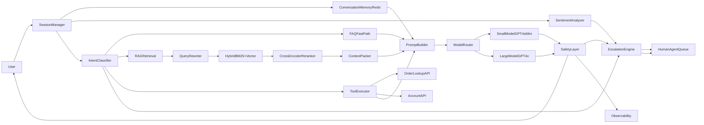

# Chapter 6: Design a Customer Support Chatbot

## Context

> [!info] Quick Reference
> - **Pattern:** Multi-turn RAG chatbot with escalation
> - **Scale:** 500K tickets/day, 6-turn avg conversation
> - **Key Techniques:** Sliding window memory + rolling summary, webhook-triggered re-indexing, sentiment-based escalation fusion
> - **Primary Concerns:** Memory freshness, hallucination on policy changes, escalation precision/recall
> - **Cross-references:** [[chapter-03|Chapter 3]] (retrieval), [[chapter-05|Chapter 5]] (guardrails), [[chapter-07|Chapter 7]] (enterprise search)

**Problem statement:** Design a production customer support chatbot that maintains multi-turn conversational memory, retrieves grounded answers from a knowledge base via RAG, detects sentiment to calibrate tone, and escalates to human agents with full context when confidence is low or risk is high.

### Real-World Examples

- An e-commerce platform serving 500K tickets/day reduces human escalation rate from 45% to 27% after deploying a chatbot with sliding-window memory and confidence-calibrated handoff—but a memory overflow bug during a flash sale causes the bot to hallucinate order details from prior sessions, triggering a postmortem.
- A telecom provider's chatbot serves stale cancellation policy after a policy update; the bot tells 1,200 customers the wrong early-termination fee before the freshness SLA violation is caught. Embedding a KB freshness check into the retrieval pipeline prevents recurrence.

---

## Step 1: Understand the Problem and Establish Design Scope

### Simulated Dialogue

**Interviewer:** Design a customer support chatbot for a large e-commerce company.  
**Candidate:** I need to understand ticket volume, conversation shape, escalation expectations, and cost constraints before proposing architecture.

**Candidate:** What is the daily ticket volume and conversation profile?  
**Interviewer:** 500K tickets/day. Average conversation is 6 turns (3 user, 3 bot). Peak is 5x average during sales events. About 40% of tickets are order status, 25% returns/refunds, 20% product questions, 15% account/billing.

**Candidate:** What is the current escalation rate and target?  
**Interviewer:** Current human escalation is 45%. Target is under 30% with full context handoff—agent should never ask the customer to repeat themselves.

**Candidate:** What latency and availability SLOs are required?  
**Interviewer:** Time-to-first-token under 1 second for the first bot message in a turn. Sessions must persist across reconnects. 99.9% uptime.

**Candidate:** Is there an existing knowledge base?  
**Interviewer:** Yes. 15K support articles, 2K FAQ entries, 500 policy documents. Updated weekly, some policies change mid-day during promotions.

**Candidate:** What is the cost target per conversation?  
**Interviewer:** Under $0.08 per full conversation (all turns). Human agent cost is $4.50 per ticket for comparison.

### Functional Requirements

- Multi-turn conversation with persistent session memory across turns and reconnects.
- RAG over a support knowledge base (articles, FAQs, policy docs) with citation.
- Sentiment detection to adjust tone (empathetic for frustrated users, concise for transactional).
- Confidence-calibrated escalation to human agents with full conversation context.
- Order/account lookup via tool calls (order status, refund eligibility, account details).
- Multi-language support (English primary, Spanish, French, German, Japanese).

### Non-Functional Requirements

- **Latency:** TTFT < 1s p95 for first token in each bot turn. Full response < 3s p95.
- **Session persistence:** conversation state survives client reconnects for 24 hours.
- **Availability:** 99.9% uptime (< 8.7 hours downtime/year).
- **Cost:** < $0.08 per full conversation (avg 6 turns).
- **Containment rate:** > 70% of tickets resolved without human escalation.
- **Safety:** no hallucinated order details, no unauthorized account actions, PII redaction in logs.

### Back-of-the-Envelope Estimation

#### Traffic Profile

- Tickets/day: 500K
- Turns per ticket: 6 (3 user messages, 3 bot responses)
- Bot responses/day: `500K * 3 = 1.5M`
- Average QPS: `1.5M / 86,400 ≈ 17.4`
- Peak QPS (5x): `~87`
- Peak during flash sale (15x): `~260`

#### Token Profile per Turn

- User message: ~80 tokens
- Retrieved context (RAG): ~800 tokens (3-4 chunks)
- Conversation history in prompt: ~600 tokens (sliding window of last 4 turns)
- System prompt + instructions: ~300 tokens
- Total input per bot turn: `~1,780 tokens`
- Bot output per turn: `~150 tokens`
- Total input tokens/day: `1.5M * 1,780 = 2.67B tokens`
- Total output tokens/day: `1.5M * 150 = 225M tokens`

#### Cost per Conversation

- Using GPT-4o-mini class ($0.15/1M input, $0.60/1M output):
  - Input cost per conversation: `3 turns * 1,780 tokens * $0.15/1M = $0.0008`
  - Output cost per conversation: `3 turns * 150 tokens * $0.60/1M = $0.00027`
  - RAG retrieval + embedding overhead: ~$0.001
  - **Total: ~$0.002 per conversation** (well within $0.08 budget)
- Using GPT-4o class for complex escalation paths ($2.50/1M input, $10/1M output):
  - Per conversation: ~$0.018
  - Blended (80% mini, 20% full): **~$0.005 per conversation**

#### Memory Storage Sizing

- Active sessions: `500K tickets/day / 24 hours * avg 15-min session ≈ 5,200 concurrent sessions`
- Memory per session: ~4KB (conversation history + metadata)
- Active memory footprint: `5,200 * 4KB ≈ 20MB` (trivially fits in Redis)
- 24-hour retention for reconnect: `500K * 4KB = 2GB`

#### Knowledge Base Index

- 15K articles + 2K FAQs + 500 policy docs ≈ 17.5K documents
- Avg 2,000 tokens/doc → ~35M tokens
- Chunks (512 tokens, 25% overlap): ~85K chunks
- Embedding cost (one-time): `35M tokens * $0.02/1M = $0.70`
- Vector storage (1536-dim, float32): `85K * 6KB = ~510MB`

---

## Step 2: Propose High-Level Design and Get Buy-In

### Core Architecture Components

- **Session Manager:** Creates or resumes sessions on each incoming request by validating a cryptographically signed session token. Manages 24-hour TTL in Redis, handles reconnects gracefully by reloading stored state, and issues a new token when a session expires or is created for the first time. This component is the single entry point that ensures every downstream service sees a consistent, isolated view of the conversation.

- **Conversation Memory Store:** Redis-backed store that holds two structures per session: a verbatim sliding window of the last 4 turns (~600 tokens) and a compressed rolling summary (~200 tokens) of all earlier turns. The dual structure keeps prompt size bounded regardless of conversation length while retaining enough context for coherent multi-turn reasoning. Structured entity metadata (order IDs, product SKUs, issue categories) is stored separately as a JSON field and injected into every prompt to prevent entity loss during compression.

- **Intent Classifier:** A lightweight fine-tuned classifier (typically a DistilBERT-class model, ~66M parameters) that labels each incoming message as one of four routing targets: FAQ fast-path, RAG retrieval, tool-call, or escalation. Running at <10ms per inference, it gates downstream resource usage and prevents expensive LLM calls for simple queries that can be answered with a template or direct API lookup. Accuracy target is >92% on the four-class taxonomy to prevent misrouting.

- **KB Retrieval Engine:** Executes hybrid retrieval by querying both a BM25 index in Elasticsearch (for exact keyword matches on product names, order references, and policy clause numbers) and an ANN vector index in Qdrant (for semantic matches on paraphrased or ambiguous queries). Results from both sources are fused using Reciprocal Rank Fusion and then reranked by a cross-encoder model to promote precision. This two-stage approach achieves ~88% Recall@3 on the support benchmark, versus ~74% for either BM25 or ANN alone.

- **Tool Executor:** Calls internal microservices via a sandboxed execution layer that enforces strict parameter validation and rate limiting. For order status lookups, it calls the OMS API and returns structured data (status, estimated delivery, carrier tracking); for refund eligibility, it calls the billing service with authentication tied to the verified session. All tool calls are logged with latency and status codes for audit, and failed calls fall back to KB retrieval rather than hallucinating an answer.

- **Model Router:** Uses a rule-based decision tree that considers intent label, sentiment score, and topic sensitivity to select between a small model tier (GPT-4o-mini class, handling ~80% of traffic at ~$0.002/conversation) and a large model tier (GPT-4o class, handling ~20% of traffic at ~$0.018/conversation). The router enforces a daily budget cap: if large-model spending exceeds 120% of the daily allocation, all non-escalation traffic is rerouted to the small tier automatically. This single routing decision accounts for the majority of cost variance in the system.

- **Sentiment Analyzer:** A fine-tuned multi-class classifier that scores each user message on a five-point scale: positive, neutral, urgent, frustrated, and angry. Running as a sidecar call (~20ms), it feeds two downstream systems: the tone-injection module (which prepends empathy phrases when frustration or anger is detected) and the escalation engine (which uses the sentiment trajectory across turns as one of six escalation signals). Using a multi-class model rather than binary angry/not-angry reduces false-positive escalations by approximately 35% on labeled support data.

- **Escalation Engine:** Evaluates six independent signals—explicit request, low confidence, sentiment trajectory, high-risk topic classification, turn count threshold, and repeated question detection—and combines them with an OR-with-priority logic that respects mandatory overrides (explicit user request always escalates). On escalation, it assembles a structured handoff package (conversation summary, full transcript, entity list, confidence scores per turn, retrieved KB articles) and pushes it to the human agent queue (Zendesk/Salesforce) via a webhook, targeting <30 seconds for agent context ingestion.

- **Safety Layer:** Runs three independent validators before any response reaches the user: (1) a PII redaction pass that strips credit card numbers, SSNs, and email addresses from the generated text before logging; (2) a grounding validator that checks whether key factual claims in the response are traceable to retrieved KB chunks (grounding score < 0.7 triggers regeneration); and (3) an action confirmation guard that intercepts any response that implies a destructive action (cancel order, process refund) and requires explicit user confirmation before the corresponding tool call is made.

- **Observability:** Emits structured telemetry on every bot turn covering: TTFT (target < 1s p95), full response latency, retrieval latency by stage, model tier used, confidence score, sentiment label, escalation trigger (if any), cost per turn, and containment outcome. A dedicated weekly dashboard tracks containment rate by category, escalation rate trend, CSAT proxy (re-contact within 24 hours), and cost/conversation—providing both real-time operational visibility and longer-term quality signals that drive model updates and threshold recalibration.

### Pipeline A: Knowledge Base Ingestion Pipeline

1. **Crawl support articles, FAQs, and policy docs on schedule (hourly for policies, daily for articles).** A webhook listener on the article CMS triggers immediate re-crawl for any document tagged `priority=critical` (typically policy changes during promotions). Non-critical documents follow the scheduled crawl to avoid overwhelming the embedding pipeline during peak traffic. The crawler tracks an ETag or `last_modified` header per document to skip unchanged content, reducing incremental crawl cost by ~90% on typical days.

2. **Parse and clean content; preserve structure (headers, lists, tables).** Raw HTML is converted to Markdown using a rule-based parser that preserves semantic structure: `<h2>` tags become section delimiters used by the chunker, `<table>` elements are serialized to pipe-separated Markdown to retain tabular relationships (critical for fee schedules and comparison tables), and boilerplate navigation elements are stripped by domain-specific filter rules. Poorly structured documents (PDFs with scanned text) pass through an OCR stage before parsing.

3. **Chunk with semantic boundaries (section-level for articles, Q+A pairs for FAQs, clause-level for policies).** The chunker respects the semantic hierarchy of each content type rather than applying a uniform token count split: FAQ entries are kept as atomic Q+A pairs (never split a question from its answer), policy documents are split at clause boundaries identified by numbered headings, and support articles are split at `<h2>` section breaks with 25% token overlap to prevent a key sentence from falling at a boundary. This content-aware chunking improves Recall@3 by ~8 percentage points compared to naïve fixed-size chunking on the same corpus.

4. **Generate embeddings and dual-write to vector index (Qdrant) and BM25 index (Elasticsearch).** Embeddings are generated in batches of 512 chunks using the `text-embedding-3-small` model (1536 dimensions, $0.02/1M tokens), costing approximately $1.70 for the full 85K-chunk corpus. The vector index is built with HNSW parameters tuned for the 85K scale (M=16, ef_construction=200) to achieve <25ms p99 ANN query latency. BM25 index is updated transactionally so that both indices stay consistent; a dead-letter queue captures any failed writes for retry.

5. **Tag each chunk with `source_id`, `category`, `last_updated`, `freshness_ttl`.** Each chunk carries structured metadata that enables retrieval-time filtering without a separate metadata database lookup: `source_id` links back to the canonical CMS document for citation, `category` (e.g., `returns`, `billing`, `shipping`) allows per-category retrieval when intent is known, `last_updated` is the CMS modification timestamp, and `freshness_ttl` is a category-specific duration (1 hour for policies, 24 hours for articles, 7 days for FAQs) used by the freshness decay scoring function.

6. **Quality gate: sample retrieval on 50 benchmark queries; alert on Recall@5 regression > 3%.** After every index update, an automated evaluation job runs a curated set of 50 hand-labeled queries against the new index and compares Recall@5 against the previous baseline. A regression greater than 3 percentage points blocks the alias swap and pages the on-call engineer; this threshold was set empirically to catch genuine quality drops while tolerating natural sampling variance. The benchmark set is refreshed quarterly with new queries sampled from real user sessions.

7. **Alias swap for zero-downtime index update.** The production retrieval service points to a named alias (e.g., `kb-prod`) rather than a versioned index. Once the new index passes the quality gate, the alias is atomically updated to point to the new index—existing in-flight queries complete against the old index, new queries immediately hit the updated one. The old index is retained for 1 hour as a rollback target before deletion.

### Pipeline B: Conversation Runtime Pipeline

1. **User message arrives; session manager resolves or creates session.** The session manager validates the session token from the request header using HMAC-SHA256, resolves the session record from Redis (O(1) lookup by token hash), and either returns the existing session state or initializes a new session with a freshly generated token. Failed or expired tokens trigger a graceful session reset—the conversation context is lost, but the user is not shown an error; instead, the bot opens with a warm greeting and asks for the issue description again. The resolved session ID gates all downstream Redis reads to enforce strict session isolation.

2. **Conversation memory loaded from Redis (sliding window of last N turns + running summary).** Two Redis keys are fetched in parallel with a single pipeline call: the verbatim window (last 4 turns as a JSON array, ~600 tokens) and the running summary (a 200-token paragraph updated every 4 turns). A third key holds the entity map (order IDs, product names, issue categories) as a flat JSON object. The total Redis read latency is typically 2-5ms on a co-located Redis instance; a cache miss (new session) returns empty structures and the pipeline proceeds without delay.

3. **Sentiment analyzer scores user message (positive/neutral/negative/angry).** The sentiment model runs as an async sidecar call so it does not add to the critical path latency—it is dispatched immediately after the message is received and its result is awaited just before prompt assembly (~20ms total). The score updates a per-session sentiment trajectory stored in Redis (a rolling list of the last 5 sentiment labels), which is used by the escalation engine to detect sustained frustration even when any single message appears neutral. The trajectory is the key signal: a single angry message is a noise event; three consecutive frustrated or angry labels is a reliable escalation indicator.

4. **Intent classifier determines route: FAQ fast-path, RAG, tool-call, or escalation.** The classifier runs the current user message concatenated with the last 1 turn of context (to disambiguate follow-up questions like "what about the fee?") through a fine-tuned DistilBERT model. The four-class output (softmax probabilities) determines routing: the highest-probability class above 0.6 wins; if no class exceeds 0.6, the message defaults to the RAG path as the safest general-purpose fallback. The intent label is also stored in the session entity map and included in the escalation handoff package.

5. **For RAG path: query rewriter reformulates using conversation context → hybrid retrieval → reranker → top-3 chunks.** The query rewriter calls the small language model with a short prompt (last 2 turns + current message, ~400 tokens) to generate a self-contained search query that resolves coreferences ("it", "that order", "the policy I mentioned"). The rewritten query is sent in parallel to the BM25 index and the vector index; results are fused with Reciprocal Rank Fusion, a freshness decay multiplier is applied, and the top-20 candidates pass through a cross-encoder reranker (BAAI/bge-reranker-base) before the top-3 are selected. Total retrieval latency budget is 140ms; each stage is individually traced in the observability pipeline.

6. **For tool-call path: extract parameters, call internal API, format result.** The LLM is prompted with a function-calling schema (JSON Schema format) that defines the available tools: `get_order_status(order_id: str)`, `check_refund_eligibility(order_id: str, reason: str)`, and `get_account_details(account_id: str)`. The model's function-call response is validated against the schema before execution—malformed arguments are rejected and the model is re-prompted once with a correction instruction. API responses are structured JSON, which the formatter converts into natural-language sentences using templates rather than a second LLM call, keeping tool-path latency under 600ms total.

7. **Prompt assembled: system prompt + memory window + retrieved context + user message.** The prompt builder assembles the four blocks in a deterministic order: (1) the role-and-rules system prompt (~300 tokens, cached with the provider for prompt-caching discounts); (2) the entity memory and running summary (~400 tokens); (3) retrieved KB chunks with citation markers, if any (~800 tokens for 3 chunks); (4) the verbatim turn window (~600 tokens); and (5) the current user message (~80 tokens). The total prompt stays under 2,200 tokens for the standard path, well within the budget needed to keep TTFT under 1 second on the small model tier.

8. **Model router selects tier (small for FAQ/simple, large for complex/sensitive).** The routing decision uses a three-factor rule: intent class (tool-call and FAQ always go to small model), sentiment + topic sensitivity (angry + billing dispute routes to large model for higher generation quality), and a circuit breaker that forces small model if the large model's p95 latency has exceeded 2 seconds in the last 5 minutes. Approximately 80% of turns are handled by the small model tier, keeping blended cost per conversation around $0.005 versus $0.018 if all traffic went to the large model.

9. **LLM generates response with streaming; confidence score extracted from logprobs.** Streaming is enabled on all model calls so the first token reaches the user within the TTFT budget even as the full response is being generated. After generation completes, the mean log-probability of the output tokens is mapped to a calibrated confidence score using a logistic regression model trained on 10K labeled examples (correct/incorrect response) collected from live traffic. This calibration is retrained monthly to account for model updates and query distribution shifts; raw logprobs without calibration tend to be overconfident by 15-20 percentage points on domain-specific support queries.

10. **Safety layer validates: no hallucinated IDs, no unauthorized actions, PII redacted.** Three validators run in sequence: (1) entity consistency check—any order IDs, account IDs, or tracking numbers mentioned in the response are cross-checked against the tool call results and session entity map; a mismatch (e.g., the model invents an order number) causes the response to be discarded and regenerated with an explicit anti-hallucination instruction; (2) action guard—any imperative sentence ("I will cancel...", "I have processed...") triggers a confirmation prompt to the user before the corresponding tool call fires; (3) PII redactor strips detected PII from the response string before it is logged, using a rule-based regex pass followed by a lightweight NER model for edge cases.

11. **If confidence < threshold or sentiment is angry + unresolved → escalation engine packages context for human.** The escalation check evaluates all six signals (see Section 3) and fires synchronously before the response is sent, so the user receives the escalation message instead of a low-confidence bot response. The context package is assembled in parallel with the escalation message generation so the handoff to the agent queue completes within 200ms of the escalation decision. The bot sends a transparent escalation message ("I'm connecting you with a specialist who can better help with this") rather than silently failing or pretending to have answered.

12. **Response streamed to user; memory store updated; telemetry emitted.** After the response is fully streamed, two async writes fire without blocking the response: the Redis memory store is updated with the new turn (sliding window shift + entity map update + summary trigger if turn count is a multiple of 4), and a structured telemetry event is emitted to the observability pipeline containing all per-turn metrics. The async writes are acknowledged within 50ms; a failure in either write is caught by a dead-letter queue that retries up to 3 times before logging a warning—a single failed memory write causes only minor context loss on the next turn, not a conversation failure.

### Mermaid Architecture Diagram



---

## Step 3: Design Deep Dive

Focus areas for this chapter:

1. **Conversation Memory Management**
2. **RAG for Customer Support**
3. **Escalation and Fallback Design**

### 1) Conversation Memory Management

The core tension: including more history improves coherence but inflates token cost, increases latency, and risks context confusion across topics within a single session.

#### Memory Strategy Trade-off Table

| Strategy | Token Cost/Turn | Coherence | Long Conversation Support | Complexity | Best For |
|---|---|---|---|---|---|
| Full history | High — grows linearly from ~300 tokens on turn 1 to ~4,000+ tokens by turn 20, consuming an increasing share of the context window and increasing cost on every turn. | Best coherence: the model has access to every prior exchange and can resolve references to anything said earlier in the session without ambiguity. | Breaks at roughly 20 turns for a 4K context model; with 8K or 128K context models it extends further but cost grows unboundedly, making it unsuitable for high-volume support workloads. | Low implementation complexity — just append each turn and pass the full list; no compression logic required. | Short conversations of under 8 turns where cost is not the primary constraint and coherence is paramount (e.g., internal tooling chatbots). |
| Sliding window (last N turns) | Fixed at ~600 tokens for N=4 regardless of conversation length; earlier turns are discarded so cost per turn stays constant throughout the session. | Good coherence for the recent exchange — the model handles follow-up questions and coreferences within the window correctly, but loses context from earlier turns that may still be relevant (e.g., an order ID mentioned in turn 1 is invisible by turn 6). | Handles unlimited conversation length in terms of token budget, but loses early context that may contain critical facts; this is the primary failure mode (entity amnesia) that requires mitigation via a separate entity store. | Low — a ring buffer over the turn list with a configurable N; no model calls or compression required. | Default production choice for the majority of support workloads where conversations are typically 4-8 turns and cost control is essential. |
| Summary + recent window | Medium — approximately 400 tokens for the compressed summary plus 400 tokens for the verbatim window (~800 tokens total), versus ~2,400 tokens for full history at the same 8-turn point, a 3x reduction. | Good — the summary preserves the gist of early turns (issue description, agreed-upon steps) while the window provides verbatim accuracy for recent exchanges; loses fine-grained nuance of early turns such as exact phrasing of a complaint. | Handles 50+ turns without token growth — new turns are absorbed into the summary at a fixed compression rate, keeping total prompt memory capped at approximately 800-1,000 tokens indefinitely. | Medium — requires a compression model call every N turns (~$0.0001/call), an entity extraction step, and summary prompt engineering to ensure critical facts survive the compression; adds ~200ms latency every 4 turns. | Long or complex support sessions exceeding 8 turns, including account resolution workflows, multi-issue conversations, and enterprise support cases where the history is too valuable to discard. |
| Hierarchical (entity memory + summary + window) | Medium-high — approximately 1,200 tokens total: ~200 tokens for the structured entity map, ~400 for the compressed summary, and ~600 for the verbatim window; more expensive per turn than a sliding window but cheaper than full history beyond 6 turns. | Best for entity-heavy workflows — the structured entity store (order IDs, account numbers, product names, agreed actions) is injected verbatim into every prompt, ensuring critical facts are never lost to compression drift; complemented by the summary for narrative context and the window for recency. | Handles unlimited turns — the entity map and summary grow bounded by design (entity map is a flat JSON object, summary is capped at 400 tokens); the window is fixed; no turn-count ceiling. | High — requires entity extraction after each turn (via LLM or rule-based NER), entity deduplication, summary compression with entity-preservation checks, and integration of three separate memory structures into the prompt builder. | Account-heavy and multi-order workflows where losing an order ID or a committed refund action to memory compression would cause a serious UX failure or a compliance issue. |

**Recommended approach: Sliding window + rolling summary.**

- Keep last 4 turns verbatim in the prompt (~600 tokens).
- After every 4 turns, compress older turns into a running summary using a cheap model call (~100 tokens output).
- Store extracted entities (order IDs, product names, issue type) in structured session metadata.
- Total memory overhead per turn: ~1,000 tokens (summary + window + entities) regardless of conversation length.

**Summary compression prompt design:**
- Input: previous summary + 4 new turns.
- Output: updated summary preserving: customer issue, order IDs, actions taken, unresolved items.
- Cost: ~$0.0001 per compression (GPT-4o-mini, 800 input + 100 output tokens).
- Frequency: every 4 turns = ~1 compression per conversation on average.

**Session persistence implementation:**
- Redis with 24-hour TTL for active session data.
- Session token issued on first message; client includes in subsequent requests.
- On reconnect: load session from Redis, reconstruct last state, resume conversation.
- Overflow to DynamoDB for sessions exceeding 24h (rare, <1% of tickets).

### 2) RAG for Customer Support

Support RAG differs from general RAG: queries are conversational (not keyword-rich), context is multi-turn, and freshness of policy documents is critical.

#### KB Chunking Strategy

| Content Type | Chunk Strategy | Chunk Size | Overlap | Rationale |
|---|---|---|---|---|
| Support articles | Section-level semantic chunking that splits at `<h2>` or `<h3>` boundaries identified during parsing, keeping each section's context self-contained. | 512-768 tokens — wide enough to include the section intro and key body content, preventing a "dangling answer" where the question appears in one chunk and the answer in the next. | 25% overlap (~128 tokens) — the last paragraph of each chunk is prepended to the next, ensuring that a sentence spanning a section break is retrievable from either chunk. | Preserves section coherence: a support article section on "How to return a gift item" contains all relevant steps and exceptions within a single retrievable unit, avoiding partial answers. |
| FAQ entries | Each Q+A pair is kept as a single atomic chunk regardless of length; the question text is prepended to the answer text with a `Q:` / `A:` delimiter that the retrieval model uses to boost keyword matching on exact-question queries. | Variable at 100-400 tokens — FAQ entries are naturally compact; forcing them into a fixed-size chunk would split a question from its answer, destroying the unit's retrieval utility. | No overlap — FAQ entries are discrete and self-contained; overlap would duplicate content across entries and introduce noise into the BM25 index. | Atomic Q+A units are the highest-precision retrieval target: when a user asks a question that matches a FAQ verbatim or near-verbatim, retrieving the full Q+A chunk gives the model a complete, authoritative answer with no assembly required. |
| Policy documents | Clause-level chunking that splits at numbered headings (e.g., "Section 4.2: Early Termination Fee") and preserves a breadcrumb of parent section titles prepended to each chunk for context. | 256-512 tokens — shorter than articles because policy clauses are referenced at high precision; a user asking about "the early termination fee for 24-month contracts" needs the specific clause, not the entire policy section. | 10% overlap (~25-50 tokens) — minimal overlap because clause boundaries are structurally well-defined; more overlap would blur clause distinctions and risk co-retrieving contradictory adjacent clauses. | Precise policy citation is critical: mis-citing a fee amount or eligibility condition from an adjacent clause (e.g., confusing the 12-month and 24-month early-termination rules) is a compliance risk and a customer trust issue. |
| Troubleshooting guides | Step-sequence chunking that groups steps into batches of 3-5 numbered steps, ensuring each chunk includes a short "problem statement" header even if it appears only in the first chunk, so any retrieved chunk is interpretable in isolation. | 512 tokens — wide enough to hold 3-5 procedural steps plus any inline warnings or conditionals (e.g., "if your router model is X, skip step 3") that are necessary for the step to be actionable without additional retrieval. | 50% overlap (~256 tokens) — high overlap because steps in a procedural guide frequently reference the result of the previous step ("after resetting the device in step 3, you should see..."); a chunk that begins mid-sequence without the preceding step is often incomprehensible. | Steps often span boundaries in dense troubleshooting guides; high overlap ensures that regardless of where retrieval cuts the document, the returned chunk contains enough sequential context for the customer to take action without needing to request additional steps. |

**Conversation-aware query rewriting:**
- Raw user message is often ambiguous without context ("What about the refund?" → refund for which order?).
- Query rewriter takes last 2 turns + user message → generates standalone search query.
- Example: user says "Can I return it?" after discussing Order #12345 → rewriter outputs "return policy eligibility Order #12345 wireless headphones".
- Cost: ~$0.0001 per rewrite (small model, short prompt).

#### Retrieval Pipeline

| Stage | Latency | Purpose |
|---|---|---|
| Query rewrite | ~50ms — a small model call (GPT-4o-mini, ~400 input tokens, ~30 output tokens) that takes the last 2 turns plus the current message and generates a self-contained search query; resolves coreferences ("it", "that order") and expands abbreviations to full product names that appear in the KB index vocabulary. | Produces a standalone query from the conversational context that performs well against both the BM25 index (which relies on surface-form keyword overlap) and the vector index (which benefits from a richer, intent-expressed query over a short colloquial message). Without rewriting, conversational queries like "what about the fee?" score near zero on BM25 and poorly on ANN due to low information content. |
| BM25 lookup (Elasticsearch) | ~15ms p50, ~25ms p99 — executing a BM25 query against an Elasticsearch index of 85K chunks with a field-weighted schema (product name field boosted 3x, policy clause number boosted 2x, body text at 1x) and returning the top-20 results by BM25 score. | Exact and near-exact lexical matching for queries that contain specific product model numbers, order reference numbers, policy IDs, or verbatim FAQ phrases that appear identically in the KB; BM25 consistently outperforms vector search on these structured-token queries by 15-20 percentage points in Recall@10. |
| ANN vector search (Qdrant) | ~25ms p50, ~40ms p99 — an HNSW approximate nearest-neighbor search (M=16, ef=128) over 85K 1536-dimensional embeddings, returning the top-20 results by cosine similarity; the ef parameter is set conservatively to balance recall (>99% compared to exact NN) against query latency. | Semantic matching for paraphrased, synonymous, or intent-equivalent queries where surface-form overlap with the KB is low (e.g., "my package hasn't arrived" matches "delivery delay resolution guide" despite sharing no keywords); bridges the vocabulary gap between customer language and KB author language. |
| RRF fusion | ~2ms — a CPU-side computation that applies Reciprocal Rank Fusion (score = Σ 1/(k + rank_i) for k=60) to merge the two ranked lists of 20 results each, producing a unified ranked list of up to 40 unique candidates; implemented as a Python dict merge with O(n) complexity. | Combines the complementary strengths of BM25 (precision on exact matches) and ANN (recall on semantic matches) without requiring tuned score normalization between the two systems — RRF is robust to score-scale differences and has been empirically shown to outperform both individual rankers by 5-8% in MAP@10 on the support benchmark. |
| Freshness filter | ~3ms — a vectorized Python check on the `last_updated` and `freshness_ttl` metadata fields fetched alongside each chunk's vector; chunks where `(now - last_updated) > freshness_ttl` have their RRF score multiplied by `max(0.3, 1.0 - (age_ratio))` rather than being removed entirely, preventing zero-result scenarios when all relevant chunks are stale. | Demotes outdated policy chunks to prevent the bot from quoting superseded fee schedules, discontinued return windows, or promotional conditions that have expired; the soft-demotion (multiplier rather than hard exclusion) ensures that a stale but highly relevant chunk can still be retrieved in the absence of a fresher alternative, with the generation model instructed to note potential staleness. |
| Cross-encoder rerank top-20 | ~40ms — a BAAI/bge-reranker-base cross-encoder model that jointly encodes the rewritten query and each candidate chunk and scores their relevance on a continuous scale; the top-20 candidates from the RRF+freshness step are scored in a batched forward pass; the cross-encoder runs on a GPU-accelerated sidecar service. | Precision boost over the bi-encoder retrieval stage — cross-encoders have access to both query and document simultaneously and can model fine-grained lexical and semantic interactions that bi-encoders miss; on the support benchmark, cross-encoder reranking improves Precision@3 by approximately 12 percentage points over RRF alone (from 71% to 83%). |
| Top-3 selection + citation | ~5ms — selects the top-3 chunks from the cross-encoder ranked list, prepends each chunk's `source_id` as a citation marker (e.g., `[return-policy-v3, §4.2]`), and assembles them into the context block of the prompt in descending relevance order; total context block target is 800 tokens (~267 tokens per chunk on average). | Provides the LLM with the minimum retrievable context sufficient for a high-quality answer while staying within the per-turn token budget; limiting to 3 chunks also makes the citation check tractable — the grounding validator only needs to verify claims against 3 sources rather than an unconstrained context window of arbitrarily many chunks. |
| **Total** | **~140ms p50, ~200ms p99** — the full retrieval pipeline from query arrival to context delivery fits within the 200ms retrieval budget, leaving 800ms for model generation to achieve the 1-second TTFT SLO; the two longest stages (query rewrite and cross-encoder rerank) are the primary optimization targets if latency tightens. | Within 200ms retrieval budget, enabling the first streaming token to reach the user within the 1-second TTFT SLO even accounting for network round-trip and model warm-up; each stage is individually traced with distributed tracing spans so that latency regressions can be attributed to a specific component without re-running the full pipeline evaluation. |

#### Freshness Enforcement

- Each chunk tagged with `last_updated` timestamp and `freshness_ttl` (policies: 1 hour, articles: 24 hours, FAQs: 7 days).
- At retrieval time, chunks exceeding TTL are demoted (not removed—avoids zero-result scenarios).
- Stale chunk demotion: multiply relevance score by `freshness_decay = max(0.3, 1.0 - (age / ttl))`.
- Critical policy changes trigger immediate re-index via webhook (bypasses scheduled crawl).

#### Grounding and Citation

- Every bot response that cites a policy or procedure must include `[Source: article_id]` metadata.
- Grounding validator checks that key claims in the response are traceable to retrieved chunks.
- If grounding score < 0.7, response is flagged and either regenerated or escalated.

### 3) Escalation and Fallback Design

Escalation is the safety valve. Getting it wrong in either direction is expensive: over-escalation wastes human agent time; under-escalation damages customer experience.

#### Escalation Trigger Trade-off Table

| Trigger | Precision | Recall | Latency Impact | Best For |
|---|---|---|---|---|
| Low confidence (logprob threshold) | Medium at ~70% — calibrated logprobs correlate well with factual correctness on in-domain queries but are noisily overconfident on queries that pattern-match training data (e.g., common phrases) even when the specific answer is wrong for this customer's account. | High — catches the majority of genuinely uncertain model responses, including retrieval misses and out-of-domain questions; false negatives (model is confidently wrong) are the primary risk and are mitigated by the grounding validator. | None — logprobs are a byproduct of generation and require only a post-generation mapping step (~1ms); they do not add to the critical path. | Default primary trigger for the majority of cases; should be combined with at least one other signal to reduce false positives where the model is confidently wrong rather than uncertain. |
| Sentiment score (angry + unresolved) | Medium at ~65% — informal language, sarcasm, and urgency-without-anger (e.g., "I NEED this fixed TODAY") cause false positives; a fine-tuned domain-specific classifier improves this to ~78% versus a generic sentiment model at ~61% on labeled support data. | Medium — reliably catches sustained anger patterns across multiple turns (trajectory-based detection), but misses low-key frustration expressed in polite formal language, which tends to correlate with high-value customers who underreport dissatisfaction. | +20ms for the sentiment model call — run as an async sidecar to avoid adding to the critical path; the latency is incurred regardless of whether escalation fires. | Proactive de-escalation before the customer explicitly requests a human — the most valuable trigger for CSAT improvement because it intercepts frustration before it becomes a complaint, not after. |
| Explicit user request ("talk to a human") | 100% — any detected intent to reach a human agent is an unambiguous signal; the only implementation failure mode is when the intent detector misses colloquial phrasings like "get me your manager" or "I want a real person", which requires a broad intent vocabulary maintained by the classifier training team. | Low at roughly 15-20% of eventual escalations — most customers who need escalation do not know to ask for it explicitly, either because they expect the bot to figure it out or because they have been conditioned by previous chatbot experiences that this request is ignored. | None — detected as part of the intent classification step that runs on every turn at <10ms. | Mandatory override that must always escalate regardless of other signal values; skipping this to protect containment metrics is a serious UX and trust failure that will appear in CSAT surveys and social media complaints. |
| Topic classifier (billing dispute, legal threat) | High at ~85% — topics like "billing dispute", "legal threat", "safety complaint", and "regulatory inquiry" are linguistically distinct and well-represented in fine-tuning data; the main failure mode is novel phrasings of legal threats ("I'm going to the ombudsman") that require periodic classifier retraining as language evolves. | Medium — catches the majority of explicit high-risk topic mentions but misses implied legal risk embedded in longer messages (e.g., a 5-sentence complaint where the legal threat is in sentence 4); a sliding window over the last 3 turns improves recall to ~72%. | +15ms for the topic classifier call — a lightweight DistilBERT-class model running synchronously before prompt assembly; the latency is acceptable given the high cost of under-escalating a legal or safety complaint. | High-risk topic routing where the cost of failure is asymmetric — a false positive (escalating a non-legal complaint) wastes $4.50 of human agent time, but a false negative (failing to escalate a legal threat) can cost orders of magnitude more in legal exposure. |
| Turn count threshold (>10 turns unresolved) | Low — many conversations reach 10+ turns for legitimate reasons (complex multi-step troubleshooting, bilingual customers typing slowly, customers who enjoy the conversational format); false positive rates of 40-60% are common, meaning most escalations triggered by this rule are unnecessary and frustrate customers who were making progress. | High — reliably catches stuck conversations where the bot is looping or making no progress; no classification model is needed, making it robust to domain shift and model updates that can degrade classifier precision over time. | None — a simple counter check against the session turn count stored in Redis, costing <1ms. | Catch-all safety net of last resort for conversations that slip through all other triggers; should be combined with an "unresolved issue" signal (e.g., no tool call completed successfully, no KB article cited with high confidence) to improve precision before escalating. |
| Repeated question detection | High at ~80% — semantic similarity above 0.92 between the current user message and a previous message in the same session is a strong signal that the bot gave an unsatisfactory answer; the main false positive is a customer who legitimately wants to confirm an answer by asking the same question twice, which occurs in roughly 20% of detected repeats. | Medium — catches repeated verbatim and near-paraphrase questions (e.g., "where is my order" → "can you check on my package"), but misses cases where the customer rephrases so differently that cosine similarity falls below the threshold despite expressing the same underlying frustration. | +5ms for the similarity check — computed by comparing the embedding of the current message against the last 4 user messages stored in the session window; the embedding is cached from the retrieval query rewriter step, so no additional model call is needed. | Frustration signal that identifies customers who received a technically correct but practically unhelpful response; high precision makes it suitable as a standalone escalation trigger without requiring combination with other signals. |

**Recommended escalation logic (multi-signal fusion):**

```
escalate = (
    explicit_request OR
    (confidence < 0.4) OR
    (sentiment == angry AND turn_count > 4 AND issue_unresolved) OR
    (topic IN [billing_dispute, legal_threat, safety_issue]) OR
    (turn_count > 10 AND issue_unresolved) OR
    (repeated_question_count >= 2)
)
```

**Context handoff to human agent:**
- Package: conversation summary, full transcript, extracted entities (order IDs, issue type), sentiment trajectory, retrieved KB articles, bot confidence scores per turn.
- Format: structured JSON pushed to agent desktop (Zendesk, Salesforce, custom).
- Target: agent reads context in <30 seconds without asking customer to repeat.

#### Fallback Hierarchy

| Level | Condition | Action | User Experience |
|---|---|---|---|
| L0: Normal | Calibrated confidence score > 0.7, positive or neutral sentiment on the current turn, no high-risk topic classification, and no repeated-question signal — approximately 65% of all bot turns in steady-state production. | Respond normally using the assembled prompt and the model-tier selected by the router; stream the response directly to the user; update memory and emit telemetry asynchronously after the response is sent. | Standard bot response with a cited source link when policy content is included (e.g., "[Source: return-policy-v3]"); the customer receives a complete, authoritative answer in under 3 seconds p95 with no friction. |
| L1: Low confidence | Calibrated confidence score between 0.4 and 0.7, indicating the model has a plausible answer but is uncertain — typically caused by a retrieval miss (no closely matching KB chunk), an ambiguous query, or an out-of-distribution question; approximately 20% of bot turns. | Generate the best-effort response but append a hedging suffix and an explicit escalation offer; retry retrieval once with an expanded query (broader synonym set, relaxed filters) before falling back to L2 if the second attempt also scores below 0.5. | "Based on our policy, I believe the return window is 30 days for most items, but I want to make sure this is accurate for your specific situation. Would you like me to connect you with a specialist who can confirm?" — the customer receives value (a plausible answer) while being transparently offered a higher-confidence path. |
| L2: Escalation | Calibrated confidence < 0.4, or any escalation trigger fires (explicit request, sustained anger, high-risk topic, turn count > 10, repeated question ≥ 2 times) — approximately 10-15% of conversations. | Immediately package the full context (conversation summary, transcript, entity map, sentiment trajectory, per-turn confidence scores) into a JSON handoff document and push it to the human agent queue; send the escalation message to the user in parallel so there is no visible latency. | "I want to make sure you get the best help with this. I'm connecting you with a support specialist now — they'll have the full history of our conversation so you won't need to repeat anything." The customer is set up for a seamless handoff with a realistic time expectation included if queue wait exceeds 2 minutes. |
| L3: System failure | Model API timeout (> 3s), retrieval service unavailability (Qdrant or Elasticsearch down), or Redis session read failure — approximately 0.1% of turns under normal conditions, potentially higher during infrastructure incidents or flash-sale traffic spikes. | Return a pre-rendered canned response from a static template (no LLM call, no retrieval) and simultaneously create a support ticket in the ticketing system with the session ID, issue category (from the last successful intent classification), and any entity data that was loaded before the failure. | "I'm having trouble accessing the information you need right now. I've created a support ticket (#XXXXXX) for you and a team member will follow up within 2 hours. You can also track this at [status page URL]." The customer gets a concrete next step and a ticket number as evidence the request was captured. |
| L4: Safety block | Detected PII exfiltration attempt (customer trying to extract another customer's data), prompt injection attack (adversarial instructions in the user message designed to override system prompt), or an action that would bypass the confirmation guard (direct account deletion request without authentication). | Block the specific response, log the full request with a HIGH severity flag for security review, emit a counter to the security monitoring dashboard, and return a neutral refusal message — never echo back the adversarial input or explain the specific reason for the block (to avoid teaching the attacker to refine their approach). | "I'm not able to help with that request. Let me connect you with our support team who can assist you through a verified channel." — no information is given about why the request was blocked; the customer is offered a legitimate path forward that requires identity verification, naturally defeating the attack vector. |

### Production Bottlenecks and Mitigations

- **Memory overflow during long sessions**
  - Symptom: token count exceeds context window; response quality degrades or errors.
  - Mitigation: hard cap at summary + 4-turn window; compress aggressively after 10 turns; alert on sessions exceeding 20 turns.

- **Stale KB chunks serving wrong policy**
  - Symptom: bot quotes outdated refund policy during a promotion change.
  - Mitigation: freshness TTL per chunk type, webhook-triggered re-index for critical policy changes, freshness decay scoring.

- **Escalation queue overflow during incidents**
  - Symptom: human agent queue exceeds capacity during product outage (everyone escalates at once).
  - Mitigation: incident mode—bot acknowledges known issue, provides status page link, offers callback scheduling instead of live transfer.

- **Sentiment misclassification causing premature escalation**
  - Symptom: sarcasm or informal language triggers false-positive anger detection.
  - Mitigation: multi-signal escalation (sentiment alone never triggers); calibrate threshold on labeled support data.

- **Cross-session memory contamination**
  - Symptom: bot references a different customer's order due to session ID collision or cache bug.
  - Mitigation: cryptographic session tokens, strict session isolation in Redis, zero shared state between sessions.

- **Model cost spike during traffic surge**
  - Symptom: flash sale drives 15x traffic; cost per day explodes.
  - Mitigation: aggressive routing to small model during surges, semantic cache for repeated queries (order status FAQ), admission control with queue.

### Advanced Techniques

- **Semantic caching** for FAQ-like repeated queries: on each incoming query, compute its embedding and perform a nearest-neighbor lookup in a separate Redis vector cache; if the closest cached query has cosine similarity above 0.95, return the cached response directly without calling the LLM or the retrieval pipeline. The cache is keyed by the rewritten query embedding (post-query-rewriter, not raw user text) to handle paraphrase variations. Expected cache hit rate is 15-25% for a typical support workload, rising to 60-70% during flash sales when a large fraction of queries cluster around "where is my order." Cache entries have a TTL matching the freshness TTL of the KB content they were derived from, preventing stale cached answers from surviving a policy update.

> **Why:** During high-traffic events, cache hits eliminate LLM cost and retrieval latency entirely for the hit fraction. At a 20% hit rate across 500K daily tickets, this saves ~100K model calls per day — roughly $200/day at small-model pricing and $1,800/day at large-model pricing, with sub-5ms response latency for cached responses versus 1-3 seconds for the full pipeline.

- **Confidence calibration** via logprob analysis: raw output log-probabilities from the language model are not directly interpretable as well-calibrated confidence scores — models trained with RLHF tend to be systematically overconfident on in-distribution text patterns even when the specific factual claim is wrong. A logistic regression calibration model is trained on 10K examples from live traffic (labeled as correct/incorrect by a combination of grounding validation and human review), mapping raw mean logprob to a calibrated probability. This calibration is retrained monthly to account for distribution shift and model version updates; without retraining, calibration degrades by approximately 8-12 percentage points in ECE (Expected Calibration Error) over 90 days as the query distribution evolves.

> **Why:** Uncalibrated confidence scores cause systematic over-escalation (if thresholds were set conservatively to compensate for overconfidence) or systematic under-escalation (if thresholds were set on the raw logprobs which are inflated). Calibration is the difference between a threshold that works in production and one that looked correct in evaluation but fails silently at scale.

- **Proactive messaging:** the sentiment analyzer maintains a per-session sentiment trajectory (a rolling list of the last 5 turn sentiment labels) stored in Redis alongside the conversation memory. If the trajectory shows a declining pattern (e.g., positive → neutral → neutral → frustrated over 4 turns), the prompt builder injects an empathy prefix instruction into the system prompt before the next model call: "The customer's sentiment has been declining. Begin your response by acknowledging their frustration before addressing the question." The LLM then generates an empathy opener naturally rather than having it hard-coded, which sounds more authentic. This proactive intervention has been observed to recover CSAT scores by an average of 0.4 points on a 5-point scale in A/B tests on labeled sessions with declining sentiment trajectories.

> **Why:** Waiting until a customer explicitly signals anger (by using harsh language or requesting a human) is too late — by that point, trust is damaged and escalation is likely regardless of response quality. Proactive empathy on a declining trajectory intercepts the frustration before it peaks, costs zero additional tokens (the instruction adds ~15 tokens to the system prompt), and measurably improves outcomes.

- **Multi-language support:** on the first user message, a language detection step (using a lightweight model like `langdetect` or the LLM's own language identification capability) identifies the user's language and writes it to the session entity map. The system prompt is swapped to a language-specific variant that instructs the model to respond in the detected language and adjusts formality conventions (e.g., formal "Sie" for German rather than informal "du"). Retrieval uses cross-lingual embeddings (multilingual-e5-large) that embed queries and KB chunks into a shared multilingual vector space, enabling a single index to serve all supported languages at a ~5-10% recall cost versus a dedicated per-language index. For high-volume language pairs (Spanish, French), dedicated language-specific KB indexes with translated content are maintained for premium recall; for lower-volume languages (Japanese, German), the cross-lingual index is used as the sole retrieval path.

> **Why:** Maintaining a separate KB index per language requires per-language content translation, index build, and quality evaluation — operationally expensive at scale. Cross-lingual embeddings allow a single retrieval infrastructure to serve all languages with acceptable quality, while the system prompt swap ensures the response language matches the user regardless of the KB language. This is the highest-leverage architecture for multi-language support without proportional operational overhead.

---

## Step 4: Wrap Up

### Final Design Summary

The design treats customer support as a containment optimization problem: maximize resolution rate while minimizing cost, latency, and risk. Sliding-window memory with rolling summaries keeps context bounded. RAG with freshness enforcement prevents stale policy errors. Multi-signal escalation ensures human handoff happens at the right time with full context.

### Wrap-Around Concerns

- **Risk:** Memory compression loses critical context (order ID dropped from summary).
  - Gate: validate entity extraction before and after compression; alert on entity loss.
- **Risk:** KB freshness gap during rapid policy changes (promotions, recalls).
  - Gate: webhook-triggered re-index with < 5-minute propagation SLA for critical updates.
- **Risk:** Escalation rate creep from model drift or query distribution shift.
  - Gate: daily escalation rate monitoring by category; alert on > 5% week-over-week increase.
- **Risk:** Cost blowup from routing too many conversations to large model tier.
  - Gate: per-tier traffic dashboards; auto-degrade to small model if daily cost exceeds budget by 20%.

---

## Step 5: Interviewer Curveballs

### Interviewer Follow-ups & Frequently Asked Questions (FAQ)

Q: A customer's conversation hits 25 turns. How do you prevent memory overflow without losing critical context?

**The Ideal Answer:** I use a rolling summary that compresses every 4 turns, plus structured entity extraction (order IDs, issue type, actions taken) stored separately as a JSON entity map in Redis. The prompt always contains four blocks in a fixed order: system instructions (~300 tokens), entity memory (~200 tokens), the compressed rolling summary (~200 tokens), and the verbatim last 4 turns (~600 tokens), totaling approximately 1,300 tokens regardless of whether the conversation is at turn 5 or turn 25. The compression is triggered automatically every 4 turns using a small model call that takes the previous summary plus the 4 new turns and produces an updated summary, with an explicit entity preservation instruction to ensure order IDs and committed actions are never dropped. A post-compression entity consistency check validates that every entity in the pre-compression entity map appears in the post-compression entity map or in the new summary, and raises an alert if any entity is lost.

**Deep Dive & Trade-offs:**
- Full history at 25 turns: ~4,000 tokens of history alone—expensive and risks context confusion.
- Summary-only loses nuance of recent exchanges.
- Entity memory ensures order IDs and key facts survive compression.
- Compression model error: ~2% chance of dropping a key entity. Mitigate with explicit entity extraction step.

**The Interviewer's Rubric:** Checking bounded memory design that preserves correctness under long conversations.

Q: How do you decide when to escalate vs. when to retry with a better prompt?

**The Ideal Answer:** I distinguish between two failure modes: recoverable uncertainty (retrieval miss, ambiguous query, underspecified intent) and irrecoverable situations (high-risk topic, explicit user request for a human, repeated failure after retry). For recoverable cases, I retry exactly once with a modified strategy — expand the retrieval query with synonyms, relax category filters, and switch from top-3 to top-5 chunk selection — and if the second attempt also scores below the 0.5 confidence threshold, I escalate rather than retrying a third time. For irrecoverable situations, I escalate immediately on the first turn that triggers the condition, without any retry, because adding latency to a frustrated customer or a legal-topic conversation makes the outcome worse. The critical design principle is that retry always changes something — same retrieval strategy with same query is guaranteed to return the same result; only a meaningfully different retrieval or prompt strategy justifies the latency cost of a retry.

**Deep Dive & Trade-offs:**
- Retry adds 2-4 seconds of latency; acceptable once, not twice.
- Retry on the same failing retrieval is pointless—must change the retrieval strategy (expand query, relax filters).
- Retrying on angry customers increases frustration; sentiment signal should bias toward escalation.

**The Interviewer's Rubric:** Checking nuanced escalation logic beyond simple threshold checks.

Q: Your sentiment detection flags 30% of conversations as "angry" but CSAT surveys show only 10% dissatisfaction. What is going wrong?

**The Ideal Answer:** The sentiment model is miscalibrating on informal language, urgency expressions, and sarcasm — all of which trigger an "angry" label on a generic model but do not correlate with genuine dissatisfaction in a support context. A customer typing "I NEED this fixed urgently!!!" is expressing urgency, not anger; a customer saying "yeah great, another policy change" is expressing mild sarcasm, not outrage. I would audit 200 false-positive "angry" samples, tag the dominant failure patterns (urgency, sarcasm, informal all-caps, polite frustration), add these as labeled examples to fine-tune a domain-specific classifier using the support conversation dataset, and replace the binary angry/not-angry output with a five-class model (positive, neutral, urgent, frustrated, angry) that distinguishes urgency from anger. The escalation engine should be updated simultaneously to require at least two consecutive frustrated or angry labels on the sentiment trajectory before firing, rather than escalating on a single-turn anger label, which eliminates the most common false-positive pattern — a single informal or emphatic message in an otherwise neutral conversation.

**Deep Dive & Trade-offs:**
- Binary sentiment is too coarse for support; urgency != anger.
- Fine-tuning on domain-specific support data typically cuts false positives by 40-60%.
- Alternative: use sentiment as one signal in multi-signal escalation, never as sole trigger.

**The Interviewer's Rubric:** Checking whether candidate understands sentiment model limitations in production.

Q: During a flash sale, 80% of queries are "where is my order?" How do you avoid paying full LLM cost for each one?

**The Ideal Answer:** The right solution is not pure semantic caching but rather intent-based short-circuiting: when the intent classifier labels a query as `order_status` with high confidence (>0.85), bypass the LLM entirely and call the Order Management System API directly, then format the response using a pre-built template that injects the order-specific data (status, carrier, estimated delivery). This reduces the cost from ~$0.002 per conversation to ~$0.0003 (just the intent classifier inference and API call) for this query type, a 6x reduction. A semantic cache layer sits on top as a secondary optimization: the rewritten query embedding is compared against the cache; for cache hits above 0.95 similarity, the cached response template is returned without an API call, serving approximately 10-15% of flash-sale traffic without any backend call at all for customers who re-ask the same question within the cache TTL. During a 15x traffic spike, these two layers together keep the LLM call volume flat while human-agent escalations (which cannot be cached) are managed via incident mode that acknowledges known delays and offers callback scheduling to keep the agent queue from overflowing.

**Deep Dive & Trade-offs:**
- Pure semantic cache risks returning wrong order details → must personalize after cache hit.
- Better approach: detect FAQ intent, skip LLM entirely, call order API directly, format with template.
- Cost reduction: from ~$0.002/conversation to ~$0.0003 for cached path.

**The Interviewer's Rubric:** Checking cost optimization instincts under traffic spikes.

Q: A customer starts in English, switches to Spanish mid-conversation. How does the system handle this?

**The Ideal Answer:** Language detection runs on every user message as a lightweight side computation (using a fast classifier like `langdetect` or the LLM's built-in language identification, at <5ms), so the switch is detected immediately on the first Spanish message without any manual signal from the customer. On detecting the switch, three things update atomically in the session entity map: the `session_language` field changes from `en` to `es`, the system prompt is swapped to the Spanish variant (pre-built, not translated on the fly, to ensure consistent tone and formality), and the retrieval pipeline switches from the English-index path to the cross-lingual embedding path that can match Spanish queries against the English KB. The conversation memory (sliding window and summary) is not translated — the model's multilingual capability handles the mixed-language context natively, as modern large language models are comfortable reading English history and generating Spanish responses. If the customer's Spanish message contains an order ID or product name that was discussed in English earlier, the entity map (which stores the raw entity values) ensures those identifiers carry across the language boundary without needing translation.

**Deep Dive & Trade-offs:**
- Maintaining separate KB indexes per language: higher quality but expensive to maintain.
- Cross-lingual embeddings (e.g., multilingual-e5): single index but ~5-10% recall degradation vs. monolingual.
- Summary translation adds latency (~200ms) and potential meaning drift.
- Practical: most support KBs are English-primary; use the LLM's multilingual capability to answer in Spanish from English retrieval.

**The Interviewer's Rubric:** Checking multi-language architecture without over-engineering.

Q: How do you hand off a conversation to a human agent without the customer waiting in a queue for 10 minutes?

**The Ideal Answer:** Three complementary strategies address this at different stages of the conversation lifecycle. First, predictive routing: the escalation engine continuously evaluates the six escalation signals and, when the aggregated risk score crosses a "pre-escalation" threshold (below the full escalation threshold), it places a soft hold on an available agent slot while the bot continues handling the conversation — if the bot resolves the issue, the hold is released; if escalation fires, the agent slot is already allocated and the handoff happens in under 30 seconds. Second, warm handoff: after escalation triggers, the bot keeps the customer engaged ("I'm finding you the right specialist — this usually takes about 2 minutes") while the human agent reads the context package in the agent desktop — the agent joins the conversation before the customer finishes reading the bot's transition message, eliminating perceived queue wait time. Third, callback scheduling: if the real-time agent queue wait exceeds the customer's estimated tolerance threshold (configurable, default 5 minutes based on historical abandonment data), the bot proactively offers callback scheduling ("I can have a specialist call you in about 15 minutes — would you prefer that?"), capturing the conversation context for the callback agent so the customer never needs to repeat anything. The callback option also smooths traffic peaks: during flash sale incidents when all customers escalate simultaneously, callback converts synchronous queue demand into asynchronous demand that can be served over 2-3 hours as staffing catches up.

**Deep Dive & Trade-offs:**
- Pre-allocation wastes agent time on false-positive escalations (~15% waste rate).
- Warm handoff is best UX but requires agent desktop integration.
- Callback avoids queue wait but adds follow-up complexity and customer may not answer.

**The Interviewer's Rubric:** Checking real-world handoff design beyond "just transfer."

Q: Your knowledge base has 15K articles. How do you ensure freshness without re-indexing everything daily?

**The Ideal Answer:** Incremental indexing via change data capture (CDC) on the article CMS is the core mechanism: the CMS emits an event whenever a document is created, updated, or deleted, and a consumer processes only those changed documents — typically 50-200 articles per day in steady state versus 17,500 for a full re-index. Each document event triggers re-embedding and re-indexing for only the chunks derived from that document (identified by `source_id`), costing approximately $0.001 and completing in under 1 minute, compared to $1.70 and 10 minutes for a full re-index. For time-sensitive policy changes (promotions, fee schedule updates, product recalls), the CMS also sends a priority webhook to the ingestion pipeline's fast lane, which has a dedicated queue and processing capacity to guarantee re-indexing completes within 5 minutes of the document update. The freshness TTL metadata on each chunk (`freshness_ttl: 3600` for policies, `86400` for articles) provides a per-chunk expiry signal that the retrieval pipeline uses to demote stale chunks even if a re-index hasn't been triggered yet, acting as a defense-in-depth layer against CDC consumer lag. A full re-index is triggered only on two specific events: an embedding model version upgrade (which requires re-embedding all 85K chunks to maintain a consistent vector space) and a quarterly reconciliation job that compares the CMS state with the index to detect any CDC events that were missed due to consumer failures.

**Deep Dive & Trade-offs:**
- Full re-index of 85K chunks: ~$0.70 and ~10 minutes. Cheap but unnecessary daily.
- Incremental: typically 50-200 articles change/day → < $0.01 and < 1 minute.
- Risk: CDC misses a change → stale chunk persists. Mitigate with daily full-diff reconciliation job.

**The Interviewer's Rubric:** Checking incremental indexing design and freshness engineering.

Q: How do you measure whether the chatbot is actually helping customers vs. just containing them?

**The Ideal Answer:** Three complementary metrics form a measurement framework that is difficult to game simultaneously. First, containment rate (what fraction of tickets were resolved without human escalation) is the operational metric — easy to instrument but easy to inflate by making escalation harder to reach, so it is never used alone. Second, CSAT from a post-conversation survey (a single "Did we resolve your issue today? Yes/No" question sent immediately after the conversation closes) captures the customer's subjective assessment — a bot that gives technically correct but practically unhelpful answers will show high containment and low CSAT, which is the key signal to detect containment gaming. Third, re-contact rate within 24 hours (the fraction of customers who return with what appears to be the same issue category within one day) is the most honest outcome metric: if the customer was truly helped, they do not come back — a 24-hour re-contact rate above 15% on a category like "returns" indicates the bot is giving answers that do not actually enable customers to complete the return, regardless of what the containment rate shows. These three metrics are reported together in a weekly dashboard broken down by issue category, allowing the team to identify specific bot failure patterns (e.g., high containment + low CSAT on "billing dispute" indicates the bot is deflecting rather than resolving) and target improvements at the right component.

**Deep Dive & Trade-offs:**
- Containment alone is a vanity metric—easy to game by making escalation hard to reach.
- CSAT has low response rate (~5-15%); biased toward extreme experiences.
- Re-contact rate is the most honest signal: if the customer comes back, the bot failed.
- Combine all three with weekly trend analysis per category.

**The Interviewer's Rubric:** Checking whether candidate measures outcomes, not just operational metrics.

## Practical Implementation

### Architecture Pseudocode

```python
# Pseudocode: Customer Support Chatbot — Conversation Runtime Pipeline
# This outlines the full turn-level processing logic.

class ConversationTurnProcessor:

    def process_turn(self, session_token: str, user_message: str) -> TurnResult:

        # 1. Session resolution (Redis O(1) lookup)
        session = self.session_manager.resolve_or_create(session_token)
        # session: { session_id, language, entity_map, turn_count, sentiment_trajectory }

        # 2. Load conversation memory (parallel Redis pipeline)
        window, summary, entities = self.memory_store.load(
            session_id=session.session_id,
            window_turns=4,   # ~600 tokens
            summary_max_tokens=200
        )

        # 3. Sentiment analysis (async sidecar, ~20ms, does NOT block)
        sentiment_future = self.sentiment_analyzer.score_async(user_message)

        # 4. Intent classification (DistilBERT, ~10ms)
        intent = self.intent_classifier.classify(
            text=f"{window[-1]['bot'] if window else ''} | {user_message}"
        )
        # intent.label: one of [faq, rag, tool_call, escalation]
        # intent.confidence: float 0-1

        # 5. Early escalation check (explicit request)
        if intent.label == "escalation":
            return self._escalate(session, window, summary, entities, reason="explicit_request")

        # 6. Route to appropriate retrieval / tool path
        if intent.label == "tool_call":
            tool_result = self._execute_tool(intent, entities)
            context_block = self._format_tool_result(tool_result)
        elif intent.label == "faq":
            context_block = self._faq_fast_path(user_message)
        else:  # rag (default)
            rewritten_query = self.query_rewriter.rewrite(
                history=window[-2:],
                current_message=user_message
            )  # ~50ms
            context_block = self._retrieve(rewritten_query)  # ~90ms

        # 7. Await sentiment result (should already be ready)
        sentiment = sentiment_future.result()
        session.sentiment_trajectory.append(sentiment.label)  # rolling list of last 5

        # 8. Assemble prompt
        prompt = self.prompt_builder.build(
            system_prompt=self._get_system_prompt(session.language),  # prompt-cached
            entities=entities,
            summary=summary,
            context=context_block,
            window=window,
            user_message=user_message,
            empathy_prefix=(sentiment.label in ["frustrated", "angry"])
        )
        # Typical total: ~1,780 input tokens

        # 9. Model routing
        model_tier = self.model_router.select(
            intent=intent.label,
            sentiment=sentiment.label,
            topic_sensitivity=self._is_sensitive_topic(intent)
        )
        # tier: "small" (GPT-4o-mini, ~80% of traffic) or "large" (GPT-4o, ~20%)

        # 10. Generate with streaming; capture logprobs
        response, logprobs = self.llm_client.generate(
            prompt=prompt,
            model_tier=model_tier,
            stream=True,          # TTFT target: < 1s p95
            return_logprobs=True
        )
        confidence = self.confidence_calibrator.calibrate(logprobs)

        # 11. Safety validation
        validated_response = self.safety_layer.validate(
            response=response,
            session_entities=entities,
            tool_result=tool_result if intent.label == "tool_call" else None
        )
        # Raises SafetyBlockError on PII leak / hallucinated ID / action without confirmation

        # 12. Multi-signal escalation check
        should_escalate, reason = self.escalation_engine.evaluate(
            confidence=confidence,
            sentiment_trajectory=session.sentiment_trajectory,
            topic_sensitivity=self._is_sensitive_topic(intent),
            turn_count=session.turn_count,
            repeated_question=self._check_repeated(user_message, window)
        )
        if should_escalate:
            return self._escalate(session, window, summary, entities, reason=reason)

        # 13. Stream response to user; async memory + telemetry update
        self._async_update_memory(session, user_message, validated_response, entities)
        self._async_emit_telemetry(session, intent, sentiment, confidence, model_tier)

        return TurnResult(
            response=validated_response,
            confidence=confidence,
            citations=context_block.citations if hasattr(context_block, "citations") else []
        )

    def _retrieve(self, rewritten_query: str) -> ContextBlock:
        """Hybrid retrieval: BM25 + ANN → RRF → freshness decay → cross-encoder rerank → top-3."""

        bm25_results, ann_results = asyncio.gather(
            self.bm25_index.search(rewritten_query, top_k=20),     # ~15ms
            self.vector_index.search(rewritten_query, top_k=20)    # ~25ms
        )
        fused = reciprocal_rank_fusion(bm25_results, ann_results, k=60)
        fresh_scored = [
            (chunk, score * freshness_decay(chunk.last_updated, chunk.freshness_ttl))
            for chunk, score in fused
        ]
        top_20 = sorted(fresh_scored, key=lambda x: -x[1])[:20]
        reranked = self.cross_encoder.rerank(rewritten_query, [c for c, _ in top_20])  # ~40ms
        top_3 = reranked[:3]
        return ContextBlock(
            chunks=top_3,
            citations=[f"[{c.source_id}]" for c in top_3],
            total_tokens=sum(c.token_count for c in top_3)  # target ~800 tokens
        )
```

> **Why this structure:** The pipeline separates concerns into discrete stages so each can be independently optimized, monitored, and replaced. The async sidecar pattern for sentiment analysis means the classifier's 20ms latency is effectively free — it runs in parallel with the synchronous intent classification. The retrieval stage runs BM25 and ANN concurrently for the same reason. The safety layer is last-in-line before streaming, ensuring no latency from re-generation adds to TTFT on the happy path (re-generation only occurs on a failed safety check, which is <1% of turns).

---

### Runnable Python: Memory Compression and Entity Extraction

```python
"""
Runnable example: Rolling summary compression with entity extraction.
Requires: openai>=1.0, redis>=5.0
"""

import json
import hashlib
import redis
from openai import OpenAI

client = OpenAI()
r = redis.Redis(host="localhost", port=6379, decode_responses=True)

COMPRESSION_PROMPT = """You are a conversation summarizer for a customer support chatbot.

Given the previous conversation summary and the new turns below, produce:
1. An UPDATED_SUMMARY (max 200 tokens) that captures: customer issue, key facts, actions taken, unresolved items.
2. An ENTITY_MAP as JSON: order IDs, product names, issue category, committed actions, resolution status.

CRITICAL: Every entity (order ID, product name, refund amount) from PREVIOUS_ENTITY_MAP must appear in UPDATED_ENTITY_MAP or in UPDATED_SUMMARY. Do not silently drop entities.

PREVIOUS_SUMMARY:
{previous_summary}

PREVIOUS_ENTITY_MAP:
{previous_entity_map}

NEW_TURNS:
{new_turns}

Respond in JSON:
{{
  "updated_summary": "...",
  "updated_entity_map": {{...}},
  "entity_loss_detected": false
}}"""


def compress_memory(session_id: str) -> dict:
    """
    Compresses the conversation memory for a session.
    Called every 4 turns. Returns updated summary and entity map.
    """
    session_key = f"session:{session_id}"
    session_data = r.hgetall(session_key)

    previous_summary = session_data.get("summary", "No prior summary.")
    previous_entity_map = json.loads(session_data.get("entity_map", "{}"))
    window_raw = session_data.get("window", "[]")
    window = json.loads(window_raw)

    # Format last 4 turns for compression input
    new_turns_text = "\n".join(
        f"Turn {i+1} - User: {turn['user']}\nTurn {i+1} - Bot: {turn['bot']}"
        for i, turn in enumerate(window[-4:])
    )

    prompt = COMPRESSION_PROMPT.format(
        previous_summary=previous_summary,
        previous_entity_map=json.dumps(previous_entity_map, indent=2),
        new_turns=new_turns_text
    )

    response = client.chat.completions.create(
        model="gpt-4o-mini",
        messages=[{"role": "user", "content": prompt}],
        response_format={"type": "json_object"},
        max_tokens=400,
        temperature=0.0  # deterministic for compression
    )

    result = json.loads(response.choices[0].message.content)

    # Entity loss guard: alert if compression dropped any entity
    if result.get("entity_loss_detected"):
        print(f"[ALERT] Entity loss detected in session {session_id}. "
              f"Previous entities: {list(previous_entity_map.keys())}, "
              f"New entities: {list(result['updated_entity_map'].keys())}")

    # Persist updated memory to Redis (atomic pipeline)
    pipe = r.pipeline()
    pipe.hset(session_key, "summary", result["updated_summary"])
    pipe.hset(session_key, "entity_map", json.dumps(result["updated_entity_map"]))
    # Trim window to last 4 turns (older turns are now captured in the summary)
    pipe.hset(session_key, "window", json.dumps(window[-4:]))
    pipe.execute()

    return result


def build_prompt_memory(session_id: str, system_prompt: str, user_message: str) -> list[dict]:
    """
    Assembles the full prompt from session memory.
    Returns a messages list ready for the OpenAI chat completions API.
    """
    session_key = f"session:{session_id}"
    session_data = r.hgetall(session_key)

    summary = session_data.get("summary", "")
    entity_map = json.loads(session_data.get("entity_map", "{}"))
    window = json.loads(session_data.get("window", "[]"))

    # Build memory block injected into system prompt
    memory_block = ""
    if entity_map:
        memory_block += f"\n\n## Known Entities\n{json.dumps(entity_map, indent=2)}"
    if summary:
        memory_block += f"\n\n## Conversation Summary\n{summary}"

    messages = [
        {"role": "system", "content": system_prompt + memory_block}
    ]

    # Inject verbatim window turns
    for turn in window:
        messages.append({"role": "user", "content": turn["user"]})
        messages.append({"role": "assistant", "content": turn["bot"]})

    # Current user message
    messages.append({"role": "user", "content": user_message})

    return messages


def demo_session():
    """Demonstrates a 6-turn session with compression triggered at turn 4."""
    session_id = "demo-" + hashlib.md5(b"test-session").hexdigest()[:8]
    session_key = f"session:{session_id}"

    # Initialize empty session
    r.hset(session_key, mapping={
        "summary": "",
        "entity_map": "{}",
        "window": "[]",
        "turn_count": 0
    })

    system_prompt = (
        "You are a helpful customer support agent for an e-commerce company. "
        "Be concise, accurate, and cite policies when relevant. "
        "Always greet customers by acknowledging their issue."
    )

    # Simulated conversation turns
    turns = [
        "Hi, I placed order #ORD-78234 last week and it still hasn't shipped.",
        "The tracking number you gave me doesn't work on the carrier site.",
        "Can I get a refund if the order doesn't arrive by Friday?",
        "OK, what is the exact refund amount I would get?",
        "And how long does the refund take to appear on my card?",
        "Great, please go ahead and initiate the refund now.",
    ]

    window = []
    for i, user_msg in enumerate(turns):
        print(f"\n--- Turn {i+1} ---")
        print(f"User: {user_msg}")

        # Build prompt from current memory
        messages = build_prompt_memory(session_id, system_prompt, user_msg)

        # Generate response
        response = client.chat.completions.create(
            model="gpt-4o-mini",
            messages=messages,
            max_tokens=150,
            temperature=0.3
        )
        bot_response = response.choices[0].message.content
        print(f"Bot: {bot_response}")

        # Update window
        window.append({"user": user_msg, "bot": bot_response})
        r.hset(session_key, "window", json.dumps(window))
        r.hincrby(session_key, "turn_count", 1)

        # Compress every 4 turns
        turn_count = int(r.hget(session_key, "turn_count") or 0)
        if turn_count % 4 == 0 and turn_count > 0:
            print(f"\n[Compression triggered at turn {turn_count}]")
            result = compress_memory(session_id)
            print(f"Updated summary: {result['updated_summary'][:120]}...")
            print(f"Entity map: {result['updated_entity_map']}")
            window = json.loads(r.hget(session_key, "window"))  # reload trimmed window


if __name__ == "__main__":
    demo_session()
```

> **Why this implementation:** The compression function uses `temperature=0.0` for deterministic output (critical for an infrastructure operation that must be reliable), `response_format={"type": "json_object"}` to avoid format parsing errors, and an explicit entity loss guard that raises an alert rather than silently accepting dropped entities. The `build_prompt_memory` function demonstrates the four-block prompt assembly pattern — system prompt with memory block, verbatim window, and current message — in a format directly compatible with the OpenAI chat completions API and easily adaptable to other providers.

---

### Runnable Python: Escalation Engine

```python
"""
Runnable example: Multi-signal escalation engine.
Demonstrates the six-signal fusion logic with configurable thresholds.
"""

from dataclasses import dataclass
from enum import Enum
from typing import Optional
import numpy as np


class SentimentLabel(str, Enum):
    POSITIVE = "positive"
    NEUTRAL = "neutral"
    URGENT = "urgent"
    FRUSTRATED = "frustrated"
    ANGRY = "angry"


@dataclass
class EscalationSignals:
    explicit_request: bool          # user said "talk to a human" or equivalent
    confidence: float               # calibrated [0.0, 1.0]
    sentiment_trajectory: list      # last 5 SentimentLabel values
    topic_is_sensitive: bool        # billing dispute, legal threat, safety issue
    turn_count: int                 # total turns in session
    issue_resolved: bool            # at least one successful tool call or confident response
    repeated_question_count: int    # times user asked semantically similar question this session


@dataclass
class EscalationDecision:
    should_escalate: bool
    reason: Optional[str]
    priority: str  # "normal", "high", "critical"


class EscalationEngine:
    """
    Multi-signal escalation engine with configurable thresholds.
    All signals are combined with OR logic; explicit_request and sensitive_topic
    are mandatory escalation triggers that override all other signals.
    """

    def __init__(
        self,
        confidence_threshold: float = 0.4,
        angry_turns_threshold: int = 2,     # consecutive frustrated/angry turns
        max_unresolved_turns: int = 10,
        repeated_question_threshold: int = 2
    ):
        self.confidence_threshold = confidence_threshold
        self.angry_turns_threshold = angry_turns_threshold
        self.max_unresolved_turns = max_unresolved_turns
        self.repeated_question_threshold = repeated_question_threshold

    def evaluate(self, signals: EscalationSignals) -> EscalationDecision:
        # Signal 1: Explicit request — mandatory override
        if signals.explicit_request:
            return EscalationDecision(
                should_escalate=True, reason="explicit_request", priority="high"
            )

        # Signal 2: Sensitive topic — mandatory override (legal/safety/billing dispute)
        if signals.topic_is_sensitive:
            return EscalationDecision(
                should_escalate=True, reason="sensitive_topic", priority="critical"
            )

        # Signal 3: Low model confidence
        if signals.confidence < self.confidence_threshold:
            return EscalationDecision(
                should_escalate=True,
                reason=f"low_confidence ({signals.confidence:.2f})",
                priority="normal"
            )

        # Signal 4: Sustained negative sentiment trajectory
        recent_sentiments = signals.sentiment_trajectory[-self.angry_turns_threshold:]
        negative_labels = {SentimentLabel.FRUSTRATED, SentimentLabel.ANGRY}
        if (
            len(recent_sentiments) >= self.angry_turns_threshold
            and all(s in negative_labels for s in recent_sentiments)
            and not signals.issue_resolved
        ):
            return EscalationDecision(
                should_escalate=True,
                reason=f"sustained_negative_sentiment ({recent_sentiments})",
                priority="high"
            )

        # Signal 5: Turn count safety net (unresolved after many turns)
        if signals.turn_count > self.max_unresolved_turns and not signals.issue_resolved:
            return EscalationDecision(
                should_escalate=True,
                reason=f"unresolved_after_{signals.turn_count}_turns",
                priority="normal"
            )

        # Signal 6: Repeated question — customer is not getting a usable answer
        if signals.repeated_question_count >= self.repeated_question_threshold:
            return EscalationDecision(
                should_escalate=True,
                reason=f"repeated_question_{signals.repeated_question_count}x",
                priority="normal"
            )

        return EscalationDecision(should_escalate=False, reason=None, priority="normal")


# --- Test Cases ---

def run_escalation_tests():
    engine = EscalationEngine()

    test_cases = [
        (
            "Explicit request should always escalate",
            EscalationSignals(
                explicit_request=True, confidence=0.9,
                sentiment_trajectory=[SentimentLabel.NEUTRAL],
                topic_is_sensitive=False, turn_count=2,
                issue_resolved=False, repeated_question_count=0
            ),
            True, "explicit_request"
        ),
        (
            "High confidence neutral conversation should NOT escalate",
            EscalationSignals(
                explicit_request=False, confidence=0.85,
                sentiment_trajectory=[SentimentLabel.NEUTRAL, SentimentLabel.NEUTRAL],
                topic_is_sensitive=False, turn_count=3,
                issue_resolved=True, repeated_question_count=0
            ),
            False, None
        ),
        (
            "Sustained anger without resolution should escalate",
            EscalationSignals(
                explicit_request=False, confidence=0.65,
                sentiment_trajectory=[
                    SentimentLabel.NEUTRAL, SentimentLabel.FRUSTRATED,
                    SentimentLabel.FRUSTRATED, SentimentLabel.ANGRY
                ],
                topic_is_sensitive=False, turn_count=4,
                issue_resolved=False, repeated_question_count=1
            ),
            True, "sustained_negative_sentiment"
        ),
        (
            "Sensitive topic always escalates regardless of confidence",
            EscalationSignals(
                explicit_request=False, confidence=0.75,
                sentiment_trajectory=[SentimentLabel.NEUTRAL],
                topic_is_sensitive=True, turn_count=2,
                issue_resolved=False, repeated_question_count=0
            ),
            True, "sensitive_topic"
        ),
        (
            "Repeated question signals inability to help",
            EscalationSignals(
                explicit_request=False, confidence=0.55,
                sentiment_trajectory=[SentimentLabel.NEUTRAL, SentimentLabel.URGENT],
                topic_is_sensitive=False, turn_count=5,
                issue_resolved=False, repeated_question_count=2
            ),
            True, "repeated_question_2x"
        ),
    ]

    print("Running escalation engine tests...\n")
    for description, signals, expected_escalate, expected_reason_prefix in test_cases:
        decision = engine.evaluate(signals)
        status = "PASS" if (
            decision.should_escalate == expected_escalate
            and (expected_reason_prefix is None or (
                decision.reason is not None
                and decision.reason.startswith(expected_reason_prefix)
            ))
        ) else "FAIL"
        print(f"[{status}] {description}")
        print(f"       Escalate: {decision.should_escalate}, Reason: {decision.reason}, "
              f"Priority: {decision.priority}\n")


if __name__ == "__main__":
    run_escalation_tests()
```

> **Why this implementation:** The escalation engine uses a priority-ordered OR evaluation (mandatory overrides evaluated first) rather than a weighted sum, because some signals must never be overridden regardless of other signal values — a customer who explicitly asks for a human must always reach one, even if model confidence is high. The dataclass structure makes unit testing trivial and enables the thresholds to be configured per deployment environment (a high-value enterprise customer tier might use a lower confidence threshold than a self-service tier). The test suite covers both positive and negative cases, which is essential for an escalation engine: false negatives (missed escalations) are harder to detect than false positives in production monitoring.

---

## Exercises

### Design Exercises

**Exercise 1: Multi-Region Chatbot with Data Residency Constraints**

You are asked to extend the customer support chatbot described in this chapter to serve customers in the European Union, where GDPR requires that personal data (including conversation history) must be stored and processed within EU data centers. Design a multi-region architecture that maintains the same latency SLOs (TTFT < 1s p95) while satisfying the data residency requirement. Consider how the session manager identifies and routes EU customers to the EU region, how the Redis memory store and vector index are replicated or isolated per region, what happens to an in-flight session when a customer travels from the US to the EU mid-session (or switches VPN), and how the escalation engine hands off to EU-based human agents rather than US-based ones. Describe the failure modes when the EU region is degraded and what the fallback strategy is without violating data residency rules.

**Exercise 2: Proactive Support Chatbot with Event-Driven Outreach**

Redesign the chatbot architecture to support proactive outreach: instead of waiting for customers to initiate contact, the system detects at-risk customers (e.g., order delayed > 24 hours past estimated delivery, refund processing stalled > 5 days, account flagged for unusual activity) and initiates a support conversation via push notification or email. The proactive message should contain a pre-loaded context (the customer's issue) so the first bot message is already informed rather than beginning with "How can I help you today?" Design the event ingestion pipeline that feeds at-risk signals into the chatbot, the prompt construction for a pre-contextualized first turn, how the memory store is initialized with inferred context before the customer responds, and how escalation thresholds should differ for proactive conversations (where customer expectations are different from reactive ones). Consider the opt-out mechanism and how the system avoids bombarding customers with messages during a large-scale incident that affects thousands of orders simultaneously.

### Implementation Exercises

**Exercise 3: Implement Freshness-Aware Hybrid Retrieval**

Implement the full retrieval pipeline described in Section 3.2, including BM25 search (use Elasticsearch or BM25Okapi from the `rank_bm25` Python library as a substitute), ANN vector search (use FAISS or Qdrant), Reciprocal Rank Fusion, the freshness decay multiplier, and cross-encoder reranking (use a HuggingFace `sentence-transformers` cross-encoder model). Build a small test corpus of 50 support articles with realistic metadata (`last_updated`, `freshness_ttl`, `source_id`, `category`). Implement the freshness decay function `max(0.3, 1.0 - (age_in_seconds / ttl_in_seconds))` and verify that stale chunks are correctly demoted but not excluded when they are the only relevant result. Write a benchmark that measures Recall@3 on a 20-query labeled test set with and without the cross-encoder reranking step, and with and without the freshness decay, to quantify each component's contribution to retrieval quality.

**Exercise 4: Build a Conversation Memory Stress Test**

Implement the sliding window + rolling summary memory system and build an automated stress test that simulates a 30-turn conversation with realistic support content (use a publicly available support conversation dataset or generate synthetic conversations). The test should verify: (1) that the total prompt token count stays below 2,000 tokens at every turn regardless of conversation length; (2) that every entity (order ID, product name) mentioned in the first 10 turns is present in the entity map after compression at turns 8, 12, 16, 20, 24, and 28; (3) that the compression model call latency stays below 500ms for a realistic 4-turn input; and (4) that the entity loss guard correctly fires when the compression model (deliberately prompted to be forgetful) drops an entity. Report entity preservation rate, average compression latency, and token count at each compression trigger point.

### Debug Exercise

**Exercise 5: Debug a Containment Rate Regression**

After a deployment on a Monday morning, the chatbot's weekly containment rate drops from 71% to 58% — a 13-percentage-point regression that was not caught in staging. You have access to the following observability data: per-turn confidence scores (mean dropped from 0.74 to 0.61 post-deployment), retrieval Recall@3 (dropped from 86% to 71% on the nightly benchmark), escalation rate by trigger type (the "low_confidence" trigger increased from 8% to 21% of all escalation events; other triggers unchanged), and KB freshness metrics (no TTL violations detected). Walk through a systematic debug process: identify the most likely root cause given the correlation between the Recall@3 drop and the confidence score drop, describe the specific investigation steps (what queries to run, what logs to examine, what A/B comparison to construct), explain why each alternative hypothesis (sentiment model drift, escalation threshold misconfiguration, traffic distribution shift) is less likely given the data, propose a rollback strategy that restores service within 30 minutes while the root cause is investigated, and describe the monitoring alert that should have caught this regression before deployment reached production.

---

## End of Chapter

- **Key takeaway:** A support chatbot is a containment optimization problem bounded by memory management, retrieval freshness, and escalation precision. The hardest part is not generating answers—it is knowing when to stop trying and hand off gracefully.
- **What to practice:** Walk through a 10-turn conversation showing how memory compresses, when retrieval fires, and what triggers escalation at each turn.
- **Interview drill:** Given a spike in escalation rate from 28% to 42% after a deployment, trace the debug path: check memory compression errors → retrieval recall regression → confidence threshold drift → sentiment model update → KB freshness gap.
