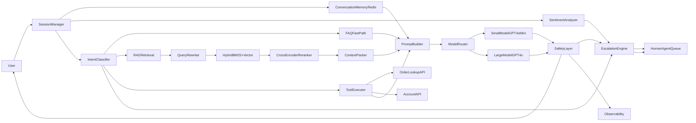

# Chapter 6: Design a Customer Support Chatbot

## Context

> [!info] Quick Reference
> - **Pattern:** Multi-turn RAG chatbot with escalation
> - **Scale:** 500K tickets/day, 6-turn avg conversation
> - **Key Techniques:** Sliding window memory + rolling summary, webhook-triggered re-indexing, sentiment-based escalation fusion
> - **Primary Concerns:** Memory freshness, hallucination on policy changes, escalation precision/recall
> - **Cross-references:** [[chapter-03|Chapter 3]] (retrieval), [[chapter-05|Chapter 5]] (guardrails), [[chapter-07|Chapter 7]] (enterprise search)

**Problem statement:** Design a production customer support chatbot that maintains multi-turn conversational memory, retrieves grounded answers from a knowledge base via RAG, detects sentiment to calibrate tone, and escalates to human agents with full context when confidence is low or risk is high.

### Real-World Examples

- An e-commerce platform serving 500K tickets/day reduces human escalation rate from 45% to 27% after deploying a chatbot with sliding-window memory and confidence-calibrated handoff—but a memory overflow bug during a flash sale causes the bot to hallucinate order details from prior sessions, triggering a postmortem.
- A telecom provider's chatbot serves stale cancellation policy after a policy update; the bot tells 1,200 customers the wrong early-termination fee before the freshness SLA violation is caught. Embedding a KB freshness check into the retrieval pipeline prevents recurrence.

---

## Step 1: Understand the Problem and Establish Design Scope

### Simulated Dialogue

**Interviewer:** Design a customer support chatbot for a large e-commerce company.  
**Candidate:** I need to understand ticket volume, conversation shape, escalation expectations, and cost constraints before proposing architecture.

**Candidate:** What is the daily ticket volume and conversation profile?  
**Interviewer:** 500K tickets/day. Average conversation is 6 turns (3 user, 3 bot). Peak is 5x average during sales events. About 40% of tickets are order status, 25% returns/refunds, 20% product questions, 15% account/billing.

**Candidate:** What is the current escalation rate and target?  
**Interviewer:** Current human escalation is 45%. Target is under 30% with full context handoff—agent should never ask the customer to repeat themselves.

**Candidate:** What latency and availability SLOs are required?  
**Interviewer:** Time-to-first-token under 1 second for the first bot message in a turn. Sessions must persist across reconnects. 99.9% uptime.

**Candidate:** Is there an existing knowledge base?  
**Interviewer:** Yes. 15K support articles, 2K FAQ entries, 500 policy documents. Updated weekly, some policies change mid-day during promotions.

**Candidate:** What is the cost target per conversation?  
**Interviewer:** Under $0.08 per full conversation (all turns). Human agent cost is $4.50 per ticket for comparison.

### Functional Requirements

- Multi-turn conversation with persistent session memory across turns and reconnects.
- RAG over a support knowledge base (articles, FAQs, policy docs) with citation.
- Sentiment detection to adjust tone (empathetic for frustrated users, concise for transactional).
- Confidence-calibrated escalation to human agents with full conversation context.
- Order/account lookup via tool calls (order status, refund eligibility, account details).
- Multi-language support (English primary, Spanish, French, German, Japanese).

### Non-Functional Requirements

- **Latency:** TTFT < 1s p95 for first token in each bot turn. Full response < 3s p95.
- **Session persistence:** conversation state survives client reconnects for 24 hours.
- **Availability:** 99.9% uptime (< 8.7 hours downtime/year).
- **Cost:** < $0.08 per full conversation (avg 6 turns).
- **Containment rate:** > 70% of tickets resolved without human escalation.
- **Safety:** no hallucinated order details, no unauthorized account actions, PII redaction in logs.

### Back-of-the-Envelope Estimation

#### Traffic Profile

- Tickets/day: 500K
- Turns per ticket: 6 (3 user messages, 3 bot responses)
- Bot responses/day: `500K * 3 = 1.5M`
- Average QPS: `1.5M / 86,400 ≈ 17.4`
- Peak QPS (5x): `~87`
- Peak during flash sale (15x): `~260`

#### Token Profile per Turn

- User message: ~80 tokens
- Retrieved context (RAG): ~800 tokens (3-4 chunks)
- Conversation history in prompt: ~600 tokens (sliding window of last 4 turns)
- System prompt + instructions: ~300 tokens
- Total input per bot turn: `~1,780 tokens`
- Bot output per turn: `~150 tokens`
- Total input tokens/day: `1.5M * 1,780 = 2.67B tokens`
- Total output tokens/day: `1.5M * 150 = 225M tokens`

#### Cost per Conversation

- Using GPT-4o-mini class ($0.15/1M input, $0.60/1M output):
  - Input cost per conversation: `3 turns * 1,780 tokens * $0.15/1M = $0.0008`
  - Output cost per conversation: `3 turns * 150 tokens * $0.60/1M = $0.00027`
  - RAG retrieval + embedding overhead: ~$0.001
  - **Total: ~$0.002 per conversation** (well within $0.08 budget)
- Using GPT-4o class for complex escalation paths ($2.50/1M input, $10/1M output):
  - Per conversation: ~$0.018
  - Blended (80% mini, 20% full): **~$0.005 per conversation**

#### Memory Storage Sizing

- Active sessions: `500K tickets/day / 24 hours * avg 15-min session ≈ 5,200 concurrent sessions`
- Memory per session: ~4KB (conversation history + metadata)
- Active memory footprint: `5,200 * 4KB ≈ 20MB` (trivially fits in Redis)
- 24-hour retention for reconnect: `500K * 4KB = 2GB`

#### Knowledge Base Index

- 15K articles + 2K FAQs + 500 policy docs ≈ 17.5K documents
- Avg 2,000 tokens/doc → ~35M tokens
- Chunks (512 tokens, 25% overlap): ~85K chunks
- Embedding cost (one-time): `35M tokens * $0.02/1M = $0.70`
- Vector storage (1536-dim, float32): `85K * 6KB = ~510MB`

---

## Step 2: Propose High-Level Design and Get Buy-In

### Core Architecture Components

- **Session Manager:** creates/resumes sessions, manages session TTL, handles reconnect with session token.
- **Conversation Memory Store:** Redis-backed sliding window + summary store for long conversations.
- **Intent Classifier:** routes to FAQ fast-path, RAG path, tool-call path, or escalation path.
- **KB Retrieval Engine:** hybrid BM25 + vector search over support knowledge base with reranking.
- **Tool Executor:** order lookup, refund eligibility check, account detail fetch via internal APIs.
- **Model Router:** routes to small model (FAQ/simple) or large model (complex/sensitive) based on intent and sentiment.
- **Sentiment Analyzer:** real-time sentiment scoring to adjust tone and trigger proactive escalation.
- **Escalation Engine:** confidence-based handoff with full context packaging for human agent.
- **Safety Layer:** PII redaction, hallucination guard (no fabricated order numbers), action confirmation.
- **Observability:** TTFT, containment rate, CSAT proxy, escalation rate, cost/ticket, sentiment distribution.

### Pipeline A: Knowledge Base Ingestion Pipeline

1. Crawl support articles, FAQs, and policy docs on schedule (hourly for policies, daily for articles).
2. Parse and clean content; preserve structure (headers, lists, tables).
3. Chunk with semantic boundaries (section-level for articles, Q+A pairs for FAQs, clause-level for policies).
4. Generate embeddings and dual-write to vector index (Pinecone/Qdrant) and BM25 index (Elasticsearch).
5. Tag each chunk with `source_id`, `category`, `last_updated`, `freshness_ttl`.
6. Quality gate: sample retrieval on 50 benchmark queries; alert on Recall@5 regression > 3%.
7. Alias swap for zero-downtime index update.

### Pipeline B: Conversation Runtime Pipeline

1. User message arrives; session manager resolves or creates session.
2. Conversation memory loaded from Redis (sliding window of last N turns + running summary).
3. Sentiment analyzer scores user message (positive/neutral/negative/angry).
4. Intent classifier determines route: FAQ fast-path, RAG, tool-call, or escalation.
5. For RAG path: query rewriter reformulates using conversation context → hybrid retrieval → reranker → top-3 chunks.
6. For tool-call path: extract parameters, call internal API, format result.
7. Prompt assembled: system prompt + memory window + retrieved context + user message.
8. Model router selects tier (small for FAQ/simple, large for complex/sensitive).
9. LLM generates response with streaming; confidence score extracted from logprobs.
10. Safety layer validates: no hallucinated IDs, no unauthorized actions, PII redacted.
11. If confidence < threshold or sentiment is angry + unresolved → escalation engine packages context for human.
12. Response streamed to user; memory store updated; telemetry emitted.

### Mermaid Architecture Diagram



---

## Step 3: Design Deep Dive

Focus areas for this chapter:

1. **Conversation Memory Management**
2. **RAG for Customer Support**
3. **Escalation and Fallback Design**

### 1) Conversation Memory Management

The core tension: including more history improves coherence but inflates token cost, increases latency, and risks context confusion across topics within a single session.

#### Memory Strategy Trade-off Table

| Strategy | Token Cost/Turn | Coherence | Long Conversation Support | Complexity | Best For |
|---|---|---|---|---|---|
| Full history | High (grows linearly) | Best | Breaks at ~20 turns (context overflow) | Low | Short conversations (<8 turns) |
| Sliding window (last N turns) | Fixed (~600 tokens for N=4) | Good for recent context | Loses early context | Low | Default production choice |
| Summary + recent window | Medium (~400 summary + 400 window) | Good | Handles 50+ turns | Medium | Long/complex support sessions |
| Hierarchical (entity memory + summary + window) | Medium-high | Best for entity tracking | Handles unlimited turns | High | Account-heavy workflows |

**Recommended approach: Sliding window + rolling summary.**

- Keep last 4 turns verbatim in the prompt (~600 tokens).
- After every 4 turns, compress older turns into a running summary using a cheap model call (~100 tokens output).
- Store extracted entities (order IDs, product names, issue type) in structured session metadata.
- Total memory overhead per turn: ~1,000 tokens (summary + window + entities) regardless of conversation length.

**Summary compression prompt design:**
- Input: previous summary + 4 new turns.
- Output: updated summary preserving: customer issue, order IDs, actions taken, unresolved items.
- Cost: ~$0.0001 per compression (GPT-4o-mini, 800 input + 100 output tokens).
- Frequency: every 4 turns = ~1 compression per conversation on average.

**Session persistence implementation:**
- Redis with 24-hour TTL for active session data.
- Session token issued on first message; client includes in subsequent requests.
- On reconnect: load session from Redis, reconstruct last state, resume conversation.
- Overflow to DynamoDB for sessions exceeding 24h (rare, <1% of tickets).

### 2) RAG for Customer Support

Support RAG differs from general RAG: queries are conversational (not keyword-rich), context is multi-turn, and freshness of policy documents is critical.

#### KB Chunking Strategy

| Content Type | Chunk Strategy | Chunk Size | Overlap | Rationale |
|---|---|---|---|---|
| Support articles | Section-level semantic | 512-768 tokens | 25% | Preserves section coherence |
| FAQ entries | Q+A pair as single chunk | Variable (100-400 tokens) | None | Atomic Q+A units |
| Policy documents | Clause-level with parent link | 256-512 tokens | 10% | Precise policy citation needed |
| Troubleshooting guides | Step-sequence chunks | 512 tokens | 50% | Steps often span boundaries |

**Conversation-aware query rewriting:**
- Raw user message is often ambiguous without context ("What about the refund?" → refund for which order?).
- Query rewriter takes last 2 turns + user message → generates standalone search query.
- Example: user says "Can I return it?" after discussing Order #12345 → rewriter outputs "return policy eligibility Order #12345 wireless headphones".
- Cost: ~$0.0001 per rewrite (small model, short prompt).

#### Retrieval Pipeline

| Stage | Latency | Purpose |
|---|---|---|
| Query rewrite | ~50ms | Standalone query from conversation |
| BM25 lookup (Elasticsearch) | ~15ms | Exact match on product names, order refs, policy IDs |
| ANN vector search (Qdrant) | ~25ms | Semantic match on paraphrased queries |
| RRF fusion | ~2ms | Merge ranked lists |
| Freshness filter | ~3ms | Remove chunks with expired `freshness_ttl` |
| Cross-encoder rerank top-20 | ~40ms | Precision boost |
| Top-3 selection + citation | ~5ms | Context packing |
| **Total** | **~140ms** | Within 200ms retrieval budget |

#### Freshness Enforcement

- Each chunk tagged with `last_updated` timestamp and `freshness_ttl` (policies: 1 hour, articles: 24 hours, FAQs: 7 days).
- At retrieval time, chunks exceeding TTL are demoted (not removed—avoids zero-result scenarios).
- Stale chunk demotion: multiply relevance score by `freshness_decay = max(0.3, 1.0 - (age / ttl))`.
- Critical policy changes trigger immediate re-index via webhook (bypasses scheduled crawl).

#### Grounding and Citation

- Every bot response that cites a policy or procedure must include `[Source: article_id]` metadata.
- Grounding validator checks that key claims in the response are traceable to retrieved chunks.
- If grounding score < 0.7, response is flagged and either regenerated or escalated.

### 3) Escalation and Fallback Design

Escalation is the safety valve. Getting it wrong in either direction is expensive: over-escalation wastes human agent time; under-escalation damages customer experience.

#### Escalation Trigger Trade-off Table

| Trigger | Precision | Recall | Latency Impact | Best For |
|---|---|---|---|---|
| Low confidence (logprob threshold) | Medium (70%) | High (catches uncertainty) | None (free from generation) | Default primary trigger |
| Sentiment score (angry + unresolved) | Medium (65%) | Medium | +20ms (sentiment model) | Proactive de-escalation |
| Explicit user request ("talk to a human") | 100% | Low (only catches explicit) | None | Mandatory override |
| Topic classifier (billing dispute, legal threat) | High (85%) | Medium | +15ms (classifier) | High-risk topic routing |
| Turn count threshold (>10 turns unresolved) | Low (many false positives) | High | None | Catch-all safety net |
| Repeated question detection | High (80%) | Medium | +5ms (similarity check) | Frustration signal |

**Recommended escalation logic (multi-signal fusion):**

```
escalate = (
    explicit_request OR
    (confidence < 0.4) OR
    (sentiment == angry AND turn_count > 4 AND issue_unresolved) OR
    (topic IN [billing_dispute, legal_threat, safety_issue]) OR
    (turn_count > 10 AND issue_unresolved) OR
    (repeated_question_count >= 2)
)
```

**Context handoff to human agent:**
- Package: conversation summary, full transcript, extracted entities (order IDs, issue type), sentiment trajectory, retrieved KB articles, bot confidence scores per turn.
- Format: structured JSON pushed to agent desktop (Zendesk, Salesforce, custom).
- Target: agent reads context in <30 seconds without asking customer to repeat.

#### Fallback Hierarchy

| Level | Condition | Action | User Experience |
|---|---|---|---|
| L0: Normal | Confidence > 0.7, positive/neutral sentiment | Respond normally | Standard bot response |
| L1: Low confidence | Confidence 0.4-0.7 | Hedge + suggest alternatives | "Based on our policy, I believe... Would you like me to connect you with a specialist?" |
| L2: Escalation | Confidence < 0.4 or escalation trigger | Transfer to human with context | "Let me connect you with a support specialist who can help with this." |
| L3: System failure | Model timeout, retrieval failure | Canned response + ticket creation | "I'm having trouble right now. I've created a ticket and a team member will follow up within 2 hours." |
| L4: Safety block | PII leak attempt, adversarial input | Block + log | "I can't help with that request. Let me connect you with our support team." |

### Production Bottlenecks and Mitigations

- **Memory overflow during long sessions**
  - Symptom: token count exceeds context window; response quality degrades or errors.
  - Mitigation: hard cap at summary + 4-turn window; compress aggressively after 10 turns; alert on sessions exceeding 20 turns.

- **Stale KB chunks serving wrong policy**
  - Symptom: bot quotes outdated refund policy during a promotion change.
  - Mitigation: freshness TTL per chunk type, webhook-triggered re-index for critical policy changes, freshness decay scoring.

- **Escalation queue overflow during incidents**
  - Symptom: human agent queue exceeds capacity during product outage (everyone escalates at once).
  - Mitigation: incident mode—bot acknowledges known issue, provides status page link, offers callback scheduling instead of live transfer.

- **Sentiment misclassification causing premature escalation**
  - Symptom: sarcasm or informal language triggers false-positive anger detection.
  - Mitigation: multi-signal escalation (sentiment alone never triggers); calibrate threshold on labeled support data.

- **Cross-session memory contamination**
  - Symptom: bot references a different customer's order due to session ID collision or cache bug.
  - Mitigation: cryptographic session tokens, strict session isolation in Redis, zero shared state between sessions.

- **Model cost spike during traffic surge**
  - Symptom: flash sale drives 15x traffic; cost per day explodes.
  - Mitigation: aggressive routing to small model during surges, semantic cache for repeated queries (order status FAQ), admission control with queue.

### Advanced Techniques

- **Semantic caching** for FAQ-like repeated queries: hash query embedding, return cached response if similarity > 0.95. Expected hit rate: 15-25% for support workload.
- **Confidence calibration** via logprob analysis: map raw logprobs to calibrated confidence using held-out labeled data.
- **Proactive messaging:** if sentiment trajectory is declining across turns, inject empathy prefix ("I understand this is frustrating. Let me...") before the factual response.
- **Multi-language support:** detect language in first message, route to language-specific system prompt, use language-matched retrieval index or cross-lingual embeddings.

---

## Step 4: Wrap Up

### Final Design Summary

The design treats customer support as a containment optimization problem: maximize resolution rate while minimizing cost, latency, and risk. Sliding-window memory with rolling summaries keeps context bounded. RAG with freshness enforcement prevents stale policy errors. Multi-signal escalation ensures human handoff happens at the right time with full context.

### Wrap-Around Concerns

- **Risk:** Memory compression loses critical context (order ID dropped from summary).
  - Gate: validate entity extraction before and after compression; alert on entity loss.
- **Risk:** KB freshness gap during rapid policy changes (promotions, recalls).
  - Gate: webhook-triggered re-index with < 5-minute propagation SLA for critical updates.
- **Risk:** Escalation rate creep from model drift or query distribution shift.
  - Gate: daily escalation rate monitoring by category; alert on > 5% week-over-week increase.
- **Risk:** Cost blowup from routing too many conversations to large model tier.
  - Gate: per-tier traffic dashboards; auto-degrade to small model if daily cost exceeds budget by 20%.

---

## Step 5: Interviewer Curveballs

### Interviewer Follow-ups & Frequently Asked Questions (FAQ)

Q: A customer's conversation hits 25 turns. How do you prevent memory overflow without losing critical context?

**The Ideal Answer:** I use a rolling summary that compresses every 4 turns, plus structured entity extraction (order IDs, issue type, actions taken) stored separately. The prompt always contains: system instructions + entity memory + compressed summary + last 4 verbatim turns. Total stays under ~1,200 tokens regardless of conversation length.

**Deep Dive & Trade-offs:**
- Full history at 25 turns: ~4,000 tokens of history alone—expensive and risks context confusion.
- Summary-only loses nuance of recent exchanges.
- Entity memory ensures order IDs and key facts survive compression.
- Compression model error: ~2% chance of dropping a key entity. Mitigate with explicit entity extraction step.

**The Interviewer's Rubric:** Checking bounded memory design that preserves correctness under long conversations.

Q: How do you decide when to escalate vs. when to retry with a better prompt?

**The Ideal Answer:** I distinguish between recoverable uncertainty (retrieval miss, ambiguous query) and irrecoverable situations (high-risk topic, explicit user request, repeated failure). For recoverable: retry once with query expansion and fallback retrieval. For irrecoverable: escalate immediately with full context.

**Deep Dive & Trade-offs:**
- Retry adds 2-4 seconds of latency; acceptable once, not twice.
- Retry on the same failing retrieval is pointless—must change the retrieval strategy (expand query, relax filters).
- Retrying on angry customers increases frustration; sentiment signal should bias toward escalation.

**The Interviewer's Rubric:** Checking nuanced escalation logic beyond simple threshold checks.

Q: Your sentiment detection flags 30% of conversations as "angry" but CSAT surveys show only 10% dissatisfaction. What is going wrong?

**The Ideal Answer:** The sentiment model is likely miscalibrating on informal language, sarcasm, or urgency (not anger). I would audit a sample of false-positive "angry" classifications, add labeled examples to fine-tune the classifier, and switch from binary angry/not-angry to a multi-dimensional sentiment model (frustration, urgency, confusion, satisfaction).

**Deep Dive & Trade-offs:**
- Binary sentiment is too coarse for support; urgency != anger.
- Fine-tuning on domain-specific support data typically cuts false positives by 40-60%.
- Alternative: use sentiment as one signal in multi-signal escalation, never as sole trigger.

**The Interviewer's Rubric:** Checking whether candidate understands sentiment model limitations in production.

Q: During a flash sale, 80% of queries are "where is my order?" How do you avoid paying full LLM cost for each one?

**The Ideal Answer:** Semantic cache with tight similarity threshold (>0.95). For "where is my order" queries, the response is a tool call to order status API—cache the response template, personalize only the order-specific data. Expected cache hit rate during flash sale: 60-70%.

**Deep Dive & Trade-offs:**
- Pure semantic cache risks returning wrong order details → must personalize after cache hit.
- Better approach: detect FAQ intent, skip LLM entirely, call order API directly, format with template.
- Cost reduction: from ~$0.002/conversation to ~$0.0003 for cached path.

**The Interviewer's Rubric:** Checking cost optimization instincts under traffic spikes.

Q: A customer starts in English, switches to Spanish mid-conversation. How does the system handle this?

**The Ideal Answer:** Language detection on every user message. On detected switch: update session language, swap system prompt to Spanish, route retrieval to Spanish KB index (or use cross-lingual embeddings if no Spanish index exists), and continue with the same conversation memory (translated summary if needed).

**Deep Dive & Trade-offs:**
- Maintaining separate KB indexes per language: higher quality but expensive to maintain.
- Cross-lingual embeddings (e.g., multilingual-e5): single index but ~5-10% recall degradation vs. monolingual.
- Summary translation adds latency (~200ms) and potential meaning drift.
- Practical: most support KBs are English-primary; use the LLM's multilingual capability to answer in Spanish from English retrieval.

**The Interviewer's Rubric:** Checking multi-language architecture without over-engineering.

Q: How do you hand off a conversation to a human agent without the customer waiting in a queue for 10 minutes?

**The Ideal Answer:** Three strategies: (1) predictive routing—if escalation is likely based on early signals, pre-allocate a human agent slot while the bot continues; (2) warm handoff—bot keeps engaging with lower-confidence responses while agent reads context; (3) callback scheduling—if queue > 5 minutes, offer "we'll call you back in 15 minutes" with full context preserved.

**Deep Dive & Trade-offs:**
- Pre-allocation wastes agent time on false-positive escalations (~15% waste rate).
- Warm handoff is best UX but requires agent desktop integration.
- Callback avoids queue wait but adds follow-up complexity and customer may not answer.

**The Interviewer's Rubric:** Checking real-world handoff design beyond "just transfer."

Q: Your knowledge base has 15K articles. How do you ensure freshness without re-indexing everything daily?

**The Ideal Answer:** Incremental indexing via CDC (change data capture) on the article CMS. Only re-embed and re-index changed documents. Tag each chunk with `last_updated`. For time-sensitive content (policies), use webhook-triggered re-index with < 5-minute SLA. Full re-index only on embedding model upgrade.

**Deep Dive & Trade-offs:**
- Full re-index of 85K chunks: ~$0.70 and ~10 minutes. Cheap but unnecessary daily.
- Incremental: typically 50-200 articles change/day → < $0.01 and < 1 minute.
- Risk: CDC misses a change → stale chunk persists. Mitigate with daily full-diff reconciliation job.

**The Interviewer's Rubric:** Checking incremental indexing design and freshness engineering.

Q: How do you measure whether the chatbot is actually helping customers vs. just containing them?

**The Ideal Answer:** Three-layer measurement: (1) containment rate (resolved without human), (2) CSAT/NPS from post-conversation survey, (3) re-contact rate within 24 hours (did the customer come back with the same issue?). A bot that "contains" by giving unhelpful answers will show high containment but low CSAT and high re-contact rate.

**Deep Dive & Trade-offs:**
- Containment alone is a vanity metric—easy to game by making escalation hard to reach.
- CSAT has low response rate (~5-15%); biased toward extreme experiences.
- Re-contact rate is the most honest signal: if the customer comes back, the bot failed.
- Combine all three with weekly trend analysis per category.

**The Interviewer's Rubric:** Checking whether candidate measures outcomes, not just operational metrics.

## End of Chapter

- **Key takeaway:** A support chatbot is a containment optimization problem bounded by memory management, retrieval freshness, and escalation precision. The hardest part is not generating answers—it is knowing when to stop trying and hand off gracefully.
- **What to practice:** Walk through a 10-turn conversation showing how memory compresses, when retrieval fires, and what triggers escalation at each turn.
- **Interview drill:** Given a spike in escalation rate from 28% to 42% after a deployment, trace the debug path: check memory compression errors → retrieval recall regression → confidence threshold drift → sentiment model update → KB freshness gap.
