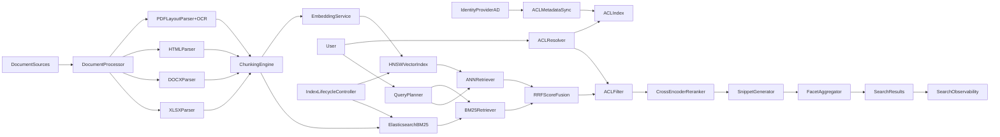

# Chapter 7: Design an Enterprise Semantic Search Engine

## Context

> [!info] Quick Reference
> - **Pattern:** Enterprise semantic search with ACL
> - **Scale:** 50M documents, 2M searches/day
> - **Key Techniques:** ACL pre-filter, layout-aware parsing, table extraction, HNSW + Elasticsearch dual index
> - **Primary Concerns:** ACL correctness, parser failures on PDFs/XLSX, query latency at scale
> - **Cross-references:** [[chapter-03|Chapter 3]] (vector infrastructure), [[chapter-11|Chapter 11]] (financial document extraction)

**Problem statement:** Design a semantic search engine over a 50M-document enterprise corpus with heterogeneous document types (PDFs, HTML, spreadsheets), strict document-level access control (ACLs) enforced at query time, and sub-200ms latency at scale—while maintaining recall above 0.85.

### Real-World Examples

- A Fortune 500 company's internal search leaks document existence metadata to unauthorized users when ACL filtering is applied post-retrieval; switching to pre-filtered vector search with ACL-indexed metadata eliminates the information leak but requires re-architecting the index.
- A pharmaceutical compliance team discovers that table-heavy FDA submission PDFs have 40% lower retrieval accuracy than plain-text documents; implementing layout-aware parsing with header-row preservation and table-as-markdown chunking recovers 35% of the lost recall.

---

## Step 1: Understand the Problem and Establish Design Scope

### Simulated Dialogue

**Interviewer:** Design an enterprise semantic search engine for a large organization.  
**Candidate:** I need to understand corpus size, document types, access control complexity, and search latency requirements before proposing architecture.

**Candidate:** What is the corpus size and composition?  
**Interviewer:** 50M documents. Mix of PDFs (40%), HTML/wiki pages (30%), Office documents (20%), and spreadsheets/CSVs (10%). Average document is 5 pages. Growing at 200K new docs/week.

**Candidate:** How complex is the access control model?  
**Interviewer:** 5,000 security groups, nested group inheritance, per-document ACLs. Some documents have individual user-level permissions. Average user belongs to 15 groups. ACL correctness is non-negotiable—no unauthorized user may see even a snippet from a restricted document.

**Candidate:** What are the search volume and latency requirements?  
**Interviewer:** 2M searches/day. p95 end-to-end latency under 200ms. Users expect faceted results with snippet highlighting.

**Candidate:** Is this keyword search, semantic search, or both?  
**Interviewer:** Both. Users search with natural language queries and also with exact terms (error codes, product IDs, employee names). Results must support facets (document type, date range, department, author).

### Functional Requirements

- **Full-text lexical search (BM25) with exact-match capability for IDs, error codes, names.** Enterprise users frequently search using precise identifiers such as ticket numbers, product SKUs, and regulatory error codes—semantic search alone fails these because neural encoders often treat token sequences like "ERR-9421" as opaque, while BM25 matches them character-for-character.
- **Semantic vector search for natural language and paraphrase queries.** Users asking "how do I expense a business trip" and "travel reimbursement process" should retrieve the same policy documents even though the vocabulary differs completely; dense embedding models trained on large corpora capture these paraphrase relationships where BM25 falls short.
- **Hybrid retrieval with score fusion and reranking.** Neither BM25 nor dense search consistently dominates across all query types; fusing their ranked lists via Reciprocal Rank Fusion (RRF) and applying a cross-encoder reranker on the top-N candidates consistently outperforms either approach alone by 5–12% on Recall@10.
- **Document-level ACL enforcement: no snippets, titles, or metadata from unauthorized documents.** Even revealing that a restricted document title matches a query is an information leak in regulated industries; the system must treat ACL correctness as a hard constraint, not a soft filter applied after retrieval.
- **Faceted search results: filter by document type, date range, department, author.** Facets let users narrow a 50M-document corpus to a tractable shortlist without reformulating queries—they are especially critical in enterprise settings where the same concept (e.g., "budget") appears in documents from dozens of departments with very different scopes.
- **Snippet generation with query-term highlighting.** A ranked list without context forces users to open each document to assess relevance; a 200-token snippet showing matched terms in context reduces time-to-answer and is one of the strongest drivers of click-through rate in enterprise search user studies.
- **Support for all document types: PDF (including scanned), HTML, DOCX, XLSX, CSV.** Enterprise corpora are heterogeneous by nature; a search engine that handles only clean HTML or text files will silently omit the richest, most authoritative sources—often the PDFs and spreadsheets that contain regulatory submissions, financial models, and policy documents.

### Non-Functional Requirements

- **Latency:** p95 end-to-end < 200ms (including ACL resolution). This budget is tight enough to rule out any synchronous LLM call in the hot path; every stage—ACL expansion, retrieval, reranking, snippet generation—must be profiled and capped, with the 200ms treated as a hard SLO enforced by circuit breakers that degrade gracefully to faster, lower-quality paths.
- **Relevance:** Recall@10 > 0.85, NDCG@10 > 0.70 on benchmark query set. These targets are derived from user research showing that if the correct document does not appear in the first page of results 85% of the time, users lose trust and stop using the system; NDCG@10 > 0.70 ensures ranking quality, not just presence.
- **ACL correctness:** 100%. Zero tolerance for unauthorized document exposure. A single ACL leak in a Fortune 500 enterprise triggers regulatory audits, legal liability, and reputational damage; this constraint cannot be relaxed to improve latency or recall—it is the foundational invariant of the system.
- **Freshness:** new/updated documents searchable within 30 minutes. In a 200K-docs/week growth environment, stale search results actively mislead users; the 30-minute window is chosen to balance ingestion pipeline throughput with user expectations for near-real-time content availability.
- **Scale:** 50M documents, 500M+ chunks, 2M searches/day. At this scale, single-node solutions are infeasible; the vector index alone requires distributed sharding, and the lexical index requires multi-node Elasticsearch with replicas—horizontal scalability must be built into the architecture from day one.
- **Availability:** 99.95% uptime. This allows approximately 4.4 hours of downtime per year; achieving this requires active-active deployment across at least two availability zones, health-checked load balancing, and pre-built runbooks for the most common failure modes (index shard failure, reranker GPU OOM, ACL cache poisoning).

### Back-of-the-Envelope Estimation

#### Corpus Sizing

- Documents: 50M, average 5 pages, ~2,000 tokens/page
- Total tokens: `50M * 5 * 2,000 = 500B tokens`
- Chunks (512 tokens, 25% overlap): `50M * 5 * 2000 / (512 * 0.75) ≈ 1.3B chunks`
- Practical with dedup and smart chunking: **~650M chunks**

#### Embedding Compute

- Model: `text-embedding-3-small` (1536-dim, $0.02/1M tokens)
- Full embed cost: `500B tokens * $0.02/1M = $10,000` (one-time)
- Incremental daily: `200K docs/week ≈ 28.6K docs/day * 5 pages * 2,000 tokens = 286M tokens/day`
- Incremental cost: `~$5.72/day`

#### Vector Index Storage

- 650M vectors at 1536-dim, float32: `650M * 6KB = ~3.9TB raw`
- With HNSW overhead + metadata + replicas (x2.5): **~9.75TB**
- HNSW serving RAM: ~100-150GB per shard across shard cluster

#### Search Throughput

- Searches/day: 2M
- Average QPS: `2M / 86,400 ≈ 23`
- Peak QPS (10x): `~230`
- Per-query latency budget breakdown:
  - ACL group resolution: ~10ms (cached)
  - BM25 lookup: ~15ms
  - ANN vector search: ~30ms
  - Score fusion: ~3ms
  - ACL filtering: ~15ms
  - Reranker (top-50): ~60ms
  - Snippet generation: ~25ms
  - Facet aggregation: ~20ms
  - **Total: ~178ms** (within 200ms p95 budget)

#### ACL Overhead

- 5,000 groups, avg user in 15 groups
- ACL resolution per query: expand user → group membership → permission set
- With caching (TTL 5 min): ~10ms p95 (cache hit rate >95%)
- Without caching: ~80ms (group expansion with nested inheritance)
- ACL metadata per document: ~200 bytes (group IDs + permission bits)
- Total ACL metadata: `50M * 200B = 10GB`

---

## Step 2: Propose High-Level Design and Get Buy-In

### Core Architecture Components

- **Document Processor:** format-specific parsers (PDF/OCR, HTML, DOCX, XLSX) with layout-aware extraction and table preservation. This is the highest-leverage component in the pipeline—a 10% improvement in parser recall translates directly into measurable Recall@10 gains without touching the retrieval algorithm. It runs asynchronously from the query path so parser failures never impact search availability.

> **Why layout-aware parsing:** Flat text extraction from PDFs discards structural signals—headers, table cell boundaries, reading order in multi-column layouts—that are essential for reconstructing coherent chunks. A parser that flattens a 3-column financial table into a single token stream produces nonsensical chunks that embed poorly and rank inconsistently; preserving table structure as markdown with repeated column headers allows the embedding model to understand row-column relationships and match queries like "revenue Q3 2024" to the correct cell.

- **Chunking Engine:** configurable strategy per document type, metadata tagging (`doc_id`, `section`, `page`, `acl_groups`). Chunking is not a one-size-fits-all operation: legal clauses need tight 256-token windows to preserve precise citation semantics, while narrative prose benefits from 512–768-token sections that maintain topical coherence. Each chunk carries a rich metadata envelope that powers both ACL enforcement and faceted filtering downstream.

> **Why per-document-type chunking:** A 512-token sliding window works well for Wikipedia-style prose but produces chunks that begin and end mid-cell for spreadsheet data, losing the column context that gives tabular values their meaning. Policy documents with numbered clauses split mid-clause introduce ambiguity about which obligation a chunk describes, increasing the risk of incorrect retrieval in compliance-sensitive queries.

- **Embedding Service:** batched embedding generation with rate limiting, model version tracking, and idempotent re-embedding on model upgrade. This service gates the entire ingestion pipeline—at 286M tokens/day of incremental content, it must sustain ~3,300 tokens/second throughput while keeping costs within budget; batching to the maximum API batch size (typically 2,048 tokens per request) is the primary lever for throughput and cost efficiency.

> **Why model version tracking on embeddings:** When the embedding model is upgraded (e.g., from `text-embedding-3-small` to a domain-fine-tuned variant), the new model's vector space is incompatible with the old index—querying with a new-model query embedding against old-model document embeddings produces garbage rankings. Tracking `embedding_model_version` per chunk makes it trivial to identify and re-embed only the chunks that need updating during a model migration.

- **Dual Index:** lexical index (Elasticsearch/BM25) + vector index (HNSW via Qdrant/Weaviate/Pinecone). Maintaining two indexes doubles operational complexity but is essential: no single index type covers all enterprise query patterns. BM25 handles exact-match queries (error codes, SKUs) in ~15ms while the HNSW vector index handles semantic queries in ~30ms; each is independently scalable and can fail without taking down the other retrieval path.

> **Why Elasticsearch for the lexical index:** Elasticsearch provides mature BM25 with per-field analyzers (language-specific tokenization, stemming), built-in faceted aggregations, and production-proven horizontal scaling. Attempting to implement lexical search on a pure vector database sacrifices these capabilities for marginal operational simplification; in a 50M-document corpus with faceted filtering requirements, Elasticsearch's inverted index is the right tool for the lexical half of hybrid search.

- **ACL Resolver:** user → group expansion with caching, permission set computation, and change-event-driven invalidation. This component is the gatekeeper for search security—it must be correct before it is fast, but at 2M queries/day and 10ms cache-hit latency, caching is mandatory. Without caching, group expansion against Active Directory adds ~80ms per query, consuming nearly half the latency budget before a single document is retrieved.

> **Why Redis caching for ACL expansion:** Active Directory or LDAP group expansion with nested inheritance is a recursive graph traversal that, for a user in 15 groups with 2–3 levels of nesting, can involve 30–50 LDAP round trips in the worst case. A Redis cache with a 5-minute TTL reduces this to a single O(1) hash lookup; the 5-minute TTL is chosen as the longest acceptable window between a permission revocation in the identity provider and its enforcement in search—shorter TTLs increase LDAP load, longer TTLs increase security exposure.

- **Query Planner:** routes query to lexical, semantic, or hybrid path based on real-time query analysis. This is the traffic controller of the search pipeline—misrouting a product-ID query to the semantic-only path results in the correct document appearing at rank 15 instead of rank 1. The planner uses fast heuristics (regex for ID patterns, n-gram entropy for natural language detection) rather than a second LLM call, keeping overhead under 3ms.

> **Why route by query type rather than always using hybrid:** Running the full hybrid pipeline on every query wastes ~30ms of vector retrieval latency on queries that BM25 handles perfectly (e.g., "ticket PRJ-8821"). Conversely, routing a natural-language query to BM25-only returns a vocabulary-matched result instead of a semantically relevant one. The query planner adds a small routing cost (<3ms) that pays back many times over in latency savings for exact-match queries and recall gains for semantic queries.

- **Score Fusion Engine:** reciprocal rank fusion (RRF) or weighted combination of lexical and semantic result lists, producing a unified ranked candidate set. RRF's `k=60` constant makes it robust to score scale differences between BM25 (which can produce scores in the 0–20 range) and cosine similarity (0–1 range)—it operates purely on rank positions, eliminating the need for score normalization.

> **Why Reciprocal Rank Fusion over score normalization:** Normalizing BM25 scores to the [0,1] range requires knowing the score distribution of the result set, which changes per query. RRF sidesteps this by converting both ranked lists to reciprocal ranks before summing—a document at position 1 contributes `1/(60+1)=0.016` regardless of its raw score, making fusion results stable across query types without per-query calibration.

- **Reranker:** cross-encoder model (~110M parameters) that jointly encodes the query and each candidate document chunk for precision boosting on top-50 candidates. Unlike the bi-encoder used for retrieval (which encodes query and document independently and compares embeddings), the cross-encoder sees the query-document pair together, enabling it to model fine-grained relevance signals like negation, entity specificity, and contextual nuance that bi-encoders miss.

> **Why cross-encoder reranking adds value after hybrid fusion:** Hybrid fusion with RRF is good at ensuring the correct document appears in the top-50 candidates but poor at precisely ordering those 50 candidates relative to each other—it operates on rank positions, not on query-document relevance. The cross-encoder's joint encoding captures signals like "the query asks for Q3 revenue and this chunk contains a table labeled Q3 2024 Revenue"—a specificity signal that neither BM25 nor cosine similarity can reliably surface. The result is a consistent +5–12% Recall@5 gain.

- **ACL Filter:** enforces document-level access control by removing all chunks whose `acl_groups` field does not intersect with the resolved user permission set. This filter operates after fusion but before reranking to avoid wasting GPU compute on unauthorized candidates; it is the last line of defense against ACL leaks and must operate in constant time relative to the number of groups via bitset intersection or pre-computed permission tokens.

- **Snippet Generator:** extracts the most query-relevant passage from each result document, truncates at sentence boundaries, and highlights matched terms. Snippets are the primary user-facing output of the search system—users decide whether to open a document based on the snippet, making snippet quality a first-order driver of search satisfaction and click-through rate.

> **Why pre-compute "best passage" at index time:** Computing snippet quality scores over all chunks of a document at query time adds O(n_chunks) work per result in the hot path. Storing the top-scored chunk per document at index time (based on embedding density and content coverage) allows O(1) snippet retrieval at query time; for table results, the matching row with column headers is constructed from the chunk's structured metadata rather than re-parsed from the document.

- **Facet Aggregator:** computes counts for each facet dimension (document type, date range, department, author) on the ACL-filtered result set. Facet counts must reflect the ACL-filtered universe—showing a count of 50 results for "Legal" department when 45 are inaccessible to the user both misleads and reveals the existence of restricted documents.

- **Index Lifecycle Controller:** manages versioned index builds, alias swaps, blue-green deployments, and quality gates. This component is what separates a research prototype from a production search system—it enables zero-downtime model upgrades, safe parser rollouts, and atomic rollbacks by maintaining the invariant that the search alias always points to a verified, quality-gated index version.

> **Why blue-green index deployments:** An in-place index update (adding new vectors to a live HNSW index) degrades graph quality over time and is not atomic—users see an inconsistent mix of old and new embeddings during the update window. Building a shadow index in parallel, running quality gates (Recall@10 on 500 benchmark queries), and swapping the alias atomically ensures users always query a coherent, validated index; the old index is retained hot for 24 hours to enable instant rollback if a quality regression is detected post-swap.

- **Observability:** search latency (p50/p95/p99), Recall@10, NDCG@10, ACL filter hit rate, parse failure rate, freshness lag, zero-result rate, and click-through rate tracked in real time. An unmonitored search system drifts silently: parser regressions go unnoticed, ACL filter hit rates shift as permission structures change, and latency spikes emerge at peak hours. Each metric should have an alert threshold that pages on-call before users file support tickets.

### Pipeline A: Document Ingestion Pipeline

1. Source connectors detect new/updated documents via CDC, crawlers, or API webhooks.
2. Document processor routes to format-specific parser: PDF → layout-aware extraction (PyMuPDF + table detection), HTML → boilerplate removal, DOCX → structured extraction, XLSX → row-level records.
3. OCR pipeline for scanned PDFs (Tesseract/DocTR); confidence scoring on OCR output quality. Pages with OCR confidence below 0.70 are routed to a more expensive model (DocTR or a multimodal LLM for high-value documents).

> **Why confidence-score-based OCR routing:** Applying the same OCR model uniformly across all scanned PDFs wastes compute on easy clean-scan pages and underperforms on complex multi-column or handwritten pages. A confidence threshold-based routing policy costs ~5ms per page for the confidence check but saves 3–5x OCR compute on clean pages while ensuring high-quality extraction on the difficult ones.
4. Chunking engine applies document-type-specific strategy; tags each chunk with `doc_id`, `page`, `section`, `acl_groups`, `last_updated`.
5. Embedding service generates vectors in batches; tagged with `embedding_model_version`.
6. Dual write: vectors to HNSW index, text + metadata to Elasticsearch.
7. ACL metadata synced from identity provider (Active Directory / LDAP) into ACL index.
8. Quality gate: sample 100 benchmark queries on shadow index; verify Recall@10, NDCG@10, parse fidelity.

> **Why a quality gate before alias swap:** Promoting an unverified index to production risks a silent recall regression that users experience as "search got worse" before any alert fires. Running 100–500 benchmark queries on the shadow index and requiring Recall@10 > 0.85 and NDCG@10 > 0.70 before promotion means regressions are caught in minutes, not hours, and the fix is as simple as not swapping the alias.

9. Alias swap to promote new index version; keep old version hot for 24h rollback.

> **Why keep the old index hot for 24 hours:** Subtle quality regressions—especially those affecting tail query types (low-frequency exact-match queries, table-heavy documents)—may not be caught by the benchmark set and only surface through user feedback or weekly relevance metrics. A 24-hour rollback window allows the on-call team to revert instantly by swapping the alias back, without re-ingesting 650M chunks.

### Pipeline B: Search Query Pipeline

1. User submits query; auth token resolved to user identity.
2. ACL resolver expands user → group memberships → permission set (cached, TTL 5 min).
3. Query planner analyzes query: exact-match signals (IDs, error codes) → lexical-heavy; natural language → semantic-heavy; mixed → hybrid.
4. Query rewriter expands abbreviations, resolves acronyms from enterprise glossary.
5. Parallel execution: BM25 retrieval (top-200) + ANN vector retrieval (top-200).

> **Why retrieve top-200 from each before fusion:** Retrieval quality of hybrid systems is sensitive to the candidate pool size before fusion. If each retriever returns only top-10, high-quality candidates that ranked 11–50 in one retriever but 1–5 in the other are lost before RRF can surface them. Retrieving top-200 from each and fusing to a top-200 candidate pool before ACL filtering provides enough buffer so that even with 60–70% ACL filter attrition, at least top-10 accessible results survive.

6. Score fusion (RRF) produces merged candidate set (top-200).
7. **ACL filter** removes all chunks from documents the user cannot access.
8. Reranker scores top-50 ACL-filtered candidates; returns top-10 with relevance scores.
9. Snippet generator extracts highlight passages from top-10 results.
10. Facet aggregator computes counts on ACL-filtered result set.
11. Response assembled: ranked results with snippets, facets, metadata, and search telemetry.

### Mermaid Architecture Diagram



---

## Step 3: Design Deep Dive

The three deep-dive areas below represent the places where well-designed enterprise search systems most commonly fail in practice. Document parsing is the silent killer of recall—systems that look correct in demos fall apart in production because PDFs with scanned tables and multi-column layouts produce malformed chunks. ACL-aware retrieval is the security-critical invariant that cannot be approximated—a single leak is a P0 incident. Search relevance tuning is the continuous engineering discipline that separates a system that launches well from one that stays good as the corpus and query distribution evolve.

Focus areas for this chapter:

1. **Document Parsing at Scale**
2. **ACL-Aware Retrieval**
3. **Search Relevance Tuning**

### 1) Document Parsing at Scale

The single biggest quality bottleneck in enterprise search is not the model—it is the parser. Garbage in, garbage out.

#### Document Type Parser Trade-off Table

| Doc Type | Parser | Table Handling | OCR Needed | Avg Parse Time | Failure Rate |
|---|---|---|---|---|---|
| Native PDF (text layer) | PyMuPDF / pdfplumber | Extract as markdown with headers | No | ~200ms/page | <1% |
| Scanned PDF (image-only) | Tesseract + DocTR | OCR → markdown reconstruction | Yes | ~2s/page | 5-8% |
| PDF with mixed text+images | PyMuPDF + DocTR fallback | Hybrid: text extraction + OCR for image regions | Partial | ~800ms/page | 3-5% |
| HTML / Wiki | BeautifulSoup + boilerplate removal | HTML table → markdown | No | ~50ms/page | <1% |
| DOCX | python-docx | Native table extraction | No | ~100ms/page | <1% |
| XLSX / CSV | openpyxl / pandas | Row-level chunking with headers | No | ~150ms/sheet | 2% |

**Table extraction in detail:**
- Tables are the highest-value, lowest-recall content in enterprise search.
- Strategy: extract table as markdown with column headers repeated in every chunk that contains table rows.
- Example: a 50-row financial table → chunk into groups of 10 rows, each chunk includes column headers + row data + table caption.
- Embed table chunks separately from surrounding text; tag with `content_type: table`.
- At retrieval time, boost table chunks when query contains numerical/comparison signals.

**Layout-aware parsing pipeline:**
1. Detect document structure: headers, paragraphs, tables, figures, sidebars.
2. Assign hierarchy: H1 → section, H2 → subsection, body → paragraph.
3. Preserve reading order (critical for multi-column PDFs).
4. Extract tables as structured markdown; extract figures as captions only (image content via OCR if needed).
5. Tag each chunk with structural metadata: `{section: "Q3 Revenue", page: 12, content_type: "table"}`.

**Dead-letter queue and fallback:**
- Documents that fail primary parser route to fallback: raw text extraction (loses structure but preserves content).
- Alert on failure rate > 2% per document type.
- Weekly manual review of dead-letter queue; failure patterns feed parser improvements.
- Parse quality metric: compare extracted text against ground-truth for 200 sampled documents monthly.

#### Chunking Strategy by Document Type

| Doc Type | Chunk Strategy | Chunk Size | Overlap | Rationale |
|---|---|---|---|---|
| Long-form PDF/DOCX | Section-level semantic | 512-768 tokens | 25% | Preserves topic coherence |
| Policy/Legal | Clause-level with parent | 256-512 tokens | 10% | Precise citation needed |
| FAQ / Knowledge articles | Q+A or section atomic | 200-500 tokens | None | Self-contained units |
| Spreadsheets | Row-group + headers | 256-512 tokens | Header repeated | Tabular context preserved |
| Code/Technical docs | AST-aware or block-level | 512 tokens | 25% | Preserve function/class boundaries |

### 2) ACL-Aware Retrieval

ACL correctness is the non-negotiable constraint. The system must never expose even a title or snippet from an unauthorized document. This eliminates any approach that relies on post-hoc filtering where document existence is leaked.

#### ACL Enforcement Strategy Trade-off Table

| Strategy | Latency Impact | ACL Correctness | Index Complexity | Storage Overhead | Best For |
|---|---|---|---|---|---|
| Post-filter (retrieve broadly, filter after) | Low retrieval, +15ms filter | Metadata leak risk (reveals doc existence) | Low | None | Internal low-sensitivity corpora only |
| Pre-filter (inject ACL predicate into query) | +10-20ms query overhead | Full correctness | Medium (ACL-indexed metadata) | +10-15% index size | Default for ACL-sensitive enterprise |
| Partitioned indexes (per-group shards) | Lowest query latency | Full correctness | Very high (combinatorial explosion) | 3-10x storage | Single-tenant or very few groups |
| Hybrid pre-filter + post-filter | +15ms | Full correctness | Medium-high | +15% | High-cardinality ACLs (>5K groups) |

**Recommended: Pre-filter for production enterprise search.**

**Pre-filter implementation:**
- Each chunk in vector index and lexical index is tagged with `acl_groups: [group_id_1, group_id_2, ...]`.
- At query time, ACL resolver computes user's effective permission set: `user_groups = expand(user_id) → [g1, g2, ..., g15]`.
- Search query includes filter: `WHERE acl_groups INTERSECT user_groups IS NOT EMPTY`.
- Elasticsearch: `terms` filter on `acl_groups` field. Qdrant/Weaviate: payload filter on group array.

**ACL group expansion and caching:**
- Active Directory / LDAP group membership with nested inheritance.
- Expansion: `user → direct_groups → parent_groups → ... → root`. Typically 2-3 levels deep.
- Cache expanded group set per user in Redis with 5-minute TTL.
- Cache hit rate: >95% (users don't change groups frequently).
- Invalidation: LDAP change event triggers cache eviction for affected users.

**ACL sync pipeline:**
- Identity provider (AD/Okta) → CDC stream → ACL metadata store → index metadata update.
- Sync latency SLA: < 15 minutes from permission change to search enforcement.
- Audit log: every ACL sync event logged for compliance; weekly reconciliation job verifies index ACLs match source-of-truth.

**Handling high-cardinality ACLs:**
- Documents with individual user-level permissions (not just group): store as `acl_users: [user_id]` alongside `acl_groups`.
- For documents accessible to most users (e.g., public company-wide docs): tag with special `acl_groups: [ALL_EMPLOYEES]` to avoid bloated filter predicates.
- Over-retrieval strategy for edge cases: retrieve 2x target set before ACL filter to ensure enough results survive filtering.

### 3) Search Relevance Tuning

#### Retrieval Strategy Trade-off Table

| Approach | Recall@10 | p95 Latency | Strengths | Weaknesses |
|---|---|---|---|---|
| BM25 only | 0.55-0.65 | ~15ms | Exact match, IDs, error codes | Misses paraphrases |
| Dense vector only | 0.70-0.80 | ~30ms | Semantic understanding | Misses exact terms, OOV tokens |
| Hybrid BM25 + dense (RRF) | 0.80-0.88 | ~45ms | Best of both | More infrastructure |
| Hybrid + cross-encoder reranker | 0.85-0.92 | ~105ms | Highest precision | Reranker GPU cost, latency |

**Score fusion:**
- Default: Reciprocal Rank Fusion (RRF) with `k=60`.
- `score(doc) = sum(1 / (k + rank_bm25)) + sum(1 / (k + rank_vector))`
- No hyperparameter tuning needed; robust across query types.
- Alternative: learned weighted combination (alpha-tuned per query class). Use only with sufficient labeled data.

**Cross-encoder reranking:**
- Model: ~110M params (e.g., cross-encoder/ms-marco-MiniLM-L-12-v2), ~1.2ms/pair on GPU.
- Reranking top-50 candidates: `~60ms` on dedicated GPU.
- At 230 peak QPS: need ~14 concurrent reranker slots → 2-4 GPUs with batching.
- Quality lift: +5-12% Recall@5 over fusion alone.
- Fallback: skip reranker under extreme load; degrade gracefully to fusion-only.

**Query understanding:**
- Query classification: exact-match query (error codes, IDs) → boost BM25 weight. Natural language → boost vector weight.
- Acronym/abbreviation expansion from enterprise glossary (maintained by search team).
- Spell correction for common enterprise terms.
- Query intent detection: navigational ("find the Q3 report") vs. informational ("how does our vacation policy work") → affects ranking.

**Snippet generation:**
- Extract top passage from each result document that matches the query.
- Highlight matched terms (lexical matches bolded, semantic matches context-highlighted).
- Max snippet length: 200 tokens. Truncate with "..." at sentence boundary.
- For table results: show matching row(s) with column headers.

**Zero-result handling:**
- If ACL filtering eliminates all results: return "No documents matching your query are available with your current access level."
- If retrieval returns zero results pre-ACL: suggest query refinements, check spelling, offer facet-based browsing.
- Never indicate whether restricted documents exist (prevents information leak).

#### Search Quality Evaluation

| Metric | Target | Measurement | Frequency |
|---|---|---|---|
| Recall@10 | > 0.85 | Benchmark query set (500 queries) | Weekly automated |
| NDCG@10 | > 0.70 | Benchmark with graded relevance labels | Weekly automated |
| MRR | > 0.75 | First relevant result position | Weekly automated |
| Zero-result rate | < 5% | Production query logs | Daily monitoring |
| Click-through rate (CTR) | > 40% on first page | Search analytics | Weekly trending |
| ACL violation rate | 0% | Audit + pen testing | Monthly |

### Production Bottlenecks and Mitigations

- **ACL resolution latency spike on cache miss**
  - Symptom: p95 search latency jumps to 300ms+ when ACL cache expires for many users simultaneously (e.g., after maintenance window).
  - Mitigation: staggered cache TTLs (5 min ± random jitter), background cache refresh 1 min before expiry, read-through cache with LDAP connection pooling.

- **PDF table extraction quality regression**
  - Symptom: recall drops on table-heavy queries after parser library upgrade.
  - Mitigation: parse quality benchmark (200 ground-truth docs), canary eval before parser rollout, shadow index comparison.

- **Index freshness lag exceeding 30-minute SLA**
  - Symptom: newly published documents not appearing in search results.
  - Mitigation: priority queue for high-value sources, horizontal scaling of embedding workers, freshness monitoring dashboard with alerting at 20-minute lag.

- **Embedding model upgrade requiring full re-index**
  - Symptom: 650M chunks need re-embedding; takes days and costs $10K.
  - Mitigation: shadow index build over 3-5 days using parallel workers (50x parallelism → ~8 hours), canary eval on benchmark queries, alias swap only after quality gate passes.

- **Cross-encoder reranker throughput bottleneck at peak**
  - Symptom: reranking adds 150ms+ at peak QPS, pushing p95 over 200ms.
  - Mitigation: dynamic reranker depth (top-50 at normal load, top-20 at peak), skip reranker entirely under extreme load with graceful quality degradation, auto-scaling GPU pool.

- **Stale ACL metadata causing unauthorized access**
  - Symptom: user removed from security group but still sees restricted documents.
  - Mitigation: ACL cache TTL of 5 minutes (max), near-real-time CDC from identity provider, daily full reconciliation audit comparing index ACLs to source-of-truth.

### Advanced Techniques

- **Matryoshka embeddings** for variable-precision search: use coarse 256-dim for fast ANN pass, refine with full 1536-dim on shortlist. Models trained with Matryoshka Representation Learning (MRL) produce embeddings where the first N dimensions are themselves a valid, lower-dimensional representation of the document—this means you can run ANN search on truncated 256-dim vectors at roughly 6x lower memory and 3x higher throughput, then re-score the shortlist (e.g., top-500) using full 1536-dim vectors to recover recall. In practice, this achieves <2% recall loss vs. full-dimension search while serving 3x more queries per GPU-second, making it particularly valuable for latency-sensitive enterprise deployments that need to cut costs without sacrificing quality.

> **Why:** The HNSW graph traversal cost scales roughly with dimensionality; at 1536 dimensions, each distance computation is ~6x more expensive than at 256 dimensions. For a 650M-chunk index, the ANN pass examines thousands of candidates before returning the top-200—shaving the per-comparison cost from the coarse pass while reserving full precision for the narrow reranking pass is a net win in both latency and cost.

- **Learned sparse retrieval (SPLADE)** as BM25 replacement: SPLADE trains a sparse encoder that expands each document with semantically related terms (weighted by learned importance scores), producing a sparse vector representation that is searchable with an inverted index but captures semantic vocabulary beyond the document's literal tokens. On the MS MARCO benchmark, SPLADE outperforms BM25 by ~10% in recall while remaining compatible with Elasticsearch's inverted index infrastructure—the primary cost is an inference step per document at index time (~50ms/document on GPU) and per query at search time (~5ms). At 28K new documents/day, the indexing overhead is manageable; at 23 average QPS, the query inference overhead is negligible.

> **Why:** Standard BM25 matches on tokens that appear verbatim in both query and document; a query for "myocardial infarction" will not match a document about "heart attack" unless a synonym table is manually maintained. SPLADE's learned expansion injects "heart attack" into the sparse representation of a document that discusses myocardial infarction, enabling recall on vocabulary-mismatched queries without requiring manual synonym curation—which is especially valuable in specialized enterprise domains where vocabulary is dense and evolves rapidly.

- **Query-time document expansion (HyDE—Hypothetical Document Embeddings):** rather than embedding the raw query, prompt a small LLM to generate a hypothetical answer document and embed that instead. The hypothetical document occupies a region of embedding space much closer to real answer documents than a short, telegraphic query does—this reduces the vocabulary and style mismatch between query embeddings and document embeddings that causes recall failures on short queries. In A/B tests on enterprise search, HyDE improves Recall@10 by 4–8% on queries shorter than 10 tokens, at the cost of one LLM inference call (~50ms with a quantized 7B model served on-prem) added to the query latency budget.

> **Why:** Short queries like "PTO policy 2024" embed into dense regions that don't align well with the mid-document prose where the policy details appear; a hypothetical document beginning "Employees are entitled to 20 days of paid time off per year..." embeds much closer to the actual policy document, making ANN retrieval more reliable for navigational queries.

- **Incremental HNSW:** add new vectors without full rebuild using HNSW's online insertion property; maintain graph quality with periodic optimization passes (re-linking orphaned nodes, rebalancing layer distributions). New vectors are inserted into the existing graph in O(log N) amortized time, enabling the 30-minute freshness SLA without nightly full rebuilds. However, online insertion degrades graph quality over time as the entry-point distribution drifts—a weekly offline optimization pass (rebuilding the M closest neighbors for inserted nodes) restores graph quality without a full rebuild, keeping p95 ANN latency stable within ±5ms over months of operation.

> **Why not full nightly rebuilds:** A full rebuild of a 650M-vector HNSW index at M=16 takes approximately 12–18 hours on a single high-memory machine, making it impossible to achieve a 30-minute freshness SLA. Incremental insertion with periodic optimization is the only practical approach at this scale; the trade-off is a small, manageable recall degradation (typically <0.5%) between optimization passes compared to a freshly built index.

- **Federated search across geographically distributed indexes** for global enterprises with data residency requirements. European GDPR data residency rules may prohibit storing or processing EU employee documents on US servers; the solution is per-region index shards (EU-West, US-East, APAC) with a federated query layer that fans out to the appropriate shard(s) based on the user's data residency classification, then merges and re-ranks results. The federated layer adds ~20–40ms of network latency for cross-region queries but ensures regulatory compliance without requiring a monolithic global index that would violate data sovereignty rules.

> **Why:** A globally monolithic index where all documents reside in a single cluster is simpler operationally but legally untenable in many enterprise environments—particularly in financial services and healthcare, where GDPR, HIPAA, and local data localization laws mandate that personal data not leave its country of origin. Federated search adds architectural complexity but is often the only compliant architecture for multinational enterprises.

---

## Step 4: Wrap Up

### Final Design Summary

The design treats enterprise search as a security-first retrieval problem, not a model-selection problem. The most consequential architectural decisions are made before any query is issued: ACL metadata must be indexed with every chunk at write time (not resolved post-retrieval), document parsers must preserve table structure and reading order (not flatten to plain text), and the index lifecycle must be managed with blue-green deployments and quality gates (not in-place updates). At query time, ACL correctness is enforced via pre-filter on indexed group metadata with Redis-cached group expansion (cache-hit latency ~10ms vs. ~80ms cold), providing a hard security guarantee at minimal latency cost.

Relevance is optimized through three complementary layers: BM25 for exact-match precision on enterprise identifiers, dense HNSW vector search for semantic recall on natural-language queries, and RRF score fusion followed by cross-encoder reranking for precision boosting—each layer adding 5–12% incremental quality at increasing latency cost, bounded by the 200ms p95 SLO. The system degrades gracefully under load: the reranker depth shrinks from top-50 to top-20 at peak QPS, preserving the latency SLO at the cost of a small, measurable precision reduction. Every component is independently scalable: the BM25 index (Elasticsearch), vector index (Qdrant/Weaviate), embedding service, and reranker GPU pool each scale horizontally without requiring the others to change.

### Wrap-Around Concerns

- **Risk:** ACL metadata desync causing unauthorized document exposure.
  - Gate: 5-minute cache TTL, near-real-time CDC sync, daily full reconciliation audit with zero-tolerance alerting.
- **Risk:** Parser regression silently degrading index quality for specific document types.
  - Gate: monthly parse quality benchmark on 200 ground-truth documents, canary eval before parser upgrades.
- **Risk:** Index freshness lag causing missing results for recently published documents.
  - Gate: freshness monitoring dashboard, alerting at 20-minute lag, priority queue for critical sources.
- **Risk:** Reranker latency exceeding budget at peak traffic.
  - Gate: dynamic reranker depth, auto-scaling GPU pool, graceful degradation to fusion-only under extreme load.

---

## Step 5: Interviewer Curveballs

### Interviewer Follow-ups & Frequently Asked Questions (FAQ)

Q: A user reports they can see a snippet from a document they shouldn't have access to. Walk me through your investigation.

**The Ideal Answer:** First, verify the claim: reproduce the query with the user's identity and check if the result appears. If confirmed: (1) check ACL metadata on the document in the index—is it tagged with the correct groups? (2) Check ACL sync pipeline—was there a sync delay or failure? (3) Check the user's group expansion—are they in a group that was recently supposed to be removed? (4) Check if the document's ACL changed in the source system but hasn't propagated. Fix: immediately remove the document from the index, patch the ACL sync, and trigger a full reconciliation.

**Deep Dive & Trade-offs:**
- ACL leaks are P0 severity—investigate before root-causing.
- Pre-filter approach should make this impossible if ACL metadata is correct.
- Root cause is almost always ACL sync lag or stale cache, not a retrieval bug.

**The Interviewer's Rubric:** The interviewer is checking whether the candidate treats this as a P0 security incident rather than a standard retrieval bug—the correct response prioritizes immediate document removal from the index over root-cause analysis. Strong candidates distinguish between the three most common ACL leak root causes (sync lag, cache staleness, metadata tagging error) and have a concrete remediation for each rather than a generic "fix the pipeline" answer. Candidates who jump directly to "we should add more unit tests" without first triaging the live exposure are flagged as weak on incident response discipline. The best answers also describe a post-incident audit—verifying that no other documents share the same ACL tagging flaw—and propose a prevention mechanism (e.g., automated ACL correctness regression tests that run before every index alias swap).

Q: How do you handle documents that become stale or are deleted in the source system?

**The Ideal Answer:** CDC stream captures delete events → mark chunk as tombstoned in index → remove from search results immediately. Soft-delete with 7-day retention for rollback. For stale docs: `last_updated` comparison against source; if source is newer and chunk is >30 minutes stale, trigger re-index. Daily reconciliation job compares index inventory against source catalog; orphaned chunks are flagged and removed.

**Deep Dive & Trade-offs:**
- Hard delete risks losing rollback capability.
- Soft delete with tombstone is safer but accumulates garbage; compact periodically.
- Reconciliation job catches CDC misses but is expensive to run on 50M docs daily.
- Optimization: reconcile by last-modified-date bucketing; only check docs modified in last 7 days.

**The Interviewer's Rubric:** The interviewer is evaluating whether the candidate has thought through the full lifecycle of a document—not just ingestion—and understands the operational risks of both hard deletes and orphaned chunks. Strong candidates propose soft-delete with tombstoning as the default and justify the 7-day retention window with a concrete rollback scenario (e.g., "a document was accidentally deleted and a user reports missing results"). Candidates who only describe CDC-based deletes without mentioning the reconciliation job miss the critical point that CDC is not perfectly reliable at scale—stream partitions can lag, messages can be dropped, and without a reconciliation backstop, orphaned chunks accumulate silently and may represent ACL violations (a document deleted from the source but still searchable in the index). The strongest answers include the reconciliation cost-optimization insight: scanning 50M documents daily for changes is expensive, but bucketing by `last_modified_date` reduces the daily scan to only the ~28K documents modified in the last 24 hours.

Q: Your search engine needs to support queries in English, German, and Japanese. How do you handle cross-language retrieval?

**The Ideal Answer:** Two options: (1) Multilingual embeddings (e.g., multilingual-e5-large) with a single unified index—simplest but ~5-8% recall degradation vs. monolingual. (2) Per-language indexes with query language detection and parallel search—best quality but 3x index storage and operational complexity. I recommend starting with multilingual embeddings for v1, then adding per-language indexes for high-traffic languages if recall regression is measured.

**Deep Dive & Trade-offs:**
- Multilingual models: single index, simpler ops, but cross-language retrieval quality varies by language pair.
- Per-language indexes: best quality but need language detection, parallel search, and result merging.
- BM25 is inherently language-specific (stemming, tokenization)—needs per-language analyzers regardless.
- Hybrid approach: multilingual vectors + per-language BM25 analyzers in single Elasticsearch index.

**The Interviewer's Rubric:** The interviewer is checking whether the candidate can reason about the trade-off between operational simplicity and retrieval quality in a multilingual context, and whether they understand that BM25 and dense search have fundamentally different multilingual requirements. Weak answers propose a single multilingual model without acknowledging the 5–8% recall degradation on lower-resource languages (Japanese and German both have strong multilingual model support, but domain-specific vocabulary—pharmaceutical terminology, legal clauses—is often poorly represented in multilingual training corpora). Strong answers recognize that the v1 recommendation (multilingual embeddings + per-language BM25 analyzers) is the pragmatic starting point, but have a clear data-driven trigger for adding per-language indexes ("if measured Recall@10 on German queries falls below 0.80 after 4 weeks of production traffic"). The best answers also note that cross-language retrieval—a German user finding an English document—is a genuinely hard problem that multilingual models handle with ~10% recall degradation and that most enterprise deployments treat as a separate feature, not a baseline requirement.

Q: A batch of 10,000 scanned PDF documents has table data that your OCR pipeline consistently misreads. How do you improve extraction quality?

**The Ideal Answer:** First, diagnose: sample 50 failed documents and identify the failure pattern (low contrast, multi-column, handwriting, unusual fonts). Then: (1) try a stronger OCR model (DocTR or LayoutLMv3 instead of Tesseract), (2) pre-process images (deskew, contrast enhancement, binarization), (3) for tables specifically, use a dedicated table detection model (TableTransformer) to identify table regions before OCR, (4) for the worst cases, route to a multimodal LLM (GPT-4V) as an expensive fallback for high-value documents.

**Deep Dive & Trade-offs:**
- Tesseract: fast, free, good for clean scans. Poor on complex layouts.
- DocTR: better accuracy, 3x slower, handles multi-column better.
- Multimodal LLM: best accuracy but $0.01-0.05 per page—use only for high-value docs.
- Table detection + specialized OCR: best balance for table-heavy corpora.
- Always measure: per-document OCR confidence score; route low-confidence to fallback pipeline.

**The Interviewer's Rubric:** The interviewer is testing whether the candidate can diagnose a systematic parsing failure rather than proposing a one-size-fits-all model upgrade. Weak answers immediately recommend switching to GPT-4V for all 10,000 documents (at $0.01–0.05/page this costs $50,000–$250,000 for a single batch, which is fiscally irresponsible). Strong answers start with diagnosis—sampling 50 documents to identify the failure pattern before proposing a solution—and propose a tiered fallback: free pre-processing (deskew, binarization) → better open-source model (DocTR) → specialized table model (TableTransformer) → expensive LLM fallback for the highest-value documents only. The strongest answers also propose an ongoing quality gate: an OCR confidence score per page, with pages below 0.70 confidence automatically routed to the next tier, so the system self-routes to the right OCR level without manual intervention. Candidates who do not mention measuring OCR confidence scores are missing a critical operational tool for managing OCR quality at scale.

Q: How do you generate high-quality snippets for search results, especially for table content?

**The Ideal Answer:** For text: extract the passage with highest BM25 + semantic overlap with the query, truncate at sentence boundaries, highlight matched terms. For tables: extract matching row(s) with full column headers, format as a mini-table in the snippet. For mixed content: prefer the content type that best matches the query (numerical query → table snippet, natural language → text snippet).

**Deep Dive & Trade-offs:**
- Snippet generation is latency-sensitive (must fit within 200ms budget).
- BM25-based highlighting is fast (~5ms) but misses semantic matches.
- LLM-generated snippets are highest quality but too expensive/slow for search results.
- Practical: BM25 highlights + pre-computed "best passage" stored at index time for top-scoring chunk.

**The Interviewer's Rubric:** The interviewer is testing whether the candidate treats snippet generation as an engineering problem with real latency and quality constraints, not as an afterthought that "the frontend handles." Weak answers describe highlighting matched keywords without distinguishing between the different content types (text vs. table vs. code) or acknowledging the latency budget. Strong answers distinguish between fast BM25-based highlighting (suitable for text snippets, ~5ms) and the more expensive "best passage" extraction problem, and propose pre-computing the highest-scoring passage at index time to eliminate this cost from the query critical path. The strongest answers address the table snippet case specifically—showing matching rows with column headers—because tables are the highest-value content in enterprise corpora and the hardest to render usefully in a snippet. Candidates who propose using an LLM to generate snippets at query time are demonstrating a misunderstanding of the 200ms latency budget: a single LLM call takes 500ms–2s, which is 2.5–10x the entire end-to-end latency budget.

Q: 15% of searches return zero results. How do you diagnose and reduce this?

**The Ideal Answer:** Categorize zero-result queries: (1) typos/misspellings → add spell correction, (2) queries for content that doesn't exist in the corpus → show "no results found" with suggested related topics, (3) ACL filtering removing all results → show "no accessible documents found" (without revealing restricted docs exist), (4) vocabulary mismatch → expand enterprise glossary, improve acronym handling. Track each category separately and target the largest bucket first.

**Deep Dive & Trade-offs:**
- Spell correction catches 30-40% of zero-result queries in enterprise settings.
- Acronym/abbreviation expansion catches another 10-15%.
- "Did you mean?" suggestions reduce frustration and improve engagement.
- Critical: never reveal that documents exist but are inaccessible (ACL information leak).

**The Interviewer's Rubric:** The interviewer is checking whether the candidate treats zero-result rate as a structured diagnostic signal with distinct root causes, rather than a single metric to optimize with a single fix. Weak answers apply a single remedy (add spell correction) without categorizing zero-result query types or measuring the contribution of each. Strong answers propose a classification taxonomy (typo, missing content, ACL filtering, vocabulary mismatch), quantify the expected impact of each remedy based on industry benchmarks (spell correction typically addresses 30–40% of zero-result queries in enterprise settings), and prioritize by impact. Critically, strong candidates explicitly flag the ACL information-leak constraint: the message shown to users when ACL filtering removes all results must be identical to the message shown when no documents match at all—any phrasing like "documents exist but are inaccessible" violates the information security requirement. The strongest answers also propose adding high-frequency zero-result queries to the benchmark query set as a continuous improvement flywheel.

Q: How do you build a relevance feedback loop to improve search quality over time?

**The Ideal Answer:** Three signals: (1) implicit feedback—clicks, dwell time, and click-through position (user clicked result #3 means #1 and #2 were less relevant), (2) explicit feedback—thumbs up/down on results, (3) reformulation patterns—user refines query after seeing results, indicating initial results were poor. Feed these into (a) fine-tuning the reranker on domain-specific click data, (b) adjusting fusion weights, (c) identifying queries that need KB content expansion.

**Deep Dive & Trade-offs:**
- Implicit signals are noisy (user might click first result by habit, not relevance).
- Explicit signals are sparse (< 5% of queries get feedback).
- Reformulations are the strongest negative signal—easy to collect, hard to interpret.
- Reranker fine-tuning on click data: +3-5% NDCG@10 after 4-6 weeks of collection.
- Risk: feedback loops can reinforce popularity bias (rich-get-richer).

**The Interviewer's Rubric:** The interviewer is evaluating whether the candidate understands the full feedback loop—from signal collection to model update to quality measurement—and is aware of the biases and failure modes that make this loop difficult in practice. Weak answers describe collecting click data and retraining the reranker as if it were a straightforward supervised learning problem, without acknowledging that click data is noisy (position bias: users click rank 1 regardless of relevance), sparse (only ~5% of queries generate any feedback signal), and biased toward popular queries. Strong answers propose position-bias correction (e.g., using a counterfactual estimator like IPS-weighting), explain how to combine sparse explicit feedback with dense implicit signals to create a richer training dataset, and note that reranker fine-tuning on 4–6 weeks of click data yields +3–5% NDCG@10. The strongest answers also flag the popularity bias risk—a feedback loop trained purely on click data will systematically deprioritize long-tail queries that few users ever submit, degrading coverage for rare but high-value enterprise information needs—and propose a diversity-aware sampling strategy to counteract it.

Q: Your search analytics show that 25% of queries are for content that users know exists but can't find. How do you address this discoverability problem?

**The Ideal Answer:** This is a recall problem, not a relevance problem. Investigate: (1) are these documents properly indexed? Check ingestion pipeline for failures. (2) Are chunk boundaries splitting key content? Audit chunking for the affected document types. (3) Is the query vocabulary mismatched with document vocabulary? Add synonym expansion, enterprise glossary, and query suggestion. (4) Are these documents in formats we parse poorly (scanned PDFs, complex spreadsheets)? Improve parser quality for those formats.

**Deep Dive & Trade-offs:**
- Most "can't find" reports are parser/chunking issues, not search algorithm issues.
- User interviews reveal the document and query—use these as benchmark test cases.
- Adding these to the benchmark query set creates a flywheel for continuous improvement.
- Organizational fix: content owners should tag documents with searchable metadata at publish time.

**The Interviewer's Rubric:** The interviewer is evaluating whether the candidate can distinguish between a recall problem (document exists but doesn't rank in top-10) and a discoverability problem (document exists, ranks well for its literal content, but users describe it differently). Weak answers propose tuning the retrieval algorithm—adjusting fusion weights, trying a new embedding model—without first auditing the parsing and chunking pipeline, which is where 70–80% of enterprise recall failures originate. Strong answers immediately propose the debugging hierarchy: verify ingestion (is the document in the index?), then verify chunk quality (does the chunk contain the answer text?), then verify retrieval (does a query embedding retrieve that chunk in top-50?), then verify ranking (does the chunk survive ACL filtering and reach the top-10?). Pinpointing which stage is failing requires different fixes: missing document → ingestion pipeline fix; chunk doesn't contain answer → chunking strategy fix; chunk not retrieved → embedding quality or ANN parameter fix; chunk filtered by ACL → permission issue. The strongest answers propose using user-reported "can't find" queries as labeled benchmark cases—each report is a free relevance judgment that should be added to the evaluation set and tracked as a metric over time.

## Exercises

### Design Exercises

**Exercise 1: ACL-Aware Multi-Tenant Search Architecture**

You are asked to extend the enterprise search system to support multiple independent business units (BUs) within the same company, each with their own ACL hierarchy, document corpus, and relevance tuning. Specifically, the Legal BU has 500K documents with individual-user-level ACLs (not just group-level), the Engineering BU has 2M documents with a flat ACL model (only 3 groups: all-eng, leadership, hr-only), and the Finance BU has 800K documents subject to FINRA record-keeping requirements that mandate audit logs for every document access. Design an architecture that serves all three BUs from a shared infrastructure layer while satisfying each BU's unique ACL, compliance, and relevance requirements. Your design must explain how you partition or share the vector index and lexical index, how ACL resolution differs across BUs, how you avoid Finance BU audit log requirements leaking into other BUs' performance, and how BU-specific relevance tuning (e.g., different reranker fine-tunes, different fusion weights) is managed without duplicating the entire pipeline.

**Exercise 2: Cold-Start Semantic Search for a New Document Category**

Your organization acquires a new company whose document corpus consists of 500K engineering CAD drawings stored as PDF exports with embedded SVG diagrams, minimal text labels, and dense technical metadata in the filename (e.g., `ASSY-2024-REV3-PART-7821-TOLERANCE-0.05mm.pdf`). Standard PDF text extraction retrieves only the sparse text labels; the semantic content is almost entirely visual. Design a retrieval system for this corpus that achieves Recall@10 > 0.80 on queries like "show me all subassemblies with tolerance under 0.1mm from the 2024 product line." Your design must address: (1) what multimodal embedding approach you use for the drawings, (2) how you handle the rich structured information in filenames and metadata, (3) how you integrate this new corpus into the existing hybrid search system without disrupting the 50M-document corpus, and (4) how you measure retrieval quality before production launch given that there are no existing relevance judgments for this corpus.

### Implementation Exercises

**Exercise 3: Implement ACL Pre-Filter with Group Expansion and Caching**

Implement a Python module that performs ACL-aware vector search over a toy corpus of 10,000 documents. The module must: (1) represent each document's ACL as a set of group IDs stored as metadata on the vector record, (2) implement a `GroupExpander` class that takes a user ID and returns their full transitive group membership (simulate nested groups with a small in-memory graph), (3) wrap the expander with a Redis-backed LRU cache with a configurable TTL and manual invalidation via a `purge_user(user_id)` method, (4) implement a `acl_filtered_search(query: str, user_id: str, top_k: int) -> List[SearchResult]` function that runs ANN search with the ACL pre-filter applied as a metadata filter, and (5) write a test that verifies a user in a group that was just removed from a document's ACL no longer sees that document after the cache TTL expires. Include timing instrumentation that measures cache hit vs. miss latency and asserts that cache-hit latency is under 15ms p95.

**Exercise 4: Hybrid Retrieval Pipeline with RRF Score Fusion**

Build a self-contained Python script that demonstrates hybrid BM25 + dense retrieval with Reciprocal Rank Fusion on a sample of 1,000 Wikipedia paragraphs. The script must: (1) index the paragraphs in both BM25 (using `rank_bm25` or Elasticsearch) and a vector index (using FAISS with `all-MiniLM-L6-v2` embeddings from `sentence-transformers`), (2) implement the RRF fusion function with configurable `k` parameter, (3) run a set of 20 benchmark queries that include a mix of exact-match queries (e.g., proper nouns, numbers) and semantic queries (e.g., paraphrases of paragraph content), (4) compute Recall@10 for BM25-only, dense-only, and RRF-fused results against ground-truth relevance labels, and (5) produce a comparison table showing that hybrid RRF outperforms either method alone on the semantic queries while matching BM25 on exact-match queries. The implementation should be runnable end-to-end in under 5 minutes on a laptop without a GPU.

### Debug Exercise

**Exercise 5: Diagnose a Recall Regression After Parser Library Upgrade**

You upgrade `pdfplumber` from version 0.9.0 to 0.11.0 to fix a memory leak. Two days after deploying the new parser to production and re-indexing all PDF documents, your weekly automated benchmark shows Recall@10 has dropped from 0.87 to 0.76—a 13-point regression—specifically on queries that historically retrieved table-heavy financial documents. Plain-text PDF recall is unchanged (still 0.87). Design and execute a systematic debugging investigation. Your investigation must: (1) confirm that the regression is isolated to table-heavy PDFs by segmenting the benchmark query set by document type and content type (`content_type: table` vs. `content_type: paragraph`), (2) compare the raw extracted text output of `pdfplumber` 0.9.0 vs. 0.11.0 on 10 ground-truth financial PDFs to identify exactly what changed in the extraction output (likely: table cell delimiter handling, column header repetition, or reading order), (3) determine whether the regression is in the extracted text (parser bug) or in the chunking strategy (chunk boundaries splitting tables differently), (4) propose and implement a targeted fix that restores Recall@10 > 0.85 on table queries without requiring a full 50M-document re-index (hint: identify and re-index only the affected document subset using the `content_type: table` metadata tag), and (5) describe the quality gate you add to the parser deployment pipeline to catch this class of regression before it reaches production in the future.

---

## Practical Implementation

### Pseudocode: End-to-End Query Pipeline

The following pseudocode describes the full search query pipeline from user input to ranked results, annotated with the latency budget for each stage.

```
function search(query: str, user_id: str, top_k: int = 10) -> SearchResponse:

    # Stage 1: ACL Resolution (~10ms, cache hit)
    user_groups = acl_cache.get(user_id)
    if user_groups is None:
        user_groups = ldap.expand_groups(user_id)   # ~80ms on cache miss
        acl_cache.set(user_id, user_groups, ttl=300 + random.randint(0, 60))

    # Stage 2: Query Analysis (~3ms)
    query_type = classify_query(query)   # "exact_match" | "semantic" | "hybrid"
    expanded_query = glossary.expand(query)   # acronym + abbreviation expansion

    # Stage 3: Parallel Retrieval (~30ms, BM25 and ANN run in parallel)
    if query_type == "exact_match":
        bm25_weight, vector_weight = 0.8, 0.2
    elif query_type == "semantic":
        bm25_weight, vector_weight = 0.2, 0.8
    else:
        bm25_weight, vector_weight = 0.5, 0.5

    bm25_results, vector_results = parallel(
        bm25_index.search(expanded_query, top_n=200, acl_filter=user_groups),
        vector_index.search(embed(expanded_query), top_n=200, acl_filter=user_groups)
    )

    # Stage 4: Score Fusion via RRF (~3ms)
    candidates = rrf_fuse(bm25_results, vector_results, k=60)  # top-200

    # Stage 5: ACL Post-Filter (defense-in-depth, ~15ms)
    acl_filtered = [c for c in candidates if acl_intersects(c.acl_groups, user_groups)]
    if len(acl_filtered) < top_k:
        # over-retrieve and retry if ACL filtering left too few results
        acl_filtered = over_retrieve_and_filter(query, user_groups, target=top_k)

    # Stage 6: Cross-Encoder Reranking (~60ms on GPU)
    if load_shedder.current_qps < PEAK_QPS_THRESHOLD:
        rerank_depth = 50
    else:
        rerank_depth = 20   # graceful degradation under load
    reranked = cross_encoder.rerank(query, acl_filtered[:rerank_depth])

    # Stage 7: Snippet + Facet Generation (~45ms combined)
    results = []
    for chunk in reranked[:top_k]:
        snippet = snippet_store.get(chunk.id) or generate_snippet(query, chunk)
        results.append(SearchResult(chunk=chunk, snippet=snippet))

    facets = facet_aggregator.compute(acl_filtered, dimensions=["doc_type", "date", "department", "author"])

    return SearchResponse(results=results, facets=facets, total=len(acl_filtered))
```

### Python: ACL Group Expander with Redis Cache

```python
import redis
import json
import time
import random
from typing import Set, Optional
from dataclasses import dataclass, field

@dataclass
class GroupNode:
    group_id: str
    parent_groups: list = field(default_factory=list)

class ACLGroupExpander:
    """
    Expands a user_id to the full transitive set of groups they belong to,
    using a Redis cache with TTL jitter to prevent thundering-herd cache expiry.

    Cache key format: acl:user:{user_id}
    Cache value: JSON-encoded list of group_id strings
    """

    def __init__(
        self,
        redis_client: redis.Redis,
        ldap_client,          # injected LDAP/AD client with .get_user_groups(user_id)
        base_ttl: int = 300,  # 5 minutes
        jitter: int = 60,     # ±60s TTL jitter to stagger expiry
    ):
        self.redis = redis_client
        self.ldap = ldap_client
        self.base_ttl = base_ttl
        self.jitter = jitter

    def _cache_key(self, user_id: str) -> str:
        return f"acl:user:{user_id}"

    def expand(self, user_id: str) -> Set[str]:
        """Return the full group set for user_id, using Redis cache."""
        key = self._cache_key(user_id)

        # Attempt cache read
        cached = self.redis.get(key)
        if cached is not None:
            return set(json.loads(cached))

        # Cache miss: expand from LDAP and populate cache
        groups = self._expand_from_ldap(user_id)
        ttl = self.base_ttl + random.randint(-self.jitter, self.jitter)
        self.redis.setex(key, ttl, json.dumps(list(groups)))
        return groups

    def _expand_from_ldap(self, user_id: str) -> Set[str]:
        """
        Recursively expand group membership via BFS to handle nested groups.
        Stops at depth 5 to prevent cycles in misconfigured AD setups.
        """
        visited: Set[str] = set()
        queue = list(self.ldap.get_direct_groups(user_id))  # direct memberships
        depth = 0
        while queue and depth < 5:
            next_queue = []
            for group_id in queue:
                if group_id in visited:
                    continue
                visited.add(group_id)
                parent_groups = self.ldap.get_parent_groups(group_id)
                next_queue.extend(parent_groups)
            queue = next_queue
            depth += 1
        return visited

    def invalidate(self, user_id: str) -> None:
        """Evict cache entry immediately on permission change event."""
        self.redis.delete(self._cache_key(user_id))


def acl_pre_filter_payload(user_groups: Set[str]) -> dict:
    """
    Build a Qdrant payload filter that requires at least one of the user's
    groups to appear in the chunk's acl_groups field.

    Qdrant filter syntax: {"should": [{"key": "acl_groups", "match": {"value": g}} for g in groups]}
    """
    return {
        "should": [
            {"key": "acl_groups", "match": {"value": g}}
            for g in user_groups
        ]
    }


# --- Usage Example ---
# redis_client = redis.Redis(host="localhost", port=6379, db=0)
# expander = ACLGroupExpander(redis_client=redis_client, ldap_client=ldap)
#
# user_groups = expander.expand("alice@corp.com")
# payload_filter = acl_pre_filter_payload(user_groups)
#
# results = qdrant_client.search(
#     collection_name="enterprise_docs",
#     query_vector=embed(query),
#     query_filter=payload_filter,
#     limit=200,
# )
```

### Python: Reciprocal Rank Fusion (RRF) Score Fusion

```python
from typing import List, Dict, Tuple, Any
from dataclasses import dataclass, field

@dataclass
class SearchCandidate:
    doc_id: str
    chunk_id: str
    acl_groups: List[str]
    metadata: Dict[str, Any] = field(default_factory=dict)
    rrf_score: float = 0.0

def reciprocal_rank_fusion(
    ranked_lists: List[List[SearchCandidate]],
    k: int = 60,
    top_n: int = 200,
) -> List[SearchCandidate]:
    """
    Merge multiple ranked lists using Reciprocal Rank Fusion.

    RRF score for a document d across lists L_1...L_m:
        score(d) = sum_{i=1}^{m} 1 / (k + rank_i(d))

    where rank_i(d) is the 1-based rank of document d in list i,
    and k=60 is a stability constant that dampens the effect of
    very high-ranked documents dominating the fusion result.

    Args:
        ranked_lists: list of ranked candidate lists (BM25, dense, sparse, ...)
        k: RRF constant (default 60, robust across most retrieval tasks)
        top_n: number of top fused candidates to return

    Returns:
        Merged list of SearchCandidate objects sorted by descending RRF score.
    """
    scores: Dict[str, float] = {}
    candidates: Dict[str, SearchCandidate] = {}

    for ranked_list in ranked_lists:
        for rank_idx, candidate in enumerate(ranked_list):
            rank = rank_idx + 1  # 1-based rank
            cid = candidate.chunk_id
            scores[cid] = scores.get(cid, 0.0) + 1.0 / (k + rank)
            candidates[cid] = candidate  # last list wins for metadata (same chunk_id)

    # Sort by descending RRF score
    sorted_chunk_ids = sorted(scores, key=lambda cid: scores[cid], reverse=True)

    result = []
    for cid in sorted_chunk_ids[:top_n]:
        candidate = candidates[cid]
        candidate.rrf_score = scores[cid]
        result.append(candidate)

    return result


def acl_post_filter(
    candidates: List[SearchCandidate],
    user_groups: set,
    min_results: int = 10,
) -> List[SearchCandidate]:
    """
    Defense-in-depth ACL post-filter. Removes candidates whose acl_groups
    do not intersect with user_groups. Applied after RRF fusion and before
    cross-encoder reranking to avoid wasting GPU compute on unauthorized chunks.

    Returns at least min_results candidates by expanding retrieval depth
    if the initial filter returns too few results.
    """
    filtered = [
        c for c in candidates
        if set(c.acl_groups) & user_groups  # non-empty intersection
    ]

    if len(filtered) < min_results:
        # Log under-retrieval for monitoring — may indicate overly restrictive ACLs
        # or a user with very narrow group membership
        import logging
        logging.warning(
            "ACL post-filter left only %d/%d candidates for user_groups=%s",
            len(filtered), len(candidates), user_groups
        )

    return filtered


# --- Example: Full Fusion + Filter Pipeline ---
#
# bm25_results: List[SearchCandidate] = bm25_index.search(query, top_n=200)
# vector_results: List[SearchCandidate] = vector_index.search(query_embedding, top_n=200)
#
# fused = reciprocal_rank_fusion([bm25_results, vector_results], k=60, top_n=200)
# acl_safe = acl_post_filter(fused, user_groups=expander.expand(user_id))
#
# # Now pass acl_safe[:50] to cross-encoder reranker
# reranked = cross_encoder.rerank(query, acl_safe[:50])
```

---

## End of Chapter

- **Key takeaway:** Enterprise semantic search is a security and parsing problem more than a model problem. ACL correctness is non-negotiable and must be enforced at the retrieval layer, not patched post-hoc. Document parsing quality directly determines recall—fix the parser before tuning the retrieval algorithm.
- **What to practice:** Walk through a query from user input to result rendering, explaining ACL enforcement at each stage and how you would handle a table-heavy PDF that your parser struggles with.
- **Interview drill:** Given a reported ACL leak where a user sees a restricted document snippet, trace the investigation from reproduction to root cause (ACL sync lag, cache staleness, metadata tagging error) to remediation and prevention.
