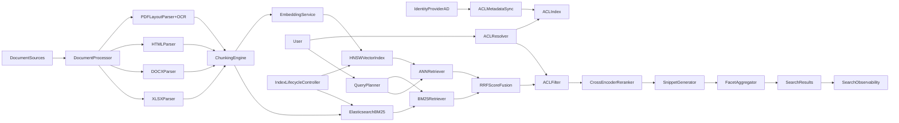

# Chapter 7: Design an Enterprise Semantic Search Engine

## Context

> [!info] Quick Reference
> - **Pattern:** Enterprise semantic search with ACL
> - **Scale:** 50M documents, 2M searches/day
> - **Key Techniques:** ACL pre-filter, layout-aware parsing, table extraction, HNSW + Elasticsearch dual index
> - **Primary Concerns:** ACL correctness, parser failures on PDFs/XLSX, query latency at scale
> - **Cross-references:** [[chapter-03|Chapter 3]] (vector infrastructure), [[chapter-11|Chapter 11]] (financial document extraction)

**Problem statement:** Design a semantic search engine over a 50M-document enterprise corpus with heterogeneous document types (PDFs, HTML, spreadsheets), strict document-level access control (ACLs) enforced at query time, and sub-200ms latency at scale—while maintaining recall above 0.85.

### Real-World Examples

- A Fortune 500 company's internal search leaks document existence metadata to unauthorized users when ACL filtering is applied post-retrieval; switching to pre-filtered vector search with ACL-indexed metadata eliminates the information leak but requires re-architecting the index.
- A pharmaceutical compliance team discovers that table-heavy FDA submission PDFs have 40% lower retrieval accuracy than plain-text documents; implementing layout-aware parsing with header-row preservation and table-as-markdown chunking recovers 35% of the lost recall.

---

## Step 1: Understand the Problem and Establish Design Scope

### Simulated Dialogue

**Interviewer:** Design an enterprise semantic search engine for a large organization.  
**Candidate:** I need to understand corpus size, document types, access control complexity, and search latency requirements before proposing architecture.

**Candidate:** What is the corpus size and composition?  
**Interviewer:** 50M documents. Mix of PDFs (40%), HTML/wiki pages (30%), Office documents (20%), and spreadsheets/CSVs (10%). Average document is 5 pages. Growing at 200K new docs/week.

**Candidate:** How complex is the access control model?  
**Interviewer:** 5,000 security groups, nested group inheritance, per-document ACLs. Some documents have individual user-level permissions. Average user belongs to 15 groups. ACL correctness is non-negotiable—no unauthorized user may see even a snippet from a restricted document.

**Candidate:** What are the search volume and latency requirements?  
**Interviewer:** 2M searches/day. p95 end-to-end latency under 200ms. Users expect faceted results with snippet highlighting.

**Candidate:** Is this keyword search, semantic search, or both?  
**Interviewer:** Both. Users search with natural language queries and also with exact terms (error codes, product IDs, employee names). Results must support facets (document type, date range, department, author).

### Functional Requirements

- Full-text lexical search (BM25) with exact-match capability for IDs, error codes, names.
- Semantic vector search for natural language and paraphrase queries.
- Hybrid retrieval with score fusion and reranking.
- Document-level ACL enforcement: no snippets, titles, or metadata from unauthorized documents.
- Faceted search results: filter by document type, date range, department, author.
- Snippet generation with query-term highlighting.
- Support for all document types: PDF (including scanned), HTML, DOCX, XLSX, CSV.

### Non-Functional Requirements

- **Latency:** p95 end-to-end < 200ms (including ACL resolution).
- **Relevance:** Recall@10 > 0.85, NDCG@10 > 0.70 on benchmark query set.
- **ACL correctness:** 100%. Zero tolerance for unauthorized document exposure.
- **Freshness:** new/updated documents searchable within 30 minutes.
- **Scale:** 50M documents, 500M+ chunks, 2M searches/day.
- **Availability:** 99.95% uptime.

### Back-of-the-Envelope Estimation

#### Corpus Sizing

- Documents: 50M, average 5 pages, ~2,000 tokens/page
- Total tokens: `50M * 5 * 2,000 = 500B tokens`
- Chunks (512 tokens, 25% overlap): `50M * 5 * 2000 / (512 * 0.75) ≈ 1.3B chunks`
- Practical with dedup and smart chunking: **~650M chunks**

#### Embedding Compute

- Model: `text-embedding-3-small` (1536-dim, $0.02/1M tokens)
- Full embed cost: `500B tokens * $0.02/1M = $10,000` (one-time)
- Incremental daily: `200K docs/week ≈ 28.6K docs/day * 5 pages * 2,000 tokens = 286M tokens/day`
- Incremental cost: `~$5.72/day`

#### Vector Index Storage

- 650M vectors at 1536-dim, float32: `650M * 6KB = ~3.9TB raw`
- With HNSW overhead + metadata + replicas (x2.5): **~9.75TB**
- HNSW serving RAM: ~100-150GB per shard across shard cluster

#### Search Throughput

- Searches/day: 2M
- Average QPS: `2M / 86,400 ≈ 23`
- Peak QPS (10x): `~230`
- Per-query latency budget breakdown:
  - ACL group resolution: ~10ms (cached)
  - BM25 lookup: ~15ms
  - ANN vector search: ~30ms
  - Score fusion: ~3ms
  - ACL filtering: ~15ms
  - Reranker (top-50): ~60ms
  - Snippet generation: ~25ms
  - Facet aggregation: ~20ms
  - **Total: ~178ms** (within 200ms p95 budget)

#### ACL Overhead

- 5,000 groups, avg user in 15 groups
- ACL resolution per query: expand user → group membership → permission set
- With caching (TTL 5 min): ~10ms p95 (cache hit rate >95%)
- Without caching: ~80ms (group expansion with nested inheritance)
- ACL metadata per document: ~200 bytes (group IDs + permission bits)
- Total ACL metadata: `50M * 200B = 10GB`

---

## Step 2: Propose High-Level Design and Get Buy-In

### Core Architecture Components

- **Document Processor:** format-specific parsers (PDF/OCR, HTML, DOCX, XLSX), layout-aware extraction, table preservation.
- **Chunking Engine:** configurable strategy per document type, metadata tagging (doc_id, section, page, ACL groups).
- **Embedding Service:** batched embedding generation with rate limiting, model version tracking.
- **Dual Index:** lexical index (Elasticsearch/BM25) + vector index (HNSW via Qdrant/Weaviate/Pinecone).
- **ACL Resolver:** user → group expansion with caching, permission set computation.
- **Query Planner:** routes query to lexical, semantic, or hybrid path based on query analysis.
- **Score Fusion Engine:** reciprocal rank fusion or weighted combination of lexical + semantic results.
- **Reranker:** cross-encoder model for precision boost on top-N candidates.
- **ACL Filter:** enforces document-level access control on retrieval results.
- **Snippet Generator:** extracts relevant passages with query-term highlighting.
- **Facet Aggregator:** computes facet counts (type, date, department, author) on ACL-filtered results.
- **Index Lifecycle Controller:** versioned indexes, alias swap, blue-green deployments, quality gates.
- **Observability:** search latency, recall, NDCG, ACL filter hit rate, parse failure rate, freshness lag.

### Pipeline A: Document Ingestion Pipeline

1. Source connectors detect new/updated documents via CDC, crawlers, or API webhooks.
2. Document processor routes to format-specific parser: PDF → layout-aware extraction (PyMuPDF + table detection), HTML → boilerplate removal, DOCX → structured extraction, XLSX → row-level records.
3. OCR pipeline for scanned PDFs (Tesseract/DocTR); confidence scoring on OCR output quality.
4. Chunking engine applies document-type-specific strategy; tags each chunk with `doc_id`, `page`, `section`, `acl_groups`, `last_updated`.
5. Embedding service generates vectors in batches; tagged with `embedding_model_version`.
6. Dual write: vectors to HNSW index, text + metadata to Elasticsearch.
7. ACL metadata synced from identity provider (Active Directory / LDAP) into ACL index.
8. Quality gate: sample 100 benchmark queries on shadow index; verify Recall@10, NDCG@10, parse fidelity.
9. Alias swap to promote new index version; keep old version hot for 24h rollback.

### Pipeline B: Search Query Pipeline

1. User submits query; auth token resolved to user identity.
2. ACL resolver expands user → group memberships → permission set (cached, TTL 5 min).
3. Query planner analyzes query: exact-match signals (IDs, error codes) → lexical-heavy; natural language → semantic-heavy; mixed → hybrid.
4. Query rewriter expands abbreviations, resolves acronyms from enterprise glossary.
5. Parallel execution: BM25 retrieval (top-200) + ANN vector retrieval (top-200).
6. Score fusion (RRF) produces merged candidate set (top-200).
7. **ACL filter** removes all chunks from documents the user cannot access.
8. Reranker scores top-50 ACL-filtered candidates; returns top-10 with relevance scores.
9. Snippet generator extracts highlight passages from top-10 results.
10. Facet aggregator computes counts on ACL-filtered result set.
11. Response assembled: ranked results with snippets, facets, metadata, and search telemetry.

### Mermaid Architecture Diagram

---

## Step 3: Design Deep Dive

Focus areas for this chapter:

1. **Document Parsing at Scale**
2. **ACL-Aware Retrieval**
3. **Search Relevance Tuning**

### 1) Document Parsing at Scale

The single biggest quality bottleneck in enterprise search is not the model—it is the parser. Garbage in, garbage out.

#### Document Type Parser Trade-off Table

| Doc Type | Parser | Table Handling | OCR Needed | Avg Parse Time | Failure Rate |
|---|---|---|---|---|---|
| Native PDF (text layer) | PyMuPDF / pdfplumber | Extract as markdown with headers | No | ~200ms/page | <1% |
| Scanned PDF (image-only) | Tesseract + DocTR | OCR → markdown reconstruction | Yes | ~2s/page | 5-8% |
| PDF with mixed text+images | PyMuPDF + DocTR fallback | Hybrid: text extraction + OCR for image regions | Partial | ~800ms/page | 3-5% |
| HTML / Wiki | BeautifulSoup + boilerplate removal | HTML table → markdown | No | ~50ms/page | <1% |
| DOCX | python-docx | Native table extraction | No | ~100ms/page | <1% |
| XLSX / CSV | openpyxl / pandas | Row-level chunking with headers | No | ~150ms/sheet | 2% |

**Table extraction in detail:**
- Tables are the highest-value, lowest-recall content in enterprise search.
- Strategy: extract table as markdown with column headers repeated in every chunk that contains table rows.
- Example: a 50-row financial table → chunk into groups of 10 rows, each chunk includes column headers + row data + table caption.
- Embed table chunks separately from surrounding text; tag with `content_type: table`.
- At retrieval time, boost table chunks when query contains numerical/comparison signals.

**Layout-aware parsing pipeline:**
1. Detect document structure: headers, paragraphs, tables, figures, sidebars.
2. Assign hierarchy: H1 → section, H2 → subsection, body → paragraph.
3. Preserve reading order (critical for multi-column PDFs).
4. Extract tables as structured markdown; extract figures as captions only (image content via OCR if needed).
5. Tag each chunk with structural metadata: `{section: "Q3 Revenue", page: 12, content_type: "table"}`.

**Dead-letter queue and fallback:**
- Documents that fail primary parser route to fallback: raw text extraction (loses structure but preserves content).
- Alert on failure rate > 2% per document type.
- Weekly manual review of dead-letter queue; failure patterns feed parser improvements.
- Parse quality metric: compare extracted text against ground-truth for 200 sampled documents monthly.

#### Chunking Strategy by Document Type

| Doc Type | Chunk Strategy | Chunk Size | Overlap | Rationale |
|---|---|---|---|---|
| Long-form PDF/DOCX | Section-level semantic | 512-768 tokens | 25% | Preserves topic coherence |
| Policy/Legal | Clause-level with parent | 256-512 tokens | 10% | Precise citation needed |
| FAQ / Knowledge articles | Q+A or section atomic | 200-500 tokens | None | Self-contained units |
| Spreadsheets | Row-group + headers | 256-512 tokens | Header repeated | Tabular context preserved |
| Code/Technical docs | AST-aware or block-level | 512 tokens | 25% | Preserve function/class boundaries |

### 2) ACL-Aware Retrieval

ACL correctness is the non-negotiable constraint. The system must never expose even a title or snippet from an unauthorized document. This eliminates any approach that relies on post-hoc filtering where document existence is leaked.

#### ACL Enforcement Strategy Trade-off Table

| Strategy | Latency Impact | ACL Correctness | Index Complexity | Storage Overhead | Best For |
|---|---|---|---|---|---|
| Post-filter (retrieve broadly, filter after) | Low retrieval, +15ms filter | Metadata leak risk (reveals doc existence) | Low | None | Internal low-sensitivity corpora only |
| Pre-filter (inject ACL predicate into query) | +10-20ms query overhead | Full correctness | Medium (ACL-indexed metadata) | +10-15% index size | Default for ACL-sensitive enterprise |
| Partitioned indexes (per-group shards) | Lowest query latency | Full correctness | Very high (combinatorial explosion) | 3-10x storage | Single-tenant or very few groups |
| Hybrid pre-filter + post-filter | +15ms | Full correctness | Medium-high | +15% | High-cardinality ACLs (>5K groups) |

**Recommended: Pre-filter for production enterprise search.**

**Pre-filter implementation:**
- Each chunk in vector index and lexical index is tagged with `acl_groups: [group_id_1, group_id_2, ...]`.
- At query time, ACL resolver computes user's effective permission set: `user_groups = expand(user_id) → [g1, g2, ..., g15]`.
- Search query includes filter: `WHERE acl_groups INTERSECT user_groups IS NOT EMPTY`.
- Elasticsearch: `terms` filter on `acl_groups` field. Qdrant/Weaviate: payload filter on group array.

**ACL group expansion and caching:**
- Active Directory / LDAP group membership with nested inheritance.
- Expansion: `user → direct_groups → parent_groups → ... → root`. Typically 2-3 levels deep.
- Cache expanded group set per user in Redis with 5-minute TTL.
- Cache hit rate: >95% (users don't change groups frequently).
- Invalidation: LDAP change event triggers cache eviction for affected users.

**ACL sync pipeline:**
- Identity provider (AD/Okta) → CDC stream → ACL metadata store → index metadata update.
- Sync latency SLA: < 15 minutes from permission change to search enforcement.
- Audit log: every ACL sync event logged for compliance; weekly reconciliation job verifies index ACLs match source-of-truth.

**Handling high-cardinality ACLs:**
- Documents with individual user-level permissions (not just group): store as `acl_users: [user_id]` alongside `acl_groups`.
- For documents accessible to most users (e.g., public company-wide docs): tag with special `acl_groups: [ALL_EMPLOYEES]` to avoid bloated filter predicates.
- Over-retrieval strategy for edge cases: retrieve 2x target set before ACL filter to ensure enough results survive filtering.

### 3) Search Relevance Tuning

#### Retrieval Strategy Trade-off Table

| Approach | Recall@10 | p95 Latency | Strengths | Weaknesses |
|---|---|---|---|---|
| BM25 only | 0.55-0.65 | ~15ms | Exact match, IDs, error codes | Misses paraphrases |
| Dense vector only | 0.70-0.80 | ~30ms | Semantic understanding | Misses exact terms, OOV tokens |
| Hybrid BM25 + dense (RRF) | 0.80-0.88 | ~45ms | Best of both | More infrastructure |
| Hybrid + cross-encoder reranker | 0.85-0.92 | ~105ms | Highest precision | Reranker GPU cost, latency |

**Score fusion:**
- Default: Reciprocal Rank Fusion (RRF) with `k=60`.
- `score(doc) = sum(1 / (k + rank_bm25)) + sum(1 / (k + rank_vector))`
- No hyperparameter tuning needed; robust across query types.
- Alternative: learned weighted combination (alpha-tuned per query class). Use only with sufficient labeled data.

**Cross-encoder reranking:**
- Model: ~110M params (e.g., cross-encoder/ms-marco-MiniLM-L-12-v2), ~1.2ms/pair on GPU.
- Reranking top-50 candidates: `~60ms` on dedicated GPU.
- At 230 peak QPS: need ~14 concurrent reranker slots → 2-4 GPUs with batching.
- Quality lift: +5-12% Recall@5 over fusion alone.
- Fallback: skip reranker under extreme load; degrade gracefully to fusion-only.

**Query understanding:**
- Query classification: exact-match query (error codes, IDs) → boost BM25 weight. Natural language → boost vector weight.
- Acronym/abbreviation expansion from enterprise glossary (maintained by search team).
- Spell correction for common enterprise terms.
- Query intent detection: navigational ("find the Q3 report") vs. informational ("how does our vacation policy work") → affects ranking.

**Snippet generation:**
- Extract top passage from each result document that matches the query.
- Highlight matched terms (lexical matches bolded, semantic matches context-highlighted).
- Max snippet length: 200 tokens. Truncate with "..." at sentence boundary.
- For table results: show matching row(s) with column headers.

**Zero-result handling:**
- If ACL filtering eliminates all results: return "No documents matching your query are available with your current access level."
- If retrieval returns zero results pre-ACL: suggest query refinements, check spelling, offer facet-based browsing.
- Never indicate whether restricted documents exist (prevents information leak).

#### Search Quality Evaluation

| Metric | Target | Measurement | Frequency |
|---|---|---|---|
| Recall@10 | > 0.85 | Benchmark query set (500 queries) | Weekly automated |
| NDCG@10 | > 0.70 | Benchmark with graded relevance labels | Weekly automated |
| MRR | > 0.75 | First relevant result position | Weekly automated |
| Zero-result rate | < 5% | Production query logs | Daily monitoring |
| Click-through rate (CTR) | > 40% on first page | Search analytics | Weekly trending |
| ACL violation rate | 0% | Audit + pen testing | Monthly |

### Production Bottlenecks and Mitigations

- **ACL resolution latency spike on cache miss**
  - Symptom: p95 search latency jumps to 300ms+ when ACL cache expires for many users simultaneously (e.g., after maintenance window).
  - Mitigation: staggered cache TTLs (5 min ± random jitter), background cache refresh 1 min before expiry, read-through cache with LDAP connection pooling.

- **PDF table extraction quality regression**
  - Symptom: recall drops on table-heavy queries after parser library upgrade.
  - Mitigation: parse quality benchmark (200 ground-truth docs), canary eval before parser rollout, shadow index comparison.

- **Index freshness lag exceeding 30-minute SLA**
  - Symptom: newly published documents not appearing in search results.
  - Mitigation: priority queue for high-value sources, horizontal scaling of embedding workers, freshness monitoring dashboard with alerting at 20-minute lag.

- **Embedding model upgrade requiring full re-index**
  - Symptom: 650M chunks need re-embedding; takes days and costs $10K.
  - Mitigation: shadow index build over 3-5 days using parallel workers (50x parallelism → ~8 hours), canary eval on benchmark queries, alias swap only after quality gate passes.

- **Cross-encoder reranker throughput bottleneck at peak**
  - Symptom: reranking adds 150ms+ at peak QPS, pushing p95 over 200ms.
  - Mitigation: dynamic reranker depth (top-50 at normal load, top-20 at peak), skip reranker entirely under extreme load with graceful quality degradation, auto-scaling GPU pool.

- **Stale ACL metadata causing unauthorized access**
  - Symptom: user removed from security group but still sees restricted documents.
  - Mitigation: ACL cache TTL of 5 minutes (max), near-real-time CDC from identity provider, daily full reconciliation audit comparing index ACLs to source-of-truth.

### Advanced Techniques

- **Matryoshka embeddings** for variable-precision search: use coarse 256-dim for fast ANN pass, refine with full 1536-dim on shortlist. ~3x ANN speedup with <2% recall loss.
- **Learned sparse retrieval (SPLADE)** as BM25 replacement: better recall on semantic queries while preserving exact-match capability. Requires dedicated infrastructure.
- **Query-time document expansion:** inject document titles and metadata into query for BM25 boost on navigational queries.
- **Incremental HNSW:** add new vectors without full rebuild; maintain graph quality with periodic optimization passes.
- **Federated search across geographically distributed indexes** for global enterprises with data residency requirements.

---

## Step 4: Wrap Up

### Final Design Summary

The design treats enterprise search as a security-first retrieval problem. ACL correctness is enforced via pre-filter on indexed metadata with cached group expansion. Document parsing quality is gated by format-specific parsers with layout preservation and dead-letter handling. Relevance is optimized through hybrid retrieval with cross-encoder reranking, bounded by strict latency SLOs.

### Wrap-Around Concerns

- **Risk:** ACL metadata desync causing unauthorized document exposure.
  - Gate: 5-minute cache TTL, near-real-time CDC sync, daily full reconciliation audit with zero-tolerance alerting.
- **Risk:** Parser regression silently degrading index quality for specific document types.
  - Gate: monthly parse quality benchmark on 200 ground-truth documents, canary eval before parser upgrades.
- **Risk:** Index freshness lag causing missing results for recently published documents.
  - Gate: freshness monitoring dashboard, alerting at 20-minute lag, priority queue for critical sources.
- **Risk:** Reranker latency exceeding budget at peak traffic.
  - Gate: dynamic reranker depth, auto-scaling GPU pool, graceful degradation to fusion-only under extreme load.

---

## Step 5: Interviewer Curveballs

### Interviewer Follow-ups & Frequently Asked Questions (FAQ)

Q: A user reports they can see a snippet from a document they shouldn't have access to. Walk me through your investigation.

**The Ideal Answer:** First, verify the claim: reproduce the query with the user's identity and check if the result appears. If confirmed: (1) check ACL metadata on the document in the index—is it tagged with the correct groups? (2) Check ACL sync pipeline—was there a sync delay or failure? (3) Check the user's group expansion—are they in a group that was recently supposed to be removed? (4) Check if the document's ACL changed in the source system but hasn't propagated. Fix: immediately remove the document from the index, patch the ACL sync, and trigger a full reconciliation.

**Deep Dive & Trade-offs:**
- ACL leaks are P0 severity—investigate before root-causing.
- Pre-filter approach should make this impossible if ACL metadata is correct.
- Root cause is almost always ACL sync lag or stale cache, not a retrieval bug.

**The Interviewer's Rubric:** Checking incident response discipline for security-critical bugs.

Q: How do you handle documents that become stale or are deleted in the source system?

**The Ideal Answer:** CDC stream captures delete events → mark chunk as tombstoned in index → remove from search results immediately. Soft-delete with 7-day retention for rollback. For stale docs: `last_updated` comparison against source; if source is newer and chunk is >30 minutes stale, trigger re-index. Daily reconciliation job compares index inventory against source catalog; orphaned chunks are flagged and removed.

**Deep Dive & Trade-offs:**
- Hard delete risks losing rollback capability.
- Soft delete with tombstone is safer but accumulates garbage; compact periodically.
- Reconciliation job catches CDC misses but is expensive to run on 50M docs daily.
- Optimization: reconcile by last-modified-date bucketing; only check docs modified in last 7 days.

**The Interviewer's Rubric:** Checking index lifecycle management for deletions and staleness.

Q: Your search engine needs to support queries in English, German, and Japanese. How do you handle cross-language retrieval?

**The Ideal Answer:** Two options: (1) Multilingual embeddings (e.g., multilingual-e5-large) with a single unified index—simplest but ~5-8% recall degradation vs. monolingual. (2) Per-language indexes with query language detection and parallel search—best quality but 3x index storage and operational complexity. I recommend starting with multilingual embeddings for v1, then adding per-language indexes for high-traffic languages if recall regression is measured.

**Deep Dive & Trade-offs:**
- Multilingual models: single index, simpler ops, but cross-language retrieval quality varies by language pair.
- Per-language indexes: best quality but need language detection, parallel search, and result merging.
- BM25 is inherently language-specific (stemming, tokenization)—needs per-language analyzers regardless.
- Hybrid approach: multilingual vectors + per-language BM25 analyzers in single Elasticsearch index.

**The Interviewer's Rubric:** Checking practical multilingual search architecture.

Q: A batch of 10,000 scanned PDF documents has table data that your OCR pipeline consistently misreads. How do you improve extraction quality?

**The Ideal Answer:** First, diagnose: sample 50 failed documents and identify the failure pattern (low contrast, multi-column, handwriting, unusual fonts). Then: (1) try a stronger OCR model (DocTR or LayoutLMv3 instead of Tesseract), (2) pre-process images (deskew, contrast enhancement, binarization), (3) for tables specifically, use a dedicated table detection model (TableTransformer) to identify table regions before OCR, (4) for the worst cases, route to a multimodal LLM (GPT-4V) as an expensive fallback for high-value documents.

**Deep Dive & Trade-offs:**
- Tesseract: fast, free, good for clean scans. Poor on complex layouts.
- DocTR: better accuracy, 3x slower, handles multi-column better.
- Multimodal LLM: best accuracy but $0.01-0.05 per page—use only for high-value docs.
- Table detection + specialized OCR: best balance for table-heavy corpora.
- Always measure: per-document OCR confidence score; route low-confidence to fallback pipeline.

**The Interviewer's Rubric:** Checking document parsing depth and fallback strategy.

Q: How do you generate high-quality snippets for search results, especially for table content?

**The Ideal Answer:** For text: extract the passage with highest BM25 + semantic overlap with the query, truncate at sentence boundaries, highlight matched terms. For tables: extract matching row(s) with full column headers, format as a mini-table in the snippet. For mixed content: prefer the content type that best matches the query (numerical query → table snippet, natural language → text snippet).

**Deep Dive & Trade-offs:**
- Snippet generation is latency-sensitive (must fit within 200ms budget).
- BM25-based highlighting is fast (~5ms) but misses semantic matches.
- LLM-generated snippets are highest quality but too expensive/slow for search results.
- Practical: BM25 highlights + pre-computed "best passage" stored at index time for top-scoring chunk.

**The Interviewer's Rubric:** Checking UX attention—snippets are what users actually read.

Q: 15% of searches return zero results. How do you diagnose and reduce this?

**The Ideal Answer:** Categorize zero-result queries: (1) typos/misspellings → add spell correction, (2) queries for content that doesn't exist in the corpus → show "no results found" with suggested related topics, (3) ACL filtering removing all results → show "no accessible documents found" (without revealing restricted docs exist), (4) vocabulary mismatch → expand enterprise glossary, improve acronym handling. Track each category separately and target the largest bucket first.

**Deep Dive & Trade-offs:**
- Spell correction catches 30-40% of zero-result queries in enterprise settings.
- Acronym/abbreviation expansion catches another 10-15%.
- "Did you mean?" suggestions reduce frustration and improve engagement.
- Critical: never reveal that documents exist but are inaccessible (ACL information leak).

**The Interviewer's Rubric:** Checking zero-result handling as a search quality signal.

Q: How do you build a relevance feedback loop to improve search quality over time?

**The Ideal Answer:** Three signals: (1) implicit feedback—clicks, dwell time, and click-through position (user clicked result #3 means #1 and #2 were less relevant), (2) explicit feedback—thumbs up/down on results, (3) reformulation patterns—user refines query after seeing results, indicating initial results were poor. Feed these into (a) fine-tuning the reranker on domain-specific click data, (b) adjusting fusion weights, (c) identifying queries that need KB content expansion.

**Deep Dive & Trade-offs:**
- Implicit signals are noisy (user might click first result by habit, not relevance).
- Explicit signals are sparse (< 5% of queries get feedback).
- Reformulations are the strongest negative signal—easy to collect, hard to interpret.
- Reranker fine-tuning on click data: +3-5% NDCG@10 after 4-6 weeks of collection.
- Risk: feedback loops can reinforce popularity bias (rich-get-richer).

**The Interviewer's Rubric:** Checking closed-loop search quality improvement design.

Q: Your search analytics show that 25% of queries are for content that users know exists but can't find. How do you address this discoverability problem?

**The Ideal Answer:** This is a recall problem, not a relevance problem. Investigate: (1) are these documents properly indexed? Check ingestion pipeline for failures. (2) Are chunk boundaries splitting key content? Audit chunking for the affected document types. (3) Is the query vocabulary mismatched with document vocabulary? Add synonym expansion, enterprise glossary, and query suggestion. (4) Are these documents in formats we parse poorly (scanned PDFs, complex spreadsheets)? Improve parser quality for those formats.

**Deep Dive & Trade-offs:**
- Most "can't find" reports are parser/chunking issues, not search algorithm issues.
- User interviews reveal the document and query—use these as benchmark test cases.
- Adding these to the benchmark query set creates a flywheel for continuous improvement.
- Organizational fix: content owners should tag documents with searchable metadata at publish time.

**The Interviewer's Rubric:** Checking root-cause analysis depth for search recall failures.

## End of Chapter

- **Key takeaway:** Enterprise semantic search is a security and parsing problem more than a model problem. ACL correctness is non-negotiable and must be enforced at the retrieval layer, not patched post-hoc. Document parsing quality directly determines recall—fix the parser before tuning the retrieval algorithm.
- **What to practice:** Walk through a query from user input to result rendering, explaining ACL enforcement at each stage and how you would handle a table-heavy PDF that your parser struggles with.
- **Interview drill:** Given a reported ACL leak where a user sees a restricted document snippet, trace the investigation from reproduction to root cause (ACL sync lag, cache staleness, metadata tagging error) to remediation and prevention.
