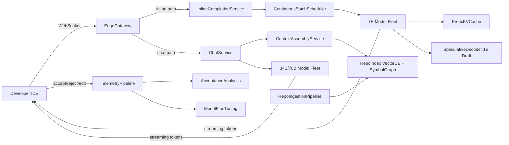

# Chapter 8: Design an AI Coding Assistant

## Context

> [!info] Quick Reference
> - **Pattern:** Dual-path coding assistant (autocomplete + chat)
> - **Scale:** 200M completions/day, 20M chat turns/day
> - **Key Techniques:** FIM prompting, speculative decoding (1B draft model), prefix KV caching, token budget assembly
> - **Primary Concerns:** < 300ms TTFT for autocomplete, acceptance rate telemetry, context window management
> - **Cross-references:** [[chapter-04|Chapter 4]] (serving optimization), [[chapter-09|Chapter 9]] (agentic path for complex edits)

**Problem statement:** Design an IDE-integrated coding assistant (GitHub Copilot-class) that delivers sub-300ms inline completions, multi-turn chat, and repo-aware suggestions—while managing extreme sensitivity to latency, context assembly correctness, and suggestion acceptance rate.

### Real-World Examples

- GitHub Copilot serves 2M+ developers with Fill-In-The-Middle (FIM) completions at <300ms TTFT; a 50ms TTFT regression drops acceptance rate by ~8%, directly impacting retention.
- An enterprise coding assistant indexes a 500K-file monorepo but hits 4s TTFT on completions because the context assembler packs 12K tokens of irrelevant imports; switching to symbol-graph-based context selection cuts prompt size to 2K tokens and restores 280ms TTFT.

---

## Step 1: Understand the Problem and Establish Design Scope

### Simulated Dialogue

**Interviewer:** Design an AI coding assistant like GitHub Copilot for production scale.  
**Candidate:** I need to distinguish two inference modes: inline autocomplete (extreme latency sensitivity, short output) and chat/explain (longer latency budget, long output). The architectures diverge significantly.

**Candidate:** What is the user base and request profile?  
**Interviewer:** 2M daily active developers, averaging 100 completion requests per day per user. Chat usage is ~10 sessions/day per active user.

**Candidate:** What latency SLOs must we hit?  
**Interviewer:** Sub-300ms TTFT for inline completions, sub-1s TTFT for chat. Completions that arrive after the developer has typed past the cursor position are worthless.

**Candidate:** What languages and repo sizes?  
**Interviewer:** Top 20 languages by GitHub usage. Repos range from 1K to 500K files. Must handle monorepos.

### Functional Requirements

- **Inline autocomplete:** Fill-In-The-Middle completions triggered on keystroke with streaming token delivery.
- **Chat/explain:** Multi-turn conversation grounded in open files, selected code, and repo context.
- **Context assembly:** Automatically select relevant code context (open files, imports, symbols, recent edits) within token budget.
- **Multi-language support:** Syntax-aware completions for top 20 languages without per-language model.
- **Telemetry:** Track acceptance/rejection/edit-after-accept per suggestion for model and ranking improvement.

### Non-Functional Requirements

- **Latency:** Inline TTFT p95 < 300ms. Chat TTFT p95 < 1,000ms.
- **Throughput:** Sustain 200M completions/day (peak 5x → ~11,500 completion QPS).
- **Availability:** 99.9% for inline path; graceful degradation (no completions) preferred over errors.
- **Cost:** < $0.001 per inline completion at scale; < $0.02 per chat turn.
- **Safety:** Never suggest secrets, license-violating code, or code that fails static analysis.

### Back-of-the-Envelope Estimation

#### Traffic Profile

- DAU: 2M developers
- Completions/day: `2M * 100 = 200M`
- Average completion QPS: `200M / 86,400 ≈ 2,315`
- Peak QPS (5x): `~11,575`
- Average output tokens/completion: 50 tokens
- Output tokens/day (completions): `200M * 50 = 10B tokens`
- Chat turns/day: `2M * 10 = 20M`
- Average chat output tokens: 300 tokens
- Output tokens/day (chat): `20M * 300 = 6B tokens`
- Total output tokens/day: ~16B tokens

#### Latency Budget — Inline Autocomplete (300ms total)

| Stage | Budget | Notes |
|---|---|---|
| IDE extension → gateway | 20ms | WebSocket/gRPC persistent connection |
| Debounce + cancellation | 50ms | Wait for typing pause; cancel in-flight on new keystroke |
| Context assembly | 30ms | Local in IDE plugin; symbol lookup + FIM formatting |
| Network to inference | 20ms | Edge PoP or regional inference cluster |
| Queue + scheduling | 10ms | Priority queue, continuous batching |
| Prefill (prompt processing) | 80ms | ~2K input tokens on optimized 7B model |
| Decode (50 tokens) | 70ms | ~1.4ms/token with speculative decoding |
| Network return + render | 20ms | First token streams immediately |

#### Latency Budget — Chat (1,000ms total)

| Stage | Budget | Notes |
|---|---|---|
| Gateway + auth | 30ms | |
| Context assembly (server-side) | 100ms | RAG over repo index + open file context |
| Queue + scheduling | 50ms | Lower priority than inline |
| Prefill (~4K tokens) | 300ms | Larger context, 34B model |
| TTFT delivery | 480ms | First token visible to user |
| Decode streaming | Ongoing | TPOT < 40ms/token |

#### GPU Fleet Sizing (Inline Path)

- Model: 7B quantized (INT4), ~18GB VRAM, ~200 tok/sec/GPU with speculative decoding
- Peak demand: `11,575 QPS * 50 tokens = 578,750 tok/sec`
- With continuous batching (8x efficiency): `578,750 / (200 * 8) ≈ 362 GPUs` for inline
- Chat path (34B, lower QPS): ~200 GPUs
- Total fleet: ~600-800 GPUs (steady-state ~250 with autoscaling)

#### Cost Per Completion

- Self-hosted 7B: ~$2/1M output tokens (amortized)
- Cost/completion: `50 tokens * $2/1M = $0.0001` ← well under $0.001 budget

---

## Step 2: Propose High-Level Design and Get Buy-In

### Core Architecture Components

- **IDE Extension (Client):** Debounce logic, local context assembly (FIM formatting), WebSocket connection, cancellation, acceptance tracking.
- **Edge Gateway:** Persistent connections, auth, rate limiting, request routing (inline vs chat).
- **Inline Completion Service:** Ultra-low-latency path with dedicated 7B model fleet, speculative decoding, prefix KV cache.
- **Chat Service:** 34B/70B model fleet with RAG over repo index, streaming output, multi-turn state.
- **Context Assembly Service:** Server-side repo-level context retrieval for chat; provides symbol graph, import resolution, and snippet ranking.
- **Repo Index Pipeline:** Offline indexing of repo structure, symbol graphs, embeddings for semantic search.
- **Telemetry Pipeline:** Acceptance/rejection/edit tracking → model fine-tuning and ranking improvement.
- **Model Serving Runtime:** vLLM/TensorRT-LLM with continuous batching, KV prefix caching, speculative decoding.

### Pipeline A: Repo Indexing Pipeline

1. On repo connect: clone/pull latest, parse AST for all supported languages.
2. Build symbol graph (definitions, references, imports, exports) per file.
3. Chunk files at function/class boundaries; generate embeddings (code-specialized model, e.g., CodeSage).
4. Store in per-repo vector index (HNSW) + symbol graph database.
5. Incremental update on file save/commit (diff-based re-index, not full rebuild).
6. Version-tag index; invalidate stale entries on branch switch.

### Pipeline B: Inline Completion Pipeline

1. Developer types → IDE extension debounces (50ms pause).
2. Extension assembles FIM prompt locally: `<prefix>code before cursor<suffix>code after cursor<middle>` with surrounding file context, open tabs ranked by relevance, and import statements.
3. Request sent via WebSocket to edge gateway; any in-flight request for same cursor position is cancelled.
4. Gateway routes to inline completion service; request enters priority queue.
5. Continuous batch scheduler admits request; checks prefix KV cache for system prompt + common prefixes.
6. 7B model generates up to 50 tokens with speculative decoding (1B draft model).
7. Tokens stream back; IDE renders ghost text as tokens arrive.
8. On accept (Tab) / reject (Esc/type-past) / edit-after-accept: telemetry event emitted.

### Pipeline C: Chat Pipeline

1. Developer opens chat panel, types question with optional code selection.
2. Chat service retrieves repo-level context via embedding search + symbol graph traversal.
3. Assembles prompt: system instructions + repo context + conversation history + user query.
4. Routes to 34B model (or 70B for complex architectural questions).
5. Streams response with code blocks, file references, and inline citations.
6. Tracks thumbs-up/down + copy/apply actions for quality signal.

### Mermaid Architecture Diagram



---

## Step 3: Design Deep Dive

Focus areas:

1. **Context Assembly and Fill-In-The-Middle (FIM)**
2. **Latency Engineering for Autocomplete**
3. **Telemetry and Acceptance Tracking**

### 1) Context Assembly and Fill-In-The-Middle (FIM)

The quality of code completions is dominated by context selection, not model size. A 7B model with perfect context outperforms a 70B model with irrelevant context.

**FIM prompt structure:**

```
<|fim_prefix|>{code before cursor}<|fim_suffix|>{code after cursor}<|fim_middle|>
```

The model generates tokens to fill the gap between prefix and suffix. This is fundamentally different from left-to-right completion—it allows the model to respect constraints imposed by code *after* the cursor (e.g., closing brackets, type annotations, function signatures).

**Context budget allocation (2,048 token budget for inline):**

| Slot | Token Budget | Source | Priority |
|---|---|---|---|
| FIM prefix (current file, before cursor) | 600 | Truncated upward from cursor | Highest |
| FIM suffix (current file, after cursor) | 400 | Truncated downward from cursor | Highest |
| Active file imports/type defs | 300 | AST-extracted | High |
| Recently edited lines (last 30s) | 200 | Edit buffer diff | High |
| Open tab snippets (ranked) | 300 | BM25 over open files using cursor-local tokens as query | Medium |
| Repository symbols (definitions used in scope) | 248 | Symbol graph traversal from cursor scope | Medium |

**Context ranking signals:**

- **Recency:** Files edited in last 60s rank highest.
- **Locality:** Same directory > same package > same repo.
- **Symbol relevance:** Definitions/types referenced in current scope.
- **Edit correlation:** Files frequently co-edited (from git history).
- **Language-specific:** For TypeScript, `.d.ts` type files rank high; for Python, `__init__.py` exports.

**Repo-level context retrieval (for chat, not inline):**

The chat path can afford 100ms for server-side retrieval:
1. Embed the user query + selected code with a code embedding model.
2. Retrieve top-K chunks from per-repo HNSW index (K=20, then rerank to top-5).
3. Traverse symbol graph: if retrieved chunk references an imported function, include that function's definition.
4. Deduplicate and assemble within 4K token budget.

#### Context Assembly Trade-off Table

| Strategy | Quality | Latency | Complexity | Best For |
|---|---|---|---|---|
| Current file only (no FIM suffix) | Low—misses constraints after cursor | <5ms | Trivial | Prototype only |
| FIM with current file | Good for single-file edits | <10ms | Low | Single-file projects |
| FIM + open tabs (BM25-ranked) | Strong for active working set | 20-30ms | Medium | Production default |
| FIM + open tabs + symbol graph | Best for cross-file completions | 30-50ms | High | Monorepo/enterprise |
| FIM + full repo RAG | Overkill for inline; high latency | 100-200ms | Very high | Chat path only |

### 2) Latency Engineering for Autocomplete

Every millisecond matters. A completion arriving 100ms late is a completion the developer has already typed past. The system must treat latency as a correctness constraint, not a performance metric.

**Debounce and cancellation protocol:**

1. IDE extension waits 50ms after last keystroke before sending request (debounce).
2. If developer types during in-flight request, the extension sends a cancel signal and dispatches a new request.
3. Server-side: cancelled requests are immediately evicted from batch scheduler, freeing KV cache slots.
4. Cancellation rate at scale: ~40-60% of requests are cancelled before completion—this is expected and healthy.

**Speculative decoding for inline path:**

- Draft model: 1B parameter model (same tokenizer as 7B target).
- Draft model proposes K=4 tokens per step.
- Target 7B model verifies all K tokens in a single forward pass.
- Acceptance rate for code: ~75-85% (code is more predictable than prose).
- Effective speedup: 2.5-3x decode speed → 50 tokens in ~70ms instead of ~175ms.
- VRAM overhead: ~2GB for draft model (trivial relative to 7B target).

**Prefix KV cache:**

- System prompt + FIM special tokens are identical across all requests.
- Cache the KV states for this prefix (~200 tokens).
- Saves ~15ms of prefill per request.
- Invalidation: only on model version change.

**Model optimization stack:**

| Technique | TTFT Impact | TPOT Impact | Quality Impact | Deployment Complexity |
|---|---|---|---|---|
| INT4 quantization (AWQ) | -10% prefill time | Negligible | <0.3% pass@1 drop | Low |
| Speculative decoding | None | 2.5-3x speedup | Zero (mathematically equivalent) | Medium |
| Prefix KV caching | -15ms per request | None | None | Low |
| Continuous batching | Prevents queuing delay | Slight TPOT increase at high batch | None | Medium (vLLM default) |
| Flash Attention 2 | -20% prefill time | -10% TPOT | None | Low (kernel swap) |
| Tensor parallelism (2 GPU) | -40% prefill time | -30% TPOT | None | Medium |

**Edge deployment strategy:**

- Deploy inference clusters in 8-12 edge regions (matching IDE telemetry hotspots: US-West, US-East, EU-West, EU-Central, India, Japan, Brazil, Australia).
- Reduces network RTT from ~80ms (centralized) to ~20ms (edge).
- Each edge cluster: 30-80 GPUs for inline, 10-20 for chat.
- Model weights synced from central registry; canary deployments per region.

**Graceful degradation under load:**

1. If queue depth > 2x batch capacity: return empty completion (no ghost text). Silent degradation—developer never sees an error.
2. If TTFT p95 exceeds 400ms: reduce max output tokens from 50 to 25.
3. If GPU utilization > 90%: shed lowest-priority requests (users with low historical acceptance rate).
4. Never show stale/cached completions—code context changes too fast for semantic caching.

### 3) Telemetry and Acceptance Tracking

Telemetry is the feedback loop that makes the system improve. Without it, you're flying blind on the metric that matters most: **acceptance rate**.

**Event taxonomy:**

| Event | Trigger | Key Payload | Latency Sensitivity |
|---|---|---|---|
| `completion_requested` | Debounce fires | cursor_position, file_lang, context_hash, timestamp | None (async) |
| `completion_shown` | Ghost text rendered | request_id, TTFT, tokens_generated, model_version | None |
| `completion_accepted` | Tab key pressed | request_id, accepted_text, time_to_accept | None |
| `completion_rejected` | Esc or type-past | request_id, rejection_type, chars_typed_past | None |
| `completion_edited` | Edit within 30s of accept | request_id, edit_diff, time_to_edit | None |
| `completion_cancelled` | New keystroke during in-flight | request_id, cancel_latency | None |

**Acceptance rate computation:**

- **Raw acceptance rate:** `accepted / shown` — typically 25-35% for mature systems.
- **Persistence rate:** `(accepted - edited_within_30s) / accepted` — measures whether accepted code survives.
- **Character-level acceptance:** `accepted_chars / total_chars_written` — captures partial value even when full suggestion is modified.
- **Weighted acceptance rate:** weight by suggestion length (accepting a 50-token suggestion is more valuable than a 5-token one).

**Telemetry-driven improvements:**

1. **Ranking model training:** Accepted suggestions become positive examples; rejected/edited become negative. Train a lightweight ranker (logistic regression on features: suggestion length, confidence score, language, time-of-day, file type) to rerank multiple candidate completions.
2. **Context ablation:** A/B test context slots (e.g., remove open-tab context for 5% of users). If acceptance rate doesn't drop, that context slot is wasting tokens.
3. **Model selection:** Route requests to model A vs B based on acceptance rate lift per token-cost.
4. **Trigger tuning:** Adjust debounce timing based on per-user typing speed profiles.

**Privacy and compliance:**

- Telemetry must never include raw code from private repos (enterprise tier).
- Use content hashes instead of raw text for acceptance tracking in enterprise mode.
- Provide opt-out for all telemetry collection.
- Code snippets used for model training require explicit opt-in (separate from telemetry).

#### Telemetry Pipeline Architecture

| Component | Technology | Throughput | Notes |
|---|---|---|---|
| Client-side buffering | IDE extension local buffer | Batch every 30s | Deduplicate cancel + show events |
| Ingestion | Kafka (partitioned by user_id) | 500K events/sec | 7-day retention |
| Real-time dashboard | Flink → Druid | Seconds lag | Acceptance rate, TTFT, error rate |
| Batch analytics | Spark on S3/Parquet | Daily | Cohort analysis, model comparison |
| Training data pipeline | Spark → feature store | Daily | Positive/negative examples for ranker |

### Production Bottlenecks and Mitigations

- **Context assembly timeout on large files**
  - Symptom: >100ms context assembly when cursor is in a 10K-line file.
  - Mitigation: Pre-compute AST and symbol index on file open; incremental update on edit. Hard cap context assembly at 30ms; truncate aggressively.

- **Cancellation storm under rapid typing**
  - Symptom: 60%+ cancellation rate wastes GPU prefill compute.
  - Mitigation: Increase debounce to 75ms for fast typists (detect via typing speed histogram). Server-side: preempt cancelled requests before prefill completes.

- **KV cache thrashing on inline path**
  - Symptom: Prefix cache hit rate drops below 50% when model fleet is at capacity.
  - Mitigation: Partition prefix cache by popularity (system prompt prefix is pinned; per-file prefixes use LRU eviction).

- **Acceptance rate collapse after model update**
  - Symptom: Canary deployment of new model shows 5% acceptance drop.
  - Mitigation: Shadow-mode deployment first (generate but don't show); compare acceptance rate on matched traffic before promoting.

- **Monorepo index staleness**
  - Symptom: Chat path retrieves deleted functions or outdated APIs.
  - Mitigation: Incremental index update on every file save (IDE extension pushes diff events). Full re-index nightly with consistency check.

---

## Step 4: Wrap Up

### Final Design Summary

The design splits into two distinct inference paths optimized for their latency budgets: an inline autocomplete pipeline built for <300ms TTFT using a 7B model with speculative decoding, FIM prompting, and aggressive context assembly within 2K tokens; and a chat pipeline using 34B+ models with repo-level RAG and 4K+ token context windows. Telemetry-driven acceptance tracking closes the feedback loop for continuous improvement.

### Wrap-Around Concerns

- **Risk:** Context assembly packs irrelevant code, degrading suggestion quality without obvious latency signal. Mitigation: A/B test context slots; monitor acceptance rate per context configuration.
- **Risk:** Speculative decoding acceptance rate drops on unfamiliar codebases (novel syntax, DSLs). Mitigation: Monitor draft acceptance rate per language; fall back to standard decoding when acceptance < 50%.
- **Risk:** Telemetry-based training creates feedback loops (model learns to suggest only what users already accept, losing novelty). Mitigation: Exploration budget—10% of suggestions bypass the ranker.
- **Risk:** Enterprise monorepo index exceeds storage/latency budget. Mitigation: Scope index to active directories (git log frequency); lazy-load cold paths.
- **Risk:** License-violating code in suggestions (trained on copyleft code). Mitigation: Post-generation filter comparing against known license-flagged snippets; block verbatim matches > 50 tokens.

---

## Step 5: Interviewer Curveballs

### Interviewer Follow-ups & Frequently Asked Questions (FAQ)

Q: Acceptance rate dropped from 32% to 24% after deploying a new model. How do you diagnose?

**The Ideal Answer:** Segment by language, file size, and suggestion length. Check if TTFT increased (late suggestions get rejected). Compare on identical prompts: if model quality is similar but TTFT is worse, it's a latency problem, not a quality problem. Check cancellation rate—if it spiked, the model is slower and completions arrive after the developer typed past.

**Deep Dive & Trade-offs:**
- Acceptance rate is a joint metric of quality AND latency. You must decompose.
- A/B test on matched traffic with forced TTFT parity (add artificial delay to faster model) isolates quality from speed.
- Rollback threshold: >3% acceptance drop sustained for 1 hour → automatic rollback.

**The Interviewer's Rubric:** Checking whether you understand that acceptance rate conflates latency and quality signals.

---

Q: How does FIM differ from standard left-to-right completion, and when does it fail?

**The Ideal Answer:** FIM conditions generation on both prefix and suffix, letting the model respect post-cursor constraints (closing braces, type annotations, function signatures). It fails when the suffix is misleading—e.g., the developer is about to delete the suffix, or the suffix belongs to a different logical block due to bad indentation.

**Deep Dive & Trade-offs:**
- FIM requires training with FIM-specific objectives (prefix-suffix-middle permutation). Not all base models support it.
- Suffix length tuning: too much suffix over-constrains the model; too little loses the benefit. Sweet spot: 400-600 tokens.
- Alternative: suffix-free completion with post-hoc validation against suffix (higher latency, but works with any model).

**The Interviewer's Rubric:** Checking depth of understanding of FIM mechanics beyond "it fills in the middle."

---

Q: A developer working in a monorepo reports that completions are irrelevant. The repo has 300K files. What's wrong?

**The Ideal Answer:** The context assembler is likely including irrelevant files. In a monorepo, directory locality is a poor signal—the developer may import from distant packages. Fix: use import graph traversal from the current file as the primary context signal instead of directory proximity. Fall back to embedding similarity only for files not reachable via imports.

**Deep Dive & Trade-offs:**
- Import graph: precise but requires per-language AST parsing (expensive to maintain).
- Embedding similarity: language-agnostic but retrieves semantically similar but functionally unrelated code.
- Hybrid: follow imports first (high precision), backfill remaining budget with embedding search (recall).
- Monorepo-specific: scope the embedding index to packages declared in the current build target.

**The Interviewer's Rubric:** Checking whether you can reason about context quality in large-scale codebases.

---

Q: How do you handle the cold-start problem for a new user or new repo?

**The Ideal Answer:** New user: use language-specific priors (most-accepted completions per language from aggregate telemetry). No personalization until 200+ accept/reject signals are collected. New repo: current-file-only context until the repo index build completes (typically 2-10 minutes for large repos). Show a "indexing" indicator in the IDE.

**Deep Dive & Trade-offs:**
- Cold-start completions have ~15% lower acceptance rate. Transparent to user via UX signal.
- Accelerate indexing: prioritize files in the current working directory and recently modified files.
- For ephemeral repos (e.g., Codespaces that exist for hours): skip full index, rely on open-file context only.

**The Interviewer's Rubric:** Checking awareness of bootstrap/degradation paths.

---

Q: What happens if you serve a completion and the developer has already typed 3 more characters by the time it renders?

**The Ideal Answer:** The IDE extension performs local reconciliation: compare the generated prefix with what the developer has typed since the request was sent. If the typed characters match the beginning of the suggestion, trim the suggestion and show the remainder. If they diverge, discard the suggestion silently. This is called "prefix matching" or "completion reconciliation."

**Deep Dive & Trade-offs:**
- Reconciliation salvage rate: ~15-20% of "late" completions can still be shown after trimming.
- Must handle multi-byte characters (Unicode) and auto-close brackets.
- Alternative: always discard late completions (simpler, but wastes ~15% of valid suggestions).

**The Interviewer's Rubric:** Checking understanding of the real-time IDE rendering challenge.

---

Q: How do you prevent the model from suggesting code that contains hardcoded secrets or API keys?

**The Ideal Answer:** Three-layer defense: (1) training data filtering to remove files containing high-entropy strings matching secret patterns (regex for AWS keys, JWT tokens, etc.); (2) post-generation regex scan before rendering in IDE—block suggestions matching known secret patterns; (3) optional enterprise integration with secret scanning tools (e.g., GitLeaks) that run on the suggestion before display.

**Deep Dive & Trade-offs:**
- Training-time filtering misses novel secret formats.
- Post-generation regex adds 1-2ms latency (acceptable).
- False positives (blocking valid base64 strings): tune patterns per language; allow user override.
- Enterprise customers require audit logs of blocked suggestions.

**The Interviewer's Rubric:** Checking security-by-design thinking for code generation.

---

Q: You have a budget for one infrastructure improvement that reduces cost by 30%. What do you choose?

**The Ideal Answer:** Prefix KV cache sharing across requests with identical system prompts and FIM special tokens. For the inline path, ~200 tokens of prefix are identical across all requests. Caching these KV states eliminates 10-15% of total prefill compute. Combined with improved debounce tuning to reduce cancellation waste (currently ~50% of requests), total cost reduction exceeds 30%.

**Deep Dive & Trade-offs:**
- Prefix caching: safe, no quality impact, medium implementation effort.
- Aggressive debounce: reduces GPU waste but increases perceived latency (slower trigger).
- Alternative: speculative decoding (reduces decode cost) but doesn't address prefill or cancellation waste.
- Model distillation (7B → 3B): risky quality trade-off; requires extensive A/B testing.

**The Interviewer's Rubric:** Checking cost engineering prioritization for inference workloads.

---

Q: How do you evaluate model quality for code completion beyond acceptance rate?

**The Ideal Answer:** Acceptance rate is necessary but not sufficient. Add: (1) **pass@1 on HumanEval/MBPP** for functional correctness; (2) **persistence rate** (% of accepted suggestions not edited within 30s); (3) **compilation success rate** (does the file still compile after accepting the suggestion); (4) **character savings ratio** (characters generated vs characters the developer would have typed); (5) **time-to-task-completion** in controlled studies.

**Deep Dive & Trade-offs:**
- Acceptance rate is biased toward short, safe suggestions (model learns to suggest `return None` because it's always accepted).
- Persistence rate catches "accept and immediately fix" patterns.
- Compilation checking requires language server integration (not available for all languages).
- Offline benchmarks (HumanEval) don't correlate perfectly with production acceptance—use both.

**The Interviewer's Rubric:** Checking whether evaluation strategy goes beyond the obvious top-line metric.

## End of Chapter

- **Key takeaway:** AI coding assistants are latency-constrained systems where the context assembly strategy and debounce/cancellation protocol matter as much as the model. Sub-300ms TTFT for inline completions requires co-design of the IDE extension, network path, context assembly, and inference stack.
- **What to practice:** Size the inline completion path end-to-end: debounce → context assembly → network → prefill → decode → render. Identify which stage dominates and how to shave 50ms from it.
- **Interview drill:** Given a 10% acceptance rate drop after a deployment, walk through the full decomposition: latency regression vs quality regression vs context assembly change vs telemetry bug.
