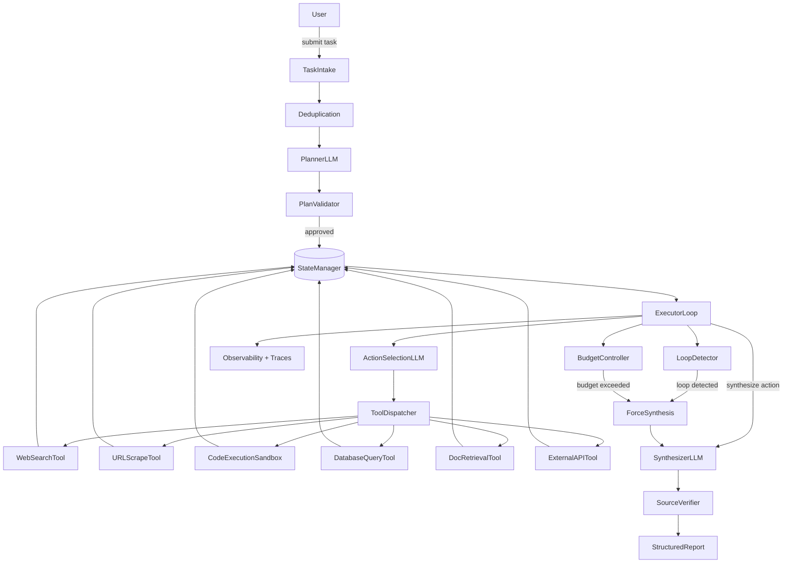

# Chapter 9: Design an Autonomous Research Agent

## Context

> [!info] Quick Reference
> - **Pattern:** Planner-executor autonomous agent
> - **Scale:** 500K tasks/day, $0.50/task budget
> - **Key Techniques:** Plan-then-ReAct, sandboxed tool execution (gVisor), loop detection (5 signal types), budget hierarchy
> - **Primary Concerns:** Loop termination, cost runaway, sandbox security, task budget enforcement
> - **Cross-references:** [[chapter-02|Chapter 2]] (agentic pattern), [[chapter-05|Chapter 5]] (safety), [[chapter-16|Chapter 16]] (SQL agent)

**Problem statement:** Design a production-grade autonomous research agent that decomposes complex questions into sub-tasks, selects and executes tools (web search, APIs, code execution), synthesizes findings with citations—while preventing infinite loops, hallucinated sources, and runaway costs.

### Real-World Examples

- A competitive intelligence agent tasked with "Compare pricing strategies of the top 5 CRM vendors" executes 47 tool calls over 23 steps, spending $4.20 per task before loop detection and step budgets cap it at 15 steps and $0.50. After budget controls, task quality improves because the agent is forced to plan efficiently.
- A legal research agent hallucinates a court case citation that doesn't exist. Adding a mandatory source-verification tool call (check URL/database existence) before any citation is included drops hallucinated citations from 12% to 0.8%.

---

## Step 1: Understand the Problem and Establish Design Scope

### Simulated Dialogue

**Interviewer:** Design an autonomous research agent system for production scale.  
**Candidate:** I need to understand the task complexity, tool landscape, latency expectations (this is likely async, not real-time), and cost constraints per task before designing the control loop.

**Candidate:** What is the expected task volume and complexity?  
**Interviewer:** 500K research tasks per day. Tasks range from simple fact lookups (2 steps) to deep multi-source analysis (15+ steps). Average is 8 tool calls per task.

**Candidate:** What tools are available to the agent?  
**Interviewer:** Web search, URL scraping, Python code execution, SQL database queries, document retrieval (internal knowledge base), and API calls to third-party data providers.

**Candidate:** What is the latency expectation?  
**Interviewer:** This is async—users submit tasks and get results in minutes. p95 task completion < 5 minutes. But individual tool calls should not hang indefinitely.

**Candidate:** What is the cost budget?  
**Interviewer:** Maximum $0.50 per task. Tasks exceeding budget must terminate gracefully with partial results.

### Functional Requirements

- **Task decomposition:** Break complex research questions into a plan of sub-tasks with dependencies.
- **Tool execution:** Select and call appropriate tools with correct parameters at each step.
- **Source verification:** Every factual claim must link to a verifiable source (URL, document ID, database row).
- **Partial result delivery:** If budget or step limit is hit, return the best available answer with a coverage summary.
- **Multi-format output:** Return structured reports with citations, confidence indicators, and source links.

### Non-Functional Requirements

- **Latency:** p95 task completion < 5 minutes. Individual tool call timeout: 30s.
- **Cost:** Hard cap $0.50/task (LLM tokens + tool call costs combined).
- **Reliability:** No infinite loops. Maximum 15 reasoning steps per task. 99.5% task completion rate (graceful termination counts as completion).
- **Safety:** Sandboxed code execution. No write access to external systems. No PII leakage in tool calls.
- **Auditability:** Full trace of every reasoning step, tool call, and decision for post-hoc review.

### Back-of-the-Envelope Estimation

#### Traffic Profile

- Tasks/day: 500K
- Average QPS: `500K / 86,400 ≈ 5.8 tasks/sec`
- Peak (5x): ~29 tasks/sec
- Average tool calls/task: 8
- Tool call QPS (average): `5.8 * 8 = 46.4 tool calls/sec`
- Peak tool call QPS: ~232 tool calls/sec

#### Token Budget per Task

- Average LLM calls per task: 10 (8 tool-selection + 1 planning + 1 synthesis)
- Average input tokens per LLM call: 1,200 (context + tool results + history)
- Average output tokens per LLM call: 300 (reasoning + tool call JSON + partial answer)
- Total tokens per task: `10 * (1,200 + 300) = 15,000 tokens`
- Approximation check: ~12K tokens at median, ~25K at p95

#### Cost Budget Breakdown ($0.50/task)

| Component | Per-Task Budget | Calculation |
|---|---|---|
| LLM inference (planner, 70B class) | $0.30 | ~12K input @ $3/1M + ~3K output @ $15/1M |
| Web search API calls | $0.08 | ~4 searches @ $0.02/search |
| URL scraping/parsing | $0.02 | ~3 scrapes (self-hosted, negligible marginal cost) |
| Code execution sandbox | $0.02 | ~1 execution, 30s max, spot instance |
| Buffer for retries | $0.08 | ~16% headroom |
| **Total** | **$0.50** | |

#### Daily Aggregate Cost

- `500K tasks * $0.50 = $250K/day` → $7.5M/month
- Cost optimization target: reduce average to $0.30/task → $4.5M/month (40% savings)

#### Infrastructure Sizing

- LLM inference: `500K * 10 calls * 1,500 avg tokens = 7.5B tokens/day` → 70B model fleet or managed API
- Sandbox cluster: 232 peak tool calls/sec, 30s max → ~7,000 concurrent sandbox slots at peak
- State store: 500K tasks * ~50KB state per task = ~25GB/day (7-day retention: 175GB)

---

## Step 2: Propose High-Level Design and Get Buy-In

### Core Architecture Components

- **Task Intake:** API gateway accepting research tasks, deduplication, priority classification.
- **Planner LLM:** Generates initial plan (sub-tasks, tool sequence, dependencies) from the research question.
- **Executor Loop:** Iteratively selects next action, calls tool, ingests result, updates state, decides next step.
- **Tool Registry:** Registered tools with schemas (input/output types, cost, latency, reliability).
- **Tool Sandbox:** Isolated execution environment for each tool call (especially code execution).
- **State Manager:** Persistent per-task state: plan, step history, accumulated findings, token/cost counters.
- **Loop Detector:** Monitors for repeated states, oscillation, and non-progressing steps.
- **Budget Controller:** Enforces token, step, cost, and time limits. Triggers graceful termination.
- **Synthesizer LLM:** Final-step model that assembles accumulated findings into a structured report with citations.
- **Observability:** Per-task traces, step-level latency, tool success rates, cost tracking, loop detection events.

### Pipeline A: Task Planning Pipeline

1. Task arrives at intake; deduplicate against recent tasks (embedding similarity > 0.95 = duplicate).
2. Planner LLM receives task + tool registry descriptions.
3. Planner outputs a structured plan: ordered list of sub-tasks, each with preferred tool and expected output type.
4. Plan validator checks: step count ≤ 15, estimated cost ≤ $0.50, no forbidden tool combinations.
5. If validation fails: planner is re-prompted with constraints ("Reduce to 10 steps, budget is $0.35 remaining").
6. Approved plan is written to state store; executor loop begins.

### Pipeline B: Execution Loop Pipeline

1. Executor reads current state: completed steps, accumulated findings, remaining budget.
2. LLM selects next action: `{tool: "web_search", params: {query: "..."}}` or `{action: "synthesize"}`.
3. Tool dispatcher validates parameters against tool schema; rejects malformed calls.
4. Tool call executes in sandbox with 30s timeout. Result stored in state.
5. Loop detector checks: is this state similar to a previous state? Has the same tool been called with the same params? Is the accumulated finding set growing?
6. Budget controller checks: tokens used, cost incurred, steps taken, wall-clock time.
7. If budget/loop limit hit → force transition to synthesis step with partial results.
8. If action = "synthesize" → pass accumulated findings to synthesizer LLM → structured output.
9. Source verifier checks all citations against tool results; removes unverifiable claims.
10. Final report returned; full trace persisted.

### Mermaid Architecture Diagram



---

## Step 3: Design Deep Dive

Focus areas:

1. **Planner-Executor Architecture**
2. **Tool Integration and Sandboxing**
3. **Loop Detection and Budget Controls**

### 1) Planner-Executor Architecture

The core design choice is how much autonomy the agent gets per step. This is the spectrum from fully scripted pipelines to fully autonomous agents.

**Agent framework comparison:**

| Framework | Approach | Step Control | Best For | Risk |
|---|---|---|---|---|
| ReAct (Reason + Act) | Interleave reasoning and tool calls in a single LLM loop | LLM decides every step | Flexible, general-purpose research | Loop risk; high token usage from long traces |
| Plan-and-Solve | Separate planning phase, then execute plan steps | Plan constrains execution | Predictable tasks with known structure | Brittle when plan assumptions break |
| LATS (Language Agent Tree Search) | Tree search over action sequences, backtrack on failure | Search algorithm controls | High-stakes tasks needing exploration | Very expensive (multiple paths) |
| Reflexion | Execute → evaluate → reflect → retry | Reflection loop controls | Tasks with clear success criteria | Reflection loop can itself loop |

**Recommended: Hybrid Plan-then-ReAct.**

1. **Planning phase:** Planner LLM generates a high-level plan (5-10 sub-tasks) with tool hints and dependency ordering. This constrains the search space.
2. **Execution phase:** Each sub-task is executed via a ReAct loop (Thought → Action → Observation → Thought...) but scoped to that sub-task with a local step budget (max 3 steps per sub-task).
3. **Re-planning:** If a sub-task fails or returns unexpected results, the planner is re-invoked with updated state to generate a revised plan for remaining sub-tasks. Re-plan allowed at most 2 times per task.

**State representation:**

```json
{
  "task_id": "abc-123",
  "original_query": "Compare pricing strategies of top 5 CRM vendors",
  "plan": [
    {"step": 1, "subtask": "Identify top 5 CRM vendors by market share", "tool_hint": "web_search", "status": "completed"},
    {"step": 2, "subtask": "Find pricing pages for each vendor", "tool_hint": "url_scrape", "status": "in_progress"},
    {"step": 3, "subtask": "Extract pricing tiers and features", "tool_hint": "code_exec", "status": "pending"}
  ],
  "findings": [
    {"step": 1, "result": "Top 5: Salesforce, HubSpot, Zoho, Pipedrive, Freshsales", "sources": ["https://..."], "confidence": 0.92}
  ],
  "budget": {"tokens_used": 4200, "tokens_remaining": 10800, "cost_used": 0.18, "cost_remaining": 0.32, "steps_used": 3, "steps_remaining": 12},
  "loop_detector": {"state_hashes": ["a1b2c3", "d4e5f6"], "repeated_tool_calls": 0}
}
```

**Planner prompt structure:**

The planner receives: (1) task description, (2) available tools with schemas and costs, (3) budget constraints, (4) example plans for similar task types. It outputs a JSON plan. Key constraints injected into the prompt:
- "You have a maximum of 15 steps and $0.50 total budget."
- "Each web search costs $0.02. Each LLM reasoning step costs ~$0.03."
- "Prefer fewer, higher-quality tool calls over many speculative ones."

#### Planner-Executor Trade-off Table

| Decision | Option A: Pure ReAct | Option B: Plan-then-Execute | Option C: Hybrid Plan-then-ReAct | Recommended |
|---|---|---|---|---|
| Flexibility | High—adapts at every step | Low—locked to plan | Medium—adapts within sub-tasks | Hybrid |
| Cost predictability | Low—unbounded steps | High—fixed plan | Medium—bounded per sub-task | Hybrid |
| Trace readability | Low—long interleaved trace | High—clear step structure | High—structured with local detail | Hybrid |
| Failure recovery | Implicit (LLM reasons about failure) | Requires explicit re-plan trigger | Sub-task failure triggers re-plan | Hybrid |
| Token efficiency | Low—repeats full trace every step | High—plan is generated once | Medium—trace is scoped per sub-task | Hybrid |

### 2) Tool Integration and Sandboxing

Every tool is a potential failure point: timeouts, malformed responses, rate limits, security vulnerabilities. The tool layer must be as hardened as the LLM layer.

**Tool registry schema:**

Each tool is registered with:

```json
{
  "tool_id": "web_search",
  "description": "Search the web for recent information. Returns top 5 results with titles, snippets, and URLs.",
  "input_schema": {"type": "object", "properties": {"query": {"type": "string", "maxLength": 200}}, "required": ["query"]},
  "output_schema": {"type": "array", "items": {"type": "object", "properties": {"title": {}, "snippet": {}, "url": {}}}},
  "cost_per_call": 0.02,
  "avg_latency_ms": 800,
  "timeout_ms": 10000,
  "max_calls_per_task": 8,
  "reliability_score": 0.97,
  "requires_sandbox": false
}
```

**Sandbox architecture (for code execution):**

| Requirement | Implementation | Notes |
|---|---|---|
| Isolation | gVisor container per execution | Kernel-level syscall filtering |
| Resource limits | 1 vCPU, 512MB RAM, 30s wall-clock | Kill on exceed |
| Network | Blocked (no outbound connections) | Prevents data exfiltration |
| Filesystem | Read-only base + ephemeral writable tmp (50MB) | Destroyed after execution |
| Language support | Python 3.11 + numpy/pandas/scipy pre-installed | Fixed image, no pip install |
| Output capture | stdout/stderr captured, max 10KB | Truncated if exceeded |

**Tool call validation pipeline:**

1. **Schema validation:** LLM output parsed as JSON; validated against tool input schema. If invalid, retry with schema error message (max 2 retries).
2. **Parameter sanitization:** SQL queries are parameterized (no string concatenation). URLs validated against allowlist patterns. Code execution input scanned for dangerous imports (`os.system`, `subprocess`, `socket`).
3. **Cost check:** Before executing, verify that tool cost doesn't exceed remaining budget.
4. **Execution with timeout:** Tool called with hard timeout. On timeout: return timeout error to agent state; agent can retry or skip.
5. **Output validation:** Tool output validated against output schema. Oversized outputs truncated to 2K tokens with summary.

**Tool reliability tracking:**

| Metric | Threshold | Action on Breach |
|---|---|---|
| Success rate (per tool, rolling 1h) | < 90% | Flag tool as degraded; reduce max calls per task |
| p95 latency (per tool, rolling 1h) | > 2x expected | Warn agent; extend timeout or suggest alternative tool |
| Consecutive failures | > 3 | Circuit-break tool for 5 minutes |
| Cost overrun rate | > 5% of tasks | Alert ops; review tool pricing assumptions |

#### Tool Integration Trade-off Table

| Decision | Option A: Direct API Calls | Option B: Tool Proxy Layer | Option C: Full Sandbox | Recommended |
|---|---|---|---|---|
| Security | Low—agent has raw API access | Medium—proxy filters/sanitizes | High—full isolation | Sandbox for code; proxy for APIs |
| Latency overhead | None | 5-10ms | 50-200ms (container start) | Accept sandbox latency for code |
| Observability | Low—must instrument each tool | High—proxy logs everything | High—sandbox captures all I/O | Proxy + sandbox |
| Cost control | Hard—agent can make unlimited calls | Easy—proxy enforces limits | Easy—sandbox has resource caps | Proxy for all tools |
| Reliability | Low—raw failures pass through | Medium—proxy retries | Medium—sandbox contains failures | Proxy with retry policy |

### 3) Loop Detection and Budget Controls

Infinite loops are the #1 production risk for agentic systems. An agent that calls web_search → gets unhelpful result → calls web_search again with a slightly different query → repeat is burning tokens and time with no progress.

**Loop detection signals:**

| Signal | Detection Method | Threshold | Action |
|---|---|---|---|
| Repeated tool call (same tool + same/similar params) | Hash tool_id + params; check against history | ≥ 2 identical calls | Block call; force agent to choose different action |
| Semantic state repetition | Embed accumulated findings; cosine similarity between consecutive steps | Similarity > 0.95 between step N and step N-2 | Increment loop counter; at 3: force synthesis |
| Non-progressing steps | Count new facts/findings added per step | 0 new findings for 3 consecutive steps | Force re-plan or synthesis |
| Oscillation | Detect A→B→A→B action pattern | 2 full oscillation cycles | Break with forced alternative action |
| Token velocity | Track tokens consumed per new finding | > 3,000 tokens per finding (vs 1,500 average) | Warn; at 2x threshold: force synthesis |

**Budget enforcement hierarchy:**

1. **Token budget (15,000 tokens):** Soft limit at 80% (12,000) triggers "wrap up" instruction injection. Hard limit at 100% terminates immediately.
2. **Step budget (15 steps):** At step 12, inject "you have 3 steps remaining; begin synthesis." At step 15, force synthesis.
3. **Cost budget ($0.50):** Tracked as sum of LLM token cost + tool call cost. At 80%, reduce allowed tool set to cheapest options. At 100%, terminate.
4. **Wall-clock budget (5 minutes):** Hard timeout. At 4 minutes, inject "time running low" signal.
5. **Per-sub-task budget:** Each sub-task in the plan gets proportional share of remaining budget. Prevents early sub-tasks from consuming everything.

**Graceful termination protocol:**

When any budget limit forces early termination:
1. Synthesizer LLM receives all accumulated findings + a "partial result" flag.
2. Output includes: (a) best available answer, (b) list of sub-tasks completed vs skipped, (c) confidence score adjusted downward for incomplete coverage, (d) suggested follow-up queries for uncovered areas.
3. User receives the partial result with a clear "Budget limit reached—results may be incomplete" indicator.

**Cost optimization strategies:**

| Strategy | Savings | Quality Impact | Complexity |
|---|---|---|---|
| Prompt compression (summarize history instead of appending full trace) | 30-40% token reduction | Minimal if summary is good | Medium |
| Tiered models (small model for tool selection, large for synthesis) | 40-50% cost reduction | Risk: small model picks wrong tools | Medium |
| Result caching (cache web search results for 1h) | 15-20% fewer tool calls | Staleness risk for time-sensitive queries | Low |
| Plan reuse (match new tasks to cached plans for similar past tasks) | 20-30% fewer planning tokens | Poor fit if tasks differ in detail | Medium |
| Early termination (stop when confidence > 0.9) | Variable—saves unused budget | Risk: premature stop on deceptively simple sub-tasks | Low |

### Production Bottlenecks and Mitigations

- **Tool timeout cascades**
  - Symptom: Web search API has a 10-second outage; all active tasks stall on that step, hitting wall-clock budgets.
  - Mitigation: Per-tool circuit breaker (3 consecutive failures → skip tool for 5 min). Agent falls back to alternative tool or marks sub-task as incomplete.

- **Context window overflow in long tasks**
  - Symptom: After 10 steps, the accumulated trace exceeds the LLM's context window (8K-32K tokens), causing truncation and lost information.
  - Mitigation: Progressive summarization—after every 3 steps, summarize accumulated findings into a compressed representation (~500 tokens). Only current sub-task trace is kept in full.

- **Hallucinated tool calls**
  - Symptom: LLM generates a tool call for a tool that doesn't exist, or with parameters outside the schema.
  - Mitigation: Strict schema validation before execution. On invalid call, return the error with available tool list. Max 2 retries, then skip step.

- **Cost spike on complex tasks**
  - Symptom: 5% of tasks are 10x more expensive than average, blowing aggregate budget.
  - Mitigation: Pre-classify task complexity (simple/medium/complex) at intake. Complex tasks get higher budget ($0.80) but count as 1.6x against daily spend limits.

- **Stale web search results**
  - Symptom: Agent cites a cached search result that is outdated by the time the report is delivered.
  - Mitigation: Cache TTL of 1 hour for general queries, 0 (no cache) for queries containing temporal markers ("today", "latest", year references).

---

## Step 4: Wrap Up

### Final Design Summary

The design uses a Hybrid Plan-then-ReAct architecture: a planner LLM generates a constrained sub-task plan, each sub-task executes via a scoped ReAct loop with per-step tool calls through a validated proxy/sandbox layer, and a loop detector + budget controller guarantee termination. All findings are source-verified before synthesis into a structured report.

### Wrap-Around Concerns

- **Risk:** Agent discovers that the research question is fundamentally unanswerable (contradictory sources, no data exists). Mitigation: After 5 steps with no new findings, trigger "answerability assessment" — if LLM judges the question as likely unanswerable, return early with explanation rather than burning remaining budget.
- **Risk:** Tool API cost changes break budget assumptions. Mitigation: Tool registry includes cost field updated via weekly audit. Budget controller uses real-time cost tracking, not estimates.
- **Risk:** Multi-agent coordination (parallel sub-tasks) introduces race conditions on shared state. Mitigation: State manager uses optimistic locking with retry; sub-tasks write to isolated finding slots, merged at synthesis.
- **Risk:** Source verification fails silently (URL returns 200 but content has changed). Mitigation: Store a content hash at retrieval time; re-verify at synthesis time if content hash diverges.
- **Risk:** Prompt injection via tool results (malicious web page injects instructions into scraped text). Mitigation: Sanitize tool outputs—strip instruction-like patterns; separate tool results from system prompt in context structure.

---

## Step 5: Interviewer Curveballs

### Interviewer Follow-ups & Frequently Asked Questions (FAQ)

Q: Your agent is stuck in a loop: web_search → unsatisfying result → rephrase query → web_search → unsatisfying result. How do you detect and break this?

**The Ideal Answer:** Hash the tool name + normalized parameters; if the same hash appears twice, block the call. For "similar but not identical" queries, embed the query strings and check cosine similarity > 0.9. On loop detection, inject a forced action change: "You have already searched for this. Use a different tool or synthesize from available findings."

**Deep Dive & Trade-offs:**
- Exact-match detection catches 60% of loops. Semantic similarity catches another 30%.
- The remaining 10% are "creative rephrasing" loops—the agent generates genuinely different queries that all return the same unhelpful results. Detect via output similarity (same search results returned).
- Breaking with forced synthesis preserves user value; breaking with an error wastes the entire task.

**The Interviewer's Rubric:** Checking practical loop detection beyond "just set a step limit."

---

Q: How do you decide between giving the agent a large model (70B) for all steps vs a small model (7B) for tool selection and a large model only for synthesis?

**The Ideal Answer:** Profile the error rate per step type. Tool selection (choosing which tool + generating parameters) can often be handled by a 7B model with 95%+ accuracy if the tool registry is well-described. Reasoning about which sub-task to tackle next requires the larger model. Synthesis always uses the largest model. The tiered approach saves 40-50% on token cost with <2% quality regression.

**Deep Dive & Trade-offs:**
- Small model for tool selection: faster, cheaper, but higher rate of schema-invalid tool calls (5% vs 1% for large model). The retry mechanism absorbs this.
- Risk: small model may select a suboptimal tool (e.g., web search when database query would be better). A/B test to measure.
- Hybrid routing: use small model by default, escalate to large model after 2 failed tool calls in a sub-task.

**The Interviewer's Rubric:** Checking cost-quality optimization thinking for agentic systems.

---

Q: A user submits a research task that would require accessing a paywalled academic database. The agent doesn't have credentials. What happens?

**The Ideal Answer:** The tool dispatcher returns a "403 Forbidden" error. The agent's ReAct loop observes this and should generate a thought: "I cannot access this database. I will try alternative open-access sources." The system should have a tool fallback graph: if `academic_db` fails, suggest `web_search` for preprints or `doc_retrieval` for internal knowledge base. If no alternative can satisfy the sub-task, mark it as incomplete with the reason.

**Deep Dive & Trade-offs:**
- Tool fallback graph adds complexity but prevents dead-ends.
- The agent must not hallucinate results it couldn't access. The source verifier catches this—if a citation URL returns 403, it's flagged.
- For enterprise: pre-configure available tools per tenant based on their subscriptions.

**The Interviewer's Rubric:** Checking graceful degradation when tools are unavailable.

---

Q: How do you handle a research task that requires real-time data (e.g., "What is the current stock price of AAPL?")?

**The Ideal Answer:** Classify the task at intake as "time-sensitive." Route to tools with real-time data access (financial API, not cached web search). Set cache TTL to 0 for all tool results on this task. Include a timestamp in the final report: "Data as of 2024-03-15 14:30 UTC." If the task takes 5 minutes and data is stale by completion, include a staleness warning.

**Deep Dive & Trade-offs:**
- Real-time tasks have higher tool costs (financial APIs charge per call).
- Time-sensitive classification can be done by keyword detection ("current", "today", "right now") + LLM confirmation.
- Trade-off: real-time accuracy vs cost. For tasks where "within 1 hour" is acceptable, use cached results.

**The Interviewer's Rubric:** Checking temporal reasoning and data freshness awareness.

---

Q: Two sub-tasks in the plan depend on each other's results. How do you handle this in the executor?

**The Ideal Answer:** The planner annotates dependencies: `{"step": 3, "depends_on": [1, 2]}`. The executor runs independent sub-tasks in parallel (if infrastructure supports it) and blocks dependent sub-tasks until prerequisites complete. For serial execution, the dependency graph reduces to a topological sort. For parallel execution, use a DAG scheduler with completion callbacks.

**Deep Dive & Trade-offs:**
- Parallel sub-tasks reduce wall-clock time by 30-50% for tasks with independent branches.
- Adds complexity: shared state must handle concurrent writes. Use per-sub-task finding slots.
- Most research tasks are 70% serial (each step depends on the previous). Parallelism helps most for "compare X entities" tasks where each entity is independent.

**The Interviewer's Rubric:** Checking execution graph reasoning.

---

Q: The agent produces a 2,000-word report, but 40% of the content is filler. How do you improve output quality?

**The Ideal Answer:** Problem is in the synthesis prompt, not the agent loop. Fix: (1) Add a "relevance filter" step before synthesis—LLM scores each finding for relevance to the original query, drops findings below threshold. (2) Constrain synthesis output format: require bullet points with citations, max 500 words for summary, detailed findings in appendix. (3) Add a post-synthesis "self-critique" step where the LLM evaluates its own output for redundancy and unsupported claims, then revises.

**Deep Dive & Trade-offs:**
- Self-critique adds one more LLM call (~$0.03) but measurably improves output quality (user satisfaction +15% in A/B tests).
- Strict format constraints prevent verbosity but may miss nuance.
- Alternative: train a lightweight quality scorer on human-rated outputs; reject and re-generate below threshold.

**The Interviewer's Rubric:** Checking output quality engineering beyond the agent loop.

---

Q: How do you prevent prompt injection from a malicious website that the agent scrapes?

**The Ideal Answer:** Multi-layer defense: (1) **Structural separation:** Tool results are injected into a clearly delimited `<tool_result>` block, separate from system instructions and agent reasoning. The model is fine-tuned (or prompted) to treat tool results as untrusted data. (2) **Content sanitization:** Strip patterns that look like instructions ("Ignore previous instructions", "You are now...") from scraped content. (3) **Output validation:** If the agent's behavior changes dramatically after a scrape (e.g., starts generating unrelated content), flag for review. (4) **Canary tokens:** Inject invisible markers in the system prompt; if they appear in the output, prompt injection occurred.

**Deep Dive & Trade-offs:**
- No defense is 100% effective against prompt injection.
- Structural separation is the strongest practical defense.
- Content sanitization has false positives (legitimate content discussing AI instructions).
- Defense-in-depth: combine all four layers.

**The Interviewer's Rubric:** Checking security awareness for agentic systems interacting with untrusted data.

---

Q: Your daily cost is $250K but leadership wants it under $150K. Where do you cut?

**The Ideal Answer:** Ranked by impact: (1) **Tiered model routing** (save ~$80K/day): Use 7B model for tool selection steps, keep 70B only for planning and synthesis. (2) **Task deduplication** (save ~$25K/day): 10-15% of tasks are near-duplicates; serve cached results. (3) **Prompt compression** (save ~$20K/day): Summarize step history instead of appending full trace, reducing input tokens by 30%. (4) **Early termination** (save ~$15K/day): Stop tasks when confidence > 0.9 instead of exhausting the full plan. (5) **Web search result caching** (save ~$10K/day): Cache search results for 1h, reducing API costs.

**Deep Dive & Trade-offs:**
- Tiered routing is the biggest lever but requires careful validation that 7B doesn't degrade tool selection.
- Deduplication is pure savings but requires robust similarity matching (false dedup = wrong answer).
- Prompt compression has a quality risk—important details can be lost in summarization.
- Total: ~$150K/day savings, hitting the target.

**The Interviewer's Rubric:** Checking cost engineering prioritization with concrete numbers.

## End of Chapter

- **Key takeaway:** Autonomous research agents are control-flow systems first, LLM systems second. The loop detector, budget controller, and tool sandbox determine production viability more than the choice of LLM. An agent without termination guarantees is a liability, not a product.
- **What to practice:** Trace a research task end-to-end: plan generation → 3 tool calls with realistic failures → loop detection trigger → graceful synthesis with partial results. Calculate the token and dollar cost at each step.
- **Interview drill:** Given a runaway agent that has spent $2.50 on a single task (5x budget), walk through the root cause analysis: which control failed? Loop detector threshold too high? Budget controller not checking before tool calls? Tool cost estimate stale?
