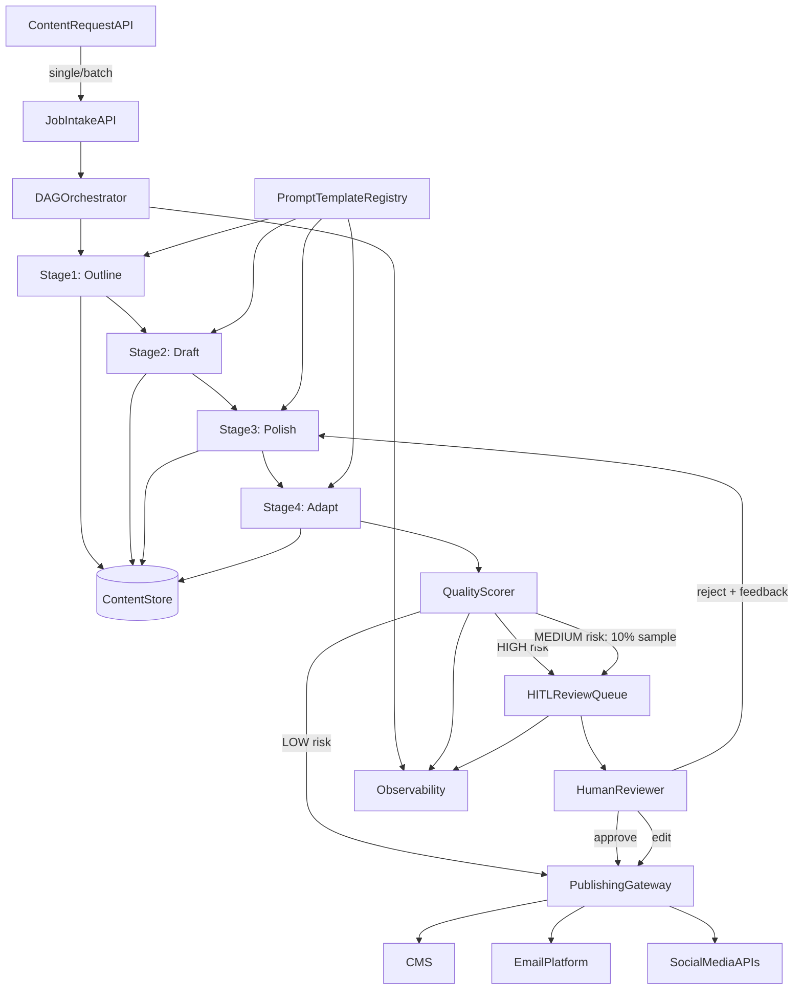

# Chapter 10: Design an Automated Content Generation Pipeline

## Context

> [!info] Quick Reference
> - **Pattern:** Multi-stage async content generation pipeline
> - **Scale:** High-volume content operations with HITL review
> - **Key Techniques:** Outline→draft→polish→format DAG (Temporal.io), quality scoring, 15% HITL routing, prompt A/B testing
> - **Primary Concerns:** Brand voice consistency, quality gate thresholds, pipeline observability, HITL latency
> - **Cross-references:** [[chapter-02|Chapter 2]] (prompt chaining), [[chapter-05|Chapter 5]] (output evaluation)

**Problem statement:** Design a high-throughput asynchronous content generation pipeline that processes 200K+ pieces per day through multi-stage prompt chains, automated quality scoring, and human-in-the-loop (HITL) review—optimizing for throughput and consistency over latency.

### Real-World Examples

- A marketing platform migrates from synchronous LLM calls (8 req/sec ceiling) to an async DAG-based pipeline, reaching 200K articles/day with 3-stage generation (outline → draft → polish) while reducing per-article cost from $0.15 to $0.06 through batch processing and prompt caching.
- A news wire deploys automated quality scoring on 100% of generated articles but routes only 15% (flagged as high-risk: legal, medical, financial topics) through human review. This cuts review backlog by 85% while maintaining a 99.7% compliance rate.

---

## Step 1: Understand the Problem and Establish Design Scope

### Simulated Dialogue

**Interviewer:** Design an automated content generation pipeline for production scale.  
**Candidate:** Content generation is fundamentally different from real-time inference—throughput and quality consistency matter more than latency. I need to understand the content types, quality bar, review requirements, and publishing SLAs.

**Candidate:** What content types and volumes?  
**Interviewer:** Marketing articles, product descriptions, email campaigns, social media posts. 200K pieces per day across all types. Each goes through multiple generation stages.

**Candidate:** What quality requirements exist?  
**Interviewer:** Automated quality scoring on all outputs. Human review on 15% of content (high-risk categories: financial claims, health advice, legal statements, brand-sensitive topics). Published content must meet brand style, factual accuracy, and compliance standards.

**Candidate:** What are the SLAs?  
**Interviewer:** Standard content: complete within 2 hours of submission. Urgent content (breaking campaigns): complete within 15 minutes. HITL review SLA: 30-minute turnaround from queue entry.

**Candidate:** What is the cost budget?  
**Interviewer:** Target $0.08 per content piece average, including LLM inference, quality scoring, and HITL labor.

### Functional Requirements

- **Multi-stage generation:** Each content piece passes through 2-4 generation stages (e.g., outline → draft → style polish → format adaptation).
- **Prompt template management:** Versioned prompt templates per content type and stage. A/B testing of prompt variants.
- **Quality scoring:** Automated scoring on every output (relevance, fluency, brand voice, factual grounding, compliance).
- **HITL review:** Route flagged content to human reviewers with structured feedback that flows back into the pipeline.
- **Batch processing:** Support bulk submission of 10K+ content requests with aggregate progress tracking.
- **Multi-format output:** Same content adapted for different channels (blog, email, social, ad copy) in a single pipeline run.

### Non-Functional Requirements

- **Throughput:** Sustain 200K content pieces/day. Peak: 3x (campaign launches).
- **Latency:** Standard p95 < 2 hours. Urgent p95 < 15 minutes.
- **Cost:** Average $0.08/piece (total, including HITL labor allocation).
- **Quality:** > 95% of published content passes human quality audit (sampled monthly).
- **Reliability:** No lost work—every stage result persisted before next stage begins. Retry on failure without re-running completed stages.
- **Observability:** Per-stage latency, quality score distribution, HITL queue depth, prompt version performance.

### Back-of-the-Envelope Estimation

#### Traffic Profile

- Content pieces/day: 200K
- Average stages per piece: 3
- Total LLM calls/day: `200K * 3 = 600K`
- Average QPS: `600K / 86,400 ≈ 7 calls/sec`
- Peak QPS (3x campaigns): ~21 calls/sec
- Average output tokens/stage: 700 tokens (outline: 300, draft: 1,200, polish: 600 → weighted avg)
- Total output tokens/day: `600K * 700 = 420M tokens`
- Average input tokens/stage: 1,300 tokens (prompt template + context + previous stage output)
- Total input tokens/day: `600K * 1,300 = 780M tokens`

#### Cost Breakdown ($0.08/piece target)

| Component | Per-Piece Cost | Calculation |
|---|---|---|
| LLM inference (3 stages) | $0.045 | 3.9K input + 2.1K output tokens @ blended $3/$15 per 1M |
| Quality scoring (1 LLM call) | $0.008 | ~800 input + 200 output tokens, cheaper model |
| HITL review (15% of pieces) | $0.021 | 15% * $0.14/review (human reviewer at $50/hr, 6 min avg) |
| Infrastructure (queues, storage, DAG engine) | $0.006 | Amortized compute + storage |
| **Total** | **$0.080** | |

#### Daily Aggregate

- LLM cost: `200K * $0.045 = $9,000/day`
- Quality scoring: `200K * $0.008 = $1,600/day`
- HITL labor: `200K * 0.15 * $0.14 = $4,200/day`
- Infrastructure: `200K * $0.006 = $1,200/day`
- **Total: ~$16,000/day → $480K/month**

#### HITL Queue Sizing

- Pieces requiring review: `200K * 15% = 30K/day`
- Reviews/hour needed: `30K / 24 = 1,250/hour` (assuming 24h coverage)
- At 6 min/review: `1,250 / 10 reviews/hr/person = 125 concurrent reviewers`
- Peak (3x): 375 reviewers → requires flexible workforce or longer SLA during peaks

#### Infrastructure Sizing

- LLM inference: 7-21 QPS is modest. A single 34B model instance handles this. Total fleet: 4-8 GPUs (or managed API).
- DAG engine: 200K DAG executions/day, 3-4 nodes per DAG → ~700K node executions/day → Airflow/Temporal handles easily.
- State store: 200K * ~15KB per piece (all stage outputs) = 3GB/day → 90GB/month (trivial).
- Queue: Kafka or SQS. 200K messages/day per topic, 5 topics → 1M messages/day (trivial throughput).

---

## Step 2: Propose High-Level Design and Get Buy-In

### Core Architecture Components

- **Job Intake API:** Accepts content requests (single or batch), validates input, assigns priority (standard/urgent), creates DAG instance.
- **DAG Orchestrator:** Manages multi-stage execution graph per content piece. Handles retries, stage dependencies, and priority scheduling.
- **Prompt Template Registry:** Versioned prompt templates per content type and stage. Supports A/B testing with traffic splitting.
- **Stage Executors:** Worker pools for each stage type (outline, draft, polish, format adaptation). Each calls LLM with stage-specific prompt.
- **Quality Scorer:** Automated quality evaluation on stage outputs. Determines pass/fail and risk classification.
- **HITL Review Queue:** Priority queue for human reviewers with structured review interface, feedback capture, and SLA tracking.
- **Content Store:** Persistent storage for all stage outputs, quality scores, review feedback, and final published content.
- **Publishing Gateway:** Delivers approved content to downstream channels (CMS, email platform, social media APIs).
- **Observability:** Per-stage latency, quality distributions, HITL queue depth and turnaround, prompt version performance, cost tracking.

### Pipeline A: Content Generation DAG

1. Content request arrives at intake API with: content type, topic/brief, target channels, priority, metadata.
2. DAG orchestrator creates execution graph based on content type template:
   - Stage 1 (Outline): Generate structured outline from brief.
   - Stage 2 (Draft): Expand outline into full draft using content type prompt.
   - Stage 3 (Polish): Style, tone, and grammar refinement.
   - Stage 4 (Adapt): Format for target channels (blog version, email version, social snippet).
3. Each stage executor pulls from its queue, retrieves prompt template from registry, injects previous stage output + metadata.
4. LLM generates output; result persisted to content store before next stage begins.
5. After final generation stage: quality scorer evaluates the output.
6. Quality scorer assigns risk level: LOW (auto-publish), MEDIUM (spot-check pool), HIGH (mandatory HITL review).
7. LOW → publishing gateway. MEDIUM → 10% sampled for HITL. HIGH → HITL review queue.

### Pipeline B: HITL Review Pipeline

1. Content enters HITL queue with priority (urgent content jumps queue).
2. Review dashboard presents: generated content, source brief, quality scores, flagged issues.
3. Reviewer actions: APPROVE (publish), REJECT (back to generation with feedback), EDIT (inline corrections → publish).
4. On REJECT: feedback injected into Stage 3 (Polish) prompt as "Reviewer feedback: {feedback}"; re-run Stage 3 + quality scoring.
5. Reviewer feedback logged for: (a) prompt template improvement, (b) quality scorer calibration, (c) model fine-tuning data.
6. SLA tracker monitors queue depth and turnaround; alerts if 30-min SLA is at risk.

### Pipeline C: Prompt Template Lifecycle

1. Prompt engineers author new template version in template registry.
2. Template deployed to shadow lane (5% of traffic, results scored but not published).
3. Compare quality scores, HITL rejection rates, and downstream engagement metrics against baseline version.
4. If shadow metrics pass threshold: gradual rollout (5% → 25% → 50% → 100%).
5. If regression detected: automatic rollback to previous version.
6. All template versions retained with full audit trail.

### Mermaid Architecture Diagram



---

## Step 3: Design Deep Dive

Focus areas:

1. **DAG-Based Pipeline Orchestration**
2. **Quality Scoring and HITL Integration**
3. **Prompt Chain Design**

### 1) DAG-Based Pipeline Orchestration

The pipeline is not a simple linear chain—content types have different stage graphs, stages can fan out (multi-channel adaptation), and failures must not lose completed work.

**DAG structure per content type:**

| Content Type | Stages | Fan-Out | Typical Duration |
|---|---|---|---|
| Blog article | Outline → Draft → Polish → SEO optimize | None | 4-8 min |
| Product description | Extract features → Write copy → Adapt (3 channels) | 1→3 at Adapt | 2-4 min |
| Email campaign | Subject line (3 variants) → Body → CTA polish | 3→1→1 | 3-5 min |
| Social media pack | Core message → Adapt (Twitter, LinkedIn, Instagram, Facebook) | 1→4 | 2-3 min |
| News summary | Source ingest → Summarize → Fact-check → Polish | None (serial) | 3-6 min |

**Orchestration engine selection:**

| Engine | Throughput | Retry/Recovery | Visibility | Operational Cost | Best For |
|---|---|---|---|---|---|
| Temporal.io | Very high (100K+ workflows/sec) | Built-in durable execution; automatic retry with backoff | Excellent (web UI, history replay) | Medium (managed service or self-hosted) | Production default |
| Apache Airflow | Moderate (DAG scheduling overhead) | DAG-level retry; manual intervention for stuck tasks | Good (web UI) | Low (mature, well-understood) | Batch-heavy, scheduled pipelines |
| AWS Step Functions | High (serverless) | Built-in retry, catch, timeout | Good (console) | Low ops, higher per-execution cost at scale | AWS-native shops, low ops overhead |
| Custom queue-based (Kafka + workers) | Highest (no orchestration overhead) | Manual retry logic; higher engineering cost | Must build | Lowest per-unit at scale | Very high throughput, simple DAGs |

**Recommended: Temporal.io** for durability guarantees. Each content piece is a Temporal workflow; each stage is an activity with configurable retry policy.

**Stage execution model:**

```
ContentWorkflow(request):
  outline = execute_stage("outline", request.brief, request.content_type)
  draft = execute_stage("draft", outline, request.content_type)
  polished = execute_stage("polish", draft, request.content_type)

  if request.channels.length > 1:
    adaptations = parallel_for(request.channels, ch ->
      execute_stage("adapt", polished, ch))
  else:
    adaptations = [polished]

  for content in adaptations:
    score = quality_score(content)
    if score.risk == HIGH or (score.risk == MEDIUM and random() < 0.10):
      reviewed = submit_for_hitl_review(content, score)
      if reviewed.action == REJECT:
        polished = execute_stage("polish", draft, request.content_type,
                                  feedback=reviewed.feedback)
        content = execute_stage("adapt", polished, request.channels[0])
        score = quality_score(content)
    publish(content, request.channel)
```

**Failure handling:**

| Failure Type | Detection | Recovery | Max Retries |
|---|---|---|---|
| LLM API timeout | 60s timeout per call | Retry with exponential backoff (2s, 4s, 8s) | 3 |
| LLM API rate limit (429) | HTTP status code | Back off per retry-after header; route to secondary provider | 5 |
| Quality score below threshold | Score < 0.4 (hard fail) | Re-run stage with temperature 0.3 (more deterministic) | 2 |
| Stage output validation failure | Schema check on output (missing required fields) | Re-run with stricter format instructions in prompt | 2 |
| Workflow timeout | Wall-clock > 2h (standard) / 15min (urgent) | Escalate to ops; partial results saved | 0 (alert only) |
| Content store write failure | Write timeout or error | Retry write; on persistent failure, pause workflow | 5 |

**Priority scheduling:**

- Urgent content gets dedicated worker pool (20% of capacity reserved).
- Standard content uses remaining 80%.
- During campaigns (3x load): autoscale standard pool; urgent pool is elastic up to 50% of total.
- Starvation prevention: standard content waiting > 1 hour gets priority boost.

### 2) Quality Scoring and HITL Integration

Quality scoring replaces manual review for 85% of content. The scorer must be fast, calibrated, and transparent.

**Quality scoring dimensions:**

| Dimension | Weight | Measurement | Threshold (pass) |
|---|---|---|---|
| Relevance to brief | 0.25 | LLM judge: does the content address the brief's requirements? | ≥ 0.7 |
| Fluency and grammar | 0.15 | LLM judge + rule-based checks (LanguageTool) | ≥ 0.8 |
| Brand voice consistency | 0.20 | LLM judge against brand style guide reference | ≥ 0.6 |
| Factual grounding | 0.20 | Citation check: claims supported by provided sources? | ≥ 0.7 |
| Compliance (legal/regulatory) | 0.20 | Rule-based keyword scan + LLM judge for claims about health/finance/legal | ≥ 0.9 |

**Composite score:** Weighted sum. Pass threshold: 0.70. Risk classification:
- Score ≥ 0.85 AND no compliance flag → LOW risk (auto-publish)
- Score ≥ 0.70 AND compliance flag → HIGH risk (mandatory HITL)
- Score ≥ 0.70 AND no compliance flag → MEDIUM risk (10% sampled for HITL)
- Score < 0.70 → FAIL (re-generate)

**Quality scorer architecture:**

| Component | Model | Latency | Cost/Evaluation |
|---|---|---|---|
| Relevance judge | 7B fine-tuned on brief→content pairs | 200ms | $0.002 |
| Fluency checker | Rule-based (LanguageTool) + 7B backup | 100ms | $0.001 |
| Brand voice scorer | 7B fine-tuned on brand-labeled examples | 200ms | $0.002 |
| Factual grounding | Citation extraction + URL/source verification | 500ms | $0.002 |
| Compliance scanner | Keyword regex + 7B judge on flagged passages | 300ms | $0.001 |
| **Total** | | **~800ms** | **$0.008** |

**Scorer calibration loop:**

1. Monthly: sample 500 scored pieces across the score distribution.
2. Human evaluators rate the same dimensions independently.
3. Compute scorer-human correlation per dimension. Target: Kendall's τ > 0.7.
4. If correlation drops below 0.6 on any dimension: retrain that dimension's judge model on the new human labels.
5. Track score distribution drift over time—if mean score creeps up without quality improvement, the scorer is inflating.

**HITL review interface design:**

The review UI must minimize reviewer cognitive load to hit the 6-minute average review time:

| UI Element | Purpose | Design |
|---|---|---|
| Side-by-side view | Brief on left, generated content on right | Highlighted sections matching brief requirements |
| Quality score breakdown | Show per-dimension scores | Color-coded (green/yellow/red) with expandable rationale |
| Flagged passages | Compliance or grounding issues | Inline highlights with suggested fixes |
| Action buttons | Approve / Edit / Reject | One-click approve; inline edit mode; reject with structured feedback form |
| Feedback taxonomy | Structured reject reasons | Dropdown: factual error, tone mismatch, incomplete, compliance violation, other |
| Time tracker | SLA monitoring | Visible countdown; items turning red at 80% of SLA |

**Feedback loop from HITL to pipeline:**

| Feedback Signal | Consumer | Action |
|---|---|---|
| Rejection reason: "tone mismatch" | Prompt template team | Adjust brand voice instructions in polish stage prompt |
| Rejection reason: "factual error" | Quality scorer | Add failing case to grounding judge training set |
| Reviewer edits (diff) | Model fine-tuning | Editor preference pairs for RLHF/DPO training |
| Approval rate by prompt version | A/B test engine | Promote high-approval prompt versions |
| Average review time by content type | Ops | Adjust HITL staffing allocation |

### 3) Prompt Chain Design

Each stage in the pipeline uses a carefully designed prompt that takes the previous stage's output as input. The chain must maintain coherence, prevent error amplification, and allow independent stage optimization.

**Prompt chain architecture principles:**

1. **Explicit contracts between stages:** Each stage outputs a structured format that the next stage expects. No ambiguity.
2. **Context compression:** Don't pass the full output of all previous stages. Summarize or extract the relevant portions.
3. **Independent optimization:** Each stage's prompt can be A/B tested independently because the inter-stage format is fixed.
4. **Error isolation:** A bad outline produces a bad draft. Add validation gates between stages to catch errors early.

**Example prompt chain for blog article:**

| Stage | Input | Output Format | Prompt Key Instructions |
|---|---|---|---|
| 1: Outline | Brief (topic, keywords, audience, length target) | JSON: `{title, sections: [{heading, bullet_points, target_word_count}]}` | "Create a structured outline. Each section must have 3-5 bullet points. Total target: {word_count} words." |
| 2: Draft | Outline JSON + brief | Markdown article with section headers | "Expand each section from the outline. Maintain the heading structure. Target {word_count} words total." |
| 3: Polish | Draft markdown + brand style guide excerpt | Markdown article (same structure, refined prose) | "Refine for {brand_voice}. Fix grammar. Ensure claims are supported. Do not change the structure or add new sections." |
| 4: SEO | Polished markdown + target keywords | Final markdown + meta description + alt texts | "Naturally integrate keywords: {keywords}. Add meta description (155 chars). Do not keyword-stuff." |

**Inter-stage validation gates:**

| Gate | Between Stages | Check | Failure Action |
|---|---|---|---|
| Outline completeness | 1 → 2 | All required sections present? Word count targets sum to ±20% of total target? | Re-run Stage 1 with stricter constraints |
| Draft length | 2 → 3 | Output within ±30% of target word count? | Re-run Stage 2 with explicit "you wrote X words, target is Y" |
| Structure preservation | 3 → 4 | Section headings match between draft and polished version? | Re-run Stage 3 with "do not modify headings" reinforced |
| Keyword integration | 4 → publish | All target keywords present at least once? | Re-run Stage 4 with missing keyword list |

**Prompt template versioning and A/B testing:**

```json
{
  "template_id": "blog_draft_v3",
  "content_type": "blog_article",
  "stage": "draft",
  "version": 3,
  "status": "canary",
  "traffic_split": 0.10,
  "baseline_version": 2,
  "prompt_text": "You are a content writer for {brand}. Expand this outline into a well-structured blog article...",
  "model": "gpt-4o-mini",
  "temperature": 0.7,
  "max_tokens": 2000,
  "evaluation_metrics": ["quality_score", "hitl_approval_rate", "avg_review_time"],
  "promotion_criteria": {
    "quality_score_delta": ">= -0.02",
    "hitl_approval_rate_delta": ">= 0",
    "min_sample_size": 500
  }
}
```

**A/B test lifecycle:**
1. New template version created → deployed at 10% traffic.
2. After 500 pieces through new version: compare metrics against baseline.
3. If promotion criteria met: escalate to 50%, then 100%.
4. If any metric regresses beyond threshold: auto-rollback to baseline.
5. Typical A/B test duration: 2-5 days at 200K pieces/day.

#### Prompt Chain Trade-off Table

| Decision | Option A: Single-Stage Generation | Option B: 2-Stage (Draft + Polish) | Option C: 3-4 Stage Chain | Recommended |
|---|---|---|---|---|
| Quality | Acceptable for short content | Good—polish fixes draft issues | Best—each stage specializes | 3-stage for articles; 2-stage for short content |
| Cost | Lowest (1 LLM call) | 2x cost | 3-4x cost | 3-stage; cost is marginal vs HITL savings |
| Latency | Fastest | 2x | 3-4x | Acceptable for async pipeline |
| Error amplification risk | None (single pass) | Low | Medium—bad outline propagates | Mitigated by inter-stage validation gates |
| Optimization granularity | Coarse (one prompt to tune) | Medium | High—tune each stage independently | 3-stage for mature pipelines |
| Consistency across pieces | Low (high variance per run) | Medium | High (structured output reduces variance) | 3-stage for brand consistency |

**Deduplication and semantic caching:**

- Before running a new content piece: embed the brief and check against recent pieces (last 30 days).
- Cosine similarity > 0.92 → flag as potential duplicate. Serve cached result or merge briefs.
- Saves ~8-12% of pipeline cost from accidental re-submissions and similar briefs from different teams.
- Cache key: content_type + brief_embedding + target_channels. TTL: 30 days.

### Production Bottlenecks and Mitigations

- **HITL queue backlog during campaign launches**
  - Symptom: Queue depth exceeds 3,000; 30-min SLA breached for 20% of items.
  - Mitigation: (1) Temporarily raise auto-publish threshold (score ≥ 0.80 → LOW risk instead of 0.85). (2) Activate surge reviewer pool. (3) For urgent content: bypass HITL for MEDIUM risk, rely on post-publish audit.

- **Prompt version regression goes undetected**
  - Symptom: New prompt template version slowly degrades quality, but quality scorer doesn't catch it because the scorer was calibrated on the old prompt's output distribution.
  - Mitigation: A/B test every template version with mandatory hold-out. Track HITL rejection rate per prompt version (leading indicator before scorer drift).

- **Stage output format drift**
  - Symptom: Stage 2 occasionally outputs HTML instead of markdown, breaking Stage 3's parser.
  - Mitigation: Strict output validation between stages. If format check fails, retry with "Output MUST be in markdown format. No HTML tags." appended to prompt. After 2 retries, flag for manual review.

- **Cost spikes from retry amplification**
  - Symptom: A temporarily degraded LLM API causes 60% of Stage 2 calls to fail quality gate, triggering 2 retries each. Cost doubles.
  - Mitigation: Circuit breaker on per-stage retry rate. If retry rate > 30% for a stage over 10 minutes, pause that stage and alert. Resume after API health check passes.

- **Content store write contention during batch submissions**
  - Symptom: 10K-piece batch submission causes write throughput bottleneck; DAGs stall waiting for persistence.
  - Mitigation: Content store uses write-ahead log with async replication. Stage can proceed once WAL write confirms. Background replication to durable store.

- **Reviewer fatigue degradation**
  - Symptom: Reviewer approval rate increases over a shift (rubber-stamping). Quality of reviews degrades in hours 6-8.
  - Mitigation: Inject known-bad content as calibration items (5% of queue). Flag reviewers whose calibration accuracy drops below 80%. Mandatory breaks every 2 hours.

---

## Step 4: Wrap Up

### Final Design Summary

The design is a throughput-first async pipeline built on DAG orchestration (Temporal.io), with multi-stage prompt chains that decompose generation into specialized steps with validation gates between them. Quality scoring on 100% of outputs routes only 15% to human review, while prompt template A/B testing and HITL feedback loops drive continuous improvement. The system is designed to process 200K content pieces/day at $0.08/piece with < 2 hour turnaround.

### Wrap-Around Concerns

- **Risk:** Quality scorer inflates over time (scores drift upward without real quality improvement), letting more low-quality content auto-publish. Mitigation: Monthly human calibration audit; track score distribution mean and alert on upward drift > 5%.
- **Risk:** Prompt chain produces internally inconsistent content (Stage 3 contradicts claims made in Stage 2). Mitigation: Add a consistency check in the quality scorer that compares key claims across stage outputs.
- **Risk:** Batch submissions from multiple teams produce near-duplicate content, polluting the brand's channel. Mitigation: Cross-batch deduplication before generation. Semantic similarity check against published content from last 30 days.
- **Risk:** HITL reviewers become a single point of failure for urgent content during off-hours. Mitigation: Follow-the-sun review team across 3 time zones. Auto-escalation if queue depth exceeds threshold with no active reviewers.
- **Risk:** Downstream channel APIs (CMS, social media) have rate limits or outages, causing published content to pile up. Mitigation: Publishing gateway uses per-channel queues with retry and dead-letter handling. Content is marked "published" only after channel confirms receipt.

---

## Step 5: Interviewer Curveballs

### Interviewer Follow-ups & Frequently Asked Questions (FAQ)

Q: The HITL review queue is growing at 500 items/hour and reviewers can only process 400/hour. What do you do right now?

**The Ideal Answer:** Immediate triage: (1) Raise the auto-publish quality threshold from 0.85 to 0.80—this routes ~30% of currently-queued MEDIUM risk content to auto-publish, instantly draining part of the queue. (2) Activate surge reviewers (on-call pool). (3) For non-urgent content, extend the SLA to 2 hours temporarily. (4) Longer term: retrain the quality scorer to be more discriminating (reduce the MEDIUM band), reducing HITL volume permanently.

**Deep Dive & Trade-offs:**
- Raising auto-publish threshold increases risk: ~2% of auto-published content may have issues caught in post-publish audit.
- Surge reviewers are expensive and may have lower quality (less familiarity with brand voice).
- The real fix is improving the quality scorer to reduce the gray zone (MEDIUM risk band).

**The Interviewer's Rubric:** Checking operational triage under pressure with quantitative reasoning.

---

Q: How do you A/B test a prompt template change when the quality scorer might itself be biased toward the old template's output style?

**The Ideal Answer:** Use a metric that is independent of the quality scorer: HITL approval rate. Route A/B traffic through HITL review at 100% (temporarily) and compare human approval rates. If the new template's HITL approval rate is equal or better, the scorer's bias doesn't matter. After confirming, recalibrate the scorer on the new template's output distribution.

**Deep Dive & Trade-offs:**
- 100% HITL review during A/B test is expensive. Limit test to 500 pieces.
- Alternative: use a held-out human evaluation panel (cheaper than HITL but slower).
- Scorer recalibration after template change is mandatory—skip it and the scorer will slowly drift.

**The Interviewer's Rubric:** Checking awareness of evaluation circularity in ML systems.

---

Q: A brand manager says the pipeline's output "doesn't sound like us" even though quality scores are high. What's wrong?

**The Ideal Answer:** The quality scorer's "brand voice" dimension is miscalibrated. It was likely trained on a small set of examples and doesn't capture the brand's evolving voice. Fix: (1) Collect 50+ examples of content the brand manager rates as "on-voice" and "off-voice." (2) Fine-tune the brand voice scorer on this data. (3) Inject the brand's actual style guide (with examples) into the polish stage prompt, not just a description. (4) Add a brand-manager review lane for 1 week to calibrate the pipeline, then reduce to spot-checks.

**Deep Dive & Trade-offs:**
- Brand voice is subjective and hard to specify in a prompt. Few-shot examples are more effective than descriptive instructions.
- Fine-tuning a scorer on 50 examples risks overfitting. Use cross-validation and track generalization.
- Ongoing: add monthly brand voice calibration sessions where brand stakeholders rate 20 random pieces.

**The Interviewer's Rubric:** Checking ability to debug subjective quality issues in an automated pipeline.

---

Q: How do you handle a content type that has never been generated before (e.g., the company launches a podcast script format)?

**The Ideal Answer:** Cold-start protocol: (1) Define the stage DAG for podcast scripts (e.g., Outline → Script Draft → Audio Direction Notes). (2) Author initial prompt templates based on 5-10 manually written podcast scripts as exemplars. (3) Route 100% of new content type through HITL review for the first 2 weeks. (4) Use HITL feedback to iterate on prompts daily. (5) Once HITL approval rate exceeds 85%: deploy quality scorer trained on the 2 weeks of human-labeled data. (6) Gradually reduce HITL rate to the standard 15%.

**Deep Dive & Trade-offs:**
- Forcing 100% HITL on new content types is expensive but prevents publishing low-quality content for a new format.
- 2-week ramp-up is aggressive. Complex formats (whitepapers, technical documentation) may need 4-6 weeks.
- The quality scorer for a new content type starts poorly. Don't trust it until it has 500+ human-labeled examples.

**The Interviewer's Rubric:** Checking cold-start reasoning for production ML pipelines.

---

Q: The pipeline processes 200K pieces/day but only 60% are ultimately published. Where is the waste?

**The Ideal Answer:** Diagnose the 40% drop-off at each stage: (1) How many fail inter-stage validation and are retried? (2) How many fail quality scoring and are re-generated? (3) How many are rejected by HITL? (4) How many are abandoned by the requester before completion? Likely culprits: (a) Poor briefs leading to irrelevant outlines (fix: brief validation at intake), (b) Requesters submitting speculative briefs they don't intend to publish (fix: approval workflow before pipeline entry), (c) Duplicate submissions from multiple teams (fix: deduplication at intake).

**Deep Dive & Trade-offs:**
- Publishing 60% of generated content means 40% of LLM cost ($3,600/day) is waste.
- Brief validation at intake (LLM check: "Is this brief specific enough to generate quality content?") costs $0.002/brief but could save $1,500/day in wasted generation.
- Deduplication saves $1,000-2,000/day depending on duplicate rate.

**The Interviewer's Rubric:** Checking system-level efficiency thinking beyond the generation pipeline itself.

---

Q: A critical downstream channel (email platform API) is down. You have 5,000 email campaigns generated and approved in the last 2 hours. What happens?

**The Ideal Answer:** The publishing gateway's email queue absorbs the backlog (dead-letter queue for failed publishes, retry with exponential backoff). Content is already generated and approved—no re-work needed. Monitor queue depth. When the email platform recovers, the queue drains automatically. If the outage exceeds 4 hours: (1) Alert requesters that delivery is delayed, (2) Review queue for time-sensitive campaigns that are now stale (flash sales, event announcements), (3) Allow requesters to cancel stale items. The pipeline itself continues generating and approving new content regardless of channel status.

**Deep Dive & Trade-offs:**
- Decoupling generation from publishing is critical. A channel outage must never block the pipeline.
- Dead-letter queue prevents message loss but needs monitoring (unbounded queue growth = cost).
- Time-sensitive content staling is the real risk. Add TTL metadata to content pieces: auto-cancel if not published within TTL.

**The Interviewer's Rubric:** Checking fault isolation and async architecture thinking.

---

Q: How would you add personalization—generating slightly different versions of the same content for different audience segments?

**The Ideal Answer:** Add a fan-out step after Stage 3 (Polish): for each audience segment, run a "Personalize" stage that adapts tone, examples, and CTAs to the segment profile. This turns a 1:1 pipeline into 1:N. Key changes: (1) Segment profiles stored in metadata (e.g., "enterprise decision-maker" vs "individual developer"). (2) Personalize stage prompt: "Adapt this content for {segment}: {segment_description}. Emphasize {segment_pain_points}." (3) Quality scoring runs independently per variant. (4) Cost scales linearly with segments: 5 segments = 5x the adapt + scoring cost.

**Deep Dive & Trade-offs:**
- Linear cost scaling makes this expensive at high segment counts. Mitigate: only personalize for segments with > 10K recipients.
- Alternative: single generic version + personalized subject line/CTA only (cheaper, captures 80% of the lift).
- Personalization increases HITL load proportionally. May need to auto-publish personalization variants if base content was already human-approved.

**The Interviewer's Rubric:** Checking ability to extend the pipeline architecture for new requirements without redesigning.

---

Q: The marketing team wants real-time A/B testing of published content (measuring click-through rates). How does this feed back into the pipeline?

**The Ideal Answer:** Close the loop: (1) Publishing gateway tags each published piece with its prompt template version and content variant ID. (2) Downstream analytics (click-through, engagement, conversion) are attributed back to these tags. (3) A daily batch job compares engagement metrics across prompt versions and content variants. (4) Winning prompt versions are auto-promoted; losing versions are auto-deprecated. (5) This creates a flywheel: prompt template A/B testing optimizes for automated quality scores (fast feedback), and downstream engagement metrics validate that quality scores correlate with real business outcomes.

**Deep Dive & Trade-offs:**
- Engagement feedback is delayed (hours to days), unlike quality scoring (seconds). The pipeline must optimize for both fast (quality score) and slow (engagement) signals.
- Attribution is noisy: engagement depends on distribution timing, audience, and channel—not just content quality.
- Minimum sample size for engagement A/B tests: ~5,000 impressions per variant. At 200K pieces/day, achievable within 1-2 days for high-traffic content types.

**The Interviewer's Rubric:** Checking end-to-end feedback loop thinking connecting generation quality to business outcomes.

## End of Chapter

- **Key takeaway:** Content generation pipelines are throughput-optimized async systems where the quality scoring layer and HITL integration determine production viability. Multi-stage prompt chains decompose a hard problem (generate great content) into a sequence of easier, individually optimizable problems (generate an outline, expand it, polish it). The DAG orchestrator, not the LLM, is the backbone.
- **What to practice:** Design a 3-stage prompt chain for a specific content type. Define the inter-stage contract (input/output format), write the validation gate between stages, and calculate the cost per piece including retries.
- **Interview drill:** The HITL queue is at 2x capacity and growing. Walk through immediate triage (threshold adjustment, surge staffing), medium-term fixes (scorer recalibration), and long-term strategy (reduce HITL rate by improving automated scoring).
