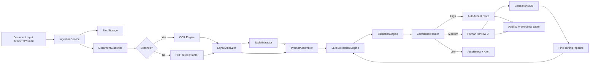

# Chapter 11: Design a Financial Document Extraction System

## Context

> [!info] Quick Reference
> - **Pattern:** OCR-to-LLM document extraction pipeline
> - **Scale:** 2M documents/day, < 5s latency, 99.5%+ per-field accuracy
> - **Key Techniques:** Layout detection (DETR), table structure recognition, constrained decoding, 5-layer hallucination prevention
> - **Primary Concerns:** Digit transposition errors, cross-document bleed, arithmetic consistency, compliance audit trail
> - **Cross-references:** [[chapter-07|Chapter 7]] (document parsing), [[chapter-17|Chapter 17]] (legal contracts), [[chapter-05|Chapter 5]] (guardrails)

**Problem statement:** Design a production system that ingests millions of financial documents (invoices, bank statements, contracts, tax forms), extracts structured fields with >99.5% per-field accuracy, and outputs validated JSON—where a single hallucinated number can trigger regulatory violations or erroneous payments.

### Real-World Examples

- A payments company processes 3M vendor invoices/day. Their regex-based extraction fails on 40% of non-standard layouts. An OCR-to-LLM pipeline with layout-aware table extraction and constrained JSON decoding achieves 99.7% field accuracy, reducing manual review from 45% to 3% of documents.
- A bank's loan processing system extracts income figures from scanned tax returns. The LLM hallucinates "$85,000" as "$850,000" on a blurred document, approving a loan that defaults. Adding cross-field verification (income × tax rate ≈ reported tax) and confidence-gated human review catches the error class entirely.

---

## Step 1: Understand the Problem and Establish Design Scope

### Simulated Dialogue

**Interviewer:** Design a system to extract structured data from financial documents at scale.  
**Candidate:** Financial extraction is an accuracy-critical domain. I need to understand document types, field schemas, volume, accuracy targets, and what happens when the system is wrong before proposing anything.

**Candidate:** What document types and volumes?  
**Interviewer:** Invoices, bank statements, loan contracts, tax forms. 2M documents/day. Mix of digital-native PDFs (60%) and scanned images (40%).

**Candidate:** What fields need extraction, and what accuracy is required?  
**Interviewer:** Average 15 fields per document—amounts, dates, account numbers, party names, line items. Target 99.5%+ per-field accuracy. Errors in monetary fields are especially costly.

**Candidate:** What's the latency budget?  
**Interviewer:** Under 5 seconds per document for the full pipeline. Some documents go through batch processing overnight, but real-time extraction for incoming invoices must meet the SLO.

**Candidate:** What happens when the system is wrong?  
**Interviewer:** Incorrect amounts can trigger erroneous payments or regulatory flags. We need confidence scoring and human-in-the-loop routing for low-confidence extractions.

### Functional Requirements

- Ingest PDFs (digital-native and scanned), images (TIFF, JPEG, PNG), and structured electronic formats (EDI, XML).
- Extract document-type-specific fields into a predefined JSON schema per document class.
- Detect and extract tables (line items, transaction histories) preserving row-column relationships.
- Assign per-field confidence scores; route low-confidence documents to human review.
- Support 50+ document templates with zero-shot generalization to unseen layouts.

### Non-Functional Requirements

- **Accuracy:** 99.5%+ per-field extraction accuracy across all document types. 99.9%+ for monetary fields after validation.
- **Latency:** End-to-end <5s per document (OCR + classification + extraction + validation).
- **Throughput:** Sustain 2M documents/day (~23 docs/sec average, 100 docs/sec peak).
- **Auditability:** Full provenance trail—every extracted value links to bounding box coordinates in the source document.
- **Availability:** 99.9% uptime with queue-based decoupling (documents never lost).

### Back-of-the-Envelope Estimation

#### Traffic Profile

- Documents/day: 2M
- Average docs/sec: `2M / 86,400 ≈ 23`
- Peak docs/sec (4x): `~92`
- Fields/day: `2M × 15 = 30M field extractions`
- Digital-native PDFs: 1.2M/day (text-layer extraction, no OCR needed)
- Scanned documents: 800K/day (require full OCR pipeline)

#### Compute Budget per Document (5s SLO)

| Stage | Budget | Notes |
|---|---|---|
| Document ingestion + classification | 200ms | Page count detection, format conversion, doc-type classifier |
| OCR (scanned only, 40% of docs) | 1,500ms | Layout-aware OCR (Tesseract/PaddleOCR), multi-page |
| Text extraction (digital PDFs) | 100ms | PDF text layer + coordinate extraction |
| Layout detection + table parsing | 800ms | Object detection model for tables, headers, footers |
| LLM extraction (field mapping) | 1,800ms | ~2K input tokens, ~500 output tokens, 7B model |
| JSON validation + cross-field checks | 200ms | Schema validation, arithmetic checks, format verification |
| Confidence scoring + routing | 100ms | Per-field confidence aggregation, threshold check |
| **Total (scanned)** | **~4,700ms** | Within 5s SLO |
| **Total (digital)** | **~3,200ms** | Comfortable margin |

#### GPU Fleet Sizing

- LLM extraction: 7B quantized model (INT4), ~120 tokens/sec/GPU
- Output tokens/doc: ~500
- Time per doc per GPU: `500 / 120 ≈ 4.2s`
- With continuous batching (6x efficiency): `~0.7s effective per doc`
- Peak demand: 92 docs/sec → `92 × 0.7 / 1 ≈ 65 GPU-equivalents`
- Layout detection model: ~10 GPUs (lightweight object detection)
- OCR: CPU-bound, ~200 CPU cores for peak scanned volume
- Total GPU fleet: **~80 GPUs** (steady-state ~35 with autoscaling)

#### Storage

- Average document size: 2MB (PDF/image)
- Daily ingestion: `2M × 2MB = 4TB/day`
- 90-day retention (regulatory): ~360TB
- Extracted JSON: ~2KB/doc → 4GB/day → negligible
- Audit trail (bounding boxes + provenance): ~10KB/doc → 20GB/day

---

## Step 2: Propose High-Level Design and Get Buy-In

### Core Architecture Components

- **Document Ingestion Service:** Accepts uploads (API, SFTP, email), normalizes format, assigns document ID, queues for processing.
- **Document Classifier:** CNN or lightweight vision model classifies document type (invoice, statement, contract, tax form) → selects appropriate extraction schema.
- **OCR Engine:** Layout-aware OCR for scanned documents. Produces text + bounding box coordinates per word/line. Skipped for digital-native PDFs (direct text extraction).
- **Layout Analyzer:** Object detection model identifies tables, headers, footers, logos, signatures. Outputs structural regions with coordinates.
- **Table Extractor:** Specialized module for row-column parsing within detected table regions. Handles merged cells, multi-line rows, nested tables.
- **LLM Extraction Engine:** Takes OCR text + layout structure + document schema → outputs structured JSON with per-field confidence.
- **Validation Engine:** JSON schema validation, cross-field arithmetic checks, format verification (dates, account numbers, amounts), business rule enforcement.
- **Confidence Router:** Aggregates per-field confidence → routes to auto-accept, human review, or auto-reject queues.
- **Human Review UI:** Displays source document with bounding box overlays, extracted fields, and confidence scores. Reviewer corrects and confirms.
- **Audit & Provenance Store:** Links every extracted value to source coordinates. Immutable log for compliance.

### Pipeline A: Document Processing Pipeline

1. Document arrives via API/SFTP/email → ingestion service assigns ID, stores original in blob storage.
2. Document classifier determines type and page count → selects extraction schema.
3. For scanned docs: OCR engine produces text + bounding boxes. For digital PDFs: text layer extracted with coordinates.
4. Layout analyzer detects structural regions (tables, headers, key-value blocks).
5. Table extractor parses detected table regions into row-column structures.
6. All extracted text, layout structure, and schema are assembled into the LLM prompt.
7. LLM generates structured JSON output with per-field values.
8. Validation engine checks schema conformance, cross-field consistency, and format rules.
9. Confidence router evaluates aggregate confidence → auto-accept (>0.95), human review (0.80–0.95), or auto-reject (<0.80).
10. Results stored with full provenance trail.

### Pipeline B: Model Training & Improvement Pipeline

1. Human review corrections collected as ground truth labels.
2. Corrections mapped to (document_image, OCR_text, layout, correct_JSON) tuples.
3. Weekly fine-tuning run on accumulated corrections (LoRA on extraction model).
4. Quality gate: new model must beat baseline on held-out test set (per-field accuracy, per-document exact-match).
5. Canary deployment to 5% of traffic → monitor field-level accuracy for 24h.
6. Gradual rollout with automatic rollback if accuracy drops >0.1%.

### Mermaid Architecture Diagram



---

## Step 3: Design Deep Dive

Focus areas:

1. **OCR-to-LLM Pipeline (Layout Detection, Table Extraction, Field Mapping)**
2. **Structured Output Enforcement (JSON Schema, Constrained Decoding, Validation)**
3. **Hallucination Prevention for Financial Data**

### 1) OCR-to-LLM Pipeline

The pipeline must bridge the gap between raw pixels and structured financial data. Each stage introduces potential error that compounds downstream.

**OCR strategy by document type:**

| Document Source | OCR Approach | Word-Level Accuracy | Notes |
|---|---|---|---|
| Digital-native PDF | Direct text extraction (pdfplumber/PyMuPDF) | 99.9%+ | No OCR needed; extract coordinates from PDF internals |
| Clean scan (300+ DPI) | Tesseract/PaddleOCR with preprocessing | 98-99% | Deskew, binarize, denoise before OCR |
| Low-quality scan (<200 DPI) | PaddleOCR + super-resolution preprocessing | 94-97% | Upscale with ESRGAN before OCR; flag for human review |
| Photographed documents | Document-specific model (DocTR/TrOCR) | 90-95% | Perspective correction, shadow removal required |
| Handwritten fields | TrOCR fine-tuned on financial handwriting | 85-92% | Always route to human review for monetary amounts |

**Layout detection architecture:**

The layout analyzer uses an object detection model (Faster R-CNN or DETR fine-tuned on financial documents) to identify structural regions:

- **Key-value blocks:** "Invoice Number: INV-2024-001" → detect label-value pairs with spatial proximity.
- **Tables:** Detect table boundaries, then apply a secondary model for row/column segmentation.
- **Headers/footers:** Identify recurring elements across pages for document template matching.
- **Signatures/stamps:** Detect but don't extract (used for document completeness verification).

**Table extraction pipeline:**

Tables are the hardest structural element. Financial documents contain line items, transaction histories, and amortization schedules with complex layouts.

1. **Table detection:** Object detection model identifies table bounding boxes.
2. **Row/column segmentation:** TSR (Table Structure Recognition) model predicts row and column separators. Handles borderless tables using whitespace analysis.
3. **Cell content extraction:** Map OCR words to cells using spatial overlap with predicted cell boundaries.
4. **Header association:** Classify first row(s) as headers; map column semantics (Description, Quantity, Unit Price, Total).
5. **Multi-page table merging:** Detect continuation tables across pages using header matching and column alignment.

**Prompt assembly for LLM extraction:**

The prompt must convey document structure, not just raw text. The format:

```
Document Type: Invoice
Schema: {invoice_number: string, date: date, vendor_name: string, ...}

=== KEY-VALUE PAIRS ===
[Label: "Invoice Number", Value: "INV-2024-001", Position: (120, 45)]
[Label: "Date", Value: "March 15, 2024", Position: (120, 72)]
...

=== TABLE: Line Items ===
| Description | Qty | Unit Price | Total |
|---|---|---|---|
| Widget A | 100 | $12.50 | $1,250.00 |
| Widget B | 50 | $8.75 | $437.50 |

=== RAW TEXT (remaining) ===
Payment Terms: Net 30 ...

Extract all fields matching the schema as JSON.
```

#### OCR-to-LLM Trade-off Table

| Approach | Accuracy | Latency | Generalization | Complexity |
|---|---|---|---|---|
| OCR → regex/template matching | 85-92% | <500ms | None (new layouts fail) | Low |
| OCR → LLM (text only, no layout) | 93-96% | 2s | Good for simple docs | Medium |
| OCR → layout-aware LLM (structured prompt) | 97-99% | 3s | Strong | High |
| Vision-Language Model (end-to-end, no OCR) | 95-98% | 3-5s | Best zero-shot | High (large model) |
| Hybrid: OCR + layout + LLM + VLM fallback | 99%+ | 4-5s | Best overall | Very high |

### 2) Structured Output Enforcement

Financial extraction demands perfectly structured output. A missing closing brace or a string where a number belongs is unacceptable.

**JSON schema enforcement layers:**

1. **Schema definition per document type:**

```json
{
  "type": "object",
  "properties": {
    "invoice_number": {"type": "string", "pattern": "^[A-Z]{2,4}-\\d{4,}$"},
    "total_amount": {"type": "number", "minimum": 0},
    "currency": {"type": "string", "enum": ["USD", "EUR", "GBP", "JPY"]},
    "line_items": {
      "type": "array",
      "items": {
        "type": "object",
        "properties": {
          "description": {"type": "string"},
          "quantity": {"type": "integer", "minimum": 1},
          "unit_price": {"type": "number", "minimum": 0},
          "total": {"type": "number", "minimum": 0}
        },
        "required": ["description", "quantity", "unit_price", "total"]
      }
    }
  },
  "required": ["invoice_number", "total_amount", "currency", "line_items"]
}
```

2. **Constrained decoding at inference time:**

Rather than hoping the LLM produces valid JSON, enforce it during generation:

- **Grammar-constrained decoding:** Use a context-free grammar (CFG) that mirrors the JSON schema. At each token position, mask logits to only allow tokens that continue a valid parse. Libraries: Outlines, llama.cpp grammar mode, vLLM guided decoding.
- **Finite-state machine (FSM) approach:** Track the parser state during decoding. When inside a string value for `total_amount`, only allow digit tokens, decimal points, and the closing quote.
- **Structured output APIs:** OpenAI/Anthropic structured output modes that guarantee schema conformance.

3. **Post-generation validation pipeline:**

Even with constrained decoding, validate:

- JSON schema conformance (jsonschema library).
- Type coercion: parse "$1,250.00" → 1250.00 (strip currency symbols, commas).
- Date normalization: "03/15/2024", "March 15, 2024", "15-Mar-24" → ISO 8601.
- Enum matching: fuzzy-match extracted values to allowed enum sets.

#### Structured Output Trade-off Table

| Technique | Conformance Rate | Latency Overhead | Quality Impact | Complexity |
|---|---|---|---|---|
| Free-form generation + regex parsing | 70-85% | None | Frequent parse failures | Low |
| Prompt engineering ("output valid JSON") | 85-95% | None | Model-dependent reliability | Low |
| Constrained decoding (grammar/FSM) | 99.9%+ | 5-15% slower decoding | Slight reduction in field value quality | Medium |
| Function calling / tool use API | 98-99% | Minimal | Good quality, API-dependent | Low |
| Constrained decoding + post-validation | 100% (by construction) | 10-20% slower | Best overall | High |

### 3) Hallucination Prevention for Financial Data

In financial extraction, a hallucinated digit is not a minor quality issue—it's a potential compliance violation or erroneous payment. The system must treat hallucination as a safety problem.

**Hallucination taxonomy for document extraction:**

| Hallucination Type | Example | Frequency | Severity |
|---|---|---|---|
| Digit transposition | "$1,250" → "$1,520" | 2-3% of fields | Critical for amounts |
| Fabricated field | Model invents an invoice number not present in document | 1-2% | High |
| Cross-document bleed | Value from a previous document in batch appears in current extraction | <0.5% | Critical |
| OCR error propagation | OCR reads "8" as "6" → LLM faithfully extracts wrong value | 3-5% on low-quality scans | High |
| Normalization error | "$1,250.00" parsed as "$125,000" (misplaced decimal) | 1-2% | Critical for amounts |

**Multi-layer hallucination prevention:**

**Layer 1 — Source grounding:**
- Every extracted value must trace to specific bounding box coordinates in the source document.
- During extraction, require the LLM to output both the value and its source location: `{"total_amount": 1250.00, "total_amount_source": "page1, bbox(320, 415, 420, 435)"}`.
- Post-extraction: OCR the specific bounding box region independently and compare against extracted value. Mismatch → flag for review.

**Layer 2 — Cross-field verification:**
- Arithmetic checks: `sum(line_item.total) == subtotal`, `subtotal + tax == total_amount`.
- Rate checks: `tax_amount / subtotal ≈ expected_tax_rate ± 1%`.
- Date logic: `due_date > invoice_date`, `payment_terms_days == due_date - invoice_date`.
- Relationship checks: `vendor_name` in extracted text must appear in raw OCR output (not fabricated).

**Layer 3 — Confidence scoring:**
- Per-field confidence derived from:
  - LLM token-level log-probabilities (average log-prob of tokens comprising the field value).
  - OCR confidence for the source bounding box region.
  - Validation pass/fail signals (arithmetic check passed → boost confidence).
- Composite confidence: `conf = 0.4 × llm_logprob + 0.3 × ocr_confidence + 0.3 × validation_score`.

**Layer 4 — Human review routing:**

| Confidence Band | Action | Expected Volume |
|---|---|---|
| > 0.95 | Auto-accept | 85% of documents |
| 0.80 – 0.95 | Human review (reviewer sees flagged fields only) | 12% of documents |
| < 0.80 | Full manual extraction | 3% of documents |

**Layer 5 — Batch-level anomaly detection:**
- Track field value distributions per vendor/document type.
- Flag statistical outliers: invoice total 10x historical average for that vendor → review.
- Detect cross-document bleed: if same unique identifier (invoice number) appears in two consecutive extractions → flag.

#### Hallucination Prevention Trade-off Table

| Technique | Error Reduction | Latency Cost | Human Review Load | Implementation Effort |
|---|---|---|---|---|
| Source grounding (bbox verification) | 40-50% | +200ms (re-OCR region) | Reduces review by surfacing specific errors | Medium |
| Cross-field arithmetic checks | 20-30% | +10ms | Eliminates entire error class | Low |
| Confidence-gated routing | N/A (catch, not prevent) | +50ms | 12-15% of docs routed | Medium |
| Dual extraction (run twice, compare) | 60-70% | +100% (2x compute) | Only review disagreements | Low complexity, high cost |
| Ensemble (two models, majority vote) | 50-60% | +80% compute | Review disagreements | High |

### Production Bottlenecks and Mitigations

- **OCR quality variance across document sources**
  - Symptom: 99% accuracy on clean scans, 88% on faxed documents.
  - Mitigation: Per-source quality scoring at ingestion. Low-quality sources get super-resolution preprocessing and automatic human review routing.

- **Table extraction failure on complex layouts**
  - Symptom: Merged cells, nested tables, or borderless tables cause row-column misalignment.
  - Mitigation: Ensemble of table detection models (rule-based + neural). Fallback to VLM for tables where structural parsing fails.

- **LLM context window overflow on multi-page documents**
  - Symptom: 20-page contracts exceed token limit; extraction misses fields on later pages.
  - Mitigation: Per-page extraction with cross-page merging. Extract each page independently, then reconcile overlapping fields.

- **Cross-document contamination in batch processing**
  - Symptom: KV cache from previous document leaks into current extraction.
  - Mitigation: Clear KV cache between documents. Never batch multiple documents in a single inference call.

- **Schema evolution when new document types appear**
  - Symptom: New vendor invoice layout has fields not in schema.
  - Mitigation: Zero-shot extraction mode that outputs discovered fields alongside schema-mandated fields. Human review confirms; schema updated weekly.

- **Confidence calibration drift**
  - Symptom: Confidence threshold of 0.95 auto-accepts 90% of docs at launch but only 70% after 3 months (model confidence distribution shifts).
  - Mitigation: Weekly recalibration using human review outcomes as ground truth. Platt scaling on held-out set.

---

## Step 4: Wrap Up

### Final Design Summary

The system chains OCR, layout analysis, table extraction, and LLM-based field mapping into a pipeline that treats accuracy as a safety constraint. Constrained decoding guarantees structural validity. Multi-layer hallucination prevention—source grounding, cross-field verification, confidence routing, and anomaly detection—pushes effective per-field accuracy past 99.5% while keeping human review load under 15%.

### Wrap-Around Concerns

- **Risk:** OCR errors on degraded scans propagate through the entire pipeline undetected. Mitigation: Per-source quality scoring, automatic re-OCR with enhanced preprocessing, confidence penalties for low-quality sources.
- **Risk:** Constrained decoding forces structurally valid but semantically wrong output (model "guesses" a number that fits the schema when uncertain). Mitigation: Prefer high-entropy "null" fields over low-confidence guesses; route nulls to human review.
- **Risk:** Adversarial documents (deliberately manipulated invoices) exploit the system's trust in OCR output. Mitigation: Tamper detection layer (check for pixel-level edits near amount fields), cross-reference against vendor master data.
- **Risk:** Regulatory requirements vary by jurisdiction (EU invoicing directives vs US standards). Mitigation: Per-jurisdiction schema variants with region-specific validation rules.
- **Risk:** Human reviewer fatigue degrades correction quality during high-volume periods. Mitigation: Review prioritization by dollar amount at risk; auto-distribute review load; quality audits on reviewer corrections.

---

## Step 5: Interviewer Curveballs

### Interviewer Follow-ups & Frequently Asked Questions (FAQ)

Q: The system extracts "$12,500" from an invoice but the actual amount is "$1,250.00"—an extra zero. How does your system catch this?

**The Ideal Answer:** Three independent checks fire. First, source grounding: re-OCR the bounding box region for the total amount field and compare character-by-character against the extracted value. Second, cross-field arithmetic: sum the line item totals and compare against the extracted total—if line items sum to $1,250 but the total says $12,500, flag the discrepancy. Third, statistical anomaly detection: compare against historical invoice totals from this vendor—a 10x deviation triggers review.

**Deep Dive & Trade-offs:**
- Source grounding catches OCR propagation errors but not cases where the source document itself is wrong.
- Arithmetic checks catch ~80% of amount errors on invoices with line items but fail on single-total invoices.
- Vendor history checks require sufficient historical data (cold-start problem for new vendors).

**The Interviewer's Rubric:** Checking multi-layered defense thinking for financial data integrity.

---

Q: A vendor sends invoices as photographed images taken with a phone camera. Quality is terrible. What do you do?

**The Ideal Answer:** Pre-processing pipeline: perspective correction (detect document quadrilateral, warp to rectangle), shadow removal, super-resolution upscaling (Real-ESRGAN from 150 DPI effective to 300 DPI), adaptive binarization. After preprocessing, route through TrOCR (transformer-based OCR that handles degraded input better than Tesseract). Automatically set confidence floor lower for this source—all monetary fields go to human review regardless of extraction confidence.

**Deep Dive & Trade-offs:**
- Super-resolution adds ~500ms but improves OCR accuracy from ~88% to ~94% on degraded images.
- TrOCR is slower than Tesseract (~2x) but significantly more robust on noisy input.
- Business decision: charge the vendor for manual review or require higher-quality submissions.

**The Interviewer's Rubric:** Checking practical image preprocessing knowledge and graceful degradation strategy.

---

Q: How do you handle a 50-page loan contract where you need to extract fields scattered across different sections?

**The Ideal Answer:** Three-phase approach. Phase 1: Document segmentation—classify each page into sections (terms, signatures, schedules, amendments) using a page-level classifier. Phase 2: Per-section extraction—run the LLM on each relevant section independently with section-specific schemas. Phase 3: Cross-section reconciliation—merge extracted fields, resolve conflicts (e.g., interest rate mentioned on page 3 and page 47 must match), and validate cross-references.

**Deep Dive & Trade-offs:**
- Per-page extraction avoids context window limits but loses cross-page references.
- Full-document extraction with a 128K context model preserves references but is expensive (~15s for 50 pages) and accuracy degrades on long contexts.
- Hybrid: extract per-section, then run a lightweight verification pass with key fields from all sections in a single prompt.

**The Interviewer's Rubric:** Checking ability to decompose long-document problems without losing cross-document coherence.

---

Q: You need to support a new document type (e.g., customs declarations) with zero training data. How?

**The Ideal Answer:** Zero-shot extraction using schema-driven prompting. Define the JSON schema for customs declarations (declaration number, HS codes, country of origin, declared value, etc.). Provide the schema and 2-3 synthetic examples in the system prompt. The LLM's general knowledge of financial document structure handles most field types. Monitor accuracy on the first 500 documents with 100% human review. Use corrections as few-shot examples, then fine-tune a LoRA adapter after accumulating 2K+ labeled documents.

**Deep Dive & Trade-offs:**
- Zero-shot accuracy for new doc types: typically 85-92% (sufficient for human-review-assisted launch).
- Few-shot (5-10 examples in prompt): jumps to 92-96%.
- Fine-tuned (2K+ examples): reaches 98%+ parity with established document types.
- Cold-start cost: 100% human review for ~2 weeks → expensive but necessary for accuracy guarantees.

**The Interviewer's Rubric:** Checking cold-start strategy and understanding of the accuracy-data flywheel.

---

Q: Constrained decoding guarantees valid JSON, but the model fills in a plausible-looking but wrong account number. How do you detect this?

**The Ideal Answer:** Constrained decoding only enforces structure, not semantics. Semantic correctness requires: (1) source grounding—verify the account number exists in the OCR text at the claimed bounding box; (2) format validation—check against known account number formats (routing numbers are 9 digits with a specific checksum algorithm, IBANs have country-specific formats with check digits); (3) entity resolution—if the vendor is known, check against the vendor master database for expected account numbers; (4) confidence thresholding—if the LLM's token log-probabilities for the account number tokens are low, route to review.

**Deep Dive & Trade-offs:**
- Checksum validation catches ~60% of fabricated account numbers (only works for formats with built-in checksums).
- Vendor master lookup catches ~90% for known vendors but requires maintained database.
- Source grounding is the strongest signal—if the value doesn't exist in the source text, it's hallucinated by definition.

**The Interviewer's Rubric:** Checking understanding that structural validity ≠ semantic correctness.

---

Q: How do you handle documents in 20 different languages?

**The Ideal Answer:** Multilingual OCR (PaddleOCR supports 80+ languages). Language detection at the OCR stage (or from document metadata). LLM extraction uses a multilingual model (or language-specific LoRA adapters on a multilingual base). JSON schema field names remain in English (canonical); extracted values retain original language. Date and number format normalization is locale-aware (e.g., "1.250,00" in German = "1,250.00" in US format). Monetary amounts always normalize to a canonical (amount, currency) tuple.

**Deep Dive & Trade-offs:**
- Multilingual base model (e.g., Qwen2 series): good across languages but slightly weaker per-language than specialized models.
- Per-language LoRA adapters: best accuracy but 20 adapters to maintain.
- Number format ambiguity: "1,250" could be 1250 (US) or 1.25 (EU). Must resolve using document language and currency context.

**The Interviewer's Rubric:** Checking awareness of locale-specific formatting challenges in financial data.

---

Q: Your human review queue is growing faster than reviewers can process it. What do you do?

**The Ideal Answer:** Triage by business impact: prioritize documents by monetary amount × confidence gap (low confidence on a $500K invoice before high confidence on a $50 invoice). Reduce review scope: show reviewers only the flagged fields, not the entire document (reduces review time from 3 min to 30 sec). Active learning: use reviewer corrections to fine-tune the model weekly—each correction should reduce future review load. Adjust confidence thresholds: if the auto-accept threshold is too conservative, analyze the error rate in the 0.90-0.95 band—if errors are <0.1%, safely lower the review threshold to 0.90.

**Deep Dive & Trade-offs:**
- Lowering the review threshold increases auto-accept rate but increases undetected errors.
- Quantify: at 0.95 threshold, 85% auto-accept with 0.3% error rate. At 0.90, 92% auto-accept with 0.8% error rate. Business decides acceptable error rate.
- Long-term: model improvement should move the confidence distribution rightward, naturally reducing review volume.

**The Interviewer's Rubric:** Checking operational maturity thinking—the human-in-the-loop system is itself a system that needs optimization.

---

Q: A competitor claims their end-to-end vision-language model (no OCR step) achieves 99% accuracy. Should you drop your OCR pipeline?

**The Ideal Answer:** Not yet—and probably never fully. End-to-end VLMs (e.g., GPT-4V, Qwen-VL) achieve strong results on clean documents but degrade on low-quality scans, complex tables, and dense multi-page documents. The OCR pipeline provides: (1) explicit bounding box provenance (required for audit compliance); (2) deterministic text extraction for digital PDFs (why run a vision model on a text document?); (3) modular error isolation (you can identify whether an error is OCR-stage or extraction-stage). Best approach: use VLM as a fallback for documents where layout-based extraction fails, and as a verification channel for high-value documents.

**Deep Dive & Trade-offs:**
- VLMs: simpler pipeline, fewer error propagation points, but opaque (no bounding box provenance without extra work).
- OCR pipeline: explicit provenance, modular debugging, but more moving parts.
- Hybrid wins: OCR pipeline for 90% of documents (reliable, auditable), VLM for the 10% that defeat layout analysis (complex or unusual formats).
- Cost: VLMs are 5-10x more expensive per document than OCR + 7B extraction model.

**The Interviewer's Rubric:** Checking ability to evaluate pipeline architecture trade-offs against end-to-end alternatives.

## End of Chapter

- **Key takeaway:** Financial document extraction is an accuracy-critical pipeline where hallucination is a safety hazard. Multi-layer defense—source grounding, cross-field verification, constrained decoding, confidence routing—is non-negotiable. No single technique achieves 99.5%; the combination does.
- **What to practice:** Trace a single document through the full pipeline (ingestion → OCR → layout → LLM → validation → routing) and identify where each error type is caught.
- **Interview drill:** Given a hallucinated monetary amount, explain every layer of defense that should have caught it and why each layer alone is insufficient.
