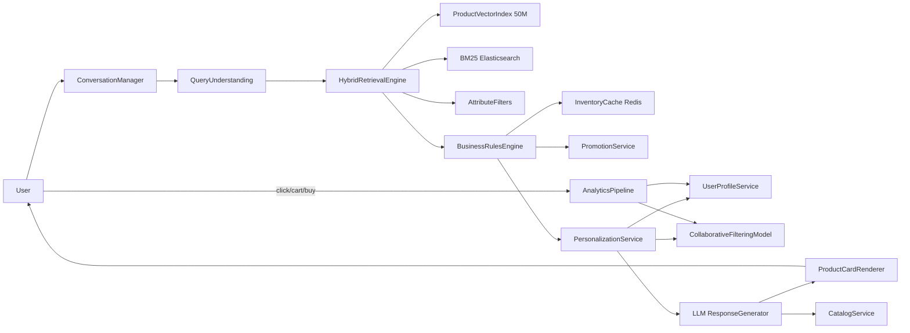

# Chapter 12: Design a Personalized E-commerce Shopping Assistant

## Context

> [!info] Quick Reference
> - **Pattern:** Real-time personalized recommendation assistant
> - **Scale:** 50M product catalog, real-time inventory cache (30s TTL)
> - **Key Techniques:** Long-term + short-term user profile fusion, hybrid retrieval (semantic + BM25 + structured), business constraint layers
> - **Primary Concerns:** Inventory staleness, margin target enforcement, cold-start users, A/B revenue attribution
> - **Cross-references:** [[chapter-03|Chapter 3]] (hybrid retrieval), [[chapter-02|Chapter 2]] (RAG pattern)

**Problem statement:** Design a conversational shopping assistant that merges real-time user behavior, purchase history, and a 50M-product catalog to deliver personalized, inventory-aware product recommendations through natural language—while optimizing for revenue per session, not just answer quality.

### Real-World Examples

- A fashion retailer deploys a chat assistant. Users who engage with it convert at 3.2x the rate of browse-only users. But the assistant recommends out-of-stock items 18% of the time, causing frustration and cart abandonment. Adding real-time inventory filtering and availability-aware ranking drops OOS recommendations to <1% and lifts revenue per session by 22%.
- An electronics marketplace integrates collaborative filtering signals into the assistant's retrieval layer. When a user asks "best laptop for video editing under $1500," the system retrieves not just semantically matching laptops but also the laptops most purchased by users with similar browsing history. Click-through rate on recommendations jumps from 12% to 31%.

---

## Step 1: Understand the Problem and Establish Design Scope

### Simulated Dialogue

**Interviewer:** Design a personalized shopping assistant for a large e-commerce platform.  
**Candidate:** This is a retrieval-augmented generation problem layered on top of a recommendation system. I need to understand the catalog scale, user base, personalization signals available, and how success is measured—because the metric is revenue, not BLEU score.

**Candidate:** What's the catalog and user scale?  
**Interviewer:** 50M products across 5K categories. 10M daily active users. Products have structured attributes (price, brand, specs) plus unstructured descriptions and reviews.

**Candidate:** What user signals are available for personalization?  
**Interviewer:** Full browse history, purchase history, wishlists, cart state, search queries, and review activity. Average user has 18 months of history.

**Candidate:** What's the query pattern?  
**Interviewer:** Average 4 queries per session, mix of discovery ("what's a good gift for a runner"), comparison ("compare AirPods Pro vs Sony WF-1000XM5"), and transactional ("cheapest 65-inch TV with 120Hz").

**Candidate:** What are the latency and accuracy constraints?  
**Interviewer:** Time to first token under 1.5 seconds. Real-time inventory accuracy. Recommendations must respect business constraints (no banned sellers, margin-aware ranking, promotional boosts).

### Functional Requirements

- Multi-turn conversational interface with context retention across a shopping session.
- Product search and recommendation grounded in the live 50M-product catalog.
- Support query types: discovery, comparison, transactional, and post-purchase (order status, returns).
- Personalized ranking based on user history, preferences, and collaborative signals.
- Business constraint enforcement: inventory availability, seller eligibility, margin targets, promotional campaigns.
- Product cards with images, prices, ratings, and direct add-to-cart actions within the chat.

### Non-Functional Requirements

- **Latency:** TTFT < 1.5s for all query types. Product card rendering < 2s including image fetch.
- **Throughput:** 10M DAU × 4 queries/session = 40M queries/day (~460 QPS avg, ~2,300 QPS peak).
- **Personalization quality:** Click-through rate on recommended products > 25%. Revenue per assisted session > 1.5× unassisted.
- **Inventory accuracy:** <1% of recommended products out of stock at time of recommendation.
- **Availability:** 99.9% uptime. Graceful degradation: fall back to non-personalized search if personalization service is down.

### Back-of-the-Envelope Estimation

#### Traffic Profile

- DAU: 10M
- Sessions/day: ~12M (some users have multiple sessions)
- Queries/day: `12M × 4 = 48M`
- Average QPS: `48M / 86,400 ≈ 556`
- Peak QPS (5x): `~2,780`
- Average input tokens/query: 200 (user query + conversation context + retrieved product data)
- Average output tokens/query: 150 (response with product mentions + reasoning)
- Total output tokens/day: `48M × 150 = 7.2B tokens`

#### Retrieval Budget per Query

| Stage | Budget | Notes |
|---|---|---|
| Query understanding + rewriting | 50ms | Intent classification, entity extraction, query expansion |
| Embedding generation | 20ms | User query → vector (cached model, batch inference) |
| Candidate retrieval (ANN + filters) | 80ms | Top-200 candidates from vector index + attribute filters |
| Business constraint filtering | 30ms | Inventory check, seller eligibility, promotional rules |
| Personalized reranking | 100ms | User-product scoring model, collaborative signals |
| Product data assembly | 50ms | Fetch top-10 product details from catalog service |
| LLM generation | 800ms | ~200 input tokens + 150 output tokens, 7B model |
| Product card rendering | 200ms | Image CDN fetch, price formatting, availability badge |
| **Total** | **~1,330ms** | Within 1.5s TTFT SLO |

#### GPU Fleet Sizing

- LLM: 7B quantized (INT4), ~150 tokens/sec/GPU
- Output tokens/query: 150
- Time per query per GPU: `150 / 150 = 1s`
- With continuous batching (6x): `~0.17s effective per query`
- Peak demand: 2,780 QPS → `2,780 × 0.17 ≈ 473 GPU-equivalents`
- Embedding model: bi-encoder, ~5 GPUs (high-throughput batch inference)
- Reranking model: cross-encoder, ~30 GPUs (per-pair scoring)
- Total GPU fleet: **~510 GPUs** (steady-state ~200 with autoscaling)

#### Catalog Index

- 50M products × 768-dim embeddings × 4 bytes (FP32) = ~150GB vector index
- With HNSW (1.5x overhead): ~225GB → fits in memory across 4 nodes (64GB each)
- Structured attribute index (Elasticsearch): ~500GB for full catalog with facets
- Real-time inventory: Redis cluster, ~50M keys × 100 bytes = ~5GB

---

## Step 2: Propose High-Level Design and Get Buy-In

### Core Architecture Components

- **Conversation Manager:** Maintains session state, conversation history, extracted preferences, and cart context. Stateful per session.
- **Query Understanding Module:** Intent classification (discovery/comparison/transactional/post-purchase), entity extraction (brand, category, price range, attributes), query rewriting for retrieval.
- **Retrieval Engine:** Hybrid search combining semantic (vector) retrieval, keyword (BM25) retrieval, and structured attribute filtering. Returns candidate products.
- **Personalization Service:** Scores candidates using user embedding, purchase history, collaborative filtering signals, and session context.
- **Business Rules Engine:** Filters and boosts candidates based on inventory, seller eligibility, margin targets, and active promotions.
- **LLM Response Generator:** Takes ranked product candidates + conversation context → generates natural language response with product references.
- **Product Card Renderer:** Enriches LLM output with structured product cards (image, price, rating, availability, add-to-cart CTA).
- **User Profile Service:** Serves user embeddings, preference vectors, and behavioral features. Updated in near-real-time from clickstream.
- **Catalog Service:** Product metadata, pricing, inventory, reviews. Serves enriched product data for response assembly.
- **Analytics & Feedback Pipeline:** Tracks clicks, add-to-carts, purchases attributed to assistant recommendations. Feeds back into personalization model training.

### Pipeline A: Query Processing & Response Pipeline

1. User sends message → conversation manager appends to session history, extracts accumulated preferences (budget, brand, category).
2. Query understanding module classifies intent and extracts entities. Rewrites query for retrieval (e.g., "something like those shoes I bought last month" → "running shoes similar to [Nike Pegasus 40]").
3. Retrieval engine executes hybrid search:
   - Semantic: embed rewritten query → ANN search over product embedding index → top-200 candidates.
   - Keyword: BM25 search over product titles/descriptions → top-100 candidates.
   - Structured: filter by extracted constraints (price range, category, brand).
   - Merge and deduplicate → ~300 unique candidates.
4. Business rules engine filters: remove out-of-stock, banned sellers, region-restricted products. Apply promotional boosts.
5. Personalization service scores remaining candidates using user-product affinity model. Rerank to top-10.
6. LLM response generator receives: conversation history + top-10 products (title, price, key specs, rating) + user preferences → generates conversational response.
7. Product card renderer attaches structured cards to product mentions in the response.
8. Response streamed to user. Click/cart/purchase events tracked for attribution.

### Pipeline B: Profile & Catalog Update Pipeline

1. Clickstream events (views, clicks, searches, carts, purchases) ingested via Kafka.
2. Near-real-time user embedding update: incremental model updates user vector every 5 minutes from recent behavior.
3. Product catalog changes (new products, price updates, inventory changes) ingested from catalog service.
4. Product embeddings generated for new/updated products; vector index updated incrementally.
5. Inventory cache (Redis) updated in real-time from warehouse management system.
6. Collaborative filtering model retrained daily on interaction matrix (user × product × action).
7. Personalization reranking model retrained weekly on attributed conversion data from assistant interactions.

### Mermaid Architecture Diagram



---

## Step 3: Design Deep Dive

Focus areas:

1. **Profile-Catalog Fusion (User Embedding + Product Embedding + Collaborative Signals)**
2. **Hybrid Search with Business Constraints**
3. **Personalization Evaluation (A/B Testing, Revenue Attribution)**

### 1) Profile-Catalog Fusion

The core challenge: merging a user's implicit preferences (derived from behavioral history) with explicit query intent and a 50M-product catalog in real-time.

**User representation architecture:**

The user profile is a multi-signal embedding that captures long-term preferences and short-term intent:

- **Long-term preference vector (768-dim):** Trained via a two-tower model on (user, purchased_product) pairs. Updated daily. Captures stable preferences (brand affinity, category preferences, price sensitivity).
- **Short-term session vector (768-dim):** Running average of product embeddings for items viewed/clicked in the current session. Updated per interaction. Captures immediate intent.
- **Explicit preference features (structured):** Price range, brand whitelist/blacklist, size, color preferences extracted from conversation. Stored as key-value pairs.

**Product representation:**

- **Product embedding (768-dim):** Generated from title + description + attributes using a fine-tuned bi-encoder (e5-large or similar). Indexed in HNSW for ANN search.
- **Structured attributes:** Category, brand, price, rating, review count, seller ID, inventory status. Stored in Elasticsearch for filtered search.
- **Collaborative signal:** `P(purchase | user_cluster, product)` from matrix factorization on the interaction matrix.

**Fusion scoring at retrieval time:**

```
score(user, product) = α × cosine(user_longterm, product_embedding)
                     + β × cosine(user_session, product_embedding)
                     + γ × collaborative_score(user_cluster, product)
                     + δ × attribute_match_score(explicit_prefs, product_attrs)
```

Where α, β, γ, δ are learned weights from a click-prediction model trained on historical assistant interactions.

#### Profile-Catalog Fusion Trade-off Table

| Signal | Precision | Coverage | Cold-Start Behavior | Latency |
|---|---|---|---|---|
| Long-term user embedding | High for repeat categories | Misses novel interests | Useless for new users | 5ms (cached lookup) |
| Session embedding | High for current intent | Narrow (only what user has viewed) | Works from first click | 2ms (in-memory) |
| Collaborative filtering | Discovers non-obvious matches | Popularity bias | Useless for new users, weak for new products | 10ms (precomputed) |
| Explicit conversation preferences | Highest precision | Only covers stated preferences | Works immediately | 0ms (extracted from context) |
| Hybrid (all signals) | Best overall | Best overall | Graceful degradation | 20ms |

**Cold-start strategy:**

- **New user, no history:** Rely on explicit preferences from conversation + popularity-based fallback. Session embedding builds from first product view.
- **New user, third-party data:** If user logged in via social/email, use demographic-based prior (age group × region → preference priors from aggregate data).
- **New product, no interactions:** Product embedding from content is available immediately. Collaborative signal zero → rely on content similarity and attribute matching. Boost new products for exploration (10% of recommendation slots reserved for new products in matching categories).

### 2) Hybrid Search with Business Constraints

E-commerce search is not pure relevance ranking. Business constraints are hard requirements that override relevance.

**Hybrid retrieval architecture:**

1. **Semantic retrieval (ANN):** Query embedding → HNSW index → top-200 by cosine similarity. Captures "intent" even when user query doesn't match product keywords.
2. **Keyword retrieval (BM25):** Query → Elasticsearch → top-100 by BM25. Catches exact brand names, model numbers, and specific attributes that semantic search may miss.
3. **Structured filter pass:** Apply hard constraints from query understanding:
   - Price: `price >= min AND price <= max`
   - Category: restrict to detected category
   - Attributes: "waterproof," "wireless," "size 10"
   - Availability: `inventory > 0 AND fulfillable_in_region`
4. **Merge:** RRF (Reciprocal Rank Fusion) to combine semantic and keyword candidate lists. Filtered candidates passed to reranking.

**Business constraint layers (applied post-retrieval, pre-reranking):**

| Constraint | Type | Implementation | Impact |
|---|---|---|---|
| Inventory availability | Hard filter | Real-time Redis check. Remove OOS products. | Eliminates ~5-15% of candidates |
| Seller eligibility | Hard filter | Banned/suspended seller list. Region-specific seller restrictions. | Eliminates ~2-3% |
| Minimum margin | Soft boost/suppress | Products below margin threshold deprioritized (not removed). | Reranks ~10% lower |
| Promotional boost | Soft boost | Active promotions receive multiplicative boost (1.2-1.5x score). | Lifts promoted items ~3-5 positions |
| Sponsored products | Injection | Ad-bidding system injects sponsored results into top-10 (max 2 slots, labeled). | Revenue diversification |
| Price competitiveness | Soft boost | Products with price < competitor_price receive boost. | Competitive positioning |

**Handling real-time inventory:**

- Inventory cache in Redis, updated from warehouse management system every 30 seconds.
- At retrieval time: batch check top-300 candidates against Redis (single pipeline call, ~10ms for 300 keys).
- Edge case: item goes OOS between recommendation and add-to-cart. Handle gracefully in cart service with "similar available items" fallback.
- Low-stock signals: when inventory < 5 units, add urgency signal to product card ("Only 3 left").

**Query rewriting for retrieval:**

| User Query | Rewritten Query | Reasoning |
|---|---|---|
| "Something like those shoes I bought last month" | "Running shoes similar to Nike Pegasus 40" | Resolve reference from purchase history |
| "Best laptop for my daughter starting college" | "Laptop student portable 13-14 inch budget $500-$1200" | Expand implicit constraints |
| "Is the Samsung one better than this?" | "Compare Samsung Galaxy S24 vs [last mentioned product]" | Coreference resolution from session |
| "Cheaper options" | "[current category] price < [current lowest viewed price]" | Session-relative constraint |

#### Hybrid Search Trade-off Table

| Approach | Recall@100 | Precision@10 | Business Constraint Handling | Latency |
|---|---|---|---|---|
| BM25 only | 40-55% | 30-40% | Post-filter only | 30ms |
| Semantic only (ANN) | 55-70% | 40-55% | Post-filter only | 50ms |
| Hybrid (BM25 + ANN + RRF) | 70-80% | 55-65% | Post-filter | 80ms |
| Hybrid + structured filters pre-applied | 75-85% | 65-75% | Native integration | 80ms |
| Hybrid + filters + personalized reranking | 80-90% | 75-85% | Native + soft constraints | 180ms |

### 3) Personalization Evaluation

Measuring whether personalization actually works—in revenue terms, not just ML metrics—is the hardest part of the system.

**Metric hierarchy:**

| Metric | Definition | Target | Measurement Frequency |
|---|---|---|---|
| Revenue per assisted session | Total purchase value in sessions with assistant interaction | > 1.5× unassisted | Daily |
| Click-through rate (CTR) on recommendations | Clicks on recommended products / recommendations shown | > 25% | Hourly |
| Add-to-cart rate | Add-to-cart actions from recommendations / recommendations shown | > 8% | Hourly |
| Conversion rate (assisted) | Sessions with assistant interaction that result in purchase / total assisted sessions | > 5% | Daily |
| Recommendation relevance (human eval) | Human raters score relevance 1-5 on sampled recommendations | > 4.0 avg | Weekly |
| Out-of-stock recommendation rate | OOS products recommended / total products recommended | < 1% | Hourly |
| Session length (turns) | Average conversation turns per session | 4-6 (engagement without frustration) | Daily |
| Fallback rate | % of queries where personalization service fails and falls back to non-personalized | < 0.5% | Hourly |

**A/B testing framework:**

- **Randomization unit:** User-level (not session-level) to avoid cross-contamination from returning users.
- **Stratification:** By user tenure (new vs returning), platform (mobile vs desktop), and region. Ensures balanced cohorts.
- **Minimum detectable effect:** 2% relative lift in revenue per session at 95% confidence requires ~500K users per arm for 7 days.
- **Guardrail metrics:** Cart abandonment rate, return rate, customer satisfaction (post-session survey). A variant that lifts revenue but increases returns is net-negative.

**Revenue attribution model:**

Attributing purchases to assistant recommendations requires careful modeling:

- **Direct attribution:** User clicks a recommended product → adds to cart → purchases within session. Clear attribution.
- **Assisted attribution:** User sees recommendation → doesn't click → later searches for same product → purchases. Requires view-through tracking with time decay (24h window, exponential decay).
- **Incremental attribution:** Compare purchase rate of recommended products in treatment vs control. Incrementality = `purchase_rate_treatment - purchase_rate_control`. This is the true causal lift.

| Attribution Model | Accuracy | Complexity | Overstates Impact By |
|---|---|---|---|
| Last-click | Low | Trivial | 0% (but misattributes) |
| Direct (click → cart → purchase) | Medium | Low | Understates by ~30% (misses assisted) |
| View-through (24h decay) | Medium-high | Medium | ~10-15% (some coincidental) |
| Incremental (A/B causal) | Highest | High | 0% (ground truth by design) |
| Multi-touch (Shapley value) | High | Very high | ~5% |

**Offline-online evaluation loop:**

1. **Offline:** Train new personalization model. Evaluate on historical data using replay methodology (counterfactual estimation). Gate: must show >2% predicted CTR lift.
2. **Shadow mode:** Deploy to production, generate recommendations but don't show them. Compare against production model predictions on same queries. Gate: predictions are well-calibrated (predicted CTR matches observed CTR within 5%).
3. **Online A/B test:** 5% traffic allocation for 7 days. Primary metric: revenue per session. Guardrails: return rate, support ticket rate.
4. **Ramp:** 5% → 25% → 50% → 100% with monitoring at each stage.

### Production Bottlenecks and Mitigations

- **Stale inventory recommendations**
  - Symptom: Users see "recommended" products that are out of stock by the time they click.
  - Mitigation: Redis inventory cache with 30s refresh. Double-check inventory at product card render time (not just retrieval time). Add "low stock" warnings.

- **Cold-start users receiving generic recommendations**
  - Symptom: New users get popularity-based recommendations that feel impersonal. Low engagement.
  - Mitigation: Aggressive preference elicitation in first 2 turns ("What are you shopping for today? Any brand preferences?"). Use onboarding quiz for high-intent users.

- **Catalog embedding index staleness**
  - Symptom: New products (added today) don't appear in semantic search results.
  - Mitigation: Streaming embedding pipeline—new product → generate embedding within 5 minutes → incremental HNSW index update. Keyword search (BM25) covers new products immediately.

- **LLM generating incorrect product claims**
  - Symptom: Assistant says "This laptop has 32GB RAM" when the product has 16GB.
  - Mitigation: LLM prompt includes only verified product attributes from catalog. Post-generation fact-check: regex-extract claims about product specs → verify against catalog data → correct or remove unverifiable claims.

- **Promotional bias eroding trust**
  - Symptom: Users notice recommendations are always promoted/sponsored items. Engagement drops.
  - Mitigation: Cap sponsored slots to 2/10 per response. Label sponsored items clearly. Track long-term user trust metrics (return visits, session frequency) as guardrail.

- **Multi-turn context window overflow**
  - Symptom: Long shopping sessions (8+ turns) exceed LLM context window; early preferences forgotten.
  - Mitigation: Conversation summarizer compresses history to structured preference state (category, budget, brand, must-haves, deal-breakers) after every 4 turns. Raw history truncated; preference state persists.

---

## Step 4: Wrap Up

### Final Design Summary

The system fuses user behavioral signals (long-term embeddings, session vectors, explicit preferences) with hybrid catalog retrieval (semantic + keyword + structured filters) under hard business constraints (inventory, seller eligibility, promotions). Personalized reranking bridges the gap between what the catalog contains and what this specific user wants. The LLM generates conversational responses grounded in verified product data, and the entire system is evaluated on revenue impact through causal A/B testing.

### Wrap-Around Concerns

- **Risk:** Personalization creates filter bubbles—users never discover new categories or brands. Mitigation: Exploration budget (10% of recommendation slots are serendipity picks from adjacent categories). Monitor category diversity per session.
- **Risk:** LLM generates persuasive but misleading product comparisons (hallucinated spec advantages). Mitigation: All product claims must trace to catalog attributes. Comparison responses use only verified specs from both products.
- **Risk:** Revenue optimization pressures high-margin products over best-fit products, degrading user trust. Mitigation: Margin boost is soft (1.1x), never overrides a >2-position relevance gap. Track return rates per recommendation source.
- **Risk:** Session state loss on app restart or browser refresh kills multi-turn context. Mitigation: Server-side session persistence with 24h TTL. Resume conversation from last state.
- **Risk:** Adversarial queries ("find me the cheapest product and apply every coupon") exploit the assistant. Mitigation: Intent classifier detects coupon stacking and policy-violating requests; assistant responds with promotion policy, not exploits.

---

## Step 5: Interviewer Curveballs

### Interviewer Follow-ups & Frequently Asked Questions (FAQ)

Q: A user says "I want something like the jacket I bought last winter but in blue." How does your system handle this?

**The Ideal Answer:** Three-step resolution. Step 1: Query understanding resolves "the jacket I bought last winter" by querying the user's purchase history for jacket purchases in Q4/Q1. Step 2: Retrieve the product embedding for the identified jacket (e.g., North Face Thermoball, black, size M). Step 3: Search for products with high embedding similarity to the original jacket AND filter on color=blue AND same size. The LLM response references the original purchase: "Based on your North Face Thermoball from December, here are similar jackets in blue..."

**Deep Dive & Trade-offs:**
- Ambiguity: "last winter" could be last calendar winter or ~12 months ago. Use recency-weighted purchase lookup.
- Multiple matches: if user bought 3 jackets, either ask for clarification or show options similar to all three.
- Attribute transfer: "like X but in blue" means preserve all attributes except color. This requires structured attribute-level similarity, not just embedding proximity.

**The Interviewer's Rubric:** Checking ability to resolve conversational references against structured user history.

---

Q: How do you prevent the assistant from recommending a product that will go out of stock by the time the user clicks "add to cart"?

**The Ideal Answer:** You can't guarantee it, but you can minimize it. Inventory cache refreshes every 30 seconds from the warehouse system. At recommendation time, filter candidates with `inventory > 0`. At product card render time (200ms later), re-check inventory for the top-10 displayed products. If an item went OOS between recommendation and card render, swap in the next-ranked candidate. For the cart click itself, the cart service does a real-time inventory hold—if the hold fails, show "This item just sold out. Here are similar options:" with pre-computed alternatives.

**Deep Dive & Trade-offs:**
- 30s cache refresh means a product that sold out 29s ago still appears available. For high-velocity items (flash sales), reduce cache TTL to 5s at the cost of higher Redis load.
- Inventory "holds" at recommendation time (not cart time) are wasteful—most recommendations are never clicked.
- Showing "Only 2 left" creates urgency and sets expectations for potential unavailability.

**The Interviewer's Rubric:** Checking understanding of distributed inventory consistency challenges.

---

Q: Your A/B test shows the personalized assistant lifts revenue per session by 8%, but the return rate also increased by 3%. Is this a win?

**The Ideal Answer:** Calculate net revenue impact: `net_lift = revenue_lift - (return_rate_increase × average_return_cost)`. If average order value is $80, 8% revenue lift = $6.40/session. If return rate goes from 10% to 13%, and average return processing cost is $15, the return cost increase = 3% × $15 = $0.45/session. Net: +$5.95/session—still a clear win. BUT: investigate why returns increased. If the assistant is making inaccurate claims about products (sizing, specs), fix the grounding. If returns are from impulse purchases driven by persuasive language, consider whether this is sustainable long-term.

**Deep Dive & Trade-offs:**
- Short-term revenue lift from persuasive recommendations can mask long-term trust erosion.
- Track 30-day retention of users in treatment vs control. If returning user rate drops, the "win" is borrowing from future revenue.
- Decompose return reasons: "didn't match description" = system problem; "changed my mind" = normal.

**The Interviewer's Rubric:** Checking business metrics reasoning beyond top-line numbers.

---

Q: How do you handle "Compare X vs Y" queries where the user names two specific products?

**The Ideal Answer:** Bypass the retrieval pipeline entirely—directly fetch both products from the catalog service by name/ID matching. Assemble a structured comparison: extract shared attribute dimensions (price, specs, rating, reviews), identify key differentiators, and generate a side-by-side comparison. The LLM response uses ONLY verified catalog attributes—no hallucinated comparisons. Add personalization: "Based on your preference for long battery life, the Y is a better fit because..."

**Deep Dive & Trade-offs:**
- Entity linking: "AirPods Pro" could match AirPods Pro 1st gen or 2nd gen. Disambiguate with recency bias + clarifying question if ambiguous.
- Attribute alignment: products in different categories may have incomparable specs. The LLM should note "these products serve different use cases" rather than force a comparison.
- Bias risk: the system should not always favor the higher-margin product. Comparison must be factually neutral; personalization layer adds user-relevant weighting.

**The Interviewer's Rubric:** Checking ability to bypass retrieval when appropriate and maintain factual grounding in comparisons.

---

Q: A product has 4.2 stars but mostly from paid reviews. How does your system handle review quality?

**The Ideal Answer:** Review signals feed into the reranking model, not the LLM directly. Integrate a review quality score that downweights suspicious review patterns: sudden rating spikes, generic language (NLP-based), verified vs unverified purchase ratio, reviewer account age. The reranking model uses `adjusted_rating = raw_rating × review_quality_multiplier`. The LLM never cites specific review text unless from verified purchases. Disclose: "4.2 stars from 230 ratings (85% verified purchases)" rather than just "4.2 stars."

**Deep Dive & Trade-offs:**
- Review fraud detection is an entire system. The shopping assistant consumes its signals, doesn't build it.
- Suppressing low-quality-review products too aggressively hurts new products with few reviews. Use a Bayesian prior (global average rating as prior, weighted by review count).
- Legal/ethical: the assistant should not call out "fake reviews"—just quietly downweight in ranking.

**The Interviewer's Rubric:** Checking awareness that star ratings are a noisy signal requiring quality adjustment.

---

Q: The user asks "What's trending right now?" How does the personalization system handle a query with no specific product intent?

**The Ideal Answer:** This is a discovery query. Dual-signal response: (1) Global trending: products with highest velocity (purchases/hour) in the last 24h, filtered by the user's historical category preferences. (2) Personalized trending: products popular among users in the same collaborative filtering cluster. Response: "Here's what's trending in categories you shop: [3 products from user's top categories] and trending overall: [2 products from global trending]." This blends personal relevance with social proof.

**Deep Dive & Trade-offs:**
- Pure global trending ignores user preferences (showing trending kids' toys to a single adult).
- Pure personalized trending may show items the user already owns or has seen.
- Time decay: trending signal uses exponential decay (half-life 6h) to capture recency.
- Seasonality: "trending" in December is gift-oriented; adjust category weights by season.

**The Interviewer's Rubric:** Checking handling of high-ambiguity, low-specificity queries.

---

Q: How do you handle a query in the middle of a session where the user completely switches topics—from "laptop for video editing" to "birthday gift for my mom"?

**The Ideal Answer:** The query understanding module detects a topic shift (intent + entity extraction shows zero overlap with session context). Two options: (1) start a new implicit sub-session—reset the session embedding and product context, but preserve explicit user preferences (budget, brand). (2) Maintain a session tree rather than a linear history—branch from the current point, allowing the user to return to "laptop" later. The LLM should acknowledge the shift naturally: "Let's look at birthday gifts! What does your mom enjoy?" rather than awkwardly connecting it to the laptop discussion.

**Deep Dive & Trade-offs:**
- Linear session history confuses the retrieval engine (laptop context pollutes gift search).
- Conversation summarizer should mark the topic boundary and segment the preference state.
- UX decision: some platforms offer explicit "new topic" buttons; others rely on detection.

**The Interviewer's Rubric:** Checking conversation state management under topic switches.

---

Q: Your recommendation engine works great for English queries, but 30% of your users speak Spanish, Hindi, and Mandarin. How do you extend?

**The Ideal Answer:** Three layers. (1) Query understanding: multilingual intent classifier and entity extractor (trained on translated query logs or using a multilingual LLM). (2) Retrieval: product embeddings generated from a multilingual encoder (e5-multilingual) so that a Spanish query retrieves English-cataloged products. Product titles/descriptions machine-translated and indexed alongside originals for BM25. (3) Response generation: multilingual LLM (or language-specific LoRA adapters) generates responses in the user's language. Product names kept in original language with translated descriptions.

**Deep Dive & Trade-offs:**
- Multilingual embedding models have ~5-10% lower retrieval accuracy than language-specific models.
- Machine-translated product descriptions may contain errors. Surface original language for critical specs.
- Regional catalog differences: products available in India may differ from US. Filter by region before retrieval.
- Cost: multilingual models are typically same-size but require broader training data. LoRA per-language adds 3-5% overhead.

**The Interviewer's Rubric:** Checking multilingual system design beyond "just use a multilingual model."

## End of Chapter

- **Key takeaway:** A shopping assistant is a recommendation system that speaks. The hard problems are not in the LLM—they're in real-time profile-catalog fusion, business constraint enforcement, and measuring whether personalization actually drives revenue, not just engagement.
- **What to practice:** Design the retrieval-to-reranking pipeline for a query like "wireless headphones under $100 with good bass" for a user who previously bought audiophile equipment. Trace every signal through the ranking function.
- **Interview drill:** Given a 5% drop in click-through rate after deploying a new personalization model, decompose into retrieval quality, ranking quality, LLM response quality, and inventory freshness.
