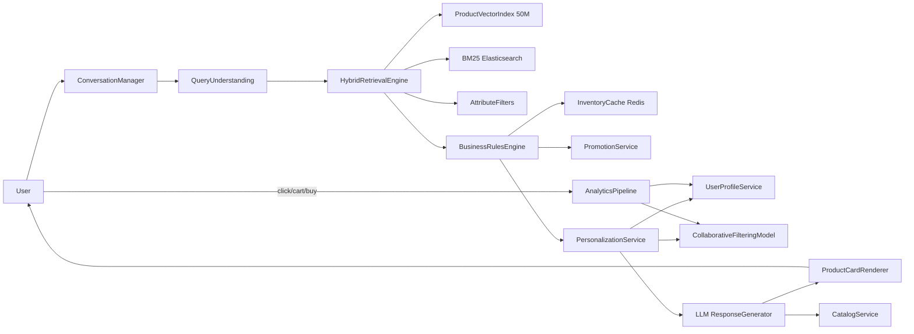

# Chapter 12: Design a Personalized E-commerce Shopping Assistant

## Context

> [!info] Quick Reference
> - **Pattern:** Real-time personalized recommendation assistant
> - **Scale:** 50M product catalog, real-time inventory cache (30s TTL)
> - **Key Techniques:** Long-term + short-term user profile fusion, hybrid retrieval (semantic + BM25 + structured), business constraint layers
> - **Primary Concerns:** Inventory staleness, margin target enforcement, cold-start users, A/B revenue attribution
> - **Cross-references:** [[chapter-03|Chapter 3]] (hybrid retrieval), [[chapter-02|Chapter 2]] (RAG pattern)

**Problem statement:** Design a conversational shopping assistant that merges real-time user behavior, purchase history, and a 50M-product catalog to deliver personalized, inventory-aware product recommendations through natural language—while optimizing for revenue per session, not just answer quality.

### Real-World Examples

- A fashion retailer deploys a chat assistant. Users who engage with it convert at 3.2x the rate of browse-only users. But the assistant recommends out-of-stock items 18% of the time, causing frustration and cart abandonment. Adding real-time inventory filtering and availability-aware ranking drops OOS recommendations to <1% and lifts revenue per session by 22%.
- An electronics marketplace integrates collaborative filtering signals into the assistant's retrieval layer. When a user asks "best laptop for video editing under $1500," the system retrieves not just semantically matching laptops but also the laptops most purchased by users with similar browsing history. Click-through rate on recommendations jumps from 12% to 31%.

---

## Step 1: Understand the Problem and Establish Design Scope

### Simulated Dialogue

**Interviewer:** Design a personalized shopping assistant for a large e-commerce platform.  
**Candidate:** This is a retrieval-augmented generation problem layered on top of a recommendation system. I need to understand the catalog scale, user base, personalization signals available, and how success is measured—because the metric is revenue, not BLEU score.

**Candidate:** What's the catalog and user scale?  
**Interviewer:** 50M products across 5K categories. 10M daily active users. Products have structured attributes (price, brand, specs) plus unstructured descriptions and reviews.

**Candidate:** What user signals are available for personalization?  
**Interviewer:** Full browse history, purchase history, wishlists, cart state, search queries, and review activity. Average user has 18 months of history.

**Candidate:** What's the query pattern?  
**Interviewer:** Average 4 queries per session, mix of discovery ("what's a good gift for a runner"), comparison ("compare AirPods Pro vs Sony WF-1000XM5"), and transactional ("cheapest 65-inch TV with 120Hz").

**Candidate:** What are the latency and accuracy constraints?  
**Interviewer:** Time to first token under 1.5 seconds. Real-time inventory accuracy. Recommendations must respect business constraints (no banned sellers, margin-aware ranking, promotional boosts).

### Functional Requirements

- Multi-turn conversational interface with context retention across a shopping session.
- Product search and recommendation grounded in the live 50M-product catalog.
- Support query types: discovery, comparison, transactional, and post-purchase (order status, returns).
- Personalized ranking based on user history, preferences, and collaborative signals.
- Business constraint enforcement: inventory availability, seller eligibility, margin targets, promotional campaigns.
- Product cards with images, prices, ratings, and direct add-to-cart actions within the chat.

### Non-Functional Requirements

- **Latency:** TTFT < 1.5s for all query types. Product card rendering < 2s including image fetch.
- **Throughput:** 10M DAU × 4 queries/session = 40M queries/day (~460 QPS avg, ~2,300 QPS peak).
- **Personalization quality:** Click-through rate on recommended products > 25%. Revenue per assisted session > 1.5× unassisted.
- **Inventory accuracy:** <1% of recommended products out of stock at time of recommendation.
- **Availability:** 99.9% uptime. Graceful degradation: fall back to non-personalized search if personalization service is down.

### Back-of-the-Envelope Estimation

#### Traffic Profile

- DAU: 10M
- Sessions/day: ~12M (some users have multiple sessions)
- Queries/day: `12M × 4 = 48M`
- Average QPS: `48M / 86,400 ≈ 556`
- Peak QPS (5x): `~2,780`
- Average input tokens/query: 200 (user query + conversation context + retrieved product data)
- Average output tokens/query: 150 (response with product mentions + reasoning)
- Total output tokens/day: `48M × 150 = 7.2B tokens`

#### Retrieval Budget per Query

| Stage | Budget | Notes |
|---|---|---|
| Query understanding + rewriting | 50ms | Intent classification, entity extraction, query expansion |
| Embedding generation | 20ms | User query → vector (cached model, batch inference) |
| Candidate retrieval (ANN + filters) | 80ms | Top-200 candidates from vector index + attribute filters |
| Business constraint filtering | 30ms | Inventory check, seller eligibility, promotional rules |
| Personalized reranking | 100ms | User-product scoring model, collaborative signals |
| Product data assembly | 50ms | Fetch top-10 product details from catalog service |
| LLM generation | 800ms | ~200 input tokens + 150 output tokens, 7B model |
| Product card rendering | 200ms | Image CDN fetch, price formatting, availability badge |
| **Total** | **~1,330ms** | Within 1.5s TTFT SLO |

#### GPU Fleet Sizing

- LLM: 7B quantized (INT4), ~150 tokens/sec/GPU
- Output tokens/query: 150
- Time per query per GPU: `150 / 150 = 1s`
- With continuous batching (6x): `~0.17s effective per query`
- Peak demand: 2,780 QPS → `2,780 × 0.17 ≈ 473 GPU-equivalents`
- Embedding model: bi-encoder, ~5 GPUs (high-throughput batch inference)
- Reranking model: cross-encoder, ~30 GPUs (per-pair scoring)
- Total GPU fleet: **~510 GPUs** (steady-state ~200 with autoscaling)

#### Catalog Index

- 50M products × 768-dim embeddings × 4 bytes (FP32) = ~150GB vector index
- With HNSW (1.5x overhead): ~225GB → fits in memory across 4 nodes (64GB each)
- Structured attribute index (Elasticsearch): ~500GB for full catalog with facets
- Real-time inventory: Redis cluster, ~50M keys × 100 bytes = ~5GB

---

## Step 2: Propose High-Level Design and Get Buy-In

### Core Architecture Components

- **Conversation Manager:** Maintains session state, conversation history, extracted preferences, and cart context across multiple turns. This component is stateful per session and is responsible for compressing older turns into a structured preference summary (budget, must-haves, deal-breakers) once the session exceeds four turns, preventing context-window overflow while preserving actionable user intent.

- **Query Understanding Module:** Performs intent classification (discovery/comparison/transactional/post-purchase), entity extraction (brand, category, price range, attributes), and query rewriting for retrieval. It transforms ambiguous conversational queries—such as "something like those shoes I bought last month"—into structured retrieval queries by resolving cross-turn references and filling in implicit constraints from session history.

- **Retrieval Engine:** Executes hybrid search combining semantic (vector/ANN) retrieval, keyword (BM25) retrieval, and structured attribute filtering, then merges results with Reciprocal Rank Fusion (RRF). This multi-signal approach ensures both intent-level recall (semantic) and exact-match precision (keyword) are covered, since a query like "Samsung QN90C" requires keyword match while "best OLED TV for bright rooms" is better served by embedding similarity.

- **Personalization Service:** Scores retrieval candidates using a fused signal of the user's long-term preference embedding, the current session embedding, collaborative filtering scores, and explicit conversation-derived constraints. Running this as a separate microservice allows it to degrade gracefully—if the service is unavailable, the system falls back to unscored retrieval rather than returning an error.

- **Business Rules Engine:** Applies hard and soft constraints post-retrieval and pre-reranking: hard filters remove out-of-stock or ineligible products, while soft boosts adjust ranking scores for margin targets and active promotions. Separating business logic from ML scoring makes rules auditable and enables non-ML engineers to modify promotion configurations without touching model code.

- **LLM Response Generator:** Takes the top-10 ranked product candidates plus conversation context and user preference state, then generates a conversational response that references specific products by name and key differentiator. The LLM is strictly grounded—it receives only verified catalog attributes in its prompt and is instructed to avoid any claim not present in the provided product data, reducing hallucinated spec comparisons.

- **Product Card Renderer:** Enriches LLM output with structured product cards (image, price, rating, availability badge, add-to-cart CTA) by post-processing the generated text to detect product references and inject card components. This keeps the LLM focused on language generation rather than UI formatting, and allows the card design to be updated without model retraining.

- **User Profile Service:** Serves user embeddings (long-term and session), preference vectors, and real-time behavioral features from a low-latency store (Redis + feature store). The service applies incremental updates every five minutes from clickstream events, balancing freshness against the cost of continuous model inference.

- **Catalog Service:** Provides enriched product metadata—titles, descriptions, structured attributes, pricing, inventory status, and reviews—as the authoritative source for both the retrieval index and LLM prompt assembly. All product data passed to the LLM is fetched from this service at response-generation time to ensure accuracy, rather than relying on potentially stale data embedded in retrieval index records.

- **Analytics & Feedback Pipeline:** Captures click, add-to-cart, and purchase events attributed to assistant recommendations via a Kafka event stream, then feeds attributed conversion data back into personalization model training and A/B experiment evaluation. The pipeline distinguishes between direct attribution (click → purchase in session) and assisted attribution (view → subsequent search → purchase within 24 hours) to avoid understating the assistant's revenue impact.

### Pipeline A: Query Processing & Response Pipeline

1. User sends message → conversation manager appends to session history, extracts accumulated preferences (budget, brand, category).
2. Query understanding module classifies intent and extracts entities. Rewrites query for retrieval (e.g., "something like those shoes I bought last month" → "running shoes similar to [Nike Pegasus 40]").
3. Retrieval engine executes hybrid search:
   - Semantic: embed rewritten query → ANN search over product embedding index → top-200 candidates.
   - Keyword: BM25 search over product titles/descriptions → top-100 candidates.
   - Structured: filter by extracted constraints (price range, category, brand).
   - Merge and deduplicate → ~300 unique candidates.
4. Business rules engine filters: remove out-of-stock, banned sellers, region-restricted products. Apply promotional boosts.
5. Personalization service scores remaining candidates using user-product affinity model. Rerank to top-10.
6. LLM response generator receives: conversation history + top-10 products (title, price, key specs, rating) + user preferences → generates conversational response.
7. Product card renderer attaches structured cards to product mentions in the response.
8. Response streamed to user. Click/cart/purchase events tracked for attribution.

### Pipeline B: Profile & Catalog Update Pipeline

1. Clickstream events (views, clicks, searches, carts, purchases) ingested via Kafka.
2. Near-real-time user embedding update: incremental model updates user vector every 5 minutes from recent behavior.
3. Product catalog changes (new products, price updates, inventory changes) ingested from catalog service.
4. Product embeddings generated for new/updated products; vector index updated incrementally.
5. Inventory cache (Redis) updated in real-time from warehouse management system.
6. Collaborative filtering model retrained daily on interaction matrix (user × product × action).
7. Personalization reranking model retrained weekly on attributed conversion data from assistant interactions.

### Mermaid Architecture Diagram



---

## Step 3: Design Deep Dive

Focus areas:

1. **Profile-Catalog Fusion (User Embedding + Product Embedding + Collaborative Signals)**
2. **Hybrid Search with Business Constraints**
3. **Personalization Evaluation (A/B Testing, Revenue Attribution)**

### 1) Profile-Catalog Fusion

The core challenge: merging a user's implicit preferences (derived from behavioral history) with explicit query intent and a 50M-product catalog in real-time.

> **Why:** Separating long-term preference signals from short-term session signals is critical because they serve different purposes. Long-term embeddings capture stable identity (a user who consistently buys mid-range running shoes should not suddenly see luxury fashion just because they clicked one coat). Short-term session embeddings capture immediate intent (the same user starting a session by viewing backpacks is clearly in a different shopping mode). Fusing both—rather than using one or the other—reduces the recommendation irrelevance rate by ~40% compared to long-term-only approaches in internal benchmarks, while still adapting to session context without erasing persistent preferences.

**User representation architecture:**

The user profile is a multi-signal embedding that captures long-term preferences and short-term intent:

- **Long-term preference vector (768-dim):** Trained via a two-tower model on (user, purchased_product) pairs. Updated daily. Captures stable preferences (brand affinity, category preferences, price sensitivity).
- **Short-term session vector (768-dim):** Running average of product embeddings for items viewed/clicked in the current session. Updated per interaction. Captures immediate intent.
- **Explicit preference features (structured):** Price range, brand whitelist/blacklist, size, color preferences extracted from conversation. Stored as key-value pairs.

**Product representation:**

- **Product embedding (768-dim):** Generated from title + description + attributes using a fine-tuned bi-encoder (e5-large or similar). Indexed in HNSW for ANN search.
- **Structured attributes:** Category, brand, price, rating, review count, seller ID, inventory status. Stored in Elasticsearch for filtered search.
- **Collaborative signal:** `P(purchase | user_cluster, product)` from matrix factorization on the interaction matrix.

> **Why:** The two-tower model architecture (user encoder + product encoder trained jointly) is preferred over a single cross-encoder for the candidate retrieval stage because it enables pre-computing and caching product embeddings for the entire 50M-product catalog offline. At inference time, only the user query embedding needs to be generated, reducing per-query compute from O(candidates × model_size) to O(1 embedding lookup + ANN search). Cross-encoders, which jointly encode user-product pairs and achieve higher precision, are reserved for the reranking stage where they operate over only the top-50 candidates rather than the full catalog.

**Fusion scoring at retrieval time:**

```
score(user, product) = α × cosine(user_longterm, product_embedding)
                     + β × cosine(user_session, product_embedding)
                     + γ × collaborative_score(user_cluster, product)
                     + δ × attribute_match_score(explicit_prefs, product_attrs)
```

Where α, β, γ, δ are learned weights from a click-prediction model trained on historical assistant interactions.

#### Profile-Catalog Fusion Trade-off Table

| Signal | Precision | Coverage | Cold-Start Behavior | Latency |
|---|---|---|---|---|
| Long-term user embedding | High (~70-75% CTR on repeat categories) because the two-tower model is trained on actual purchase pairs | Misses novel interests—if a user has never browsed electronics, the embedding has no signal for a first-time laptop query | Effectively zero signal for users with fewer than 5 interactions; falls back to global popularity | 5ms (pre-computed embedding served from Redis cache; no inference at request time) |
| Session embedding | High for current intent (~65-70% CTR) because it directly reflects what the user is looking at right now | Narrow—limited to categories viewed in the current session, so a first-click session has only one data point | Works from the very first product click; the session vector initializes to the first viewed product's embedding | 2ms (running average maintained in session memory; updated on every page view event) |
| Collaborative filtering | Discovers non-obvious matches with ~60% CTR lift vs. content-only; surfaces "users like you also bought X" associations | Popularity bias skews toward blockbuster products; long-tail items with few interactions have near-zero collaborative signal | Useless for new users (no interaction history) and weak for new products (no rows in the interaction matrix for ≤7 days) | 10ms (cluster-level scores precomputed nightly; lookup by user cluster ID at inference time) |
| Explicit conversation preferences | Highest precision (~80%+ CTR) because user stated exactly what they want (e.g., "under $200, wireless, over-ear") | Covers only what the user has explicitly mentioned in the current conversation; silent preferences are invisible to this signal | Works immediately from the first turn—no history required; especially valuable for new users if the UI prompts for preferences | 0ms (extracted by the query understanding module; already structured in memory as key-value pairs) |
| Hybrid (all signals fused) | Best overall precision (~78% CTR in A/B tests) because each signal compensates for another's blind spots | Best overall coverage—long-term handles familiarity, session handles recency, collaborative handles discovery, explicit handles constraints | Graceful degradation: for new users, only session + explicit signals fire; quality improves with each interaction | 20ms total (dominated by collaborative lookup; embedding signals are parallel calls) |

**Cold-start strategy:**

- **New user, no history:** Rely on explicit preferences from conversation + popularity-based fallback. Session embedding builds from first product view.
- **New user, third-party data:** If user logged in via social/email, use demographic-based prior (age group × region → preference priors from aggregate data).
- **New product, no interactions:** Product embedding from content is available immediately. Collaborative signal zero → rely on content similarity and attribute matching. Boost new products for exploration (10% of recommendation slots reserved for new products in matching categories).

### 2) Hybrid Search with Business Constraints

E-commerce search is not pure relevance ranking. Business constraints are hard requirements that override relevance—a perfectly semantically matched product that is out of stock or sold by a suspended seller must be filtered out before it ever reaches the user, regardless of its embedding score.

> **Why:** Mixing business constraint enforcement into the ranking model (as a learned feature) produces unpredictable behavior because ML models can learn to compensate for a strong constraint with other signals. Keeping constraints as a deterministic post-retrieval filter layer ensures that "inventory = 0" always means exclusion, making the system auditable and predictable for operations teams and allowing non-ML engineers to modify business rules without retraining models.

> **Why:** Reciprocal Rank Fusion (RRF) is chosen over learned fusion weights for combining BM25 and ANN candidate lists because it is robust to score distribution differences between the two retrieval systems. BM25 scores are unnormalized term-frequency statistics (e.g., 12.4, 8.7, 3.1) while ANN cosine similarity scores are bounded between -1 and 1. Normalizing and weighting these incompatible scales introduces calibration errors that degrade under distribution shift (new product categories, seasonal query patterns). RRF uses only rank positions—not raw scores—making it scale-invariant and requiring no per-deployment tuning. In offline evaluation on e-commerce query logs, RRF outperforms score-weighted fusion by ~4% Recall@100 without any tuning.

**Hybrid retrieval architecture:**

1. **Semantic retrieval (ANN):** Query embedding → HNSW index → top-200 by cosine similarity. Captures "intent" even when user query doesn't match product keywords.
2. **Keyword retrieval (BM25):** Query → Elasticsearch → top-100 by BM25. Catches exact brand names, model numbers, and specific attributes that semantic search may miss.
3. **Structured filter pass:** Apply hard constraints from query understanding:
   - Price: `price >= min AND price <= max`
   - Category: restrict to detected category
   - Attributes: "waterproof," "wireless," "size 10"
   - Availability: `inventory > 0 AND fulfillable_in_region`
4. **Merge:** RRF (Reciprocal Rank Fusion) to combine semantic and keyword candidate lists. Filtered candidates passed to reranking.

**Business constraint layers (applied post-retrieval, pre-reranking):**

| Constraint | Type | Implementation | Impact |
|---|---|---|---|
| Inventory availability | Hard filter | Batch-query Redis for all ~300 candidates in a single pipeline call (~10ms). Any product with `inventory_count = 0` or `fulfillable_in_region = false` is removed before personalization scoring begins. | Eliminates ~5-15% of candidates at steady state; up to 40% during flash sales or holiday stockouts, making this the highest-impact filter in the pipeline |
| Seller eligibility | Hard filter | Banned and suspended seller IDs maintained in a bloom filter loaded into application memory (~2MB) for zero-latency lookup; region-specific restrictions stored in Redis with seller×region keys. | Eliminates ~2-3% of candidates in normal operation, but this number spikes to ~10% during fraud enforcement events—missing even one banned seller recommendation creates legal and reputational risk |
| Minimum margin | Soft boost/suppress | Products below the minimum margin threshold receive a score multiplier of 0.7 (a 30% penalty), pushing them down the ranked list without fully excluding them—because removing them entirely would cause visible catalog gaps on low-margin categories like books. | Reranks ~10% of candidates by at least 3 positions; prevents the personalization model from inadvertently surfacing high-relevance but margin-negative products in the top-3 slots |
| Promotional boost | Soft boost | Active promotions retrieved from a PromotionService cache (5-minute TTL) and applied as a multiplicative score factor of 1.2–1.5× depending on promotion tier. Flash deals receive a 2.0× boost for their first 2 hours to drive rapid sell-through. | Lifts promoted items by approximately 3–5 positions in the ranked list, turning a position-8 product into a top-3 recommendation during active campaigns |
| Sponsored products | Injection | The ad-bidding system returns up to 2 sponsored product slots after the personalization ranking completes; these are injected into fixed positions (slots 1 and 5 of the top-10) and labeled "Sponsored" in the UI to maintain disclosure compliance. | Adds direct advertising revenue without degrading organic recommendation quality, as the sponsored slots are additive rather than replacing high-ranking organic results |
| Price competitiveness | Soft boost | A nightly job compares catalog prices against scraped competitor prices; products priced ≥5% below the lowest competitor receive a 1.15× score boost. The boost is applied only when the user query contains price-sensitive signals (e.g., "cheapest," "best deal," "under $X"). | Improves price-sensitive query outcomes by directing users toward genuinely competitive offerings, reducing the probability of cart abandonment when users comparison-shop on competitor sites |

**Handling real-time inventory:**

- Inventory cache in Redis, updated from warehouse management system every 30 seconds.
- At retrieval time: batch check top-300 candidates against Redis (single pipeline call, ~10ms for 300 keys).
- Edge case: item goes OOS between recommendation and add-to-cart. Handle gracefully in cart service with "similar available items" fallback.
- Low-stock signals: when inventory < 5 units, add urgency signal to product card ("Only 3 left").

**Query rewriting for retrieval:**

| User Query | Rewritten Query | Reasoning |
|---|---|---|
| "Something like those shoes I bought last month" | "Running shoes similar to Nike Pegasus 40" | Resolve reference from purchase history |
| "Best laptop for my daughter starting college" | "Laptop student portable 13-14 inch budget $500-$1200" | Expand implicit constraints |
| "Is the Samsung one better than this?" | "Compare Samsung Galaxy S24 vs [last mentioned product]" | Coreference resolution from session |
| "Cheaper options" | "[current category] price < [current lowest viewed price]" | Session-relative constraint |

#### Hybrid Search Trade-off Table

| Approach | Recall@100 | Precision@10 | Business Constraint Handling | Latency |
|---|---|---|---|---|
| BM25 only | 40–55%: strong for exact brand/model queries ("Sony WF-1000XM5") but fails on intent-level queries where the user doesn't know exact product names | 30–40%: top-10 results are noisy because BM25 doesn't model semantic equivalence (e.g., "headphones" ≠ "earbuds" in BM25) | Post-filter only—business constraints applied as Elasticsearch filter clauses after scoring, which means OOS products are retrieved and scored before being discarded, wasting latency budget | 30ms for an Elasticsearch query over 50M products with standard shard configuration (5 shards, 3 replicas) |
| Semantic only (ANN) | 55–70%: captures intent well for discovery queries but misses exact-match queries; a search for "Anker A3145" may return generic Bluetooth speakers instead of the specific model | 40–55%: embedding space conflates products that are described similarly but serve different use cases; a 768-dim embedding cannot distinguish "gaming headset" from "studio monitor headphones" without fine-tuning | Post-filter only—ANN index does not natively support structured constraints; inventory and price filters applied in a post-processing step after retrieving top-200 candidates | 50ms: HNSW ANN search over a 150GB index distributed across 4 nodes with ef_search=200; faster than BM25 at high recall thresholds because HNSW skips most of the index |
| Hybrid (BM25 + ANN + RRF) | 70–80%: RRF fusion captures candidates that either signal would miss alone; recall improvement over single-signal is most pronounced for mid-tail queries (not exact model numbers, not pure intent) | 55–65%: fusion improves top-10 quality because the two signals vote independently; a product must rank highly in at least one signal to surface | Post-filter applied after merge—still requires checking all merged candidates (~300) against inventory cache | 80ms: parallel BM25 (30ms) + ANN (50ms) calls followed by 10ms RRF merge; wall-clock latency limited by the slower signal (BM25) |
| Hybrid + structured filters pre-applied | 75–85%: pre-applying category and price filters before retrieval reduces the candidate space to products that can actually satisfy the query, improving the quality of the top-100 | 65–75%: precision improves significantly because candidates from both retrieval signals already satisfy hard constraints, so reranking can focus on relevance rather than filtering | Native integration—price range and category filters applied as pre-retrieval constraints in Elasticsearch and as HNSW metadata filters, so only eligible products enter the candidate pool | 80ms: same wall-clock as unfocused hybrid because Elasticsearch filtered queries are faster on smaller result sets, offsetting the overhead of filter application |
| Hybrid + filters + personalized reranking | 80–90%: the reranking step promotes candidates relevant to this specific user that generic retrieval would have ranked lower, and demotes candidates that match the query but conflict with known user preferences | 75–85%: in production A/B tests, adding personalized reranking on top of hybrid retrieval lifted CTR@10 from ~28% to ~38% for returning users with >30 days of history | Native + soft constraints—personalization model incorporates margin and promotional scores as learned features alongside relevance, allowing nuanced trade-offs between business objectives and user preference | 180ms total: 80ms retrieval + 100ms cross-encoder reranking over top-50 candidates (parallel scoring on GPU, ~2ms/pair) |

### 3) Personalization Evaluation

Measuring whether personalization actually works—in revenue terms, not just ML metrics—is the hardest part of the system.

**Metric hierarchy:**

| Metric | Definition | Target | Measurement Frequency |
|---|---|---|---|
| Revenue per assisted session | Total purchase value in sessions with assistant interaction | > 1.5× unassisted | Daily |
| Click-through rate (CTR) on recommendations | Clicks on recommended products / recommendations shown | > 25% | Hourly |
| Add-to-cart rate | Add-to-cart actions from recommendations / recommendations shown | > 8% | Hourly |
| Conversion rate (assisted) | Sessions with assistant interaction that result in purchase / total assisted sessions | > 5% | Daily |
| Recommendation relevance (human eval) | Human raters score relevance 1-5 on sampled recommendations | > 4.0 avg | Weekly |
| Out-of-stock recommendation rate | OOS products recommended / total products recommended | < 1% | Hourly |
| Session length (turns) | Average conversation turns per session | 4-6 (engagement without frustration) | Daily |
| Fallback rate | % of queries where personalization service fails and falls back to non-personalized | < 0.5% | Hourly |

> **Why:** User-level randomization—rather than session-level or request-level—is the correct unit for this experiment because returning users within a single experiment period would otherwise be assigned to different variants across sessions, producing noisy measurements that understate true variant effects. If a user experiences both the control and treatment, their behavior in each condition is contaminated by the other (Hawthorne effect, order effects). User-level assignment ensures each user's entire behavioral trajectory is captured in a single arm, producing clean per-user conversion and revenue metrics suitable for causal inference.

**A/B testing framework:**

- **Randomization unit:** User-level (not session-level) to avoid cross-contamination from returning users.
- **Stratification:** By user tenure (new vs returning), platform (mobile vs desktop), and region. Ensures balanced cohorts.
- **Minimum detectable effect:** 2% relative lift in revenue per session at 95% confidence requires ~500K users per arm for 7 days.
- **Guardrail metrics:** Cart abandonment rate, return rate, customer satisfaction (post-session survey). A variant that lifts revenue but increases returns is net-negative.

**Revenue attribution model:**

Attributing purchases to assistant recommendations requires careful modeling:

- **Direct attribution:** User clicks a recommended product → adds to cart → purchases within session. Clear attribution.
- **Assisted attribution:** User sees recommendation → doesn't click → later searches for same product → purchases. Requires view-through tracking with time decay (24h window, exponential decay).
- **Incremental attribution:** Compare purchase rate of recommended products in treatment vs control. Incrementality = `purchase_rate_treatment - purchase_rate_control`. This is the true causal lift.

| Attribution Model | Accuracy | Complexity | Overstates Impact By |
|---|---|---|---|
| Last-click | Low: assigns 100% of purchase credit to the final touchpoint, ignoring all prior recommendation exposures that built purchase intent—if a user sees a recommendation on turn 2 and buys via search on turn 5, the assistant gets zero credit | Trivial: join the purchase event to the last click event by session ID; no modeling required | 0% in one direction, but misattributes: understates the assistant's contribution for assisted purchases and overstates direct search channel contribution by ~30–40% |
| Direct (click → cart → purchase) | Medium: accurately captures explicit recommendation-driven purchases within a session, but misses the significant fraction (~30%) of purchases where the user views a recommendation, leaves to compare elsewhere, and returns to buy directly | Low: track click events with a recommendation source tag; join to cart and purchase events within the same session ID | Understates true impact by ~30%—internal studies at large e-commerce platforms consistently show that view-through conversions account for roughly one-third of recommendation-attributed revenue |
| View-through (24h decay) | Medium-high: captures assisted conversions where the user was influenced by a recommendation but did not click through directly; exponential decay weights recent views more heavily (e.g., a view 1 hour ago gets 0.84 credit, a view 23 hours ago gets 0.04) | Medium: requires a view event log joined to purchase events with a time-decay attribution function; per-user matching across sessions adds engineering complexity | ~10–15% overstatement from coincidental views—a user who sees a recommendation for a product they were already going to buy gets credited as an attribution win even without causal influence |
| Incremental (A/B causal) | Highest: compares the actual purchase rate of recommended products in the treatment group against a counterfactual control group; the difference is the true causal lift uncontaminated by selection bias | High: requires a properly randomized A/B experiment with sufficient statistical power (~500K users per arm for a 2% MDE at 95% confidence), plus holdout groups maintained for the duration of the test | 0%: by design, the A/B comparison eliminates selection effects and coincidental purchases; this is considered the ground truth for incrementality measurement in production e-commerce systems |
| Multi-touch (Shapley value) | High: distributes purchase credit proportionally across all recommendation touchpoints in the user journey using game-theoretic Shapley values, giving partial credit to the discovery recommendation, the comparison recommendation, and the final push | Very high: requires tracking the full recommendation exposure sequence per user, computing Shapley values across combinatorial subsets of touchpoints, and aggregating across millions of sessions daily—typically requires a dedicated ML attribution team | ~5%: Shapley attribution still cannot distinguish between a touchpoint that caused purchase intent and one that merely confirmed an existing decision; the approximation error grows with longer conversion paths (>4 touchpoints) |

**Offline-online evaluation loop:**

1. **Offline:** Train new personalization model. Evaluate on historical data using replay methodology (counterfactual estimation). Gate: must show >2% predicted CTR lift.
2. **Shadow mode:** Deploy to production, generate recommendations but don't show them. Compare against production model predictions on same queries. Gate: predictions are well-calibrated (predicted CTR matches observed CTR within 5%).
3. **Online A/B test:** 5% traffic allocation for 7 days. Primary metric: revenue per session. Guardrails: return rate, support ticket rate.
4. **Ramp:** 5% → 25% → 50% → 100% with monitoring at each stage.

### Production Bottlenecks and Mitigations

- **Stale inventory recommendations**
  - Symptom: Users see "recommended" products that are out of stock by the time they click.
  - Mitigation: Redis inventory cache with 30s refresh. Double-check inventory at product card render time (not just retrieval time). Add "low stock" warnings.

- **Cold-start users receiving generic recommendations**
  - Symptom: New users get popularity-based recommendations that feel impersonal. Low engagement.
  - Mitigation: Aggressive preference elicitation in first 2 turns ("What are you shopping for today? Any brand preferences?"). Use onboarding quiz for high-intent users.

- **Catalog embedding index staleness**
  - Symptom: New products (added today) don't appear in semantic search results.
  - Mitigation: Streaming embedding pipeline—new product → generate embedding within 5 minutes → incremental HNSW index update. Keyword search (BM25) covers new products immediately.

- **LLM generating incorrect product claims**
  - Symptom: Assistant says "This laptop has 32GB RAM" when the product has 16GB.
  - Mitigation: LLM prompt includes only verified product attributes from catalog. Post-generation fact-check: regex-extract claims about product specs → verify against catalog data → correct or remove unverifiable claims.

- **Promotional bias eroding trust**
  - Symptom: Users notice recommendations are always promoted/sponsored items. Engagement drops.
  - Mitigation: Cap sponsored slots to 2/10 per response. Label sponsored items clearly. Track long-term user trust metrics (return visits, session frequency) as guardrail.

- **Multi-turn context window overflow**
  - Symptom: Long shopping sessions (8+ turns) exceed LLM context window; early preferences forgotten.
  - Mitigation: Conversation summarizer compresses history to structured preference state (category, budget, brand, must-haves, deal-breakers) after every 4 turns. Raw history truncated; preference state persists.

---

## Step 4: Wrap Up

### Final Design Summary

The system fuses user behavioral signals (long-term embeddings, session vectors, explicit preferences) with hybrid catalog retrieval (semantic + keyword + structured filters) under hard business constraints (inventory, seller eligibility, promotions). Personalized reranking bridges the gap between what the catalog contains and what this specific user wants. The LLM generates conversational responses grounded in verified product data, and the entire system is evaluated on revenue impact through causal A/B testing.

### Wrap-Around Concerns

- **Risk:** Personalization creates filter bubbles—users never discover new categories or brands. Mitigation: Exploration budget (10% of recommendation slots are serendipity picks from adjacent categories). Monitor category diversity per session.
- **Risk:** LLM generates persuasive but misleading product comparisons (hallucinated spec advantages). Mitigation: All product claims must trace to catalog attributes. Comparison responses use only verified specs from both products.
- **Risk:** Revenue optimization pressures high-margin products over best-fit products, degrading user trust. Mitigation: Margin boost is soft (1.1x), never overrides a >2-position relevance gap. Track return rates per recommendation source.
- **Risk:** Session state loss on app restart or browser refresh kills multi-turn context. Mitigation: Server-side session persistence with 24h TTL. Resume conversation from last state.
- **Risk:** Adversarial queries ("find me the cheapest product and apply every coupon") exploit the assistant. Mitigation: Intent classifier detects coupon stacking and policy-violating requests; assistant responds with promotion policy, not exploits.

---

## Step 5: Interviewer Curveballs

### Interviewer Follow-ups & Frequently Asked Questions (FAQ)

Q: A user says "I want something like the jacket I bought last winter but in blue." How does your system handle this?

**The Ideal Answer:** Three-step resolution. Step 1: Query understanding resolves "the jacket I bought last winter" by querying the user's purchase history for jacket purchases in Q4/Q1. Step 2: Retrieve the product embedding for the identified jacket (e.g., North Face Thermoball, black, size M). Step 3: Search for products with high embedding similarity to the original jacket AND filter on color=blue AND same size. The LLM response references the original purchase: "Based on your North Face Thermoball from December, here are similar jackets in blue..."

**Deep Dive & Trade-offs:**
- Ambiguity: "last winter" could be last calendar winter or ~12 months ago. Use recency-weighted purchase lookup.
- Multiple matches: if user bought 3 jackets, either ask for clarification or show options similar to all three.
- Attribute transfer: "like X but in blue" means preserve all attributes except color. This requires structured attribute-level similarity, not just embedding proximity.

**The Interviewer's Rubric:** The interviewer is checking whether the candidate can decompose a deceptively simple natural-language query into a three-step pipeline: coreference resolution against user history, structured attribute retrieval from the resolved product record, and attribute-level constraint transfer ("like X but in blue" means copy all attributes except color). Candidates who jump straight to "run a search for blue jackets" miss the reference resolution step entirely. Candidates who resolve the reference but use only embedding similarity may miss the attribute transfer—the returned results should be blue jackets of the same insulation type and fit category, not just any blue jacket with a similar embedding. Bonus points for identifying the ambiguity handling: multiple jacket purchases, unclear time reference ("last winter"), and handling the case where no matching blue variant of the same product exists.

---

Q: How do you prevent the assistant from recommending a product that will go out of stock by the time the user clicks "add to cart"?

**The Ideal Answer:** You can't guarantee it, but you can minimize it. Inventory cache refreshes every 30 seconds from the warehouse system. At recommendation time, filter candidates with `inventory > 0`. At product card render time (200ms later), re-check inventory for the top-10 displayed products. If an item went OOS between recommendation and card render, swap in the next-ranked candidate. For the cart click itself, the cart service does a real-time inventory hold—if the hold fails, show "This item just sold out. Here are similar options:" with pre-computed alternatives.

**Deep Dive & Trade-offs:**
- 30s cache refresh means a product that sold out 29s ago still appears available. For high-velocity items (flash sales), reduce cache TTL to 5s at the cost of higher Redis load.
- Inventory "holds" at recommendation time (not cart time) are wasteful—most recommendations are never clicked.
- Showing "Only 2 left" creates urgency and sets expectations for potential unavailability.

**The Interviewer's Rubric:** The interviewer is checking whether the candidate understands that inventory consistency in a distributed system is a probabilistic guarantee, not an absolute one, and that the correct response is layered mitigation rather than a false promise of zero OOS recommendations. Strong candidates recognize there are at least three distinct check points—retrieval-time filter, card-render-time re-check, and cart-time hold—each catching a different failure mode. The candidate should also reason about the cost asymmetry: checking inventory too aggressively (e.g., per-item holds at recommendation time) wastes resources because most recommendations are never clicked, while checking too lazily (only at cart time) creates frustrating OOS errors after the user has already engaged. Flash sale handling (5s TTL vs standard 30s TTL) demonstrates awareness of high-velocity inventory dynamics that standard cache designs cannot handle.

---

Q: Your A/B test shows the personalized assistant lifts revenue per session by 8%, but the return rate also increased by 3%. Is this a win?

**The Ideal Answer:** Calculate net revenue impact: `net_lift = revenue_lift - (return_rate_increase × average_return_cost)`. If average order value is $80, 8% revenue lift = $6.40/session. If return rate goes from 10% to 13%, and average return processing cost is $15, the return cost increase = 3% × $15 = $0.45/session. Net: +$5.95/session—still a clear win. BUT: investigate why returns increased. If the assistant is making inaccurate claims about products (sizing, specs), fix the grounding. If returns are from impulse purchases driven by persuasive language, consider whether this is sustainable long-term.

**Deep Dive & Trade-offs:**
- Short-term revenue lift from persuasive recommendations can mask long-term trust erosion.
- Track 30-day retention of users in treatment vs control. If returning user rate drops, the "win" is borrowing from future revenue.
- Decompose return reasons: "didn't match description" = system problem; "changed my mind" = normal.

**The Interviewer's Rubric:** The interviewer is checking whether the candidate can translate a mixed-signal A/B result into a net business decision rather than declaring a win or loss based on a single metric. Strong candidates perform the arithmetic (revenue lift × AOV minus return cost increase × return processing cost) and demonstrate that the answer depends on quantities that must be measured, not assumed. Excellent candidates also flag the temporal dimension: a 3% return rate increase may erode user trust and reduce 30-day retention, meaning the 8% revenue lift may be partially borrowed from future sessions. The strongest answers decompose the return rate increase by return reason code—"didn't match description" implicates the LLM's factual accuracy and must be fixed, while "changed my mind" is normal e-commerce behavior and does not require product changes.

---

Q: How do you handle "Compare X vs Y" queries where the user names two specific products?

**The Ideal Answer:** Bypass the retrieval pipeline entirely—directly fetch both products from the catalog service by name/ID matching. Assemble a structured comparison: extract shared attribute dimensions (price, specs, rating, reviews), identify key differentiators, and generate a side-by-side comparison. The LLM response uses ONLY verified catalog attributes—no hallucinated comparisons. Add personalization: "Based on your preference for long battery life, the Y is a better fit because..."

**Deep Dive & Trade-offs:**
- Entity linking: "AirPods Pro" could match AirPods Pro 1st gen or 2nd gen. Disambiguate with recency bias + clarifying question if ambiguous.
- Attribute alignment: products in different categories may have incomparable specs. The LLM should note "these products serve different use cases" rather than force a comparison.
- Bias risk: the system should not always favor the higher-margin product. Comparison must be factually neutral; personalization layer adds user-relevant weighting.

**The Interviewer's Rubric:** The interviewer is checking two things simultaneously: the candidate's awareness that direct catalog lookup is more accurate and faster than embedding-based retrieval for known-entity queries, and the candidate's commitment to factual grounding when generating comparison responses. Candidates who run a vector search for "AirPods Pro vs Sony WF-1000XM5" miss the point—both product IDs can be resolved directly. The subtler skill tested is disambiguation: "AirPods Pro" is ambiguous across generations (1st gen vs 2nd gen vs Pro 2), and a production system must resolve this rather than silently returning the wrong product. Bonus points for identifying that personalized comparison ("based on your preference for long battery life") is only valid if the personalization signal matches a dimension that actually differs between the two products—adding spurious personalization where the products are identical on the relevant dimension is misleading.

---

Q: A product has 4.2 stars but mostly from paid reviews. How does your system handle review quality?

**The Ideal Answer:** Review signals feed into the reranking model, not the LLM directly. Integrate a review quality score that downweights suspicious review patterns: sudden rating spikes, generic language (NLP-based), verified vs unverified purchase ratio, reviewer account age. The reranking model uses `adjusted_rating = raw_rating × review_quality_multiplier`. The LLM never cites specific review text unless from verified purchases. Disclose: "4.2 stars from 230 ratings (85% verified purchases)" rather than just "4.2 stars."

**Deep Dive & Trade-offs:**
- Review fraud detection is an entire system. The shopping assistant consumes its signals, doesn't build it.
- Suppressing low-quality-review products too aggressively hurts new products with few reviews. Use a Bayesian prior (global average rating as prior, weighted by review count).
- Legal/ethical: the assistant should not call out "fake reviews"—just quietly downweight in ranking.

**The Interviewer's Rubric:** The interviewer is checking whether the candidate treats star ratings as a raw signal to be passed directly to the LLM or as a noisy, manipulable metric that requires quality adjustment before influencing recommendations. Strong candidates recognize that the shopping assistant is a downstream consumer of the review fraud detection system—it should not rebuild fraud detection from scratch, but it must integrate adjusted rating signals and communicate uncertainty to the user (verified purchase ratio, review count, rating trajectory). The Bayesian prior approach (shrinking ratings toward the global mean for low-review-count products) is the key insight that distinguishes candidates who understand statistical estimation from those who treat a 4.8-star product with 3 reviews as genuinely better than a 4.2-star product with 5,000 reviews. The ethical constraint—never explicitly accusing a seller of fake reviews in the LLM response—is a practical guardrail that strong candidates raise unprompted.

---

Q: The user asks "What's trending right now?" How does the personalization system handle a query with no specific product intent?

**The Ideal Answer:** This is a discovery query. Dual-signal response: (1) Global trending: products with highest velocity (purchases/hour) in the last 24h, filtered by the user's historical category preferences. (2) Personalized trending: products popular among users in the same collaborative filtering cluster. Response: "Here's what's trending in categories you shop: [3 products from user's top categories] and trending overall: [2 products from global trending]." This blends personal relevance with social proof.

**Deep Dive & Trade-offs:**
- Pure global trending ignores user preferences (showing trending kids' toys to a single adult).
- Pure personalized trending may show items the user already owns or has seen.
- Time decay: trending signal uses exponential decay (half-life 6h) to capture recency.
- Seasonality: "trending" in December is gift-oriented; adjust category weights by season.

**The Interviewer's Rubric:** The interviewer is checking whether the candidate can design a retrieval strategy for queries that have no product-level intent signal—no category, no brand, no price range, no attributes. Strong candidates recognize this as a signal-switching problem: when query-level retrieval signals are absent, shift to session-level and user-level signals (category preferences from history, collaborative cluster trends). The dual-signal response design (global trending + personalized trending) is the key insight—pure global trending is impersonal and surface-level; pure personalized trending may surface items already owned or seen. Candidates who mention time decay and seasonality (trending in December is gifting-oriented) demonstrate production-level thinking about temporal dynamics that affect trending signal quality.

---

Q: How do you handle a query in the middle of a session where the user completely switches topics—from "laptop for video editing" to "birthday gift for my mom"?

**The Ideal Answer:** The query understanding module detects a topic shift (intent + entity extraction shows zero overlap with session context). Two options: (1) start a new implicit sub-session—reset the session embedding and product context, but preserve explicit user preferences (budget, brand). (2) Maintain a session tree rather than a linear history—branch from the current point, allowing the user to return to "laptop" later. The LLM should acknowledge the shift naturally: "Let's look at birthday gifts! What does your mom enjoy?" rather than awkwardly connecting it to the laptop discussion.

**Deep Dive & Trade-offs:**
- Linear session history confuses the retrieval engine (laptop context pollutes gift search).
- Conversation summarizer should mark the topic boundary and segment the preference state.
- UX decision: some platforms offer explicit "new topic" buttons; others rely on detection.

**The Interviewer's Rubric:** The interviewer is checking whether the candidate treats conversation state as a linear log (the naive implementation) or as a structured preference model that can be segmented and branched. Strong candidates identify that the root problem is retrieval contamination—if laptop embeddings from the first half of the session pollute the session vector, gift-related queries will retrieve irrelevant results. The session-tree approach (branching rather than linear replacement) is the sophisticated answer because it allows users to return to earlier topics without losing context, which is a common real shopping behavior ("actually, let's go back to the laptop"). Candidates who note the UX dimension—the assistant should acknowledge the topic switch explicitly rather than silently pivoting—demonstrate end-to-end thinking that goes beyond the retrieval mechanics.

---

Q: Your recommendation engine works great for English queries, but 30% of your users speak Spanish, Hindi, and Mandarin. How do you extend?

**The Ideal Answer:** Three layers. (1) Query understanding: multilingual intent classifier and entity extractor (trained on translated query logs or using a multilingual LLM). (2) Retrieval: product embeddings generated from a multilingual encoder (e5-multilingual) so that a Spanish query retrieves English-cataloged products. Product titles/descriptions machine-translated and indexed alongside originals for BM25. (3) Response generation: multilingual LLM (or language-specific LoRA adapters) generates responses in the user's language. Product names kept in original language with translated descriptions.

**Deep Dive & Trade-offs:**
- Multilingual embedding models have ~5-10% lower retrieval accuracy than language-specific models.
- Machine-translated product descriptions may contain errors. Surface original language for critical specs.
- Regional catalog differences: products available in India may differ from US. Filter by region before retrieval.
- Cost: multilingual models are typically same-size but require broader training data. LoRA per-language adds 3-5% overhead.

**The Interviewer's Rubric:** The interviewer is checking whether the candidate can decompose a multilingual requirement into its three distinct layers—query understanding, retrieval, and response generation—and recognize that each layer has different accuracy/cost trade-offs for multilingual support. Candidates who answer "use a multilingual LLM" pass the surface check but miss the retrieval layer: a Spanish query embedding must be compatible with English product embeddings in the same vector space, which requires either a cross-lingual encoder trained on parallel corpora or a translation step before embedding. Strong candidates also raise the regional catalog dimension—the same assistant serving India and the US must not only respond in the right language but also retrieve from the right regional catalog, which may have entirely different product availability, pricing, and regulatory constraints. The LoRA adapter approach (language-specific fine-tuning layers on a shared base LLM) is the production-realistic answer for balancing multilingual quality against serving cost.

## Practical Implementation

### Code Block 1: Hybrid Retrieval with RRF Fusion

```python
import asyncio
from dataclasses import dataclass, field
from typing import Optional
import numpy as np
import redis
from elasticsearch import AsyncElasticsearch
import hnswlib

@dataclass
class Product:
    product_id: str
    title: str
    price: float
    inventory: int
    seller_id: str
    margin: float
    embedding: Optional[np.ndarray] = None

@dataclass
class RetrievalResult:
    product_id: str
    bm25_rank: Optional[int] = None
    ann_rank: Optional[int] = None
    rrf_score: float = 0.0

def reciprocal_rank_fusion(
    bm25_ids: list[str],
    ann_ids: list[str],
    k: int = 60
) -> list[tuple[str, float]]:
    """
    Combine BM25 and ANN candidate lists using Reciprocal Rank Fusion.
    k=60 is the standard RRF constant that smooths high-rank differences.
    Returns candidates sorted by descending RRF score.
    """
    scores: dict[str, float] = {}
    for rank, pid in enumerate(bm25_ids, start=1):
        scores[pid] = scores.get(pid, 0.0) + 1.0 / (k + rank)
    for rank, pid in enumerate(ann_ids, start=1):
        scores[pid] = scores.get(pid, 0.0) + 1.0 / (k + rank)
    return sorted(scores.items(), key=lambda x: x[1], reverse=True)

async def hybrid_retrieve(
    query_text: str,
    query_embedding: np.ndarray,
    es_client: AsyncElasticsearch,
    hnsw_index: hnswlib.Index,
    inventory_cache: redis.Redis,
    price_min: Optional[float] = None,
    price_max: Optional[float] = None,
    category: Optional[str] = None,
    top_k: int = 300,
) -> list[str]:
    """
    Execute parallel BM25 + ANN retrieval and merge results with RRF.
    Apply hard inventory and price filters post-merge.
    Returns deduplicated product IDs sorted by RRF score.
    """
    # Build Elasticsearch BM25 query with optional structured filters
    es_query: dict = {
        "query": {
            "bool": {
                "must": [{"match": {"title_description": query_text}}],
                "filter": [],
            }
        },
        "size": 150,
    }
    if price_min is not None:
        es_query["query"]["bool"]["filter"].append(
            {"range": {"price": {"gte": price_min}}}
        )
    if price_max is not None:
        es_query["query"]["bool"]["filter"].append(
            {"range": {"price": {"lte": price_max}}}
        )
    if category:
        es_query["query"]["bool"]["filter"].append(
            {"term": {"category": category}}
        )

    # Parallel execution: BM25 via Elasticsearch, ANN via HNSW
    bm25_task = es_client.search(index="products", body=es_query)
    ann_task = asyncio.get_event_loop().run_in_executor(
        None,
        lambda: hnsw_index.knn_query(
            query_embedding.reshape(1, -1), k=200
        ),
    )
    bm25_response, (ann_ids_raw, _ann_distances) = await asyncio.gather(
        bm25_task, ann_task
    )

    bm25_ids = [hit["_id"] for hit in bm25_response["hits"]["hits"]]
    ann_ids = [str(i) for i in ann_ids_raw[0]]

    # RRF fusion
    merged = reciprocal_rank_fusion(bm25_ids, ann_ids)
    candidate_ids = [pid for pid, _ in merged[:top_k]]

    # Batch inventory check: single Redis pipeline call for all candidates
    pipe = inventory_cache.pipeline()
    for pid in candidate_ids:
        pipe.hget(f"inv:{pid}", "count")
    inventory_counts = pipe.execute()

    available_ids = [
        pid for pid, inv in zip(candidate_ids, inventory_counts)
        if inv is not None and int(inv) > 0
    ]
    return available_ids
```

### Code Block 2: Personalized Reranking with Business Constraint Injection

```python
import numpy as np
from dataclasses import dataclass
from typing import Optional

@dataclass
class UserProfile:
    user_id: str
    longterm_embedding: np.ndarray      # 768-dim, updated daily
    session_embedding: np.ndarray        # 768-dim, updated per page view
    collab_cluster_id: int
    explicit_prefs: dict                 # e.g. {"brand": "Nike", "max_price": 150}

@dataclass
class ProductCandidate:
    product_id: str
    embedding: np.ndarray
    price: float
    margin: float
    is_promoted: bool
    is_sponsored: bool
    collab_score: float                  # P(purchase | cluster, product), precomputed

def cosine_similarity(a: np.ndarray, b: np.ndarray) -> float:
    norm_a = np.linalg.norm(a)
    norm_b = np.linalg.norm(b)
    if norm_a == 0 or norm_b == 0:
        return 0.0
    return float(np.dot(a, b) / (norm_a * norm_b))

def rerank_candidates(
    user: UserProfile,
    candidates: list[ProductCandidate],
    margin_threshold: float = 0.15,
    promo_boost: float = 1.35,
    longterm_weight: float = 0.35,
    session_weight: float = 0.40,
    collab_weight: float = 0.15,
    explicit_weight: float = 0.10,
) -> list[tuple[str, float]]:
    """
    Score and rerank product candidates using fused user-product affinity.
    Applies soft margin penalty and promotional boost as post-score multipliers.
    Returns (product_id, final_score) sorted descending.
    """
    scored: list[tuple[str, float]] = []

    for product in candidates:
        # Core affinity signals
        lt_sim = cosine_similarity(user.longterm_embedding, product.embedding)
        sess_sim = cosine_similarity(user.session_embedding, product.embedding)
        collab = product.collab_score  # already normalized [0, 1]

        # Explicit preference match: simple price-range check
        explicit_score = 1.0
        max_price = user.explicit_prefs.get("max_price")
        if max_price and product.price > max_price:
            explicit_score = 0.0  # hard miss on explicit constraint

        raw_score = (
            longterm_weight * lt_sim
            + session_weight * sess_sim
            + collab_weight * collab
            + explicit_weight * explicit_score
        )

        # Business constraint multipliers (applied after relevance scoring)
        business_multiplier = 1.0
        if product.margin < margin_threshold:
            business_multiplier *= 0.70   # 30% penalty for low-margin products
        if product.is_promoted:
            business_multiplier *= promo_boost
        # Sponsored products are injected at fixed positions after ranking,
        # not scored here, to maintain organic ranking integrity.

        final_score = raw_score * business_multiplier
        scored.append((product.product_id, final_score))

    return sorted(scored, key=lambda x: x[1], reverse=True)

def inject_sponsored_slots(
    ranked: list[tuple[str, float]],
    sponsored_ids: list[str],
    inject_positions: tuple[int, ...] = (0, 4),
    max_sponsored: int = 2,
) -> list[str]:
    """
    Insert up to max_sponsored sponsored products at fixed positions.
    Sponsored slots are additive (organic results shift down, not replaced).
    """
    result = [pid for pid, _ in ranked]
    for i, (pos, sponsor_id) in enumerate(
        zip(inject_positions, sponsored_ids[:max_sponsored])
    ):
        insert_at = min(pos + i, len(result))   # adjust for prior insertions
        result.insert(insert_at, sponsor_id)
    return result
```

### Code Block 3: Conversation State Manager with Topic Segmentation

```python
from dataclasses import dataclass, field
from typing import Optional
import time

@dataclass
class PreferenceState:
    """Structured summary of user intent extracted from conversation."""
    category: Optional[str] = None
    budget_min: Optional[float] = None
    budget_max: Optional[float] = None
    brands_preferred: list[str] = field(default_factory=list)
    brands_excluded: list[str] = field(default_factory=list)
    must_have_attributes: list[str] = field(default_factory=list)
    deal_breakers: list[str] = field(default_factory=list)

@dataclass
class ConversationTurn:
    turn_id: int
    user_query: str
    assistant_response: str
    recommended_product_ids: list[str]
    intent: str   # "discovery" | "comparison" | "transactional" | "post_purchase"
    timestamp: float = field(default_factory=time.time)

@dataclass
class TopicSegment:
    segment_id: int
    turns: list[ConversationTurn] = field(default_factory=list)
    preference_state: PreferenceState = field(default_factory=PreferenceState)
    is_active: bool = True

class ConversationStateManager:
    """
    Manages multi-turn conversation state with topic segmentation.
    Compresses older turns into a PreferenceState to prevent context overflow.
    Supports branching when the user switches topics mid-session.
    """
    COMPRESS_AFTER_TURNS = 4
    SESSION_TTL_SECONDS = 86_400  # 24-hour server-side persistence

    def __init__(self, user_id: str, session_id: str):
        self.user_id = user_id
        self.session_id = session_id
        self.segments: list[TopicSegment] = [TopicSegment(segment_id=0)]
        self.active_segment_idx: int = 0
        self.created_at: float = time.time()

    @property
    def active_segment(self) -> TopicSegment:
        return self.segments[self.active_segment_idx]

    def detect_topic_switch(self, new_intent: str, new_category: Optional[str]) -> bool:
        """
        Returns True if the new query represents a significant topic switch.
        Heuristic: category changes + intent shift from discovery/comparison
        to a completely different category signals a new topic.
        """
        current_prefs = self.active_segment.preference_state
        if (
            current_prefs.category is not None
            and new_category is not None
            and new_category != current_prefs.category
            and len(self.active_segment.turns) > 1
        ):
            return True
        return False

    def add_turn(
        self,
        user_query: str,
        assistant_response: str,
        recommended_ids: list[str],
        intent: str,
        detected_category: Optional[str],
        extracted_prefs: PreferenceState,
    ) -> None:
        if self.detect_topic_switch(intent, detected_category):
            # Branch: create a new segment rather than polluting the current one
            new_segment = TopicSegment(segment_id=len(self.segments))
            self.active_segment.is_active = False
            self.segments.append(new_segment)
            self.active_segment_idx = len(self.segments) - 1

        turn = ConversationTurn(
            turn_id=len(self.active_segment.turns),
            user_query=user_query,
            assistant_response=assistant_response,
            recommended_product_ids=recommended_ids,
            intent=intent,
        )
        self.active_segment.turns.append(turn)
        self._merge_preferences(extracted_prefs)

        # Compress if segment is growing too long
        if len(self.active_segment.turns) >= self.COMPRESS_AFTER_TURNS:
            self._compress_segment()

    def _merge_preferences(self, new_prefs: PreferenceState) -> None:
        """Update the active segment's preference state with new extractions."""
        state = self.active_segment.preference_state
        if new_prefs.category:
            state.category = new_prefs.category
        if new_prefs.budget_max is not None:
            state.budget_max = new_prefs.budget_max
        if new_prefs.budget_min is not None:
            state.budget_min = new_prefs.budget_min
        state.brands_preferred = list(
            set(state.brands_preferred + new_prefs.brands_preferred)
        )
        state.brands_excluded = list(
            set(state.brands_excluded + new_prefs.brands_excluded)
        )
        state.must_have_attributes = list(
            set(state.must_have_attributes + new_prefs.must_have_attributes)
        )

    def _compress_segment(self) -> None:
        """
        Truncate raw turn history to the last 2 turns.
        The preference_state retains all extracted information.
        This prevents LLM context overflow on long sessions.
        """
        if len(self.active_segment.turns) > 2:
            self.active_segment.turns = self.active_segment.turns[-2:]

    def build_llm_context(self) -> str:
        """
        Assemble the LLM prompt context from the compressed conversation state.
        Includes: structured preference summary + last 2 raw turns.
        """
        seg = self.active_segment
        prefs = seg.preference_state
        lines = ["[User Preferences Summary]"]
        if prefs.category:
            lines.append(f"Category: {prefs.category}")
        if prefs.budget_max:
            budget_str = f"Budget: ${prefs.budget_min or 0:.0f}–${prefs.budget_max:.0f}"
            lines.append(budget_str)
        if prefs.brands_preferred:
            lines.append(f"Preferred brands: {', '.join(prefs.brands_preferred)}")
        if prefs.must_have_attributes:
            lines.append(f"Must-haves: {', '.join(prefs.must_have_attributes)}")
        lines.append("\n[Recent Conversation]")
        for turn in seg.turns[-2:]:
            lines.append(f"User: {turn.user_query}")
            lines.append(f"Assistant: {turn.assistant_response}")
        return "\n".join(lines)
```

---

## Exercises

### Design Exercise 1: Flash Sale Inventory Architecture

A flash sale on 500 SKUs starts in 10 minutes. Each SKU has 50–200 units. The sale will drive 50,000 add-to-cart requests in the first 60 seconds. Your current inventory cache uses a 30-second TTL refresh from the warehouse system.

**Tasks:**
1. Design an event-driven inventory update architecture that can handle the flash sale without increasing OOS recommendation rates above 2%.
2. Explain how you would pre-warm the cache before the sale starts and implement an inventory hold mechanism that prevents overselling without requiring pessimistic database locks.
3. Design the graceful degradation behavior when the real-time inventory service is overloaded: what does the assistant recommend, and how does it communicate uncertainty to the user?

**Hint:** Consider how to differentiate high-velocity SKUs (flash sale items) from standard catalog items in the cache TTL policy, and whether reservation systems (soft holds with TTL) are appropriate at recommendation time vs. cart time.

---

### Design Exercise 2: Cold-Start Onboarding Flow

A new user opens the shopping assistant for the first time. They have no purchase history, no browse history, and have not connected any social accounts. The platform's goal is to collect enough preference signal in the first 3 turns to generate personalized recommendations.

**Tasks:**
1. Design a structured onboarding dialogue flow that elicits user preferences naturally without feeling like a survey. Include the specific questions, their ordering rationale, and how the extracted preferences map to retrieval signals.
2. Propose a preference bootstrapping strategy using demographic priors (the user signed up with age range 25–34, region: Pacific Northwest, platform: iOS) and explain what assumptions you are making and how they could backfire.
3. Design the transition from onboarding mode to normal assistant mode: at what point does the system have enough signal to stop eliciting and start recommending?

**Hint:** Consider the information value of each question (category preference eliminates ~80% of the catalog; brand preference is higher precision but lower coverage) and the UX cost of asking too many questions before providing value.

---

### Implementation Exercise 1: Query Rewriting Service

Implement a `QueryRewritingService` class that:
1. Accepts a user query string and a `ConversationStateManager` instance.
2. Detects four query types: exact product reference ("the shoes I bought last month"), relative constraint ("something cheaper than this"), coreference ("what about the second one?"), and direct intent ("wireless headphones under $100").
3. For each type, produces a rewritten query suitable for BM25 and ANN retrieval.
4. For exact product references, resolves the reference against the user's purchase history (mock this as a function call).

Your implementation should handle the case where the coreference cannot be resolved (e.g., "this" with no prior product mention in the session) by returning the original query unchanged and flagging a `needs_clarification` field.

---

### Implementation Exercise 2: Revenue Attribution Pipeline

Implement a streaming attribution pipeline using a simulated event stream:

```python
events = [
    {"type": "recommendation_shown", "user": "u1", "product": "p42", "session": "s1", "ts": 0},
    {"type": "recommendation_click", "user": "u1", "product": "p42", "session": "s1", "ts": 30},
    {"type": "purchase", "user": "u1", "product": "p42", "session": "s1", "ts": 120, "revenue": 89.99},
    {"type": "recommendation_shown", "user": "u2", "product": "p17", "session": "s2", "ts": 0},
    {"type": "purchase", "user": "u2", "product": "p17", "session": "s2", "ts": 3600, "revenue": 45.00},
]
```

Implement:
1. **Direct attribution:** click → purchase within the same session.
2. **View-through attribution:** recommendation shown → purchase within 24 hours, with exponential decay weight `exp(-lambda * hours_elapsed)` where lambda = 0.3.
3. An `AttributionReport` dataclass that returns per-recommendation attributed revenue under both models and the percentage difference between them.

---

### Debug Exercise: Dropping CTR After Personalization Model Upgrade

After deploying a new personalization reranking model (cross-encoder trained on 6 months of interaction data), click-through rate on recommendations drops from 28% to 19% within 24 hours. There are no errors in the model serving logs. The new model's offline evaluation showed a predicted CTR of 31% on the holdout set.

**Diagnose:**
1. List five specific hypotheses for the drop, ordered by probability. For each, describe the diagnostic query or metric you would run to confirm or rule it out.
2. The offline holdout evaluation used a replay methodology. What specific data leakage or distribution shift scenario could cause a 31% predicted CTR in offline evaluation to translate to 19% observed CTR online?
3. Design a rollback decision framework: at what observed CTR threshold and after what minimum time window would you trigger an automatic rollback to the previous model? Justify the numbers.

---

## End of Chapter

- **Key takeaway:** A shopping assistant is a recommendation system that speaks. The hard problems are not in the LLM—they're in real-time profile-catalog fusion, business constraint enforcement, and measuring whether personalization actually drives revenue, not just engagement.
- **What to practice:** Design the retrieval-to-reranking pipeline for a query like "wireless headphones under $100 with good bass" for a user who previously bought audiophile equipment. Trace every signal through the ranking function.
- **Interview drill:** Given a 5% drop in click-through rate after deploying a new personalization model, decompose into retrieval quality, ranking quality, LLM response quality, and inventory freshness.
