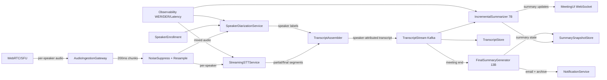

# Chapter 14: Design a Real-Time Meeting Summarizer

## Context

> [!info] Quick Reference
> - **Pattern:** Real-time streaming transcription + summarization
> - **Scale:** 100K concurrent meetings, 600K concurrent audio streams
> - **Key Techniques:** Streaming STT (RNN-T), speaker diarization (enrollment + online clustering), hierarchical incremental summarization, Silero VAD
> - **Primary Concerns:** < 2s utterance-to-text latency, speaker accuracy > 90%, summary drift prevention, action item extraction
> - **Cross-references:** [[chapter-04|Chapter 4]] (serving), [[chapter-18|Chapter 18]] (voice agent), [[chapter-15|Chapter 15]] (multimodal)

**Problem statement:** Design a system that ingests live audio from concurrent meetings, performs real-time speech-to-text with speaker diarization, and produces streaming incremental summaries with action item extraction—all within seconds of utterance.

### Real-World Examples

- A videoconferencing platform (Zoom AI Companion-class) serves 100K concurrent meetings. A 3-second STT lag causes the incremental summary to drift out of sync with the conversation, and participants lose trust. Switching from batch Whisper transcription to a streaming Conformer model with 200ms chunk processing restores real-time parity.
- An enterprise meeting assistant attributes action items to the wrong speaker because diarization fails when two participants have similar vocal profiles over a VoIP codec. Adding embedding-based speaker enrollment at meeting start (3-second voice sample per participant) raises attribution accuracy from 78% to 94%.

---

## Step 1: Understand the Problem and Establish Design Scope

### Simulated Dialogue

**Interviewer:** Design a real-time meeting summarizer that works across a large videoconferencing platform.  
**Candidate:** I need to decompose this into three distinct subsystems: real-time audio ingestion and STT, speaker diarization and attribution, and incremental summarization. Each has radically different latency and accuracy constraints.

**Candidate:** What is the concurrency and meeting profile?  
**Interviewer:** 100K concurrent meetings at peak, average meeting duration 45 minutes, 2–20 participants per meeting.

**Candidate:** What are the real-time constraints?  
**Interviewer:** Transcript must appear within 2 seconds of utterance. Running summary must update every 30 seconds. Final polished summary within 10 seconds of meeting end.

**Candidate:** What accuracy targets for STT and diarization?  
**Interviewer:** Word Error Rate (WER) < 12% for English across accents. Speaker diarization accuracy > 90% (DER < 10%). Action item extraction precision > 85%.

**Candidate:** Multi-language support?  
**Interviewer:** English first. Design extensibility for top-10 languages by meeting volume.

### Functional Requirements

- Real-time streaming transcription with < 2s utterance-to-text latency.
- Speaker diarization with identity labels (speaker enrollment optional, fallback to Speaker A/B/C).
- Incremental rolling summary updated every 30 seconds during the meeting.
- Action item and decision extraction with speaker attribution.
- Final polished summary generated within 10 seconds of meeting end.
- Searchable transcript archive with speaker-labeled segments.

### Non-Functional Requirements

- **Latency:** STT utterance-to-text < 2s. Summary update cycle ≤ 30s. Final summary < 10s after meeting end.
- **Scale:** 100K concurrent meetings, average 6 participants per meeting → 600K concurrent audio streams.
- **Accuracy:** WER < 12%, DER < 10%, action item precision > 85%.
- **Availability:** 99.95% uptime for STT path; summarization can degrade gracefully.
- **Cost:** < $0.02 per meeting-minute at scale (inclusive of STT + diarization + LLM summarization).

### Back-of-the-Envelope Estimation

#### Traffic Profile

- Concurrent meetings at peak: 100K
- Average participants/meeting: 6
- Concurrent audio streams: `100K * 6 = 600K`
- Average meeting duration: 45 min
- Meetings starting/ending per minute (steady-state): `100K / 45 ≈ 2,222 meetings/min`
- Total meeting-minutes/day (assuming 8-hour peak): `100K * 45 * (480 / 45) ≈ 48M meeting-minutes/day`

#### Audio Ingestion

- Audio format: Opus codec, 16kHz mono per speaker, ~32kbps per stream
- Aggregate bandwidth (peak): `600K streams * 32kbps = 19.2 Gbps` inbound audio
- Chunk size for streaming STT: 200ms audio chunks (3,200 samples at 16kHz)
- Chunks/sec (all streams): `600K * 5 = 3M audio chunks/sec`

#### STT Compute

- Streaming Conformer model: processes 200ms chunk in ~50ms on GPU (real-time factor 0.25x)
- Concurrent STT inferences: 600K streams, each needing 5 inferences/sec = 3M inferences/sec
- Per-GPU throughput (batched, A100): ~200 concurrent streams per GPU (batch of 200, 50ms/batch)
- GPU requirement for STT: `600K / 200 = 3,000 GPUs`
- With mixed-precision and optimized kernels: ~2,000-2,500 A100 GPUs for STT

#### Diarization Compute

- Speaker embedding extraction: run every 1.5s per meeting (not per stream—done on mixed audio)
- Meetings needing diarization inference/sec: `100K / 1.5 ≈ 67K inferences/sec`
- Speaker embedding model (ECAPA-TDNN): ~5ms per inference on GPU, batch of 256
- GPUs for diarization: `67K / (256 / 0.005) ≈ ~1,300 GPUs` → with optimization: ~400-600 GPUs

#### Summarization Compute

- Summary update every 30s per meeting: `100K / 30 ≈ 3,333 summarization requests/sec`
- Input: rolling transcript window ~2K tokens, output: ~200 tokens per update
- 7B quantized model: ~120 tok/sec/GPU, batch of 8 → ~960 tok/sec effective
- Output tokens/sec demand: `3,333 * 200 = 666K tok/sec`
- GPUs for summarization: `666K / 960 ≈ 694 GPUs` → ~700-900 GPUs

#### Final Summary Burst

- Meetings ending per minute: ~2,222
- Final summary: ~4K input tokens (full transcript summary), ~500 output tokens
- Burst demand: `2,222 / 60 ≈ 37 requests/sec` → manageable with summarization fleet headroom

#### Cost Estimation

- Total GPU fleet: ~3,000-4,000 GPUs (STT dominant)
- A100 hourly cost (cloud): ~$2.50/hr
- Hourly GPU cost: `3,500 * $2.50 = $8,750/hr`
- Meeting-minutes/hour (peak): `100K * 60 = 6M meeting-minutes`
- Cost/meeting-minute: `$8,750 / 6M ≈ $0.0015` ← well under $0.02 budget

---

## Step 2: Propose High-Level Design and Get Buy-In

### Core Architecture Components

- **Audio Ingestion Gateway:** Receives per-participant audio streams via WebRTC/SFU, demuxes into per-speaker mono channels, buffers 200ms chunks.
- **Streaming STT Service:** Conformer-based streaming ASR with endpointer. Emits partial and final transcript segments per speaker stream.
- **Speaker Diarization Service:** Extracts speaker embeddings from mixed audio, clusters or matches against enrollment embeddings, assigns speaker labels to transcript segments.
- **Transcript Assembler:** Merges STT output with diarization labels, resolves timing overlaps, produces a time-aligned speaker-attributed transcript stream.
- **Incremental Summarizer:** Consumes rolling transcript window, generates updated summary every 30s, extracts action items and decisions.
- **Final Summary Generator:** On meeting end, takes full condensed transcript and produces polished summary with structured sections.
- **Storage Layer:** Time-series transcript store (per-meeting), summary snapshots, speaker enrollment embeddings.
- **Observability:** WER sampling, DER monitoring, summary latency, GPU utilization per service.

### Pipeline A: Audio Ingestion and Transcription Pipeline

1. SFU (Selective Forwarding Unit) extracts per-participant audio tracks from WebRTC session.
2. Audio preprocessor resamples to 16kHz mono, applies noise suppression (RNNoise), and segments into 200ms chunks.
3. Chunks are routed by meeting-ID to a stateful streaming STT worker (sticky session via consistent hashing).
4. STT worker runs incremental Conformer inference, emitting partial hypotheses (updated every chunk) and final segments (on endpointer detection).
5. Parallel path: mixed audio (all speakers) sent to diarization service at 1.5s intervals.
6. Transcript segments tagged with speaker labels from diarization and pushed to Transcript Assembler.
7. Assembler resolves overlapping speech, aligns timestamps, and writes to meeting transcript stream (Kafka topic partitioned by meeting-ID).

### Pipeline B: Summarization Pipeline

1. Summarization worker subscribes to meeting transcript stream.
2. Every 30 seconds, worker snapshots the latest transcript window (last 5 minutes of transcript + previous summary state).
3. Constructs prompt: `[System: You are a meeting summarizer] [Previous Summary] [New Transcript Segment] → [Updated Summary + Action Items]`.
4. Routes to 7B summarization model with streaming output.
5. Summary delta is diffed against previous summary; new action items appended to action list.
6. Updated summary pushed to real-time client (WebSocket to meeting UI).
7. On meeting end signal: final summary job queued with full condensed transcript → 13B/34B model for polished output.
8. Final summary stored, emailed to participants, indexed for search.

### Mermaid Architecture Diagram



---

## Step 3: Design Deep Dive

Focus areas:

1. **Real-Time Audio Pipeline (STT, VAD, Diarization, Streaming Transcript)**
2. **Incremental Summarization (Rolling Context, Section Detection, Action Item Extraction)**
3. **Speaker Attribution and Correction**

### 1) Real-Time Audio Pipeline

The audio pipeline must convert raw audio to speaker-attributed text with < 2s end-to-end latency. This is the hardest latency constraint in the system.

**Streaming STT architecture:**

The STT model processes audio incrementally, maintaining hidden state across chunks. Unlike offline models (Whisper) that require the full utterance, streaming models emit partial hypotheses that are refined as more audio arrives.

- **Model:** Streaming Conformer-Transducer (RNN-T) or Conformer-CTC with attention rescoring.
- **Chunk size:** 200ms (balance between latency and acoustic context). Smaller chunks increase latency overhead from inference scheduling; larger chunks add perceptible delay.
- **Lookahead:** 200ms future context (total algorithmic latency = 400ms).
- **Endpointer (VAD):** Energy-based VAD with neural confirmation. Detects end-of-utterance to emit finalized segments. Threshold tuned to avoid cutting off mid-sentence.

**Stateful vs stateless STT workers:**

| Aspect | Stateful Worker | Stateless Worker |
|---|---|---|
| Architecture | Sticky session per stream; maintains RNN-T hidden state in GPU memory | Each chunk processed independently with context passed in request |
| Latency | Lower (no state serialization overhead) | Higher (+20-50ms for state reload) |
| Fault tolerance | Stream interrupted on worker failure; requires state checkpointing | Naturally fault-tolerant; any worker can serve any chunk |
| Scaling | Harder (must migrate state on rebalance) | Easier (stateless horizontal scaling) |
| GPU memory | Higher (holds state for all assigned streams) | Lower per-worker (state in external store) |
| **Recommended** | **Production default for < 2s latency** | Fallback for overflow / fault recovery |

**Voice Activity Detection (VAD) pipeline:**

1. Frame-level energy detection (< 1ms, CPU): flags silence vs speech.
2. Neural VAD (Silero VAD, ~2ms per 200ms chunk on CPU): classifies speech/non-speech with 96%+ accuracy.
3. Speech segments routed to STT; silence segments suppressed (saves ~40% of STT compute since meetings are ~60% speech).
4. Endpointer: detects 600ms of silence after speech → triggers final hypothesis emission.

#### STT Provider Trade-off Table

| Provider/Model | WER (English) | Streaming Support | Latency (chunk) | Cost/hr Audio | Self-Hosted | Best For |
|---|---|---|---|---|---|---|
| Streaming Conformer-RNN-T (self-hosted) | 8-12% | Native streaming | ~50ms/chunk | $0.10-0.20 (GPU amortized) | Yes | Production default at scale |
| Whisper Large V3 (offline) | 5-8% | No (requires full utterance) | 2-5s per utterance | $0.15 | Yes | Post-meeting re-transcription |
| Google Cloud STT Chirp | 6-10% | Yes (streaming API) | ~200ms | $0.024/min | No | Low-scale or cold-start |
| AWS Transcribe Streaming | 10-14% | Yes | ~300ms | $0.024/min | No | AWS-native stacks |
| Deepgram Nova-2 | 8-11% | Yes | ~200ms | $0.015/min | No | Cost-optimized SaaS |
| Azure Speech (custom) | 7-11% | Yes | ~250ms | $0.017/min | No | Enterprise Azure stacks |

**Recommendation:** Self-hosted streaming Conformer for the core path (cost and latency optimal at 100K concurrent meetings). Managed API as overflow during traffic spikes.

### 2) Incremental Summarization

Summarizing a 45-minute meeting is not a single inference at meeting end—it is a continuous process that must produce useful output at any point during the meeting.

**Three summarization strategies:**

| Strategy | How It Works | Latency | Quality | Compute Cost | Best For |
|---|---|---|---|---|---|
| Post-hoc | Full transcript → single LLM call at meeting end | 10-30s at end | Highest (full context) | Low (one call) | Short meetings (<15 min), async use |
| Incremental (rolling) | Every 30s: [prev summary + new transcript] → updated summary | 2-5s per update | Good (may lose early detail) | High (many calls) | Real-time display during meeting |
| Hybrid | Incremental during meeting + post-hoc final polish | 2-5s updates + 10s final | Best of both | Medium-high | **Production default** |

**Incremental summarization protocol (hybrid approach):**

1. **Sliding window:** Maintain a rolling window of transcript: last 5 minutes (T<sub>recent</sub>) + condensed summary of all prior content (S<sub>prev</sub>).
2. **Update cycle (every 30s):**
   - Input: `S_prev` (~300 tokens) + `T_recent` (~1,500 tokens) + system prompt (~200 tokens) = ~2,000 tokens.
   - Output: updated summary (~200 tokens) + new action items (~50 tokens).
   - Model: 7B quantized, ~120 tok/sec → inference time ~2s per update.
3. **Section detection:** The model is prompted to identify topic transitions. When a new topic is detected, the current section summary is finalized and a new section begins. This prevents "summary drift" where early topics are gradually overwritten.
4. **Action item extraction:** Structured output parsing. The prompt enforces `[ACTION] {assignee}: {task} [by {deadline}]` format. Regex post-processing extracts and deduplicates action items.
5. **Final polish (meeting end):** Concatenate all section summaries + action items → feed to 13B model with instruction to produce a structured final summary (executive summary, key decisions, action items, next steps). Budget: 4K input tokens → 500 output tokens, ~5-8s.

**Context window management:**

| Approach | Context Used | Risk | Mitigation |
|---|---|---|---|
| Full transcript in context | All tokens from meeting start | Exceeds context window on long meetings (45 min ≈ 15K-25K tokens) | Not viable for real-time |
| Fixed sliding window (last N min) | Last 5 min of transcript | Loses information from early meeting | Combine with running summary |
| Hierarchical: summary + window | Compressed prior + recent raw | Summary may drop detail | Section-based summarization preserves structure |
| **Map-reduce** | Chunk transcript → summarize chunks → merge | Parallel processing possible | Loss of cross-chunk context; incoherent merging |

**Recommended:** Hierarchical (summary + window) for real-time updates; map-reduce for final summary of very long meetings (>90 min).

**Prompt template for incremental update:**

```
<system>You are a meeting summarizer. Update the running summary with new transcript content. Preserve all prior decisions and action items. Identify topic transitions. Extract new action items in format: [ACTION] Speaker: Task.</system>

<previous_summary>{S_prev}</previous_summary>

<new_transcript>{T_recent}</new_transcript>

<instructions>Output an updated summary. If the topic has changed, start a new section. List any new action items.</instructions>
```

### 3) Speaker Attribution and Correction

Diarization answers "who spoke when." Errors here propagate to action item attribution—assigning "John will send the report" to the wrong speaker undermines the entire system's value.

**Diarization approaches:**

| Approach | How It Works | DER | Latency | Enrollment Required | Best For |
|---|---|---|---|---|---|
| Online clustering (spectral) | Extract embeddings from mixed audio, cluster in real-time | 12-18% | 1-2s | No | Unknown speaker count, no enrollment |
| Enrollment-based matching | Compare segment embeddings to pre-registered voiceprints | 5-8% | 500ms | Yes (3s voice sample) | Enterprise with known participants |
| Hybrid (enroll + cluster) | Match enrolled speakers first, cluster unknowns | 6-10% | 1s | Optional | **Production default** |
| End-to-end neural (EEND) | Single model jointly segments and labels speakers | 8-12% | 2-3s | No | Research; not production-ready for streaming |

**Speaker embedding pipeline:**

1. **Feature extraction:** 80-dim log-mel filterbank features from 1.5s audio segments.
2. **Embedding model:** ECAPA-TDNN (192-dim speaker embedding). Inference: ~5ms per segment on GPU.
3. **Enrollment matching:** Cosine similarity between segment embedding and enrolled speaker embeddings. Threshold: 0.65 (tuned per deployment). Above threshold → assign identity. Below → route to clustering.
4. **Online clustering:** Agglomerative clustering with a distance threshold. New clusters created when no existing cluster centroid is within threshold.
5. **Label smoothing:** Prevent rapid speaker label oscillation by enforcing a minimum segment duration of 500ms. If a speaker label change lasts < 500ms, merge with the surrounding dominant speaker.

**Correction mechanisms:**

- **Overlap handling:** When two speakers talk simultaneously (cross-talk), diarization degrades. Strategy: detect overlap via energy-based analysis; label the segment as "multiple speakers" and attribute transcript to the dominant speaker (higher energy). Flag for human review if action items are detected in overlap regions.
- **Retroactive correction:** When a new segment provides disambiguating evidence, retroactively relabel prior segments within a 30s window. Propagate corrections to the summary (invalidate and regenerate affected action items).
- **Human-in-the-loop:** Expose a "correct speaker" button in the meeting UI. Corrections are fed back as additional enrollment data for the session, improving diarization for the remainder of the meeting.
- **Post-meeting re-diarization:** After meeting end, run offline diarization (pyannote.audio pipeline with full meeting audio) to produce a higher-accuracy transcript. Replace the streaming transcript in the archive.

**Speaker embedding enrollment flow:**

1. At meeting join, prompt participant: "Say your name to enable speaker identification" (3-second sample).
2. Extract ECAPA-TDNN embedding from sample. Store in session-scoped enrollment cache.
3. If participant has prior enrollment (from previous meetings), merge embeddings with exponential moving average (α=0.3) for drift adaptation.
4. Enrollment is optional—system degrades to anonymous clustering labels (Speaker 1, Speaker 2, etc.) without it.

### Production Bottlenecks and Mitigations

- **STT worker failure mid-meeting**
  - Symptom: transcript gap of 5-10 seconds while stream is reassigned.
  - Mitigation: state checkpointing every 5s to Redis. On failure, new worker resumes from checkpoint. Gap filled by re-processing buffered audio chunks (held in Kafka for 60s).

- **Diarization label flip-flopping**
  - Symptom: speaker labels oscillate rapidly between two speakers during quiet transitions.
  - Mitigation: minimum segment duration enforcement (500ms). Hysteresis on cosine similarity threshold (require 3 consecutive frames above threshold before switching label).

- **Summary hallucination under sparse transcript**
  - Symptom: when participants are silent for extended periods, the summarizer fills in with fabricated content.
  - Mitigation: detect silence gaps > 60s in transcript; inject `[No discussion for N minutes]` marker. Instruct model to skip summarization for gaps.

- **Action item duplication across summary updates**
  - Symptom: same action item re-extracted in consecutive update cycles.
  - Mitigation: maintain a deduplication set of action items keyed by (speaker, task_hash). Only surface new items. Hash uses semantic similarity (embedding distance < 0.15 → duplicate).

- **Cross-talk regions corrupting attribution**
  - Symptom: action items attributed to wrong speaker during simultaneous speech.
  - Mitigation: flag cross-talk regions in transcript. Attach `[attribution uncertain]` tag. In final summary, present uncertain attributions with both candidate speakers.

- **Audio codec degradation on poor networks**
  - Symptom: WER spikes to 25%+ when participants are on low-bandwidth connections (Opus at 8kbps).
  - Mitigation: detect low-bitrate streams via codec metadata. Route to STT model fine-tuned on degraded audio. Flag transcript segments as low-confidence.

---

## Step 4: Wrap Up

### Final Design Summary

The design decomposes real-time meeting summarization into three loosely coupled subsystems: a streaming STT pipeline using Conformer-RNN-T with stateful workers and VAD gating that achieves < 2s utterance-to-text latency across 600K concurrent streams; a hybrid diarization service combining enrollment-based matching with online clustering to hit > 90% speaker accuracy; and a hierarchical incremental summarizer that maintains rolling context with section detection and structured action item extraction, producing useful output at any point during the meeting and a polished final summary within 10 seconds of meeting end.

### Wrap-Around Concerns

- **Risk:** STT model WER degrades on non-native English accents, domain-specific jargon (medical, legal), and code-switching. Mitigation: domain-specific fine-tuning with adapter layers; custom vocabulary injection per organization.
- **Risk:** Incremental summary loses critical early-meeting context as the meeting progresses. Mitigation: section-based hierarchical summarization; immutable section summaries that do not get overwritten.
- **Risk:** Speaker enrollment adoption is low, degrading diarization quality. Mitigation: passive enrollment from calendar-linked audio history (with consent). Fall back to anonymous labels with graceful UX.
- **Risk:** GPU cost for STT at 100K concurrent meetings is significant (~2,500 GPUs). Mitigation: VAD gating eliminates ~40% of STT inference. Silence-aware batching further improves utilization.
- **Risk:** Regulatory constraints on audio recording and transcription (GDPR, HIPAA). Mitigation: explicit consent flow before recording; on-premise deployment option for regulated industries; audio not persisted (only transcript + summary stored, audio discarded after processing).

---

## Step 5: Interviewer Curveballs

### Interviewer Follow-ups & Frequently Asked Questions (FAQ)

Q: A participant reports that their statements are consistently attributed to another speaker. How do you debug this?

**The Ideal Answer:** Pull the speaker embeddings for both participants from the enrollment cache. Compute cosine similarity—if > 0.60, the voiceprints are too similar for the current threshold. Check if both participants are using the same audio device (shared conference room mic). Inspect the diarization clustering history: if the speakers were initially clustered together and never split, the online clustering merged them early. Fix: lower the similarity threshold for this meeting, or trigger re-enrollment with a longer voice sample.

**Deep Dive & Trade-offs:**
- Similar-sounding speakers (same gender, similar pitch) are the hardest case for embedding-based diarization.
- Longer enrollment samples (10s vs 3s) improve embedding quality but hurt UX.
- Alternative: use spatial audio features (if stereo/multi-channel mic is available) to separate speakers by location, not voice.
- Post-meeting re-diarization with full audio context will produce better results than online streaming diarization.

**The Interviewer's Rubric:** Checking whether you can trace diarization errors to embedding space properties and propose practical fixes.

---

Q: The meeting runs for 3 hours (board meeting). How does your summarization strategy change?

**The Ideal Answer:** At 3 hours, the raw transcript is ~40K-60K tokens—far exceeding any single context window. The hierarchical approach becomes mandatory: the meeting is segmented into sections (agenda items), each section is summarized independently (section summaries ~200 tokens each), and the final summary is a map-reduce over section summaries. The rolling summary state is checkpointed every 15 minutes to bound the risk of state corruption. For the final summary, use a long-context model (128K window) on the concatenation of all section summaries (~3K tokens) plus the raw transcript of the final 15 minutes for recency.

**Deep Dive & Trade-offs:**
- Map-reduce summarization loses cross-section references ("as we discussed earlier..."). Mitigate by including a 200-token "prior context" prefix in each section's summarization prompt.
- Checkpointing summary state protects against worker failure but adds storage overhead (~1KB per checkpoint, negligible).
- 3-hour meetings are rare (<2% of meetings) but generate 80% of support tickets about summary quality. Invest disproportionate quality effort here.

**The Interviewer's Rubric:** Checking understanding of how summarization architecture must adapt to content length, not just treat all meetings the same.

---

Q: How do you handle a meeting where participants switch between English and Japanese mid-sentence?

**The Ideal Answer:** Code-switching is an unsolved hard problem for monolingual STT models. Options: (1) run parallel STT streams (English + Japanese) and merge based on language detection per segment—works for full-sentence switches but fails on intra-sentence mixing. (2) Use a multilingual streaming model (Whisper-class, but adapted for streaming) that handles code-switching natively—higher WER on both languages (~15-20%) compared to monolingual models. (3) Detect language at the segment level (every 2 seconds) and route to the appropriate monolingual model—introduces 2-3s additional latency for language detection. I'd recommend option (3) for production: route each segment to the best monolingual model with a lightweight language ID classifier (wav2vec2 fine-tuned for language ID, ~10ms inference).

**Deep Dive & Trade-offs:**
- Multilingual models sacrifice accuracy on each language for breadth. At 100K concurrent meetings, the accuracy loss is unacceptable for primary languages.
- Language detection adds latency and can misclassify short utterances (< 1s).
- Summarization also needs multilingual capability: summarize in the dominant meeting language, or offer per-language summaries.
- Cost: running dual STT models for bilingual meetings doubles STT compute for affected meetings (~5% of total).

**The Interviewer's Rubric:** Checking awareness of multilingual STT challenges and pragmatic routing strategies.

---

Q: How do you evaluate summarization quality when there is no ground truth?

**The Ideal Answer:** There is no clean ground truth for meeting summaries. Use a multi-signal evaluation framework: (1) **Faithfulness:** LLM-as-judge checks if every claim in the summary is supported by the transcript (NLI-based, precision-oriented). (2) **Coverage:** check if key topics from the transcript appear in the summary (recall-oriented, measured by topic overlap between transcript topic model and summary). (3) **Action item accuracy:** compare extracted action items against post-meeting survey where participants confirm their action items. (4) **User satisfaction:** thumbs-up/down on the summary within the meeting UI. (5) **Downstream utility:** do participants who use the summarizer send fewer "what did we decide?" follow-up messages? Measure thread reduction in post-meeting communication.

**Deep Dive & Trade-offs:**
- LLM-as-judge for faithfulness can be gamed (summary copies transcript verbatim → perfect faithfulness, zero compression).
- User satisfaction is noisy and biased by recency (users rate based on the last 5 minutes of the summary).
- Action item accuracy via survey has < 30% response rate; need to sample and extrapolate.
- The strongest signal is downstream utility (email/message reduction), but it requires weeks of measurement and A/B testing.

**The Interviewer's Rubric:** Checking whether evaluation strategy addresses the fundamental absence of ground truth for summarization.

---

Q: Your STT service goes down for 60 seconds mid-meeting. What happens?

**The Ideal Answer:** Audio is buffered in Kafka (60s retention on the ingestion topic). When STT recovers, workers consume the backlog at accelerated rate (batch mode, not streaming—process 60s of audio in ~10-15s). The transcript has a gap marker `[Transcript temporarily unavailable: 14:32:00 - 14:33:00]`. Once the backlog is processed, the gap is backfilled and the incremental summarizer receives the missing transcript. The summary regenerates for the affected window. Users see the gap filled in retroactively. The real-time summary during the outage simply pauses updates with a "Catching up..." indicator.

**Deep Dive & Trade-offs:**
- Buffered audio ensures no data loss for outages < 60s. Longer outages require extending Kafka retention (trades storage cost for durability).
- Backfill processing competes for GPU resources with live streams. Reserve 10% of STT fleet as backfill capacity to avoid degrading live meetings.
- The summarizer must handle out-of-order transcript delivery gracefully (timestamp-sorted insertion into the rolling window).

**The Interviewer's Rubric:** Checking fault tolerance design for a stateful streaming pipeline.

---

Q: How do you reduce the 2,500 GPU requirement for STT?

**The Ideal Answer:** Three levers: (1) **VAD gating** already reduces STT compute by ~40% (silence suppression). Further optimize by increasing VAD aggressiveness—only route to STT when speech probability > 0.8 (vs 0.5 default). Risk: clipping initial syllables. (2) **Model distillation:** distill the Conformer-Large (600M params) to Conformer-Small (100M params) with < 2% WER degradation. 3-4x throughput improvement per GPU. (3) **Selective transcription:** not all participants need real-time STT—for meetings with < 4 participants, process only the mixed audio (1 stream instead of N streams), then diarize offline. This reduces stream count by ~60% for small meetings (which are 70% of total meetings). Combined: GPU reduction from 2,500 to ~600-800.

**Deep Dive & Trade-offs:**
- Aggressive VAD risks losing short utterances ("yes," "agreed"). Tune on meeting-specific audio, not general speech datasets.
- Model distillation requires 2-4 weeks of training and risks degradation on tail accents/domains.
- Mixed audio processing loses per-speaker audio quality but is adequate for small meetings with clear turn-taking.
- This is an economic optimization—must be validated that accuracy remains within WER < 12% target.

**The Interviewer's Rubric:** Checking practical cost reduction strategies that go beyond "use cheaper GPUs."

---

Q: A participant joins via phone (PSTN) with 8kHz audio while others are on 16kHz. How do you handle this?

**The Ideal Answer:** The phone participant's audio is narrowband (300Hz-3.4kHz). Upsampling to 16kHz doesn't recover lost frequency information. Options: (1) Route the PSTN stream to a narrowband-specific STT model trained on 8kHz audio (lower WER on narrowband than a wideband model receiving upsampled audio). (2) Apply neural bandwidth extension (BWE) to hallucinate the missing frequency bands, then process with the standard 16kHz model. BWE adds ~10ms latency. I'd use option (1) in production: maintain a small narrowband STT model variant alongside the standard model. PSTN streams are detected by codec metadata at ingestion and routed accordingly.

**Deep Dive & Trade-offs:**
- Narrowband models have ~3-5% higher WER than wideband even on their native domain. This is inherent—less acoustic information.
- BWE introduces artifacts that can confuse downstream diarization (hallucinated frequencies don't match the speaker's real voice).
- PSTN participants are ~5% of total streams—maintaining a separate model is justifiable.
- Speaker diarization for PSTN participants is harder (narrowband embeddings are less discriminative). Lower the diarization confidence threshold and flag PSTN speakers for potential attribution errors.

**The Interviewer's Rubric:** Checking awareness of real-world audio heterogeneity in production meeting systems.

---

Q: How do you handle a meeting with 20 participants where 5 people are in the same conference room sharing one microphone?

**The Ideal Answer:** The shared microphone produces a single mixed audio stream for 5 speakers. Per-speaker audio separation is impossible from one channel without source separation. Strategy: (1) Treat the conference room mic as a single "room" stream. Apply diarization on the room stream using speaker embeddings—this works when speakers take turns, but fails during cross-talk. (2) Use a speech separation model (e.g., SepFormer) to attempt real-time source separation of the room audio into individual speaker streams. This adds ~100ms latency and works for 2-3 speakers but degrades for 5. (3) Practical recommendation: in the meeting UI, label in-room participants as "Conference Room" and attribute at the group level. Post-meeting, offer re-diarization with enhanced offline processing.

**Deep Dive & Trade-offs:**
- Source separation for 5 speakers in real-time is beyond current production-quality models. Research models achieve ~10dB SI-SNR improvement but add 200ms+ latency.
- Group attribution ("Conference Room: John, Sarah, Mike, Lisa, David") is honest about the limitation and doesn't introduce false attribution.
- Hardware solution: meeting room devices with speaker-tracking beamforming microphone arrays (Polycom/Jabra) provide per-speaker audio tracks. This eliminates the problem at the hardware layer.
- Encourage organizations to provide individual headsets or speaker-tracking hardware for critical meetings.

**The Interviewer's Rubric:** Checking whether you acknowledge system limitations honestly and propose practical workarounds.

## End of Chapter

- **Key takeaway:** Real-time meeting summarization is a pipeline coordination problem. The STT subsystem dominates both latency budget and GPU cost. Diarization accuracy determines whether summaries are trusted. Incremental summarization must be architected as a hierarchical stateful process, not a single LLM call at meeting end.
- **What to practice:** Size the STT GPU fleet for a given concurrent meeting count, accounting for VAD gating, batching efficiency, and mixed narrowband/wideband streams. Draw the latency budget from utterance to displayed text.
- **Interview drill:** Given a 3-hour meeting with 15 participants, walk through how the transcript, diarization, and summary systems interact—including failure recovery when a worker dies at the 90-minute mark.
