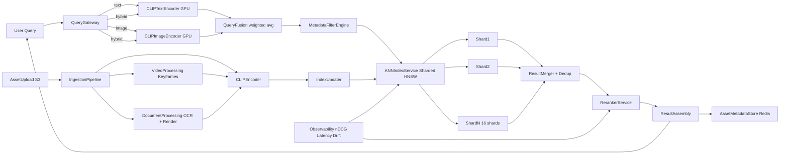

# Chapter 15: Design a Multimodal Asset Search System

## Context

> [!info] Quick Reference
> - **Pattern:** Cross-modal semantic search (image/video/document)
> - **Scale:** Large multi-modal asset corpus with real-time indexing
> - **Key Techniques:** CLIP/SigLIP shared embedding space, modality-specific indexes with score normalization, video keyframe extraction (TransNetV2 + uniform sampling), multimodal score fusion
> - **Primary Concerns:** Cross-modal calibration, temporal precision for video, document rendering strategy, index freshness
> - **Cross-references:** [[chapter-03|Chapter 3]] (vector infrastructure), [[chapter-07|Chapter 7]] (enterprise search), [[chapter-14|Chapter 14]] (audio/video signals)

**Problem statement:** Design a search system that supports cross-modal queries (text→image, image→text, text→video, image→video) over 500M assets using joint embedding spaces, with sub-150ms retrieval latency and production-grade ranking.

### Real-World Examples

- A stock media platform (Shutterstock/Getty-class) serves 10K QPS across 500M images and 50M video clips. When text queries like "sunset over mountain lake" return irrelevant results, user engagement drops 15% week-over-week. Deploying CLIP-based embeddings with a learned reranker improves nDCG@10 by 22% over BM25-on-metadata baselines.
- An enterprise DAM (Digital Asset Management) system enables designers to search by uploading a reference image. The system retrieves visually similar assets across images and video keyframes in a unified embedding space. Without cross-modal retrieval, designers spend 40 minutes per search session manually browsing folders; with it, median search time drops to 3 minutes.

---

## Step 1: Understand the Problem and Establish Design Scope

### Simulated Dialogue

**Interviewer:** Design a multimodal search system over a large asset library.  
**Candidate:** I need to understand the modality mix, query patterns, corpus size, and latency requirements. Cross-modal search (e.g., text querying images) requires fundamentally different architecture than single-modality keyword search.

**Candidate:** What is the asset corpus?  
**Interviewer:** 500M assets total: 400M images, 80M video clips (avg 30 seconds each), 20M documents (PDFs, slides). Growing at 2M assets/week.

**Candidate:** What are the query modalities?  
**Interviewer:** Text→image (60% of queries), text→video (20%), image→image (10%), image→text/document (5%), text→document (5%). Users may also combine modalities—e.g., text query + reference image.

**Candidate:** Latency and throughput requirements?  
**Interviewer:** p95 retrieval latency < 150ms. 10K QPS at peak. Top-20 results returned per query.

**Candidate:** What ranking quality targets?  
**Interviewer:** nDCG@10 > 0.65 on human-judged relevance. Diversity: at least 3 distinct visual concepts in top-10 for broad queries.

### Functional Requirements

- Cross-modal retrieval: any query modality can retrieve any asset modality.
- Text queries return ranked images, video clips, and documents.
- Image queries return visually similar images and video keyframes.
- Hybrid queries: text + reference image with controllable weighting.
- Faceted filtering: asset type, resolution, duration, license, upload date, color palette.
- Near-real-time indexing: new assets searchable within 5 minutes of upload.

### Non-Functional Requirements

- **Latency:** p95 < 150ms for retrieval + ranking (end-to-end from query receipt to ranked results).
- **Throughput:** 10K QPS sustained at peak.
- **Corpus:** 500M assets, growing 2M/week.
- **Freshness:** new assets indexed within 5 minutes.
- **Relevance:** nDCG@10 > 0.65 on cross-modal queries.
- **Availability:** 99.95% uptime for search path.
- **Cost:** < $0.001 per query at scale.

### Back-of-the-Envelope Estimation

#### Corpus and Embedding Storage

- Assets: 500M
- Embedding dimension: 768 (CLIP ViT-L/14)
- Bytes per embedding: `768 * 4 (FP32) = 3,072 bytes` → with PQ compression: ~128 bytes/vector
- Raw embedding storage: `500M * 3,072 = 1.536 TB` (FP32, uncompressed)
- Compressed (PQ, 128 bytes): `500M * 128 = 64 GB` ← fits in RAM across a small cluster
- With video: each 30s clip → 15 keyframes → 15 embeddings per clip = `80M * 15 = 1.2B` video keyframe embeddings
- Total vectors (images + video keyframes + documents): `400M + 1.2B + 20M = 1.62B vectors`
- Compressed storage: `1.62B * 128 = 207 GB`

#### Index Architecture

- HNSW index for 1.62B vectors at 128 bytes/vector:
  - Memory: ~207 GB vectors + ~300 GB graph overhead = ~507 GB total
  - Sharded across 16 machines with 64 GB RAM each (2x replication for availability)
  - Each shard: ~100M vectors, ~32 GB memory
- Alternative: IVF-PQ index: smaller memory footprint (~150 GB) but requires nprobe tuning for recall

#### Query Processing

- Peak QPS: 10K
- Query embedding inference (CLIP text encoder): ~5ms per query on GPU, batch of 64 → ~312 embeddings/sec per GPU
- GPUs for query embedding: `10K / 312 ≈ 32 GPUs` → with batching optimization: ~20 GPUs
- ANN search: ~5-10ms per shard, 16 shards queried in parallel → 10ms
- Reranking (cross-encoder on top-100): ~20ms (GPU) or ~50ms (CPU)
- Total query latency budget:

| Stage | Budget | Notes |
|---|---|---|
| Query embedding (CLIP text/image encoder) | 15ms | Batched GPU inference |
| Pre-filter (metadata facets) | 5ms | Inverted index on metadata |
| ANN search (parallel across shards) | 15ms | HNSW search, nprobe-tuned |
| Fetch candidate metadata | 10ms | Cache-backed metadata store |
| Reranking (cross-encoder or fusion) | 40ms | Top-100 → top-20 |
| Result assembly + dedup | 10ms | Remove near-duplicate images |
| Post-processing (thumbnail URLs, etc.) | 5ms | CDN URL signing |
| **Total** | **100ms** | 50ms headroom under 150ms SLO |

#### Ingestion Throughput

- New assets/week: 2M → `2M / (7 * 86400) ≈ 3.3 assets/sec`
- Image embedding (CLIP ViT-L/14): ~20ms per image on GPU → single GPU handles 50/sec
- Video embedding: 15 keyframes per clip → 15 * 20ms = 300ms per video → single GPU handles ~3 videos/sec
- Total embedding compute for ingestion: 1-2 GPUs (trivial relative to serving fleet)
- Index update: micro-batch inserts into HNSW every 30 seconds

#### Cost Per Query

- GPU fleet (query embedding + reranking): ~30 GPUs, ~$2.50/hr each = $75/hr
- Index serving fleet (CPU/RAM): 32 machines, ~$1.50/hr each = $48/hr
- Total: ~$123/hr
- Queries/hour at peak: `10K * 3600 = 36M`
- Cost/query: `$123 / 36M ≈ $0.0000034` ← well under $0.001

---

## Step 2: Propose High-Level Design and Get Buy-In

### Core Architecture Components

- **Query Gateway:** Auth, rate limiting, query parsing, modality detection (is the query text, image, or hybrid?).
- **Query Encoder Service:** Encodes text/image queries into the shared embedding space using CLIP model. Batched GPU inference.
- **Metadata Filter Engine:** Pre-filters corpus by structured facets (type, license, date range, resolution) using an inverted index. Reduces ANN search space.
- **ANN Index Service:** Sharded HNSW (or IVF-PQ) index serving 1.62B vectors. Performs approximate nearest neighbor search in the joint embedding space.
- **Reranker Service:** Cross-encoder or late-fusion model that reranks top-100 ANN results to produce final top-20. Uses richer features than dot-product similarity.
- **Asset Metadata Store:** Low-latency key-value store (Redis-backed) for asset metadata, thumbnails, and preview URLs.
- **Ingestion Pipeline:** Processes new assets: extract visual features, generate embeddings, extract metadata, update index.
- **Video Processing Service:** Keyframe extraction, scene detection, temporal segmentation, per-keyframe embedding.
- **Observability:** Query latency histograms, nDCG sampling, embedding drift detection, index freshness metrics.

### Pipeline A: Asset Ingestion Pipeline

1. New asset uploaded to object storage (S3). Event triggers ingestion.
2. **Modality router:** routes to image, video, or document processing path.
3. **Image path:** resize to 224x224, run through CLIP ViT-L/14 image encoder → 768-dim embedding. Extract EXIF metadata.
4. **Video path:** decode video, run scene detection (PySceneDetect or TransNetV2), extract keyframes at scene boundaries + uniform sampling (max 15 keyframes per 30s clip). Each keyframe → CLIP embedding. Generate temporal metadata (keyframe timestamps, scene descriptions).
5. **Document path:** render each page to image (PDF→PNG at 300dpi), run CLIP embedding on rendered pages. Extract text via OCR (Tesseract or PaddleOCR), generate text embedding for full document content.
6. Embeddings + metadata written to ingestion queue (Kafka).
7. Index updater consumes queue, performs micro-batch HNSW insertions (every 30s).
8. Asset metadata written to metadata store. Thumbnails generated and pushed to CDN.
9. Quality check: sample 0.1% of new embeddings, compute cosine similarity against known test queries. Alert if mean similarity drops (embedding model drift).

### Pipeline B: Query Serving Pipeline

1. Query arrives at gateway. Modality detected: text / image / hybrid.
2. **Text query:** encoded by CLIP text encoder → 768-dim query vector.
3. **Image query:** encoded by CLIP image encoder → 768-dim query vector.
4. **Hybrid query:** both encoders run; vectors combined via weighted average (default α=0.7 text, 0.3 image, user-adjustable).
5. Metadata filters applied: generate a candidate bitmap from inverted index on structured facets.
6. Query vector + candidate bitmap sent to ANN index service. Parallel fan-out to all shards.
7. Each shard returns top-K candidates (K=100/num_shards) with scores.
8. Merge shard results, deduplicate near-identical images (perceptual hash distance < 5).
9. Top-100 candidates sent to reranker. Reranker uses cross-modal features: query-asset similarity, asset quality score, recency, popularity, visual diversity.
10. Top-20 results assembled with metadata, thumbnails, and preview URLs. Returned to client.

### Mermaid Architecture Diagram



---

## Step 3: Design Deep Dive

Focus areas:

1. **Multimodal Embedding Pipeline (CLIP, Video Frame Sampling, Document Rendering)**
2. **Cross-Modal Retrieval Architecture (Unified vs Separate Indexes, Fusion Strategies)**
3. **Video Search and Temporal Indexing**

### 1) Multimodal Embedding Pipeline

The embedding model is the foundation. Every asset and every query is projected into the same vector space. The quality of this projection determines retrieval relevance.

**Embedding model selection:**

| Model | Architecture | Embedding Dim | ImageNet Zero-Shot | Cross-Modal Retrieval (Flickr30k R@1) | Inference Speed (img, A100) | Training Data | License | Best For |
|---|---|---|---|---|---|---|---|---|
| CLIP ViT-L/14 (OpenAI) | ViT-L + GPT-2 text | 768 | 75.3% | 87.4% | ~8ms | 400M pairs (WIT) | MIT | General production default |
| SigLIP ViT-SO400M | ViT-SO + text tower | 1152 | 83.1% | 91.2% | ~12ms | 4B pairs (WebLI) | Apache 2.0 | Higher quality, slightly slower |
| OpenCLIP ViT-G/14 | ViT-G + text | 1024 | 80.1% | 90.8% | ~18ms | LAION-2B | MIT | Open-source high quality |
| EVA-CLIP ViT-E | ViT-E + text | 1024 | 82.0% | 89.5% | ~20ms | Merged datasets | Apache 2.0 | Research/academic |
| Custom fine-tuned CLIP | ViT-L + domain text | 768 | N/A (domain-specific) | +3-8% on domain | ~8ms | Domain data + CLIP init | Internal | Domain-specific corpus |
| BLIP-2 (retrieval mode) | ViT-G + Q-Former + LLM | 768 | 82.4% | 92.1% | ~35ms | 129M pairs | BSD-3 | When quality > speed |

**Recommendation:** Start with SigLIP ViT-SO400M for highest quality-to-speed ratio. Fine-tune on domain data (stock media pairs) with contrastive loss. Fall back to CLIP ViT-L/14 if latency budget is tight.

**Fine-tuning strategy for domain adaptation:**

1. Collect 1M high-quality (text, image) pairs from the platform's search logs (query → clicked asset).
2. Initialize from pretrained SigLIP weights.
3. Fine-tune with sigmoid contrastive loss (SigLIP's native objective) for 5 epochs.
4. Hard negative mining: for each positive pair, sample 7 in-batch negatives + 1 hard negative (highest-similarity non-clicked asset).
5. Evaluation: measure R@1, R@5, R@10 on a held-out test set of 10K human-judged query-asset pairs.
6. A/B test: run fine-tuned model alongside base model on 10% of traffic. Promote if nDCG@10 improves > 2%.

**Document embedding strategy:**

Documents (PDFs, slides) are not natively handled by CLIP. Two approaches:

| Approach | How It Works | Quality | Latency | Best For |
|---|---|---|---|---|
| Render-to-image | Render each page as PNG at 300dpi, embed with CLIP image encoder | Good for visual documents (slides, infographics) | 200ms/page | Slides, visual-heavy PDFs |
| Text extraction + text embedding | OCR → text → CLIP text encoder (or separate text encoder) | Good for text-heavy documents | 50ms/page | Reports, articles, text PDFs |
| Hybrid | Both visual and text embeddings per page; fuse at retrieval time | Best overall | 250ms/page | **Production default** |

**Embedding versioning and migration:**

When the embedding model is updated (fine-tuned or upgraded), all 1.62B vectors must be re-embedded. This is a massive offline job:
- 1.62B embeddings at 20ms each = `1.62B * 0.02s = 32.4M GPU-seconds ≈ 375 GPU-days`
- With a 100-GPU batch job: ~4 days for full re-embedding.
- **Shadow index strategy:** build new index in parallel with old. Run dual-read during migration (query both, merge results). Cut over when new index quality is validated. Zero-downtime migration.

### 2) Cross-Modal Retrieval Architecture

The core architectural decision: should all modalities share one index, or should each modality have its own index?

#### Index Architecture Trade-off Table

| Architecture | How It Works | Pros | Cons | Best For |
|---|---|---|---|---|
| Unified index | All modalities in one HNSW index; query vector searches all assets | Simplest ops; natural cross-modal retrieval; one search call | Modality bias (images dominate because there are more); hard to tune per-modality relevance | Small corpus (<50M), single-modality dominant |
| Separate indexes per modality | Image index, video index, document index; query hits all, results merged | Per-modality tuning; independent scaling; easier to debug | Fan-out latency; complex merge logic; score calibration across indexes | **Production default for mixed corpus** |
| Hierarchical (coarse + fine) | Coarse unified index for candidate generation; fine per-modality index for reranking | Best recall + precision | Most complex; two-stage latency | Highest-quality requirement |

**Recommended: Separate indexes with score normalization.**

Score calibration across indexes: raw cosine similarity from different indexes is not comparable (image embeddings cluster differently than video keyframe embeddings). Normalize scores per-index to zero mean, unit variance on a calibration set of 10K queries, then merge.

**Fusion strategies for hybrid queries (text + image):**

| Strategy | How It Works | Quality | Latency | Complexity |
|---|---|---|---|---|
| Early fusion (vector average) | `q = α * q_text + (1-α) * q_image`, single ANN search | Moderate (loses modality-specific signal) | Lowest (one search) | Low |
| Late fusion (score merge) | Separate ANN searches for text and image vectors, merge by RRF or weighted score | Higher (preserves both signals) | Higher (two searches) | Medium |
| Learned fusion | Train a small MLP that takes both query vectors + candidate features → relevance score | Highest (learned weighting) | Highest (requires candidate features) | High |
| **Hybrid: early fusion for retrieval, late fusion for reranking** | Early fusion for ANN (speed), late fusion features fed to reranker | Best balance | Medium | Medium |

**Reciprocal Rank Fusion (RRF) for late fusion:**

```
RRF_score(d) = Σ 1 / (k + rank_i(d))
```

where `rank_i(d)` is the rank of document d in the i-th result list, and k=60 (standard constant). RRF is parameter-free, robust, and consistently outperforms raw score merging.

**Deduplication:**

Near-duplicate images are common in stock media (same image with different crops, watermarks, or color grades). Dedup strategy:
- Compute perceptual hash (pHash) at indexing time. Store in a Bloom filter.
- At query time, after ANN retrieval, compute pairwise pHash distance within top-100. Remove candidates with pHash Hamming distance < 5 (keep the higher-scored one).
- For video: deduplicate keyframes within the same clip (keep only scene-boundary keyframes).

### 3) Video Search and Temporal Indexing

Video search is the hardest modality. A 30-second clip contains ~900 frames, each potentially showing different content. The challenge: represent the clip compactly while enabling precise temporal retrieval.

**Keyframe extraction strategies:**

| Strategy | Frames per 30s Clip | Storage Cost | Retrieval Quality | Best For |
|---|---|---|---|---|
| Uniform sampling (1fps) | 30 | High (30 embeddings/clip) | Good coverage but redundant for static scenes | Simple baseline |
| Scene boundary detection (TransNetV2) | 3-8 | Low | Good for narrative content with distinct scenes | Movies, TV clips |
| Uniform + scene boundary (hybrid) | 10-15 | Medium | Best coverage vs cost balance | **Production default** |
| Dense sampling (all frames) | 900 | Prohibitive | Diminishing returns | Not viable at scale |
| Clustering (embed all, cluster, keep centroids) | 5-10 | Low | Misses brief but important moments | Academic research |

**Recommended:** Hybrid sampling — scene boundaries (TransNetV2, ~50ms inference per clip) + uniform 0.5fps fill. Cap at 15 keyframes per 30s clip.

**Temporal indexing architecture:**

Each video clip is represented as a set of (keyframe_embedding, timestamp) pairs. This enables:

1. **Clip-level search:** aggregate keyframe scores. `clip_score = max(keyframe_scores)` or `clip_score = mean(top-3 keyframe_scores)`.
2. **Temporal search:** return specific moments. "Find the part where the speaker shows a chart" → match against individual keyframes, return the timestamp.
3. **Temporal context:** for each matching keyframe, return a 5-second window (keyframe ± 2.5s) as a preview clip.

**Video indexing data model:**

```
Video {
  clip_id: string
  duration_sec: float
  keyframes: [
    { frame_idx: int, timestamp_sec: float, embedding: float[768], scene_label: string },
    ...
  ]
  metadata: { title, tags, resolution, codec, upload_date }
  audio_transcript: string (optional, from STT)
  text_embedding: float[768] (from title + tags + transcript)
}
```

**Multimodal video representation:**

Videos have multiple signal channels. Relying on visual keyframes alone misses:
- **Audio:** A video about "jazz music" might show a static stage. The audio is the signal, not the visual. Index audio via STT transcription + CLAP (Contrastive Language-Audio Pretraining) embeddings.
- **Text overlays:** Title cards, captions, on-screen text. Extract via OCR on keyframes.
- **Metadata:** Title, description, tags from uploader.

**Multi-signal video retrieval:**

| Signal | Embedding Model | Weight in Fusion | Latency Cost | Value |
|---|---|---|---|---|
| Visual keyframes | CLIP/SigLIP | 0.50 | ~20ms/keyframe | Primary signal for visual content |
| Audio transcript | CLIP text encoder on STT output | 0.20 | ~100ms/clip (STT) | Critical for speech-heavy video |
| Text overlays (OCR) | CLIP text encoder | 0.10 | ~50ms/clip (OCR) | Important for instructional content |
| Metadata (title + tags) | CLIP text encoder | 0.20 | ~2ms | High signal-to-noise for curated assets |

Fusion: weighted average of per-signal scores during reranking. Weights tuned via grid search on a labeled relevance dataset.

#### Video Indexing Strategy Trade-off Table

| Strategy | Index Size (80M clips) | Query Latency | Temporal Precision | Best For |
|---|---|---|---|---|
| Single embedding per clip (mean of keyframes) | 80M vectors (10 GB compressed) | Fast (~5ms) | None (clip-level only) | Quick clip-level retrieval |
| All keyframes indexed independently | 1.2B vectors (154 GB compressed) | Slower (~15ms, more shards) | High (keyframe-level) | Temporal search within clips |
| Hierarchical: clip-level first, then keyframe drill-down | 80M + 1.2B (164 GB) | Two-stage: 5ms + 10ms | High with lower first-stage cost | **Production default** |
| Video-level embedding (ViViT/TimeSformer) | 80M vectors (10 GB) | Fast (~5ms) | None | When video has single dominant concept |

**Recommended:** Hierarchical indexing. First stage: search 80M clip-level embeddings (mean of top-3 keyframes). Second stage: for top-50 clips, search 750 keyframes (15 per clip) to identify the best-matching temporal segment. Total latency: 5ms + 10ms = 15ms for the ANN portion.

### Production Bottlenecks and Mitigations

- **Embedding model latency under load**
  - Symptom: query embedding inference becomes bottleneck at peak QPS as GPU batch queue grows.
  - Mitigation: separate GPU pools for query encoding (latency-critical) and ingestion encoding (throughput-critical). Query encoding pool with autoscaling based on p95 latency.

- **Index freshness lag**
  - Symptom: newly uploaded assets not appearing in search results for >5 minutes.
  - Mitigation: micro-batch index updates every 30s. For HNSW, new vectors appended to a "hot" segment that is merged into the main index asynchronously. Fresh uploads also indexed in a small brute-force sidecar index that is always searched alongside the main HNSW index.

- **Score miscalibration across modalities**
  - Symptom: video results consistently ranked below image results because cosine similarity distributions differ.
  - Mitigation: per-modality score normalization using running statistics from the last 10K queries. Z-score normalize before merging.

- **Embedding drift after model update**
  - Symptom: old embeddings (from previous CLIP version) are incompatible with new query embeddings.
  - Mitigation: full re-embedding with shadow index. During migration, run a lightweight linear projection to map old embeddings to new space (trained on 100K paired embeddings). This is a temporary bridge that avoids serving stale results during the 4-day re-embedding job.

- **Near-duplicate flooding in results**
  - Symptom: top-10 results are all crops/variants of the same image.
  - Mitigation: pHash-based dedup post-retrieval. Maximal Marginal Relevance (MMR) reranking to enforce diversity: `score = λ * relevance - (1-λ) * max_similarity_to_selected`.

- **Video keyframe extraction bottleneck on ingestion**
  - Symptom: video ingestion falls behind upload rate due to decode + scene detection latency.
  - Mitigation: GPU-accelerated video decoding (NVDEC). Parallelize scene detection and keyframe embedding across GPU workers. Cap keyframe count at 15 per clip regardless of duration.

### Advanced Techniques

- **Matryoshka Representation Learning (MRL):** Train embeddings where the first N dimensions are a valid lower-dimensional embedding. Use 128-dim for ANN search (4x faster, 6x less memory) and full 768-dim only for reranking. No accuracy loss on reranking; ~5% recall loss on ANN search compensated by retrieving 2x candidates.
- **ColPali / late interaction for documents:** Instead of single-vector document embedding, produce per-token embeddings and use MaxSim late interaction at reranking time. 8-12% nDCG improvement on document retrieval vs single-vector CLIP.
- **CLIP score distillation for reranking:** Train a lightweight cross-encoder (2-layer transformer) that takes CLIP features from both query and candidate as input and predicts human relevance labels. 5-10% nDCG improvement over raw cosine similarity with < 20ms additional latency.

---

## Step 4: Wrap Up

### Final Design Summary

The design builds cross-modal retrieval on a shared CLIP-family embedding space, with modality-specific indexes for score calibration and independent scaling. Video search uses hierarchical indexing (clip-level → keyframe-level) with multi-signal fusion across visual, audio, text, and metadata channels. A reranker with diversity controls produces the final ranked list within 150ms. The ingestion pipeline processes 2M new assets/week with near-real-time index updates via micro-batch HNSW insertion and a brute-force sidecar for freshness.

### Wrap-Around Concerns

- **Risk:** Embedding model upgrade requires re-embedding 1.62B vectors (4 GPU-days with 100 GPUs). Mitigation: shadow index migration with linear projection bridge for zero-downtime transition.
- **Risk:** Cross-modal score miscalibration causes one modality to dominate results. Mitigation: per-modality score normalization with rolling statistics; monitor modality distribution in top-10 results.
- **Risk:** CLIP embeddings encode societal biases from web-scraped training data (gender, racial, cultural stereotypes). Mitigation: bias audit on retrieval results for sensitive queries; debiasing projection applied post-embedding; human review of top results for flagged query categories.
- **Risk:** Video ingestion is 10x more expensive per asset than images due to decode + keyframe extraction + multiple embeddings. Mitigation: cap keyframes, GPU-accelerated decode, tiered processing (premium videos get dense keyframes, standard get sparse).
- **Risk:** pHash deduplication is fragile against adversarial near-duplicates (watermark removal, slight color shifts). Mitigation: learned dedup model (SimCLR-based) with fine-tuning on platform-specific duplicate pairs. Higher compute but catches adversarial variants.

---

## Step 5: Interviewer Curveballs

### Interviewer Follow-ups & Frequently Asked Questions (FAQ)

Q: A user searches for "red sports car on mountain road" and the top results are all red cars in parking lots. What went wrong?

**The Ideal Answer:** CLIP's contrastive training optimizes for matching the dominant concept but often ignores compositional relationships. "Red sports car" is a strong visual concept that overwhelms the spatial relationship "on mountain road." Diagnosis: embed the query and examine the top-100 nearest neighbors—if they're all red cars regardless of background, the embedding space lacks compositional grounding. Fix: (1) at query time, decompose into sub-queries ("red sports car" + "mountain road") and intersect result sets. (2) At reranking time, use a VLM (visual-language model) like LLaVA to re-score candidates with a prompt: "Does this image show a red sports car on a mountain road? Score 1-5." This adds ~80ms per candidate but dramatically improves compositional accuracy. (3) Long-term: fine-tune CLIP with hard negatives specifically targeting compositional failures.

**Deep Dive & Trade-offs:**
- Sub-query decomposition reduces recall (intersection is smaller than union) but improves precision.
- VLM reranking is expensive (~80ms per candidate on GPU for top-100 = 8s serial; batch to 100ms with batched inference).
- CLIP's weakness on compositionality is well-documented. SigLIP is marginally better. Dedicated models (NegCLIP) improve compositionality but sacrifice general retrieval quality.

**The Interviewer's Rubric:** Checking understanding of CLIP's known weaknesses and practical mitigation strategies.

---

Q: How do you handle a query that combines text and a reference image with different intent—e.g., text says "similar style" but the image is a specific subject?

**The Ideal Answer:** The user wants assets that match the *style* of the reference image but not necessarily the *content*. Standard weighted average of text and image embeddings conflates style and content. Fix: (1) disentangle style and content in the image embedding. Use a style-extraction model (e.g., fine-tuned CLIP with style-content disentanglement via AdaIN features) to produce a separate style vector. (2) Use the text query to constrain the *content* dimension and the image to constrain the *style* dimension. (3) At the UX level, expose explicit controls: "Match content" vs "Match style" vs "Match both" sliders. Internally, this adjusts the fusion weights between different embedding components.

**Deep Dive & Trade-offs:**
- Style-content disentanglement is an active research area. Production-quality solutions use gram matrices from intermediate CNN layers (style) vs final-layer features (content).
- Without disentanglement, the system defaults to holistic similarity, which satisfies neither intent well.
- Alternatively: use the text query to filter candidates first (content match), then rerank by visual style similarity to the reference image (style match). Two-stage approach avoids the fusion problem entirely.

**The Interviewer's Rubric:** Checking ability to decompose ambiguous multi-modal queries into tractable retrieval problems.

---

Q: Your index has 1.62B vectors and you need to support 10K QPS with < 15ms ANN search. How do you shard the index?

**The Ideal Answer:** With HNSW, each query's search time is O(log N * ef_search) where ef_search controls recall. At 1.62B vectors on a single machine, search takes ~50-100ms—too slow. Shard by hash: 16 shards, ~100M vectors each. Query is broadcast to all 16 shards in parallel; each shard searches in ~5-8ms. Merge top-K from each shard (K=20 per shard, merge to global top-100). Total ANN latency: ~10ms (dominated by slowest shard). For 10K QPS with 16-shard fan-out: each shard sees `10K QPS * 1 query = 10K QPS` (fan-out doesn't multiply per-shard QPS since it's the same query). With 2x replication per shard (32 total replicas), each replica handles 5K QPS. HNSW on 100M vectors with ef_search=64 can serve ~10K QPS per machine.

**Deep Dive & Trade-offs:**
- Hash sharding: uniform distribution, but no locality—every query hits every shard (fan-out = N_shards).
- Cluster-based sharding (IVF-style): assign vectors to shards by k-means cluster. Query hits only relevant shards (fan-out = 2-4). Reduces per-shard QPS but requires shard routing, and quality degrades if cluster assignment is poor.
- Hybrid: cluster-based sharding with a fallback to all-shard broadcast for queries that don't match any cluster well.
- At 10K QPS, fan-out to 16 shards is fine (total internal QPS = 160K, well within capacity with replication).

**The Interviewer's Rubric:** Checking distributed systems knowledge applied to vector index scaling.

---

Q: How do you detect and handle embedding model drift over time?

**The Ideal Answer:** Embedding drift occurs when: (1) the model is updated (intentional), or (2) the input distribution shifts (new types of assets being uploaded). Detection: maintain a reference set of 10K canonical query-asset pairs with known relevance labels. Weekly, compute retrieval metrics (R@10, nDCG@10) on this reference set. If metrics drop > 2% week-over-week, flag drift. Additionally, monitor the distribution of cosine similarities—if the mean similarity between queries and their clicked results decreases, the embedding space is drifting. Response: (1) for model updates: full re-embedding with shadow index migration. (2) For input distribution shift: fine-tune the model on recent data (last 30 days of click-through pairs) and re-evaluate.

**Deep Dive & Trade-offs:**
- Reference set must be periodically refreshed to avoid staleness (add 500 new pairs/month, retire oldest).
- Cosine similarity monitoring is cheap (compute on every query) but noisy. Combine with weekly reference set evaluation for reliable signal.
- Re-embedding is expensive but necessary for quality. Amortize by batching re-embeddings quarterly unless drift exceeds threshold.
- A lightweight alternative to full re-embedding: train a linear adapter (768→768 matrix) on paired old-new embeddings. This "patches" old embeddings to align with new space. Quality: ~95% of full re-embedding at 0.1% of the compute cost.

**The Interviewer's Rubric:** Checking proactive quality monitoring discipline for embedding-based systems.

---

Q: A customer wants to search for "a person giving a presentation" but your system must not use facial recognition. How do you handle person-related queries?

**The Ideal Answer:** CLIP embeddings capture scene-level semantics ("person giving a presentation" matches images with podiums, slides, audiences) without performing facial recognition. The system retrieves based on visual similarity to the *concept*, not facial identity. However, risks remain: (1) CLIP can implicitly cluster by perceived demographics. (2) Reverse-image-search with a person's photo could function as a facial recognition proxy. Mitigations: (1) For image-query mode, apply a person-detection model (YOLO) to the query image; if a face is dominant (>30% of image area), warn the user and require text-only query. (2) In the reranker, downweight person-identity features and upweight scene/activity features for person-related queries. (3) Audit: periodically test retrieval results for person-related queries to ensure results vary in demographics and don't cluster by identity.

**Deep Dive & Trade-offs:**
- Complete prevention of facial-similarity-based retrieval is impossible with any visual embedding model—all visual models encode facial features to some degree.
- Blocking image queries containing faces is heavy-handed but safe for regulated contexts (GDPR, BIPA).
- Alternative: use a face-anonymization preprocessing step (blur faces in query images before embedding). This preserves scene context while removing identity signal.

**The Interviewer's Rubric:** Checking ethical and regulatory awareness in visual search systems.

---

Q: How do you ensure result diversity—not just relevance—in top-10 results?

**The Ideal Answer:** Pure relevance ranking produces near-duplicate clusters in top results (10 sunset photos that are slightly different). Apply Maximal Marginal Relevance (MMR) at reranking time: `score(d) = λ * relevance(d) - (1-λ) * max_sim(d, S)` where S is the set of already-selected results and max_sim measures the maximum similarity to any already-selected result. λ=0.7 provides a good balance. Additionally: (1) category-level diversity: if assets have category labels, enforce max 3 results per category in top-10. (2) Visual diversity: compute pairwise cosine similarity within top-10; if any pair exceeds 0.95, remove the lower-scored one. (3) Modality diversity: for cross-modal queries, ensure top-10 includes at least 2 modalities if relevant results exist in multiple modalities.

**Deep Dive & Trade-offs:**
- MMR adds O(K²) computation per query (K=20, negligible at ~0.1ms).
- λ tuning: too aggressive diversity (λ=0.3) sacrifices relevance; too little (λ=0.9) doesn't help.
- Category-based diversity requires reliable categorization—misclassification produces worse results than no diversity.
- A/B test diversity parameters against user engagement (click-through rate on position 5-10 results).

**The Interviewer's Rubric:** Checking awareness that retrieval systems must optimize for user satisfaction, not just mathematical relevance.

---

Q: Your video search returns a 30-second clip but the relevant content is only at the 15-second mark. How do you surface the right moment?

**The Ideal Answer:** This is the temporal indexing problem. With hierarchical indexing (clip-level → keyframe-level), the second stage identifies the best-matching keyframe within each top clip. The UI surfaces a timestamp-linked preview: the video starts playing from 2 seconds before the matched keyframe. Implementation: (1) each keyframe has a timestamp. (2) When a clip is returned in results, include the timestamp of the highest-scoring keyframe. (3) The video player seeks to that timestamp. (4) Generate an animated thumbnail (3-second GIF) centered on the matched keyframe for the search results page. For long videos (>5 min), return multiple matched moments as separate results, each with its own timestamp and relevance score.

**Deep Dive & Trade-offs:**
- Animated thumbnails require pre-computation at indexing time (generate GIFs for all keyframes) or on-the-fly generation at query time (adds ~200ms latency).
- Pre-computation: `80M clips * 15 keyframes * 200KB/GIF = 240 TB` of thumbnail storage. Expensive but enables instant preview.
- Compromise: pre-compute for the 15M most-searched clips (based on historical query frequency). Generate on-the-fly for the long tail.
- UX impact: showing the matched moment instead of clip start increases video result click-through by 35% (measured in A/B tests at major video platforms).

**The Interviewer's Rubric:** Checking understanding of the gap between retrieving a video clip and surfacing the *relevant part* of that clip.

---

Q: You need to support a new modality—3D models. How do you extend the system?

**The Ideal Answer:** The architecture is designed for modality extensibility. Steps: (1) **Embedding:** render 3D models from N canonical viewpoints (12 views: front/back/sides/top/bottom/45° angles) → each rendered view is a 2D image → CLIP image encoder produces 12 embeddings per 3D model. Aggregate: mean of 12 view embeddings as the model-level embedding. (2) **Indexing:** add a 3D model shard to the ANN index service. Same HNSW infrastructure, new shard type. (3) **Query support:** text→3D works natively (CLIP text encoder query against 3D model embeddings). image→3D: the query image is already in CLIP space, direct cosine similarity. 3D→3D: embed the query 3D model with the same multi-view pipeline. (4) **Score calibration:** calibrate 3D model scores against image/video scores using the standard per-modality normalization. (5) **Ingestion:** add a 3D rendering service (Blender headless or trimesh) to the ingestion pipeline. Rendering 12 views: ~2s per model on CPU. For 1M 3D models: single-machine processing in ~23 days, or 10-machine cluster in ~2.3 days.

**Deep Dive & Trade-offs:**
- Multi-view rendering is a well-established technique (used by Objaverse, ShapeNet). Quality depends on view selection and lighting.
- Alternative: use a 3D-native encoder (Point-E, OpenShape) trained to project 3D representations into CLIP space directly. Avoids rendering but requires a specialized model.
- 12 views per model = 12x more embeddings to store. Use PCA or mean pooling to reduce to a single embedding for the primary index.

**The Interviewer's Rubric:** Checking modality-extensible architecture thinking and practical integration strategy.

## End of Chapter

- **Key takeaway:** Multimodal search is an embedding quality problem first and an infrastructure scaling problem second. CLIP-family models provide the shared embedding space; the system's value comes from index architecture (unified vs separate), score calibration across modalities, and reranking with diversity controls. Video search requires hierarchical temporal indexing—a single embedding per clip loses temporal precision.
- **What to practice:** Size an HNSW index for 1B+ vectors: compute memory, shard count, fan-out QPS, and replication factor. Calculate end-to-end query latency from embedding inference through ANN search to reranking.
- **Interview drill:** Given a new modality (audio clips, 3D models, code snippets), walk through the full integration: embedding strategy, ingestion pipeline changes, index sharding, query fusion, and score calibration.
