# Chapter 17: Design a Legal Contract Review System

## Context

> [!info] Quick Reference
> - **Pattern:** Long-context legal document review with citation grounding
> - **Scale:** 10K contracts/day, avg 80 pages (~120K tokens)
> - **Key Techniques:** Hierarchical chunking (coarse + fine extraction), 5-layer citation verification, clause alignment algorithm, temperature=0 for reproducibility
> - **Primary Concerns:** Citation fabrication, digit transposition, OCR error propagation, 7-year audit trail (WORM)
> - **Cross-references:** [[chapter-03|Chapter 3]] (chunking), [[chapter-11|Chapter 11]] (document extraction), [[chapter-05|Chapter 5]] (hallucination prevention)

**Problem statement:** Design a system that reviews legal contracts at scale—extracting clauses, grounding every finding to exact source text, comparing against master templates, and producing structured risk assessments—while handling documents that routinely exceed 100K tokens and tolerating zero hallucinated legal language.

### Real-World Examples

- A corporate legal team reviews 500 vendor contracts/month against a Master Service Agreement (MSA). Each contract averages 80 pages. A junior associate spends ~4 hours per contract identifying deviations. Deploying an LLM-based review system with clause-level grounding reduces review time to 20 minutes per contract, but a hallucinated indemnification clause in the first week (the model fabricated language that wasn't in the contract) nearly causes a $2M liability. Adding character-level citation verification eliminates hallucinated clauses entirely at the cost of 15% more processing time.
- An insurance company processes 10K policy documents/day during renewal season. Each policy must be compared against the current template to flag clause changes. Manual comparison misses 8% of material deviations. An LLM-based diff pipeline with structured clause alignment catches 99.2% of deviations, but the long-context processing pipeline must handle policies with 200+ page appendices that exceed single-model context windows.

---

## Step 1: Understand the Problem and Establish Design Scope

### Simulated Dialogue

**Interviewer:** Design a legal contract review system powered by LLMs.  
**Candidate:** Legal review has a unique constraint hierarchy: correctness > completeness > speed. A hallucinated clause that doesn't exist in the contract is worse than missing a real clause. I need to understand document characteristics, clause taxonomy, and the acceptable error budget for different clause risk tiers.

**Candidate:** What are the document characteristics?  
**Interviewer:** 10K contracts/day. Average 80 pages, ~120K tokens. Some contracts have 200+ page appendices pushing to 300K tokens. Formats: PDF (80%), DOCX (15%), scanned images (5%).

**Candidate:** What is the review task?  
**Interviewer:** Extract 50+ clause types (indemnification, limitation of liability, termination, IP assignment, confidentiality, governing law, etc.). Compare each extracted clause against a master template. Flag deviations with risk scores. Every finding must cite exact text from the source document.

**Candidate:** What accuracy is required?  
**Interviewer:** For critical clauses (indemnification, liability caps, termination): 99%+ extraction accuracy, zero tolerance for hallucinated text. For standard clauses (notice periods, assignment rights): 95%+ accuracy. False positives (flagging a deviation that isn't one) are acceptable at 5%; false negatives (missing a real deviation) must be <1% for critical clauses.

**Candidate:** Latency requirements?  
**Interviewer:** This is a batch workflow, not interactive. Acceptable processing time: <5 minutes per contract for standard (80 pages), <15 minutes for complex (200+ pages). Results delivered to a review queue for attorney sign-off.

### Functional Requirements

- Extract 50+ predefined clause types from contracts with exact text spans (start/end character offsets).
- Compare extracted clauses against master templates to identify deviations, additions, and omissions.
- Produce structured risk assessments: per-clause risk score (critical/high/medium/low), deviation summary, recommended action.
- Support multi-document comparison: compare two contracts against each other (e.g., proposed vs. executed version).
- Handle documents exceeding 200K tokens through chunked or hierarchical processing.
- Every extracted clause and finding must include exact source citation (page, paragraph, character span).
- Support PDF, DOCX, and scanned document ingestion with OCR.

### Non-Functional Requirements

- **Accuracy:** 99%+ extraction for critical clauses, 95%+ for standard clauses. Zero hallucinated text in citations.
- **Throughput:** 10K contracts/day = ~7 contracts/minute sustained.
- **Latency:** <5 min per standard contract (80 pages), <15 min per complex contract (200+ pages).
- **Cost:** <$2 per contract (LLM + compute).
- **Auditability:** full trace from finding to source text; reproducible results for legal discovery.
- **Security:** contracts contain sensitive business terms; data must not leave tenant boundary. On-prem or private cloud deployment required for many customers.

### Back-of-the-Envelope Estimation

#### Document Processing

- Contracts/day: 10K
- Average pages: 80
- Average tokens: 120K
- Total tokens/day (input): `10K * 120K = 1.2B tokens`
- With clause extraction (50 clauses × ~200 output tokens each): `10K * 50 * 200 = 100M output tokens/day`
- Comparison output (deviations): ~500 output tokens/contract → `10K * 500 = 5M output tokens/day`
- Total output tokens/day: ~105M

#### LLM Cost

- Using GPT-4-class model (128K context): ~$0.01/1K input, $0.03/1K output
- Input cost/day: `1.2B / 1K * $0.01 = $12,000`
- Output cost/day: `105M / 1K * $0.03 = $3,150`
- Total/day: ~$15,150
- Per contract: `$15,150 / 10K = $1.52` ← under $2 budget
- With chunked processing overhead (20% token increase for overlapping chunks): `$1.52 * 1.2 = $1.82`

#### Alternative: Long-Context Model (1M+ tokens)

- Claude/Gemini with 1M context: ~$0.003/1K input, $0.015/1K output (cheaper per token but uses full context)
- Per contract (120K input): `120 * $0.003 + 10 * $0.015 = $0.36 + $0.15 = $0.51`
- 60% cheaper per contract but requires the model to attend over 120K tokens accurately

#### Processing Budget per Contract (80 pages, <5 min)

| Stage | Budget | Notes |
|---|---|---|
| Document ingestion (PDF parse + OCR if needed) | 30s | PDF → text with layout preservation |
| Document chunking + indexing | 10s | Overlapping chunks, section detection |
| Clause extraction (LLM, multiple chunks) | 150s | 5-8 LLM calls for chunked processing, or 1 call for long-context |
| Citation verification | 30s | Verify each extracted clause exists verbatim in source |
| Template comparison | 30s | Clause alignment + deviation detection |
| Risk scoring + report generation | 30s | Structured output assembly |
| **Total** | **280s (~4.7 min)** | Within 5-min budget |

#### Infrastructure

- Throughput: 7 contracts/min → 7 concurrent processing pipelines
- GPU (if self-hosted): 7 pipelines × 1 GPU each (for 70B model) = 7 GPUs sustained
- With API-based: 7 concurrent API calls with rate limit headroom
- OCR processing (5% scanned): 500 contracts/day × 80 pages × 200ms/page = ~2.2 GPU-hours for OCR

---

## Step 2: Propose High-Level Design and Get Buy-In

### Core Architecture Components

- **Document Ingestion Service:** PDF/DOCX parsing with layout preservation, OCR for scanned documents, text normalization, section boundary detection.
- **Document Chunker:** Splits long documents into overlapping chunks aligned to section boundaries. Preserves paragraph integrity. Maintains character offset mapping from chunks back to original document.
- **Clause Extractor (LLM):** Identifies and extracts 50+ clause types from document chunks. Returns clause text + character offsets. Operates per-chunk with cross-chunk deduplication.
- **Citation Verifier:** Post-extraction verification that every cited clause text exists verbatim in the source document at the claimed offset. Rejects any extraction where the cited text doesn't match.
- **Template Registry:** Stores master contract templates with pre-extracted clause definitions. Each clause type has: expected language, acceptable variations, and deviation severity rules.
- **Clause Comparator:** Aligns extracted clauses against template clauses. Computes semantic similarity, identifies additions/deletions/modifications, and classifies deviation severity.
- **Risk Scorer:** Combines clause extraction confidence, deviation severity, and clause criticality into a per-clause risk score. Produces structured risk report.
- **Review Queue:** Attorney-facing UI showing the contract with inline annotations, extracted clauses with source highlights, deviations with risk scores, and approve/reject/escalate actions.
- **Observability:** Extraction accuracy (sampled against attorney judgments), hallucination rate, processing time, cost per contract.

### Pipeline A: Template Ingestion Pipeline

1. Legal team uploads a master contract template (the "gold standard" document).
2. **Document Ingestion** parses the template with full layout preservation.
3. **Clause Extractor** runs with a specialized prompt: "Extract every clause in this template. For each: clause type, exact text, section number, page number."
4. Attorney reviews and corrects the extracted template clauses (human-in-the-loop calibration).
5. Approved template clauses stored in **Template Registry** with: clause_type, canonical_text, acceptable_variation_rules (e.g., "liability cap must be between $1M and $10M"), severity_if_missing (critical/high/medium/low).
6. Template versioned. Multiple templates can coexist (e.g., vendor MSA template v3.2, NDA template v1.1).

### Pipeline B: Contract Review Pipeline

1. Contract submitted for review (PDF/DOCX upload via API or batch).
2. **Document Ingestion:** parse PDF with `pdfplumber` (for native PDF) or `Tesseract` (for scanned). Preserve page numbers, paragraph boundaries, and character offsets. Output: structured text with character-level position mapping.
3. **Section Detection:** identify document structure—section headers, numbered clauses, appendices, exhibits, signature blocks. Use a combination of regex patterns (numbered sections like "3.1", "ARTICLE IV") and an LLM classifier for ambiguous boundaries.
4. **Document Chunking:** split into overlapping chunks of ~8K tokens with 500-token overlap. Align chunk boundaries to section breaks when possible. Each chunk carries its character offset range in the original document.
5. **Clause Extraction:** for each chunk, call the LLM with the prompt:
   - System: "You are a legal contract reviewer. Extract all clauses matching the following types: [list of 50+ clause types]. For each clause found, return: clause_type, exact_verbatim_text (copy character-for-character from the document), start_char_offset, end_char_offset, confidence_score."
   - Emphasis in prompt: "Do NOT paraphrase or summarize. Return the EXACT text as it appears in the document."
6. **Cross-chunk deduplication:** clauses spanning chunk boundaries appear in both chunks. Deduplicate by character offset overlap (>50% overlap → merge, keep the extraction with higher confidence).
7. **Citation Verification:** for every extracted clause, verify: `document_text[start_offset:end_offset] == extracted_text`. If mismatch: fuzzy-match within a ±200 character window. If still no match: reject the extraction (hallucination detected).
8. **Template Comparison:** for each extracted clause, find the matching clause in the template. Compute:
   - Token-level diff (insertion/deletion/modification).
   - Semantic similarity (sentence embedding cosine similarity).
   - Clause-specific deviation rules (e.g., "liability cap changed from $5M to $2M" → critical deviation).
9. **Missing clause detection:** for each template clause not found in the contract, flag as "clause omitted" with severity from template definition.
10. **Risk Scoring:** aggregate per-clause scores into a contract-level risk report. Structure: critical (must fix), high (should fix), medium (review), low (informational).
11. Results pushed to **Review Queue** for attorney sign-off.

### Mermaid Architecture Diagram

```mermaid
flowchart LR
  contract[ContractUpload PDF/DOCX] --> ingestion[DocumentIngestion]
  ingestion --> ocr{Scanned?}
  ocr -->|yes| ocrEngine[OCR Tesseract/PaddleOCR]
  ocr -->|no| parser[PDFParser pdfplumber]
  ocrEngine --> structuredText[StructuredText + CharOffsets]
  parser --> structuredText

  structuredText --> sectionDetect[SectionDetector]
  sectionDetect --> chunker[DocumentChunker 8K overlap]

  chunker --> clauseExtract[ClauseExtractor LLM]
  clauseExtract --> dedup[CrossChunkDedup]
  dedup --> citVerify[CitationVerifier]

  citVerify -->|verified| comparator[ClauseComparator]
  citVerify -->|hallucination| reject[RejectedExtraction]

  templateUpload[TemplateUpload] --> templateIngest[TemplateIngestion]
  templateIngest --> templateRegistry[TemplateRegistry]

  templateRegistry --> comparator
  comparator --> riskScorer[RiskScorer]
  riskScorer --> reviewQueue[AttorneyReviewQueue]

  reviewQueue --> attorney[Attorney Approve/Reject/Escalate]

  observability[Observability Accuracy Hallucination Latency] --> clauseExtract
  observability --> citVerify
  observability --> comparator
```



---

## Step 3: Design Deep Dive

Focus areas:

1. **Long-Context Processing Strategies**
2. **Exact Grounding and Citation Verification**
3. **Multi-Document Comparison Pipeline**

### 1) Long-Context Processing Strategies

An 80-page contract at ~120K tokens exceeds the effective context window of most models. Even models with 128K or 1M token context windows degrade in accuracy on tasks requiring attention to specific passages deep in the context (the "lost in the middle" problem). Three architectural approaches:

**Approach A: Chunked Processing with Cross-Chunk Reconciliation**

Split the document into overlapping chunks, process each independently, reconcile results.

- Chunk size: 8K tokens (fits comfortably in any model's context with room for the system prompt + clause definitions).
- Overlap: 500 tokens (ensures clauses spanning chunk boundaries are captured in at least one chunk).
- Processing: each chunk gets an independent LLM call for clause extraction.
- Reconciliation: deduplicate by character offset, merge split clauses, resolve conflicts (same text classified as different clause types in different chunks → use the classification with higher confidence).
- Chunks per 120K-token contract: `120K / (8K - 0.5K) = 16 chunks`
- LLM calls: 16 per contract for extraction + 1 for final reconciliation = 17 calls.

**Approach B: Long-Context Model (Single Pass)**

Use a model with 128K+ context window (Claude 3.5, Gemini 1.5 Pro, GPT-4-turbo 128K) to process the entire document in one call.

- Entire 120K-token document + system prompt + clause definitions (~5K tokens) = 125K tokens.
- Single LLM call. No chunking, no reconciliation.
- Risk: "lost in the middle" effect—clauses in the middle third of the document have lower extraction recall (~15% lower) than clauses near the beginning or end.
- Mitigation: use two passes with different document orderings (original order, then reversed order), merge results.

**Approach C: Hierarchical Processing**

Two-stage pipeline: coarse pass identifies clause locations, fine pass extracts and analyzes each.

1. **Stage 1 (coarse):** Use a fast model (or even regex + NLP) to identify candidate clause locations—section headers matching clause type patterns ("Indemnification", "Limitation of Liability", "Term and Termination"). Output: (section_header, page, char_offset) tuples.
2. **Stage 2 (fine):** For each candidate location, extract a ~4K token window around it. Run the LLM on this focused context with the specific clause type prompt. Higher accuracy because the model attends to a small, relevant window.
3. **Stage 3 (gap check):** Run a sweep to find clauses in unexpected locations (e.g., an indemnification clause buried in an appendix). Use embedding search: embed each paragraph, search for paragraphs similar to template clause embeddings.

#### Long-Context Strategy Trade-off Table

| Strategy | Extraction Recall | Precision (no hallucination) | LLM Calls (80-page contract) | Cost | Latency | Best For |
|---|---|---|---|---|---|---|
| Chunked (8K chunks, overlap) | 92% | 96% (some cross-chunk errors) | 17 | $1.80 | 150s (parallel) or 300s (serial) | Universal fallback, any model |
| Long-context single pass | 85% (lost-in-middle) | 97% | 1 | $0.51 | 60s | Short contracts (<60 pages) |
| Long-context dual pass (fwd + reverse) | 93% | 97% | 2 | $1.02 | 120s | Medium contracts, good model |
| Hierarchical (coarse + fine + gap) | 96% | 98% | 10-15 (focused) | $1.20 | 180s | **Production default for critical clauses** |
| Hybrid: hierarchical for critical, chunked for standard | 96% critical, 92% standard | 98% critical, 96% standard | 12-18 | $1.50 | 200s | **Production default overall** |

**Recommended:** Hybrid approach. Use hierarchical processing for the 15 critical clause types (indemnification, liability, termination, IP, confidentiality, etc.) and chunked processing for the remaining 35+ standard clause types. This allocates compute budget where accuracy matters most.

### 2) Exact Grounding and Citation Verification

In legal review, a hallucinated clause—text the model generates that doesn't exist in the contract—can cause material harm. The citation verification layer is the system's most critical safety component.

**The hallucination problem in legal text:**

LLMs hallucinate legal text in predictable ways:
- **Paraphrasing:** the model rephrases a clause in its own words instead of quoting verbatim. "Company shall indemnify" becomes "The company agrees to provide indemnification."
- **Interpolation:** the model combines language from two different clauses into one quote.
- **Confabulation:** the model generates legally plausible language that doesn't appear anywhere in the document.
- **Offset drift:** the model returns the correct text but with wrong character offsets (pointing to a different part of the document).

**Citation verification pipeline:**

1. **Exact match check:** `document_text[start:end] == extracted_text`. If match → verified. (~70% of extractions pass this check immediately.)
2. **Normalized match:** strip whitespace variations, normalize Unicode, collapse multiple spaces. Re-check. (Catches ~10% more.)
3. **Fuzzy window search:** if no exact match at the claimed offset, search within ±500 characters using Levenshtein distance. Accept if edit distance < 3% of text length. (Catches offset drift, ~8% more.)
4. **Full document search:** if still no match, search the entire document for the extracted text. If found elsewhere → correct the offset, flag as "offset corrected." (~5% more.)
5. **Rejection:** if no match found anywhere → reject as hallucination. Log for analysis. (~7% of initial extractions rejected.)

**Post-rejection recovery:**

For rejected extractions, attempt recovery:
- Re-prompt the LLM with explicit grounding instructions: "The following text was not found in the document. Please re-read section [N] and extract the [clause_type] clause using ONLY text from the document."
- Include the actual document text for the relevant section in the re-prompt.
- Recovery success rate: ~60% (the model self-corrects when confronted with the actual text).

**Hallucination rate by model and strategy:**

| Model/Strategy | Hallucination Rate (before verification) | After Verification (rejected) | Latency Overhead |
|---|---|---|---|
| GPT-4-class, no grounding instructions | 12% | 0% (all caught) | +30s/contract |
| GPT-4-class, with "quote verbatim" instruction | 7% | 0% | +30s/contract |
| GPT-4-class, with verbatim instruction + few-shot grounding examples | 3% | 0% | +30s/contract |
| Claude 3.5 (strong instruction following) | 4% | 0% | +30s/contract |
| Any model + citation verification + recovery | <1% effective (after recovery) | 0% | +45s/contract |

**Character offset tracking through the pipeline:**

The entire system maintains a character-level coordinate system:
- Document ingestion outputs text with character offsets per page, paragraph, and line.
- Chunks carry their offset ranges.
- LLM extractions include offsets relative to the chunk, which are translated to document-global offsets.
- All downstream processing (comparison, risk scoring) references document-global offsets.
- The review UI uses these offsets to highlight exact text spans in the rendered PDF.

#### Grounding Strategy Trade-off Table

| Strategy | Hallucination Rate | Recall Impact | Implementation Complexity | Notes |
|---|---|---|---|---|
| Prompt instruction only ("quote verbatim") | 7% | None | Trivial | Insufficient for legal |
| Instruction + few-shot grounding examples | 3% | None | Low | Good baseline |
| Post-extraction exact match verification | 0% (caught), 7% rejected | -7% recall (rejected extractions) | Medium | Must recover rejected |
| Verification + fuzzy match + recovery | 0% (caught), <1% final miss | -1% recall | High | **Production default** |
| Constrained decoding (force output from source tokens) | 0% by construction | -5% recall (can't extract reformatted text) | Very high | Research-stage |

### 3) Multi-Document Comparison Pipeline

Contract review often requires comparing a submitted contract against a master template, or comparing two versions of the same contract (redline diff). This is fundamentally a structured alignment problem.

**Clause alignment algorithm:**

1. **Extract clauses from both documents** using the extraction pipeline described above. Output: two lists of (clause_type, text, offset) tuples.
2. **Match by clause type:** for each clause type present in the template, find the corresponding clause in the submitted contract. Three outcomes:
   - **Matched:** same clause type found in both. Proceed to diff analysis.
   - **Missing:** clause type in template but not in contract. Flag severity from template rules.
   - **Added:** clause type in contract but not in template. Flag for review (may be innocuous or adversarial).
3. **Semantic similarity scoring:** for matched clauses, compute sentence-embedding cosine similarity between template clause and contract clause. Threshold: >0.95 = "substantially similar," 0.80-0.95 = "modified," <0.80 = "significantly different."
4. **Token-level diff:** for modified/different clauses, compute a word-level diff (similar to `git diff` but on legal text). Highlight insertions, deletions, and substitutions.
5. **Clause-specific rule evaluation:** some clauses have structured deviation rules:
   - Liability cap: extract the dollar amount, compare against template range ($1M-$10M). Flag if outside range.
   - Termination notice period: extract the number of days, compare against template (30 days). Flag if shorter.
   - Governing law: extract jurisdiction, compare against template (State of Delaware). Flag if different.
   - These rules are codified in the Template Registry as structured extraction + comparison functions.

**Structured extraction for parameterized clauses:**

For clauses with extractable parameters (amounts, dates, durations, jurisdictions), use structured output:

```json
{
  "clause_type": "limitation_of_liability",
  "full_text": "In no event shall either party's aggregate liability exceed $5,000,000...",
  "parameters": {
    "cap_amount": 5000000,
    "cap_currency": "USD",
    "cap_type": "aggregate",
    "applies_to": "both_parties",
    "exclusions": ["willful misconduct", "indemnification obligations"]
  },
  "source_offset": {"start": 45230, "end": 45487},
  "page": 23
}
```

The comparator then operates on structured parameters, not just text similarity.

**Multi-document comparison at scale:**

When comparing N contracts against a template (e.g., reviewing 100 vendor contracts against the same MSA):

1. Extract template clauses once (cached).
2. Process all N contracts through the extraction pipeline (parallelizable).
3. For each contract, compare against the cached template.
4. Aggregate deviations across all N contracts into a heat map: which clause types are most frequently deviated? Which vendors have the most critical deviations?

**Risk scoring model:**

Each deviation receives a risk score:

```
risk_score = clause_severity × deviation_magnitude × confidence_penalty
```

- `clause_severity`: from template (critical=1.0, high=0.7, medium=0.4, low=0.1)
- `deviation_magnitude`: from semantic similarity (1 - cosine_similarity) for text changes; rule-based for parameter changes (e.g., liability cap below template minimum = 1.0)
- `confidence_penalty`: from extraction confidence (if extraction confidence < 0.8, multiply risk by 1.5 to ensure human review)

Contract-level risk = max(clause_risks) for the traffic-light summary (red/yellow/green).

#### Multi-Document Comparison Trade-off Table

| Strategy | Precision (correct deviations) | Recall (missed deviations) | Latency per Comparison | Best For |
|---|---|---|---|---|
| Full-text diff (no clause extraction) | Low (75%)—noise from formatting changes | High (98%) | 5s | Quick first-pass scan |
| Clause-level extraction + type matching | High (93%) | Medium (90%)—misses clauses in unexpected sections | 30s | Standard review |
| Clause extraction + semantic similarity + rule-based | Very high (97%) | High (96%) | 45s | **Production default** |
| Clause extraction + LLM-based deviation analysis | Highest (99%) | Highest (98%) | 120s | Critical contracts (M&A, large vendor) |

### Production Bottlenecks and Mitigations

- **OCR quality on scanned documents**
  - Symptom: clause extraction accuracy drops to 70% on scanned PDFs with poor scan quality.
  - Mitigation: OCR confidence scoring per page. If average confidence < 85%, flag the document for manual re-scan or apply image enhancement (deskew, contrast normalization) before re-OCR. Use a multimodal model (GPT-4V) as fallback for low-confidence pages.

- **Clause spanning page breaks with different formatting**
  - Symptom: a single clause split across pages is extracted as two separate clauses, or the second half is missed.
  - Mitigation: section-aware chunking that groups content by section headers, not page boundaries. The overlap in chunk boundaries ensures split clauses are captured. Post-extraction merge: if two extracted clauses of the same type have adjacent offsets, merge them.

- **Template drift (template updated but not re-ingested)**
  - Symptom: the system flags deviations that were intentionally changed in the latest template version.
  - Mitigation: template versioning with mandatory re-ingestion on update. Comparison always uses the template version specified by the legal team. Alerts when a template hasn't been re-validated in 90 days.

- **Adversarial clause insertion**
  - Symptom: a counterparty inserts a clause in an unexpected location (e.g., a limitation of liability buried in the definitions section) to evade detection.
  - Mitigation: the hierarchical pipeline's gap-check stage (Stage 3) uses embedding search across the entire document to find clause-like text in unexpected locations. This catches ~85% of adversarial placements.

- **Cost explosion on 200+ page documents**
  - Symptom: a 300-page contract generates 40 chunks, resulting in 40+ LLM calls and $4+ per contract.
  - Mitigation: hierarchical processing with aggressive section filtering. If the table of contents is extractable, skip sections known to be boilerplate (e.g., "Exhibit A: List of Subprocessors"). Process only sections likely to contain the 50 target clause types.

### Advanced Techniques

- **Clause-level fine-tuning:** fine-tune a smaller model (8B-13B) specifically on legal clause extraction with a dataset of 10K+ (contract_section, extracted_clauses) pairs. Reduces cost by 10x vs. GPT-4-class while maintaining 95%+ accuracy on standard clauses. Reserve GPT-4-class for critical clauses only.
- **Cross-reference resolution:** legal contracts reference other sections ("as defined in Section 3.2(a)"). Build a cross-reference graph during section detection and resolve references before clause extraction, injecting the referenced text inline.
- **Precedent-based risk scoring:** train a risk model on historical attorney decisions (approved/rejected/negotiated) for each deviation type. The model learns that "governing law changed from Delaware to California" is low risk (attorney approved 95% of the time) while "liability cap removed entirely" is critical (attorney escalated 100% of the time).

---

## Step 4: Wrap Up

### Final Design Summary

The system processes legal contracts through a five-stage pipeline: document ingestion with OCR and layout preservation; hierarchical clause extraction that focuses LLM compute on critical clause types while using chunked processing for standard clauses; character-level citation verification that catches and recovers from hallucinated text; structured clause comparison against versioned master templates with both semantic similarity and rule-based parameter checks; and risk scoring that combines clause severity, deviation magnitude, and extraction confidence into actionable attorney review queues. The architecture handles 120K-token documents within the 5-minute processing budget at <$2/contract.

### Wrap-Around Concerns

- **Risk:** Hallucinated legal text that passes through to an attorney who trusts it. Mitigation: citation verification with exact match + fuzzy match + full-document search. The reject-and-recover pipeline ensures zero unverified text reaches the review queue. But verification adds 15% to processing time.
- **Risk:** "Lost in the middle" for long documents causes critical clauses in the middle pages to be missed. Mitigation: hierarchical processing with embedding-based gap search. Dual-pass (forward + reverse) for long-context models.
- **Risk:** Scanned PDFs with poor quality produce garbled OCR, causing extraction failures. Mitigation: OCR confidence scoring with fallback to multimodal models (GPT-4V reads the page image directly). Adds $0.01/page for vision model calls.
- **Risk:** Template version mismatch causes false deviation flags, eroding attorney trust. Mitigation: strict template versioning with review date tracking. Comparison always binds to a specific template version.
- **Risk:** Adversarial clause placement in unexpected document sections. Mitigation: embedding-based full-document sweep catches clauses outside expected sections. Not foolproof against highly obfuscated language—this is the argument for attorney-in-the-loop, not full automation.

---

## Step 5: Interviewer Curveballs

### Interviewer Follow-ups & Frequently Asked Questions (FAQ)

Q: A contract has an indemnification clause that spans two pages with a table of exceptions in between. Your chunked approach splits this into two chunks and extracts it as two separate clauses. How do you fix this?

**The Ideal Answer:** This is the cross-boundary clause problem. Three fixes layered: (1) **Section-aware chunking:** detect that both parts belong to the same numbered section (e.g., "Section 8.1 Indemnification") and keep the entire section in one chunk, even if it exceeds the 8K target (allow up to 12K for section integrity). (2) **Overlap window:** the 500-token overlap ensures the start of the second part appears in the first chunk and vice versa. During deduplication, if two extractions of the same clause type have overlapping character offsets, merge them. (3) **Cross-chunk reference resolution:** if the first chunk ends with "...subject to the exceptions in Table 8.1" and the second chunk starts with that table, the hierarchical pipeline's fine-grained extraction stage pulls both the clause text and the table into a single extraction window.

**Deep Dive & Trade-offs:**
- Section-aware chunking requires robust section detection, which fails on poorly formatted documents (~10% of PDFs).
- Larger chunks (12K) increase per-call cost and may reduce accuracy for the non-target content in the chunk.
- The merge algorithm must handle partial overlaps carefully—naive deduplication might drop the table of exceptions if it's classified as a different clause type.

**The Interviewer's Rubric:** Checking understanding of the interaction between document structure and chunking boundaries.

---

Q: The model extracts a clause and cites it verbatim, but the clause is from a DIFFERENT contract the model saw in its training data, not the one being reviewed. Your citation verifier passes because the text coincidentally also appears in the current document. How do you handle this?

**The Ideal Answer:** This is an extremely subtle failure mode—the model hallucinates familiar boilerplate that happens to exist in the current document. The citation verifier correctly validates the text exists at the claimed location, so no alarm fires. Detection requires a second layer: **contextual coherence checking**. The extracted clause must be coherent with its surrounding context. If the extracted "indemnification clause" is located in the definitions section, that's suspicious. Cross-check: (1) the clause type must appear in a section that semantically matches (indemnification clauses belong in indemnification or liability sections). (2) The extracted text's section header must be consistent with the clause type. (3) For parameterized clauses, verify that the extracted parameters (party names, amounts) match the contract's parties, not some other entity.

**Deep Dive & Trade-offs:**
- This failure mode is rare (<0.5% of extractions) but high-impact for critical clauses.
- Section-type validation requires a mapping of clause types to expected section types—manual curation, not hard to build.
- Party name verification requires entity extraction (NER) from the contract header.
- Defense in depth: even with these checks, the attorney review step is the ultimate safeguard. The system should never be positioned as replacing attorney judgment, only accelerating it.

**The Interviewer's Rubric:** Checking depth of adversarial thinking about grounding verification edge cases.

---

Q: Your system uses a 128K context model and processes the entire contract in one pass. Extraction accuracy for clauses on pages 30-50 (middle of document) is 15% lower than pages 1-10 or 70-80. How do you fix this without switching to chunked processing?

**The Ideal Answer:** The "lost in the middle" problem is well-documented for long-context transformers. Fixes within the single-pass paradigm: (1) **Document reordering:** process the contract twice—once in original order, once with sections shuffled (or reversed). Merge the two extraction results, keeping the higher-confidence extraction for each clause. This ensures every section appears "near the edges" in at least one pass. (2) **Attention anchoring:** insert marker tokens at key section boundaries: `[SECTION: Indemnification starts here]`. These markers help the model allocate attention to specific regions. (3) **Structured prompting:** instead of asking "extract all clauses" in one shot, ask clause-type-by-clause-type: "Find the indemnification clause," then "Find the liability limitation clause." Each focused query forces the model to attend to the relevant section. This turns 1 call into 50 calls but each is highly focused.

**Deep Dive & Trade-offs:**
- Dual-pass doubles cost ($1.02 vs $0.51). Justified for critical clauses; overkill for standard.
- Clause-by-clause prompting (50 calls) is accurate but slow (~50 × 10s = 500s) and expensive (50 × $0.51 = $25.50/contract). Only viable for the 5-10 most critical clause types.
- In practice: hybrid approach. Single pass for standard clauses, clause-by-clause for critical clauses, dual pass as a completeness check.

**The Interviewer's Rubric:** Checking knowledge of transformer attention limitations and practical workarounds.

---

Q: A customer wants to compare 100 vendor contracts against the same MSA template. How do you scale this and what aggregate insights can you provide?

**The Ideal Answer:** Architecture for batch comparison: (1) Extract template clauses once, cache. (2) Process 100 contracts in parallel (7 concurrent workers = ~15 minutes total, not 500 minutes serial). (3) For each contract, store structured deviations in a database: (contract_id, clause_type, deviation_type, severity, extracted_text, template_text). (4) **Aggregate analytics:** query the deviations database to produce: a heatmap of most-deviated clause types across vendors; a ranked list of highest-risk vendors; common deviation patterns (e.g., "35 out of 100 vendors reduced the liability cap below $5M"); clause-specific trend analysis ("notice period deviations increased 20% vs. last quarter"). (5) **Standardization recommendations:** based on the aggregate data, suggest template modifications. If 80% of vendors reject a specific clause, the template may be unreasonable—flag for legal team review.

**Deep Dive & Trade-offs:**
- Parallel processing requires sufficient LLM API rate limits or self-hosted GPU fleet. At 7 QPS, 100 contracts complete in ~15 minutes.
- Aggregate analytics requires structured extraction (not just text diffs). The structured output format with parsed parameters is essential.
- Privacy: different vendors' contract details must not leak across tenant boundaries in the aggregate view. Ensure aggregation only shows statistics, not raw clause text from other vendors.

**The Interviewer's Rubric:** Checking ability to think beyond single-document processing to portfolio-level legal analytics.

---

Q: How do you handle contracts in languages other than English?

**The Ideal Answer:** Multilingual support requires changes at multiple layers: (1) **OCR:** use a multilingual OCR engine (PaddleOCR supports 80+ languages). (2) **Section detection:** language-specific section header patterns (e.g., "Artikel" in German, "Article" in French, "條" in Chinese). Maintain per-language regex libraries. (3) **Clause extraction:** modern LLMs (GPT-4, Claude) handle major languages well. The clause type taxonomy is language-independent but the extraction prompt must include language-specific instructions and few-shot examples in the target language. (4) **Citation verification:** exact-match verification works identically regardless of language (it's character comparison). Fuzzy matching must handle language-specific normalization (e.g., CJK character width normalization). (5) **Template comparison:** cross-language comparison (e.g., English template vs. French contract) requires clause-level translation before comparison. Use the LLM to translate the extracted clause, then compare against the English template. Flag that the comparison was cross-lingual.

**Deep Dive & Trade-offs:**
- LLM accuracy for legal text extraction degrades for lower-resource languages. German/French: ~90% of English accuracy. Japanese/Korean: ~80%. Less common languages: may require fine-tuning.
- Cross-language comparison introduces translation errors as a noise source. Consider requiring all comparisons to be intra-language (translate the template, not the contract).
- The structured output format (JSON with parameters) is language-independent, which helps downstream processing.

**The Interviewer's Rubric:** Checking internationalization thinking for legal tech systems.

---

Q: An attorney reports that the system flagged a clause as "missing" when it actually exists under a different section title. How do you debug and fix this?

**The Ideal Answer:** Root cause analysis: (1) Check the clause extraction output—was the clause extracted at all? If yes, was it classified as the wrong clause type? If no, the extraction missed it. (2) **If misclassified:** the clause type taxonomy may be too rigid. "Indemnity" might be titled "Hold Harmless" in some contracts. Fix: expand the clause type definitions with aliases and synonyms. In the template registry, "indemnification" maps to: ["indemnification", "indemnity", "hold harmless", "defence and indemnity"]. (3) **If not extracted at all:** check which chunk contained the clause. If the clause was at a chunk boundary, it may have been split. Check the hierarchical pipeline's gap search—did the embedding search flag this section? If not, the clause's language may be unusual enough that its embedding doesn't match the template clause embedding. Fix: add this contract's phrasing as an additional example in the few-shot pool. (4) **Systematic fix:** track all "attorney overrides" (attorney marks a clause as present after the system said missing). Use these overrides as training signal to expand clause type definitions and improve extraction prompts.

**Deep Dive & Trade-offs:**
- Every attorney correction is a training signal. Build a feedback pipeline: override → add to eval set → retune prompts/thresholds monthly.
- Expanding clause aliases too aggressively causes false positives (extracting text that isn't actually that clause type).
- The alias list should be curated by attorneys, not auto-generated, to maintain legal precision.

**The Interviewer's Rubric:** Checking closed-loop improvement thinking and humility about system limitations.

---

Q: How do you ensure reproducibility? If the same contract is processed twice, it must produce identical results.

**The Ideal Answer:** LLMs are non-deterministic by default (temperature > 0, sampling). For legal review, reproducibility is a compliance requirement. Enforcement: (1) **Temperature 0:** all LLM calls use temperature=0 and top_p=1.0 (greedy decoding). This is necessary but not sufficient—some APIs still show minor variation. (2) **Deterministic seed:** if the API supports a seed parameter, set it to a deterministic hash of (document_id + template_version). (3) **Result caching:** after processing, store the full extraction result keyed by (document_hash + template_version + model_version + prompt_version). Subsequent requests for the same document return the cached result, not a new processing run. (4) **Version pinning:** pin model version, prompt version, and template version. Any change to these triggers a new processing run with a new version tag, not an in-place update. (5) **Audit trail:** every extraction includes a provenance record: model_id, prompt_hash, document_hash, timestamp, full extraction output.

**Deep Dive & Trade-offs:**
- Temperature 0 slightly reduces extraction recall (~1-2%) because the model can't explore alternative interpretations. Acceptable trade-off for reproducibility.
- Caching means reprocessing requires explicit invalidation. If the model improves, old results persist until the cache is cleared.
- Version pinning adds operational complexity (must maintain old model versions alongside new ones during transition periods).

**The Interviewer's Rubric:** Checking compliance and auditability thinking for regulated industries.

---

Q: What's your strategy for handling contracts where the PDF is a scanned image of a fax of a photocopy—extremely degraded quality?

**The Ideal Answer:** Degraded document pipeline: (1) **Image preprocessing:** deskew, binarization (Otsu's method), contrast enhancement, noise removal (median filter). These are deterministic CV operations, <100ms per page. (2) **Multi-engine OCR:** run both Tesseract and PaddleOCR; merge results using confidence-weighted voting per word. (3) **OCR confidence filtering:** if average word confidence < 70% for a page after preprocessing, escalate to a multimodal model (GPT-4V/Claude with vision). The vision model reads the page image directly, bypassing OCR entirely. Cost: ~$0.01/page for vision. (4) **Confidence-gated extraction:** if overall document OCR confidence is below a threshold, flag the entire document for manual review instead of producing low-confidence extractions. A wrong extraction on a degraded document is worse than no extraction. (5) **Quality reporting:** include an "OCR quality score" in the output so attorneys know which pages may have transcription errors.

**Deep Dive & Trade-offs:**
- Multimodal models are excellent at reading degraded text but expensive at scale ($0.01/page × 80 pages = $0.80 per contract, a significant uplift).
- Use vision models only for pages below the confidence threshold, not the entire document.
- Some documents are simply unreadable by any automated system. The system must know when to say "I can't process this" rather than produce garbage.
- Pre-processing improves OCR accuracy by 10-15% on degraded documents. Always apply before OCR.

**The Interviewer's Rubric:** Checking robustness thinking for real-world document quality issues.

## End of Chapter

- **Key takeaway:** Legal contract review is a precision-critical system where hallucinated text can cause material harm. Citation verification with character-level grounding is non-negotiable. Long-context processing requires a hybrid strategy—hierarchical for critical clauses, chunked for standard—because no single approach achieves 99%+ accuracy across an entire 120K-token document. Multi-document comparison transforms from a text-diff problem into a structured alignment problem when clause-level extraction with parameterized outputs is in place.
- **What to practice:** Trace a single clause through the entire pipeline: document ingestion → chunking → extraction → citation verification → template comparison → risk scoring. Identify where hallucination can enter and how each layer guards against it.
- **Interview drill:** Given a 200-page contract with an indemnification clause split across pages 45-46, walk through how the system detects, extracts, verifies, and compares this clause. What happens if the citation verifier rejects the extraction?
