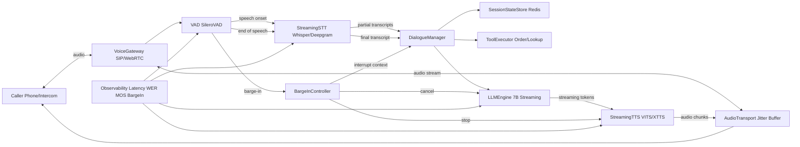

# Chapter 18: Design a Voice-First Real-Time Agent (AI Drive-Thru / Phone Agent)

## Context

> [!info] Quick Reference
> - **Pattern:** Fully-streaming sub-500ms voice-to-voice agent
> - **Scale:** 50K concurrent voice sessions, 12M sessions/day
> - **Key Techniques:** Streaming STT (Deepgram Nova-2) + self-hosted 8B LLM with speculative decoding + XTTS v2 TTS, barge-in handling (AEC + 2-stage detection), Silero VAD
> - **Primary Concerns:** End-to-end < 500ms voice-to-voice latency, barge-in interruption handling, acoustic echo cancellation, graceful degradation
> - **Cross-references:** [[chapter-04|Chapter 4]] (speculative decoding), [[chapter-14|Chapter 14]] (streaming STT), [[chapter-09|Chapter 9]] (agentic loop control)

**Problem statement:** Design a real-time voice agent that conducts natural conversations over phone or drive-thru intercom with sub-500ms voice-to-voice latency, handles interruptions gracefully, and maintains task state across multi-turn dialogues—processing 50K concurrent sessions with human-like responsiveness.

### Real-World Examples

- A fast-food chain deploys AI drive-thru agents across 5,000 locations. Each agent handles 200 orders/day. The critical metric: voice-to-voice latency (time from when the customer stops speaking to when the agent starts responding). At 800ms, customers perceive the agent as "slow and robotic" and 30% abandon mid-order. At 400ms, satisfaction scores match human operators. The system must handle interruptions—a customer changing their order mid-sentence ("Actually, make that a large—no, medium") requires the agent to stop speaking, reparse, and respond within 500ms.
- A healthcare appointment scheduling system handles 50K concurrent calls during open enrollment. Callers frequently interrupt the agent ("I already said Tuesday") and speak over confirmations. A naive pipeline (wait for silence → STT → LLM → TTS) produces 1.2s latency that causes callers to repeat themselves, creating a feedback loop of confusion. Switching to a streaming pipeline (STT starts transcribing during speech, LLM begins generating before STT finalizes) cuts latency to 450ms and reduces repeat-utterance rate by 60%.

---

## Step 1: Understand the Problem and Establish Design Scope

### Simulated Dialogue

**Interviewer:** Design a voice-first real-time agent for drive-thru ordering or phone-based customer service.  
**Candidate:** Voice agents have a fundamentally different latency contract than text-based systems. In text chat, 2 seconds is fine. In voice, anything over 500ms feels unnatural—humans expect conversational pacing. I need to understand the voice pipeline architecture (STT→LLM→TTS vs. native multimodal), interruption handling requirements, and concurrent session targets.

**Candidate:** What's the scale and concurrency?  
**Interviewer:** 50K concurrent voice sessions at peak. Each session lasts 2-5 minutes with 5-15 conversational turns.

**Candidate:** What latency targets?  
**Interviewer:** Voice-to-voice latency (end of user speech to start of agent speech) must be <500ms at p95. Total response must begin within 500ms; full responses stream over 2-5 seconds.

**Candidate:** What quality metrics?  
**Interviewer:** STT accuracy >95% WER (word error rate <5%). TTS naturalness MOS >4.0 (Mean Opinion Score, 1-5 scale). Task completion rate >90% (e.g., order placed correctly). Interruption handling: agent must stop within 200ms of user barge-in.

**Candidate:** What's the deployment environment?  
**Interviewer:** Phone calls via SIP/PSTN for customer service. Drive-thru intercom via audio stream. Both require handling background noise (kitchen noise, traffic, multiple speakers).

### Functional Requirements

- Real-time bidirectional voice conversation: agent speaks while listening for interruptions.
- STT with streaming partial transcripts (not wait-for-end).
- LLM response generation triggered on partial transcripts (speculative execution).
- TTS with streaming audio output (first audio chunk before full response is generated).
- Barge-in detection: if the user speaks while the agent is speaking, the agent stops and listens.
- Task-state management: order state, appointment details, or issue context maintained across turns.
- Multi-language support for common scenarios (English + Spanish at minimum).
- Graceful escalation to human agent when confidence drops below threshold.

### Non-Functional Requirements

- **Voice-to-voice latency:** p95 < 500ms (user silence detected → first agent audio byte).
- **Concurrent sessions:** 50K peak.
- **STT accuracy:** WER < 5% on domain-specific vocabulary.
- **TTS naturalness:** MOS > 4.0.
- **Barge-in response:** agent audio stops within 200ms of user voice detection.
- **Availability:** 99.95% (voice downtime = lost revenue).
- **Cost:** < $0.05 per minute of conversation.

### Back-of-the-Envelope Estimation

#### Session Profile

- Concurrent sessions: 50K
- Average session duration: 3 minutes
- Turns per session: 10 (5 user, 5 agent)
- Total sessions/day: assuming average session = 3 min, 50K concurrent, avg utilization 40%: `50K * 0.4 * (86400 / 180) = 9.6M sessions/day`
- Realistically (business hours, 12hr window): `50K * (12 * 3600 / 180) = 12M sessions/day`

#### Audio Data Volume

- Audio bitrate: 16kHz, 16-bit mono = 256 kbps = 32 KB/s
- Per session (3 min): `32 * 180 = 5.76 MB`
- Daily audio: `12M * 5.76 MB = 69 TB` (if stored; typically not stored long-term)
- Audio in transit: 50K sessions × 32 KB/s = 1.6 GB/s sustained bandwidth

#### STT Compute

- Whisper large-v3: processes 30s of audio in ~1s on A100 GPU (30x real-time)
- For streaming STT (Deepgram, AssemblyAI): cloud API, no GPU management needed
- Self-hosted streaming STT: each GPU handles ~30 concurrent streams
- GPUs for 50K concurrent: `50K / 30 = ~1,667 GPUs` for STT alone (prohibitive self-hosted)
- Reality: use managed STT API (Deepgram: $0.0043/min, AssemblyAI: $0.0065/min)
- STT cost: `12M sessions * 3 min * $0.0043 = $154,800/day` ← significant

#### LLM Compute

- Tokens per turn: ~100 input (transcript + state), ~50 output
- Turns per session: 5 agent turns
- Tokens per session: `5 * 150 = 750 tokens`
- Total tokens/day: `12M * 750 = 9B tokens`
- Using a fast 7B model (self-hosted, $0.10/1M tokens): `9B * $0.10/1M = $900/day`
- Using GPT-4o-mini ($0.15/1M input, $0.60/1M output): ~$2,700/day
- LLM is NOT the cost bottleneck. STT and TTS are.

#### TTS Compute

- Agent speaks ~15 seconds per turn, 5 turns = 75 seconds per session
- ElevenLabs: $0.18/1K chars, ~15 chars/second = ~$0.04/min
- Self-hosted (VITS/Bark): 1 GPU handles ~100 concurrent streams at real-time factor 50x
- GPUs for 50K concurrent TTS: `50K / 100 = 500 GPUs` self-hosted
- Managed TTS cost: `12M * 1.25 min * $0.04 = $600K/day` ← prohibitive at scale
- Self-hosted TTS is mandatory at this scale

#### Latency Budget (500ms voice-to-voice)

| Stage | Budget | Notes |
|---|---|---|
| Voice Activity Detection (VAD) | 50ms | Detect end-of-speech (silence threshold) |
| STT finalization (last partial → final) | 100ms | Streaming STT already has partial; final confirmation |
| Network (STT → LLM) | 20ms | Co-located services |
| LLM prefill + first token | 150ms | 7B model, ~100 input tokens |
| LLM first token → TTS first chunk | 30ms | Streaming handoff |
| TTS first audio chunk generation | 100ms | First 200ms of audio generated |
| Network (TTS → user) | 50ms | Audio packet delivery |
| **Total** | **500ms** | Zero slack—every stage must hit budget |

#### Cost Summary

| Component | Self-Hosted (per day) | Managed API (per day) | Notes |
|---|---|---|---|
| STT | $12K (400 GPUs) | $155K (Deepgram) | Self-host at scale |
| LLM | $900 (30 GPUs) | $2.7K (GPT-4o-mini) | Either works |
| TTS | $15K (500 GPUs) | $600K (ElevenLabs) | Must self-host |
| Infrastructure | $5K (networking, storage) | $2K | |
| **Total** | **~$33K/day** | **~$760K/day** | Self-hosted is 23x cheaper |
| **Per minute** | **$0.0019** | **$0.044** | |

---

## Step 2: Propose High-Level Design and Get Buy-In

### Core Architecture Components

- **Voice Gateway:** Handles SIP/PSTN connections for phone calls, WebSocket/WebRTC for web-based voice, and audio stream connections for drive-thru intercoms. Manages audio codec negotiation, echo cancellation, and noise suppression.
- **VAD (Voice Activity Detection):** Continuously monitors the audio stream. Detects speech onset (user starts talking) and speech offset (user stops talking). Also detects barge-in (user talks while agent is speaking). Low-latency requirement: <50ms detection.
- **Streaming STT:** Converts audio to text in real-time with partial (interim) transcripts. Partial transcripts arrive every 100-300ms as the user speaks. Final transcript arrives 100-200ms after speech ends.
- **Dialogue Manager:** Maintains conversation state (order items, customer info, issue context). Receives transcripts, determines next action (respond, ask clarification, execute tool call), manages multi-turn context window.
- **LLM Engine:** Generates agent responses based on transcript + dialogue state + system prompt. Must support streaming output (token-by-token). Optimized for low TTFT (<150ms).
- **Streaming TTS:** Converts LLM text output to audio in real-time. Starts generating audio from the first sentence fragment, doesn't wait for full response. Streams audio chunks back to the user.
- **Barge-In Controller:** Coordinates interruption handling. When VAD detects user speech during agent TTS playback: (1) immediately stop TTS audio, (2) cancel in-flight LLM generation, (3) route new audio to STT, (4) update dialogue state with interruption context.
- **Session State Store:** Low-latency key-value store (Redis) holding per-session state: conversation history, order state, customer metadata, current turn status.
- **Audio Transport Layer:** WebRTC for low-latency bidirectional audio. Jitter buffer management, packet loss concealment, adaptive bitrate.
- **Observability:** Voice-to-voice latency histograms, STT WER sampling, TTS MOS sampling, barge-in rate, task completion rate, escalation rate.

### Pipeline A: Session Establishment Pipeline

1. Incoming call (SIP) or audio connection (WebSocket) arrives at **Voice Gateway**.
2. Gateway negotiates codec (Opus for WebRTC, G.711 for PSTN), establishes bidirectional audio stream.
3. New session created in **Session State Store** with initial context (caller ID, time, location for drive-thru).
4. **VAD** begins monitoring inbound audio stream.
5. **TTS** generates and plays the greeting: "Welcome to [restaurant], what can I get for you?"
6. System enters listening state.

### Pipeline B: Turn-by-Turn Conversation Pipeline

1. **User speaks.** VAD detects speech onset → **Streaming STT** begins transcribing.
2. STT emits partial transcripts every 200ms: "I'd like a..." → "I'd like a large..." → "I'd like a large combo number three."
3. **Speculative execution (optional):** after the first 2-3 partial transcripts, the **Dialogue Manager** begins pre-processing likely intents. If "I'd like a large" strongly predicts an order, pre-load the menu context.
4. VAD detects end-of-speech (300ms silence) → STT emits final transcript.
5. **Dialogue Manager** receives final transcript, resolves it against conversation state:
   - Extracts intent (order item, modify order, ask question, confirm).
   - Executes any tool calls (add item to order, check availability).
   - Constructs LLM prompt: system prompt + menu/policy context + conversation history + current transcript.
6. **LLM Engine** generates response with streaming output. First token in <150ms.
7. **Streaming TTS** receives first sentence fragment from LLM, begins audio synthesis. First audio chunk ready in <100ms.
8. Audio streams to user. Agent is "speaking."
9. **If user interrupts (barge-in):** VAD detects user speech → **Barge-In Controller** triggers:
   - TTS audio playback stops within 200ms.
   - LLM generation cancelled.
   - STT begins transcribing the interruption.
   - Dialogue Manager receives the interruption transcript with context: "interrupted agent mid-response."
   - New LLM call generated with interruption context.
10. Turn completes. State updated. Next turn begins.

### Mermaid Architecture Diagram



---

## Step 3: Design Deep Dive

Focus areas:

1. **End-to-End Voice Latency Pipeline**
2. **Interruption Handling and Turn-Taking**
3. **Pipeline vs. Native Multimodal Architecture**

### 1) End-to-End Voice Latency Pipeline

The 500ms budget is the single most important constraint. Every millisecond wasted in one stage must be recovered in another. The pipeline must be designed for streaming at every stage—no stage waits for the previous stage to complete.

**The streaming pipeline principle:**

In a naive (batch) pipeline: user finishes speaking → STT processes full utterance → LLM receives full text → generates full response → TTS synthesizes full audio → playback begins. Total: 2-3 seconds.

In a streaming pipeline: STT emits partial transcripts while user speaks → LLM begins generating from partial context → TTS synthesizes audio from first sentence fragment → first audio byte plays before LLM finishes generating. Total: 400-500ms from end-of-speech to first audio.

**Per-stage latency optimization:**

**Stage 1: VAD (Voice Activity Detection) — 50ms budget**

| VAD Model | Latency | Accuracy | Resource | Notes |
|---|---|---|---|---|
| Silero VAD | 10-30ms | 95%+ | CPU only | **Production default.** Lightweight, runs on any CPU. |
| WebRTC VAD (Google) | 5-10ms | 90% | CPU only | Very fast but higher false-positive rate in noisy environments |
| Energy-based (RMS threshold) | 1-5ms | 80% | CPU only | Too many false triggers in drive-thru noise |
| Custom CNN VAD | 20-50ms | 97% | GPU | Overkill unless noise environment is extreme |

End-of-speech detection: VAD must decide "the user has stopped talking" quickly but not prematurely. Use a silence duration threshold:
- 300ms silence → end-of-speech (default for transactional conversations)
- 500ms silence → end-of-speech (for more deliberate speakers)
- Adaptive: start at 300ms, increase to 500ms if the user has been pausing mid-sentence (detected via partial transcript analysis)

**Stage 2: Streaming STT — 100ms budget (from end-of-speech to final transcript)**

The STT has been running throughout the user's speech, emitting partial transcripts. After VAD signals end-of-speech, the STT needs only ~100ms to finalize the transcript (commit the last few words, apply language model correction).

| STT System | Streaming | WER (clean audio) | WER (noisy, drive-thru) | Latency (partial) | Latency (final) | Cost |
|---|---|---|---|---|---|---|
| Deepgram Nova-2 | Yes | 3.2% | 8.5% | 200ms | 100ms after EOS | $0.0043/min |
| Google Cloud STT v2 | Yes | 3.8% | 9.1% | 250ms | 150ms after EOS | $0.006/min |
| Whisper large-v3 (streaming via whisper.cpp) | Semi (chunked) | 2.9% | 7.8% | 500ms chunks | 300ms after EOS | Self-hosted: ~$0.001/min |
| AssemblyAI Universal | Yes | 3.5% | 8.0% | 200ms | 100ms after EOS | $0.0065/min |
| Fine-tuned Whisper (domain vocab) | Semi | 2.1% | 5.2% | 500ms chunks | 300ms after EOS | Self-hosted: ~$0.001/min |

For <500ms voice-to-voice: managed streaming STT (Deepgram) provides the best latency profile. Self-hosted Whisper requires chunked streaming (500ms chunks), which adds 200ms to the pipeline.

**Domain vocabulary adaptation:**

Drive-thru menus have domain-specific terms ("McFlurry," "Whopper," "venti"). STT systems misrecognize these. Fix:
- **Hot-word boosting:** Deepgram/Google Cloud support keyword boosting—provide a list of menu item names with boosted recognition probability. +15% accuracy on menu items, zero latency impact.
- **Fine-tuning:** fine-tune Whisper on 100 hours of drive-thru audio with transcripts. WER drops from 8.5% to 5.2% on domain vocab. Requires labeled training data.
- **Post-correction:** after STT, run a fast string-matching pass to correct common misrecognitions: "large MacFlurry" → "large McFlurry." Adds <5ms.

**Stage 3: LLM Generation — 150ms budget (to first token)**

The LLM must produce the first output token within 150ms of receiving the final transcript. This constrains model size and optimization stack.

| Model | Size | TTFT (100 tokens input) | TPOT | Quality (task completion) | Self-hosted GPU | Notes |
|---|---|---|---|---|---|---|
| GPT-4o-mini (API) | Unknown | 200-400ms | 15ms | 94% | N/A | API latency adds 50-100ms network |
| Llama 3 8B (INT4, vLLM) | 8B | 80ms | 8ms | 88% | 1× A100 | **Production default** |
| Llama 3 8B + speculative decoding | 8B + 1B | 80ms | 3ms | 88% | 1× A100 | Fastest decode |
| Phi-3 3.8B (INT4) | 3.8B | 40ms | 5ms | 82% | 1× A10 | Budget option |
| Mistral 7B (INT4) | 7B | 75ms | 7ms | 86% | 1× A100 | Good alternative |

For voice agents, a self-hosted 8B model with speculative decoding is optimal: 80ms TTFT, 3ms TPOT, fitting the 150ms budget with headroom. API-based models add 50-100ms network latency that's hard to recover.

**Prompt design for voice agents:**

Voice agent prompts differ from text agent prompts:
- Responses must be SHORT. A 200-word text response is fine; a 200-word spoken response takes 60 seconds and the caller hangs up.
- Responses must be SPEAKABLE. No bullet points, URLs, or code. No parenthetical remarks.
- System prompt includes: "Keep responses to 1-2 sentences. Use simple, conversational language. Never list more than 3 items. If the order is ambiguous, ask one clarifying question."
- Token budget: cap output at 50 tokens (~15 seconds of speech). Longer responses get truncated.

**Stage 4: Streaming TTS — 100ms budget (to first audio chunk)**

TTS begins synthesizing as soon as the first complete sentence or clause arrives from the LLM. It doesn't wait for the full response.

| TTS System | Streaming | MOS | Latency (first chunk) | Languages | Cost | Notes |
|---|---|---|---|---|---|---|
| ElevenLabs Turbo v2 (API) | Yes | 4.5 | 200-400ms | 30+ | $0.18/1K chars | High quality but API latency |
| XTTS v2 (self-hosted) | Yes | 4.2 | 80ms | 17 | Self-hosted: ~$0.001/min | **Production default** |
| VITS (self-hosted) | Yes | 3.8 | 40ms | Per-language | Self-hosted: ~$0.0005/min | Fastest, lower quality |
| Bark (self-hosted) | No (batch) | 4.3 | 2,000ms | 10+ | Self-hosted | Too slow for real-time |
| Azure Neural TTS (API) | Yes | 4.4 | 150-300ms | 100+ | $16/1M chars | Good quality, API latency |

For <500ms pipeline: self-hosted XTTS v2 with 80ms first-chunk latency. Trade-off: slightly lower naturalness (MOS 4.2 vs 4.5) but meets the latency budget.

**Sentence-level streaming:**

The LLM generates tokens one at a time. TTS needs at least a sentence fragment to produce natural-sounding audio. Strategy:
- Buffer LLM tokens until a sentence boundary (period, question mark) or a pause-worthy clause boundary (comma followed by a conjunction).
- Minimum fragment: 5 words. Shorter fragments produce choppy audio.
- Maximum wait before forcing synthesis: 500ms of buffered tokens. If the LLM is slow, synthesize whatever is available.

#### End-to-End Latency Trade-off Table

| Pipeline Mode | Voice-to-Voice Latency | Quality | Complexity | Cost | Best For |
|---|---|---|---|---|---|
| Batch (wait for each stage) | 2,000-3,000ms | Highest (no partial errors) | Low | Low (fewer API calls) | Voicemail transcription, non-interactive |
| Streaming STT + batch LLM + batch TTS | 1,200-1,800ms | High | Medium | Medium | Low-priority phone IVR |
| Full streaming (STT→LLM→TTS all streaming) | 400-500ms | Good (occasional partial-transcript errors) | High | Medium | **Production default for real-time agents** |
| Speculative pipeline (start LLM on partial transcript) | 300-400ms | Lower (may generate wrong response) | Very high | Higher (wasted compute on wrong predictions) | Ultra-low-latency premium |

### 2) Interruption Handling and Turn-Taking

Humans interrupt each other constantly in conversation. A voice agent that can't handle interruptions feels robotic and frustrating. Barge-in handling is the second most critical feature after latency.

**Barge-in detection pipeline:**

1. While TTS is playing (agent speaking), VAD continues monitoring the inbound audio stream.
2. **Challenge:** the agent's own audio (played through a speaker/earpiece) feeds back into the microphone, creating an echo. VAD must distinguish the user's voice from the echo of the agent's voice.
3. **Acoustic Echo Cancellation (AEC):** subtract the known agent audio signal from the incoming audio before VAD analysis. This is standard in telephony hardware (PSTN handles it) and WebRTC (built-in AEC). Drive-thru intercoms require custom AEC tuning for the acoustic environment.
4. After AEC, if VAD detects speech energy above threshold → **barge-in detected.**

**Barge-in response sequence (must complete in <200ms):**

| Step | Action | Latency | Notes |
|---|---|---|---|
| 1 | VAD detects speech during agent playback | 30ms | After AEC |
| 2 | Send stop signal to TTS audio output | 10ms | Immediate audio mute |
| 3 | Cancel in-flight LLM generation | 10ms | Abort streaming response |
| 4 | Record how much of the agent response was played | 5ms | For context: "agent said X before interrupted" |
| 5 | Route inbound audio to STT | 10ms | STT begins transcribing interruption |
| 6 | Update dialogue state with interruption | 5ms | Flag: partial response delivered |
| **Total** | | **70ms** | Well within 200ms budget |

**Turn-taking state machine:**

```
States: LISTENING → PROCESSING → SPEAKING → INTERRUPTED

LISTENING: VAD monitors. On speech_onset → route to STT. On end_of_speech → transition to PROCESSING.
PROCESSING: STT finalizes. LLM generates. On first_audio_chunk → transition to SPEAKING.
SPEAKING: TTS plays. On barge_in → transition to INTERRUPTED. On playback_complete → transition to LISTENING.
INTERRUPTED: Stop TTS. Cancel LLM. STT transcribes interruption. On end_of_speech → transition to PROCESSING (with interruption context).
```

**Context handling after interruption:**

When the user interrupts, the dialogue manager must know:
- What the agent was saying when interrupted (for context, the user heard part of it).
- What the user said during/after the interruption.
- Whether the interruption is a correction ("no, I said medium"), an addition ("and also a drink"), or a redirect ("actually, cancel that").

Prompt augmentation after interruption:
```
[Previous agent response, spoken up to: "Your total comes to $12.50. Would you like to add—"]
[User interrupted with: "Actually, remove the fries."]
[Instruction: The user interrupted your response. Acknowledge the interruption, process their request, and continue.]
```

**False barge-in handling:**

Not all detected speech during agent playback is an intentional interruption:
- Background noise (other people talking, traffic)
- The user saying "uh-huh" or "yeah" as backchannel acknowledgment
- Someone else at the drive-thru window talking

Strategy:
- **Minimum speech duration:** don't trigger barge-in for speech bursts < 300ms. Short bursts are likely backchannel or noise.
- **Confidence threshold:** if STT produces only filler words ("uh," "hmm," "yeah") with high confidence, treat as backchannel, not interruption. Continue agent playback.
- **Two-stage detection:** on first speech detection, lower TTS volume by 50% for 500ms. If speech continues past 500ms, fully stop TTS and process as interruption. If speech stops, restore TTS volume. This creates a graceful "pause" rather than a jarring stop.

#### Interruption Handling Trade-off Table

| Strategy | False Barge-In Rate | Missed Barge-In Rate | User Experience | Complexity |
|---|---|---|---|---|
| Immediate stop on any speech | 25% (noise triggers) | 0% | Choppy—agent stops for every noise | Low |
| 300ms minimum speech + backchannel filter | 5% | 3% (misses very short corrections) | Good for most environments | Medium |
| Two-stage (volume reduction → full stop) | 3% | 2% | **Most natural** | High |
| No barge-in (wait for agent to finish) | 0% | 100% | Terrible—caller must wait | Trivial |

### 3) Pipeline vs. Native Multimodal Architecture

The traditional voice agent uses a cascade pipeline: STT → LLM → TTS. An emerging alternative: native speech-to-speech models that process audio directly without text intermediation.

**Pipeline architecture (STT → LLM → TTS):**

```
Audio In → STT → Text → LLM → Text → TTS → Audio Out
```

Each stage is independently optimizable and debuggable. STT, LLM, and TTS can be swapped independently. Text intermediation enables logging, filtering, and safety checks on the actual words.

**Native multimodal architecture (Audio → Model → Audio):**

```
Audio In → Multimodal Model → Audio Out
```

A single model (e.g., GPT-4o voice mode, Moshi, SpeechGPT) takes audio tokens as input and produces audio tokens as output. No text intermediation.

| Dimension | Pipeline (STT→LLM→TTS) | Native Multimodal | Notes |
|---|---|---|---|
| **Voice-to-voice latency** | 400-500ms (sum of stages) | 200-300ms (single model) | Multimodal eliminates inter-stage latency |
| **STT accuracy dependency** | Yes—LLM only sees STT output; STT errors propagate | No—model hears raw audio, can understand despite noise | Major advantage for noisy environments |
| **LLM reasoning quality** | High—text-mode LLMs are well-optimized | Lower—speech-to-speech models are less capable at reasoning | Pipeline wins for complex tasks |
| **TTS naturalness** | Depends on TTS model (MOS 3.8-4.5) | Very high—model controls prosody, emotion, pacing natively (MOS 4.5+) | Multimodal produces more human-like speech |
| **Debuggability** | High—inspect text at each stage | Low—audio-in/audio-out is a black box | Critical for production debugging |
| **Safety/filtering** | Easy—text-based content filtering between LLM and TTS | Hard—must analyze audio output or add separate ASR for monitoring | Compliance requirement |
| **Language/voice control** | Separate TTS voice selection, style control | Limited—model has its own voice(s) | Pipeline offers more customization |
| **Cost** | Sum of 3 models | Single model (but larger, GPU-intensive) | Roughly comparable at scale |
| **Maturity** | Production-proven (2+ years) | Early production (2024-2025) | Pipeline is safer choice today |
| **Modularity** | Swap any component independently | Monolithic—upgrade is all-or-nothing | Pipeline wins for iteration speed |
| **Emotion/tone** | TTS must be explicitly instructed (SSML) | Model naturally modulates tone based on context | Multimodal feels more human |

**Recommended: Pipeline with multimodal as a staged migration.**

Start with the pipeline architecture (STT→LLM→TTS) for production reliability, debuggability, and safety filtering. Monitor multimodal model maturity. Pilot multimodal on low-risk, high-volume scenarios (drive-thru greetings, simple order confirmations) while keeping pipeline for complex interactions (order modifications, complaints, escalations).

**Hybrid architecture (emerging best practice):**

```
Audio In → STT → Text → LLM (text) → Text → TTS → Audio Out
                    ↓
              Audio In → Multimodal Model → Audio Out
              (fallback for noisy audio where STT fails)
```

Use the pipeline by default. If STT confidence drops below 70% (noisy environment), fall back to the multimodal model that can handle audio directly. This gives the best of both worlds.

#### Architecture Strategy Trade-off Table

| Architecture | Latency | Quality | Safety | Debuggability | Maturity | Best For |
|---|---|---|---|---|---|---|
| Pipeline (STT→LLM→TTS) | 400-500ms | Good | High (text filtering) | High | Production | **Default for most deployments** |
| Native multimodal | 200-300ms | Higher naturalness | Low (audio black box) | Low | Early | Greenfield projects with lower compliance |
| Hybrid (pipeline + multimodal fallback) | 400ms default, 250ms fallback | Best overall | Medium | Medium | **Target architecture (2025+)** |
| Pipeline with speculative LLM | 300-400ms | Good | High | High | Experimental | Latency-critical premium tier |

### Production Bottlenecks and Mitigations

- **STT latency spike under load**
  - Symptom: managed STT API p95 latency jumps from 100ms to 500ms during peak hours, pushing total voice-to-voice latency to 900ms.
  - Mitigation: multi-provider STT failover. Primary: Deepgram. Failover: Google Cloud STT. If primary latency exceeds 200ms for 3 consecutive calls, route to failover. Additionally: self-host a Whisper instance pool for fallback (higher latency but no rate limits).

- **Background noise false-triggers VAD continuously**
  - Symptom: drive-thru kitchen noise triggers speech detection, causing constant barge-in on agent speech.
  - Mitigation: deploy a noise-robust VAD trained on drive-thru audio (fine-tune Silero VAD on 1,000 hours of drive-thru ambient noise). Additionally: use directional microphone hardware at the order point to reduce ambient noise pickup.

- **TTS audio glitches during streaming**
  - Symptom: audio artifacts (clicks, pops, gaps) at sentence boundaries when TTS switches from one synthesized fragment to the next.
  - Mitigation: overlap-add blending at fragment boundaries. Generate 50ms of overlapping audio between consecutive fragments and crossfade. This smooths transitions. Additionally: buffer two fragments ahead before starting playback (adds 100ms to initial latency but eliminates all audible gaps).

- **Dialogue state corruption on rapid interruptions**
  - Symptom: user interrupts twice in quick succession ("no—wait—actually, make it a large"), and the dialogue manager loses track of the current order state.
  - Mitigation: atomic state updates with version numbers. Each state change is a versioned transaction. Interrupted LLM generations that haven't committed a state change are rolled back. Only fully processed turns update the state.

- **Caller on hold / silence handling**
  - Symptom: caller goes silent for 10+ seconds (putting phone down, talking to someone else). System times out and disconnects.
  - Mitigation: implement a "patience protocol." After 5s silence: "Take your time, I'm still here." After 15s: "Are you still there?" After 30s: "I'll keep your order saved. Call back when you're ready." Don't hard-disconnect until 60s.

### Advanced Techniques

- **Speculative response generation:** while the user is still speaking (mid-utterance), the system predicts the likely complete utterance from partial transcripts and begins generating a response speculatively. If the prediction is correct (>70% of the time for common patterns like "I'd like a [menu_item]"), the response is already partially generated by the time the user finishes. Saves 100-200ms. Risk: wasted compute on wrong predictions (~30% waste rate).
- **Emotion detection for escalation:** analyze audio features (pitch, speaking rate, volume) to detect caller frustration. If frustration score exceeds threshold, proactively offer: "I want to make sure I get this right for you. Would you like me to connect you with a team member?" Early escalation improves CSAT vs. letting the caller struggle with the AI.
- **Contextual pre-loading:** for drive-thru, pre-load the current menu, promotions, and item availability into the LLM context before the first customer interaction. For phone agents, use caller ID to pre-load account history. Reduces per-turn context assembly time to near-zero.

---

## Step 4: Wrap Up

### Final Design Summary

The system achieves sub-500ms voice-to-voice latency through a fully streaming pipeline: Silero VAD for end-of-speech detection (50ms), streaming STT with domain-adapted vocabulary (100ms finalization), a self-hosted 8B LLM with speculative decoding (80ms TTFT), and self-hosted XTTS v2 for streaming TTS (80ms first chunk). Barge-in handling uses a two-stage detection strategy (volume reduction then full stop) that achieves 3% false positive rate while catching 98% of real interruptions. At 50K concurrent sessions, self-hosted STT and TTS at $0.002/minute is 23x cheaper than managed APIs. The architecture is pipeline-based (STT→LLM→TTS) for production maturity and debuggability, with a planned migration path to hybrid pipeline + native multimodal for noisy environments.

### Wrap-Around Concerns

- **Risk:** 500ms latency budget has zero slack. Any single stage regression (STT provider latency spike, GPU contention on LLM, TTS audio buffer underrun) breaks the SLO. Mitigation: per-stage latency monitoring with circuit breakers. If any stage exceeds 1.5x budget, degrade gracefully (shorter responses, skip speculative execution, use lower-quality but faster TTS).
- **Risk:** Background noise in drive-thru environments degrades STT accuracy below 95%. Mitigation: domain-adapted STT model, hot-word boosting, and multimodal fallback for low-confidence transcripts.
- **Risk:** Barge-in handling with AEC fails in novel acoustic environments (new intercom hardware, outdoor seating areas). Mitigation: per-location AEC calibration during installation. Monitor barge-in false-positive rate per location; alert if >10%.
- **Risk:** Self-hosted TTS and STT require 900+ GPUs at peak, creating significant infrastructure operational burden. Mitigation: auto-scaling with spot instances for burst. Maintain 60% baseline on reserved instances, scale 40% on spot.
- **Risk:** Dialogue state errors cause wrong orders (customer says "large" but system records "small"). Mitigation: explicit confirmation turns for high-value items. "Got it—one large combo number three. Is that correct?" Confirmation rate should be >95%.

---

## Step 5: Interviewer Curveballs

### Interviewer Follow-ups & Frequently Asked Questions (FAQ)

Q: The customer says "I'd like a large number three with no pickles and a Coke—oh wait, make that a Sprite." Your system must handle this single utterance. Walk through exactly what happens.

**The Ideal Answer:** This is a self-correction within a single turn—not a multi-turn dialogue issue. The STT transcribes the full utterance as one text. The LLM must parse the self-correction. Prompt design handles this: the system prompt instructs "Customers may change their mind mid-sentence. The LAST stated preference overrides earlier ones." The LLM parses: (1) large #3, (2) no pickles, (3) Coke, (4) correction: Sprite replaces Coke. Final order: large #3, no pickles, Sprite. The dialogue manager commits this as a single state update. Confirmation: "A large number three, no pickles, with a Sprite. Anything else?"

**Deep Dive & Trade-offs:**
- The LLM must be robust to self-corrections. Include few-shot examples of self-corrections in the system prompt.
- If STT segments this as two utterances (pause between "Coke" and "oh wait"), the system processes two turns. The second turn ("make that a Sprite") is a modification. Both paths work but the two-turn path adds 500ms.
- Edge case: "no pickles" is a negation. LLMs sometimes struggle with negations in structured extraction. Include explicit negation examples in few-shot.

**The Interviewer's Rubric:** Checking understanding of real-world speech patterns and how they map to dialogue management.

---

Q: Your STT transcribes "I'd like a four-piece nugget" but the customer actually said "forty-piece nugget." This is a real order—how do you prevent costly misrecognitions?

**The Ideal Answer:** Numerals in noisy environments are the #1 STT failure mode. Defense layers: (1) **Hot-word boosting:** if the menu has "4-piece" and "40-piece" but no "forty-piece" as a string, STT may default to the more common "four-piece." Boost all menu item names including their numeric variants. (2) **Menu-aware post-processing:** after STT, validate the transcript against the actual menu. "Four-piece nugget" is a valid menu item but so is "forty-piece nugget." If ambiguous, use acoustic confidence scores on the numeral. (3) **Confirmation protocol:** for items where the quantity matters (and thus the price difference is large—$3 vs $12), always confirm: "Was that a four-piece or forty-piece nugget?" This adds one turn (~3 seconds) but prevents a wrong order. (4) **Cost-based confirmation threshold:** only confirm when the price difference between homophones exceeds $5. "Coke vs. Diet Coke" ($0 difference) → don't confirm. "4-piece vs. 40-piece" ($9 difference) → confirm.

**Deep Dive & Trade-offs:**
- Confirmation on every item creates a tedious experience. Cost-based thresholding limits confirmations to ~10% of items.
- Alternative: use DTMF (keypad) input for quantities. "Press 4 for four-piece, press 0 for forty-piece." Works for phone; not for drive-thru.
- Long-term: fine-tune STT on menu-specific audio (with emphasis on numeric terms) to reduce misrecognition rate.

**The Interviewer's Rubric:** Checking awareness of domain-specific STT failure modes and practical mitigation.

---

Q: Two people are talking at the drive-thru speaker simultaneously—one ordering, one commenting to their passenger. How does the system handle overlapping speakers?

**The Ideal Answer:** Multi-speaker handling at drive-thru is a hard unsolved problem. Practical approaches: (1) **Speaker diarization:** identify the primary speaker (closest to the microphone) and filter out the secondary speaker. Modern diarization models (pyannote) can separate speakers in real-time but add 100-200ms latency—tight for the budget. (2) **Dominant speaker extraction:** without full diarization, use audio energy and direction (if using a directional microphone array) to focus on the loudest/closest speaker. Simpler, faster (<50ms), works 80% of the time. (3) **Confusion detection:** if the STT output is incoherent (two interleaved conversations), the system recognizes confusion and asks: "Sorry, I heard a couple of things. Could you repeat your order?" (4) **Hardware solution:** directional microphone with cardioid pattern pointed at the driver-side window. Rejects speech from the passenger side by 15-20 dB. This is the most effective solution and most drive-thru installations use it.

**Deep Dive & Trade-offs:**
- Real-time speaker diarization adds 100-200ms—may break the 500ms budget if the pipeline is already tight.
- Directional microphones solve 90% of the problem at hardware level, zero latency impact.
- For phone calls (not drive-thru), there's no directional mic. Must rely on diarization or simply accept that multi-speaker phone calls are harder.
- Worst case: if the system can't distinguish speakers, it processes whatever STT produces and relies on the confirmation step to catch errors.

**The Interviewer's Rubric:** Checking understanding that voice pipeline challenges are often solved at the hardware/acoustic layer, not just software.

---

Q: Your LLM generates a response but the TTS pronunciation is wrong—it says "live" (as in "alive") instead of "live" (as in "broadcast"). How do you control pronunciation?

**The Ideal Answer:** TTS pronunciation errors on homographs ("live," "read," "lead," "wind") are common. Controls: (1) **SSML (Speech Synthesis Markup Language):** wrap ambiguous words with phoneme hints: `<phoneme alphabet="ipa" ph="laɪv">live</phoneme>`. This requires the LLM to generate SSML-annotated text, which is feasible with prompt engineering. (2) **Pronunciation dictionary:** the TTS system maintains a custom pronunciation dictionary mapping words to phonemes in context. "Live music" → /laɪv/, "live broadcast" → /laɪv/, "live animals" → /laɪv/. Context-dependent rules. (3) **Domain-specific TTS fine-tuning:** fine-tune the TTS model on domain-specific text-audio pairs. For a drive-thru, the vocabulary is limited; pronunciation errors are rare after fine-tuning on menu items. (4) **Post-synthesis verification (expensive):** run a lightweight STT on the generated audio and compare against the input text. If mismatched, re-synthesize. Adds ~200ms per turn.

**Deep Dive & Trade-offs:**
- SSML adds complexity to the LLM prompt and output parsing. Not all TTS systems fully support SSML.
- Pronunciation dictionaries are effective for domain-specific terms but don't generalize to novel text.
- TTS fine-tuning requires 5-10 hours of recorded audio in the target voice + domain text. ~1 week of effort.
- In practice, for constrained domains (drive-thru, appointment scheduling), the vocabulary is small enough that a pronunciation dictionary covers 99% of cases.

**The Interviewer's Rubric:** Checking awareness of TTS quality control beyond "plug in a TTS API."

---

Q: You need to deploy this system across 5,000 drive-thru locations worldwide. How do you handle the infrastructure?

**The Ideal Answer:** Two architectural options: (1) **Cloud-centralized:** all audio streams back to regional cloud data centers. Pros: centralized GPU fleet, easy model updates, shared capacity. Cons: network latency from store to cloud (50-100ms RTT), bandwidth costs (32KB/s per stream × 5K locations), dependency on WAN. (2) **Edge deployment:** deploy a small compute node at each location (or per-cluster of locations). Run VAD + lightweight processing locally; stream only to STT/LLM in a regional data center. Pros: reduced network dependency, lower latency. Cons: 5,000 edge devices to manage, limited compute per location.

**Recommended: Hybrid.** VAD runs on a local edge device (Raspberry Pi-class, $50 hardware). Audio streams to the nearest regional data center (8-12 regions globally) for STT→LLM→TTS processing. Audio transport over WebRTC with adaptive bitrate.

Regional data center sizing: 5,000 locations / 10 regions = 500 locations per region. At peak (lunch rush): 500 locations × 3 concurrent orders = 1,500 concurrent sessions per region. GPU fleet per region: ~30 GPUs for STT, ~5 for LLM, ~15 for TTS = ~50 GPUs per region, 500 GPUs total.

Network resilience: if WAN to cloud fails, the edge device plays pre-recorded prompts ("Our AI system is temporarily unavailable. A team member will take your order.") and escalates to human.

**Deep Dive & Trade-offs:**
- Edge VAD eliminates false triggers before audio leaves the premises, saving bandwidth.
- Running full STT/LLM/TTS on-premise is theoretically possible (with a $5K GPU box per location) but operationally nightmarish at 5,000 locations.
- Network quality varies by location. Rural locations with poor connectivity may need a larger edge compute footprint.
- Model updates: push new model weights to regional data centers (trivial). Push new VAD models to edge devices (non-trivial—requires OTA update infrastructure).

**The Interviewer's Rubric:** Checking infrastructure architecture thinking for geographically distributed real-time systems.

---

Q: A customer has a heavy accent that drops STT accuracy to 70% WER. How do you handle graceful degradation?

**The Ideal Answer:** Accent robustness is an equity and accessibility concern, not just a quality metric. Layers: (1) **Multi-model STT ensemble:** run two STT models in parallel (e.g., Deepgram + Whisper). Take the transcript with higher confidence. Different models have different accent strengths. (2) **Confidence-based clarification:** if STT confidence on any word drops below 60%, ask for clarification on that specific word rather than the whole utterance: "I got 'large number three'—was the drink a Coke or a Fanta?" (3) **Multimodal fallback:** if text-based understanding fails, route the audio to a native multimodal model (GPT-4o voice mode) that processes audio directly—it may understand accented speech that STT couldn't transcribe. (4) **Human escalation:** if confidence stays below threshold for 3 consecutive turns, offer: "Let me connect you with a team member who can help." Don't let the customer struggle. (5) **Long-term:** collect and label accent-diverse training data (with speaker consent). Fine-tune STT models to improve accuracy across accent groups. Monitor WER by demographic cohort (accent, age) to ensure equitable performance.

**Deep Dive & Trade-offs:**
- Multi-model STT doubles compute cost. Only activate for low-confidence sessions.
- Clarification questions add friction. Limit to 1 clarification per turn.
- Human escalation is the safety net but defeats the purpose of automation. Track escalation rate by accent group—if one group escalates 5x more, the model needs retraining for that accent.
- Ethical consideration: if the system performs significantly worse for certain accent groups, it's discriminatory. Regular fairness audits on WER by accent are mandatory.

**The Interviewer's Rubric:** Checking fairness and accessibility thinking in voice AI systems.

---

Q: The restaurant changes its menu seasonally. How do you update the voice agent without downtime?

**The Ideal Answer:** Menu updates propagate through three components: (1) **Dialogue context:** the system prompt and menu context (item names, prices, availability) are stored in a configuration database, not hardcoded in the model. Menu update = database record update, zero model changes. The LLM reads the current menu from context at the start of each session. (2) **STT hot-words:** the keyword boost list must be updated with new item names. Push new hot-word list to the STT service (API parameter, no model reload). (3) **TTS pronunciation dictionary:** add pronunciation entries for new menu items. Deploy as a config update to the TTS service.

Deployment: blue-green deployment at the session level. New sessions use the updated config (new menu). Existing sessions continue with the old config until they end (max 5 minutes). No mid-session menu changes to avoid confusion. Zero downtime.

Testing: before deployment, run the updated config through an automated test suite: 50 synthetic orders covering new menu items. Verify: STT recognizes new item names, LLM correctly adds them to orders, TTS pronounces them correctly, confirmation messages include correct prices.

**Deep Dive & Trade-offs:**
- Separating menu data from model weights is critical. If menu items were in the model's training data, updates would require model retraining.
- Hot-word lists have limits (typically 100-500 terms). Seasonal menus fit easily; restaurants with 500+ items may need tiered boosting (boost seasonal items + top-50 by popularity).
- The test suite should run in <5 minutes. Block deployment if any test fails.
- Rollback: if the new menu config causes issues (wrong prices, unrecognized items), revert the database record. All new sessions immediately use the old menu. Rollback time: <1 minute.

**The Interviewer's Rubric:** Checking operational maturity for configuration-driven updates in real-time systems.

---

Q: How do you measure whether the voice agent is actually good? What metrics matter beyond latency?

**The Ideal Answer:** Voice agent quality is multi-dimensional. Metric stack: (1) **Task completion rate:** did the order get placed correctly / did the appointment get scheduled / did the issue get resolved? Ground truth: compare agent-recorded order vs. POS system receipt. Target: >90%. (2) **Order accuracy:** for drive-thru, exact match between what the agent understood and what the customer received. Track mismatches at the item and modifier level (wrong size, missing "no pickles"). (3) **Average handle time (AHT):** total session duration. Compare against human operator baseline. Target: within 20% of human AHT. (4) **Escalation rate:** % of sessions escalated to human. Target: <10%. (5) **Customer satisfaction (CSAT):** post-call survey or inferred from behavioral signals (repeat usage, abandonment). (6) **Utterance understanding rate:** % of user utterances that the system correctly interpreted (manual sampling of 500/week). (7) **Barge-in success rate:** when users interrupt, does the system correctly handle the interruption? (8) **Revenue per session:** for sales agents, compare average order value (AI agent vs. human). AI agents are consistent (always upsell) but may miss contextual cues.

**Deep Dive & Trade-offs:**
- Task completion rate is the ultimate metric but is expensive to measure (requires ground truth from the fulfillment system).
- AHT is easy to measure but can be gamed (agent that confirms excessively has low error but high AHT).
- CSAT surveys have low response rates (<5%). Infer satisfaction from behavioral signals: repeat usage, session duration, abandonment timing.
- Weekly review of 500 sampled sessions by QA team provides qualitative insights that metrics miss.

**The Interviewer's Rubric:** Checking holistic quality measurement beyond engineering metrics.

## End of Chapter

- **Key takeaway:** Voice-first agents are latency-engineering problems first and AI problems second. The 500ms voice-to-voice budget requires streaming at every pipeline stage—STT, LLM, and TTS cannot operate in batch mode. Barge-in handling (interruption detection and response within 200ms) is the feature that separates usable voice agents from frustrating ones. At 50K concurrent sessions, self-hosted STT and TTS are 23x cheaper than managed APIs, making infrastructure architecture as critical as model selection.
- **What to practice:** Draw the end-to-end latency waterfall from user speech → VAD → STT → LLM → TTS → audio playback, with millisecond budgets per stage. Identify which stage is the bottleneck and how to shave 50ms from it.
- **Interview drill:** Walk through a barge-in scenario: the agent is saying "Your total comes to twelve dollars and fifty cents" and the customer interrupts at "twelve dollars." Trace every system action from VAD detection through TTS stop through STT transcription of the interruption through LLM re-generation through audio playback.
