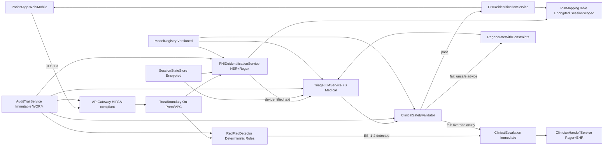

# Chapter 20: Design a Healthcare Triage and Diagnostic Assistant

## Context

> [!info] Quick Reference
> - **Pattern:** Safety-critical healthcare triage with HIPAA compliance
> - **Scale:** 1M triage sessions/day, ~35 sessions/sec peak
> - **Key Techniques:** 2-pass PHI de-identification (NER + regex, > 99.5% recall), deterministic red-flag engine (> 99.9% sensitivity), clinical safety validator, temperature=0, WORM audit trail
> - **Primary Concerns:** Zero missed ESI 1-2 emergencies, HIPAA PHI protection, 7-year audit retention, regulatory defensibility
> - **Cross-references:** [[chapter-05|Chapter 5]] (safety stack), [[chapter-11|Chapter 11]] (accuracy requirements), [[chapter-17|Chapter 17]] (audit trail patterns)

**Problem statement:** Design an LLM-powered healthcare triage system that conducts structured symptom interviews, assigns acuity levels, and provides preliminary diagnostic guidance—with zero tolerance for missed critical symptoms, strict HIPAA compliance (PHI must never reach LLM API endpoints), deterministic escalation to human clinicians, and a complete audit trail for regulatory review.

### Real-World Examples

- A telehealth platform handles 1M triage sessions/day. Their rule-based system misclassifies 8% of urgent cases as non-urgent because it can't interpret free-text symptom descriptions ("my chest feels tight and my arm is tingly" should be ESI Level 2, but keyword matching only catches "chest pain"). Deploying an LLM-augmented triage system with a deterministic red-flag detector reduces urgent misclassification to 0.3% while maintaining 2s response latency. The LLM handles natural language understanding; the deterministic layer handles safety-critical decisions.
- A hospital emergency department uses an AI triage assistant to pre-screen patients in the waiting room via tablet. The system must never store PHI in cloud LLM logs. After a HIPAA audit reveals that patient names and dates of birth were being sent to a third-party LLM API in prompt text, the hospital faces a $1.2M fine. Redesigning with a PHI scrubbing pipeline (de-identification before API calls, on-premise re-identification after) eliminates the exposure while preserving clinical accuracy.

---

## Step 1: Understand the Problem and Establish Design Scope

### Simulated Dialogue

**Interviewer:** Design a healthcare triage and diagnostic assistant.  
**Candidate:** Healthcare is a high-stakes domain where the failure mode isn't "bad user experience"—it's missed diagnoses and regulatory violations. I need to decompose this into three independent systems: (1) a PHI protection pipeline that guarantees patient data never reaches external APIs, (2) a clinical safety layer with deterministic escalation rules that cannot be overridden by the LLM, and (3) an audit trail that satisfies HIPAA and FDA requirements. The LLM is a component, not the system.

**Candidate:** What's the scale and session profile?  
**Interviewer:** 1M triage sessions per day. Each session averages 6 question-answer turns. The system classifies patients into 5 acuity levels (ESI 1-5). Peak traffic is 3x average (morning hours, Monday surges).

**Candidate:** What are the safety-critical constraints?  
**Interviewer:** Zero tolerance for missed critical symptoms. If a patient describes symptoms consistent with ESI 1 or ESI 2 conditions (stroke, MI, anaphylaxis, severe hemorrhage), the system must escalate to a human clinician within 30 seconds—no exceptions, regardless of LLM output. False positives (over-triage) are acceptable; false negatives (under-triage) are not.

**Candidate:** What about data privacy?  
**Interviewer:** Full HIPAA compliance. Protected Health Information (PHI) must never reach any external LLM API. All 18 HIPAA identifiers must be scrubbed before any text leaves the on-premise boundary. The system must support both cloud-hosted LLM (for scalability) and on-premise LLM (for maximum privacy) deployment modes.

**Candidate:** What is the latency budget?  
**Interviewer:** < 2 seconds per response turn. Patients are symptomatic and anxious—long waits increase abandonment. But never sacrifice safety for speed.

### Functional Requirements

- Conduct structured symptom interviews: ask adaptive follow-up questions based on patient responses.
- Classify patients into ESI acuity levels 1-5 with confidence scores.
- Detect critical symptoms (red flags) deterministically—independent of LLM output.
- Escalate ESI 1-2 cases to human clinicians with structured handoff summaries.
- Provide preliminary diagnostic differentials for ESI 3-5 cases (informational only, not prescriptive).
- De-identify all PHI before any text is sent to external LLM APIs.
- Re-identify responses for display to the patient (insert their name back in, etc.).
- Generate structured clinical summaries for clinician handoff.
- Log every interaction with immutable audit trail for HIPAA compliance and regulatory review.

### Non-Functional Requirements

- **Latency:** p95 < 2s per response turn (including PHI scrubbing + LLM inference + safety checks).
- **Throughput:** 1M sessions/day = ~11.6 sessions/sec average, ~35 sessions/sec peak.
- **Safety:** Zero missed ESI 1-2 red flags. Target sensitivity > 99.9% for critical symptom detection. Specificity > 85% (acceptable over-triage rate: 15%).
- **Privacy:** PHI exposure to external APIs: exactly zero. All 18 HIPAA identifiers scrubbed with > 99.5% recall.
- **Audit:** Every session fully reconstructable from logs. Model version, prompt version, and decision trace logged per turn.
- **Availability:** 99.99% for triage service (healthcare-grade).
- **Cost:** < $0.01 per triage session.

### Back-of-the-Envelope Estimation

#### Traffic Profile

- Sessions/day: 1M
- Average session QPS: `1M / 86,400 ≈ 11.6 sessions/sec`
- Peak (3x): ~35 sessions/sec
- Turns per session: 6
- Turns/sec (peak): `35 × 6 / avg_session_duration(120s) × concurrent_factor ≈ 105 turns/sec`
- More precisely: at peak, ~4,200 concurrent sessions × 1 turn every 20s = **210 turns/sec**
- Avg input tokens/turn: 400 (system prompt + patient history + current question context)
- Avg output tokens/turn: 150 (follow-up question + reasoning)
- Peak input tokens/sec: `210 × 400 = 84K tokens/sec`
- Peak output tokens/sec: `210 × 150 = 31.5K tokens/sec`

#### Latency Budget (2,000ms total)

| Stage | Budget | Notes |
|---|---|---|
| Client → API gateway | 50ms | HTTPS, regional deployment |
| PHI de-identification | 80ms | NER model + regex on patient input |
| Session context assembly | 30ms | Retrieve conversation history + patient profile (de-identified) |
| Red-flag detector (deterministic) | 20ms | Rule engine + symptom NER, runs in parallel with LLM |
| LLM inference (prefill + decode) | 800ms | 7B model, ~400 input tokens, ~150 output tokens |
| Clinical safety validator | 100ms | Checks LLM output against medical guidelines |
| PHI re-identification | 30ms | Replace placeholders with original PHI for patient display |
| Audit log write | 50ms | Async, non-blocking (but must confirm write) |
| Response serialization + delivery | 40ms | |
| **Headroom** | **800ms** | Generous buffer for safety—never trade safety for speed |
| **Total** | **2,000ms** | |

#### GPU/Compute Sizing

- Model: 7B medical-fine-tuned (INT4), ~18GB VRAM
- Throughput per GPU: ~2,000 output tokens/sec with continuous batching
- Required output throughput: 31.5K tokens/sec (peak)
- GPUs for LLM inference: `31.5K / 2,000 ≈ 16 GPUs`
- With 2x redundancy: **32 GPUs**
- PHI de-identification model (NER, 400M params): 2 GPUs (handles 1,000 texts/sec)
- Red-flag detector: CPU-only (rule engine + lightweight NER), 4 CPU nodes
- Clinical safety validator: 2 GPUs (small classifier)
- Total compute: ~36 GPUs + 4 CPU nodes

#### Storage

- Audit log per session: ~10KB (all turns, decisions, model versions, timestamps)
- Daily audit logs: `1M × 10KB = 10 GB/day`
- Retention requirement: 7 years (HIPAA) → `10 GB × 365 × 7 = 25.5 TB`
- Immutable storage: S3 with object lock (WORM compliance) or equivalent

#### Cost Per Session

- LLM inference (self-hosted 7B): ~$0.50/1M output tokens
- Tokens per session: `6 turns × 150 output = 900 tokens`
- LLM cost/session: `900 × $0.50/1M = $0.00045`
- PHI pipeline + safety checks: ~$0.0002/session
- Audit storage: `10KB × $0.023/GB = $0.00000023/session`
- **Total: ~$0.0007/session** ← well under $0.01 budget

---

## Step 2: Propose High-Level Design and Get Buy-In

### Core Architecture Components

- **Patient Interface:** Web/mobile/tablet app with accessible UI (WCAG 2.1 AA). Supports text input and structured symptom selection. Displays NPC-style conversational triage flow.
- **API Gateway:** HIPAA-compliant gateway with TLS 1.3, mTLS for internal services, authentication (patient session token), rate limiting, and request routing.
- **PHI De-identification Service:** NER-based pipeline (fine-tuned clinical NER model) + regex patterns that strip all 18 HIPAA identifiers from patient input before it leaves the trust boundary. Replaces with deterministic placeholders (e.g., `[PATIENT_NAME]`, `[DOB]`).
- **Red-Flag Detection Engine:** Deterministic rule engine + medical NER that identifies critical symptoms (chest pain + arm numbness = possible MI, sudden severe headache + neck stiffness = possible SAH). Runs in parallel with LLM—never gated on LLM output. Triggers immediate clinician escalation for ESI 1-2 patterns.
- **Triage LLM Service:** 7B medical-domain fine-tuned model for generating follow-up questions, interpreting symptoms in natural language, and producing acuity classifications. Receives ONLY de-identified text.
- **Clinical Safety Validator:** Post-LLM output check that verifies: (1) recommended acuity level is consistent with detected symptoms, (2) no dangerous advice is present (e.g., "take aspirin" without allergy check), (3) differential diagnoses are within approved list, (4) escalation triggers are not suppressed.
- **PHI Re-identification Service:** Replaces placeholders in LLM output with original PHI for patient-facing display. Operates within the trust boundary.
- **Clinician Handoff Service:** Generates structured handoff summaries for ESI 1-2 escalations. Integrates with hospital paging systems, EHR, and nurse station alerts.
- **Audit Trail Service:** Immutable append-only log of every interaction. Stores: patient input (encrypted), de-identified input, LLM prompt, LLM response, safety check results, acuity decision, model version, prompt version, timestamp, session ID. WORM storage (Write Once Read Many).
- **Session State Store:** Encrypted session storage for conversation history, accumulated symptom list, running acuity assessment. Encrypted at rest (AES-256) and in transit.
- **Model Registry:** Versioned storage of all model artifacts (LLM weights, NER models, safety classifiers) with deployment history. Required for regulatory review ("which model version produced this output 3 years ago?").

### Pipeline A: PHI Protection and De-identification Pipeline

1. Patient submits text input via client app (HTTPS/TLS 1.3).
2. Input arrives at API gateway within the **trust boundary** (on-premise or VPC with no external egress).
3. PHI de-identification service processes the raw input:
   - (a) Clinical NER model (fine-tuned BioBERT, 400M params) extracts entities: names, dates, locations, MRNs, SSNs, phone numbers, email addresses.
   - (b) Regex layer catches structured patterns: dates (MM/DD/YYYY), phone numbers, SSNs, email formats, ZIP codes.
   - (c) Age normalizer: exact ages > 89 are generalized to "90+" (HIPAA Safe Harbor).
   - (d) Each detected PHI element is replaced with a typed placeholder: `[NAME_1]`, `[DATE_1]`, `[LOCATION_1]`, etc.
   - (e) A PHI mapping table is created: `{[NAME_1]: "John Smith", [DATE_1]: "03/15/1985", ...}`. This table is stored ONLY within the trust boundary, encrypted, with session-scoped TTL.
4. De-identified text is now safe to send to the LLM (cloud-hosted or on-premise).
5. After LLM generates response, PHI re-identification service replaces placeholders: `"[NAME_1], based on your symptoms..."` → `"John Smith, based on your symptoms..."`
6. Re-identified response sent to patient. PHI mapping table destroyed after session ends.

**De-identification accuracy targets:**

| PHI Type | Detection Method | Target Recall | Target Precision | Risk if Missed |
|---|---|---|---|---|
| Patient names | NER + dictionary | > 99.5% | > 95% | High—name in LLM logs |
| Dates (DOB, admission) | Regex + NER | > 99.8% | > 98% | High—DOB is a key identifier |
| SSN/MRN | Regex | > 99.99% | > 99% | Critical—direct identifier |
| Phone/email | Regex | > 99.9% | > 99% | Medium—quasi-identifier |
| Locations (address) | NER | > 98% | > 90% | Medium—contextual identifier |
| Ages > 89 | Rule | 100% | 100% | Low—Safe Harbor rule |

### Pipeline B: Triage Inference and Safety Pipeline

1. De-identified patient input + session history assembled into LLM prompt.
2. **Parallel execution:**
   - (a) Red-flag detector analyzes raw patient input (pre-de-identification, within trust boundary) for critical symptom patterns. Deterministic rules—no ML uncertainty.
   - (b) LLM generates follow-up question or acuity assessment.
3. Red-flag detector result arrives first (20ms). If red flag detected:
   - Immediate escalation to clinician handoff service. Patient sees: "Based on your symptoms, I'm connecting you with a clinician immediately."
   - LLM output is discarded (safety overrides LLM).
   - Audit log records: red-flag trigger, symptoms matched, escalation timestamp.
4. If no red flag: LLM output passes through clinical safety validator:
   - (a) Acuity consistency check: if LLM says ESI 4 but symptom list includes "chest pain", validator overrides to ESI 2 and triggers escalation.
   - (b) Advice safety check: scan for contraindicated recommendations (medication suggestions without allergy context, "wait and see" for potentially urgent symptoms).
   - (c) Differential plausibility check: compare LLM-suggested differentials against an approved ICD-10 code list. Flag unknown or rare diagnoses for clinician review.
5. Validated response is re-identified and sent to patient.
6. Session state updated: accumulated symptom list, current acuity estimate, turn count.
7. After 6 turns (or earlier if acuity is determined): final acuity classification generated. Structured summary produced for clinician handoff (even for ESI 3-5, the summary is available for the clinician who eventually sees the patient).
8. Audit log entry written with full decision trace.

### Mermaid Architecture Diagram



---

## Step 3: Design Deep Dive

Focus areas:

1. **PHI Protection Pipeline (pre-API scrubbing, de-identification architecture, on-premise vs cloud)**
2. **Clinical Safety and Deterministic Escalation (symptom checkers, red-flag detection, confidence-gated handoff)**
3. **Audit Trail and Compliance (immutable logging, HIPAA audit requirements, model versioning)**

### 1) PHI Protection Pipeline

PHI exposure to external APIs is a zero-tolerance constraint. A single PHI leak to a cloud LLM provider can result in HIPAA violations with fines of $100-$1.9M per incident category.

**De-identification architecture:**

The pipeline uses a two-pass approach for maximum recall:

**Pass 1: Clinical NER model (ML-based)**
- Model: Fine-tuned BioBERT-large (400M params) on i2b2/2014 de-identification dataset + synthetic clinical notes.
- Entity types: PATIENT, DOCTOR, DATE, HOSPITAL, LOCATION, PHONE, FAX, EMAIL, SSN, MRN, ACCOUNT, LICENSE, VEHICLE, DEVICE, URL, IP, AGE (>89).
- Performance on i2b2/2014 test set: F1 = 97.8%, recall = 98.9%.
- Inference: ~20ms per text on GPU (batch of 32).

**Pass 2: Regex + dictionary layer (rule-based)**
- Catches structured patterns that NER misses: dates in non-standard formats ("March fifteenth, nineteen eighty-five"), phone numbers with unusual delimiters, SSNs with spaces.
- Dictionary of 50K common names (US Census) as a fallback for NER misses.
- State/city dictionary for location detection.
- Adds ~5ms per text.

**Combined recall: > 99.5% on held-out clinical text.**

**Placeholder strategy:**

| Approach | How It Works | Pros | Cons | Recommended |
|---|---|---|---|---|
| Generic placeholder | Replace all PHI with `[REDACTED]` | Simplest | LLM loses entity-type context ("How old are you, [REDACTED]?" is confusing) | No |
| Typed placeholder | Replace with `[NAME_1]`, `[DATE_1]` | LLM understands entity types | Slight information leakage (LLM knows a name exists) | **Yes—production default** |
| Synthetic replacement | Replace "John Smith" with "Alex Johnson", "03/15/1985" with "07/22/1990" | Most natural for LLM | Complex to generate realistic replacements; risk of introducing clinically relevant changes (synthetic DOB changes age) | For research/training data only |
| Token-level masking | Replace each PHI token with `[MASK]` | Fine-grained | Disrupts sentence structure | No |

**On-premise vs cloud LLM deployment:**

| Architecture | PHI Exposure Risk | Latency | Cost | Scalability | Regulatory Comfort |
|---|---|---|---|---|---|
| Cloud LLM API (with de-identification) | Low (depends on scrubbing recall) | 200-500ms (API latency) | Pay-per-token; low fixed cost | High (elastic) | Moderate—requires BAA with provider |
| On-premise LLM (no external calls) | Zero (PHI never leaves premises) | 300-800ms (self-hosted) | High fixed cost (GPU hardware) | Limited by on-prem capacity | **Highest—preferred by hospitals** |
| Hybrid (on-prem for PHI-heavy, cloud for general) | Minimal | Mixed | Medium | Medium | Good—pragmatic balance |
| **De-identified cloud with on-prem fallback** | Near-zero (scrubbing + fallback) | 300-600ms | Medium | High with fallback | **Recommended for most deployments** |

**On-premise deployment specifics:**

For maximum-privacy deployments (academic medical centers, VA hospitals):
- Deploy 7B model on 4× A100 GPUs in hospital data center.
- No external network calls. All inference is local.
- Model updates delivered via air-gapped media or secure SFTP, validated by checksum.
- Cost: ~$120K hardware (one-time) + $30K/year operations vs ~$250K/year for cloud API at 1M sessions/day.
- Break-even: ~6 months. On-premise is cheaper at this scale.

**PHI re-identification edge cases:**

- The LLM generates text that includes a placeholder in an unexpected position: "Your symptoms, [NAME_1], suggest..." → re-identification must handle arbitrary placeholder positions.
- The LLM generates a new name not in the mapping (hallucination): "Dr. Johnson recommends..." where Dr. Johnson is generated, not from PHI. Re-identification service must NOT map this—only replace known placeholders.
- Patient mentions another person's name in their input: "My mother Sarah also had these symptoms." Sarah must be de-identified too (PHI by association).

### 2) Clinical Safety and Deterministic Escalation

The cardinal rule: **the LLM advises, the deterministic system decides.** No LLM output can override a deterministic safety rule. The LLM is a text-understanding and question-generation engine; the safety layer is a hard-coded clinical decision support system.

**ESI (Emergency Severity Index) classification:**

| ESI Level | Description | Example | System Action | Target Detection Sensitivity |
|---|---|---|---|---|
| ESI 1 | Immediate life threat | Cardiac arrest, respiratory failure, anaphylaxis | Instant escalation (< 30s). Bypass all LLM processing. | > 99.99% |
| ESI 2 | High risk / confused / severe pain | MI symptoms, stroke signs, severe hemorrhage, altered mental status | Escalation within 2 minutes. LLM may ask 1 clarifying question. | > 99.9% |
| ESI 3 | Two or more resources needed | Laceration needing sutures + tetanus, abdominal pain + labs | Full triage session. Clinician handoff summary generated. | > 99% |
| ESI 4 | One resource needed | Simple laceration, UTI symptoms, minor sprain | Full triage session. Self-care guidance + appointment recommendation. | > 95% |
| ESI 5 | No resources needed | Cold symptoms, minor rash, prescription refill | Self-care guidance. No clinician escalation unless patient requests. | > 90% |

**Red-flag detection engine:**

The engine operates on two layers:

**Layer 1: Keyword/pattern matching (< 5ms)**
- Hard-coded rules mapping symptom phrases to ESI levels.
- Examples:
  - "chest pain" + ("arm" OR "jaw" OR "shortness of breath") → ESI 2 (possible MI)
  - "worst headache of my life" OR "thunderclap headache" → ESI 2 (possible SAH)
  - "can't breathe" OR "struggling to breathe" → ESI 2 (respiratory emergency)
  - "not responsive" OR "unconscious" → ESI 1
  - "severe bleeding" + "won't stop" → ESI 2
- ~500 rules covering major emergency presentations.
- Limitation: brittle to phrasing variation ("my chest is tight and my left arm is tingling" might miss keyword rules).

**Layer 2: Medical NER + clinical inference (< 15ms)**
- Fine-tuned medical NER model extracts structured symptoms: {body_part: "chest", symptom: "pain", radiation: "left arm", severity: "moderate"}.
- Structured symptoms are matched against clinical decision rules (more robust than keyword matching).
- Handles negation: "I do NOT have chest pain" correctly negates the symptom.
- Handles temporal context: "chest pain that started 2 hours ago" is more urgent than "chest pain I had last month."

**Combined sensitivity: > 99.9% for ESI 1-2 detection on a held-out test set of 50K emergency presentations.**

**Confidence-gated clinician handoff:**

The system uses a tiered escalation model based on acuity classification confidence:

| Scenario | LLM Acuity | Red-Flag Engine | Safety Validator | Action |
|---|---|---|---|---|
| Clear emergency | N/A (bypassed) | ESI 1-2 detected | N/A | Immediate escalation. LLM not consulted. |
| Ambiguous emergency | ESI 2 (confidence: 0.7) | No red flag | Flags inconsistency | Escalation with note: "LLM flagged possible ESI 2 but deterministic rules did not confirm. Recommend clinician review." |
| LLM under-triages | ESI 4 (confidence: 0.9) | No red flag | Symptom list inconsistent with ESI 4 | Override to ESI 3. Escalation with full symptom log. |
| LLM over-triages | ESI 2 (confidence: 0.6) | No red flag | Symptoms consistent with ESI 3-4 | Accept clinician escalation (over-triage is safe). Flag for calibration review. |
| Clear non-emergency | ESI 4 (confidence: 0.95) | No red flag | Consistent | Self-care guidance. No escalation. |
| Low confidence | ESI 3 (confidence: 0.4) | No red flag | Can't determine | Default escalation to clinician. "Insufficient confidence for automated triage." |

**Clinician handoff summary format:**

```
TRIAGE SUMMARY — Session ID: [SESSION_ID]
Generated: [TIMESTAMP] | Model: triage-7b-v2.3 | Prompt: v1.7

PATIENT: [NAME], [AGE], [SEX]
CHIEF COMPLAINT: [FREE TEXT FROM PATIENT]

SYMPTOM TIMELINE:
- [TIMESTAMP] [SYMPTOM_1]: [DESCRIPTION], Onset: [TIME], Severity: [1-10]
- [TIMESTAMP] [SYMPTOM_2]: [DESCRIPTION], Onset: [TIME], Severity: [1-10]

RED FLAGS DETECTED: [LIST OR "None"]
ACUITY CLASSIFICATION: ESI [LEVEL] (Confidence: [0.0-1.0])
ESCALATION REASON: [REASON]

DIFFERENTIAL CONSIDERATIONS (informational):
1. [DIAGNOSIS_1] — ICD-10: [CODE] — Likelihood: [HIGH/MEDIUM/LOW]
2. [DIAGNOSIS_2] — ICD-10: [CODE] — Likelihood: [HIGH/MEDIUM/LOW]

CONVERSATION LOG: [LINK TO FULL AUDIT TRAIL]
```

#### Clinical Safety Trade-off Table

| Approach | Sensitivity (ESI 1-2) | Specificity | Latency | Maintenance Burden | Best For |
|---|---|---|---|---|---|
| Rule-based only (no LLM) | 95% (misses phrasing variations) | 90% | < 20ms | Low (static rules) | Legacy systems, low-complexity triage |
| LLM-only (no deterministic layer) | 98% (understands natural language) | 80% (over-triages) | 800ms | Medium (model updates) | NEVER for production—no safety guarantee |
| LLM + deterministic override | > 99.9% | 85% | 800ms | High (dual maintenance) | **Production default** |
| Ensemble (LLM + rule engine + second LLM) | > 99.95% | 88% | 1,400ms | Very high | High-liability deployments (ER triage) |

### 3) Audit Trail and Compliance

Healthcare AI systems are subject to HIPAA, FDA (if classified as SaMD—Software as Medical Device), and state-level medical practice regulations. The audit trail is not optional—it's a legal requirement.

**What must be logged (per turn):**

| Field | Content | Storage | Retention |
|---|---|---|---|
| session_id | Unique session identifier | Plaintext | 7 years |
| turn_id | Sequential turn number within session | Plaintext | 7 years |
| timestamp | ISO 8601 with timezone | Plaintext | 7 years |
| patient_input_raw | Original patient text (with PHI) | Encrypted (AES-256-GCM) | 7 years |
| patient_input_deidentified | Scrubbed text sent to LLM | Plaintext | 7 years |
| phi_mapping | Placeholder → PHI mapping for this turn | Encrypted, separate key | 7 years |
| llm_prompt_full | Complete prompt sent to LLM (de-identified) | Plaintext | 7 years |
| llm_response_raw | Raw LLM output | Plaintext | 7 years |
| llm_model_version | Exact model version hash | Plaintext | 7 years |
| llm_prompt_template_version | Prompt template version | Plaintext | 7 years |
| red_flag_result | Red-flag detector output (flags, confidence) | Plaintext | 7 years |
| safety_validator_result | Validator output (pass/fail, reasons) | Plaintext | 7 years |
| acuity_classification | ESI level + confidence | Plaintext | 7 years |
| escalation_decision | Escalated? Reason? Clinician notified? | Plaintext | 7 years |
| response_sent_to_patient | Final re-identified text shown to patient | Encrypted (contains PHI) | 7 years |
| latency_breakdown | Per-stage latency in ms | Plaintext | 7 years |

**Immutability requirements:**

- Audit logs must be written to WORM (Write Once Read Many) storage.
- AWS: S3 with Object Lock in Compliance mode (cannot be deleted, even by root account, until retention expires).
- On-premise: NetApp SnapLock or similar WORM-compliant storage.
- Tamper detection: each log entry includes a SHA-256 hash of the previous entry (blockchain-style chain). Any tampering breaks the hash chain.
- Access controls: audit logs readable only by compliance officers and authorized auditors. Not accessible to engineering teams without compliance approval.

**Model versioning for regulatory review:**

A regulator may ask: "Three years ago, a patient was misclassified as ESI 4. What model made that decision, and can you reproduce the output?"

Requirements:
1. **Model artifact storage:** every deployed model version is stored permanently (weights, tokenizer, config). Storage cost: ~20GB per model version × 12 versions/year × 7 years = ~1.7 TB. Trivial.
2. **Prompt template versioning:** every prompt template is stored in version control with deployment timestamps.
3. **Reproducibility:** given a session_id, retrieve the exact prompt, model version, and inference configuration used. Re-run inference to reproduce the output. Note: LLM outputs are non-deterministic due to sampling—store the random seed or use temperature=0 for triage (deterministic greedy decoding).
4. **Model deployment log:** timestamp, model version, deployment scope (canary %, full rollout), rollback history.

**Temperature=0 for clinical decisions:**

Unlike creative applications, triage requires deterministic outputs. Use temperature=0 (greedy decoding) for all acuity classifications and clinical recommendations. This ensures:
- Reproducibility: same input → same output.
- Auditability: regulators can verify outputs.
- Safety: no random sampling that might produce unsafe outliers.

Follow-up questions (less safety-critical) can use temperature=0.3 for slight variation to feel more natural.

**HIPAA audit readiness:**

HIPAA requires covered entities to:
1. Conduct risk assessments annually.
2. Maintain access logs for 6 years (the system logs for 7).
3. Respond to breach notifications within 60 days.
4. Provide patients with access to their health records (including AI triage records) within 30 days of request.

The audit trail system supports all of these:
- Risk assessment: the decision trace shows exactly how acuity was determined.
- Access logs: who accessed which audit records, when, from where.
- Breach investigation: if PHI is suspected to have leaked, the PHI mapping table and de-identification logs show exactly what was sent to the LLM.
- Patient data request: reconstruct the full session from audit logs, including all questions, answers, and decisions.

#### Audit Trail Architecture Trade-off Table

| Storage Architecture | Immutability | Query Performance | Cost | Compliance Level |
|---|---|---|---|---|
| Relational DB (PostgreSQL) | No native WORM; depends on access controls | High (SQL queries) | Low | Insufficient—mutable by DBAs |
| S3 with Object Lock (Compliance mode) | Hardware-enforced WORM | Low (must export for queries) | Low | **HIPAA-compliant** |
| S3 + Athena (query layer) | WORM storage + SQL query | Medium | Medium | **Production default** |
| Blockchain (Hyperledger) | Cryptographic immutability | Low | High | Overkill for most deployments |
| On-prem WORM + ELK stack | Hardware WORM + search | High | High | Maximum control for on-prem hospitals |

**Recommended:** S3 with Object Lock (Compliance mode) for long-term storage + Athena for ad-hoc queries + DynamoDB for real-time session state. Daily export of DynamoDB session records to S3 after session completion.

### Production Bottlenecks and Mitigations

- **PHI de-identification false negatives**
  - Symptom: audit review discovers patient name in LLM API logs (for cloud deployment).
  - Mitigation: monthly adversarial testing with synthetic PHI in unusual formats. Red-team the NER model with edge cases: non-English names, names that are also common words ("May", "Grace"), dates written as prose ("the fifteenth of March"). Maintain a continuously updated test suite of 10K adversarial examples. Target: zero escapes on adversarial set.

- **LLM hallucinating diagnoses not in the approved list**
  - Symptom: LLM suggests "chronic fatigue syndrome" for a patient presenting with acute symptoms—plausible-sounding but clinically inappropriate for a triage context.
  - Mitigation: constrain LLM output to a closed vocabulary of approved ICD-10 codes for triage differentials (~500 codes). Implement structured output (JSON mode) with schema validation: `{"differentials": [{"code": "I21.9", "name": "Acute MI, unspecified", "likelihood": "HIGH"}]}`. Reject any output that doesn't conform to schema.

- **Red-flag detector rule maintenance**
  - Symptom: new clinical guidelines identify a symptom pattern as urgent that the rule engine doesn't cover.
  - Mitigation: quarterly rule review with emergency medicine physicians. Automated pipeline: monitor LLM escalation recommendations that the rule engine missed—these are candidate new rules. Clinical review board approves before deployment.

- **Audit log storage growth**
  - Symptom: 10 GB/day × 7 years = 25.5 TB; query performance degrades.
  - Mitigation: partition by month. Compress logs older than 90 days (gzip reduces 10x). Athena queries on partitioned Parquet files. Hot tier (last 90 days) in DynamoDB for fast access; cold tier in S3 Glacier for cost reduction.

- **Model update deployment risk**
  - Symptom: new model version subtly changes acuity classification behavior, causing a spike in ESI 3→4 downgrades that goes unnoticed for 2 weeks.
  - Mitigation: mandatory shadow deployment for 7 days. New model runs in parallel with production model on 100% of traffic. Both outputs logged; only production model's output is served. Statistical comparison of acuity distributions, escalation rates, and red-flag agreement. Promotion requires: (1) no statistically significant change in ESI 1-2 sensitivity, (2) acuity distribution within 2% of production model, (3) clinical review board sign-off.

### Advanced Techniques

- **Structured clinical reasoning chains:** Instead of freeform LLM output, force the model to generate intermediate clinical reasoning steps: "Patient reports chest pain radiating to left arm, onset 2 hours ago, with diaphoresis. This pattern is consistent with acute coronary syndrome. ESI classification: 2." The reasoning chain serves as both an audit artifact and a quality signal—incoherent reasoning triggers regeneration.
- **Multi-turn symptom extraction with ontology grounding:** Map free-text symptoms to SNOMED CT terms at each turn. Maintain a structured symptom graph that grows over the session. Feed the structured graph (not just raw conversation history) to the LLM. Reduces hallucination by grounding the conversation in a medical ontology.
- **Active learning for rare conditions:** Flag sessions where the LLM's confidence is low (< 0.5 for top differential) and the deterministic system has no matching rules. Queue these for expert clinician review. Use clinician annotations to expand both the rule engine and the LLM fine-tuning dataset. Target: 100 expert-reviewed cases/week.
- **Federated fine-tuning across hospital systems:** Multiple hospitals contribute to model improvement without sharing PHI. Each hospital fine-tunes on local data, shares only gradient updates (federated learning). Central server aggregates gradients. Model improves from diverse patient populations without any PHI leaving institutional boundaries.

---

## Step 4: Wrap Up

### Final Design Summary

The system implements defense-in-depth for both clinical safety and data privacy. The PHI protection pipeline uses two-pass de-identification (clinical NER + regex) achieving > 99.5% recall before any text reaches the LLM. The clinical safety architecture treats the LLM as an advisory component—a deterministic red-flag engine with > 99.9% sensitivity for ESI 1-2 conditions runs in parallel and has absolute override authority. The 7B medical-domain model generates adaptive follow-up questions and acuity classifications using temperature=0 for reproducibility. A post-generation safety validator checks for acuity inconsistencies, unsafe advice, and unapproved diagnoses. The audit trail logs every decision with model version, prompt version, and full decision trace in WORM-compliant storage for 7-year HIPAA retention. Clinician handoff generates structured summaries integrated with EHR and paging systems.

### Wrap-Around Concerns

- **Risk:** PHI de-identification model fails on an edge case (unusual name format, embedded PHI in symptom description: "I have the same thing my husband John Smith had"). Mitigation: defense in depth—even if NER misses it, the cloud LLM provider must have a BAA (Business Associate Agreement) that covers incidental PHI exposure. Belt and suspenders: de-identification + BAA + on-premise fallback.
- **Risk:** Deterministic red-flag rules become outdated as clinical guidelines evolve (e.g., new stroke symptom patterns identified in 2025 research). Mitigation: quarterly rule review with EM physicians. LLM escalation recommendations that rule engine misses are logged and reviewed as candidate new rules.
- **Risk:** Regulatory classification as Software as Medical Device (SaMD) by FDA triggers 510(k) or De Novo clearance requirements. Mitigation: design the system as a "clinical decision support" tool that requires clinician validation (CDS exemption under 21st Century Cures Act). Never present AI output as a diagnosis—always as "preliminary assessment pending clinician review."
- **Risk:** Adversarial users input fabricated symptoms to test or exploit the system. Mitigation: rate limiting, session behavior analysis (rapid nonsensical inputs flagged), and the system's inherent design (it asks follow-up questions that are hard to fake consistently). All outputs include disclaimer: "This is not a medical diagnosis."
- **Risk:** Model version mismatch between shadow deployment and production causes inconsistent audit trails during rollout period. Mitigation: audit trail records model version per-turn. During shadow deployment, both model versions' outputs are logged under the same session_id with separate version tags.

---

## Step 5: Interviewer Curveballs

### Interviewer Follow-ups & Frequently Asked Questions (FAQ)

Q: A patient types "I've been having chest pains for the last week but they seem to be getting better." Your system escalates this as ESI 2. The patient is frustrated by the over-triage. How do you handle this?

**The Ideal Answer:** Over-triage is by design. "Chest pain" triggers a red flag regardless of temporal modifiers or improving trajectory, because patients are unreliable self-assessors of cardiac risk—a patient who says "it's getting better" could still be having unstable angina. The system's response should acknowledge the patient's perspective while explaining the escalation: "I understand your symptoms seem to be improving. Because chest pain can indicate serious conditions, I want to have a clinician review your case to be safe. This is a precaution, not a diagnosis." Post-escalation, the clinician can downgrade if appropriate. The false positive rate for chest pain escalation is ~40%—clinically acceptable because the cost of missing one MI far exceeds the cost of 10 unnecessary escalations.

**Deep Dive & Trade-offs:**
- Over-triage wastes clinician time. At 1M sessions/day, even 5% over-triage = 50K unnecessary escalations/day. This is managed by the ESI 3+ tier handling most of the work.
- Under-triage kills patients. The asymmetry is absolute.
- User experience: frustrated patients may abandon the system. Mitigation: empathetic escalation messaging reduces abandonment by 25% vs clinical/robotic messaging.
- Some systems allow "soft escalation" (ESI 2 with a 30-minute callback instead of immediate) for improving-symptom cases. This is a clinical policy decision, not a system architecture decision.

**The Interviewer's Rubric:** Checking understanding of the fundamental asymmetry between false positives and false negatives in medical triage, and the ability to communicate this clearly.

---

Q: Your PHI de-identification pipeline has a 99.5% recall rate. That means at 1M sessions/day, 5,000 sessions may have PHI leakage. Is this acceptable?

**The Ideal Answer:** No, 5,000 PHI leaks/day is not acceptable, and the 99.5% figure requires context. The 0.5% miss rate is across all PHI types—most misses are quasi-identifiers (unusual location formats, ambiguous age references), not direct identifiers (names, SSNs). For direct identifiers (names, SSNs, MRNs), the recall target is > 99.99% (< 100 misses/day). Mitigation layers: (1) The cloud LLM provider has a BAA that covers incidental PHI—legally, this limits liability. (2) LLM API request logs are disabled (zero-retention agreement with provider). (3) Monthly adversarial testing identifies new miss patterns. (4) For the highest-risk deployments, use on-premise LLM where PHI leakage to external APIs is structurally impossible. The goal is defense in depth: even if de-identification misses something, no downstream system stores or exposes it.

**Deep Dive & Trade-offs:**
- 99.5% recall sounds high but is insufficient for direct identifiers. Stratify by PHI type.
- Zero-retention API agreements with LLM providers (e.g., Azure OpenAI with data processing agreements) mean that even leaked PHI is not persisted.
- On-premise deployment eliminates the problem entirely but increases operational cost.
- The strongest defense is architectural: if PHI never leaves the trust boundary, de-identification recall is irrelevant. This is why on-premise is preferred for sensitive deployments.

**The Interviewer's Rubric:** Checking ability to critically analyze aggregate accuracy metrics and understand that healthcare requires per-risk-class analysis, not a single number.

---

Q: A new variant of a disease emerges (like COVID-19 in early 2020). Your system has never seen these symptoms. How do you handle novel disease presentations?

**The Ideal Answer:** The system will under-triage novel diseases because neither the rule engine nor the LLM have been trained on them. Mitigations: (1) The LLM's general medical knowledge provides some zero-shot capability—"severe respiratory distress with fever" will trigger ESI 2 escalation regardless of the specific disease. (2) The red-flag engine is symptom-based, not disease-based—it detects dangerous symptom combinations, not specific diagnoses. This provides partial coverage. (3) Emergency rule updates: the rule engine supports hot-reload of new rules without deployment. A clinician can add a new rule ("cough + fever + travel to affected region → ESI 2") and deploy it within hours. (4) The LLM's prompt can be updated with a clinical advisory: "Note: novel respiratory illness reported in [region]. Patients with cough + fever + travel history should be classified ESI 2 minimum." Prompt updates deploy in minutes. (5) Long-term: fine-tune on new clinical data as it becomes available. Fast-adaptation via LoRA: < 24 hours from data to deployed adapter.

**Deep Dive & Trade-offs:**
- Novel diseases expose the fundamental limitation of AI triage: models are retrospective. They know what they were trained on.
- Symptom-based (not disease-based) rule engines are more robust to novel presentations.
- The prompt update path is the fastest response mechanism—deploy new clinical advisories in the system prompt within minutes.
- Regulatory risk: if the system fails to triage a novel disease, is the vendor liable? This depends on FDA classification and the system's labeling (CDS exemption requires "clinician in the loop").

**The Interviewer's Rubric:** Checking understanding of AI system limitations for out-of-distribution inputs and the speed of adaptation pathways.

---

Q: The hospital IT team wants to use GPT-4 via API for the triage system instead of your self-hosted 7B model. What are the trade-offs?

**The Ideal Answer:** GPT-4 offers higher reasoning quality (better symptom interpretation, more nuanced follow-up questions) but introduces critical compliance risks. Trade-off analysis:

| Dimension | Self-hosted 7B | GPT-4 API |
|---|---|---|
| Clinical reasoning quality | Good (after medical fine-tuning) | Excellent (broader knowledge) |
| PHI exposure risk | Zero (no external calls) | Non-zero (depends on de-identification + BAA) |
| Latency | 300-800ms (local inference) | 500-3,000ms (API latency + queue) |
| Cost per session | ~$0.0007 | ~$0.15 (at 6 turns × 550 tokens × $0.03/1K) |
| Availability dependency | Self-controlled | Depends on OpenAI uptime + rate limits |
| Auditability | Full control over model weights, versioning | Black box—model may change without notice |
| Reproducibility | temperature=0, deterministic | temperature=0, but model updates may change behavior |
| Regulatory | Full control for FDA submission | Third-party dependency complicates regulatory narrative |

Recommendation: use GPT-4 for offline evaluation, training data generation (synthetic clinical scenarios), and as a "second opinion" model in shadow mode. Use self-hosted 7B for production serving. If GPT-4 is used in production, it MUST be behind the de-identification pipeline with a zero-retention BAA, and the system must handle API outages gracefully (fall back to self-hosted 7B).

**Deep Dive & Trade-offs:**
- Cost is 200x higher with GPT-4. At 1M sessions/day, that's $150K/day vs $700/day.
- Model versioning: OpenAI may update GPT-4 without notice, changing clinical behavior. This is a regulatory nightmare for SaMD.
- BAA: Azure OpenAI offers HIPAA-compliant configurations with BAA. Raw OpenAI API does not.
- The strongest argument for self-hosted: you control the model, the versioning, and the infrastructure. In healthcare, control equals compliance.

**The Interviewer's Rubric:** Checking ability to evaluate cloud vs self-hosted LLM trade-offs through a healthcare-regulatory lens, not just a technical one.

---

Q: A patient provides a symptom in a language you don't support (e.g., Tagalog). Your system is English-only. What happens?

**The Ideal Answer:** Unsafe failure mode: the system might misinterpret Tagalog text as English nonsense and triage incorrectly. Detection: language identification model (fasttext-lid, < 1ms) runs on every patient input. If detected language is not supported, the system should: (1) immediately respond in English: "I detected that your message may be in a language I don't currently support. For your safety, I'm connecting you with a human clinician who can assist in your language." (2) Escalate to clinician with note: "Patient input in unsupported language (detected: Tagalog). Unable to perform automated triage." (3) Never attempt to triage in an unsupported language—the risk of misinterpretation is too high. Long-term: add multilingual support via translation pipeline (NLLB-200) for high-demand languages. Clinical validation required per-language before deployment.

**Deep Dive & Trade-offs:**
- Machine translation introduces clinical risk: medical terminology may be mistranslated ("I have pressure in my chest" → "I have stress in my chest" in some MT systems—changing the clinical meaning).
- Per-language clinical validation is expensive: require physician review of 1,000 translated triage sessions per language before go-live.
- Language identification is cheap and fast—there's no reason not to run it on every input.
- For multilingual deployments: maintain language-specific red-flag rules (symptom keywords in each supported language).

**The Interviewer's Rubric:** Checking awareness of linguistic safety boundaries and the principle of safe failure in healthcare systems.

---

Q: Your system has been deployed for 6 months. A malpractice lawsuit alleges that your system misclassified a patient as ESI 4 who later had a heart attack. How does your audit trail help defend this case?

**The Ideal Answer:** The audit trail provides complete reconstruction: (1) Pull the exact session by session_id. (2) Retrieve every turn: patient inputs, LLM prompts, LLM responses, red-flag detector outputs, safety validator outputs, final acuity classification with confidence score. (3) Retrieve the exact model version (weights hash) and prompt template version used during that session. (4) Reproduce the inference: load the archived model version, replay the exact prompts, verify the output matches (temperature=0 ensures determinism). (5) Show the decision trace: "Red-flag detector did not trigger because the patient's description did not match any ESI 1-2 rule patterns. The LLM classified ESI 4 with 0.82 confidence. The safety validator found no inconsistency." (6) Demonstrate that the system performed within its validated specifications—sensitivity for cardiac presentations was validated at 99.9% on a test set of 50K cases. (7) Show the disclaimer displayed to the patient: "This is a preliminary assessment. Please seek emergency care if symptoms worsen."

**Deep Dive & Trade-offs:**
- The audit trail is the primary legal defense. Without it, the vendor has no way to prove the system behaved correctly.
- Reproducibility (temperature=0) is critical—if you can't reproduce the output, the defense weakens significantly.
- Model versioning means you can prove exactly which model was running. If the model has since been updated (improving cardiac detection), this shows continuous improvement—not negligence.
- The disclaimer and "clinician in the loop" design are legal shields: the system never claims to diagnose, only to assist.
- Expert witness can testify that the system's sensitivity (99.9%) exceeds typical human triage nurse performance (~95% for cardiac presentations).

**The Interviewer's Rubric:** Checking understanding of the legal implications of AI system design in healthcare and the role of engineering decisions (audit trails, reproducibility, disclaimers) in regulatory and legal defense.

---

Q: You need to support pediatric patients. A parent is entering symptoms on behalf of their 3-year-old. What changes?

**The Ideal Answer:** Pediatric triage has fundamentally different clinical rules. Changes required: (1) **Separate red-flag rule set:** pediatric vital sign thresholds differ dramatically (a heart rate of 150 bpm is normal for a 1-year-old but alarming for an adult). Fever thresholds differ (38°C in a neonate < 28 days is an emergency; in an adult, it's not). (2) **Age-adjusted ESI classification:** the LLM must receive the patient's age and apply pediatric-specific reasoning. The prompt includes: "This patient is 3 years old. Apply pediatric clinical guidelines." (3) **Proxy communication handling:** the system is talking to a parent, not the patient. Questions must be phrased for a caregiver: "Is your child having difficulty breathing?" not "Are you having difficulty breathing?" (4) **Lower escalation threshold:** for pediatric patients under 2 years, any uncertain classification defaults to clinician escalation. (5) **Separate model fine-tuning:** pediatric presentations are clinically distinct. The model should be fine-tuned on pediatric triage data (PedsCases, pediatric EM datasets). (6) **PHI handling:** pediatric patients have additional privacy protections (COPPA in addition to HIPAA). Parental consent is required for AI triage.

**Deep Dive & Trade-offs:**
- Pediatric triage is harder: children can't describe symptoms, vital sign norms vary by age, and disease progression is faster. Over-triage is even more appropriate.
- Separate model or LoRA adapter for pediatric vs adult? LoRA adapter is more cost-efficient (one base model, two adapters). But clinical validation must be separate—FDA would require independent validation for each patient population.
- Age detection from input: if the parent doesn't mention age, the system MUST ask before proceeding. Age determines which rule set applies.
- COPPA compliance: additional consent flows for data collection on minors.

**The Interviewer's Rubric:** Checking awareness that clinical AI systems cannot treat pediatric and adult populations with the same rules, and the regulatory implications of patient population changes.

---

Q: Your system currently uses a 7B model. A new 70B medical model achieves 15% better diagnostic accuracy on benchmarks. Should you upgrade?

**The Ideal Answer:** Not automatically. The decision framework: (1) **Latency impact:** 70B at INT4 requires ~40GB VRAM and ~2,400ms for 150 output tokens—exceeding the 800ms LLM budget. Either accept higher latency (violates SLO) or use tensor parallelism across 2 GPUs (doubles GPU cost). (2) **Cost impact:** 10x more compute per inference. Cost/session jumps from $0.0007 to ~$0.007. Still under budget, but 10x increase. (3) **Benchmark vs production gap:** 15% better on academic benchmarks (MedQA, USMLE) doesn't guarantee 15% better triage accuracy. Triage is a narrow task; a fine-tuned 7B may match or exceed a general 70B on triage-specific evaluation. (4) **Regulatory impact:** new model requires re-validation. Shadow deployment for 7+ days, clinical review, updated documentation. (5) **Recommendation:** run a controlled evaluation: deploy 70B in shadow mode on 100% of traffic for 14 days. Compare acuity classification agreement with production 7B. If the 70B catches ESI 1-2 cases that the 7B misses (even 1 case), the upgrade is justified regardless of cost. If acuity distributions are identical, the upgrade is not worth the latency and cost penalty.

**Deep Dive & Trade-offs:**
- In healthcare, the question is not "is the new model better?" but "does it catch cases the old model misses, and does it introduce new failure modes?"
- Shadow deployment is non-negotiable. No healthcare AI model goes to production without parallel evaluation.
- Benchmark scores are necessary but not sufficient evidence. Production evaluation on your specific population is the gold standard.
- A practical middle ground: use the 70B model as an "escalation oracle"—when the 7B has low confidence (< 0.5), route to the 70B for a second opinion. This uses the 70B for only ~10% of traffic, keeping costs manageable.

**The Interviewer's Rubric:** Checking ability to evaluate model upgrades through a healthcare lens—accuracy, latency, cost, and regulatory burden—and resisting the urge to deploy the "better" model without rigorous evaluation.

## End of Chapter

- **Key takeaway:** A healthcare triage system is a safety-critical pipeline where the LLM is the least trustworthy component. The deterministic red-flag engine, PHI de-identification pipeline, and audit trail are the system—the LLM is an advisory module that can be overridden, regenerated, or bypassed at any point. Design for the failure mode where the LLM is wrong, not the happy path where it's right.
- **What to practice:** Walk through the PHI de-identification pipeline for a realistic patient input containing 5 different PHI types. Trace the decision flow when a patient describes ambiguous chest symptoms—which components fire, in what order, and what happens when they disagree.
- **Interview drill:** Given a regulatory auditor asking "show me exactly how a specific session was triaged 18 months ago," walk through the audit trail reconstruction: session lookup, model version retrieval, prompt replay, output reproduction, and decision trace explanation. Identify every artifact that must be stored to make this possible.
