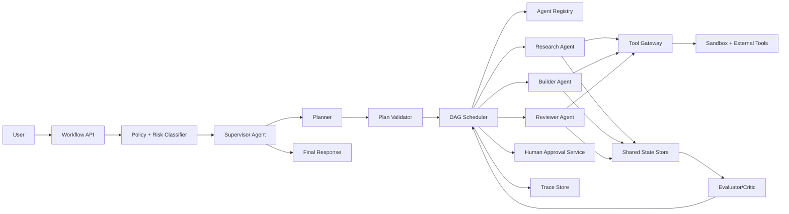

# Chapter 22: Design a Multi-Agent Workflow Orchestrator

## Context

> [!info] Quick Reference
> - **Pattern:** Supervisor-worker multi-agent orchestration with shared state, dependency graphs, tool budgets, and human approval
> - **Scale:** 200K workflows/day, 5-50 agent steps/workflow, p95 workflow completion < 10 minutes
> - **Key Techniques:** task decomposition, DAG scheduling, typed handoffs, tool sandboxing, state store, approval gates, trace replay
> - **Primary Concerns:** runaway loops, conflicting agents, tool safety, observability, cost, deterministic recovery
> - **Cross-references:** [[chapter-09|Chapter 9]] (autonomous research agent), [[chapter-10|Chapter 10]] (DAG orchestration), [[chapter-16|Chapter 16]] (sandboxed execution)

**Problem statement:** Design a platform where multiple specialized agents collaborate on complex enterprise workflows such as incident response, sales research, code migration, or compliance review.

### Real-World Examples

- A migration assistant uses one agent to inspect code, one to edit files, one to run tests, and one to review security. Without a supervisor and state machine, agents overwrite each other's work and burn thousands of tool calls.
- An incident-response assistant coordinates log analysis, hypothesis generation, dashboard inspection, and remediation drafting. Human approval is required before any production-changing action.

### Design Contract

| Dimension | Target | Why It Matters |
|---|---:|---|
| Workflow volume | 200K workflows/day | scheduler and trace store must be horizontally scalable |
| Step count | 5-50 agent steps/workflow | budgets and loop detection must be explicit |
| Tool risk | read-only, sandboxed, internal-write, external-write | approval policy depends on side-effect class |
| Completion SLO | p95 < 10 minutes for standard workflows | long-running tasks need async state and resumability |
| Cost ceiling | per-workflow and per-agent budgets | prevents runaway planner/executor loops |
| Human control | approval before irreversible side effects | makes autonomy acceptable in enterprise settings |
| Auditability | replayable artifact and tool-call trace | required for debugging and compliance |

The orchestrator should be judged like a workflow engine: can it recover, retry, pause, resume, explain, and roll back? The LLM agents are workers inside that system, not the authority that defines correctness.

---

## Step 1: Understand the Problem and Establish Design Scope

### Simulated Dialogue

**Interviewer:** Design a multi-agent orchestrator.  
**Candidate:** I will treat agents as unreliable workers in a distributed workflow system. The core design problem is not making agents talk; it is controlling state, permissions, dependencies, budgets, and recovery.

**Candidate:** What workflows must the platform support?  
**Interviewer:** Research, code changes, incident response, and business operations. Some actions are read-only; others mutate production systems and require approval.

**Candidate:** How autonomous can it be?  
**Interviewer:** It can act autonomously for read-only and sandboxed actions. It must request human approval for external writes, customer messages, money movement, or production changes.

### Functional Requirements

- **Decompose user goals into tasks and dependency graphs.** A free-form goal such as "investigate this incident" must be converted into discrete, bounded tasks whose inputs and outputs are well-defined; otherwise agents cannot be retried, parallelized, or audited independently.
- **Assign tasks to specialized agents with scoped tools and budgets.** Each agent should receive only the tools needed for its task—a log-analysis agent should not have access to deploy or payment tools—so a compromised or hallucinating agent cannot cause damage beyond its scope.
- **Run independent tasks in parallel.** Tasks with no data dependency should start simultaneously; in a 12-step workflow where 6 steps are independent, parallel execution can cut wall time by 40–60%, keeping workflows under the 10-minute SLO.
- **Share state through typed artifacts rather than free-form chat only.** Unstructured text transcripts cannot be validated, versioned, or indexed; typed artifacts with confidence scores, evidence IDs, and schema versions give downstream agents and the critic a machine-checkable record.
- **Enforce approvals for sensitive actions.** Before any tool call that modifies production state, sends external communication, or moves money, the workflow must pause and await explicit human authorization; this is the primary control that makes enterprise autonomy acceptable.
- **Detect loops, conflicts, stuck workflows, and low-confidence outputs.** An agent that keeps calling the same tool with minor prompt variations must be caught by a step counter and novelty check, not by the billing limit.
- **Produce an audit trace and replayable execution record.** Every artifact, tool call, model input/output, cost, and approval decision must be recorded so that engineers can replay a workflow with a fixed artifact to bisect model or prompt regressions.

### Non-Functional Requirements

- **Reliability:** workflows recover from individual agent/tool failures by persisting task state after each step; a retried task reads the last committed artifact rather than restarting from scratch, so a transient tool timeout does not waste prior computation.
- **Cost control:** enforce per-workflow, per-agent, and per-tool budgets enforced at the gateway layer, not in prompts; budgets expressed as dollars, tokens, and wall-clock seconds give operators a deterministic ceiling regardless of model verbosity.
- **Safety:** least-privilege tools and approval gates enforced structurally—agents receive a tool list from the registry at dispatch time and cannot call tools outside that list, even if the model generates a valid-looking tool call for an unauthorized tool.
- **Observability:** every step emits a structured span with model inputs, sampled outputs, tool call arguments and results, token cost, wall-time latency, and a decision rationale field; this makes p95 cost-per-workflow and step-level error rates queryable without log parsing.
- **Determinism:** the workflow state machine transitions are deterministic even if model outputs are not; given the same task state, the scheduler always makes the same scheduling decision, so replay and debugging are reliable.

### Back-of-the-Envelope Estimation

- Workflows/day: 200K
- Average steps/workflow: 12
- Peak multiplier: 5x
- Average agent steps/sec: `200K * 12 / 86,400 ~= 28`
- Peak steps/sec: `~140`
- If 20% of steps call tools with 10s average duration: `140 * 0.2 * 10 ~= 280` concurrent tool slots
- Trace storage: `200K workflows * 12 steps * 20KB ~= 48GB/day` before compression

---

## Step 2: Propose High-Level Design and Get Buy-In

### Core Architecture Components

- **Workflow API:** receives user goal, policy context, and approval preferences; it assigns a workflow ID, stores the raw goal, and hands off to the policy classifier before any agent is invoked.
- **Supervisor Agent:** decomposes the goal into a task plan, assigns tasks to agents, monitors progress, arbitrates conflicts between agent outputs, and decides whether the goal is complete or requires replanning.
- **Planner:** converts the supervisor's intent into a typed DAG with explicit task IDs, dependencies, per-task budgets, allowed tools, and output schemas that the scheduler can validate before any execution begins.
- **Agent Registry:** stores the authoritative definition of each agent role: which model tier it uses, which tools it may call, what input and output schemas it accepts, and what retry and timeout policy applies.
- **DAG Scheduler:** maintains a ready-queue of tasks whose dependencies are satisfied, dispatches tasks to the correct agent, tracks in-flight and completed tasks, and handles retries with exponential backoff up to a configurable maximum.
- **Shared State Store:** a versioned, append-only artifact store—backed by something like DynamoDB or Postgres with optimistic locking—that agents write structured outputs to and read prior artifacts from; it is the single source of truth for workflow progress.
- **Tool Gateway:** the enforcement point for all tool calls; it validates tool arguments against JSON Schema, checks the calling agent's permission list, enforces per-tool rate limits and timeouts, logs every call and response, and routes execution to the appropriate sandbox or external API.
- **Approval Service:** pauses a workflow by setting a task to `PENDING_APPROVAL` status, sends a notification with the proposed action and its evidence to the designated approver channel (Slack, email, or dashboard), and resumes or rejects the task based on the human response.
- **Evaluator/Critic Agent:** receives a completed task artifact and checks it against a rubric—schema compliance, confidence threshold, evidence coverage, and policy constraints—before marking the task as accepted; rejection triggers a retry or escalation rather than passing bad output downstream.
- **Trace Store:** stores a complete, ordered timeline of every event in a workflow—task dispatch, model calls with token counts and costs, tool invocations with arguments and results, artifact writes, approval decisions, and final output—queryable by workflow ID, agent, or tool name.

> **Why:** Separating the Supervisor, Planner, Scheduler, and Critic into distinct components rather than a single "orchestrator agent" is the core reliability decision. A single orchestrator that both plans and executes cannot be retried safely, cannot enforce budgets structurally, and produces a trace that is a monologue rather than a structured event log. Decomposing these responsibilities makes each component independently testable, replaceable, and auditable.

### Pipeline A: Workflow Planning

1. User submits goal and constraints.
2. Policy layer classifies risk and allowed automation level.
3. Supervisor asks planner to create task DAG.
4. Plan validator checks schema, dependencies, budget, and approval points.
5. Scheduler persists plan and starts ready tasks.

### Pipeline B: Multi-Agent Execution

1. Scheduler assigns a ready task to the appropriate agent.
2. Agent receives task, relevant state artifacts, allowed tools, and budget.
3. Tool calls go through gateway and sandbox.
4. Agent writes structured output artifact.
5. Critic validates artifact quality and policy compliance.
6. Scheduler unblocks dependent tasks.
7. Supervisor synthesizes final result or replans when required.

### Request Flow Walkthrough

Example workflow: "Investigate why checkout latency increased after yesterday's deployment and prepare a rollback recommendation."

1. **Policy layer:** classifies this as read-heavy with possible production-change recommendation.
2. **Supervisor:** decomposes the goal into log analysis, metrics analysis, deploy diff review, hypothesis synthesis, and rollback plan.
3. **Scheduler:** runs log and metrics analysis in parallel because they have no dependency.
4. **Research agent:** queries traces and incident docs, then writes a structured finding artifact.
5. **Metrics agent:** inspects dashboards and produces latency/cost/error-rate deltas.
6. **Code/deploy agent:** reads release notes and changed services, but cannot deploy or rollback.
7. **Critic agent:** checks whether evidence supports the proposed root cause.
8. **Supervisor:** merges findings and drafts a rollback recommendation.
9. **Approval service:** requires human approval before any rollback tool can be invoked.
10. **Trace store:** records every artifact, tool call, approval decision, and final recommendation.

### Developer-Facing Workflow Schema

The planner should emit a typed plan that the scheduler can validate before execution.

```json
{
  "workflow_id": "wf_latency_123",
  "goal": "Investigate checkout latency regression",
  "budget": {"max_steps": 30, "max_cost_usd": 8.0, "max_wall_time_min": 10},
  "tasks": [
    {
      "id": "t1",
      "agent": "metrics_agent",
      "description": "Compare checkout p95 latency before and after deploy",
      "allowed_tools": ["metrics.query"],
      "depends_on": [],
      "output_schema": "finding.v1"
    },
    {
      "id": "t2",
      "agent": "deploy_agent",
      "description": "Identify services changed in deploy 2026.05.28.3",
      "allowed_tools": ["deploy.read", "git.read"],
      "depends_on": [],
      "output_schema": "change_summary.v1"
    },
    {
      "id": "t3",
      "agent": "supervisor",
      "description": "Synthesize root cause and rollback recommendation",
      "depends_on": ["t1", "t2"],
      "requires_approval_for": ["deploy.rollback"]
    }
  ]
}
```

This schema gives the interviewer confidence that the design has real control surfaces: dependency validation, budget enforcement, scoped tools, and approval points.

### Mermaid Architecture Diagram



---

## Step 3: Design Deep Dive

### 1) Orchestration Patterns

| Pattern | Strength | Weakness | Best For |
|---|---|---|---|
| Supervisor-worker | A single supervisor holds global context and resolves conflicts deterministically; ownership of each task is always clear, making retries and audits straightforward | The supervisor is a bottleneck: at 140 peak steps/sec, a single-threaded supervisor with a 500ms LLM round-trip can only sustain ~2 workflows/sec without parallelization strategies like batched reviews | Most enterprise workflows where correctness and auditability outweigh raw throughput |
| DAG workflow | Dependency edges make parallelism and retry scopes explicit without any LLM reasoning; a scheduler can guarantee that a failed node is retried exactly once without re-running its dependents | The plan is fixed at creation time; an unexpected finding mid-workflow—such as discovering a third affected service—cannot be incorporated without a replan that restarts the scheduler | Code migrations, report generation, data pipelines, and compliance reviews where the task graph is knowable upfront |
| Blackboard | Agents independently post discoveries to a shared workspace and consume each other's findings without a central coordinator, enabling emergent task coverage | Multiple agents writing to the same namespace without locks cause overwrites and contradictions; conflict resolution requires either pessimistic locking (serializes writes) or a reconciliation agent (adds latency and cost) | Open-ended research and threat-hunting tasks where the full task list cannot be enumerated in advance |
| Debate/consensus | Two or more agents produce competing analyses and a judge synthesizes them; this reliably catches factual errors and one-sided reasoning that a single agent misses | Running N agents plus a judge multiplies cost by roughly N+0.5; at $0.015/1K output tokens, a three-agent debate on a complex task can cost 3–5× a single-agent answer | High-stakes, low-frequency decisions such as legal risk assessment, financial model review, or security architecture sign-off |
| Swarm | Agents spawn sub-agents dynamically for high-branching exploration tasks, maximizing coverage of a large search space | Swarms are extremely difficult to audit, budget, and terminate gracefully; runaway spawning can exhaust tool quotas and cost budgets within minutes without hard resource caps at the spawn point | Rarely appropriate in production enterprise systems; better suited to offline research or strictly sandboxed environments |

> **Why:** The supervisor-worker pattern is recommended as the default because it gives a single component—the supervisor—clear authority to arbitrate, replan, and approve. Without a designated authority, two worker agents producing conflicting recommendations will stall the workflow indefinitely or silently discard one result. The DAG scheduler adds structure that makes parallelism safe and retries bounded, which no amount of agent prompting can replicate reliably.

Recommended default: supervisor-worker plus DAG scheduler. Use agents for judgment-heavy tasks and deterministic workflow code for control flow.

### 2) State, Handoffs, and Conflict Control

Agents should not hand off large unstructured transcripts as the primary state. Passing raw conversation history between agents couples their token budgets together—an agent that has accumulated a 30K-token context will push its downstream consumer past the model's effective reasoning window before the actual task content is even read. Use typed artifacts instead: compact, schema-validated structures that convey conclusions, evidence pointers, and confidence scores without carrying the entire reasoning trace.

> **Why:** Typed artifacts enforce a contract between agents the same way function signatures enforce a contract between code modules. A `finding.v1` artifact with `confidence`, `evidence_ids`, and `open_questions` fields tells the critic exactly what to check, lets the supervisor compare two conflicting findings on equal terms, and gives the trace store a structured record that is queryable and diffable. Unstructured text handoffs make all of this impossible without another LLM call to parse them.

Example artifact types:

```json
{
  "artifact_type": "finding",
  "owner_agent": "research_agent",
  "confidence": 0.84,
  "evidence_ids": ["log-143", "doc-882"],
  "summary": "p95 latency regression starts after deploy 2026.05.28.3",
  "open_questions": ["whether cache hit rate drop is causal"]
}
```

Conflict handling:

- **Lock mutable resources such as files, tickets, and deployment plans.** Use optimistic locking with a version token in the artifact store: an agent reads an artifact at version N and may only write version N+1; if another agent has already written N+1, the write fails and the agent must re-read and retry, preventing silent overwrites in concurrent workflows.
- **Require merge/review steps for competing artifacts.** When two agents produce `finding` artifacts with different root causes for the same incident, the scheduler inserts an explicit merge task assigned to the critic or supervisor before any dependent tasks can start; this makes the conflict visible and resolvable rather than implicitly discarding one output.
- **Keep state append-only; mark artifacts superseded rather than deleting.** An artifact that is overwritten loses the evidence trail that the original agent produced; by appending a new artifact version and marking the old one `superseded_by: v2`, the trace store retains the full reasoning history needed for post-incident debugging and compliance review.
- **Give the supervisor authority to choose between conflicting outputs.** When the critic cannot resolve a conflict mechanically—for example, two plausible but mutually exclusive root causes with similar confidence scores—the supervisor agent performs a synthesis step, and if that is still inconclusive, the workflow pauses for human arbitration rather than proceeding with an arbitrarily selected output.

### 3) Safety, Budgets, and Human Approval

Every workflow needs a budget hierarchy enforced structurally at the gateway and scheduler layers, not in prompts. Prompt-based budget instructions ("stop after 10 tool calls") are ignored during long-context reasoning and cannot be trusted as a safety mechanism.

> **Why:** Budget enforcement in prompts fails because models do not have a reliable internal counter for tool calls or dollars spent, especially in multi-turn reasoning chains. Structural enforcement—a counter in the scheduler that blocks task dispatch at the limit, and a dollar meter in the gateway that blocks tool calls when exceeded—is the only mechanism that provides a hard ceiling regardless of model behavior.

- **Workflow budget:** max total dollars, tokens, wall time, and total tool calls; when any dimension is exceeded the scheduler transitions the workflow to `BUDGET_EXCEEDED` state, persists all completed artifacts, and surfaces the partial result rather than silently terminating.
- **Agent budget:** max steps and model tier per agent per workflow; this prevents a single verbose planner from consuming the token budget intended for the entire pipeline, and allows a cost-sensitive operator to restrict certain agent roles to cheaper model tiers (e.g., Haiku for log extraction, Sonnet for synthesis).
- **Tool budget:** max calls per tool type, per-call timeout, per-minute rate limit, and data scope filter (e.g., a log-query tool capped at 7-day lookback); this makes the cost of each tool class predictable and prevents a runaway agent from issuing thousands of metrics queries in a single step.
- **Approval budget:** max pending approval time—typically 30 minutes for low-stakes actions and 4 hours for production changes—after which the workflow either escalates to a secondary approver, sends a reminder, or auto-rejects to avoid indefinite suspension of workflow resources.

Approval gates:

| Action | Approval Required? |
|---|---|
| Read logs/docs | No — read-only operations with no side effects are pre-authorized at workflow creation time via the policy classifier |
| Run tests in sandbox | No — sandboxed execution is isolated from production state; failure is recoverable and produces no external side effects |
| Open pull request | Usually yes — a PR is visible to the team and triggers CI pipelines; a mistaken PR from an automated agent can mislead reviewers and waste engineering time |
| Send customer email | Yes — external communications are irreversible; a mis-addressed or factually wrong email damages trust and may have legal consequences |
| Modify production config | Yes — config changes can cause immediate service degradation affecting all users; approval must include a diff and a rollback plan |
| Execute payment/refund | Yes — financial transactions are governed by audit and compliance requirements; every execution must have an approver identity and timestamp recorded |

> **Why:** The approval gate taxonomy maps directly to the concept of reversibility. Read-only actions are always safe to automate because they leave no state change. Sandboxed actions are safe because their blast radius is intentionally bounded. All other actions are gated by approval because their effects persist in systems the orchestrator does not control—external APIs, customer inboxes, production databases, and financial ledgers—and cannot be undone programmatically.

### Production Bottlenecks and Mitigations

- **Runaway loops:** enforce a hard `max_steps` counter in the scheduler (not in the prompt) and add a novelty check—if the last three tool calls produced identical results, mark the task as `STUCK` and escalate to the supervisor for replanning or human review; in practice, loops account for roughly 15–20% of budget overruns in early production deployments.
- **Agent disagreement:** when two agents produce conflicting artifacts with overlapping scope, route both to the critic with a structured comparison prompt; if the critic cannot resolve the conflict with confidence above 0.8, escalate to the supervisor; cap the arbitration loop at three rounds to prevent the arbitration itself from becoming a loop.
- **Tool failures:** classify errors at the gateway as `RETRYABLE` (network timeout, rate limit 429) versus `TERMINAL` (invalid credentials, permission denied, 404 not found) before triggering retry logic; persist every completed artifact checkpoint so a retry starts from the last successful artifact, not from the beginning of the workflow.
- **Trace overload:** at 48GB/day of raw trace data, store hot traces (last 7 days) in a queryable columnar store such as ClickHouse with indexed fields for workflow ID, agent, tool, and cost; compress and tier traces older than 7 days to object storage with a metadata index for compliance lookups; sample full tool-call payloads at 10% after the first 24 hours.
- **Approval latency:** group low-risk, homogeneous approvals (e.g., ten similar PR opens from the same workflow type) into a single batched approval card; include a structured diff, confidence score, and evidence links so the approver can decide in under 60 seconds; measure and alert on approval response time p95 because high approval latency directly inflates workflow wall time.

### Advanced Techniques

- **Hierarchical planning:** the top-level supervisor decomposes a large goal into sub-workflows, each with its own local supervisor, budget, and state namespace; this allows a "migrate 50 microservices" goal to run as 50 parallel sub-workflows without the root supervisor needing to hold all intermediate state in a single context window.

> **Why:** A flat plan for a 50-service migration would have hundreds of tasks in a single DAG, making the scheduler's ready-queue enormous and the supervisor's synthesis step impossibly large. Hierarchical decomposition keeps each sub-workflow small enough to fit within a manageable context and budget, while the root supervisor only needs to aggregate final status artifacts from each sub-workflow.

- **Speculative parallelism:** launch two or more independent research branches simultaneously when the planner cannot determine upfront which path will yield useful results; after a configurable time or step budget, score the branches by artifact confidence and evidence coverage, then commit the winning branch and discard the rest; this trades extra cost (typically 1.5–2× a single path) for lower p95 wall time when the best path is unpredictable.
- **Typed tool contracts:** define every tool's input and output with JSON Schema and validate at the gateway before execution; a schema mismatch surfaces as a `VALIDATION_ERROR` before the tool is invoked, which is cheaper and more debuggable than a runtime failure inside the tool and prevents malformed arguments from reaching external APIs.
- **Trace replay:** re-run a workflow by substituting fixed artifacts for one or more completed tasks, allowing engineers to test a new prompt or model version against real historical inputs without re-executing expensive or side-effectful tool calls; replay is the primary mechanism for bisecting whether a regression is caused by a model change, a prompt change, or a data change.
- **Agent evals:** measure task success rate, cost per task, and tool error rate broken down by agent role, model tier, tool type, and workflow category; without role-level evals it is impossible to determine whether a quality regression is caused by the planner, a worker agent, or the critic, making prompt and model updates a guessing game.

---

## Step 4: Wrap Up

### Final Design Summary

The design makes the workflow engine, not the LLM, the source of control. Agents perform bounded specialized work, while the scheduler owns dependencies, state transitions, retries, approval gates, and auditability.

### Wrap-Around Concerns

- **Risk:** agents overwrite each other's work. Mitigation: typed artifacts with optimistic locking in the state store prevent silent overwrites; a merge task inserted by the scheduler makes conflicts explicit and resolvable rather than invisible; append-only versioning preserves the full history for post-mortem review.
- **Risk:** autonomy exceeds policy. Mitigation: the tool gateway is the structural enforcement point—agents receive only their authorized tool list at dispatch time and cannot call any tool outside it, regardless of what the model generates; the approval service adds a second layer for actions whose side effects are irreversible even within the authorized tool scope.
- **Risk:** impossible debugging. Mitigation: the trace store records every artifact version, model input with token count, tool call with arguments and response, cost delta, approval decision, and state transition; a replay endpoint lets engineers re-run any task against historical inputs to isolate whether a failure is caused by a model change, a prompt change, a data change, or an external tool API change.

---

## Step 5: Interviewer Curveballs

### Interviewer Follow-ups & Frequently Asked Questions (FAQ)

**Q: Why not let agents coordinate through chat?**  
**The Ideal Answer:** Chat is useful for shared context but structurally weak as a system-of-record for production orchestration. A chat transcript has no schema, no versioning, no ownership, no locking semantics, and no machine-checkable completion signal; if the process crashes mid-conversation, there is no safe point from which to resume. Typed artifacts with an append-only state store give the scheduler a deterministic view of what has been completed, what is in-flight, and what is blocked—making retries, parallelism, and audit trails reliable properties of the system rather than emergent behaviors of the model. Chat should remain the user-facing surface, not the inter-agent state bus.

**Q: Two agents produce conflicting recommendations. What happens?**  
**The Ideal Answer:** The scheduler detects the conflict when both artifacts are written to the shared state store with overlapping scope and different conclusions. It inserts a critic task that receives both artifacts as input along with their evidence IDs and confidence scores; the critic attempts a structured comparison and either endorses one artifact, synthesizes a merged conclusion, or flags the conflict as unresolvable. If the critic's confidence in its resolution is below the threshold (e.g., 0.75), the supervisor receives both artifacts and the critic's analysis, performs a final arbitration step, and pauses the workflow for human review if the conflicting task gate-keeps a sensitive action like a production rollback. The key point: the conflict is never silently discarded—both artifacts are retained in the trace store for audit.

**Q: How do you know whether adding agents improves quality?**  
**The Ideal Answer:** Controlled comparison is the only reliable answer. First establish a single-agent baseline and a deterministic-workflow baseline for the same task type, measuring task success rate (rubric-scored), cost per completion, wall-time p95, tool error rate, and human edit distance on final outputs. Then add the multi-agent configuration and measure the same metrics over a statistically significant sample. Adding agents is justified only if the quality improvement is real (not just longer output), the cost increase is within the per-workflow budget ceiling, and the wall-time increase stays within the completion SLO. Role-level evals—per-agent task success rate, per-tool error rate—are also necessary to diagnose which component is contributing value and which is adding cost without benefit.

**Q: An agent gets stuck in a loop calling the same tool repeatedly. How does your design prevent runaway cost?**  
**The Ideal Answer:** The design has three independent safety layers that operate without any model cooperation. First, the scheduler increments a per-task step counter with every tool call dispatch; when `steps_used >= max_steps_for_task`, the scheduler refuses to dispatch the next tool call and transitions the task to `STUCK`. Second, the tool gateway enforces per-tool call rate limits—for example, a metrics query tool is capped at 20 calls per task—and returns a `BUDGET_EXCEEDED` error rather than executing the call. Third, the workflow-level dollar meter in the gateway accumulates cost with each tool response; when the workflow budget is breached, the gateway blocks all further tool calls and the scheduler checkpoints the workflow state. All three layers are enforced in infrastructure code, not in prompts, so they cannot be bypassed by a hallucinating or stuck model.

**Q: How would you handle a workflow that needs to span multiple days because it waits on external events like a code review or a regulatory approval?**  
**The Ideal Answer:** Long-running workflows must be fully resumable from persisted state, which means no in-memory workflow state. The scheduler stores every task in the state store with its status, last artifact version, and budget consumed; a task waiting for an external event transitions to `WAITING_EXTERNAL` and the scheduler releases its worker thread immediately. When the external event arrives—via webhook, polling, or human callback—the scheduler reads the task state from the store, validates that the workflow budget has not expired during the wait, and dispatches the task to the appropriate agent with its pre-existing context artifacts. Workflow timeouts must be configurable per event type: a code review might have a 3-day timeout, while a regulatory approval might have a 30-day timeout, each with escalation notifications at configurable intervals.

**Q: Your supervisor agent is a bottleneck. How do you scale it?**  
**The Ideal Answer:** The supervisor can be decomposed into two distinct responsibilities that scale differently. The first responsibility—plan synthesis and conflict arbitration—is stateful and judgment-heavy; it must be single-threaded per workflow but can run concurrently across workflows, so horizontal scaling across workflows is straightforward as long as each supervisor instance holds state for only its assigned workflow. The second responsibility—task status aggregation and dependency evaluation—is mechanically simple and can be offloaded to the DAG scheduler entirely, so the supervisor's LLM only activates for judgment steps (initial decomposition, conflict resolution, final synthesis) rather than for every task state transition. For very high-volume workloads, a hierarchical supervisor pattern assigns a local supervisor to each sub-workflow, so the root supervisor only handles cross-sub-workflow coordination, dramatically reducing its invocation frequency.

**Q: How do you handle a case where a tool returns partial or ambiguous results?**  
**The Ideal Answer:** Partial or ambiguous tool results must be surfaced as a first-class artifact state rather than silently passed downstream as if they were complete. The agent writes a `finding` artifact with `confidence` below the threshold (e.g., 0.6) and populates `open_questions` with the specific ambiguities. The critic detects the low confidence score during evaluation and either triggers a retry with a narrowed tool query, spawns a supplementary task to gather additional evidence, or escalates to the supervisor for a replanning decision. The key design principle is that downstream tasks—and especially approval gates for sensitive actions—must never consume an artifact whose confidence is below the minimum acceptable threshold for that action class; the threshold should be configurable in the agent registry per output schema and action type.

**Q: A new regulation requires you to prove that a human approved every production change. How does your design satisfy that?**  
**The Ideal Answer:** The approval service records a tamper-evident log entry for every approval decision: the approver identity (from SSO token), the timestamp, the workflow ID, the task ID, the proposed action with its full argument payload, the evidence artifacts presented to the approver, and the approval or rejection outcome. This log is written to an append-only audit store—separate from the operational trace store—with a cryptographic hash chain so that deletions or modifications are detectable. The tool gateway checks for a valid, non-expired approval token before executing any action classified as `production-write`; if the token is missing or expired, the tool call is rejected and logged as `UNAUTHORIZED_TOOL_CALL`. Compliance reports can be generated by querying the audit store for all `production-write` tool executions joined with their approval records, giving auditors a complete chain of custody from user goal to approved action to executed tool call.

---

## Practical Implementation

### DAG Scheduler Core Loop

```python
import heapq
from dataclasses import dataclass, field
from typing import Any
from enum import Enum

class TaskStatus(Enum):
    PENDING = "pending"
    READY = "ready"
    IN_FLIGHT = "in_flight"
    PENDING_APPROVAL = "pending_approval"
    SUCCEEDED = "succeeded"
    FAILED = "failed"
    STUCK = "stuck"
    BUDGET_EXCEEDED = "budget_exceeded"

@dataclass
class Task:
    id: str
    agent: str
    description: str
    allowed_tools: list[str]
    depends_on: list[str]
    output_schema: str
    max_steps: int = 15
    steps_used: int = 0
    status: TaskStatus = TaskStatus.PENDING
    artifact: dict | None = None
    requires_approval_for: list[str] = field(default_factory=list)

class DAGScheduler:
    def __init__(self, state_store, tool_gateway, approval_service):
        self.state_store = state_store
        self.tool_gateway = tool_gateway
        self.approval_service = approval_service

    def get_ready_tasks(self, tasks: dict[str, Task]) -> list[Task]:
        """Return tasks whose all dependencies have SUCCEEDED."""
        ready = []
        for task in tasks.values():
            if task.status != TaskStatus.PENDING:
                continue
            deps_done = all(
                tasks[dep_id].status == TaskStatus.SUCCEEDED
                for dep_id in task.depends_on
            )
            if deps_done:
                task.status = TaskStatus.READY
                ready.append(task)
        return ready

    def dispatch_task(self, task: Task, workflow_budget: dict) -> dict:
        """Dispatch a task to its agent with scoped context and budget."""
        # Gather input artifacts from completed dependencies
        input_artifacts = {
            dep_id: self.state_store.get_artifact(dep_id)
            for dep_id in task.depends_on
        }
        # Check workflow budget before dispatch
        if workflow_budget["cost_usd"] >= workflow_budget["max_cost_usd"]:
            task.status = TaskStatus.BUDGET_EXCEEDED
            return {"status": "budget_exceeded", "task_id": task.id}

        task.status = TaskStatus.IN_FLIGHT
        self.state_store.save_task(task)

        return {
            "task_id": task.id,
            "agent": task.agent,
            "description": task.description,
            "allowed_tools": task.allowed_tools,
            "input_artifacts": input_artifacts,
            "max_steps": task.max_steps,
            "output_schema": task.output_schema,
        }

    def complete_task(self, task_id: str, artifact: dict, tasks: dict[str, Task]):
        """Mark task succeeded, persist artifact, unblock dependents."""
        task = tasks[task_id]
        task.artifact = artifact
        task.status = TaskStatus.SUCCEEDED
        self.state_store.save_artifact(task_id, artifact)
        self.state_store.save_task(task)
        # Immediately evaluate which tasks are now unblocked
        return self.get_ready_tasks(tasks)
```

> **Why:** The scheduler owns all status transitions and persists state after every mutation. If the process crashes between `dispatch_task` and `complete_task`, the task remains `IN_FLIGHT` in the store and can be detected by a watchdog that re-queues tasks stuck in-flight beyond their timeout. No workflow progress is lost.

### Tool Gateway with Budget Enforcement and Approval Routing

```python
import time
from typing import Callable

TOOL_RISK_CLASS = {
    "metrics.query": "read_only",
    "logs.query": "read_only",
    "git.read": "read_only",
    "tests.run_sandbox": "sandboxed",
    "deploy.read": "read_only",
    "github.create_pr": "internal_write",
    "email.send": "external_write",
    "deploy.rollback": "production_write",
    "payments.refund": "production_write",
}

APPROVAL_REQUIRED_FOR = {"internal_write", "external_write", "production_write"}

class ToolGateway:
    def __init__(self, approval_service, audit_store, rate_limiter):
        self.approval_service = approval_service
        self.audit_store = audit_store
        self.rate_limiter = rate_limiter
        self._tool_registry: dict[str, Callable] = {}

    def register_tool(self, name: str, fn: Callable):
        self._tool_registry[name] = fn

    def call(
        self,
        tool_name: str,
        args: dict,
        task: "Task",
        workflow_context: dict,
    ) -> dict:
        # 1. Authorization: is this tool in the task's allowed list?
        if tool_name not in task.allowed_tools:
            self.audit_store.log({
                "event": "UNAUTHORIZED_TOOL_CALL",
                "tool": tool_name,
                "task_id": task.id,
                "workflow_id": workflow_context["workflow_id"],
                "timestamp": time.time(),
            })
            raise PermissionError(f"Tool '{tool_name}' not in task allowed list")

        # 2. Step budget check
        task.steps_used += 1
        if task.steps_used > task.max_steps:
            task.status = TaskStatus.STUCK
            raise RuntimeError(f"Task {task.id} exceeded max_steps={task.max_steps}")

        # 3. Rate limiting
        self.rate_limiter.check(tool_name, workflow_context["workflow_id"])

        # 4. Risk classification and approval gate
        risk_class = TOOL_RISK_CLASS.get(tool_name, "unknown")
        if risk_class in APPROVAL_REQUIRED_FOR:
            if tool_name in task.requires_approval_for:
                approval = self.approval_service.request(
                    workflow_id=workflow_context["workflow_id"],
                    task_id=task.id,
                    tool_name=tool_name,
                    args=args,
                    evidence_artifact_ids=list(workflow_context.get("artifacts", {}).keys()),
                )
                if not approval["approved"]:
                    raise PermissionError(f"Approval denied for {tool_name}: {approval['reason']}")

        # 5. Execute
        start = time.time()
        result = self._tool_registry[tool_name](**args)
        latency_ms = (time.time() - start) * 1000

        # 6. Audit log
        self.audit_store.log({
            "event": "TOOL_CALL",
            "tool": tool_name,
            "args": args,
            "risk_class": risk_class,
            "task_id": task.id,
            "workflow_id": workflow_context["workflow_id"],
            "latency_ms": latency_ms,
            "timestamp": time.time(),
        })
        return result
```

> **Why:** The gateway is the single enforcement point for authorization, step budget, rate limits, and approval routing. Distributing these checks across individual agent implementations creates inconsistency—a new agent built by a different team might omit one check. Centralizing them in the gateway means every tool call, regardless of which agent issues it, passes through the same policy layer.

### Typed Artifact Store with Optimistic Locking

```python
import hashlib
import json
import time
from typing import Optional

class ArtifactStore:
    """
    Append-only artifact store with optimistic locking.
    Backed by any KV store (DynamoDB, Redis, Postgres).
    """

    def __init__(self, backend):
        self.backend = backend  # must support get/put with conditional writes

    def write_artifact(
        self,
        task_id: str,
        artifact: dict,
        expected_version: Optional[int] = None,
    ) -> dict:
        """
        Write a new artifact version. Raises ConflictError if another agent
        has already written this version (optimistic locking).
        """
        key = f"artifact:{task_id}"
        current = self.backend.get(key)

        if current is not None:
            current_version = current["version"]
            if expected_version is not None and current_version != expected_version:
                raise ConflictError(
                    f"Artifact {task_id} version mismatch: "
                    f"expected {expected_version}, found {current_version}. "
                    "Re-read and retry."
                )
            new_version = current_version + 1
            # Mark previous version as superseded
            self.backend.put(f"artifact:{task_id}:v{current_version}", {
                **current, "superseded_by": new_version
            })
        else:
            new_version = 1

        versioned_artifact = {
            **artifact,
            "version": new_version,
            "task_id": task_id,
            "written_at": time.time(),
            "checksum": hashlib.sha256(
                json.dumps(artifact, sort_keys=True).encode()
            ).hexdigest(),
        }
        # Conditional write: fails if another writer beat us
        self.backend.put_if_version(key, versioned_artifact, expected_version=current_version if current else None)
        return versioned_artifact

    def get_artifact(self, task_id: str, version: Optional[int] = None) -> Optional[dict]:
        if version is not None:
            return self.backend.get(f"artifact:{task_id}:v{version}")
        return self.backend.get(f"artifact:{task_id}")

    def list_versions(self, task_id: str) -> list[dict]:
        """Return all historical versions for audit and replay."""
        versions = []
        v = 1
        while True:
            artifact = self.backend.get(f"artifact:{task_id}:v{v}")
            if artifact is None:
                break
            versions.append(artifact)
            v += 1
        return versions

class ConflictError(Exception):
    pass
```

> **Why:** Optimistic locking in the artifact store prevents two agents from simultaneously overwriting the same task output without either being aware of the conflict. Unlike pessimistic locking (which serializes all writes and creates a bottleneck), optimistic locking allows concurrent writes and only fails the rarer case of a true collision, at which point the losing agent re-reads the current state and decides whether to merge or retry. The version history and checksum chain provide the tamper-evident record required for compliance audits.

---

## Exercises

### Design Exercises

**Exercise 1: Adaptive Replanning Under Budget Pressure**
You are designing the replanning logic for a supervisor agent. Mid-workflow, the cost meter shows 70% of the workflow budget has been consumed after only 40% of tasks have completed. The remaining tasks include both high-confidence deterministic steps (log parsing, schema validation) and low-confidence judgment steps (root cause synthesis, recommendation drafting). Design a replanning strategy that the supervisor should follow. Your design should specify: (a) how the supervisor decides which tasks to skip or downgrade, (b) what signals it uses to classify tasks as skippable, (c) how it communicates the reduced scope to the final output consumer, and (d) what guard rails prevent the supervisor from eliminating the tasks that most contribute to output quality.

**Exercise 2: Multi-Tenant Workflow Isolation**
Your multi-agent orchestrator serves 50 enterprise tenants on a shared infrastructure. Design the isolation architecture that ensures one tenant's runaway workflow cannot degrade latency or consume resources for other tenants. Address: (a) scheduler-level isolation (queue priority, worker pool partitioning), (b) tool gateway rate limiting per tenant, (c) trace store and state store namespace isolation, (d) approval service routing so one tenant's approvers never see another tenant's actions, and (e) how you handle a tenant whose single workflow legitimately needs 10× their normal tool call rate due to an incident response.

### Implementation Exercises

**Exercise 3: Loop Detection with Novelty Scoring**
Implement a `NoveltyChecker` class that the scheduler calls before dispatching each tool call. The checker should maintain a sliding window of the last N tool calls for a given task (tool name + argument hash). It should compute a novelty score: 1.0 for a completely new call, 0.0 for an exact repeat, and a value between 0 and 1 for similar-but-not-identical calls (consider Jaccard similarity on argument keys). The scheduler should block dispatch and transition the task to `STUCK` if the novelty score falls below a configurable threshold for two consecutive calls. Write the class with unit tests covering: exact repeat detection, near-repeat detection, and a legitimate sequence of varied tool calls that should not trigger the check.

**Exercise 4: Trace Replay Engine**
Implement a `WorkflowReplayer` that takes a workflow ID and a set of `override_artifacts` (a mapping from task ID to a replacement artifact). The replayer should re-execute all tasks that depend on any overridden task, while using the stored artifacts for all other tasks. The purpose is to let an engineer test a new prompt for the root-cause synthesis task without re-running the expensive log analysis and metrics query tasks. Your implementation should: (a) topologically sort the task graph, (b) identify the replay frontier (tasks that must re-run because their inputs changed), (c) call the live agent only for frontier tasks and their downstream dependents, and (d) write the replayed artifacts to a separate replay namespace so the original workflow is not mutated.

### Debug Exercise

**Exercise 5: Diagnose a Stuck Workflow**
A workflow `wf_incident_887` has been in status `IN_FLIGHT` for 47 minutes against a 10-minute SLO. The trace store shows the following: task `t3` (root cause synthesis, assigned to supervisor agent) was dispatched 47 minutes ago, has `steps_used=1`, and no tool calls have been recorded since the initial dispatch. Task `t1` (log analysis) and `t2` (metrics query) both show status `SUCCEEDED` with artifacts written 48 minutes ago. The tool gateway shows zero calls from task `t3`. The approval service shows no pending approval requests for this workflow.

Given this evidence, identify at least three distinct failure hypotheses ordered by likelihood, describe the specific log queries or state store lookups you would run to confirm or eliminate each hypothesis, and propose the recovery action for the most likely cause. Then redesign one aspect of the orchestrator to automatically detect and recover from this failure class within 5 minutes rather than requiring manual investigation.

---

## End of Chapter
