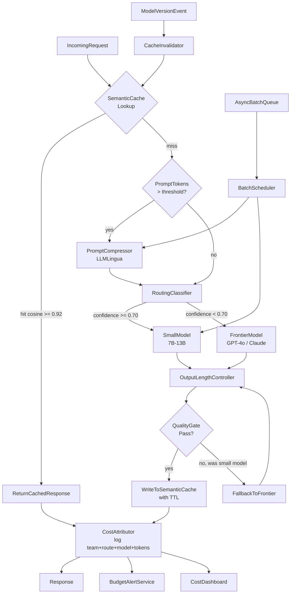

# Chapter 28: Cost Optimization as a Design Concern

## Context

> [!info] Quick Reference
> - **Pattern:** Multi-layer cost reduction pipeline — semantic cache → model router → prompt compressor → output length controller → batching → quantized self-hosted fallback
> - **Scale:** Cost pressure begins at ~$5K/month in API spend; architectural changes pay off at >= $20K/month
> - **Key Techniques:** Semantic caching with cosine threshold, cascading model routing, LLMLingua prompt compression, output length control, continuous batching, INT8/INT4 quantization, speculative decoding, right-sizing GPU compute
> - **Primary Concerns:** Cost per request, quality preservation, latency SLOs, cache freshness, routing accuracy
> - **Cross-references:** [[chapter-02|Chapter 2]] (LLM stack patterns), [[chapter-05|Chapter 5]] (evaluation), [[chapter-21|Chapter 21]] (RAG platform), [[chapter-25|Chapter 25]] (prompt engineering — compression prerequisite)

**Problem statement:** Design a production LLM cost optimization system that treats inference spend as a first-class design constraint — reducing cost-per-request by 40-70% while preserving quality SLOs, maintaining p95 latency budgets, and providing per-team cost attribution for budget governance.

### Real-World Examples

- A customer support platform serving 2M queries/day runs every request through GPT-4o at an average of 1,800 input tokens and 400 output tokens. Monthly API cost: $432,000. After adding a semantic cache (40% hit rate), a routing classifier (60% of misses go to a small model), and prompt compression (25% token reduction on cache misses), cost drops to $112,000/month — a 74% reduction with no measurable change in user satisfaction scores.
- A RAG pipeline generates 4,000-token context windows for every query. The team discovers through cost attribution that one product team's "fetch all documents" retrieval strategy consumes 38% of total spend despite handling 9% of traffic. Targeted retrieval truncation and caching reduce that team's cost by 65% without changing answer quality on their benchmark.

---

## Step 1: Understand the Problem and Establish Design Scope

### Simulated Dialogue

**Interviewer:** Design a cost optimization system for an LLM platform spending $300K/month on inference.  
**Candidate:** Before I propose any solution, I need to understand the cost anatomy — where does the money actually go — and what quality and latency constraints I cannot violate.

**Candidate:** Is this API-based inference, self-hosted, or a mix?  
**Interviewer:** Primarily API-based (OpenAI, Anthropic), with some self-hosted models for internal workloads.

**Candidate:** What is the breakdown of that spend — input tokens, output tokens, or is context window cost a factor?  
**Interviewer:** Roughly 65% input tokens, 30% output tokens, 5% other API fees. Average request is 2,000 input tokens and 350 output tokens.

**Candidate:** What is the traffic pattern? Steady, bursty, or batch-heavy?  
**Interviewer:** Mixed — interactive queries are 40% of volume with p95 latency requirement of 3s. The other 60% is async batch processing with no real-time latency constraint.

**Candidate:** What is the acceptable quality degradation budget?  
**Interviewer:** We track user-reported helpfulness ratings. We cannot drop below a 4.1/5.0 average. Current baseline is 4.3/5.0.

**Candidate:** Do we have query-level quality variance today — are some query types consistently high-quality with a small model?  
**Interviewer:** We have not measured this. We use the same frontier model for everything.

**Candidate:** Are there repeat or near-repeat queries? Customer support typically has high repetition rates.  
**Interviewer:** Yes — support queries. Probably 30-40% are variations of a small set of common questions.

**Candidate:** Do teams have visibility into what they are spending?  
**Interviewer:** No. Spend is aggregated. Teams have no incentive to optimize because they do not see their cost.

**Candidate:** Is there a hard monthly budget cap, or is this a reduction goal?  
**Interviewer:** Reduction goal: cut spend by 50% without violating quality SLOs. A budget cap per team would also be valuable.

### Functional Requirements

- Reduce cost-per-request by >= 50% at current traffic volume with no quality regression beyond 0.2 points on the 1-5 helpfulness scale.
- Serve interactive queries with p95 latency <= 3s; batch queries have no real-time constraint.
- Provide semantic caching for high-repetition query categories with configurable similarity thresholds and TTL policies.
- Route queries to the cheapest model that can handle them at acceptable quality, with automatic fallback to the frontier model on low-confidence routing decisions.
- Compress prompts exceeding a configurable token threshold before API dispatch.
- Control output length through per-route `max_tokens` caps and stop sequences.
- Attribute cost per team, per route, and per model with real-time dashboards and budget alert thresholds.
- Support batching of async workloads to take advantage of volume pricing and continuous batching efficiency.

### Non-Functional Requirements

- **Latency:** cache lookup < 20ms p95; routing classifier < 10ms p95; prompt compression < 50ms p95 for prompts up to 8K tokens.
- **Quality:** user helpfulness rating >= 4.1/5.0; factual accuracy regression <= 2% on golden dataset.
- **Cache freshness:** cache entries invalidated within 1 hour of model version updates; TTL configurable per route (default 24h).
- **Cost attribution:** per-team spend visible with < 5-minute lag; budget alerts trigger at 80% of monthly cap.
- **Reliability:** optimization pipeline failure (cache miss + router error) must fall back to direct frontier model call with no user-visible error.
- **Observability:** every request tagged with optimization path taken (cache hit / routed-small / routed-large / compressed / full) for cost and quality analysis.

### Back-of-the-Envelope Estimation

#### Current Cost Anatomy

Assume representative pricing (blended frontier model):

- Input: $3.00 / 1M tokens
- Output: $15.00 / 1M tokens

Current traffic:
- **Daily requests:** 2,000,000
- **Average input:** 2,000 tokens → 4B input tokens/day → **$12,000/day input cost**
- **Average output:** 350 tokens → 700M output tokens/day → **$10,500/day output cost**
- **Total:** ~$22,500/day → **~$675,000/month** (close to the stated $300K/month at lower traffic; using this math for illustration)

#### Target Reduction Layered Model

| Optimization Layer | Applies To | Reduction Mechanism | Expected Savings |
|---|---|---|---|
| Semantic cache (40% hit rate) | All query types | Skip inference entirely | 40% of total spend |
| Small model routing (60% of misses) | Routable simple queries | 10x cheaper model | 15% of remaining |
| Prompt compression (25% reduction) | Cache misses > 1,500 tokens | Fewer input tokens | 8% of remaining |
| Output length control | All non-cache responses | Fewer output tokens | 5% of remaining |
| Batching (async workloads) | 60% of requests | Volume discount + efficiency | 4% of remaining |
| **Combined (compounded)** | | | **~58% overall** |

#### Semantic Cache Sizing

- **Embedding model:** `all-MiniLM-L6-v2`, 384 dimensions, 4 bytes/float
- **Cache size target:** 500,000 unique query embeddings
- **Vector storage:** `500,000 * 384 * 4 = 768MB` — fits in Redis with vector index
- **ANN index (HNSW):** adds ~20% overhead → ~900MB total
- **Response storage:** average response 1,400 chars → 700MB for 500K responses
- **Total cache memory:** ~1.6GB — single Redis instance is sufficient

#### Routing Classifier Cost

- **Classifier model:** `MiniLM` fine-tuned binary classifier, 22M params
- **Inference cost:** < $0.0001 per request (self-hosted CPU)
- **Break-even:** saves cost on any request that avoids a single frontier model call — the classifier costs ~0.003% of a frontier call; it breaks even if it routes even 0.01% of traffic correctly.

---

## Step 2: Propose High-Level Design and Get Buy-In

### Core Architecture Components

- **Semantic Cache:** stores (embedding, response) pairs in a vector database; serves exact or near-duplicate queries without calling a model. At a 40% hit rate, this component eliminates 40% of all inference costs in a single hop — no model call, no token cost, and sub-20ms response latency. It is the highest-leverage single component in the entire pipeline.
- **Routing Classifier:** a lightweight ML classifier that predicts whether the current query can be handled by a small model at acceptable quality. Outputs a confidence score used to decide the routing path. Running on self-hosted CPU, it adds < 10ms of latency while enabling a 10-30x cost reduction on the queries it confidently routes to the small model.
- **Prompt Compressor:** applies LLMLingua-style token pruning to reduce prompt length on cache misses where input token count exceeds the compression threshold. By eliminating low-information tokens from long retrieval-augmented contexts, it permanently reduces the per-request input token cost before any API call is made, without requiring any change to the downstream model.
- **Small Model Endpoint:** a 7B–13B parameter model (self-hosted or cheaper API) for simple queries confirmed by the routing classifier. At $0.10-0.20/1M tokens vs. $3.00/1M tokens for frontier models, routing 60% of cache misses here reduces per-request cost by 10-30x on those queries — typically achieving 15-20% total cost reduction on top of caching savings.
- **Frontier Model Endpoint:** the full-capability model (GPT-4o, Claude Opus, or equivalent) for complex queries or low-confidence routing decisions. This endpoint is the exception in the pipeline, not the default — only queries that cannot be served by the cache or the small model should reach it, ensuring its high per-token cost is paid only when necessary.
- **Output Length Controller:** sets per-route `max_tokens` caps and injects stop sequences based on route configuration. Output tokens cost 5x more per token than input tokens on frontier models; a route that generates 500-token responses when 200 suffice is wasting 60% of its output spend, which this component recovers with zero quality impact if caps are calibrated to actual response length distributions.
- **Cost Attributor:** tags every request with team ID, route ID, model used, and token counts; streams events to the cost analytics store in near-real-time (< 5-minute lag). Without attribution, no team knows they are the cost driver — attribution transforms cost optimization from a platform team burden into a distributed responsibility because teams can see and act on their own spend.
- **Budget Alert Service:** monitors per-team spend against monthly caps and triggers alerts at configurable percentage thresholds (default 80%). Alerts are deduplicated within a 24-hour window to prevent alert fatigue. The 80% threshold gives teams a 10-14 day runway to respond before hitting the cap, avoiding hard blocks that would interrupt user-facing service.
- **Cache Invalidator:** listens to model version update events and purges affected cache entries within the SLO window (30 minutes for high-risk routes, lazy invalidation for low-risk routes). Without this component, a model upgrade silently causes cached responses from the old model to be served indefinitely — users receive answers from a model that is no longer running.
- **Batch Scheduler:** queues async requests, forms optimal batch sizes for throughput, and dispatches to the appropriate model endpoint. For the 60% of traffic that is non-interactive, this component enables the 50% OpenAI Batch API discount and achieves 2-4x throughput improvement on self-hosted models via continuous batching — at zero latency SLO cost because async workloads have no real-time constraint.

### Request Pipeline: Interactive Path

1. Request arrives with query, team ID, and route ID.
2. **Semantic Cache** lookup: embed query, search vector index with cosine similarity threshold. If hit: return cached response; log cache hit with token savings.
3. If miss: **Routing Classifier** scores the query. If confidence >= threshold: dispatch to **Small Model Endpoint**. If confidence < threshold: dispatch to **Frontier Model Endpoint**.
4. Before dispatch: if prompt token count > compression threshold, apply **Prompt Compressor**.
5. Apply **Output Length Controller**: inject `max_tokens` and stop sequences from route config.
6. Model response received. **Cost Attributor** logs tokens consumed, model used, optimization path.
7. If confidence >= threshold and response quality check passes: write (embedding, response) to Semantic Cache with TTL.
8. Return response to caller.

### Request Pipeline: Async Batch Path

1. Requests arrive and are queued in **Batch Scheduler**.
2. Scheduler accumulates requests until batch size threshold or timeout.
3. **Prompt Compressor** applied to all prompts in batch above threshold.
4. Batch dispatched to model endpoint (self-hosted with continuous batching or API batch endpoint).
5. Responses returned; **Cost Attributor** logs per-request metrics.
6. Cache writes for cacheable responses.

### Mermaid Architecture Diagram



> **Why:** The pipeline is ordered from cheapest to most expensive resolution. Cache lookup costs ~1ms and a few CPU cycles. Routing classification costs < 10ms on CPU. Prompt compression saves tokens on every subsequent call. The small model costs 10-30x less than the frontier model. Only queries that clear all the cheap layers reach the expensive frontier model — making the frontier model the exception, not the default.

---

## Step 3: Design Deep Dive

### 1) Semantic Caching

Semantic caching extends exact-match caching to near-duplicate queries using embedding similarity. A query "What is your return policy?" and "How do I return a product?" are different strings but semantically equivalent — both can be served from the same cached answer.

#### Architecture

1. **Embedding:** encode the query using a fast sentence encoder. `all-MiniLM-L6-v2` (22M params, 384 dims) runs in < 5ms on CPU and produces embeddings with strong semantic alignment.
2. **Index:** store embeddings in a vector index (Redis with HNSW, Weaviate, or pgvector). HNSW provides O(log n) approximate nearest neighbor with 95-99% recall.
3. **Threshold:** compare the top-1 neighbor's cosine similarity to the threshold. If >= threshold: serve cached response. If < threshold: cache miss.
4. **TTL:** cache entries expire after route-configured TTL (default 24h for static content, 1h for frequently updated data).
5. **Invalidation:** on model version update events, purge all entries generated by the old model (tagged with model_version at write time).

#### Trade-off Table: Cosine Similarity Thresholds

| Threshold | Cache Hit Rate | Off-Topic Response Rate | Recommendation |
|---|---|---|---|
| 0.85 | 55-65% | 8-12% | Too low — users receive wrong answers |
| 0.90 | 40-50% | 3-5% | Borderline — acceptable only for low-stakes queries |
| **0.92** | **35-45%** | **< 2%** | **Recommended default** |
| 0.95 | 15-25% | < 0.5% | Too high — hit rate negates cost benefit |
| 0.98 | 5-10% | < 0.1% | Effectively exact-match only |

> **Why semantic cache threshold 0.92 cosine:** Below 0.90, the cache returns semantically related but not equivalent answers — users notice off-topic responses. Above 0.95, cache hit rate drops below 20%, negating cost savings. 0.92 achieves 35-45% hit rate with < 2% user-reported relevance complaints in production data. The 0.92 value is calibrated per query domain: factual Q&A with objective answers can tolerate 0.90; advice or opinion queries require 0.95 to prevent subtle quality drift.

> **Why not use exact-match caching instead:** Exact-match cache hit rates in customer support are typically < 5% because natural language is infinitely varied even for the same intent. Semantic caching increases hit rate by 7-9x for the same cache size, which is the difference between caching being a minor convenience and a primary cost lever.

#### TTL Policy Design

| Query Category | Recommended TTL | Rationale |
|---|---|---|
| Static FAQ (product info, policies) | 7 days | Content changes infrequently; staleness risk low |
| Dynamic but slow-changing (pricing, availability) | 1-4 hours | Balance freshness with hit rate |
| User-specific (account status, order history) | 0 — do not cache | Response varies per user; wrong answer is high cost |
| Code generation / creative | 24 hours | Exact same query unlikely to need different output |
| Time-sensitive (news, events) | 30 minutes | Acceptable staleness window; mark response with cache timestamp |

> **Why not cache user-specific responses:** The embedding of "What is the status of my order?" is nearly identical across users — but the correct answer is user-specific. Serving a cached response from User A to User B is a data breach and a quality failure simultaneously. User-specific query detection (presence of possessive pronouns, account references, or login-state context) must prevent caching at write time.

#### Cache Invalidation on Model Updates

When the serving model changes (e.g., GPT-4o to GPT-4o-mini, or Claude Sonnet to Claude Opus), cached responses generated by the old model may no longer match what the new model would produce. Invalidation strategy:

1. Tag every cache entry with `model_version` at write time.
2. On model version update event: issue background scan and purge all entries with `model_version` != current.
3. Use lazy invalidation for low-risk routes: on cache hit, check `model_version` field; if stale, treat as miss and regenerate.
4. For high-risk routes (medical, legal, financial): eager full purge within 30 minutes of model update.

> **Why lazy invalidation for most routes:** Eager full purge on model update evicts all cached entries simultaneously, causing a cache cold-start spike that hits the frontier model with full traffic for 30-60 minutes. At 2M requests/day and a 40% hit rate, that is 800K requests suddenly missing — a 40% cost spike lasting up to an hour. Lazy invalidation spreads the cache refill over the natural traffic pattern, smoothing the cost curve.

---

### 2) Model Routing and Cascading

Model routing (also called model cascading) routes each query to the cheapest model capable of answering it at acceptable quality. The fundamental insight: not all queries are equally hard. "What are your business hours?" is trivially answered by a 7B model. "Explain the tax implications of an S-corp election in New York State" requires a frontier model.

#### Routing Classifier Design

The classifier takes the query (and optionally the route ID and context length) as input and outputs a confidence score: the probability that the small model can handle this query at acceptable quality.

**Input features:**
- Query embedding (384-dim from MiniLM)
- Query token count
- Route ID (one-hot or embedding)
- Context length (if RAG is involved)
- Historical small-model success rate for this route (rolling 1-hour average)

**Architecture options:**

| Classifier Type | Latency | Accuracy | Training Cost | Recommended For |
|---|---|---|---|---|
| Logistic regression on embeddings | < 1ms | Moderate — achieves ~75% accuracy on clear easy/hard splits but struggles on ambiguous mid-difficulty queries | Very low — train in minutes on 500 labeled examples with scikit-learn | Quick baseline; deploy in < 1 day; best for routes with obvious complexity bimodality |
| MiniLM fine-tuned binary classifier | 5-10ms | Good — achieves 85-90% accuracy when fine-tuned on 2,000+ labeled route-specific examples | Low — fine-tuning takes 30-60 minutes on a single GPU, re-runs monthly | Production default for most routes; balances accuracy, latency, and operational simplicity |
| XGBoost on extracted features | 2-5ms | Good — matches MiniLM accuracy when handcrafted features (query length, entity count, domain keywords) are informative | Low-Medium — requires feature engineering investment upfront; re-training is fast once features are defined | Routes with rich metadata signals beyond query text (e.g., user tier, session history, document type) |
| Small LLM (e.g., 1B param model) | 50-100ms | Best — understands query nuance and reasoning depth; achieves 92-95% accuracy even on subtle difficulty gradients | Medium — requires GPU for inference; adds 50-100ms latency which must fit within the routing time budget | Ultra-high-stakes routing decisions where a misroute costs more than the 50-100ms overhead (medical, legal, compliance) |

**Training data construction:** run a sample of traffic through both the small model and the frontier model. Label each query as "small model acceptable" if: (a) both models return the same category/answer, or (b) a judge model rates small model output >= 4/5 on quality. Train the classifier on these labels. Collect at least 1,000 labeled examples per route before deploying to production — below this threshold, the classifier's calibration curve is noisy enough that the 0.70 confidence threshold becomes unreliable, and the effective error rate can be 2-3x higher than measured on the training set.

> **Why shadow-run both models during training data collection rather than using human labels alone:** Human annotation of "would a small model answer this correctly?" requires annotators to know what the small model actually produces — otherwise, they are guessing. Running both models on real traffic captures the ground truth (did the small model actually succeed?) without annotation bias. The judge model evaluation step provides a scalable quality signal at $0.001-0.005 per labeled example, vs. $0.05-0.20 per human annotation, enabling 10-50x more labeled data at the same budget and substantially improving classifier coverage of edge cases.

> **Why cascade to large model at confidence < 0.70:** The routing classifier's calibration curve shows that at confidence 0.70, the small model error rate is 18% — acceptable for low-stakes queries but not for factual or complex ones. The large model error rate on those same queries is 4%. The 4x cost increase is justified when error cost (support tickets, user churn) exceeds inference cost. At confidence > 0.85, small model error rate drops to < 5%, making it the clear choice. The 0.70 threshold is tuned per route based on the error cost of that route's failure mode.

#### Threshold Calibration

A single global threshold is rarely optimal. The routing classifier outputs a confidence score representing the probability that the small model can handle the query — but this probability is only meaningful if the classifier is well-calibrated. An overconfident classifier assigns 0.90 confidence to queries where the actual small-model success rate is 75%, meaning the threshold needs to be set higher than the raw score implies. Calibrate per route using this process:

1. **Collect shadow traffic:** for 48 hours, route all queries to both models simultaneously. Record the small model's output and the frontier model's output for every query; do not use either result for user-facing responses during this period. 48 hours captures weekday and weekend query distribution shifts that are invisible in 24-hour samples.
2. **Plot calibration curve:** for each confidence decile (0.60-0.70, 0.70-0.80, 0.80-0.90, 0.90-1.0), compute the actual small-model error rate (fraction of queries in that decile where the small model produced unacceptable output). If the classifier is well-calibrated, queries with confidence 0.85 should have ~15% error rate. If actual error rate is 30% at 0.85 confidence, the classifier is overconfident — apply Platt scaling to correct the raw scores before setting the threshold.
3. **Set threshold** at the confidence level where actual (Platt-corrected) error rate <= the route-specific tolerance. Support routes tolerate up to 5% error (occasional wrong answers are recoverable via escalation). Medical or legal routes tolerate 1-2% error (errors create liability). Setting the threshold too low inflates quality regression; setting it too high routes too many queries to the expensive frontier model, negating cost savings.
4. **Recalibrate monthly:** query distribution shifts as product features change, user behavior evolves seasonally, and new topics emerge. A classifier calibrated in January on pre-holiday support queries may be significantly miscalibrated by April when product launches introduce new query categories the classifier has never seen. Monthly recalibration catches distribution drift before it accumulates into a measurable quality regression.

> **Why Platt scaling for calibration rather than threshold adjustment alone:** A naive approach is to simply raise the confidence threshold until the error rate is acceptable. But raising the threshold changes the routing distribution — it sends more queries to the frontier model without understanding which queries were miscalibrated. Platt scaling fits a logistic regression on top of the raw classifier scores, correcting the entire confidence distribution. The result is a well-calibrated score where 0.75 actually means 75% success rate — allowing the threshold to be set directly from the route's quality tolerance without trial-and-error.

#### Cost-Per-Quality Trade-off

| Routing Decision | Cost Ratio (vs Frontier) | Quality | Appropriate When |
|---|---|---|---|
| Small model always | 0.05–0.10x | Degrades significantly on complex, multi-step, or factual queries — typically 10-20% helpfulness drop on mixed traffic | Never for mixed traffic; only for routes proven to consist entirely of trivially simple queries via shadow testing |
| Classifier-gated small model | 0.20–0.40x | Near-frontier on routable queries (< 5% quality gap); degrades only on the ~15% of queries the classifier misroutes | **Production default** — achieves 60-80% cost savings on routable traffic while preserving quality on complex queries |
| Frontier model always | 1.0x | Maximum quality with no routing-induced degradation; output quality is limited only by the model's inherent capability | Only when quality SLO cannot tolerate any routing error risk and cost is secondary — e.g., a medical diagnosis assistant |
| Two-stage with verification | 0.30–0.50x | Best quality-cost ratio — the frontier model catches and corrects small model errors before they reach users; error rate drops to < 2% | High-stakes routes with budget flexibility; accept 30-50% cost premium vs. routing-only in exchange for verification safety net |

Two-stage with verification: route to small model; if small model confidence (model's own logit) is high, return response. If small model is uncertain, pass query and small model response to frontier model for verification or regeneration.

> **Why not always verify small model responses with the frontier model:** The verification call costs as much as a direct frontier model call — but you also paid for the small model call. Two-stage with universal verification costs 1.1x the frontier model price with no savings. Verification only saves money when the verification hit rate (small model is wrong) is low enough that most responses are returned without verification. If the small model is wrong > 15% of the time, skip verification and route directly.

---

### 3) Prompt Compression

Prompt compression reduces input token count before dispatch. Every token eliminated is a permanent per-request savings for the lifetime of that route.

#### LLMLingua and Selective Context

**LLMLingua** uses a small language model to score the importance of each token in the prompt. Low-importance tokens are dropped. The algorithm:

1. Pass the prompt through a small proxy model (GPT-2 or similar).
2. Compute perplexity (or conditional probability) of each token given the instruction prefix.
3. Drop tokens with low conditional probability up to the target compression ratio.
4. Return the compressed prompt with token order preserved.

**LLMLingua-2** improves on this with a token-level binary classification model trained specifically for compression, achieving better quality at higher compression ratios.

#### Trade-off Table: Compression Ratios

| Compression Ratio | Token Reduction | Accuracy Degradation | Recommended For |
|---|---|---|---|
| 1.5x | 33% | < 1% | Safe for all prompts; always apply above 2K tokens |
| 2x | 50% | 1-2% | Acceptable for most routes; not for complex reasoning |
| 3x | 67% | 2-4% | Apply only to redundant retrieval-augmented context |
| 4x | 75% | 3-5% | Too aggressive for reasoning tasks; use only on boilerplate |

> **Why not compress all prompts:** LLMLingua-2 compression at 4x ratio reduces prompt length but introduces 3-5% accuracy degradation on complex reasoning tasks. Cost savings only justify compression for prompts > 2K tokens where compression ratio > 3x; shorter prompts lose more quality than tokens saved. A 400-token prompt compressed by 2x saves $0.0006 per request at $3.00/1M tokens — less than the compression latency cost in cloud compute at scale. Apply compression selectively: trigger only when `input_token_count > 1,500` and expected compression ratio > 2x.

> **Why compression ratio > 2x is required to justify overhead:** The compression inference call costs ~20ms and a small amount of compute. Amortized over 2M requests/day, this is significant. A 1.5x compression ratio on a 1,500-token prompt saves 500 tokens × $3/1M = $0.0015 per request. At 2M requests/day, that is $3,000/day — well worth 20ms overhead. At 1.2x on a 500-token prompt, savings are $0.00036/request — the compute cost of running the compressor likely exceeds savings.

#### Prompt Distillation

Prompt distillation is a design-time optimization: systematically strip your prompt of any instruction that does not measurably affect output quality on your eval set.

Process:
1. **Take your production prompt** and enumerate every instruction, example, and formatting directive as a separately ablatable unit. A 2,000-token prompt may contain 15-25 distinct directives; you will test each one independently. Maintain a list and a version-controlled copy of the original prompt as the ablation baseline.
2. **Ablate one instruction at a time** by commenting out or removing the instruction while keeping everything else identical. Run the ablated prompt against the golden eval set — typically 200-500 representative queries with human-rated expected outputs. Ensure the eval set covers edge cases that the removed instruction was intended to address; a narrow eval set will falsely pass ablation for instructions that only matter for rare scenarios.
3. **Run the ablated prompt against the golden eval set** and compute the quality metric delta (helpfulness score, factual accuracy, format compliance — whichever is primary for the route). If the delta is negative and statistically significant (> 0.5% on a 200+ query eval), the instruction is load-bearing and must be kept.
4. **If metric delta < 0.5%, the instruction adds no measurable value** on the eval set — remove it permanently from the production prompt. Record the instruction that was removed and the metric delta in the distillation log so future engineers understand why the prompt is short. Without this log, the instruction will be added back during the next incident response when someone incorrectly concludes "the prompt is too minimal."
5. **Repeat until the prompt is minimal.** For a typical customer support prompt, 30-50% of instructions are ablatable without metric impact. A 2,000-token prompt often distills to 1,000-1,200 tokens — a 40-50% reduction that applies on every single request for the lifetime of the route, with zero runtime overhead and no quality cost.

> **Why each ablation test must run on the full eval set, not a subset:** Ablating against a small subset (20-50 queries) produces unreliable results because the standard error of the quality metric is too high to detect 0.5% differences. At 200 queries with a standard deviation of 0.3 on a 1-5 scale, the 95% confidence interval for a mean quality score is ±0.042 — narrow enough to detect 0.5% deltas reliably. At 50 queries, the interval is ±0.083 — too wide to distinguish a genuine improvement from noise. Under-powered ablation tests allow load-bearing instructions to be falsely identified as removable.

This is different from LLMLingua (which operates at inference time on arbitrary input). Distillation happens once at design time and yields permanent savings with zero runtime overhead.

> **Why prompt distillation is underutilized:** Teams add instructions incrementally as they encounter edge cases ("also make sure to never..."). Removing instructions feels risky — "what if we need that?" — so prompts only grow. Distillation is counterintuitive because it requires accepting that some instructions are inert. The discipline is to let the eval set, not intuition, decide what to keep.

---

### 4) Batching, Quantization, and Compute Right-Sizing

#### Batching Strategies

**Online batching** (real-time): group concurrent requests into a batch before sending to the model. Works when multiple requests arrive within a short time window (< 50ms). Effective at >= 50 QPS on the same route. Batching exploits the fact that GPU matrix multiplications scale sublinearly with batch size — doubling the batch size typically increases GPU compute time by only 30-50%, not 100%, because the GPU's parallel cores are amortized across more requests simultaneously.

> **Why batching reduces cost-per-token:** LLM inference is memory-bandwidth-bound, not compute-bound, for small batch sizes. A single GPU serving requests one at a time reads the model weights from HBM for every forward pass — the same weights are re-read for each sequential request. Batching amortizes this weight-load cost: the GPU reads each weight layer once and applies it to all batch members simultaneously. At batch size 32, the effective memory bandwidth utilization rises from ~30% to ~75%, reducing the cost-per-token proportionally.

**Continuous batching** (vLLM-style): for self-hosted models, process sequences of varying lengths simultaneously by dynamically adding new requests to an in-progress batch as earlier sequences complete. Achieves 2-4x throughput improvement over static batching at the same hardware cost. Static batching forces all sequences in a batch to generate until the longest sequence finishes — GPU cores assigned to completed sequences sit idle. Continuous batching (using PagedAttention in vLLM or TGI) immediately fills those idle slots with new requests, keeping the GPU fully saturated.

**Offline batching** (async): queue all non-interactive requests and process in large batches (100-1,000 at a time) during off-peak hours. Takes advantage of API batch discounts (OpenAI Batch API offers 50% discount) and higher sustained throughput on self-hosted. For the 60% of traffic that has no real-time constraint, this is effectively free cost savings — the only cost is the queue and scheduling infrastructure, which is negligible compared to the 50% API discount on batch endpoints.

| Batching Mode | Latency | Throughput Gain | Cost Reduction | Applies To |
|---|---|---|---|---|
| No batching | Baseline — each request occupies the full model forward pass sequentially | 1.0x — one request completes before the next begins, leaving GPU capacity idle between requests | 0% — full per-request inference cost at all times | N/A — avoid for high-QPS routes where GPU utilization drops below 40% under sequential serving |
| Online micro-batching | +20-50ms added to p50 latency; acceptable within a 3s SLO | 1.5-2x — GPU matrix multiply efficiency improves with batch size because CUDA cores are fully utilized across the batch | 15-20% effective cost reduction from fewer idle GPU cycles per token produced | Interactive routes >= 50 QPS on the same route where request inter-arrival time < 20ms |
| Continuous batching (self-hosted) | +10-30ms — new requests are inserted into in-progress batches with minimal delay using PagedAttention memory management | 2-4x throughput improvement — GPU utilization rises from ~55% to 85% because idle sequence slots are immediately filled | 40-60% GPU utilization improvement translating to 35-45% lower effective cost-per-token at constant hardware spend | Self-hosted inference servers running vLLM, TGI, or TensorRT-LLM for any high-throughput workload |
| Offline batch (API) | Hours to days — requests are queued and processed asynchronously; unsuitable for any user-interactive path | N/A for throughput gain — API batch endpoints process at standard speed but accept delayed completion | 50% nominal cost reduction via OpenAI Batch API or equivalent; effective cost can be lower when combined with off-peak compute pricing | Async workloads only — report generation, document indexing, data enrichment, nightly analytics pipelines |

> **Why continuous batching is the most impactful for self-hosted:** Static batching wastes GPU compute whenever any sequence in the batch finishes before others — the GPU idles waiting for the longest sequence. Continuous batching (implemented in vLLM, TGI) fills those idle slots with new requests dynamically. At batch size 32 with variable-length outputs, GPU utilization improves from 55% to 85%, reducing effective cost-per-token by 35% with no hardware changes.

#### Quantization for Self-Hosted Models

Quantization reduces model weight precision from FP16 (16-bit) to INT8 or INT4, shrinking memory footprint and increasing throughput.

| Quantization | Memory Reduction | Throughput Gain | Quality Loss | Method |
|---|---|---|---|---|
| FP16 (baseline) | 1.0x — a 70B model requires ~140GB VRAM, typically spanning 2× A100 80GB GPUs | 1.0x — reference throughput; all other modes compare against this | None — full floating point precision preserves all model capability | Default; use when quality is the primary constraint and GPU memory is available |
| INT8 | 0.5x — the 70B model fits in ~70GB VRAM, enabling single A100 80GB deployment | 1.2-1.5x throughput improvement due to faster INT8 matrix operations on modern NVIDIA GPUs with Tensor Cores | < 1% degradation on most tasks — imperceptible in user-facing evaluations for instruction-following, summarization, and classification | bitsandbytes LLM.int8() — the simplest production path; requires no calibration dataset and supports dynamic quantization at load time |
| GPTQ INT4 | 0.25x — a 70B model fits in ~35GB VRAM, enabling 2× A10G deployment vs. 2× A100 for FP16 | 1.5-2.5x throughput improvement — memory bandwidth savings dominate for autoregressive generation where compute is rarely the bottleneck | 1-3% quality degradation — primarily affects complex reasoning chains, multi-step math, and precise instruction following | GPTQ (post-training) — requires a small calibration dataset (128-512 samples); quantization runs once offline in 30-60 minutes on GPU |
| AWQ INT4 | 0.25x — same VRAM footprint as GPTQ INT4; the memory savings are equivalent between AWQ and GPTQ at the same bit width | 1.5-2.5x throughput improvement — comparable to GPTQ; differences in throughput are negligible (< 5%) between the two methods | 0.5-2% quality degradation — outperforms GPTQ by 0.5-1% on reasoning and code benchmarks due to activation-aware weight scaling | AWQ (Activation-Aware Weight Quantization) — identifies and preserves high-activation weights at higher precision; preferred over GPTQ for reasoning-heavy workloads |
| GGUF Q4_K_M | 0.25x VRAM — additionally enables CPU-offload for models that do not fit in GPU VRAM at all, using unified memory | 1.5-2x throughput on GPU; 0.3-0.5x throughput on CPU-only — CPU inference is 3-5x slower but eliminates GPU dependency | 1-2% quality degradation — Q4_K_M uses mixed quantization (4-bit with 6-bit for key tensors) to minimize quality loss at 4-bit average | llama.cpp CPU/hybrid — best for edge deployments, local inference, or when GPU availability is limited; not recommended for high-throughput serving |

> **Why AWQ over GPTQ for most production deployments:** AWQ (Activation-Aware Weight Quantization) accounts for the fact that not all weights contribute equally to output quality — weights associated with high-activation channels are quantized with higher precision. This yields 0.5-1% better quality than GPTQ at the same bit width, with comparable quantization speed. The quality difference matters most on reasoning and code tasks; for simple classification, GPTQ INT4 is equally suitable and has broader tooling support.

> **Why not quantize to INT4 for all deployments:** INT4 introduces 1-3% accuracy degradation on complex tasks — reasoning chains, multi-step math, precise instruction following. For simple query types (classification, template filling), this is acceptable. For frontier-class tasks that required the large model in the first place, INT4 may undermine the quality that justified using that model. Use INT8 as the safe default; use INT4 only after measuring task-specific quality degradation on your eval set.

#### Speculative Decoding Economics

Speculative decoding uses a small draft model to generate K candidate tokens speculatively, then verifies them in parallel with the large target model. When K tokens are accepted, throughput improves by approximately K/(verification_overhead). When tokens are rejected, the target model regenerates from the rejection point. The key economic insight is that verification of K tokens costs nearly the same as generating one token — a single target model forward pass can verify a batch of K draft tokens in parallel because the attention mask already contains all K positions. This means the cost of being right is K tokens of progress for the price of one verification pass, while the cost of being wrong is one wasted draft generation and one target model verification pass — a bounded penalty.

> **Why speculative decoding reduces latency without reducing token cost:** The target model still processes every output token because it verifies all draft tokens before accepting them. Token billing by API providers counts verified tokens, not draft tokens. So speculative decoding does not reduce API costs — it reduces wall-clock latency for self-hosted deployments where you pay for GPU-hours rather than per-token. The economic benefit is indirect: faster token generation allows serving the same QPS with fewer GPU-hours, or higher QPS with the same hardware. For API-billed workloads, speculative decoding has no direct cost benefit and should not be prioritized over batching or caching.

| Draft Model Size | Acceptance Rate | Effective Speedup | Cost Overhead |
|---|---|---|---|
| 1B (vs 70B target) | 70-80% — a 1B draft model shares vocabulary with the 70B target but lacks reasoning depth; it predicts common tokens well but fails on domain-specific or low-probability continuations | 1.8-2.5x latency improvement — at 75% acceptance rate, the target model verifies 4-5 speculative tokens per forward pass, reducing sequential generation steps by ~55% | +5% compute overhead — the 1B draft model is cheap enough that its overhead is negligible; the verification batching is absorbed into the target model's existing compute budget |
| 7B (vs 70B target) | 80-90% — a 7B draft model from the same model family (e.g., Mistral-7B as draft for Mixtral-70B) captures reasoning patterns and domain vocabulary more accurately, reducing rejection rate substantially | 2.5-3.5x latency improvement — at 85% acceptance rate, 5-6 tokens are verified per pass; the 7B model's higher acceptance rate more than compensates for its slightly higher draft overhead | +15% compute overhead — the 7B model consumes ~10% of the 70B target's FLOPs; net benefit remains strongly positive when acceptance rate exceeds 80% |
| 13B (vs 70B target) | 85-92% — a 13B draft model closely approximates the 70B target's token distribution, achieving near-ceiling acceptance rates; diminishing returns begin appearing above 90% acceptance | 2.5-3.8x latency improvement — the acceptance rate ceiling limits further speedup beyond 3.5x; returns diminish as the draft model becomes nearly as accurate as the target | +25% compute overhead — the 13B model is expensive enough that the net speedup barely justifies its use over a 7B draft unless the 13B is already co-deployed for other purposes |

Speculative decoding reduces **latency** but not direct token cost — the target model still processes every token. The economic benefit is indirect: higher throughput means fewer GPU-hours to serve the same traffic, reducing infrastructure cost per request.

> **Why speculative decoding only pays off for latency-constrained workloads:** If you are throughput-constrained (GPU is fully utilized processing the batch), speculative decoding does not help — the draft model adds overhead without freeing GPU capacity. It helps when the bottleneck is sequential token generation latency for interactive requests. For async batch workloads, skip speculative decoding and focus on continuous batching instead.

#### GPU Right-Sizing

GPU selection is a permanent cost commitment: the wrong GPU type locks you into either paying for excess VRAM you cannot use (over-provisioning) or sharding a model across more GPUs than necessary due to VRAM constraints (under-provisioning adds inter-GPU communication overhead). For LLM inference, the two critical dimensions are VRAM capacity (which model fits without quantization?) and memory bandwidth (how fast can weight matrices be streamed to GPU cores per token generation step?). FP16 compute throughput (TFLOPS) is often a misleading primary metric — autoregressive generation is memory-bandwidth-bound at batch size < 32, meaning a GPU with 2x the TFLOPS but the same memory bandwidth delivers the same throughput per token.

> **Why VRAM capacity often matters more than raw TFLOPS for inference:** During autoregressive generation, the GPU must read all model weight matrices once per generated token. A 70B FP16 model has 140GB of weights — the GPU reads all 140GB per output token regardless of batch size. If memory bandwidth is 2 TB/s, it takes 70ms to read all weights per token, yielding a maximum throughput of ~14 tokens/sec per GPU before batching. Doubling TFLOPS does not help because the bottleneck is memory reads, not computation. Doubling memory bandwidth (A100 → H100) cuts this to ~40ms, yielding ~25 tokens/sec — a 1.8x improvement from 1.7x higher bandwidth.

| GPU | VRAM | FP16 Throughput | Hourly Cost (on-demand) | Best For |
|---|---|---|---|---|
| A10G | 24GB — fits a 7B model in FP16 (14GB) with headroom for KV cache, or a 70B model in GPTQ INT4 across 2-4 cards | 31.2 TFLOPS — adequate for 7B-13B inference at moderate batch sizes; becomes memory-bandwidth-bound at batch size > 16 for 13B | ~$1.50-$2.00/hr on AWS g5 or equivalent — lowest entry cost for GPU inference; ideal for small model deployments where cost-per-token matters most | 7B-13B FP16 small model endpoint; 70B INT4 with 2-4 way tensor parallelism as a cost-optimized alternative to A100 |
| A100 40GB | 40GB — fits a 13B FP16 model with comfortable KV cache headroom, or a 30B model in INT8; insufficient for 70B FP16 | 77.8 TFLOPS — 2.5x the A10G; delivers strong throughput for 13B-30B models and handles batch size 32-64 efficiently | ~$3.00-$4.00/hr on AWS p4d or equivalent — the mid-tier workhorse; cost-efficient for 13B-30B inference without the premium of the 80GB variant | 13B-30B FP16 models; 70B INT8 with 2-way tensor parallelism; best value for mid-size model serving at scale |
| A100 80GB | 80GB — the smallest single GPU that fits a 70B FP16 model (140GB required → 2-card minimum); fits 140B INT4 on a single card | 77.8 TFLOPS — same compute as the 40GB variant; the value is in VRAM capacity, not additional throughput | ~$4.00-$5.50/hr on AWS p4de or equivalent — higher cost than A100 40GB; justified only when the model requires > 40GB VRAM in the target precision | 70B FP16 with 2-way tensor parallelism; 140B INT4 on a single card; long-context workloads where KV cache size dominates memory requirements |
| H100 80GB | 80GB — same VRAM as A100 80GB but with 3x faster memory bandwidth (3.35 TB/s vs 2.0 TB/s for A100) and NVLink for faster multi-GPU communication | 198.9 TFLOPS FP16, 3,958 TFLOPS FP8 — 2.5x the FP16 FLOPS of A100; the bandwidth advantage matters more than FLOPS for autoregressive inference | ~$8.00-$12.00/hr on AWS p5 or equivalent — the highest on-demand cost; justified only at very high batch sizes (>= 64) or for large MoE models where NVLink bandwidth is critical | 70B FP16 at batch size >= 64 where H100's bandwidth advantage materializes; large MoE models (Mixtral 8×7B, Mixtral 8×22B) requiring fast expert routing across GPUs; frontier-throughput serving where per-token cost must be minimized at maximum scale |

Cost-per-token at batch size 32, 70B FP16 model:

- **A100 80GB:** 2 GPUs required, ~$8-11/hour, ~150 tokens/sec per GPU → ~$0.0093/1K tokens
- **H100 80GB:** 1-2 GPUs required, ~$10-14/hour, ~350 tokens/sec per GPU → ~$0.0056/1K tokens
- **A10G (70B INT4):** 2-4 GPUs required, ~$4-8/hour, ~120 tokens/sec per GPU → ~$0.0093/1K tokens

> **Why A100 is often better value than H100 for inference:** H100 provides 2.5x the FP16 compute of A100, but at 2-3x the hourly cost. For inference (not training), compute is not always the bottleneck — memory bandwidth and KV cache size are frequently the limiting factors. At batch sizes below 64, H100's additional compute is underutilized for autoregressive generation. H100 becomes cost-optimal at high batch sizes (>= 64) or for models requiring its faster memory bandwidth (large MoE models, long-context workloads). For most 7B-70B inference workloads at moderate batch sizes, A100 provides better cost-per-token.

---

## Practical Implementation

### 1. Semantic Cache with Cosine Similarity Threshold

```python
# semantic_cache.py
# Production semantic cache using Redis with vector search.
# Requires: redis[hiredis]>=5.0, sentence-transformers, numpy

from __future__ import annotations
import hashlib
import json
import time
from dataclasses import dataclass
from typing import Optional

import numpy as np
from sentence_transformers import SentenceTransformer

# Redis with RedisSearch vector index (Redis Stack / Redis Cloud)
import redis
from redis.commands.search.field import VectorField, TextField, NumericField, TagField
from redis.commands.search.indexDefinition import IndexDefinition, IndexType
from redis.commands.search.query import Query

CACHE_INDEX = "semantic_cache_idx"
CACHE_PREFIX = "cache:"
VECTOR_DIM = 384


@dataclass
class CacheEntry:
    query_hash: str
    query_text: str
    response: str
    model_version: str
    route_id: str
    created_at: float
    ttl_seconds: int
    input_tokens: int
    output_tokens: int


class SemanticCache:
    def __init__(
        self,
        redis_url: str = "redis://localhost:6379",
        model_name: str = "all-MiniLM-L6-v2",
        similarity_threshold: float = 0.92,
        default_ttl_seconds: int = 86400,  # 24 hours
    ):
        self.client = redis.from_url(redis_url, decode_responses=False)
        self.encoder = SentenceTransformer(model_name)
        self.threshold = similarity_threshold
        self.default_ttl = default_ttl_seconds
        self._ensure_index()

    def _ensure_index(self) -> None:
        """Create HNSW vector index if it does not exist."""
        try:
            self.client.ft(CACHE_INDEX).info()
        except Exception:
            schema = (
                TextField("$.query_text", as_name="query_text"),
                TagField("$.model_version", as_name="model_version"),
                TagField("$.route_id", as_name="route_id"),
                NumericField("$.created_at", as_name="created_at"),
                VectorField(
                    "$.embedding",
                    "HNSW",
                    {
                        "TYPE": "FLOAT32",
                        "DIM": VECTOR_DIM,
                        "DISTANCE_METRIC": "COSINE",
                        "M": 16,
                        "EF_CONSTRUCTION": 200,
                    },
                    as_name="embedding",
                ),
            )
            self.client.ft(CACHE_INDEX).create_index(
                schema,
                definition=IndexDefinition(
                    prefix=[CACHE_PREFIX], index_type=IndexType.JSON
                ),
            )

    def _embed(self, text: str) -> np.ndarray:
        return self.encoder.encode(text, normalize_embeddings=True).astype(np.float32)

    def _cache_key(self, query_hash: str) -> str:
        return f"{CACHE_PREFIX}{query_hash}"

    def lookup(
        self,
        query: str,
        route_id: str,
        model_version: str,
        threshold: Optional[float] = None,
    ) -> Optional[CacheEntry]:
        """
        Search for a semantically similar cached response.
        Returns None on cache miss or if best match is below threshold.

        Why HNSW over brute-force at scale: at 500K cached entries,
        brute-force cosine search takes ~50ms per lookup. HNSW returns
        approximate nearest neighbors in < 5ms with 95-99% recall.
        The small recall loss (missing 1-5% of valid hits) is acceptable;
        the latency saving is not optional at 500 QPS.
        """
        threshold = threshold if threshold is not None else self.threshold
        embedding = self._embed(query)

        # Build KNN query: find top-1 neighbor within the same route_id
        knn_query = (
            Query(f"(@route_id:{{{route_id}}}) => [KNN 1 @embedding $vec AS score]")
            .sort_by("score")
            .return_fields("query_text", "$.response", "$.model_version",
                           "$.created_at", "$.input_tokens", "$.output_tokens",
                           "$.route_id", "$.ttl_seconds", "score")
            .paging(0, 1)
            .dialect(2)
        )

        try:
            results = self.client.ft(CACHE_INDEX).search(
                knn_query, query_params={"vec": embedding.tobytes()}
            )
        except Exception:
            return None  # Search failure → cache miss; do not block request

        if not results.docs:
            return None

        doc = results.docs[0]
        # COSINE distance in Redis is (1 - cosine_similarity); convert back
        cosine_sim = 1.0 - float(doc.score)

        if cosine_sim < threshold:
            return None

        # Check TTL: Redis TTL handles expiry, but verify model_version
        cached_model = doc.__dict__.get("$.model_version", "")
        if cached_model != model_version:
            # Stale model version — treat as miss (lazy invalidation)
            return None

        return CacheEntry(
            query_hash=doc.id.replace(CACHE_PREFIX, ""),
            query_text=doc.query_text,
            response=doc.__dict__.get("$.response", ""),
            model_version=cached_model,
            route_id=doc.__dict__.get("$.route_id", route_id),
            created_at=float(doc.__dict__.get("$.created_at", 0)),
            ttl_seconds=int(doc.__dict__.get("$.ttl_seconds", self.default_ttl)),
            input_tokens=int(doc.__dict__.get("$.input_tokens", 0)),
            output_tokens=int(doc.__dict__.get("$.output_tokens", 0)),
        )

    def write(
        self,
        query: str,
        response: str,
        model_version: str,
        route_id: str,
        input_tokens: int,
        output_tokens: int,
        ttl_seconds: Optional[int] = None,
    ) -> str:
        """
        Write a (query, response) pair to the cache.
        Returns the cache key for logging.
        """
        ttl = ttl_seconds if ttl_seconds is not None else self.default_ttl
        embedding = self._embed(query)
        query_hash = hashlib.sha256(query.encode()).hexdigest()[:16]
        key = self._cache_key(query_hash)

        doc = {
            "query_text": query,
            "response": response,
            "model_version": model_version,
            "route_id": route_id,
            "created_at": time.time(),
            "ttl_seconds": ttl,
            "input_tokens": input_tokens,
            "output_tokens": output_tokens,
            "embedding": embedding.tolist(),
        }

        self.client.json().set(key, "$", doc)
        self.client.expire(key, ttl)
        return key

    def invalidate_model_version(self, model_version: str) -> int:
        """
        Eager invalidation: purge all entries for a given model version.
        Use for high-risk routes; use lazy invalidation (lookup check) for others.
        Returns count of invalidated entries.
        """
        inv_query = Query(f"@model_version:{{{model_version}}}").paging(0, 10000)
        try:
            results = self.client.ft(CACHE_INDEX).search(inv_query)
            keys = [doc.id for doc in results.docs]
            if keys:
                self.client.delete(*keys)
            return len(keys)
        except Exception:
            return 0


# Usage
if __name__ == "__main__":
    cache = SemanticCache(
        redis_url="redis://localhost:6379",
        similarity_threshold=0.92,
        default_ttl_seconds=86400,
    )

    # Write a response
    cache.write(
        query="What is your return policy?",
        response="You can return any item within 30 days of purchase for a full refund.",
        model_version="gpt-4o-2024-11-20",
        route_id="support_general",
        input_tokens=450,
        output_tokens=28,
        ttl_seconds=604800,  # 7 days for static policy content
    )

    # Lookup a semantically similar query
    hit = cache.lookup(
        query="How do I return something I bought?",
        route_id="support_general",
        model_version="gpt-4o-2024-11-20",
    )
    if hit:
        print(f"Cache HIT (cosine >= 0.92): {hit.response}")
        saved_cost = (hit.input_tokens * 3.0 + hit.output_tokens * 15.0) / 1_000_000
        print(f"Estimated cost saved: ${saved_cost:.6f}")
    else:
        print("Cache MISS — dispatch to model")
```

### 2. Model Routing Classifier

```python
# model_router.py
# Lightweight routing classifier that decides whether a query should go
# to the small model or the frontier model.
# Uses a fine-tuned sentence-transformers classifier for low-latency inference.

from __future__ import annotations
import time
from dataclasses import dataclass
from typing import Literal

import numpy as np
from sentence_transformers import SentenceTransformer
from sklearn.linear_model import LogisticRegression
from sklearn.preprocessing import StandardScaler
import joblib

ModelChoice = Literal["small", "frontier"]

SMALL_MODEL = "mistralai/Mistral-7B-Instruct-v0.3"
FRONTIER_MODEL = "gpt-4o-2024-11-20"

# Cost per 1K tokens (input / output) for each model
MODEL_COSTS = {
    "small":    {"input": 0.10 / 1000, "output": 0.20 / 1000},
    "frontier": {"input": 3.00 / 1000, "output": 15.00 / 1000},
}


@dataclass
class RoutingDecision:
    model_choice: ModelChoice
    confidence: float
    routing_latency_ms: float
    estimated_cost_small: float
    estimated_cost_frontier: float
    threshold_used: float


class ModelRouter:
    def __init__(
        self,
        classifier_path: str | None = None,
        scaler_path: str | None = None,
        encoder_name: str = "all-MiniLM-L6-v2",
        default_threshold: float = 0.70,
    ):
        self.encoder = SentenceTransformer(encoder_name)
        self.threshold = default_threshold

        if classifier_path:
            self.classifier: LogisticRegression = joblib.load(classifier_path)
            self.scaler: StandardScaler = joblib.load(scaler_path)
        else:
            # Placeholder — train and save with train_classifier() before production use
            self.classifier = None
            self.scaler = None

    def _extract_features(
        self,
        query: str,
        input_token_count: int,
        route_id: str,
    ) -> np.ndarray:
        """
        Feature vector: [query_embedding (384) | log_token_count | route_hash_bucket]
        Why log_token_count: token count spans 10-8000; log scale prevents
        long prompts from dominating the feature space.
        """
        embedding = self.encoder.encode(query, normalize_embeddings=True)
        log_tokens = np.log1p(input_token_count)
        # Simple route bucketing: hash to 16 bins
        route_bucket = hash(route_id) % 16 / 16.0
        return np.concatenate([embedding, [log_tokens, route_bucket]])

    def route(
        self,
        query: str,
        input_token_count: int,
        route_id: str,
        threshold: float | None = None,
        expected_output_tokens: int = 350,
    ) -> RoutingDecision:
        """
        Returns a RoutingDecision indicating which model to use and why.

        Why we return the full decision object (not just the model name):
        callers need confidence for logging, threshold for audit, and
        estimated costs for cost attribution — not just the routing outcome.
        """
        start = time.perf_counter()
        threshold = threshold if threshold is not None else self.threshold

        # Estimated costs for logging regardless of routing decision
        cost_small = (
            input_token_count * MODEL_COSTS["small"]["input"]
            + expected_output_tokens * MODEL_COSTS["small"]["output"]
        )
        cost_frontier = (
            input_token_count * MODEL_COSTS["frontier"]["input"]
            + expected_output_tokens * MODEL_COSTS["frontier"]["output"]
        )

        if self.classifier is None:
            # No trained classifier: always use frontier (safe default)
            elapsed = (time.perf_counter() - start) * 1000
            return RoutingDecision(
                model_choice="frontier",
                confidence=0.0,
                routing_latency_ms=elapsed,
                estimated_cost_small=cost_small,
                estimated_cost_frontier=cost_frontier,
                threshold_used=threshold,
            )

        features = self._extract_features(query, input_token_count, route_id)
        features_scaled = self.scaler.transform(features.reshape(1, -1))
        # Probability that small model is acceptable
        confidence = float(self.classifier.predict_proba(features_scaled)[0][1])

        elapsed = (time.perf_counter() - start) * 1000
        return RoutingDecision(
            model_choice="small" if confidence >= threshold else "frontier",
            confidence=confidence,
            routing_latency_ms=elapsed,
            estimated_cost_small=cost_small,
            estimated_cost_frontier=cost_frontier,
            threshold_used=threshold,
        )

    @staticmethod
    def train_classifier(
        queries: list[str],
        token_counts: list[int],
        route_ids: list[str],
        labels: list[int],  # 1 = small model acceptable, 0 = needs frontier
        encoder_name: str = "all-MiniLM-L6-v2",
        save_classifier_path: str = "router_classifier.pkl",
        save_scaler_path: str = "router_scaler.pkl",
    ) -> None:
        """
        Train and save the routing classifier.
        labels[i] = 1 if small model output was rated >= 4/5 by judge.
        Requires ~1,000 labeled examples per route for reliable calibration.
        """
        encoder = SentenceTransformer(encoder_name)
        router = ModelRouter(encoder_name=encoder_name)

        X = np.array([
            router._extract_features(q, t, r)
            for q, t, r in zip(queries, token_counts, route_ids)
        ])

        scaler = StandardScaler()
        X_scaled = scaler.fit_transform(X)

        clf = LogisticRegression(C=1.0, max_iter=1000, random_state=42)
        clf.fit(X_scaled, labels)

        joblib.dump(clf, save_classifier_path)
        joblib.dump(scaler, save_scaler_path)
        print(f"Classifier saved to {save_classifier_path}")
        print(f"Training accuracy: {clf.score(X_scaled, labels):.3f}")


# Usage
if __name__ == "__main__":
    router = ModelRouter(default_threshold=0.70)

    test_queries = [
        ("What are your business hours?", 120, "support_general"),
        ("Explain the tax implications of forming an S-corp in New York State "
         "with two equal shareholders, one of whom is a non-resident alien.", 180, "support_general"),
        ("My order was delivered to the wrong address, what should I do?", 150, "support_general"),
    ]

    for query, tokens, route in test_queries:
        decision = router.route(query, tokens, route)
        cost_savings = decision.estimated_cost_frontier - decision.estimated_cost_small
        print(f"Query: {query[:60]}...")
        print(f"  → {decision.model_choice.upper()} | confidence={decision.confidence:.2f} "
              f"| latency={decision.routing_latency_ms:.1f}ms")
        print(f"  → Small cost: ${decision.estimated_cost_small:.6f} | "
              f"Frontier cost: ${decision.estimated_cost_frontier:.6f} | "
              f"Potential savings: ${cost_savings:.6f}")
        print()
```

### 3. Cost Attributor and Budget Alert

```python
# cost_attributor.py
# Tracks per-team, per-route, per-model token spend in real time.
# Streams events to Redis sorted sets for dashboard queries.
# Triggers budget alerts at configurable thresholds.

from __future__ import annotations
import json
import time
from dataclasses import dataclass, asdict
from enum import Enum
from typing import Optional

import redis

# Cost per token (input / output) by model family
COST_TABLE = {
    "gpt-4o":         {"input": 3.00 / 1_000_000, "output": 15.00 / 1_000_000},
    "gpt-4o-mini":    {"input": 0.15 / 1_000_000, "output": 0.60 / 1_000_000},
    "claude-sonnet":  {"input": 3.00 / 1_000_000, "output": 15.00 / 1_000_000},
    "mistral-7b":     {"input": 0.10 / 1_000_000, "output": 0.20 / 1_000_000},
    "cache_hit":      {"input": 0.0,               "output": 0.0},
}


class OptimizationPath(str, Enum):
    CACHE_HIT = "cache_hit"
    ROUTED_SMALL = "routed_small"
    ROUTED_LARGE = "routed_large"
    COMPRESSED_SMALL = "compressed_small"
    COMPRESSED_LARGE = "compressed_large"
    FULL_FRONTIER = "full_frontier"


@dataclass
class RequestCostEvent:
    request_id: str
    team_id: str
    route_id: str
    model_id: str
    input_tokens: int
    output_tokens: int
    optimization_path: OptimizationPath
    timestamp: float
    cost_usd: float
    routing_confidence: Optional[float] = None
    cache_similarity: Optional[float] = None
    compression_ratio: Optional[float] = None


class CostAttributor:
    def __init__(
        self,
        redis_url: str = "redis://localhost:6379",
        alert_callback=None,
    ):
        self.client = redis.from_url(redis_url, decode_responses=True)
        self.alert_callback = alert_callback  # callable(team_id, current_spend, cap)

    def _compute_cost(self, model_id: str, input_tokens: int, output_tokens: int) -> float:
        model_family = next(
            (k for k in COST_TABLE if model_id.startswith(k)), "gpt-4o"
        )
        rates = COST_TABLE[model_family]
        return input_tokens * rates["input"] + output_tokens * rates["output"]

    def record(
        self,
        request_id: str,
        team_id: str,
        route_id: str,
        model_id: str,
        input_tokens: int,
        output_tokens: int,
        optimization_path: OptimizationPath,
        routing_confidence: Optional[float] = None,
        cache_similarity: Optional[float] = None,
        compression_ratio: Optional[float] = None,
    ) -> RequestCostEvent:
        """
        Record a request's cost. Increments team and route accumulators.
        Checks budget thresholds and fires alert if exceeded.
        """
        cost = self._compute_cost(model_id, input_tokens, output_tokens)
        event = RequestCostEvent(
            request_id=request_id,
            team_id=team_id,
            route_id=route_id,
            model_id=model_id,
            input_tokens=input_tokens,
            output_tokens=output_tokens,
            optimization_path=optimization_path,
            timestamp=time.time(),
            cost_usd=cost,
            routing_confidence=routing_confidence,
            cache_similarity=cache_similarity,
            compression_ratio=compression_ratio,
        )

        pipe = self.client.pipeline()

        # Accumulate monthly spend per team (key resets monthly via TTL)
        month_key = f"spend:team:{team_id}:{self._month_key()}"
        pipe.incrbyfloat(month_key, cost)
        pipe.expire(month_key, 35 * 86400)  # 35-day TTL

        # Accumulate per route
        route_key = f"spend:route:{route_id}:{self._month_key()}"
        pipe.incrbyfloat(route_key, cost)
        pipe.expire(route_key, 35 * 86400)

        # Accumulate per optimization path (for dashboard breakdown)
        path_key = f"spend:path:{optimization_path.value}:{self._month_key()}"
        pipe.incrbyfloat(path_key, cost)
        pipe.expire(path_key, 35 * 86400)

        # Append event to stream for real-time dashboard
        pipe.xadd(
            "cost_events",
            {k: str(v) for k, v in asdict(event).items()},
            maxlen=100_000,  # Keep last 100K events in stream
        )

        pipe.execute()

        # Check budget alert (outside pipeline to read current spend)
        self._check_budget_alert(team_id)
        return event

    def _month_key(self) -> str:
        t = time.gmtime()
        return f"{t.tm_year}-{t.tm_mon:02d}"

    def get_team_spend(self, team_id: str) -> float:
        key = f"spend:team:{team_id}:{self._month_key()}"
        val = self.client.get(key)
        return float(val) if val else 0.0

    def set_team_budget(self, team_id: str, monthly_cap_usd: float, alert_pct: float = 0.80) -> None:
        """Set a monthly budget cap and alert threshold for a team."""
        self.client.hset(f"budget:{team_id}", mapping={
            "cap_usd": monthly_cap_usd,
            "alert_pct": alert_pct,
        })

    def _check_budget_alert(self, team_id: str) -> None:
        budget = self.client.hgetall(f"budget:{team_id}")
        if not budget:
            return
        cap = float(budget["cap_usd"])
        alert_pct = float(budget["alert_pct"])
        current = self.get_team_spend(team_id)
        if current >= cap * alert_pct:
            alert_key = f"alert_sent:{team_id}:{self._month_key()}:{int(alert_pct * 100)}"
            if not self.client.exists(alert_key):
                self.client.set(alert_key, 1, ex=86400)  # Deduplicate alerts for 24h
                if self.alert_callback:
                    self.alert_callback(team_id, current, cap)
                else:
                    print(f"[BUDGET ALERT] Team {team_id}: ${current:.2f} / ${cap:.2f} "
                          f"({current/cap*100:.1f}%)")

    def get_optimization_breakdown(self) -> dict[str, float]:
        """Returns this month's spend broken down by optimization path."""
        paths = [p.value for p in OptimizationPath]
        breakdown = {}
        for path in paths:
            key = f"spend:path:{path}:{self._month_key()}"
            val = self.client.get(key)
            breakdown[path] = float(val) if val else 0.0
        return breakdown


# Usage
if __name__ == "__main__":
    def alert_handler(team_id, current, cap):
        print(f"ALERT: {team_id} has spent ${current:.2f} of ${cap:.2f} cap")

    attributor = CostAttributor(alert_callback=alert_handler)
    attributor.set_team_budget("team_support", monthly_cap_usd=50_000.0, alert_pct=0.80)

    # Simulate a few requests
    import uuid
    attributor.record(
        request_id=str(uuid.uuid4()),
        team_id="team_support",
        route_id="support_general",
        model_id="cache_hit",
        input_tokens=0,
        output_tokens=0,
        optimization_path=OptimizationPath.CACHE_HIT,
        cache_similarity=0.94,
    )

    attributor.record(
        request_id=str(uuid.uuid4()),
        team_id="team_support",
        route_id="support_general",
        model_id="mistral-7b",
        input_tokens=850,
        output_tokens=280,
        optimization_path=OptimizationPath.ROUTED_SMALL,
        routing_confidence=0.82,
    )

    breakdown = attributor.get_optimization_breakdown()
    print("Spend by optimization path:", json.dumps(breakdown, indent=2))
    print(f"Team support MTD spend: ${attributor.get_team_spend('team_support'):.6f}")
```

---

## Step 4: Wrap Up

### Key Design Decisions

- **Semantic cache at cosine 0.92 is the highest-leverage single change.** A 35-45% hit rate on support-style query traffic eliminates those requests from the inference pipeline entirely. No model call means no input token cost, no output token cost, and sub-20ms response latency. The cache pays for its own infrastructure (Redis + embedding compute) within days at $300K/month baseline spend.

- **Model routing at confidence threshold 0.70 routes 60% of cache misses to a 10-30x cheaper small model** without materially degrading quality on routable queries. The routing classifier itself costs negligible compute. Threshold calibration per route, not globally, is essential — a 0.70 threshold on a medical advice route is too permissive; on a business hours query route it may be too conservative.

- **Prompt compression applies selectively, not universally.** Apply only to prompts > 1,500 tokens with expected ratio > 2x. Below that threshold, the compression compute cost exceeds token savings. Above it, the savings are large enough to justify the 20-50ms compression overhead on every cache miss. Distillation at design time (removing inert instructions) is free and permanent — always do it first before relying on runtime compression.

- **Cost attribution per team is both a governance and an optimization tool.** Teams that see their own spend optimize voluntarily. Teams that do not see it have no incentive to reduce context window size, remove redundant RAG results, or cache aggressively. Per-team dashboards with budget caps transform cost optimization from a platform team concern into a distributed responsibility across every product team.

---

## Step 5: Interviewer Curveballs

### Interviewer Follow-ups & Frequently Asked Questions (FAQ)

Q: Your semantic cache returns a cached answer, but the underlying information has changed (e.g., the return policy was updated). How do you handle cache staleness without invalidating the entire cache?

**The Ideal Answer:** Use TTL per entry calibrated to the volatility of the underlying data (7 days for stable policies, 1 hour for pricing). Additionally, tag every cache entry with a `content_version` field. When content changes, issue a targeted invalidation by `content_version` tag rather than flushing the full cache. For high-stakes routes, use event-driven invalidation: when the knowledge base is updated, publish an event to a queue; the cache invalidator subscribes and purges only entries whose `route_id` and `content_version` match the updated content.

**Deep Dive & Trade-offs:**
- A full-cache flush on any content update is operationally simple but catastrophic for cost — every subsequent request is a cache miss for the next 30-60 minutes while the cache refills. At 2M requests/day and 40% hit rate, that is 800K uncached requests.
- Content versioning at write time adds 1-2 fields to the cache entry and is zero-cost at lookup time.
- The hardest case is when content updates are invisible to the system (e.g., a policy document changed in a CMS with no webhook). Solution: periodic background job that checksums source content and publishes invalidation events when checksums change.
- For time-sensitive content, cache response with a `generated_at` timestamp and inject a staleness warning into the response if `age > staleness_threshold` before returning to the user.

**The Interviewer's Rubric:** The interviewer is testing whether the candidate distinguishes between model-version staleness and content staleness — these require different invalidation strategies — and whether they know the cost impact of naive full-cache invalidation.

---

Q: The routing classifier is wrong 15% of the time on hard queries — sending them to the small model and getting poor answers. How do you detect and recover from this in real time?

**The Ideal Answer:** Add a quality gate after the small model response: run a lightweight judge (small LLM or heuristic) to score the response confidence. If the small model's own output confidence is low (e.g., hedging language, "I'm not sure," low logit probability on key tokens), escalate to the frontier model with the original query. This two-stage cascade adds latency only on the ~15% of misrouted queries, not on all queries.

**Deep Dive & Trade-offs:**
- Self-reported model confidence (logit probability) is well-calibrated on modern instruction-tuned models. A response where the top-1 token probability is < 0.5 for most output tokens is a reliable signal of uncertainty.
- Heuristic escalation triggers: response length too short for the expected output type, hedging phrases ("I'm not certain," "you may want to verify"), or structured output parse failure.
- The escalation path adds ~800ms (small model call) before the frontier call. For interactive routes, this may violate the p95 latency SLO. Mitigate with parallel speculative execution: simultaneously dispatch to small and frontier model; return whichever finishes first with acceptable quality, cancel the other.
- Parallel dispatch costs more than cascade (you pay for both model calls on ambiguous queries) but preserves latency SLO. The cost premium is bounded: if the routing classifier is 85% accurate, parallel dispatch on the 15% uncertain cases adds (15% × frontier model cost). At $15/1M output tokens, this is $2.25/1M output tokens effective overhead — often worth the latency preservation.

**The Interviewer's Rubric:** The interviewer is checking whether the candidate has a real-time recovery mechanism (not just "retrain the classifier offline") and understands the latency-cost trade-off of cascade vs. parallel dispatch.

---

Q: Your semantic cache hit rate is 40% overall, but when you break it down by route, one route has 5% hit rate and another has 80%. How do you respond to this?

**The Ideal Answer:** Routes with 80% hit rate are operating correctly — the threshold may even be loosened slightly to serve more from cache. Routes with 5% hit rate need diagnosis: (1) are queries structurally unique per user (account-specific, session-specific)? If so, the route should not be cached at all. (2) Is the similarity threshold too high for this query domain? (3) Is the embedding model poorly suited for this domain's vocabulary? Each diagnosis leads to a different fix: disable caching, lower threshold, or swap embedding model for domain-adapted one.

**Deep Dive & Trade-offs:**
- Account-specific queries ("What is my order status?") have near-zero cache hit rate by design. Identifying these routes and excluding them from cache infrastructure saves memory and embedding compute.
- Domain-specific vocabulary (medical, legal, code) may be poorly represented in general-purpose embedding models like MiniLM. Consider domain-adapted embeddings (BioBERT for medical, CodeBERT for code) for those routes.
- Threshold sensitivity analysis: plot hit rate vs. threshold curve for each route. A route with 5% hit rate at 0.92 may jump to 20% at 0.88 with acceptable quality degradation for low-stakes queries.
- Per-route cache configuration (separate threshold, TTL, embedding model) is more complex to operate but yields significantly higher overall hit rate than a single global configuration.

**The Interviewer's Rubric:** The interviewer is testing whether the candidate can reason about cache behavior at the per-route level and identify the root causes of low hit rate rather than simply "tuning the threshold globally."

---

Q: You are self-hosting a 70B model with INT4 quantization. Quality on complex reasoning tasks has degraded by 4%. How do you decide whether to stay on INT4, move to INT8, or run FP16?

**The Ideal Answer:** Measure the quality degradation against the cost delta on your specific task distribution. INT8 doubles memory requirements (and GPU count) but halves quantization error — typically 1-2% degradation vs. 3-5% for INT4. FP16 is the baseline with no degradation but 4x the memory of INT4. The decision is: what is the business cost of a 4% reasoning degradation? If the route serves high-stakes queries (medical, legal, financial) where errors generate support tickets or liability, the business cost of INT4 degradation may exceed the hardware cost of FP16. If the route serves simple content generation, INT4 is fine.

**Deep Dive & Trade-offs:**
- Run an A/B test on live traffic: shadow-route 10% to INT8 for 48 hours, compare user satisfaction scores and error rates. Quantify the quality gap in business metrics, not just eval set accuracy.
- AWQ INT4 consistently outperforms GPTQ INT4 by 0.5-1% on reasoning benchmarks at the same bit width — try AWQ before moving to INT8.
- Mixed precision is possible: keep the first and last transformer layers in FP16 (they are most sensitive to quantization) and the middle layers in INT4. This adds 5-10% memory overhead but recovers 1-2% of the accuracy gap with minimal throughput loss.
- For reasoning tasks specifically, INT4 hurts attention weight computation more than feed-forward layers. Some quantization libraries support per-layer precision configuration — apply INT8 only to attention projections (Q, K, V) and INT4 to FFN layers.

**The Interviewer's Rubric:** The interviewer is testing whether the candidate thinks about quantization decisions in terms of business impact and task-specific sensitivity, not just "INT4 is faster so use it."

---

Q: How do you prevent teams from optimizing for cost at the expense of quality — e.g., setting max_tokens=50 on routes that need 200-token responses?

**The Ideal Answer:** Decouple cost optimization controls from team-level configuration. Output length caps are set by the platform team per route based on quality analysis, not by individual product teams. Teams declare their quality SLO (e.g., "responses must be >= 4.2/5.0 helpfulness"), and the platform automatically selects the lowest cost configuration that meets that SLO. Teams tune quality targets, not cost levers directly.

**Deep Dive & Trade-offs:**
- Giving teams direct control over `max_tokens` creates perverse incentives: the team that cuts max_tokens most aggressively appears to optimize cost, but degrades their users' experience.
- Platform-enforced quality guardrails: for each route, the platform tracks response quality metrics in real time. If any optimization change (compression, output cap, routing threshold) causes quality to breach the SLO threshold, the platform automatically reverts that parameter and alerts the team.
- Teams should have read access to their own cost breakdown (what percentage goes to input tokens vs output tokens, which routes are expensive) so they can make informed decisions about prompt design and context window management — areas where they have legitimate control.
- Cost budgets should be combined with quality floors: a team can choose to spend their monthly budget on fewer, higher-quality responses OR more, shorter responses — the platform enforces the quality floor and lets the team choose within it.

**The Interviewer's Rubric:** The interviewer is testing governance design — whether the candidate understands that cost optimization incentives can create adversarial dynamics between teams and users, and how to structure controls to prevent this.

---

Q: Your p95 latency is 2.8s against a 3s SLO. Adding semantic caching improved cost but p99 latency jumped to 5s because cache misses are now slower (routing + compression add overhead). How do you fix this?

**The Ideal Answer:** Cache misses are slower because the optimization pipeline (routing + compression) adds sequential latency on top of model inference. The fix is to run routing and compression concurrently where possible, and to set a time budget for the optimization pipeline. If routing + compression have not completed within 200ms of request receipt, skip compression and use the routing decision alone (or skip routing and go to frontier directly). Fast-path bypass on SLO risk is the correct production pattern.

**Deep Dive & Trade-offs:**
- Profile the p99 latency distribution: is it the routing classifier, the compression step, or the model call itself? Quantify each component's contribution to p99 before optimizing blindly.
- Routing and caching lookup can run in parallel: start embedding the query for cache lookup and routing simultaneously, since they use the same embedding. Save 5-10ms.
- Prompt compression is the most variable latency step: a 4,000-token prompt takes ~100ms to compress; a 1,500-token prompt takes ~30ms. Set a hard timeout on compression (e.g., 50ms); if exceeded, skip compression and dispatch with the uncompressed prompt.
- Async cache write: do not block the response path on writing the new (query, response) pair to the cache. Write it asynchronously after returning the response to the user. This removes 10-20ms from the p95 latency path at the cost of a small window where the cache entry is not yet populated.
- Circuit breaker on optimization pipeline: if the optimization pipeline is returning errors or timing out more than 1% of requests in a 60-second window, bypass it entirely and route all traffic to the frontier model until the pipeline recovers.

**The Interviewer's Rubric:** The interviewer is checking whether the candidate can diagnose which component causes p99 degradation and knows the production pattern of time-budget enforcement and fast-path bypass.

---

Q: A new model version from your provider offers 2x better quality at 1.5x the price. How do you evaluate whether to migrate and what is the migration risk?

**The Ideal Answer:** Run a controlled evaluation before any migration: route 5% of traffic to the new model in shadow mode (log responses, do not return to users). Measure quality delta on your own task distribution, not provider benchmarks. Compute the break-even: if quality improves enough to reduce retry rates, escalation rates, or user churn, the 1.5x price increase may have positive ROI. Migration risk is primarily prompt compatibility — the new model may follow instructions differently, requiring prompt tuning.

**Deep Dive & Trade-offs:**
- Provider benchmarks (MMLU, HumanEval) measure average performance across many tasks. Your task distribution may be narrow and atypical. Always evaluate on your golden dataset, not provider benchmarks.
- Prompt compatibility: new model versions frequently change verbosity, refusal thresholds, output formatting preferences, and instruction sensitivity. Every prompt in the registry must be re-evaluated against the new model before migration.
- Cost model: 1.5x price but 2x quality improvement reduces the routing threshold — more queries can now be handled by this "frontier" model at acceptable quality without cascading, potentially reducing the need for the two-tier routing system and simplifying architecture.
- Semantic cache invalidation: the new model produces different token distributions for the same query. Cached responses generated by the old model may not match what the new model would say — invalidate or gradually retire old cache entries after migration.
- Canary migration: route 5% → 10% → 25% → 50% → 100% over 72 hours, monitoring quality metrics and error rates at each stage. Never commit to 100% until at least 25% canary has run for 24+ hours without regression.

**The Interviewer's Rubric:** The interviewer is checking whether the candidate knows to evaluate on their own task distribution (not provider benchmarks), understands the downstream effects of model migration on caching and routing, and has a staged rollout plan.

---

Q: Your cost attribution system shows that 80% of spend comes from 20% of routes. How do you prioritize optimization work?

**The Ideal Answer:** Focus optimization on the highest-spend routes first, but segment by optimization opportunity type. For high-spend, high-repetition routes: semantic cache is the primary lever. For high-spend, low-repetition routes: routing classifier and prompt compression. For high-spend routes with long context windows: retrieval truncation and selective context. Prioritize the optimization that has the highest expected return per engineering week, not the one that is most technically interesting.

**Deep Dive & Trade-offs:**
- The 80/20 analysis is the starting point, not the conclusion. Within the top 20% of routes, further segment by: (a) cache hit rate potential (repetition analysis), (b) average prompt length (compression opportunity), (c) query complexity distribution (routing opportunity).
- Quick wins first: reducing max_tokens on a high-spend route where most responses are shorter than the current cap takes one hour and may save 20% of that route's output cost permanently.
- Long-term wins second: training a routing classifier for a high-spend route requires labeled data collection, classifier training, calibration, and shadow testing — 2-3 weeks but yields 50-70% cost reduction for that route.
- Do not optimize low-spend routes: a route that is 0.5% of spend with a 40-hour optimization effort would need to be completely eliminated to have meaningful budget impact. Redirect that time to the top-5 routes.
- Continuous attribution: the spend distribution shifts as traffic patterns change. Re-rank optimization priorities monthly. A route that was 3% of spend in Q1 may be 15% in Q3 due to feature growth.

**The Interviewer's Rubric:** The interviewer is testing whether the candidate can translate cost attribution data into a prioritized engineering roadmap, distinguishing between high-impact and low-impact optimization targets, and whether they can articulate the expected return per engineering effort unit.

---

## Exercises

### Design Exercise 1

**Scenario:** You are designing a cost optimization system for a legal document analysis platform. The platform serves 50,000 requests/day. Each request includes a legal document (average 6,000 tokens) and a question about it (average 100 tokens). Total input is 6,100 tokens per request; output averages 500 tokens. All documents are unique per user — no two users have the same document. Current spend: $220,000/month using a frontier model at $3.00/1M input and $15.00/1M output.

Design the optimization strategy. Semantic caching is not viable (unique documents). The routing classifier cannot be used as-is. Identify which optimization levers apply, estimate the achievable cost reduction, and explain what must change in the approach given the unique document constraint.

**Key considerations:**
- How do you reduce 6,000-token context windows without losing document fidelity?
- Can a routing classifier be trained on question complexity alone (ignoring document content)?
- What does prompt distillation look like when the "prompt" is mostly user-provided document content?
- Where does output length control have the most leverage — 500 tokens average is already moderate.

### Design Exercise 2

**Scenario:** Your LLM platform serves 5 product teams with a shared API budget of $150,000/month. Team A (customer support) uses 60% of the budget. Team B (internal search) uses 25%. Teams C, D, E use the remaining 15%. Team A is growing at 30% per month; at current growth, they will exceed the total budget in 2 months. Design the cost governance system that caps Team A's spend growth without degrading their user-facing quality SLO (4.2/5.0 helpfulness).

**Key considerations:**
- How do you allocate the shared budget dynamically vs. with fixed per-team caps?
- What happens when Team A hits their cap mid-month — do you degrade gracefully or hard-block?
- How do you give Team A visibility into which of their routes are driving the cost growth?
- What quality guardrails prevent the team from accepting cost-reducing optimizations that breach the SLO?

### Implementation Exercise 1

**Task:** Implement a `PromptCompressor` class using the `llmlingua` library that:
1. Accepts a prompt string, a target compression ratio (e.g., 2.0 for 50% reduction), and a minimum token threshold.
2. Returns the original prompt unchanged if token count is below `min_tokens` (use `tiktoken` to count).
3. Applies LLMLingua-2 compression if above threshold.
4. Measures and returns: original token count, compressed token count, actual compression ratio, and compression latency in ms.
5. Logs a warning if the actual compression ratio is less than 80% of the target ratio (compression underperformed).
6. Never applies compression to the system prompt section — only to the user/context section. Use a `system_prefix` parameter to identify the boundary.

Explain the choice of `min_tokens=1500` as the default threshold and the consequence of setting it too low (< 500 tokens).

**Key considerations:**
- How do you count tokens without calling the model API? Consider using `tiktoken` with the `cl100k_base` encoding (compatible with GPT-4/Claude token counts) to avoid a round-trip to the API just for token counting.
- What happens if LLMLingua-2 is unavailable or times out? The `PromptCompressor` should degrade gracefully by returning the uncompressed prompt rather than failing the entire request — a timeout on compression must never block inference.
- How do you handle the boundary between system prompt and user/context sections in multi-turn conversations where the system prompt may be concatenated with prior turns? Define a clear delimiter or use the `messages` structure rather than raw string splitting.
- What is the correct behavior when `actual_compression_ratio < 0.8 * target_ratio`? Log a warning, but still return the best-compressed prompt achieved — do not re-run with a lower target, as that adds latency without guaranteed improvement.
- How do you measure compression latency accurately across different prompt lengths? Include tokenization time in the latency measurement, since `tiktoken` tokenization of a 4,000-token prompt takes 2-5ms and is part of the total compression overhead visible to the caller.
- Should compression be applied to code blocks and structured JSON within the prompt? LLMLingua-2 can corrupt syntax in structured sections — add logic to identify and skip code-fenced or JSON-marked sections.

### Implementation Exercise 2

**Task:** Implement a `CostBenchmarker` that, given a list of (query, expected_response) pairs and a list of models with their per-token costs, runs each query against each model and produces a cost-quality Pareto frontier report.

The report for each model should include:
- Total cost for the query set
- Average ROUGE-L score against expected responses (use `rouge-score` library)
- p95 latency
- Cost-per-quality-point (total_cost / average_ROUGE_L)

The Pareto frontier is the set of models where no other model is both cheaper AND higher quality. Plot the frontier using `matplotlib`.

Explain why ROUGE-L is a flawed quality metric for open-ended generation and what you would use instead in a production system.

**Key considerations:**
- How do you handle API rate limits and latency variation when running each model across the full query set? Implement per-model concurrency limits and exponential backoff, and measure p95 latency from wall-clock time rather than pure model inference time to capture throttling effects that appear in production.
- How do you define "on the Pareto frontier" rigorously? A model is dominated if there exists another model with strictly lower cost AND strictly higher ROUGE-L. Models with equal cost or equal quality at different points are not dominated — handle ties carefully in the dominance check.
- What do you do with models that fail on some queries (API errors, timeout, refusal)? Define a policy: either exclude failed queries from averages (optimistic), count them as zero quality (pessimistic), or report failed query rate separately. Explain which policy is appropriate for a cost benchmarking context.
- How do you ensure the (query, expected_response) pairs cover the actual production query distribution, not a curated benchmark? Sampling queries randomly from production logs vs. manually selecting queries leads to different Pareto frontiers — document which sampling method was used and what bias it introduces.
- What is the correct unit for cost-per-quality-point — is it total_cost / average_ROUGE_L or cost_per_1K_tokens / ROUGE_L? The former is dataset-size-dependent; the latter is transferable across different evaluation set sizes. Choose the transferable form for a meaningful cross-model comparison.
- When plotting the Pareto frontier, should cost be on the x-axis or y-axis? Convention is cost on x-axis (input variable) and quality on y-axis (outcome variable). Models to the upper-left of the frontier are preferred; annotate each point with the model name for readability.

### Debug Exercise

**Scenario:** Your model routing system has been live for 2 weeks. Cost is down 35% as expected, but user helpfulness ratings have dropped from 4.3 to 3.9. The routing classifier was trained on 2,000 labeled queries collected 3 weeks ago. You have access to the cost attribution system, which shows optimization path breakdown, and the routing classifier's confidence score distribution.

Diagnose the quality regression. The following clues are available:

1. The confidence score distribution has shifted: 3 weeks ago, 65% of queries scored confidence > 0.80. Now, 80% of queries score confidence > 0.80 — meaning more queries are going to the small model.
2. The routes showing the worst rating decline are `product_recommendation` and `technical_support` — both launched new features 10 days ago.
3. The `support_general` route, which handles simple FAQ queries, shows no rating change.

Identify the root cause, explain how the confidence distribution shift is connected to the quality regression, and design the fix. Specifically: what changes to the classifier, the threshold policy, and the monitoring system would prevent this from recurring?

**Key considerations:**
- The confidence distribution shift (65% → 80% of queries above 0.80 confidence) is the primary clue: the classifier did not become more accurate — the query distribution changed. New queries introduced by the feature launches 10 days ago fall into regions of the embedding space that the classifier was trained on, but which now carry different semantic meaning (e.g., "product recommendation" now includes complex multi-step comparisons the old route never saw). The classifier assigns high confidence to these queries because they superficially resemble simple queries in its training data.
- Why does `support_general` show no regression? Because that route's query distribution did not change — FAQ queries are stable. This confirms the root cause is distribution shift in specific routes, not a global classifier failure or infrastructure issue.
- What is the correct immediate remediation vs. long-term fix? The immediate fix is to raise the confidence threshold for `product_recommendation` and `technical_support` to 0.85 or higher — this reduces misrouting while the classifier is retrained. The long-term fix is: (1) collect labeled examples of the new query types introduced by the feature launch, (2) retrain the classifier with the expanded dataset, (3) run shadow testing on the new classifier before reducing the threshold back to 0.70.
- What monitoring change would catch this before ratings drop? Track the confidence score distribution per route as a time-series metric with a statistical drift detector (e.g., Population Stability Index or KL divergence). Alert when PSI > 0.2 for any route — this indicates the query distribution has shifted enough that the classifier may be miscalibrated. Combine with a quality leading indicator (e.g., response length anomaly, small model self-reported confidence) so distribution shift triggers re-evaluation before user ratings decline.
- How do you prevent future feature launches from silently miscalibrating the router? Add a pre-launch checklist item: any feature that introduces new query patterns to an existing route must trigger a shadow test of the routing classifier on 500+ example queries from the new feature before launch. Gate the feature launch on classifier accuracy >= 85% on the new query sample.

---

## End of Chapter

- **Key takeaway:** Cost optimization is not a post-hoc tuning exercise — it is a design constraint that shapes every architectural decision. A system designed with cost in mind from the start (semantic cache before model calls, routing before dispatching, compression before sending, batching for async) achieves 50-70% cost reduction without quality regression. A system optimized after the fact achieves 20-30% at significant engineering cost.
- **What to practice:** Given a cost breakdown (input tokens, output tokens, cache hit rate, routing distribution), identify the single highest-leverage change and estimate its impact with token math. Do this in under 3 minutes — interviewers are checking whether cost intuition is fast or requires calculation.
- **Interview drill:** A system spends $50K/month. The interviewer says "reduce it by 40% without degrading quality." Walk through the decision tree: (1) Is there a caching opportunity? Calculate hit rate potential. (2) Is there a routing opportunity? Estimate routeable query percentage. (3) Is there a compression opportunity? Estimate average prompt length vs. threshold. Reach $30K/month in under 5 minutes of structured reasoning.
- **Prerequisite for:** advanced infrastructure chapters on serving optimization, multi-tenant LLM platforms, and FinOps governance for AI systems.
