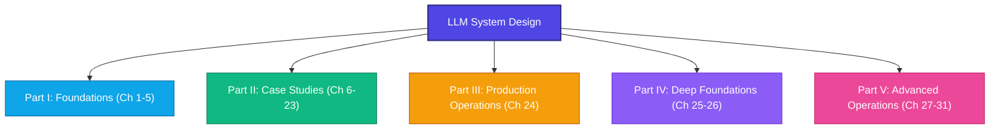
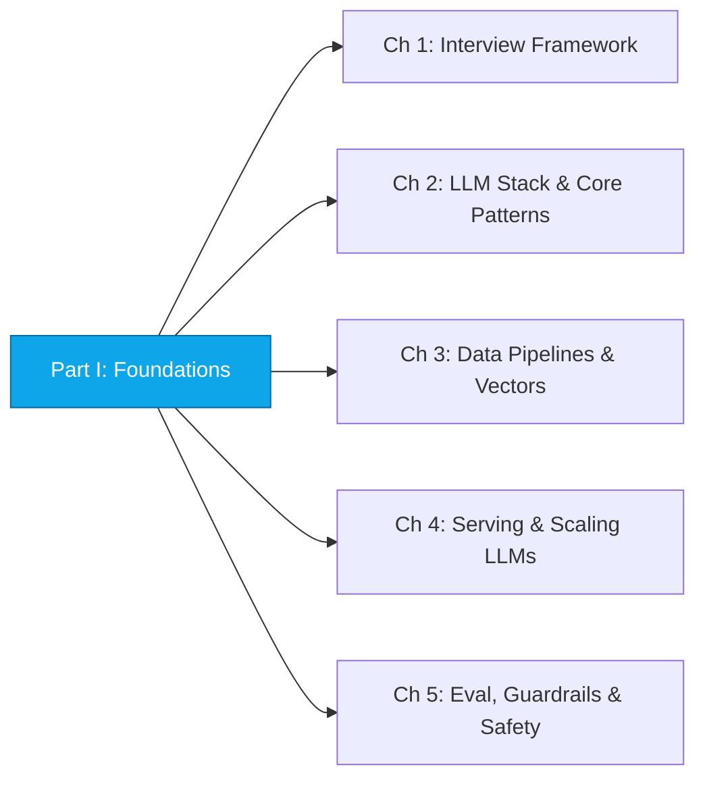
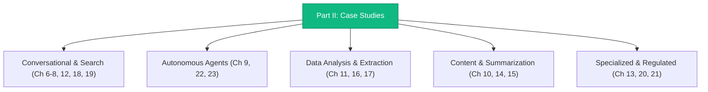
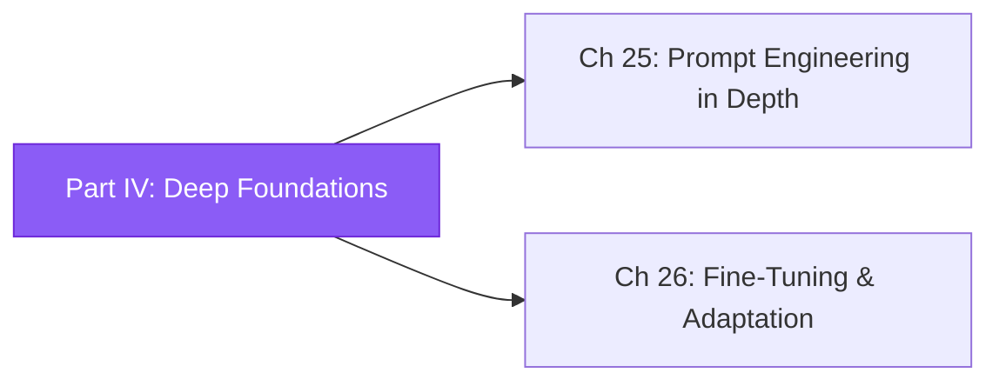
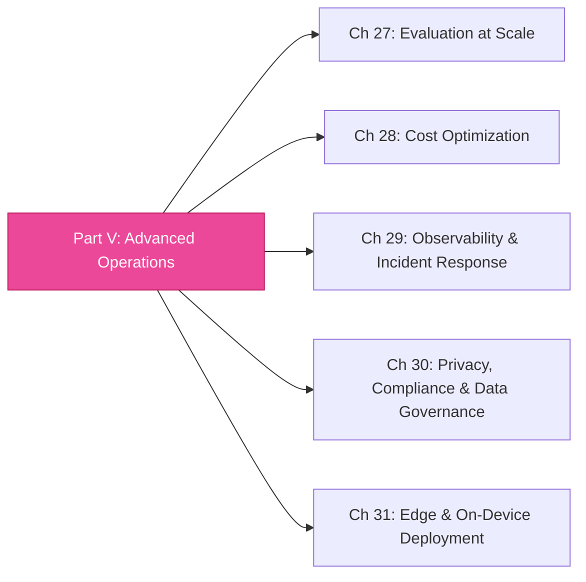

# LLM System Design — Book Chapter Mind Map

This document serves as an interactive mind map and detailed reference guide for all 31 chapters of the **LLM System Design** repository. It maps out the logical progression of foundations, case studies, operational guidelines, and advanced topics.

---

## 1. Book Structure Overview

---

## 2. Part I: Foundations (Chapters 1–5)

The foundational chapters establish the core primitives, algorithms, and design choices that apply to every system.

### [[chapter-01|Chapter 1: A Framework for LLM System Design Interviews]]
*   **What we are working on:** Building a reusable, rigorous 5-step framework to successfully navigate senior-level LLM system design interviews.
*   **Key Concepts:**
    *   Functional & Non-Functional requirement definition.
    *   Estimation templates for memory, bandwidth, context sizing, GPU counts, and serving costs.
    *   Proposing clean high-level designs and executing deep dives on latency and cost trade-offs.

### [[chapter-02|Chapter 2: The LLM Stack and Core Patterns]]
*   **What we are working on:** Establishing the decision tree to choose between Prompt Chaining, RAG, Fine-Tuning, and Agentic Orchestration.
*   **Key Concepts:**
    *   Intent routing models (semantic classifier, small routers).
    *   Model tiering pipelines (matching request complexity to model capacity).
    *   Unified platform architectures for caching, templating, and model API abstraction.

### [[chapter-03|Chapter 3: Data Pipelines and Vector Infrastructure]]
*   **What we are working on:** Designing highly scalable ingestion pipelines to transform raw data into indexable vector storage.
*   **Key Concepts:**
    *   Parsing and chunking strategies (semantic chunking, sliding window).
    *   Vector indexing algorithms (HNSW vs. IVF-PQ) and hybrid retrieval (sparse BM25 + dense neural).
    *   Document-level ACL (Access Control List) enforcement in real-time query engines.

### [[chapter-04|Chapter 4: Serving, Scaling, and Optimizing LLMs]]
*   **What we are working on:** Optimizing serving backends to handle high request throughput while respecting strict latency SLOs.
*   **Key Concepts:**
    *   Continuous batching, speculative decoding, and FlashAttention.
    *   KV cache memory management using PagedAttention and prefix caching.
    *   Model compression and quantization (FP8, INT8/INT4) trade-offs.

### [[chapter-05|Chapter 5: Evaluation, Guardrails, and Safety]]
*   **What we are working on:** Constructing a defense-in-depth security model and automated validation suites.
*   **Key Concepts:**
    *   Input/Output guardrails for PII redaction, prompt injection, and toxicity filtering.
    *   LLM-as-a-judge pipelines with confidence-based routing.
    *   Continuous evaluation loops using static golden datasets and synthetic test generation.

---

## 3. Part II: Case Studies (Chapters 6–23)

Applied end-to-end design scenarios targeting specific industries and technical requirements.

### [[chapter-06|Chapter 6: Design a Customer Support Chatbot]]
*   **What we are working on:** A low-latency customer assistant capable of resolver containment, deflection, and seamless escalation.
*   **Key Concepts:** Intent classification, RAG-grounded FAQs, session memory cache (Redis), and fallback orchestration for human agent handoffs.

### [[chapter-07|Chapter 7: Design an Enterprise Semantic Search Engine]]
*   **What we are working on:** A scalable corporate search platform handling heterogeneous files under complex authorization layers.
*   **Key Concepts:** Document parse engines, sparse-dense hybrid search (BM25 + SPLADE + Cohere reranker), ACL filtering, and Reciprocal Rank Fusion (RRF).

### [[chapter-08|Chapter 8: Design an AI Coding Assistant]]
*   **What we are working on:** Ultra-fast code autocompletion and workspace chat integrated into IDEs.
*   **Key Concepts:** Fill-in-the-Middle (FIM) prompt formatting, local edge inference vs. cloud routing, AST (Abstract Syntax Tree) parsing, and speculative decoding.

### [[chapter-09|Chapter 9: Design an Autonomous Research Agent]]
*   **What we are working on:** An agent capable of planning and executing multi-step research tasks using dynamic tools.
*   **Key Concepts:** ReAct loop planning, short/long-term memory networks, vector state tracking, cost/loop guards, and sandbox tool runners.

### [[chapter-10|Chapter 10: Design an Automated Content Generation Pipeline]]
*   **What we are working on:** Batch content creation engines that strictly adhere to corporate brand guidelines and safety checks.
*   **Key Concepts:** Few-shot styling guides, brand-safety classifier gates, multiline streaming response orchestration, and human-in-the-loop review portals.

### [[chapter-11|Chapter 11: Design a Financial Document Extraction System]]
*   **What we are working on:** High-fidelity document parsing to pull structured metrics from PDF financial sheets.
*   **Key Concepts:** OCR table parsing, chunk alignment, schemas and structured output engines (Pydantic/Instructor), and citation tracing to page coordinates.

### [[chapter-12|Chapter 12: Design a Personalized E-commerce Shopping Assistant]]
*   **What we are working on:** An assistant that matches user queries to catalog inventories based on real-time personalized history.
*   **Key Concepts:** Catalog database vectorization, user embedding storage, dynamic preference vectors, stock availability filters, and cross-sell scoring.

### [[chapter-13|Chapter 13: Design an AI Tutor for Education]]
*   **What we are working on:** An educational bot designed to scaffold student learning without directly revealing answers.
*   **Key Concepts:** Knowledge graph student state modeling, hint-delivery prompt sequencing, pediatric safety classifiers, and dynamic cognitive load adjustments.

### [[chapter-14|Chapter 14: Design a Real-Time Meeting Summarizer]]
*   **What we are working on:** Streaming transcription and live summarization of concurrent voices.
*   **Key Concepts:** Automatic Speech Recognition (ASR), speaker diarization/attribution, and sliding-window context summarization (refine/map-reduce).

### [[chapter-15|Chapter 15: Design a Multimodal Asset Search System]]
*   **What we are working on:** Dual-modality retrieval matching text queries to image/video catalogs.
*   **Key Concepts:** Joint embedding models (CLIP/SigLIP), video keyframe sampling, temporal segment indexing, and multimodal fusion ranking.

### [[chapter-16|Chapter 16: Design an AI Data Analyst (Text-to-SQL and Insights)]]
*   **What we are working on:** Converting human natural language into precise SQL queries against live databases.
*   **Key Concepts:** Schema context compilation, few-shot syntax examples, sandbox validation engines, execution error self-correction loops, and result translation.

### [[chapter-17|Chapter 17: Design a Legal Contract Review System]]
*   **What we are working on:** Automated review of multi-hundred-page legal contracts to flag deviations from standard clauses.
*   **Key Concepts:** Hierarchy-aware document chunking, semantic clause clustering, rule compliance checkers, and immutable audit logs.

### [[chapter-18|Chapter 18: Design a Voice-First Real-Time Agent (AI Drive-Thru / Phone Agent)]]
*   **What we are working on:** A low-latency vocal conversationalist handling real-time ordering or booking.
*   **Key Concepts:** End-to-end voice latency budgeting, ASR streaming, turn-taking state machines, interruption detection, and TTS streaming.

### [[chapter-19|Chapter 19: Design an AI NPC Engine for Multiplayer Games]]
*   **What we are working on:** Scalable character dialogue engines that match specific lore and current game state.
*   **Key Concepts:** Lore memory retrieval, dynamic dialog styling, latency budgeting, and high-concurrency server hosting for millions of players.

### [[chapter-20|Chapter 20: Design a Healthcare Triage and Diagnostic Assistant]]
*   **What we are working on:** A highly guarded, medically compliant system for triage recommendation.
*   **Key Concepts:** Clinical guideline validation, strict medical taxonomy mapping (ICD-10/SNOMED), hard out-of-domain rejection, and safety-first escalation gates.

### [[chapter-21|Chapter 21: Design an Advanced RAG Platform]]
*   **What we are working on:** Production RAG framework incorporating advanced search and synthesis patterns.
*   **Key Concepts:** Query reformulation (sub-querying), GraphRAG entity discovery, context packaging/pruning, hallucination checkers (RAGAS), and observability.

### [[chapter-22|Chapter 22: Design a Multi-Agent Workflow Orchestrator]]
*   **What we are working on:** Frameworks managing complex networks of collaborative agents.
*   **Key Concepts:** DAG execution planning, supervisor-worker protocols, agent state locks, token consumption gates, and distributed trace replay.

### [[chapter-23|Chapter 23: Design an MCP-Based Tool Integration Platform]]
*   **What we are working on:** Standardized tool registries conforming to Model Context Protocol specs.
*   **Key Concepts:** MCP server configuration hubs, resource access permission controls, secure execution runtimes, and user prompt approvals.

---

## 4. Part III: Production Operations (Chapter 24)

Consolidating the lifecycle and release workflows for production environments.

### [[chapter-24|Chapter 24: LLMOps and Production Lifecycle Management]]
*   **What we are working on:** Building continuous deployment, staging, and roll-back automation.
*   **Key Concepts:** Prompt version registries, vector index warm-up workflows, automated shadow routing, A/B testing pipelines, and disaster-recovery fallback thresholds.

---

## 5. Part IV: Deep Foundations (Chapters 25–26)

Advanced deep dives into adaptation and customization mechanics.

### [[chapter-25|Chapter 25: Prompt Engineering in Depth]]
*   **What we are working on:** Building high-precision prompt templates and dynamic generation pipelines.
*   **Key Concepts:** Dynamic few-shot selection (semantic extraction), structured JSON schema output forcing, injection defense walls, and systematic prompt tuning.

### [[chapter-26|Chapter 26: Fine-Tuning and Adaptation]]
*   **What we are working on:** Training models to adapt to custom domains and behavior guidelines.
*   **Key Concepts:** Parameter-efficient fine-tuning (LoRA, QLoRA), instruction dataset filtering, alignment pipelines (SFT, DPO, RLHF), and adapter multi-routing.

---

## 6. Part V: Advanced Operations (Chapters 27–31)

Operating under performance, security, cost, and physical device constraints.

### [[chapter-27|Chapter 27: Evaluation at Scale]]
*   **What we are working on:** Constructing continuous CI/CD evaluation gates for high-accuracy applications.
*   **Key Concepts:** LLM-as-a-judge customization, automated drift detection, synthetic data expansion, and regression test suites.

### [[chapter-28|Chapter 28: Cost Optimization as a Design Concern]]
*   **What we are working on:** Minimizing the serving and API footprint without degrading accuracy.
*   **Key Concepts:** Semantic cache architectures, classification router cascades, prompt token compression, dynamic batching, and quantization economics.

### [[chapter-29|Chapter 29: Observability and Incident Response for LLM Systems]]
*   **What we are working on:** Production telemetry for debugging non-deterministic AI pipelines.
*   **Key Concepts:** Latency monitoring (TTFT, Inter-token latency), span-level tracing for agent loops, cost estimation tracking, and prompt/response drift logging.

### [[chapter-30|Chapter 30: Privacy, Compliance, and Data Governance for LLM Systems]]
*   **What we are working on:** Satisfying strict legislative standards (HIPAA, GDPR, CCPA) within LLM architectures.
*   **Key Concepts:** In-line PII redaction engines (Presidio), role-based semantic search access, compliance delete commands (right-to-be-forgotten), and security auditing.

### [[chapter-31|Chapter 31: Edge and On-Device LLM Deployment]]
*   **What we are working on:** Compressing, running, and maintaining small model architectures directly on client hardware.
*   **Key Concepts:** GGUF/AWQ compilation, client inference runtimes (llama.cpp/MLC-LLM), battery/thermal conservation logic, and hybrid local-to-cloud fallback routes.
